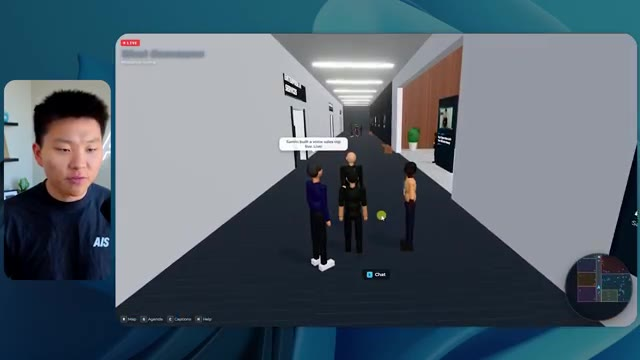
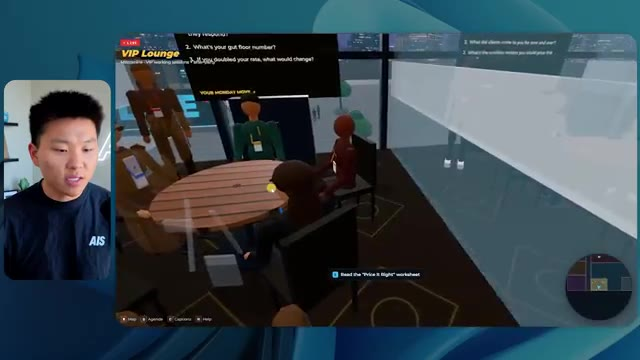
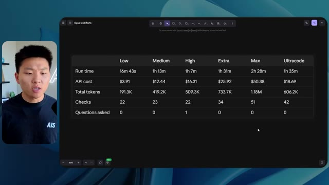
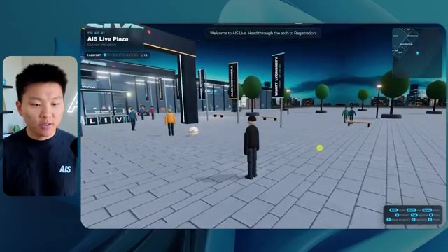
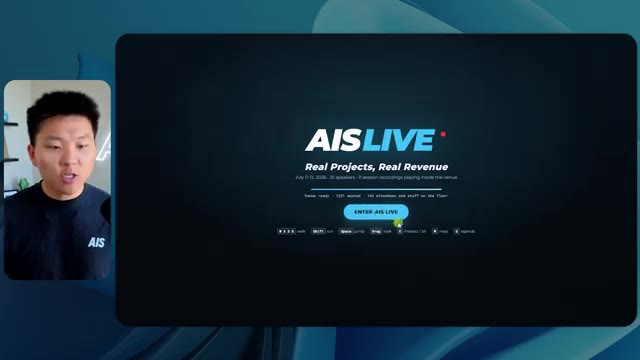

# 🎬 I Built the Ultimate AI Board of Advisors

> **Chaîne** : [Nate Herk | AI Automation](https://www.youtube.com/@nateherk/featured)  
> **Lien YouTube** : [https://www.youtube.com/watch?v=7GTWAXCTy0o](https://www.youtube.com/watch?v=7GTWAXCTy0o)  
> **Date de publication** : 20261013  
> **Durée** : 00:01:31  
> **Identifiant vidéo** : `7GTWAXCTy0o`  
> **Transcription & Analyse** : `whisper-v3-large-turbo+gemini-3.5-flash-lite`  

---

## 📌 Synthèse Exécutive & Outils

### 💡 Résumé

Dans cette vidéo de la chaîne *Nate Herk | AI Automation*, l'analyseur explore le comportement et les performances du modèle d'IA **Opus 5.5** lorsqu'il est soumis exactement au même prompt complexe, mais exécuté à différents niveaux d'effort (du niveau « bas » jusqu'à « ultra code »). Le défi proposé à l'agent consistait à transformer un dossier Frame.io brut de 105 gigaoctets contenant les enregistrements vidéo de l'événement virtuel *AIS Live* en un monde 3D interactif et explorable en vue à la troisième personne, intégrant des salles thématiques, des pistes de conférence, des scènes principales et une navigation en temps réel. L'expérience met en lumière l'impact direct du paramètre d'effort sur la qualité architecturale, visuelle et fonctionnelle du code généré.

Les résultats démontrent une progression spectaculaire de la qualité entre les niveaux d'effort « bas » et « moyen ». En mode **faible**, l'application générée souffre de graves lacunes visuelles (identité de marque absente, bugs d'affichage des PNJ, vidéos statiques au lieu de flux dynamiques, cartes peu fonctionnelles) pour un temps de génération de 16 minutes et un coût estimé de 3,91 $ sans aucune interaction humaine. En revanche, le passage au mode **moyen** livre une application nettement plus mature : respect des chartes graphiques, intégration réussie des flux vidéo en direct, PNJ dynamiques, cartes interactives synchronisées et zones VIP fonctionnelles, bien que le processus ait nécessité 1 heure et 13 minutes pour un coût de 12,44 $ en tokens.

L'analyse de ce benchmark met en évidence le compromis stratégique inhérent à l'ingénierie des agents autonomes : un effort accru augmente le temps de calcul et les coûts API, mais réduit drastiquement les erreurs de conception et produit des environnements logiciels hautement fonctionnels et prêts à l'emploi. Cette démonstration valide également les recommandations officielles d'Anthropic, qui conseillent de calibrer l'effort en fonction de la complexité du livrable attendu tout en soulignant la nécessité de combler le fossé entre le prototypage local et le déploiement en production.

### 🛠️ Outils, Modèles & Logiciels Présentés

* **Opus 5.5** : Modèle de pointe d'Anthropic réputé pour son intelligence, son coût abordable et sa polyvalence, doté de curseurs d'effort ajustables (faible, moyen, élevé, extra, max, ultra code).
* **Claude Code** : Environnement de programmation et agent conversationnel utilisé par les développeurs pour exécuter des tâches d'ingénierie complexes directement dans les dossiers de projet.
* **Frame.io** : Plateforme de collaboration vidéo cloud utilisée pour stocker et héberger les 105 gigaoctets d'enregistrements bruts de l'événement *AIS Live*.
* **Herc 2** : Système d'exploitation IA propriétaire de Nate Herk servant de boîte à outils et d'écosystème de ressources pour alimenter les agents.
* **Hostinger Connector** : Extension gratuite pour éditeur de code permettant de connecter directement un compte d'hébergement pour un déploiement et une mise en ligne immédiats des applications générées.

### 🔑 Points Clés & Enseignements Stratégiques

* **Impact direct du niveau d'effort** : Le paramètre d'effort (effort level) modifie profondément la profondeur du raisonnement, la rigueur du code produit et la qualité finale de l'application 3D sans nécessiter de modification du prompt initial.
* **Arbitrage coût/performance** : Le niveau bas génère un résultat rapide (16 min, 3,91 $) mais inexploitable visuellement, tandis que le niveau moyen (1 h 13 min, 12,44 $) produit une application fonctionnelle et esthétiquement fidèle aux exigences de la marque.
* **Autonomie totale des agents** : À travers tous les niveaux testés, l'agent a exécuté l'intégralité du développement de manière autonome, en formulant exactement zéro question de clarification (« zéro question posée »).
* **Capacité de vérification automatisée** : L'utilisation intensive des boucles de validation (22 à 23 vérifications par exécution via l'ouverture itérative du navigateur) garantit que l'agent teste et ajuste lui-même son code en cours de route.
* **Respect des consignes de design et de branding** : Les niveaux d'effort supérieurs sont capables d'analyser et d'appliquer correctement les directives de marque (palettes de couleurs, logos, identité visuelle *AIS Live*), contrairement aux versions bas de gamme.
* **Intégration multimédia complexe** : Les agents de niveau supérieur réussissent à transformer des répertoires de données brutes massifs en interfaces interactives intégrant de véritables flux vidéo dynamiques, des cartes topographiques et des espaces de networking.
* **Gestion des bugs d'affichage (Clipping/Ghosts)** : Les faibles niveaux d'effort pèchent par une mauvaise gestion des entités 3D (disparition de personnages, bugs graphiques), corrigée par une logique spatiale plus robuste dans les modes supérieurs.
* **Recommandation méthodologique d'Anthropic** : Il est fortement conseillé de suivre les directives officielles d'Anthropic en débutant les projets complexes au niveau d'effort moyen, puis d'ajuster à la hausse ou à la baisse selon la criticité du livrable.
* **Le gouffre du déploiement (Deployment Gap)** : L'automatisation par agent résout brillamment la phase de création logicielle locale, mais laisse entière la problématique de la mise en production rapide, nécessitant des intégrations dédiées comme l'extension Hostinger.
* **Scalabilité et consommation de tokens** : L'augmentation de l'effort s'accompagne d'une consommation linéaire à exponentielle des ressources (passage de 191 000 à 490 000 jetons), soulignant l'importance d'optimiser le rapport ROI pour les tâches d'ingénierie d'agents à grande échelle.

---

## ⏱️ Chronologie & Transcription Complète Audio & Visuelle (Mot pour Mot)

### ⏱️ `[00:00:00 - 00:00:20]` | Segment #01

**🔊 Audio (Transcription Intégrale Mot pour Mot en Français) :**
> Opus 5.5, Opus 5.5, Opus 5.5, Opus 5.5, Opus 5.5. Ce modèle est littéralement partout et pour de très bonnes raisons. Il est intelligent, il est bon marché, il a un goût incroyable, c'est un modèle d'IA incroyable. Mais avec chaque modèle d'IA, vous avez le choix de l'effort, que ce soit faible, moyen, élevé, extra, max ou code ultra.

**👁️ Analyse Visuelle d'Écran (gemini-3.5-flash-lite) :**
**Interface & Outils** : Interface du réseau social X (Twitter).

**Contenu textuel & Code** : Un tweet avec une vidéo montrant un rendu visuel 3D et du texte en anglais sur l'impact de l'IA.

**Action / Démonstration** : Affichage d'un exemple concret de réalisation visuelle par IA sur les réseaux sociaux pour illustrer le sujet.

*⏱️ 00:00:05 — Capture d'écran montrant un post sur X (Twitter) avec une vidéo intégrée illustrant un paysage en 3D généré par IA, accompagné d'un texte sur la disruption des créateurs techniques.*

---

### ⏱️ `[00:00:20 - 00:00:38]` | Segment #02

**🔊 Audio (Transcription Intégrale Mot pour Mot en Français) :**
> Donc dans cette vidéo, j'ai donné à Opus 5.5 exactement le même prompt et je l'ai exécuté à chaque niveau d'effort et nous allons comparer les résultats. Nous examinerons la qualité de toutes les différentes sorties réelles, mais nous allons également examiner combien de temps chacun d'entre eux a fonctionné, combien cela nous a coûté si c'était une facturation par API, le nombre total de jetons, combien de vérifications ils ont exécutées et combien de questions ils m'ont réellement posées tout au long du processus.

**👁️ Analyse Visuelle d'Écran (gemini-3.5-flash-lite) :**
**Interface & Outils** : Application de tableau blanc ou outil de visualisation (type Miro, Whimsical ou Obsidian Canvas)

**Contenu textuel & Code** : Tableau comparatif avec les colonnes Low, Medium, High, Extra, Max, Ultracode et les lignes Run time, API cost, Total tokens, Checks, Questions asked.

**Action / Démonstration** : Présentation d'un tableau comparatif des performances de l'IA selon le niveau d'effort sélectionné.

*⏱️ 00:00:29 — Capture d'un tableau comparatif montrant les différents niveaux d'effort (Low, Medium, High, Extra, Max, Ultracode) et des métriques telles que Run time, API cost, Total tokens, Checks et Questions asked.*

---

### ⏱️ `[00:00:39 - 00:00:58]` | Segment #03

**🔊 Audio (Transcription Intégrale Mot pour Mot en Français) :**
> Et les résultats que nous avons obtenus ne sont pas du tout ce à quoi je m'attends, donc j'ai hâte de partager cela avec vous les gars. Ne perdons pas de temps et entrons directement dans le vif du sujet. D'accord, alors plongeons directement dans celui-ci. Je veux commencer juste en vous montrant, les gars, le prompt réel que nous avons utilisé, que nous avons donné à chacun de ces différents agents. Je vais aller dans les fichiers ici, et nous allons ouvrir ce fichier markdown de prompt, et je vais vous montrer ce que nous avons obtenu. Alors voici le slash objectif que j'ai fourni.

**👁️ Analyse Visuelle d'Écran (gemini-3.5-flash-lite) :**
**Interface & Outils** : Interface de type éditeur / outil d'agent IA (Opus 5.5 / Ultracode) avec incrustation vidéo du présentateur.

**Contenu textuel & Code** : Un message d'un agent IA demandant s'il doit commencer à construire un monde 3D interactif basé sur un fichier PROMPT.md.

**Action / Démonstration** : Le présentateur présente l'interface et le prompt initial de l'agent IA avant exécution.

*⏱️ 00:00:48 — Interface de l'outil de développement IA affichant un prompt demandant de construire un monde 3D interactif.*

---

### ⏱️ `[00:00:58 - 00:01:34]` | Segment #04

**🔊 Audio (Transcription Intégrale Mot pour Mot en Français) :**
> J'ai dit, tu dois me créer un monde 3D qui est une conférence technologique réaliste dans laquelle je peux me promener en vue à la troisième personne. Tu vas regarder ce dossier, qui contient mes ressources d'enregistrement d'événements d'AIS Live. Et ce dossier est un dossier Frame.io de 105 gigaoctets d'enregistrements vidéo. C'était un événement complètement virtuel. Tout a été enregistré et tous les enregistrements sont ici même. J'ai dit, ton objectif est de prendre cet événement et de le transformer en un monde 3D explorable qui me donne l'impression d'avoir réellement assisté à une vraie conférence en personne avec différentes salles, différentes pistes, différentes scènes, bla, bla, bla. N'hésite pas à utiliser key.ai si tu as besoin de générer des images ou des vidéos. Et tu peux aussi utiliser tout ce qui se trouve dans mon projet Herc 2, qui est comme mon système d'exploitation IA. J'ai dit,

**👁️ Analyse Visuelle d'Écran (gemini-3.5-flash-lite) :**
**Interface & Outils** : Éditeur de code (VS Code / Cursor) et interface web Frame.io

**Contenu textuel & Code** : Fichier Markdown contenant le prompt complet demandant de transformer des enregistrements d'événements virtuels en monde 3D explorable en vue à la troisième personne, avec lien Frame.io vers 105 Go de ressources.

**Action / Démonstration** : Présentation du prompt initial et du dossier de ressources cloud utilisé pour alimenter le projet de génération 3D.

*⏱️ 00:01:07 — Éditeur de code affichant le fichier PROMPT.md avec les instructions pour créer un monde 3D interactif et un lien Frame.io.*

*⏱️ 00:01:16 — Interface de partage Frame.io montrant un dossier d'enregistrements d'événements "AIS Live" d'une taille de 105,69 Go.*

*⏱️ 00:01:25 — Éditeur de code affichant à nouveau le fichier de prompt détaillé destiné à l'agent IA.*

---

### ⏱️ `[00:01:34 - 00:02:08]` | Segment #05

**🔊 Audio (Transcription Intégrale Mot pour Mot en Français) :**
> vous serez jugé sur la créativité, le design, la physique et la sensation générale lorsque j'explorerai le monde 3D que vous avez construit. Et c'était fondamentalement la fin des instructions. Donc comme vous pouvez le voir sur ce côté gauche, j'ai exécuté cela à travers tous les différents niveaux d'effort. Commençons par le niveau bas et remontons jusqu'à ultra code. Très bien. Donc ici nous avons le résultat du niveau bas. Ouvrons ceci et jetons un œil. Donc nous avons AIS Live, le sommet des services IA en personne enfin, et nous avons pu cliquer partout. Tout d'abord, on ne sent pas vraiment l'identité de la marque. Genre, ce n'ce n'est pas le logo d'AIS Live. Ce n'même pas nos couleurs. Donc je n'aime pas trop ça, mais entrons ici. D'accord. C'est beaucoup trop lumineux. Euh, nous avons une carte en haut à droite, nous avons une ville par ici, je ne peux pas dire quelle ville c'est

**👁️ Analyse Visuelle d'Écran (gemini-3.5-flash-lite) :**
**Interface & Outils** : Interface web de gestion de projet / agent IA (semblable à Cursor ou une interface personnalisée)

**Contenu textuel & Code** : Texte du prompt : "Hi Nate. This worktree has the effort-test task queued in PROMPT.md : build a walkable third-person 3D world..." et la réponse de l'utilisateur en bas : "yes, start the task in PROMPT.md"

**Action / Démonstration** : Navigation et sélection des différents niveaux de test d'effort dans la barre latérale gauche par le présentateur.

*⏱️ 00:01:42 — Capture d'écran montrant l'interface d'une application d'agent IA avec un volet de navigation à gauche listant les différents niveaux de test (Hello, Extra, High, Max, Ultracode, Medium, Low) et un panneau de discussion à droite affichant le prompt initial de l'agent.*

---

### ⏱️ `[00:02:08 - 00:02:40]` | Segment #06

**🔊 Audio (Transcription Intégrale Mot pour Mot en Français) :**
> c'est. D'accord. C'est Chicago, ce qui est plutôt cool parce que tu sais, j'habite à Chicago, mais bref, en haut, à droite, on peut voir une carte. Nous avons un hall d'accueil. Nous avons un hall d'exposition. Nous avons un salon VIP, la scène principale. Aussi, la carte montre où se trouve chaque autre personne et ça se synchronise en direct. Donc on peut voir l'enregistrement. On peut voir le premier jour, la keynote de l'hyper agent, le débrief en direct. Cool. Donc ça connaît réellement l'agenda et puis il y a le deuxième jour. Donc il a trouvé ça, c'est bien. Nous avons ces petites boules ici que je peux espérer botter. D'accord. Le visage, oh, regarde ça. Si je vais par ici, tous les gens disparaissent tout simplement. Très mauvais. Très mauvais. D'accord. Alors voyons voir. Est-ce que je peux sprinter ? D'accord.

**👁️ Analyse Visuelle d'Écran (gemini-3.5-flash-lite) :**
**Interface & Outils** : Application ou plateforme virtuelle interactive de conférence (type metaverse ou événement virtuel 3D).

**Contenu textuel & Code** : Éléments textuels d'orientation ('Badge pickup', 'DAY 1', programme de conférence, 'Expo Hall') et interface de navigation avec mini-carte.

**Action / Démonstration** : Navigation et exploration de différents espaces virtuels (hall d'accueil, zone de badges, hall d'exposition) d'une plateforme de conférence.

*⏱️ 00:02:16 — Vue d'un monde virtuel interactif montrant une zone de retrait de badges (Badge pickup) avec des avatars et une mini-carte en haut à droite.*

*⏱️ 00:02:24 — Vue du lobby virtuel d'une conférence en ligne avec un panneau indiquant 'DAY 1' et une mini-carte de navigation.*

*⏱️ 00:02:32 — Vue de l'Expo Hall virtuel avec des stands, des avatars de participants et un affichage indiquant 'Sponsors, booths and hallway conversations'.*

---

### ⏱️ `[00:02:40 - 00:03:04]` | Segment #07

**🔊 Audio (Transcription Intégrale Mot pour Mot en Français) :**
> Je peux avancer un peu plus vite. Je vais d'abord aller par ici. Il y a des produits promotionnels, euh, certifié AIS plus glido. D'accord. Donc, il y a les vrais stands que nous avions dans l'événement virtuel. Nous avions des stands. C'est donc plutôt cool. Un petit endroit pour prendre des photos. La salle C. En ce moment, nous avons Tangy Frederick qui anime un atelier. D'accord. Mais ce n'est pas une vidéo. Comme vous pouvez le voir, c'est juste une image. Elle ne bouge pas. C'est donc juste une image. Ces gens sont en train de disparaître. Ce doivent être des fantômes. Allons par ici dans la salle A.

**👁️ Analyse Visuelle d'Écran (gemini-3.5-flash-lite) :**
**Interface & Outils** : Environnement virtuel 3D interactif (type metaverse/jeu).

**Contenu textuel & Code** : Aucun code source ni terminal, uniquement des affichages textuels d'instructions dans l'espace 3D virtuel.

**Action / Démonstration** : Navigation et exploration de l'espace virtuel par le présentateur.

---

### ⏱️ `[00:03:04 - 00:03:30]` | Segment #08

**🔊 Audio (Transcription Intégrale Mot pour Mot en Français) :**
> Nous avons Liberty White. D'accord. Très cool. Vos 30 premiers jours en automatisation. Encore une fois, c'est juste une image fixe et les gens ont des bugs d'affichage. Donc ce n'est pas très bien ici. Je vais aller sur la scène principale et voir ce que nous avons. D'accord, cool. Donc nous avons une scène d'apparence principale. Les gens ont des bugs d'affichage. Vraiment grave. Ce n'est vraiment pas terrible. Notre vidéo est en fait en train de bouger. Genre, j'ai vu mon visage ici et j'ai vu celui de Devin, mais maintenant ils ont disparu. Donc je ne sais pas ce qui s'est passé. D'accord. C'est, on dirait plutôt un diaporama. Rien n'est en fait encore en train d'être diffusé. Bref, entrons ici.

**👁️ Analyse Visuelle d'Écran (gemini-3.5-flash-lite) :**
**Interface & Outils** : Environnement virtuel 3D type plateforme d'événement en ligne (metavers).

**Contenu textuel & Code** : Interface utilisateur virtuelle affichant 'Workshop Room A', 'Foundation track' et 'AIS LIVE AI Services Summit'.

**Action / Démonstration** : Navigation et déplacement d'un avatar dans l'espace virtuel 3D pour explorer différentes salles.

---

### ⏱️ `[00:03:30 - 00:03:58]` | Segment #09

**🔊 Audio (Transcription Intégrale Mot pour Mot en Français) :**
> Nous avons plus de stands. Nous avons hyper agent. Nous avons Claude Code. Nous avons plus de goodies. La salle B, c'est Dave Ebelor. Je suppose que c'est exactement la même chose. Nous avons du café. Et ensuite, je suppose que le salon VIP, accès VIP seulement. C'est plutôt cool, mais il n'y a vraiment rien qui se passe ici. Cet écran est beaucoup trop lumineux. D'accord. Donc je pense que vous comprenez l'ambiance que nous retirons ici d'Opus 5.5 en effort faible. Et c'est là que les choses deviennent intéressantes. Combien de temps pensez-vous que cela a duré ? Combien de temps ? Celui-ci a duré 16 minutes et 43 secondes. Combien pensez-vous que cela a coûté ?

**👁️ Analyse Visuelle d'Écran (gemini-3.5-flash-lite) :**
**Interface & Outils** : Interface web de tableau blanc ou de présentation (Opus 5.5 Efforts)

**Contenu textuel & Code** : Tableau comparatif avec les critères : Run time, API cost, Total tokens, Checks, Questions asked selon différents modes de puissance (Low à Ultracode)

**Action / Démonstration** : Présentation d'un tableau comparatif des différents niveaux d'effort d'un modèle d'intelligence artificielle.

*⏱️ 00:03:51 — Tableau comparatif sur une interface web intitulé 'Opus 5.5 Efforts' montrant différents niveaux de performance (Low, Medium, High, Extra, Max, Ultracode).*

---

### ⏱️ `[00:03:58 - 00:04:26]` | Segment #10

**🔊 Audio (Transcription Intégrale Mot pour Mot en Français) :**
> 3,91 dollars si c'eût été une facturation par API. J'utilise évidemment mon abonnement ici, mais nous allons simplement calculer cela avec la facturation par API. Le total des jetons était de 191 000. Il a effectué 22 vérifications. Donc, la vérification, 22 fois il a ouvert le navigateur et a exécuté différentes sortes de vérifications. Donc, 22 catégories de vérifications. Et combien de questions m'a-t-il posées ? Il m'a posé un total de zéro question tout au long de cette invite de commande « slash goal ». D'accord. Alors, ouvrons l'effort moyen et voyons ce que nous avons. D'accord, c'est parti. Effort moyen. Nous avons Nate Herc. Nous avons mon badge. C'est aux couleurs de la marque AI's Life.

**👁️ Analyse Visuelle d'Écran (gemini-3.5-flash-lite) :**
**Interface & Outils** : Tableau de bord / application de type tableur ou outil de diagramme.

**Contenu textuel & Code** : Tableau avec les lignes : "Run time" (16m 43s), "API cost" ($3.91), "Total tokens" (191.3K), "Checks", et "Questions asked", sous des colonnes de niveau d'effort ("Low", "Medium", "High", "Ex").

**Action / Démonstration** : Présentation des métriques de coût et de performance d'exécution de l'agent.

*⏱️ 00:04:05 — Capture d'écran montrant le présentateur à gauche et un tableau de données sur fond sombre à droite détaillant les performances et coûts d'exécution.*

---

### ⏱️ `[00:04:26 - 00:04:46]` | Segment #11

**🔊 Audio (Transcription Intégrale Mot pour Mot en Français) :**
> Donc ça a déjà l'air un tout petit peu mieux. On dirait nos palettes de couleurs qui ont utilisé nos directives de marque. Premier jour de construction, deuxième jour de gain, VIP. Cool. D'accord. Je vais entrer dans le lieu. D'accord. Wouah. Une ambiance un peu similaire. C'est en arrière-plan. Ça ne ressemble pas à Chicago, n'est-ce pas ? Non, ça ressemble à, honnêtement, ça ressemble à une ville inventée. Quoi qu'il en soit, c'est marrant qu'ils aient décidé de faire ça. Voyons si je peux avancer un peu plus vite. Oh, wouah.

**👁️ Analyse Visuelle d'Écran (gemini-3.5-flash-lite) :**
**Interface & Outils** : Interface web d'application virtuelle / environnement 3D.

**Contenu textuel & Code** : Page de bienvenue 'Welcome to AIS Live' avec des instructions de contrôle clavier (WASD, Shift, Espace) et un badge personnalisé.

**Action / Démonstration** : Le présentateur navigue dans l'interface et entre dans le lieu virtuel 3D.

*⏱️ 00:04:31 — Interface web de l'événement virtuel AIS Live avec un badge numérique affichant 'NATE HERK' et un bouton 'ENTER THE VENUE'.*

*⏱️ 00:04:41 — Vue dans le monde virtuel 3D avec des avatars interactifs et un paysage urbain nocturne en arrière-plan.*

---

### ⏱️ `[00:04:46 - 00:05:21]` | Segment #12

**🔊 Audio (Transcription Intégrale Mot pour Mot en Français) :**
> Les gens interagissent avec moi. Regardez. Si je m'approche de ce type, il vient de lever le bras. Bon, maintenant il ne veut plus du tout avoir affaire à moi. Mais tous ces petits robots ici doivent prendre des décisions. Je ne sais pas s'ils utilisent Jev. C'est certain que non. Je ne le lui ai pas dit. En fait, ma clé Jev est à l'arrière. Je ne sais pas. Peut-être qu'il l'a utilisée. Quoi qu'il en soit, nous pouvons voir ici que nous avons la salle d'atelier C, le laboratoire des agents. Sympa. Donc celui-ci fonctionne réellement. Vous pouvez voir qu'il s'agit d'une vraie vidéo diffusée par Tangy. Tout le monde ici est en train de travailler sur un ordinateur portable. Ils ne buguent pas. C'est plutôt cool. De plus, mon badge est sur ma poitrine, ce qui est plutôt cool. Je peux venir par ici. Nous avons une carte en haut à droite, comme vous pouvez le voir, mais je peux venir par ici. Nous avons un

**👁️ Analyse Visuelle d'Écran (gemini-3.5-flash-lite) :**
**Interface & Outils** : Environnement virtuel 3D de type métavers ou simulation d'agents.

**Contenu textuel & Code** : Avatars 3D modélisés, interface de navigation, mini-carte en haut à droite.

**Action / Démonstration** : Exploration et navigation d'un utilisateur au sein d'une simulation virtuelle peuplée d'avatars.

---

### ⏱️ `[00:05:21 - 00:05:47]` | Segment #13

**🔊 Audio (Transcription Intégrale Mot pour Mot en Français) :**
> hall d'exposition. C'est là que nous avons le stand Glido. Et ça diffuse en ce moment. Oui, ça diffuse la vidéo de nous en train de parler de Glido. Ça diffuse la vidéo d'Ed et moi parlant de notre programme de certification. Nous avons le logo AIS Plus ici à l'arrière, qui est un peu mal placé. Ce sont les diapositives des conférenciers et les points clés. Alors wow, ce sont toutes les ressources que nous avons distribuées après l'événement. Elles sont toutes là également. Nous pouvons voir que nous avons un projecteur sur la communauté. C'est donc Aiden qui parle de l'accord qu'il a conclu et c'est diffusé en direct. Ces gens regardent.

**👁️ Analyse Visuelle d'Écran (gemini-3.5-flash-lite) :**
**Interface & Outils** : Environnement virtuel 3D (metaverse / plateforme d'événements virtuels).

**Contenu textuel & Code** : Aucun code source, terminal ou prompt visible ; affichage de bannières d'événements et de diapositives virtuelles.
[DESC_ACTION] Navigation et exploration d'un espace d'exposition virtuel par l'animateur.

**Action / Démonstration** : Explications face caméra et démonstration conceptuelle.

---

### ⏱️ `[00:05:47 - 00:06:21]` | Segment #14

**🔊 Audio (Transcription Intégrale Mot pour Mot en Français) :**
> Ils sont plutôt engagés. On a un hyper agent. C'était, c'est ce que je voulais dire. Si vous avez vu ces gens lever les bras en disant bonjour, c'était plutôt marrant. Regardez, regardez, le voilà qui recommence. Bref. Bon. Où est-ce que je suis maintenant ? Maintenant, je suis dans le hall principal. On a un bar à café. On a un grand logo, qui est le vrai logo. C'est trop lumineux, mais on a le logo. On peut voir si on peut entrer ici dans le parcours fondation. On a Sabrina Romanov et Liberty White. Donc différentes formations juste là. On peut entrer dans cette salle. C'est le parcours avancé. Alors, qu'est-ce qui se passe ici ? On a Dave Ebelar et Saman qui parlent de différentes choses là-dedans. Et maintenant, allons jeter un œil à la scène principale. Oh, attendez, il y a une vidéo de moi là-haut. C'est genre un VIP

**👁️ Analyse Visuelle d'Écran (gemini-3.5-flash-lite) :**
**Interface & Outils** : Environnement virtuel 3D interactif (plateforme d'événement virtuel)

**Contenu textuel & Code** : Interface d'un espace virtuel interactif avec mini-carte et avatars d'utilisateurs

**Action / Démonstration** : Navigation et déplacement d'un avatar à travers le hall et les espaces d'une conférence virtuelle

*⏱️ 00:05:55 — Le présentateur apparaît dans un encadré à gauche, tandis que l'écran principal montre un hall d'exposition virtuel en 3D avec des avatars.*

*⏱️ 00:06:04 — Le présentateur est visible à gauche, l'écran principal affichant des avatars se déplaçant vers une salle de conférence virtuelle.*

*⏱️ 00:06:12 — Le présentateur est à gauche, l'écran principal affichant une vue en troisième personne d'avatars dans un environnement virtuel 3D.*

---

### ⏱️ `[00:06:21 - 00:06:50]` | Segment #15

**🔊 Audio (Transcription Intégrale Mot pour Mot en Français) :**
> section ? Ouais, on ira voir ça dans une minute. Mais bref, voici la scène principale. Ça a l'air vraiment, vraiment très bien. On a une grande scène. On a genre quatre personnes assises ici. On a les trois écrans d'Alex là-haut avec Hyper Agent. Est-ce que j'ai le droit de monter sur scène ? Oh, et ça me laisse monter sur scène. D'accord. C'est plutôt sympa. Bon les gars, faisons un selfie. Laissez-moi prendre tout le monde en arrière-plan. Venez par ici. Bref, c'est vraiment, vraiment cool. Toutes les places ne sont pas occupées par contre. Il va donc falloir qu'on travaille là-dessus. Mais bon, je vais y retourner en courant pour voir ce que c'était que cette section VIP. D'accord. Salon VIP. J'ai l'impression que c'est comme un aéroport ou un truc du genre.

**👁️ Analyse Visuelle d'Écran (gemini-3.5-flash-lite) :**
**Interface & Outils** : Environnement virtuel 3D / Plateforme d'événements virtuels

**Contenu textuel & Code** : Interface utilisateur affichant les détails de la keynote "Hyperagent Keynote" par Alex McDonnell.

**Action / Démonstration** : Navigation et exploration de l'espace virtuel 3D par le présentateur.

---

### ⏱️ `[00:06:51 - 00:07:14]` | Segment #16

**🔊 Audio (Transcription Intégrale Mot pour Mot en Français) :**
> Okay, super. Donc maintenant nous avons les sessions VIP ici. Une foire aux questions VIP avec la lecture vidéo en direct de Nate juste ici. Très, très cool. Et nous avons comme un bar ou quelque chose du genre. Génial. Je dirais que c'est un très bon résultat. Maintenant, en ce qui concerne les statistiques ici, celui-ci a pris une heure et 13 minutes à s'exécuter. Il nous aurait coûté 12 dollars et 44 cents. Il a utilisé 490 000 jetons et il a fait 23 vérifications.

**👁️ Analyse Visuelle d'Écran (gemini-3.5-flash-lite) :**
**Interface & Outils** : Application virtuelle interactive / Navigateur web, et interface de type tableau de bord "Opus 5.5 Efforts".

**Contenu textuel & Code** : Écran virtuel avec diffusion vidéo et sous-titres ; tableau comparatif affichant "Run time: 16m 43s", "API cost: $3.91", "Total tokens: 191.3K".

**Action / Démonstration** : Navigation et présentation des différents espaces virtuels (salon VIP avec bar et écran vidéo), puis bascule vers l'affichage des métriques d'exécution.

*⏱️ 00:06:56 — Vue d'un espace virtuel interactif ou d'un jeu montrant une zone VIP avec un écran géant diffusant une vidéo de Nate Herk.*

*⏱️ 00:07:02 — Tableau de données montrant les performances et coûts d'exécution (Run time, API cost, Total tokens) dans une interface de type tableau blanc/notes.*

---

### ⏱️ `[00:07:14 - 00:07:48]` | Segment #17

**🔊 Audio (Transcription Intégrale Mot pour Mot en Français) :**
> Et il ne nous a posé absolument zéro question une fois de plus. Très bien, passons au niveau élevé. C'était déjà un résultat plutôt correct et Anthropic eux-mêmes dans leur vidéo, ou désolé, pas une vidéo, un article sur la façon de prompter Opus 5.5. Ils ont dit de commencer simplement par le niveau moyen et d'ajuster à la hausse ou à la baisse si nécessaire. C'était donc un résultat moyen. Passons au niveau élevé et voyons ce que nous avons obtenu. Très rapidement, les gars, je dois prendre une seconde pour vous parler du sponsor de la vidéo d'aujourd'hui, Hostinger. Donc ces deux modèles viennent de me construire une version fonctionnelle de la même chose. Et maintenant, je suis exactement là où je finis toujours, avec quelque chose de terminé sur mon ordinateur portable et aucun moyen rapide de le mettre en ligne. Et c'est le fossé que comble le connecteur de Hostinger. C'est une extension gratuite.

**👁️ Analyse Visuelle d'Écran (gemini-3.5-flash-lite) :**
**Interface & Outils** : Tableau comparatif de type tableur/canvas et interface d'éditeur de code de type Cursor/VS Code avec panneaux de chat et de génération de code.

**Contenu textuel & Code** : Métriques comparatives d'exécution (Run time de 16m43s à 1h13m, coûts API de 3.91$ à 12.44$, tokens et nombre de questions posées) et prompt de génération d'une application web ROI calculator.

**Action / Démonstration** : Présentation comparative des résultats d'exécution de l'agent IA selon différents niveaux d'effort et démonstration d'un prompt en cours de traitement dans l'éditeur.

*⏱️ 00:07:22 — Tableau comparatif des performances et des coûts selon les niveaux de l'agent IA (Low, Medium, High, Extra) avec les métriques Run time, API cost, Total tokens, Checks et Questions asked.*

*⏱️ 00:07:39 — Interface de développement avec un éditeur divisé en deux fenêtres montrant l'exécution d'un prompt pour créer un calculateur de ROI en HTML (« Build Northwind ROI calculator ») avec des détails sur l'utilisation des tokens et le raisonnement de l'IA.*

---

### ⏱️ `[00:07:48 - 00:08:23]` | Segment #18

**🔊 Audio (Transcription Intégrale Mot pour Mot en Français) :**
> pour votre éditeur qui intègre votre compte Hostinger dans l'outil de programmation que vous utilisez déjà. Que ce soit VS Code, Cursor, Cloud Code, Codex, et j'en passe. Vous vous connectez une seule fois en un seul clic, et à partir de là, votre agent peut déployer le site, y associer un domaine, configurer les enregistrements DNS et vérifier votre VPS sans que vous ayez à quitter votre éditeur. Ainsi, quel que soit celui que vous finirez par préférer, ce qu'il a construit est à quelques minutes d'une véritable URL sur un hébergement géré. Connector est gratuit avec tous les plans d'hébergement, donc si vous avez toujours besoin de l'hébergement en dessous, prenez le plan illimité avec le lien dans la description et utilisez le code NATEHERK pour 10 % de réduction. Cela inclut également un nom de domaine gratuit et un e-mail professionnel pour l'année. Et c'est toujours le moyen le moins cher que j'ai trouvé pour obtenir quelque chose

**👁️ Analyse Visuelle d'Écran (gemini-3.5-flash-lite) :**
**Interface & Outils** : Interface web de gestion Hostinger connectée et Claude Code.

**Contenu textuel & Code** : Panneau de configuration "Manage Hostinger from your IDE" avec statut "Connected" et liste des outils avec cases à cocher.

**Action / Démonstration** : Connexion du compte Hostinger à l'EDI via OAuth pour permettre à l'assistant d'accéder aux outils de déploiement et de gestion de domaines.

*⏱️ 00:07:57 — Interface montrant l'intégration de Hostinger connectée via OAuth (avec Node.js 24.13.0) et la liste des outils disponibles (Websites, Domains, Subscriptions, Email Marketing), aux côtés d'une fenêtre Claude Code et de la vidéo du présentateur.*

---

### ⏱️ `[00:08:23 - 00:08:47]` | Segment #19

**🔊 Audio (Transcription Intégrale Mot pour Mot en Français) :**
> vous avez construit sur une vraie URL. Donc revenons à la vidéo. D'accord. Encore une fois, très, très thématisé par la marque. C'est un écran de chargement encore mieux que le précédent. Nous avons ce joli petit effet en arrière-plan. Nous avons le logo. Nous allons entrer dans le lieu. D'accord. Nous y voilà. Ça a l'air plutôt bien. Nous commençons à l'extérieur et vous pouvez voir que nous avons ces drapeaux pour tous les intervenants, Wyatt, Casper, Alex, Ed, Aiden, Sabrina, Liberty. C'est plutôt cool. Nous avons des blocs en direct ici.

**👁️ Analyse Visuelle d'Écran (gemini-3.5-flash-lite) :**
**Interface & Outils** : Application web 3D interactive (AIS Live / RingCentral)

**Contenu textuel & Code** : Interface utilisateur virtuelle avec bannières indicatives et commandes de déplacement 3D

**Action / Démonstration** : Entrée dans le lieu virtuel et exploration de la place centrale 3D

*⏱️ 00:08:29 — Écran de chargement de l'application AIS Live avec le logo et les instructions de contrôle (WASD pour marcher, Souris pour regarder).*

*⏱️ 00:08:35 — Vue de l'espace virtuel 3D (AIS Live Plaza) avec des avatars et des bâtiments en arrière-plan.*

*⏱️ 00:08:41 — Navigation dans la place virtuelle 3D montrant des bannières verticales avec des noms de conférenciers.*

---

### ⏱️ `[00:08:47 - 00:09:23]` | Segment #20

**🔊 Audio (Transcription Intégrale Mot pour Mot en Français) :**
> il a pris cette photo de moi, votre hôte, Nate Herc, John, Dave, Nate Herc. Voilà. D'accord. Les portes. Génial. Ce sont des portes coulissantes automatiques en verre. J'adore ça. Nous pouvons voir l'enregistrement VIP. Nous pouvons voir l'admission générale. Nous pouvons venir ici et nous pouvons découvrir l'exposition avec différents stands, le projecteur sur la communauté. Vous pouvez également voir qu'en haut à gauche, j'ai un passeport. Donc c'est du genre, ça montrera combien d'endroits j'ai visités. Tout cela est une vraie lecture. Nous avons un mur de ressources avec tous les différents conférenciers. Ils ont aussi une session de réseautage ici. Donc je vais venir très vite voir de quoi il s'agit. Nous avons donc le bar à cold brew AIS. Nous avons différents membres de la communauté qui ont été mis en avant ou mis en lumière.

**👁️ Analyse Visuelle d'Écran (gemini-3.5-flash-lite) :**
**Interface & Outils** : Application de réalité virtuelle / monde virtuel 3D en ligne

**Contenu textuel & Code** : Environnement de conférence virtuel avec bannières de "Registration", "Main Stage" et "Expo Hall"

**Action / Démonstration** : Exploration et navigation dans l'espace virtuel par l'avatar de l'utilisateur

*⏱️ 00:08:56 — Vue d'un monde virtuel interactif (Registration Concourse) avec des avatars et des comptoirs de check-in VIP et généraux, commenté par l'hôte en incrustation.*

*⏱️ 00:09:05 — Navigation dans un hall d'exposition virtuel (Expo Hall) montrant des stands et des avatars interactifs.*

*⏱️ 00:09:14 — Vue à la troisième personne dans un espace virtuel futuriste en 3D avec des participants modélisés sous forme d'avatars.*

---

### ⏱️ `[00:09:23 - 00:09:56]` | Segment #21

**🔊 Audio (Transcription Intégrale Mot pour Mot en Français) :**
> On a l'aile VIP. Attends, quoi ? Récupère un bracelet. Oh, je dois vraiment aller chercher le bracelet. D'accord. Laisse-moi m'enregistrer rapidement. Le bracelet est déjà mis. Attends, quoi ? D'accord. Oh, d'accord. Maintenant, les portes se sont ouvertes pour moi. Cool. Je peux entrer ici. Oh, ça mène juste à la scène principale. Salon VIP. Il y a une séance de questions-réponses en cours. Ça a l'air très sympa. Je veux dire, je suis très impressionné par la façon dont il parvient à faire ça. Waouh. D'accord. Donc c'est vraiment bien. Ce qu'on a fait, c'est qu'on a eu des salles de discussion VIP avec différentes personnes. Tu peux voir qu'il y a différentes salles, différents membres de l'équipe AIS qui participent à des trucs. C'est vraiment cool. C'est très cool. C'est un VIP bien meilleur

**👁️ Analyse Visuelle d'Écran (gemini-3.5-flash-lite) :**
**Interface & Outils** : Application web de monde virtuel interactif / métavers

**Contenu textuel & Code** : Environnement virtuel 3D avec affichage tête haute (HUD), mini-carte, indicateurs de progression et zones interactives textuelles.

**Action / Démonstration** : Navigation et exploration de différentes zones d'un événement virtuel, transition du hall d'enregistrement vers les salons VIP et sessions de travail.

*⏱️ 00:09:32 — Vue d'un monde virtuel interactif (Registration Concourse) montrant l'avatar du présentateur et l'interface de navigation.*

*⏱️ 00:09:40 — Intérieur d'un salon virtuel (VIP Lounge) avec un écran affichant une visioconférence et des avatars assis sur des canapés.*

*⏱️ 00:09:48 — Espace de travail virtuel (VIP Working Sessions) avec différentes salles thématiques ("Price It Right", "Turn Your Expertise into a Service", "Land Your First Paying Client").*

---

### ⏱️ `[00:09:56 - 00:10:30]` | Segment #22

**🔊 Audio (Transcription Intégrale Mot pour Mot en Français) :**
> expérience que ce qui a été montré dans la première partie. D'accord. VIP after party. Regardez ça. On a une piste de danse. On a tous ces éléments ici. On a la lecture de la véritable VIP after party juste ici. Et il y a une estrade de DJ. C'est trop marrant. Il y a un petit bug ici, un petit glitch ici, mais c'est génial. Oh, cool. Donc quand je suis ici sur la scène principale, on a des sous-titres. Vous pouvez voir juste ici en bas de mon écran, on a ces sous-titres de Wyatt qui est en train de parler ici. On a des lumières. On a le panel. Très cool. Belle scène principale. Je vais aller ici. On peut aller à la fondation,

**👁️ Analyse Visuelle d'Écran (gemini-3.5-flash-lite) :**
**Interface & Outils** : Application web ou plateforme virtuelle 3D (Gather ou équivalent)

**Contenu textuel & Code** : Environnement virtuel 3D interactif avec avatars, écrans vidéo en direct et interface utilisateur de conférence en ligne

**Action / Démonstration** : Navigation et exploration de différents espaces virtuels (after-party et scène principale) dans une plateforme en ligne

*⏱️ 00:10:04 — Capture montrant l'interface d'un espace virtuel 3D (VIP After-Party) avec une piste de danse, des avatars et des écrans vidéo de participants.*

*⏱️ 00:10:13 — Vue de la piste de danse virtuelle 3D avec des avatars en mouvement et des ballons de plage interactifs.*

*⏱️ 00:10:21 — Vue de la scène principale (Main Stage) de l'événement virtuel 3D avec des spectateurs assis et une retransmission vidéo.*

---

### ⏱️ `[00:10:30 - 00:11:06]` | Segment #23

**🔊 Audio (Transcription Intégrale Mot pour Mot en Français) :**
> avancé, et les parcours d'entreprise ici. Donc voyons voir. Nous avons l'anatomie de trois vraies transactions. Nous avons hyper agent. Nous avons les évaluations avec Nate et Ed ici. Nous avons Dave qui intervient dans les trucs avancés. C'est vraiment sympa. Je veux dire, évidemment, chacun, chacun de ces résultats jusqu'à présent, faible était correct. Moyen était meilleur. Élevé a été encore meilleur. Voyons si cette tendance se poursuit et voyons combien cela nous a coûté. Donc, le mode élevé a tourné pendant une heure et sept minutes. Donc un peu plus rapide que moyen, cela nous aurait coûté 16 dollars et 31 cents. Il a utilisé un demi-million de tokens, 509 000. Il a fait 22 vérifications. Et il nous a aussi demandé, enfin, non, je me suis trompé. Ce

**👁️ Analyse Visuelle d'Écran (gemini-3.5-flash-lite) :**
**Interface & Outils** : Application de tableau blanc / interface de présentation (style Excalidraw / outil de diagramme).

**Contenu textuel & Code** : Tableau avec des colonnes Low, Medium, High, Extra comparant Run time (16m 43s à 1h 13m), API cost ($3.91 à $16.31), Total tokens (191.3K à 419.2K) et Checks (22 à 23).

**Action / Démonstration** : Manipulation d'éléments visuels et sélection de cellules dans le tableau comparatif d'Opus 5.5.

*⏱️ 00:10:57 — Tableau comparatif des coûts et performances d'Opus 5.5 (niveaux Low, Medium, High, Extra) avec métriques (Run time, API cost, Total tokens, Checks).*

---

### ⏱️ `[00:11:06 - 00:11:25]` | Segment #24

**🔊 Audio (Transcription Intégrale Mot pour Mot en Français) :**
> l'un m'a posé une question et, spoiler, c'est le seul qui nous a posé une question pendant tout ça. Voyons voir, il nous en reste trois : Extra, Max et Ultra Code. Laissez-moi ouvrir Extra et nous verrons ce qu'on a. D'accord. Donc celui-là a l'air plutôt bien. Je dirais honnêtement que pour l'instant, l'écran de chargement haut était le meilleur, celui qu'on vient juste de voir, mais bref, entrons dans AIS Live.

**👁️ Analyse Visuelle d'Écran (gemini-3.5-flash-lite) :**
**Interface & Outils** : Application de tableau de bord ou interface de type canvas (Opus 5.5 Efforts).

**Contenu textuel & Code** : Tableau avec des lignes : Run time (16m 43s, 1h 13m, 1h 7m), API cost ($3.91, $12.44, $16.31), Total tokens (191.3K, 419.2K, 509.3K), Checks (22, 23, 22), Questions asked (0, 0, 1).

**Action / Démonstration** : Le présentateur passe en revue les résultats de performance et les métriques des différents tests, en se préparant à examiner la colonne Extra.

*⏱️ 00:11:11 — Tableau comparatif affichant les métriques de différents niveaux d'effort (Low, Medium, High, Extra) incluant le temps d'exécution, le coût API, le nombre total de tokens, les vérifications et les questions posées.*

---

### ⏱️ `[00:11:26 - 00:11:51]` | Segment #25

**🔊 Audio (Transcription Intégrale Mot pour Mot en Français) :**
> Wouah. D'accord. Donc on a comme des petits extraits sonores. Je peux discuter avec des gens. Le panneau sur la guerre des outils a réglé quelques débats pour moi. Sympas. Bonne perspective là-bas. On est de nouveau dehors. On a ces différentes bannières, bien qu'elles soient toutes les mêmes. Elles n'affichent pas les noms de différentes personnes. Donc grand logo AIS Live. L'aile des ateliers est par ici. Et passons par les portes coulissantes en verre pour voir ce qu'on a. Donc on a le café AIS. La carte est en bas à droite, et elle n'est pas très descriptive.

**👁️ Analyse Visuelle d'Écran (gemini-3.5-flash-lite) :**
**Interface & Outils** : Environnement virtuel 3D interactif (metaverse / jeu de rôle en ligne)

**Contenu textuel & Code** : Avatars virtuels, interface de jeu en 3D, bannières et décors de convention virtuelle.

**Action / Démonstration** : Exploration d'un espace virtuel en 3D avec un avatar.

*⏱️ 00:11:32 — Le présentateur commente une vue à la troisième personne d'un univers virtuel de type metaverse avec des avatars.*

*⏱️ 00:11:38 — Le personnage virtuel continue d'explorer l'esplanade extérieure d'une convention virtuelle.*

*⏱️ 00:11:45 — L'avatar virtuel se dirige vers l'entrée principale d'un bâtiment futuriste dans le monde virtuel.*

---

### ⏱️ `[00:11:51 - 00:12:26]` | Segment #26

**🔊 Audio (Transcription Intégrale Mot pour Mot en Français) :**
> J'aime bien comment les autres cartes nous ont dit quoi, genre où se trouvaient les choses, mais celle-ci a l'air très professionnelle. On peut voir ici la scène principale. Allons y faire un tour rapidement. Ils ont tous ces ballons qui volent partout, ce qui, je trouve, est assez drôle. Les ballons de plage AIS. On me voit là-haut en train de parler. Je crois que j'introduisais l'un des jours. Continuons à avancer par ici vers la salle d'atelier sur ce côté gauche. D'accord. Donc ici, nous avons le théâtre Hyper Agent. Nous avons cette session sponsorisée ici par Hyper Agent, mais cela nous montre aussi ce qui va s'y passer. C'est vraiment drôle qu'on puisse discuter avec les gens. Salmon a construit un représentant commercial vocal en direct. La salle "Le Juste Prix" était comble. As-tu pris le guide d'accompagnement VIP ? C'est trop marrant. Nous avons le parcours avancé dans

**👁️ Analyse Visuelle d'Écran (gemini-3.5-flash-lite) :**
**Interface & Outils** : Application web interactive de monde virtuel en 3D (type événement virtuel en ligne).

**Contenu textuel & Code** : Environnement virtuel 3D avec avatars d'utilisateurs, interface de chat et mini-carte de navigation.

**Action / Démonstration** : Exploration et navigation en 3D à l'intérieur d'un événement virtuel hébergé sur une plateforme web.

*⏱️ 00:12:00 — Vue d'une scène principale virtuelle avec des avatars assis dans une salle de conférence et un écran géant affichant une retransmission en direct.*

*⏱️ 00:12:09 — Navigation dans le hall virtuel (Grand Lobby) avec plusieurs avatars d'utilisateurs et des panneaux d'indication vers les ateliers.*

*⏱️ 00:12:17 — Exploration d'un couloir virtuel à l'intérieur de l'application avec des avatars en discussion et des options de chat.*

---

### ⏱️ `[00:12:26 - 00:12:58]` | Segment #27

**🔊 Audio (Transcription Intégrale Mot pour Mot en Français) :**
> ici. Encore une fois, nous avons la lecture en direct. Est-ce une lecture en direct ? Oh, d'accord. Ça a commencé dès que je suis entré, mais je peux m'asseoir. Oh là là. Je peux regarder ça. Je peux me lever. Je veux m'asseoir devant. C'est plutôt cool. C'est très sympa. J'aime ça. Et vous savez ce que j'ai remarqué jusqu'à présent ? Le personnage que j'incarne me ressemble un peu. Je pense qu'ils l'ont modelé sur mes miniatures ou quelque chose comme ça. Quoi qu'il en soit, nous avons Sabrina ici, l'hôte de la salle, prenez un siège libre. D'accord, c'est cool. Et j'ai vraiment aimé la fonctionnalité d'assise. C'est assez drôle. Comme si nous pouvions réellement assister à cet atelier et participer. Quoi qu'il en soit, il nous montre les conférenciers. Il nous montre les

**👁️ Analyse Visuelle d'Écran (gemini-3.5-flash-lite) :**
**Interface & Outils** : Application de réalité virtuelle / espace virtuel 3D pour atelier interactif.

**Contenu textuel & Code** : Interface d'événement virtuel avec affichage du programme ("Workshop Block 2") et flux vidéo des présentateurs.
[DESC_IMAGE_3] Navigation et exploration de l'environnement virtuel 3D.

**Action / Démonstration** : Navigation et exploration de l'environnement virtuel 3D.

*⏱️ 00:12:34 — Vue d'un environnement virtuel de type classe ou atelier en 3D (Metaverse) avec des avatars assis, le présentateur apparaissant dans un encadré à gauche.*

*⏱️ 00:12:42 — Navigation dans la salle de classe virtuelle avec un écran de projection affichant le contenu du workshop.*

*⏱️ 00:12:50 — Changement d'angle de caméra dans l'espace virtuel montrant les participants et les écrans de présentation.*

---

### ⏱️ `[00:12:58 - 00:13:31]` | Segment #28

**🔊 Audio (Transcription Intégrale Mot pour Mot en Français) :**
> ordre du jour. Il y a un petit tapis rouge ici pour prendre des photos. On peut prendre la pose. Oh, wow. C'est plutôt cool. Bibliothèque de ressources, obtenez la certification AIS Plus, Glido, Hyper Agent, AIS Plus, trois vraies affaires. Génial. Je veux dire, je dirais certainement que jusqu'à présent, chacun est meilleur. Et nous n'avons même pas encore visité la section VIP, le salon VIP. Montons ici rapidement. J'espère que je peux y entrer. Sympa. Nous avons la réinitialisation des outils. Ce sont les différentes salles dans lesquelles nous pourrions aller. Donc, encore une fois, je pourrais prendre la feuille de travail et essayer de comprendre comment fixer le prix de mes affaires. C'est tellement cool. C'est vraiment mieux que le précédent où nous avions juste

**👁️ Analyse Visuelle d'Écran (gemini-3.5-flash-lite) :**
**Interface & Outils** : Environnement virtuel 3D, système de chat.

**Contenu textuel & Code** : Questions d'un exercice : "1. What's your gut floor number?", "2. What's your gut floor number?", "3. Your Monday Now", "What did clients come to you for and why?", "What did clients come to you for and why?".

**Action / Démonstration** : Navigation et interaction dans un environnement virtuel.

*⏱️ 00:13:23 — Une table ronde dans le "VIP Lounge" avec des avatars et un écran affichant des questions pour un exercice.*

---

### ⏱️ `[00:13:31 - 00:13:59]` | Segment #29

**🔊 Audio (Transcription Intégrale Mot pour Mot en Français) :**
> comme regardé des choses. Génial. Je peux aller derrière le bar et entrer ici. C'est très agréable. OK. Donc pour ce qui est des statistiques, celle-ci a duré une heure et demie. Elle a coûté 25,92 dollars. Je ne sais pas pourquoi je dis 25 dollars, 92 cents. C'était 733 000 tokens et 34 vérifications. Donc elle a eu le plus de vérifications jusqu'à présent, de loin. Et elle ne nous a posé aucune question. J'ai hâte de voir ce que nous avons ici de la part de Max et Ultra Code. OK. Voici les écrans de chargement de Max, ennuyeux, mais c'est dans la marque et ça a notre logo.

**👁️ Analyse Visuelle d'Écran (gemini-3.5-flash-lite) :**
**Interface & Outils** : Application de présentation/édition graphique (nom de l'application : Opus 5.5 Effects)

**Contenu textuel & Code** : Tableau de statistiques avec les colonnes : Medium, High, Extra, Max, Ultracode et les lignes : 1h 13m, $12.44, 419.2K, 23, 0 pour Medium, 1h 7m, $16.31, 509.3K, 22, 1 pour High, 1h 31m pour Extra.

**Action / Démonstration** : Présentation des statistiques dans un format visuel de tableau et de graphique.

*⏱️ 00:13:38 — Interface de tableau de statistiques comparant différentes catégories (Medium, High, Extra, Max, Ultracode) avec des données telles que le temps, le coût, les tokens et les vérifications. Une barre de graphique pour la catégorie "Extra" est sélectionnée et mise en évidence. Sur la gauche, une petite fenêtre montre une personne parlant dans un micro.*

---

### ⏱️ `[00:14:00 - 00:14:35]` | Segment #30

**🔊 Audio (Transcription Intégrale Mot pour Mot en Français) :**
> Donc c'était bien. J'aime bien ça. On va continuer et entrer dans AIS live. Oh, jolie petite animation ici qui nous fait entrer. Une fois de plus, le personnage me ressemble. Ils m'ont tous ressemblé. Enfin, en quelque sorte, assis à l'arrière-plan... Ça ressemble à Chicago. Comme je l'ai mentionné plus tôt, beaucoup d'entre eux diffusent des sons et je ne les inclus pas parce que ce serait très distrayant pour vous d'essayer d'écouter ce qui se passe en même temps que je parle. Il y a donc comme une légère musique dans tout ça. Je déteste cette façon de marcher. Cette démarche est vraiment, vraiment mauvaise. Je veux dire, la marche, ouais, je n'aime pas du tout ça. Donc ce n'est pas génial. Mais à part ça, entrons et explorons. Remarquez ces ombres quand j'entre, elles changent vraiment brusquement. Je ne sais pas trop pourquoi,

**👁️ Analyse Visuelle d'Écran (gemini-3.5-flash-lite) :**
**Interface & Outils** : Application web 3D / Environnement virtuel interactif (AIS live).

**Contenu textuel & Code** : Interface de métavers ou espace d'événement virtuel avec des indicateurs de statut en direct, mini-carte et commandes de déplacement (WASD).

**Action / Démonstration** : Exploration d'un environnement virtuel 3D en naviguant avec un avatar.

*⏱️ 00:14:08 — Vue d'une application virtuelle 3D (AIS live) montrant une place urbaine stylisée avec des avatars et le présentateur en médaillon.*

*⏱️ 00:14:17 — Poursuite de la navigation dans l'univers virtuel 3D avec l'avatar se dirigeant vers l'entrée d'un bâtiment moderne.*

*⏱️ 00:14:26 — L'avatar s'approche de l'entrée principale du grand bâtiment vitré dans l'environnement virtuel.*

---

### ⏱️ `[00:14:35 - 00:15:11]` | Segment #31

**🔊 Audio (Transcription Intégrale Mot pour Mot en Français) :**
> mais bref, nous pouvons discuter avec des gens ici aussi. Le stand Hyperagent est juste à l'entrée de l'exposition. Tout va bien. OK, cool. Je peux continuer à appuyer sur E pour qu'ils changent ce qu'ils disent. Nous avons les intervenants juste ici. Ça a l'air plutôt bien. Bien que nous ayons définitivement la photo de profil de tout le monde. Donc je ne suis pas sûr pourquoi ce n'est pas inclus ici. Nous voyons des gens prendre des photos juste ici. J'adore ça. Et ça enregistre une petite image. OK. La carte n'est pas non plus très, comme elle ne me donne pas une bonne explication de ce qui se passe, mais j'aime ces stands. Ils sont cool. Je pense que ces stands sont les meilleurs que j'ai vus jusqu'à présent. Ils sont juste jolis. Ils ont des représentants. Il y a de belles diapositives derrière eux. Ouais. Ces stands sont cool. OK. Nous avons un petit théâtre en vedette

**👁️ Analyse Visuelle d'Écran (gemini-3.5-flash-lite) :**
**Interface & Outils** : Non spécifié

**Contenu textuel & Code** : Non spécifié

**Action / Démonstration** : Naviguer dans une salle d'exposition virtuelle.

*⏱️ 00:14:44 — Vue d'ensemble d'une salle d'exposition virtuelle avec des avatars.*

*⏱️ 00:14:53 — Une photo instantanée d'une scène virtuelle dans une salle d'exposition virtuelle.*

*⏱️ 00:15:02 — Vue d'une salle d'exposition virtuelle avec des stands d'exposants.*

---

### ⏱️ `[00:15:11 - 00:15:35]` | Segment #32

**🔊 Audio (Transcription Intégrale Mot pour Mot en Français) :**
> ça se passe ici. C'est Casper. Bien que pourquoi ça ne joue pas ? J'ai l'impression que ça devrait jouer, non ? Comme dans les autres, ils jouaient toujours. On peut parler à d'autres personnes ici. Le café est gratuit. Blah, blah, blah. Amy Simpson, Matt Wolf. Bien. C'est juste la zone de réseautage où nous sommes en ce moment, mais on peut voir en haut à droite. On peut aussi voir ce qui est en direct sur la scène principale en ce moment. C'est un panel de guerre d'outils. Alors allons-y. Nous avons Devin, Cole, Dave et Russ qui discutent ici. Nous avons un peu de son, quelques lumières qui se passent par ici.

**👁️ Analyse Visuelle d'Écran (gemini-3.5-flash-lite) :**
**Interface & Outils** : Navigateur web affichant une plateforme virtuelle 3D (style Gather.town ou métavers).

**Contenu textuel & Code** : Interface utilisateur virtuelle montrant une salle d'exposition et des zones de réseautage en ligne.

**Action / Démonstration** : Navigation d'un avatar à travers l'espace virtuel de la conférence en ligne.

---

### ⏱️ `[00:15:36 - 00:15:55]` | Segment #33

**🔊 Audio (Transcription Intégrale Mot pour Mot en Français) :**
> Basculons la scène principale sur ce qui compte vraiment en ce moment. Je peux donc changer de sujet. C'est cool. Je viens donc de basculer sur moi et Matt. Nous pouvons passer à l'anatomie de trois vraies transactions. C'est plutôt cool. La scène a l'air bien. Nous avons un petit panel sympa ici. Je peux monter sur la scène ? Sympa. Sympa. Bon, je ne peux pas aller trop loin, en fait. Très bien tout le monde, laissez-moi prendre le selfie. Tout le monde vient là-dedans. Je peux aussi m'asseoir dans ce public là-bas et simplement profiter de la session.

**👁️ Analyse Visuelle d'Écran (gemini-3.5-flash-lite) :**
**Interface & Outils** : Environnement virtuel 3D / plateforme de type métavers ou événement en ligne gamifié.

**Contenu textuel & Code** : Interface de navigation virtuelle avec mini-carte, commandes (WASD, Shift, Space) et affichage d'événements en direct ("Main Stage").

**Action / Démonstration** : Navigation et déplacement d'un avatar dans un espace virtuel d'événement en ligne.

---

### ⏱️ `[00:15:55 - 00:16:14]` | Segment #34

**🔊 Audio (Transcription Intégrale Mot pour Mot en Français) :**
> Très cool, très cool. Okay, allons par ici. Je vois une section à l'étage. Donc c'est drôle comment ils choisissent tous de mettre la section VIP à l'étage. Je veux dire, je ne déteste pas ça. Oh mon dieu, ils ont un escalier mécanique. Pas possible. Je vais discuter avec ce gars dans l'escalier mécanique. Glenn a 15 ans d'expérience en agence. Son truc de "land and expand" était de l'or. Beau travail, Glenn. Cool, donc je vais, je ne peux même pas passer ce gars par contre.

**👁️ Analyse Visuelle d'Écran (gemini-3.5-flash-lite) :**
**Interface & Outils** : Application web de métaverse ou d'événement virtuel en 3D avec interface de navigation et mini-carte.

**Contenu textuel & Code** : Environnement virtuel représentant un hall de conférence avec des panneaux d'information, des sections VIP et des avatars d'utilisateurs interactifs.

**Action / Démonstration** : Navigation de l'avatar dans l'espace virtuel et approche de l'escalier mécanique menant à l'étage VIP.

*⏱️ 00:16:00 — Vue d'un espace virtuel en 3D avec des avatars d'utilisateurs et de grandes baies vitrées donnant sur des gratte-ciels, avec le présentateur en incrustation à gauche.*

*⏱️ 00:16:04 — L'avatar s'approche d'un escalier mécanique menant à la section 'VIP Level' dans l'environnement virtuel.*

*⏱️ 00:16:09 — L'avatar monte l'escalier mécanique derrière un autre participant virtuel, avec une bulle de dialogue affichant des informations sur l'utilisateur 'Glenn'.*

---

### ⏱️ `[00:16:14 - 00:16:48]` | Segment #35

**🔊 Audio (Transcription Intégrale Mot pour Mot en Français) :**
> Oh, je devais sauter par-dessus lui. D'accord, niveau VIP, badge requis. Oh mon Dieu. Tu te moques de moi ? Je dois aller chercher mon badge. D'accord, cool. Maintenant, ça montre que je suis un vrai VIP et je peux aller ici dans la section VIP. Nous avons de petites sessions de travail sympas là-bas, dans lesquelles nous pouvons sauter. Je me demande si ça va me laisser m'asseoir ici. Je peux juste discuter. Puis-je participer ? Ça ne me laisse pas m'asseoir et participer. C'est bon. Nous avons la salle de guerre des prix. Oh, c'est peut-être l'after-party. Allons voir ce qui se passe par ici. Ou peut-être que je dois juste entrer par ici. D'accord. C'est bizarre. Je devais juste entrer par ici. Cette after-party n'est pas aussi cool que l'autre. Mais bon, allons voir ce qui se passe par ici.

**👁️ Analyse Visuelle d'Écran (gemini-3.5-flash-lite) :**
**Interface & Outils** : Application de métavers ou plateforme virtuelle 3D (environnement virtuel interactif pour événements).

**Contenu textuel & Code** : Interface utilisateur virtuelle affichant les informations de profil (Nate Herk, Founder AI Automation Society, badge VIP), mini-carte, et commandes de navigation.
[DESC_IMAGE_3] Navigation et exploration de l'espace virtuel par l'avatar de l'utilisateur.

**Action / Démonstration** : Explications face caméra et démonstration conceptuelle.

*⏱️ 00:16:23 — L'avatar de l'orateur se déplace dans un hall virtuel 3D avec des escaliers et un panneau affichant le profil de Nate Herk avec un badge VIP.*

*⏱️ 00:16:31 — L'avatar accède à une zone de session de travail VIP où des participants virtuels sont assis autour d'une table avec des écrans de présentation.*

*⏱️ 00:16:39 — L'avatar navigue dans un espace virtuel VIP montrant des salles thématiques et des panneaux d'affichage informatifs.*

---

### ⏱️ `[00:16:48 - 00:17:07]` | Segment #36

**🔊 Audio (Transcription Intégrale Mot pour Mot en Français) :**
> dans les ateliers. D'accord. Ce n'était pas bien. Regardez ça. On peut tout voir et je viens de bugger et maintenant boum. Donc ce n'est pas bon. Je dirais qu'globalement, je veux dire, vous captez l'ambiance de comment ça fonctionne, mais je dirais que celui d'avant, qui était, je crois, élevé, je préférais celui-là. Je ne peux pas m'asseoir dans ces chaises non plus. Ouais. Donc je n'aime pas la marche dans celui-ci.

**👁️ Analyse Visuelle d'Écran (gemini-3.5-flash-lite) :**
**Interface & Outils** : Environnement virtuel 3D de type métavers ou plateforme de conférence en ligne.

**Contenu textuel & Code** : Interface utilisateur affichant la carte, le profil de Nate Herk et des informations sur les sessions.

**Action / Démonstration** : Navigation et exploration de l'espace virtuel par le présentateur.

*⏱️ 00:16:53 — Vue d'un avatar virtuel explorant un couloir de conférence 3D.*

*⏱️ 00:16:57 — L'avatar s'approche de l'entrée d'une salle de conférence étiquetée Room C.*

*⏱️ 00:17:02 — L'avatar entre dans la salle de classe virtuelle et interagit avec les participants.*

---

### ⏱️ `[00:17:07 - 00:17:43]` | Segment #37

**🔊 Audio (Transcription Intégrale Mot pour Mot en Français) :**
> Je n'aime pas trop l'ambiance et il y a quelques bugs. Donc, jusqu'à présent, si nous voulons regarder notre liste, j'aime bien Extra Extra, c'est celui que j'ai préféré jusqu'à présent. Mais bref, celui-ci était au maximum. Celui-ci était au maximum juste ici. Alors voyons combien de temps cela a duré : deux heures et 28 minutes. Donc ça a tourné pendant longtemps, 50 dollars et 38 cents, 1,18 million de tokens. Donc il y a eu une compaction et il a dû faire une auto-compaction. Et puis il a fait 51 vérifications. Est-ce vraiment le cas ? Parce qu'il y avait beaucoup de bugs là-dedans. Et bref, celui-ci ne nous a posé zéro question. Donc, jusqu'à présent, à chaque fois, c'est devenu plus ou moins plus cher et ça a pris plus de temps, à part ici. Mais ceux-là, fondamentalement

**👁️ Analyse Visuelle d'Écran (gemini-3.5-flash-lite) :**
**Interface & Outils** : Tableau de bord analytique ou interface de mind mapping / tableau blanc

**Contenu textuel & Code** : Tableau comparatif avec les colonnes Medium, High, Extra, Max, Ultracode montrant des durées (ex: 1h 13m, 1h 31m), des coûts en dollars et des volumes de tokens.

**Action / Démonstration** : Le présentateur commente les performances et les résultats des différents niveaux affichés dans le tableau.

*⏱️ 00:17:16 — Un tableau comparatif affichant les résultats de différents niveaux d'effort (Medium, High, Extra, Max, Ultracode) avec des métriques de temps, de coûts et de tokens.*

---

### ⏱️ `[00:17:43 - 00:18:17]` | Segment #38

**🔊 Audio (Transcription Intégrale Mot pour Mot en Français) :**
> a pris à peu près le même laps de temps, mais à chaque fois, il a utilisé plus de jetons parce qu'il a davantage réfléchi. Et puis, vous savez, ces jetons vont coûter plus cher. Mais bref, passons au dernier, qui est Ultra Code. Donc, nous espérons vraiment que celui-ci est le meilleur. Alors, allons voir sur ce localhost ce que nous avons. D'accord, super. Regardez ce badge. C'est un joli badge "host all access". Nous avons un petit visuel sympa juste ici. Nous allons entrer "AIS Live". Super. D'accord. Bienvenue, Nate. J'aime bien la marche. Ça a l'air réaliste. J'aime le logo, même s'il lui manque le petit point rouge qui donne l'air d'un direct. La carte en haut à droite

**👁️ Analyse Visuelle d'Écran (gemini-3.5-flash-lite) :**
**Interface & Outils** : Tableau comparatif de données et interface d'application web 3D.

**Contenu textuel & Code** : Données de performance (temps, coûts en dollars, nombre de jetons) pour les modes High, Extra et Max.
[DESC_IMAGE_2] Présentation des résultats finaux et de l'interface de l'application générée.

**Action / Démonstration** : Explications face caméra et démonstration conceptuelle.

*⏱️ 00:17:52 — Un tableau comparatif affichant les métriques des différents modes (High, Extra, Max, Ultracode) avec les temps d'exécution, les coûts et le nombre de jetons.*

*⏱️ 00:18:09 — Une interface virtuelle 3D représentant un événement en ligne intitulé "AIS LIVE" avec des avatars d'utilisateurs.*

---

### ⏱️ `[00:18:17 - 00:18:49]` | Segment #39

**🔊 Audio (Transcription Intégrale Mot pour Mot en Français) :**
> est un tout petit peu mieux étiqueté, donc je peux voir ce qui se passe. Je vais venir ici et récupérer mon bracelet VIP très rapidement. D'accord, sympa. Ça me dit aussi quoi faire. Donc en haut à gauche, il est écrit de scanner au portail VIP sur le mur est du hall. Donc je crois que l'est serait par là, non ? Never eat soggy waffles. Oui. Ailes VIP, scanner le bracelet. D'accord, cool. Maintenant, je suis dans la section VIP. Je peux voir ces différentes pièces. L'outil s'est réinitialisé. La vidéo en direct est diffusée. Je peux voir les sous-titres juste là de ce dont on parle. Ça joue aussi les sons, mais je ne diffuse tout simplement pas l'audio pour vous les gars parce que je ne veux pas surcharger.

**👁️ Analyse Visuelle d'Écran (gemini-3.5-flash-lite) :**
**Interface & Outils** : Environnement virtuel 3D interactif (plateforme d'événement en ligne).

**Contenu textuel & Code** : Interface utilisateur virtuelle affichant les instructions de navigation (« Registration & Lobby », « VIP Wing », « VIP Room 5 »).

**Action / Démonstration** : Navigation et exploration de l'espace virtuel par l'avatar, passage du portail VIP et entrée dans une salle de réunion.

*⏱️ 00:18:25 — Le présentateur navigue dans le hall d'accueil virtuel d'un événement, avec un message textuel indiquant de scanner au portail VIP.*

*⏱️ 00:18:33 — L'avatar du présentateur franchit l'accès de l'aile VIP (« VIP Wing ») dans l'environnement virtuel 3D.*

*⏱️ 00:18:41 — L'avatar se trouve dans la « VIP Room 5 » autour d'une table ronde avec d'autres participants virtuels et un écran de présentation.*

---

### ⏱️ `[00:18:50 - 00:19:08]` | Segment #40

**🔊 Audio (Transcription Intégrale Mot pour Mot en Français) :**
> Encore une fois, celui-ci fonctionne avec Cody et Mustafa là-dedans. C'est génial. Vidéo en direct. La vidéo ne se lance pas tant qu'on n'entre pas, par contre. Donc, honnêtement, je pense que c'est un bon choix. Dès que j'entre, par contre, la vidéo démarre. Sympa. Belle attention. Toutes ces pièces. Génial. Ouais. Je veux dire, ça fait très haut de gamme. Voici une salle de guerre des prix. Allons voir ça. Moi et John là-dedans.

**👁️ Analyse Visuelle d'Écran (gemini-3.5-flash-lite) :**
**Interface & Outils** : Application web 3D immersive ou espace de coworking virtuel.

**Contenu textuel & Code** : Environnement virtuel 3D affichant une zone "VIP Wing", des salles de réunion, des écrans et des avatars.

**Action / Démonstration** : Navigation et exploration de l'espace virtuel par le présentateur.

*⏱️ 00:18:54 — Un avatar virtuel explore l'aile VIP d'une application de bureau virtuel 3D (type Gather.town ou similaire) où l'on aperçoit des salles de réunion avec écrans et participants.*

---

### ⏱️ `[00:19:08 - 00:19:42]` | Segment #41

**🔊 Audio (Transcription Intégrale Mot pour Mot en Français) :**
> Et ensuite, nous avons l'after-party sympa. Cet after-party n'est pas encore aussi animé. Et nous avons plus de ballons de plage pour une raison quelconque, mais cet after-party est cool. Je veux dire, ça nous donne une bonne ambiance et il y a la rediffusion juste ici de notre séance de questions-réponses de l'after-party, tout cela est en direct aussi. Génial. Bon. Allons sur la scène principale. Cela m'invite aussi à prendre une place côté allée sur la scène principale, qui est tout droit en traversant l'expo. Donc en fait, traversons d'abord l'expo. Qu'est-ce que vous construisez ? Il y a beaucoup de gens qui parlent de différentes choses par ici. Waouh. Il y a aussi comme un petit truc de basket. Est-ce que je peux le lancer ? Je peux. Est-ce que je dois regarder en l'air pour le lancer vers le haut ? D'accord.

**👁️ Analyse Visuelle d'Écran (gemini-3.5-flash-lite) :**
**Interface & Outils** : Application de monde virtuel 3D en ligne.

**Contenu textuel & Code** : Environnement virtuel interactif avec avatars, texte d'interface et mini-carte.

**Action / Démonstration** : Navigation et exploration dans le monde virtuel 3D.

*⏱️ 00:19:17 — Vue d'une fête virtuelle en 3D avec des avatars d'utilisateurs sur une piste de danse.*

---

### ⏱️ `[00:19:42 - 00:20:08]` | Segment #42

**🔊 Audio (Transcription Intégrale Mot pour Mot en Français) :**
> Eh bien, pas terrible. Mais bref, nous avons un stand AIS plus. Nous avons le stand Glido. Est-ce que ça diffuse en direct ? Oui, ça diffuse définitivement en direct. Sympa. Nous avons le stand Hyper Agent. Nous avons d'autres trucs par ici. Ok, cool. Je vais aller dans la salle principale et voir si on peut trouver une place côté allée. Dès qu'on entre, tout commence à jouer. On a une très belle ambiance de scène. Comment faire pour trouver une place côté allée par contre. Voilà. Il a fallu que je trouve la bonne. Prendre la place côté allée. Il n'y a personne sur scène, ce qui est bizarre. J'aimais bien quand il y avait du monde sur scène dans les versions précédentes.

**👁️ Analyse Visuelle d'Écran (gemini-3.5-flash-lite) :**
**Interface & Outils** : Application web de métavers / espace virtuel 3D (AIS Live)

**Contenu textuel & Code** : Interface d'événement virtuel avec affichage de stands et d'une scène de conférence.

**Action / Démonstration** : Navigation et déplacement de l'avatar du présentateur dans le monde virtuel.

---

### ⏱️ `[00:20:08 - 00:20:31]` | Segment #43

**🔊 Audio (Transcription Intégrale Mot pour Mot en Français) :**
> Prenons un petit selfie. Bref, il y a moi et Pat là-haut. Pat est habillé comme un ouvrier du bâtiment. Comme vous pouvez le voir, nous faisions un petit appel de découverte simulé dans cet exemple. Je vais revenir par l'expo et nous allons aller ici vers l'aile des ateliers et simplement vérifier si ces salles sont fondamentalement exactement telles qu'elles devraient l'être. Maintenant, je ne peux pas vraiment discuter avec les gens. Avant, je le pouvais, dans les versions précédentes, discuter avec les gens, ce que je trouvais être une très belle attention. Et nous avons atelier un parcours fondation. Est-ce que je peux m'asseoir ?

**👁️ Analyse Visuelle d'Écran (gemini-3.5-flash-lite) :**
**Interface & Outils** : Application virtuelle 3D interactive (environnement metaverse/événementiel)

**Contenu textuel & Code** : Environnement virtuel 3D avec avatars, mini-carte en haut à droite et textes d'interface de navigation

**Action / Démonstration** : Navigation et exploration de différentes zones de l'événement virtuel (Main Stage, Expo Hall, Workshop Wing)

*⏱️ 00:20:14 — Vue d'une scène virtuelle 3D représentant une grande estrade (Main Stage) avec des avatars et des écrans interactifs.*

*⏱️ 00:20:20 — Navigation dans la zone d'exposition virtuelle (Expo Hall) montrant divers avatars et panneaux d'indication.*

*⏱️ 00:20:25 — Déplacement dans l'aile des ateliers (Workshop Wing) avec des couloirs virtuels et des avatars en discussion.*

---

### ⏱️ `[00:20:32 - 00:21:04]` | Segment #44

**🔊 Audio (Transcription Intégrale Mot pour Mot en Français) :**
> Je ne peux pas m'asseoir. Je ne sais pas. Nous avons Liberty qui parle en ce moment et elle parle et nous pouvons l'entendre. C'est donc bien, mais ça ne me laisse pas m'asseoir. Et regardez ça. Je deviens assez buggé ici même. Ça buggait de la façon dont je marchais. Ça ne me laissait pour ainsi dire pas marcher. Ce n'est pas bon. Pareil. Nous avons cette piste avancée là-dedans. Génial. Donc, dans l'ensemble, ils ont une ambiance très similaire. Je dirai que je suis impressionné par la façon dont ils ont été capables de raconter une histoire à partir de ce que nous faisions. Bibliothèque de points clés des intervenants. D'accord. C'est cool. Je ne pense pas que nous ayons vu cela depuis différents endroits, mais ce sont comme les ressources et ça montre des trucs sympas. Oh, waouh. Je

**👁️ Analyse Visuelle d'Écran (gemini-3.5-flash-lite) :**
**Interface & Outils** : Environnement virtuel 3D / Simulateur en ligne

**Contenu textuel & Code** : Menus textuels contextuels et sous-titres interactifs dans l'espace virtuel

**Action / Démonstration** : Exploration et déplacement d'un avatar dans différentes sections de la plateforme virtuelle

*⏱️ 00:20:40 — Vue d'un monde virtuel 3D avec l'interface 'Workshop A - Foundation Track' montrant un avatar et du texte sous-titré.*

*⏱️ 00:20:48 — Navigation dans la salle virtuelle 'Workshop B - Advanced Track' avec un avatar au premier plan.*

*⏱️ 00:20:56 — Exploration de la 'Speaker Takeaways Library' dans l'espace virtuel 3D avec plusieurs avatars et écrans d'affichage.*

---

### ⏱️ `[00:21:04 - 00:21:41]` | Segment #45

**🔊 Audio (Transcription Intégrale Mot pour Mot en Français) :**
> peut réellement ouvrir toutes ces choses et nous pouvons prendre des photos ici même aussi. Sympathique. Prendre une photo. Je peux enregistrer ceci également. Genre, je peux vraiment télécharger ceci. Et maintenant nous avons cette photo que nous venons de prendre à cet événement en direct d'AIS. Très bien. Eh bien, je pense qu'il est temps pour moi de tirer quelques conclusions, mais voyons d'abord ce que cette exécution nous a coûté. Cela a pris une heure et 35 minutes. C'était donc beaucoup plus rapide que max. Cela n'a coûté que 18 dollars et 69 cents. Waouh. C'était donc un peu plus cher que high, moins cher que extra et beaucoup moins cher que max. Cela a également utilisé 606 000 jetons et 42 vérifications avec zéro question. Maintenant, une autre chose intéressante à noter est que tout

**👁️ Analyse Visuelle d'Écran (gemini-3.5-flash-lite) :**
**Interface & Outils** : Visionneuse d'images Windows et outil de diagramme/tableau de bord interactif.

**Contenu textuel & Code** : Photo d'un événement virtuel AIS Live et tableau de données chiffrées avec des durées et des prix.

**Action / Démonstration** : Présentation d'une capture photo réalisée lors de l'événement en direct, puis transition vers un tableau de suivi ou d'analyse.

*⏱️ 00:21:13 — Visionneuse d'images affichant une photo prise lors de l'événement en direct d'AIS avec des avatars sur un tapis rouge.*

*⏱️ 00:21:22 — Interface de tableau de bord ou d'outil de diagramme montrant un tableau comparatif avec les colonnes "Extra", "Max", et "Ultracode".*

---

### ⏱️ `[00:21:41 - 00:22:13]` | Segment #46

**🔊 Audio (Transcription Intégrale Mot pour Mot en Français) :**
> ces exécutions, aucune d'entre elles n'a utilisé de sous-agent. J'ai vérifié et je me suis assuré qu'aucune d'elles n'avait utilisé de sous-agents. Elles ne voulaient déléguer aucun travail, ce qui était intéressant. Donc ces jetons sont ce qui a été reflété à l'intérieur de cette session. Évidemment, comme je l'ai dit, celle-ci a dépassé, vous savez, 950 000, donc, ou peu importe quelle est la fenêtre de compaction. Je ne la laisse généralement jamais monter aussi haut, mais comme c'était un objectif « slash » et que je n'étais pas impliqué, celle-ci a dû se compacter, mais les autres ont juste fonctionné dans cette unique session. Et ce sont les statistiques globales. Et aussi, très rapidement concernant les trucs d'UltraCode, les gars, je ne sais pas si vous l'avez remarqué, mais quand j'ai exécuté UltraCode ces derniers temps, ça a juste fait bizarre. Ça a l'air un peu buggé. J'ai, à quelques reprises, je l'ai exécuté

**👁️ Analyse Visuelle d'Écran (gemini-3.5-flash-lite) :**
**Interface & Outils** : Application de tableau de bord ou visionneuse de données (titre "Opus 5.5 Efforts")

**Contenu textuel & Code** : Tableau comparatif des niveaux d'effort montrant des métriques détaillées (Run time, API cost, Total tokens, Checks, Questions asked) pour chaque niveau.

**Action / Démonstration** : Analyse et présentation des résultats de performances et de consommation de jetons en fonction du niveau d'effort configuré.

*⏱️ 00:21:49 — Tableau comparatif affichant les performances selon différents niveaux d'effort (Low, Medium, High, Extra, Max, Ultracode) avec des métriques telles que le temps d'exécution, le coût API, le nombre de jetons, les vérifications et les questions posées.*

---

### ⏱️ `[00:22:13 - 00:22:34]` | Segment #47

**🔊 Audio (Transcription Intégrale Mot pour Mot en Français) :**
> et je me suis dit, est-ce que ça tourne vraiment sur UltraCode ? Ça a fait pas mal de vérifications de plus que ces autres, mais pour une raison quelconque, ça ne me semblait pas correct, parce qu'essentiellement, ce qu'est UltraCode, c'est un effort supplémentaire et c'est simplement comme utiliser des flux de travail plus dynamiques afin de faire les choses. Et donc, à travers toutes mes recherches dans les journaux de session et même quand je regardais cette chose se construire dans UltraCode, ça ne lançait aucun de ces flux de travail dynamiques et j'ai essayé cela plusieurs fois.

**👁️ Analyse Visuelle d'Écran (gemini-3.5-flash-lite) :**
**Interface & Outils** : Tableau comparatif de performances et benchmarks (interface web/dashboard sombre).

**Contenu textuel & Code** : Tableau avec colonnes Low, Medium, High, Extra, Max, Ultracode et lignes Run time, API cost, Total tokens, Checks, Questions asked.

**Action / Démonstration** : Analyse et comparaison des différentes configurations d'effort d'exécution.

*⏱️ 00:22:18 — Un tableau comparatif montrant les métriques de performance de différents niveaux d'effort (Low, Medium, High, Extra, Max, Ultracode) incluant le temps d'exécution, le coût API, le nombre total de tokens, de vérifications et de questions posées.*

---

### ⏱️ `[00:22:35 - 00:23:00]` | Segment #48

**🔊 Audio (Transcription Intégrale Mot pour Mot en Français) :**
> Donc je ne sais pas si c'est un bug en ce moment dans le harnais CloudCode ou si c'est juste avec Opus 5.5, c'est un tout petit peu pire avec UltraCode en ce moment ou quelque chose comme ça, mais dans les deux cas, ce sont les niveaux d'effort globaux réels et tout cela semble tout à fait logique quand on regarde comment ils progressent. Jetons donc un coup d'œil à cela. Coût maximal par rapport au coût minimal, nous avions 12,9 fois sur l'exécution la moins chère par rapport à l'exécution la plus chère, ce qui, je crois, allait de 3,98 $ à 50,38 $.

**👁️ Analyse Visuelle d'Écran (gemini-3.5-flash-lite) :**
**Interface & Outils** : Application web ou tableau de bord de type Miro/Figma, avec le présentateur en incrustation vidéo sur le côté gauche.

**Contenu textuel & Code** : Tableau avec les en-têtes : Low, Medium, High, Extra, Max, Ultracode, et les lignes : Run time, API cost, Total tokens, Checks, Questions asked.

**Action / Démonstration** : Le présentateur explique et commente les résultats comparatifs des différents niveaux d'effort affichés dans le tableau.

*⏱️ 00:22:41 — Tableau comparatif des performances de différents niveaux d'effort (Low, Medium, High, Extra, Max, Ultracode) pour Opus 5.5, affichant le temps d'exécution, le coût API, les tokens totaux, les vérifications et les questions posées.*

---

### ⏱️ `[00:23:01 - 00:23:19]` | Segment #49

**🔊 Audio (Transcription Intégrale Mot pour Mot en Français) :**
> Donc c'était le minimum et le maximum. En ce qui concerne les vérifications maximales par rapport au minimum, nous avons eu un multiple de 2,3. Le total pour les six était de 127 dollars et l'ultracode était de 18,69 dollars. Examinons la vitesse par rapport au coût ici. Laissez-moi donc dézoomer un peu pour que nous puissions voir tout cela. Sur l'axe des X, nous avons le temps d'exécution. Sur l'axe des Y, nous avons le coût.

**👁️ Analyse Visuelle d'Écran (gemini-3.5-flash-lite) :**
**Interface & Outils** : Interface web de test d'efforts (Opus Effort Test).

**Contenu textuel & Code** : Statistiques : "12.9x Max cost vs Low", "2.3x Max checks vs Low", "$18.69 Ultracode cost, 42 checks", "$127.65 Total across all six".

**Action / Démonstration** : Présentation des résultats comparatifs de coûts et de vérifications entre différents niveaux d'effort.

*⏱️ 00:23:05 — Capture d'écran montrant le présentateur à gauche et une interface web avec des métriques de tests d'efforts (coût, vérifications, total).*

---

### ⏱️ `[00:23:19 - 00:23:42]` | Segment #50

**🔊 Audio (Transcription Intégrale Mot pour Mot en Français) :**
> Donc, j'ai l'impression que le mieux serait en bas à gauche, mais pas vraiment. Donc de toute façon, vous pouvez voir que bas était bon marché et rapide. Max était lent et cher. Mais ce genre de graphique a généralement du sens. À mesure que vous augmentez l'effort, ça va coûter plus cher et ça va prendre un peu plus de temps. C'est logique. Maintenant, voyons la croissance par rapport à bas. Nous avons donc le temps d'exécution en bleu, les coûts de l'API en orange, les jetons en vert et les vérifications en or jaunâtre, moutarde.

**👁️ Analyse Visuelle d'Écran (gemini-3.5-flash-lite) :**
**Interface & Outils** : Application web de test et de visualisation de données (« Opus Effort Test »).

**Contenu textuel & Code** : Graphique cartésien « Speed vs cost » avec les points Low, Medium, High, Extra, Ultracode et Max. Des infobulles affichent les détails comme « Low - 16m 43s - $3.91 - 191.3K tokens - 22 checks ».

**Action / Démonstration** : Le présentateur commente et survole le point représentant le niveau d'effort bas sur le graphique.

*⏱️ 00:23:25 — Un graphique montrant la vitesse en fonction du coût pour différents niveaux d'effort (« Opus Effort Test »), avec le présentateur en médaillon à gauche.*

---

### ⏱️ `[00:23:42 - 00:24:01]` | Segment #51

**🔊 Audio (Transcription Intégrale Mot pour Mot en Français) :**
> Et d'ailleurs, la raison pour laquelle UltraCode apparaît comme ça, c'est parce qu'il utilise en fait un niveau d'effort supplémentaire. Il est simplement incité et il utilise plutôt des flux de travail dynamiques et des choses de ce genre, ce qui fait que, vous savez, c'est logique parce qu'en gros, il utilisait un effort supplémentaire sous le capot. C'est aussi pour cela que Claude l'a marqué ici en orange. Quoi qu'il en soit, si on continue par ici, c'est généralement logique, n'est-ce pas ?

**👁️ Analyse Visuelle d'Écran (gemini-3.5-flash-lite) :**
**Interface & Outils** : Interface web d'analyse ou de tableau de bord montrant des graphiques de statistiques.

**Contenu textuel & Code** : Graphique "Growth relative to Low" avec des courbes pour Run time, API cost, Tokens et Checks, incluant une infobulle sur le niveau "Extra".

**Action / Démonstration** : Le présentateur commente le graphique et les performances associées aux différents niveaux d'effort, notamment "Ultracode".

*⏱️ 00:23:47 — Capture d'écran montrant un graphique de performance comparant différents niveaux d'effort (Low, Medium, High, Extra, Max, Ultracode) en fonction du temps d'exécution, du coût API, des tokens et des vérifications.*

---

### ⏱️ `[00:24:02 - 00:24:21]` | Segment #52

**🔊 Audio (Transcription Intégrale Mot pour Mot en Français) :**
> Au fur et à mesure que le niveau d'effort augmente, encore une fois, ces métriques vont augmenter. Le temps d'exécution, les coûts d'API, les jetons et les vérifications. C'est la même chose ici avec le temps d'exécution. Cela nous donne simplement des graphiques linéaires individuels pour chacune de ces différentes métriques, comme le coût d'API, les vérifications, le total des jetons, le coût par vérification, et tous les chiffres au même endroit. C'est donc des données plutôt cool.

**👁️ Analyse Visuelle d'Écran (gemini-3.5-flash-lite) :**
**Interface & Outils** : Interface web de test et de visualisation de données.

**Contenu textuel & Code** : Graphiques en ligne montrant l'augmentation des coûts d'API (12.9x), du temps d'exécution (8.9x), des tokens (6.2x) et des vérifications (2.3x) du niveau Low jusqu'à Max.

**Action / Démonstration** : Le présentateur commente l'évolution des métriques selon le niveau d'effort croissant.

*⏱️ 00:24:06 — Capture d'écran montrant un graphique de résultats d'évaluation ("Opus Effort Test") comparant différentes métriques (Run time, API cost, Tokens, Checks) en fonction du niveau d'effort, avec le présentateur visible à l'écran.*

---

### ⏱️ `[00:24:21 - 00:24:40]` | Segment #53

**🔊 Audio (Transcription Intégrale Mot pour Mot en Français) :**
> Je vais dire que rien ici n'est trop choquant. Ce qui a été le plus choquant pour moi, ce sont ces résultats. Mes deux principaux concurrents étaient High, qui est celui-ci, et Extra, qui est celui-ci. Je dois donc retourner ici et me rappeler ce que j'en pensais. J'ai vraiment aimé cette sensation. Celui-ci donne aussi l'impression d'être le plus fluide. La physique était agréable. La porte coulissante en verre était agréable. Je n'ai pas vraiment remarqué beaucoup de bugs dans celui-ci, ce qui est ce que j'ai vraiment aimé.

**👁️ Analyse Visuelle d'Écran (gemini-3.5-flash-lite) :**
**Interface & Outils** : Navigateur web affichant une application 3D interactive (environnement RingCentral / AIS Live).

**Contenu textuel & Code** : Interface utilisateur avec contrôles de déplacement (WASD, ESPACE, TAB) et mini-carte.

**Action / Démonstration** : Exploration de l'environnement virtuel 3D et navigation dans la place interactive.

*⏱️ 00:24:26 — Écran d'accueil de la plateforme virtuelle 'AIS LIVE' avec logo et instructions de navigation.*

*⏱️ 00:24:31 — Vue en monde virtuel 3D (AIS Live Plaza) avec des avatars et des bannières d'événements.*

*⏱️ 00:24:35 — Navigation dans la place virtuelle 3D montrant l'avatar du joueur se déplaçant vers l'entrée.*

---

### ⏱️ `[00:24:40 - 00:25:13]` | Segment #54

**🔊 Audio (Transcription Intégrale Mot pour Mot en Français) :**
> Je ne me rappelle pas si celui-ci était un de ceux où, oh, je ne pouvais pas parler aux gens en revanche. Je pouvais juste traverser tout droit. Je ne pouvais pas m'asseoir dans celui-ci non plus. Voici un autre petit truc visuel où je fais fondamentalement juste traverser ce mur tout droit. Donc, je n'aime pas trop ça. Mais je pense, est-ce que c'était celui où je pouvais m'asseoir dans ces sessions ? Non. D'accord. Donc je ne pense pas que c'était mon gagnant du coup. Celui-ci est super haut. Je pense que c'est le gagnant. Ouais. Je pense que c'était celui que j'aimais le plus. J'adorais toute cette ambiance. J'adorais le fait que je pouvais discuter avec les gens. C'était définitivement celui où nous pouvions venir ici et nous pouvions nous asseoir où nous voulions, prendre une place, nous lever. Je pouvais lire ces trois offres et je pouvais discuter avec eux. J'ai aussi réalisé qu'il y avait de petites sections pour simuler des appels de découverte ici aussi.

**👁️ Analyse Visuelle d'Écran (gemini-3.5-flash-lite) :**
**Interface & Outils** : Application web interactive AIS Live (interface 3D de type métavers ou événement virtuel).

**Contenu textuel & Code** : Interface utilisateur de l'événement virtuel avec affichage des sessions et commandes de navigation.
[DESC_IMAGE_3] Navigation de l'avatar dans l'environnement virtuel et exploration des différentes salles.

**Action / Démonstration** : Explications face caméra et démonstration conceptuelle.

*⏱️ 00:24:48 — Image montrant une scène virtuelle 3D avec des avatars au sein de l'application AIS Live.*

*⏱️ 00:24:57 — Écran d'accueil de l'application web AIS Live avec le bouton de connexion.*

*⏱️ 00:25:05 — Vue à la troisième personne dans l'espace virtuel 3D montrant l'accès à la Main Stage.*

---

### ⏱️ `[00:25:13 - 00:25:51]` | Segment #55

**🔊 Audio (Transcription Intégrale Mot pour Mot en Français) :**
> Nous avons des goodies et des sacs cabas, ce qui est de la vraie physique. J'aime bien. C'était celui où l'on pouvait s'asseoir partout. Oui, j'ai vraiment, vraiment aimé celui-là. Bien que je pense que le seul inconvénient de celui-ci était qu'il n'avait pas vraiment d'after-party VIP, parce que je crois que c'était le salon. Et je pense que c'était la seule partie de la section VIP, qui consistait en ces différentes pièces où l'on pouvait entrer et s'asseoir. Mais à part ça, il n'offrait pas une super expérience VIP par rapport à certains des autres que nous avons vus. Donc mon gagnant ici sera définitivement Extra. Extra a fait un travail phénoménal. C'était environ la moitié de la durée et la moitié du coût de Max. Donc Max, je pense, était tout simplement bien trop cher pour pas assez de qualité. Je pense que les points forts étaient corrects. Ça pouvait,

**👁️ Analyse Visuelle d'Écran (gemini-3.5-flash-lite) :**
**Interface & Outils** : Opus 5.5 Efforts (Interface web)

**Contenu textuel & Code** : Tableau comparatif des performances des modèles IA (Run time, API cost, Total tokens, Checks, Questions asked)

**Action / Démonstration** : Aucune action visible (visualisation de données)

*⏱️ 00:25:42 — Un tableau comparant les données d'exécution de différents modèles IA, notamment le temps d'exécution, le coût de l'API, le nombre total de tokens, les vérifications et les questions posées.*

---

### ⏱️ `[00:25:51 - 00:26:25]` | Segment #56

**🔊 Audio (Transcription Intégrale Mot pour Mot en Français) :**
> avec peut-être un ou deux prompts de plus, arrivé là où je l'aimais vraiment. Mais pour un objectif de niveau slash, Extra a fourni un résultat incroyable ici. Je n'ai pas adoré Medium. Et pour une grande partie de mon travail intellectuel et de ce que je fais, Medium fonctionne très bien. Mais pour cette tâche spécifiquement, j'avais besoin de beaucoup de raisonnement. Il devait passer au peigne fin des tonnes de choses. Il devait passer au peigne fin des tonnes de vidéos. Il devait trouver beaucoup de choses à l'intérieur de mes projets. Il devait créer une expérience et raconter une histoire à partir de tout cela. Je pense qu'Extra a fait un travail phénoménal. En général, cependant, j'ai aimé beaucoup de ces résultats, mais Extra est celui avec lequel je voudrais commencer dès maintenant. Si je voulais vraiment en faire une application et un univers super, super soignés et cools, je commencerais par le résultat d'Extra et probablement

**👁️ Analyse Visuelle d'Écran (gemini-3.5-flash-lite) :**
**Interface & Outils** : Application web ou tableau de bord avec une interface sombre.

**Contenu textuel & Code** : Tableau de données comparatives des niveaux d'effort : Run time (de 16m 43s à 2h 28m), API cost (de $3.91 à $50.38), Total tokens, Checks et Questions asked.

**Action / Démonstration** : Le présentateur commente et compare les différents niveaux d'effort et leurs coûts/performances affichés dans le tableau.

*⏱️ 00:26:00 — Un tableau comparatif montrant les performances de différents niveaux d'effort (Low, Medium, High, Extra, Max, Ultracode) avec les métriques associées (Run time, API cost, Total tokens, Checks, Questions asked).*

---

### ⏱️ `[00:26:25 - 00:26:37]` | Segment #57

**🔊 Audio (Transcription Intégrale Mot pour Mot en Français) :**
> continuez à itérer avec Extra. Donc de toute façon, les gars, c'était l'expérience. J'espère que vous avez trouvé cela instructif. J'espère que vous avez appris quelque chose de nouveau. Et si c'est le cas, veuillez lui donner un j'aime. Cela m'aide énormément. Et comme toujours, je vous remercie d'être arrivés jusqu'à la fin de la vidéo, et je vous verrai sur la prochaine. Merci, tout le monde.

**👁️ Analyse Visuelle d'Écran (gemini-3.5-flash-lite) :**
**Interface & Outils** : Aucun

**Contenu textuel & Code** : Aucun

**Action / Démonstration** : Le présentateur conclut la vidéo en parlant à l'écran.

---

