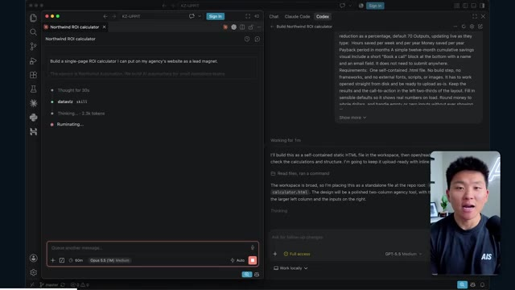
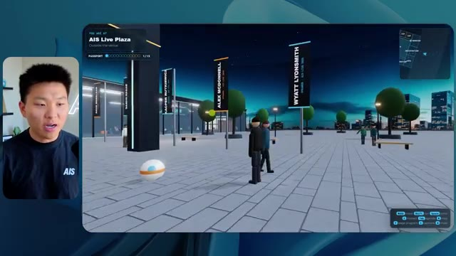
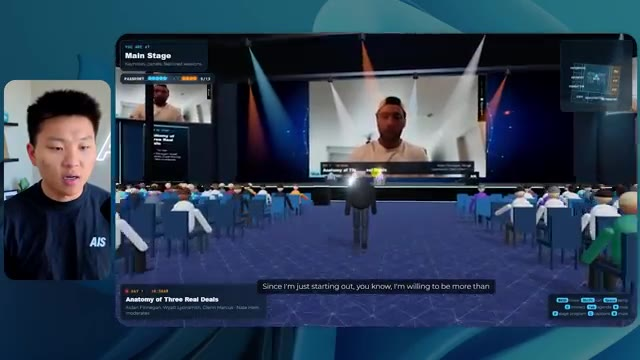
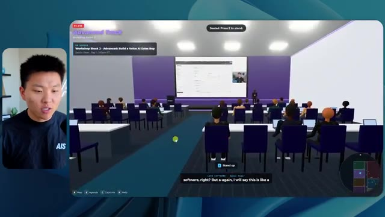
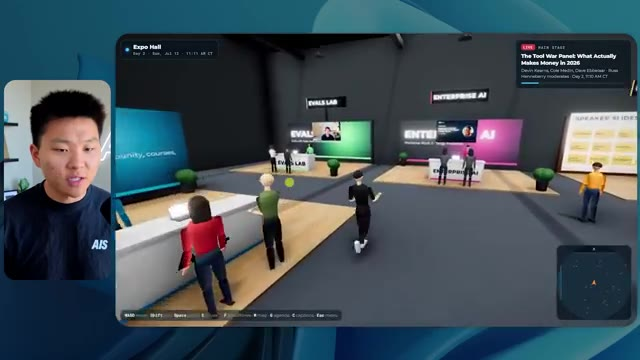
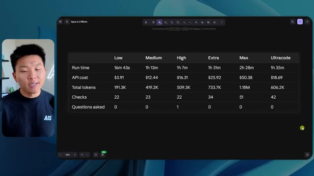

# 🎬 The Viral "Reverse Engineer Anything" Repo Explained Clearly

> **Chaîne** : [Nate Herk | AI Automation](https://www.youtube.com/@nateherk/featured)  
> **Lien YouTube** : [https://www.youtube.com/watch?v=hxJDcw540IE](https://www.youtube.com/watch?v=hxJDcw540IE)  
> **Date de publication** : 20261013  
> **Durée** : 00:01:19  
> **Identifiant vidéo** : `hxJDcw540IE`  
> **Transcription & Analyse** : `whisper-v3-large-turbo+gemini-3.5-flash-lite`  

---

## 📌 Synthèse Exécutive & Outils

### 💡 Résumé

Cette vidéo de la chaîne Nate Herk | AI Automation explore l'impact des différents niveaux d'effort (de faible à *code ultra*) sur le modèle d'IA de pointe **Opus 5.5**, à travers un cas pratique d'ingénierie logicielle complexe. Le défi proposé à l'agent consiste à transformer un dossier Frame.io de 105 gigaoctets d'enregistrements vidéo (provenant de l'événement virtuel *AIS Live*) en un monde 3D interactif et explorable à la troisième personne, simulant une conférence technologique physique réaliste. Le prompt intègre également des consignes créatives, de design, de physique et l'utilisation potentielle d'outils externes et de l'écosystème du projet *Herc 2*.

Les résultats comparatifs révèlent des dynamiques surprenantes en termes de performances, de coûts et de comportements des agents. En mode *effort faible*, le modèle génère un environnement fonctionnel mais grossier en 16 minutes, pour un coût API virtuel de 3,91 $ (191k jetons, 22 vérifications, 0 question), marqué par des incohérences visuelles (absence de couleurs de marque, éléments graphiques statiques et bugs d'affichage). En mode *effort moyen*, l'agent élève considérablement le niveau de qualité : respect de la charte graphique, intégration de flux vidéo en direct fonctionnels, PNJ (personnages non-joueurs) interactifs et modélisation fidèle des espaces (salles de séminaire, hall d'exposition, salon VIP, scène principale). Cette itération a nécessité 1 heure et 13 minutes, pour un coût de 12,44 $ (490k jetons, 23 vérifications, 0 question), démontrant la pertinence des recommandations d'Anthropic d'utiliser le niveau moyen comme point de départ pour des tâches complexes.

La démonstration illustre la capacité des grands modèles de langage modernes, couplés à des agents autonomes et à des capacités de vérification visuelle dans un navigateur, à industrialiser la rétro-conception et le prototypage d'applications immersives à partir de données brutes massives. Elle met en lumière l'arbitrage critique entre complexité du code généré, consommation de ressources, temps d'exécution et fidélité contextuelle, tout en soulignant la friction classique entre le développement local et le déploiement en production.

### 🛠️ Outils, Modèles & Logiciels Présentés

*   **Opus 5.5** : Modèle d'IA de pointe hautement performant et économique, utilisé au cœur de l'expérimentation pour exécuter le développement complet du monde 3D selon différents niveaux d'effort (de faible à code ultra).
*   **Claude Code** : Outil de développement assisté par IA et agent de programmation intégré, mentionné comme composant clé des flux de travail et des environnements techniques de l'écosystème.
*   **Anthropic** : Entreprise créatrice des modèles Opus, dont les documentations et articles préconisent d'utiliser le niveau d'effort moyen comme référence de départ pour les tâches d'ingénierie.
*   **Frame.io** : Plateforme de gestion et de stockage cloud utilisée pour héberger la ressource massive de 105 gigaoctets d'enregistrements vidéo de l'événement *AIS Live*.
*   **Herc 2** : Système d'exploitation personnel et modulaire basé sur l'IA, utilisé par Nate Herk comme base de ressources et d'automatisation pour alimenter les agents.
*   **Key.ai** : Service externe mobilisé par l'agent pour la génération dynamique d'images et de ressources visuelles adaptées au monde 3D.
*   **Hostinger (Connecteur)** : Solution sponsorisant la vidéo, proposée sous forme d'extension gratuite pour éditeur de code afin de combler le fossé entre le projet local terminé et sa mise en ligne rapide.

### 🔑 Points Clés & Enseignements Stratégiques

*   **Impact direct du paramètre d'effort** : La modification du niveau d'effort sur Opus 5.5 transforme radicalement la qualité structurelle, esthétique et fonctionnelle du code généré, passant d'un prototype rudimentaire et buggé à une application immersive fluide.
*   **Pertinence de la ligne de base moyenne** : Suivant les recommandations d'Anthropic, démarrer les projets complexes au niveau d'effort moyen offre un équilibre optimal entre respect des consignes de design, intégration multimédia et maîtrise des coûts.
*   **Autonomie des agents sans rétroaction humaine** : Sur l'ensemble des exécutions comparées, le modèle a accompli des tâches de programmation massives de manière totalement autonome, s'abstenant de poser la moindre question de clarification à l'utilisateur.
*   **Arbitrage coût/temps/complexité** : Le passage de l'effort faible à l'effort moyen multiplie le temps d'exécution par plus de quatre (de 16 minutes à 1h13) et triple le coût API estimé (de 3,91 $ à 12,44 $), justifié par un gain exponentiel en complexité logicielle et en fidélité visuelle.
*   **Intégration de données hétérogènes massives** : L'expérimentation prouve la capacité d'un agent IA à ingérer, structurer et exploiter un volume brut de 105 Go de vidéos (via Frame.io) pour contextualiser un espace virtuel interactif (agendas, ateliers, branding).
*   **Automatisation des vérifications contextuelles** : L'utilisation de boucles de rétroaction où l'agent ouvre de manière répétée le navigateur pour effectuer des vérifications visuelles (22 à 23 cycles) garantit une auto-correction progressive du rendu final.
*   **Respect de l'identité de marque (Branding)** : Les niveaux d'effort supérieurs démontrent une meilleure capacité à analyser et appliquer des directives de design complexes (palettes de couleurs, logos officiels, badges personnalisés) par rapport aux exécutions basiques.
*   **Dynamisme et interactivité des environnements** : Au-delà d'un simple diaporama statique, un niveau d'effort élevé permet d'injecter de la logique comportementale (PNJ interactifs, flux vidéo en direct intégrés dans les salles, éléments de physique 3D).
*   **Gestion des artefacts visuels (Bugs de rendu)** : Les niveaux d'effort faibles souffrent de défauts majeurs (disparition d'éléments, PNJ fantômes, écrans surexposés), tandis que les efforts accrus stabilisent la scène et fluidifient l'expérience utilisateur à la troisième personne.
*   **Le goulet d'étranglement du déploiement** : La vidéo met en lumière une friction classique de l'ingénierie moderne par IA : la capacité des modèles à produire rapidement des applications fonctionnelles en local, contrastant avec la complexité de leur mise en production rapide, nécessitant des connecteurs dédiés (comme l'extension Hostinger).

---

## ⏱️ Chronologie & Transcription Complète Audio & Visuelle (Mot pour Mot)

### ⏱️ `[00:00:00 - 00:00:20]` | Segment #01

**🔊 Audio (Transcription Intégrale Mot pour Mot en Français) :**
> Opus 5.5, Opus 5.5, Opus 5.5, Opus 5.5, Opus 5.5. Ce modèle est littéralement partout et pour de très bonnes raisons. Il est intelligent, il est bon marché, il a un goût extraordinaire, c'est un modèle d'IA incroyable. Mais avec chaque modèle d'IA, vous avez le choix de l'effort, que ce soit faible, moyen, élevé, extra, max ou code ultra.

**👁️ Analyse Visuelle d'Écran (gemini-3.5-flash-lite) :**
**Interface & Outils** : Interface web de X (Twitter).

**Contenu textuel & Code** : Un tweet avec une image/vidéo de paysage côtier tropical et le texte "It's a great time for hobbyists, bad time for professionals...".

**Action / Démonstration** : Affichage d'un exemple de contenu généré par IA partagé sur les réseaux sociaux pour illustrer le propos.

*⏱️ 00:00:05 — Capture d'écran d'un post sur X (Twitter) montrant une vidéo de paysage tropical généré par IA et un texte sur l'impact de l'IA sur les créateurs techniques.*

---

### ⏱️ `[00:00:20 - 00:00:38]` | Segment #02

**🔊 Audio (Transcription Intégrale Mot pour Mot en Français) :**
> Donc dans cette vidéo, j'ai donné exactement le même prompt à Opus 5.5 et je l'ai exécuté sur chaque niveau d'effort et nous allons comparer les résultats. Nous allons examiner la qualité de toutes les différentes sorties réelles, mais nous allons aussi examiner combien de temps chacun d'eux a fonctionné, combien cela nous a coûté s'il s'agissait d'une facturation API, le nombre total de jetons, combien de vérifications ils ont exécutées, et combien de questions ils m'ont réellement posées tout au long du processus.

**👁️ Analyse Visuelle d'Écran (gemini-3.5-flash-lite) :**
**Interface & Outils** : Application web de tableau ou de mind mapping.

**Contenu textuel & Code** : Tableau avec les en-têtes de colonnes Low, Medium, High, Extra, Max, Ultracode et de lignes Run time, API cost, Total tokens, Checks, Questions asked.

**Action / Démonstration** : Affichage et comparaison des performances de l'IA selon différents niveaux d'effort.

*⏱️ 00:00:29 — Tableau comparatif sur une interface web montrant les différents niveaux d'effort (Low, Medium, High, Extra, Max, Ultracode) et des métriques telles que Run time, API cost, Total tokens, Checks et Questions asked.*

---

### ⏱️ `[00:00:39 - 00:00:58]` | Segment #03

**🔊 Audio (Transcription Intégrale Mot pour Mot en Français) :**
> Et les résultats que nous avons obtenus ne sont pas du tout ce à quoi je m'attends, donc j'ai hâte de partager ça avec vous les gars. Ne perdons pas de temps et allons directement à celui-ci. D'accord, alors plongeons directement dans celui-ci. Je veux commencer juste en vous montrant le prompt réel que nous avons utilisé que nous avons donné à chacun de ces différents agents. Je vais aller dans les fichiers ici, et nous allons ouvrir ce fichier markdown de prompt, et je vais vous montrer ce que nous avons obtenu. Donc voici le slash objectif que j'ai fourni.

**👁️ Analyse Visuelle d'Écran (gemini-3.5-flash-lite) :**
**Interface & Outils** : Interface de l'application de développement / outil IA (style IDE ou plateforme agentique) avec le modèle Opus 5.5.

**Contenu textuel & Code** : Un message d'interaction avec un agent IA : "Hi Nate. This worktree has the effort-test task queued in PROMPT.md : build a walkable third-person 3D world of the AIS Live conference from your f.io recordings..."

**Action / Démonstration** : Présentation du prompt initial et de l'environnement de travail avant le lancement de la tâche par l'agent IA.

*⏱️ 00:00:48 — Interface d'un éditeur ou d'un outil de développement avec le présentateur incrusté à gauche, affichant un prompt textuel lié à un projet 3D et des options de configuration dans le panneau latéral.*

---

### ⏱️ `[00:00:58 - 00:01:34]` | Segment #04

**🔊 Audio (Transcription Intégrale Mot pour Mot en Français) :**
> J'ai dit : tu dois me créer un monde en 3D qui soit une conférence technologique réaliste dans laquelle je peux me déplacer en vue à la troisième personne. Tu vas regarder ce dossier, qui contient mes ressources d'enregistrement d'événements d'AIS Live. Et ce dossier est un dossier Frame.io de 105 gigaoctets d'enregistrements vidéo. C'était un événement entièrement virtuel. Tout a été enregistré et tous les enregistrements sont juste ici. J'ai dit, ton objectif est de prendre cet événement et de le transformer en un monde explorable en 3D qui me donne l'impression d'avoir réellement assisté à une vraie conférence en personne avec différentes salles, différentes pistes, différentes scènes, bla-bla-bla. N'hésite pas à utiliser key.ai si tu as besoin de générer des images ou des vidéos. Et tu peux aussi utiliser n'importe quoi d'autre dans mon projet Herc 2, qui est en quelque sorte mon système d'exploitation basé sur l'IA. J'ai dit,

**👁️ Analyse Visuelle d'Écran (gemini-3.5-flash-lite) :**
**Interface & Outils** : Éditeur de code (type VS Code/Cursor) et interface web Frame.io

**Contenu textuel & Code** : Fichier Markdown PROMPT.md contenant le prompt complet demandant de transformer les enregistrements d'un événement virtuel en un monde 3D explorable à la troisième personne, incluant un lien Frame.io de 105 Go.

**Action / Démonstration** : Présentation du prompt initial et des ressources vidéo Frame.io utilisées pour alimenter l'agent IA dans la création du monde 3D.

*⏱️ 00:01:07 — Éditeur de code affichant le fichier PROMPT.md contenant les instructions pour créer un monde 3D interactif et le lien vers le dossier Frame.io.*

*⏱️ 00:01:16 — Interface Frame.io montrant le dossier des ressources de l'événement "AIS Live" d'une taille de 105 Go avec les sous-dossiers "GA Access" et "VIP Access".*

*⏱️ 00:01:25 — Éditeur de code affichant à nouveau le fichier PROMPT.md avec le texte détaillé des consignes données à l'agent IA.*

---

### ⏱️ `[00:01:34 - 00:02:08]` | Segment #05

**🔊 Audio (Transcription Intégrale Mot pour Mot en Français) :**
> vous serez jugé sur la créativité, le design, la physique et la sensation générale lorsque j'explorerai le monde en 3D que vous avez construit. Et c'était fondamentalement la fin des instructions. Donc, comme vous pouvez le voir sur ce côté gauche, j'ai exécuté cela à travers tous les différents niveaux d'effort. Commençons par le niveau bas et montons jusqu'au code ultra. Très bien. Donc ici, nous avons le résultat du niveau bas. Ouvrons ceci et jetons un coup d'œil. Nous avons donc AIS Live, le sommet des services IA en personne enfin, et nous avons pu cliquer partout. Tout d'abord, cela ne fait pas très personnalisé. Genre, ce n'ha pas le logo d'IS Live. Ce ne sont même pas nos couleurs. Donc je n'aime pas trop ça, mais entrons ici. D'accord. C'est beaucoup trop lumineux. Euh, nous avons une carte en haut à droite. Nous avons une ville par ici. Je ne peux pas dire quelle ville c'est

**👁️ Analyse Visuelle d'Écran (gemini-3.5-flash-lite) :**
**Interface & Outils** : Application de développement / interface de chat IA (type Claude / agent de code) avec volet de navigation latéral.

**Contenu textuel & Code** : Message de l'assistant : "Hi Nate. This worktree has the effort-test task queued in PROMPT.md : build a walkable third-person 3D world..." et champ de saisie en bas avec la réponse "yes, start the task in PROMPT.md".

**Action / Démonstration** : Navigation et sélection des différents niveaux de test (effort-test) dans le panneau latéral gauche.

*⏱️ 00:01:42 — Interface d'une application montrant le panneau latéral avec des tests à différents niveaux (Hello, Extra, High, Max, Ultracode, Medium, Low) et le panneau de chat affichant un message de l'assistant IA concernant la création d'un monde 3D.*

---

### ⏱️ `[00:02:08 - 00:02:40]` | Segment #06

**🔊 Audio (Transcription Intégrale Mot pour Mot en Français) :**
> c'est. D'accord. C'est Chicago, ce qui est plutôt cool parce que vous savez, je vis à Chicago, mais bref, en haut à droite, nous pouvons voir une carte. Nous avons un hall d'accueil. Nous avons un hall d'exposition. Nous avons le salon VIP, la scène principale. La carte montre également où se trouve chaque autre personne et cela se synchronise en direct. Nous pouvons donc voir l'enregistrement. Nous pouvons voir le premier jour, la keynote de l'agent hyper, le débriefing en direct. Cool. Donc ça connaît réellement l'agenda et ensuite il y a le deuxième jour. Donc il a trouvé ça, c'est bien. Nous avons ces petites boules ici que je peux espérer botter. D'accord. Le visage, oh, regardez ça. Si je vais par ici, tous les gens disparaissent tout simplement. Très mauvais. Très mauvais. D'accord. Alors voyons voir. Est-ce que je peux sprinter ? D'accord.

**👁️ Analyse Visuelle d'Écran (gemini-3.5-flash-lite) :**
**Interface & Outils** : Application de monde virtuel 3D en ligne

**Contenu textuel & Code** : Environnement virtuel 3D avec avatars, panneaux d'information textuels et mini-carte de navigation

**Action / Démonstration** : Navigation et exploration de l'espace virtuel par le présentateur

*⏱️ 00:02:16 — Vue dans un monde virtuel 3D montrant l'avatar d'un utilisateur et un panneau 'Badge pickup - GA and VIP' avec une mini-carte en haut à droite.*

*⏱️ 00:02:24 — Vue dans un monde virtuel 3D affichant l'accueil (Lobby) avec un panneau listant les programmes du jour 1 et une mini-carte en haut à droite.*

*⏱️ 00:02:32 — Vue dans un monde virtuel 3D de l'expo (Expo Hall) avec des avatars d'utilisateurs et une structure lumineuse centrale, et une mini-carte en haut à droite.*

---

### ⏱️ `[00:02:40 - 00:03:04]` | Segment #07

**🔊 Audio (Transcription Intégrale Mot pour Mot en Français) :**
> Je peux aller un peu plus vite. Je vais d'abord aller par ici. Il y a des goodies, euh, certifiés AIS plus glido. D'accord. Donc il y a les stands réels qu'on avait dans l'événement virtuel. On avait des stands. Donc c'est plutôt cool. Un petit endroit pour prendre des photos. La salle C. En ce moment, nous avons Tangy Frederick qui anime un atelier. D'accord. Mais ce n'est pas une vidéo. Comme vous pouvez le voir, c'est juste une image. Elle ne bouge pas. C'est donc juste une image. Ces gens sont en train de disparaître. Ça doit être des fantômes. Allons par ici dans la salle A.

**👁️ Analyse Visuelle d'Écran (gemini-3.5-flash-lite) :**
**Interface & Outils** : Application de métavers / événement virtuel interactif 3D

**Contenu textuel & Code** : Environnement virtuel 3D interactif avec avatar, stands de sponsors (Glaido, AIS) et écrans de présentation didactiques.

**Action / Démonstration** : Exploration d'un espace événementiel virtuel 3D avec des stands et des tutoriels textuels.

*⏱️ 00:02:46 — Vue d'un monde virtuel interactif montrant le stand de Glaido avec des boîtes de goodies labellisées AIS, le présentateur apparaissant en incrustation à gauche.*

*⏱️ 00:02:52 — Navigation dans la salle d'atelier C (Workshop Room C) du monde virtuel, affichant des tables éclairées et des écrans explicatifs.*

*⏱️ 00:02:58 — Gros plan sur un écran virtuel dans l'atelier C affichant des instructions étape par étape pour configurer une clé API.*

---

### ⏱️ `[00:03:04 - 00:03:30]` | Segment #08

**🔊 Audio (Transcription Intégrale Mot pour Mot en Français) :**
> Nous avons Liberty White. D'accord. Très cool. Vos 30 premiers jours en automatisation. Encore une fois, ce n'est qu'une image fixe et les gens ont des bugs. Donc ce n'est pas très bon ici. Je vais aller sur la scène principale et voir ce que nous avons. D'accord, cool. Nous avons donc une scène qui a l'air principale. Les gens ont des bugs. Vraiment grave. Ce n'est vraiment pas bon du tout. Notre vidéo est en train de bouger. Genre, j'ai vu mon visage ici et j'ai vu celui de Devin, mais maintenant ils ont disparu. Donc je ne sais pas ce qui s'est passé. D'accord. On dirait que c'est plutôt un diaporama. Rien n'est vraiment diffusé pour l'instant. Quoi qu'il en soit, entrons ici.

**👁️ Analyse Visuelle d'Écran (gemini-3.5-flash-lite) :**
**Interface & Outils** : Environnement virtuel 3D de type métaverse / plateforme de conférence en ligne.

**Contenu textuel & Code** : Textes d'affichage et signalétique de conférence virtuelle (« Workshop Room A », « Main Stage », « AIS LIVE AI Services Summit »).

**Action / Démonstration** : Exploration et navigation interactive dans un espace virtuel de conférence 3D à l'aide d'un avatar.

*⏱️ 00:03:11 — Vue d'une salle virtuelle (Workshop Room A - Foundation track) avec un avatar naviguant dans un espace 3D minimaliste.*

*⏱️ 00:03:17 — Navigation dans la scène principale montrant un amphithéâtre virtuel rempli d'avatars de participants et le titre 'Hyperagent Workshop'.*

*⏱️ 00:03:24 — Vue de face de la scène principale avec le logo géant 'AIS LIVE AI Services Summit' sur grand écran et des ballons de plage virtuels.*

---

### ⏱️ `[00:03:30 - 00:03:58]` | Segment #09

**🔊 Audio (Transcription Intégrale Mot pour Mot en Français) :**
> Nous avons plus de stands. Nous avons hyper agent. Nous avons Claude Code. Nous avons plus de goodies. La salle B, c'est Dave Ebelor. Je suppose que c'est exactement la même chose. Nous avons du café. Et ensuite, je suppose que le salon VIP est réservé à l'accès VIP uniquement. C'est plutôt sympa, mais il ne se passe vraiment rien ici. Cet écran est beaucoup trop lumineux. Bon. Donc je pense que vous comprenez l'ambiance que nous obtenons ici d'Opus 5.5 en effort faible. Et c'est là que les choses deviennent intéressantes. Combien de temps pensez-vous que cela a duré ? Combien de temps ? Celui-ci a duré 16 minutes et 43 secondes. Combien pensez-vous que cela a coûté ?

**👁️ Analyse Visuelle d'Écran (gemini-3.5-flash-lite) :**
**Interface & Outils** : Application web Opus 5.5 Efforts

**Contenu textuel & Code** : Tableau comparatif des niveaux d'effort avec Run time, API cost, Total tokens, Checks et Questions asked.

**Action / Démonstration** : Présentation des différents niveaux de performance et de coût d'un modèle d'IA.

*⏱️ 00:03:51 — Un tableau comparatif sur l'interface d'Opus 5.5 avec des niveaux de performance (Low, Medium, High, Extra, Max, Ultracode) et des métriques (Run time, API cost, Total tokens, Checks, Questions asked).*

---

### ⏱️ `[00:03:58 - 00:04:26]` | Segment #10

**🔊 Audio (Transcription Intégrale Mot pour Mot en Français) :**
> 3,91 dollars si c'eût été une facturation par API. J'utilise évidemment mon abonnement ici, mais nous allons simplement calculer cela avec la facturation par API. Le total des jetons était de 191 000. Il a fait 22 vérifications. Donc pour la vérification, 22 fois il a ouvert le navigateur et a exécuté différentes sortes de vérifications. Donc 22 catégories de vérifications. Et combien de questions m'a-t-il posées ? Il m'a posé un total de zéro question tout au long de cette invite de commande d'objectif. D'accord. Alors, ouvrons l'effort moyen et voyons ce que nous avons. D'accord, c'est parti. Effort moyen. Nous avons Nate Herc. Nous avons mon badge. C'est aux couleurs de la marque AI's life.

**👁️ Analyse Visuelle d'Écran (gemini-3.5-flash-lite) :**
**Interface & Outils** : Application de tableau blanc / diagramme en ligne (type Excalidraw ou similaire).

**Contenu textuel & Code** : Tableau avec des colonnes "Low", "Medium", "High", "Ext" et des lignes pour Run time, API cost, Total tokens, Checks et Questions asked.

**Action / Démonstration** : Le présentateur explique les coûts d'API et le nombre de tokens pour le niveau bas du processus.

*⏱️ 00:04:05 — Un tableau comparatif montrant les métriques de performance et de coût pour le niveau "Low" (Run time: 16m 43s, API cost: $3.91, Total tokens: 191.3K, Checks, Questions asked).*

---

### ⏱️ `[00:04:26 - 00:04:46]` | Segment #11

**🔊 Audio (Transcription Intégrale Mot pour Mot en Français) :**
> Donc ça a déjà l'air un tout petit peu mieux. Ça ressemble à nos palettes de couleurs qui utilisaient nos directives de marque. Premier jour de construction, deuxième jour de gain, VIP. Cool. D'accord. Je vais entrer dans le lieu. D'accord. Waouh. Donc une ambiance un peu similaire. C'est en arrière-plan. Ça ne ressemble pas à Chicago, hein ? Non, ça ressemble à, honnêtement, ça ressemble à une ville inventée. Quoi qu'il en soit, c'est marrant qu'ils aient décidé de faire ça. Voyons si je peux me déplacer un peu plus vite. Oh, waouh.

**👁️ Analyse Visuelle d'Écran (gemini-3.5-flash-lite) :**
**Interface & Outils** : Navigateur web / Application web 3D virtuelle

**Contenu textuel & Code** : Page d'accueil de l'événement virtuel "AIS Live" avec badge (Nate Herk, Host - All Access) et contrôles clavier à l'écran.

**Action / Démonstration** : Le présentateur navigue dans l'interface et entre dans l'espace virtuel de l'événement.

*⏱️ 00:04:31 — Interface web 'AIS Live' montrant un badge nominatif virtuel avec les options de navigation et un bouton 'Enter the Venue'.*

*⏱️ 00:04:41 — Vue à la première ou troisième personne dans un espace virtuel 3D avec des avatars et une vue sur une ville la nuit.*

---

### ⏱️ `[00:04:46 - 00:05:21]` | Segment #12

**🔊 Audio (Transcription Intégrale Mot pour Mot en Français) :**
> Les gens interagissent avec moi. Regardez. Si je m'approche de ce type, il vient de lever le bras. Bon, maintenant il ne veut plus du tout avoir affaire à moi. Mais tous ces petits robots ici doivent prendre des décisions. Je ne sais pas s'ils utilisent Jev. Ils ne le font clairement pas. Je ne leur ai pas demandé. En fait, ma clé Jev est à l'arrière. Je ne sais pas. Peut-être qu'il l'a utilisée. Quoi qu'il en soit, on peut voir ici que nous avons la Salle d'atelier C, le Laboratoire des agents. Sympa. Donc celui-ci est en fait en cours d'exécution. Vous pouvez voir qu'il s'agit d'une vraie vidéo diffusée par Tangy. Tout le monde ici est en train de travailler sur un ordinateur portable. Ils ne buguent pas. C'est plutôt cool. De plus, mon badge est sur ma poitrine, ce qui est plutôt cool. Je peux venir par ici. Nous avons une carte en haut à droite, comme vous pouvez le voir, mais je peux venir par ici. Nous avons un

**👁️ Analyse Visuelle d'Écran (gemini-3.5-flash-lite) :**
**Interface & Outils** : Environnement virtuel 3D de simulation / métavers / plateforme d'agents conversationnels.

**Contenu textuel & Code** : Interface utilisateur virtuelle affichant "Agents Lab", une minimap en haut à droite et des informations de session ("Enterprise AI Services").

**Action / Démonstration** : Navigation et exploration d'un environnement virtuel 3D peuplé d'avatars animés.

---

### ⏱️ `[00:05:21 - 00:05:47]` | Segment #13

**🔊 Audio (Transcription Intégrale Mot pour Mot en Français) :**
> hall d'exposition. C'est là que nous avons le stand Glido. Et ça diffuse en ce moment. Oui, ça diffuse la vidéo de nous parlant de Glido. Ça diffuse la vidéo d'Ed et moi parlant de notre programme de certification. Nous avons le logo AIS Plus juste ici, qui est un peu dans un endroit bizarre. Ce sont les diapositives des conférenciers et les points clés. Donc wow, ce sont toutes les ressources que nous avons distribuées après l'événement. Elles sont toutes là aussi. Nous pouvons voir que nous avons un coup de projecteur sur la communauté. C'est donc Aiden qui parle de l'accord qu'il a conclu et c'est diffusé en direct. Ces gens regardent.

**👁️ Analyse Visuelle d'Écran (gemini-3.5-flash-lite) :**
**Interface & Outils** : Environnement virtuel 3D de type métavers / plateforme d'événements virtuels.

**Contenu textuel & Code** : Affiches, diapositives de présentation et panneaux d'information virtuels.

**Action / Démonstration** : Navigation et exploration d'un espace d'exposition virtuel par un avatar.

---

### ⏱️ `[00:05:47 - 00:06:21]` | Segment #14

**🔊 Audio (Transcription Intégrale Mot pour Mot en Français) :**
> Ils sont plutôt engagés. On a un hyper agent. C'était, c'est ce que je voulais dire. Si vous avez vu ces gens lever les mains pour dire bonjour, c'était plutôt marrant. Regardez, regardez, le voilà qui recommence. Bref. Bon. Où est-ce que je suis maintenant ? Maintenant, je suis dans le hall principal. On a un bar à café. On a un grand logo, qui est le vrai logo. C'est trop lumineux, mais on a le logo. On peut voir si on peut entrer ici dans le parcours des fondations. On a Sabrina Romanov et Liberty White. Donc différentes formations juste là. On peut entrer dans cette salle. C'est le parcours avancé. Alors qu'est-ce qui se passe ici. On a Dave Ebelar et Saman qui parlent de différentes choses là-dedans. Et maintenant, allons jeter un œil à la scène principale. Oh, attendez, il y a une vidéo de moi là-haut. C'est genre un VIP

**👁️ Analyse Visuelle d'Écran (gemini-3.5-flash-lite) :**
**Interface & Outils** : Environnement virtuel 3D / plateforme de métaverse ou de conférence en ligne.

**Contenu textuel & Code** : Interface utilisateur d'un espace virtuel interactif affichant le titre "Main Lobby", une minimap et des avatars de participants.

**Action / Démonstration** : Navigation et exploration d'un environnement virtuel de conférence avec des avatars par le présentateur.

---

### ⏱️ `[00:06:21 - 00:06:50]` | Segment #15

**🔊 Audio (Transcription Intégrale Mot pour Mot en Français) :**
> section ? Ouais, on ira voir ça dans une minute. Mais bref, voici la scène principale. Ça a l'air vraiment, vraiment très bien. On a une grande scène. On a genre quatre personnes assises ici. On a les trois écrans d'Alex là-haut avec Hyper Agent. Est-ce que j'ai le droit de monter sur scène ? Oh, et ça me laisse monter sur scène. D'accord. C'est plutôt sympa. Bon les gars, prenons un selfie. Laissez-moi prendre tout le monde en arrière-plan. Venez par ici. Bref, c'est plutôt, plutôt cool. Par contre, toutes les places ne sont pas occupées. Donc il va falloir qu'on travaille là-dessus. Mais bref, je vais courir voir ce qu'était cette section VIP. D'accord. Salon VIP. J'ai l'impression que c'est comme un aéroport ou un truc du genre.

**👁️ Analyse Visuelle d'Écran (gemini-3.5-flash-lite) :**
**Interface & Outils** : Application virtuelle Hyper Agent

**Contenu textuel & Code** : Interface utilisateur virtuelle représentant une keynote avec un public et des écrans de présentation.

**Action / Démonstration** : Navigation et exploration de l'espace virtuel de conférence par l'utilisateur.

---

### ⏱️ `[00:06:51 - 00:07:14]` | Segment #16

**🔊 Audio (Transcription Intégrale Mot pour Mot en Français) :**
> Ok, super. Donc maintenant nous avons les sessions VIP ici. Une session VIP de questions-réponses avec Nate, lecture vidéo en direct juste ici. Très, très cool. Et nous avons comme un bar ou quelque chose comme ça. Génial. Je dirais que c'est un assez bon résultat. Maintenant, en ce qui concerne les statistiques ici, celle-ci a pris une heure et 13 minutes à s'exécuter. Cela nous aurait coûté 12 dollars et 44 cents. Elle a utilisé 490 000 jetons et a fait 23 vérifications.

**👁️ Analyse Visuelle d'Écran (gemini-3.5-flash-lite) :**
**Interface & Outils** : Espace virtuel 3D (type Gather.town ou similaire) et interface web d'analyse (Opus 5.5 Efforts).

**Contenu textuel & Code** : Affichage d'une session VIP Q&A avec Nate, et un tableau de métriques (Run time: 16m 43s, API cost: $3.91, Total tokens: 191.3K, Checks: 22).

**Action / Démonstration** : Présentation de l'espace virtuel VIP et analyse des performances de l'agent.

*⏱️ 00:06:56 — Capture montrant un espace virtuel en 3D avec des avatars et un écran géant affichant une session vidéo en direct de Nate Herk.*

*⏱️ 00:07:02 — Capture montrant un tableau comparatif dans l'interface d'Opus 5.5 Efforts avec des métriques de performance telles que le temps d'exécution et le coût API.*

---

### ⏱️ `[00:07:14 - 00:07:48]` | Segment #17

**🔊 Audio (Transcription Intégrale Mot pour Mot en Français) :**
> Et il ne nous a posé absolument aucune question une nouvelle fois. Très bien, passons au niveau élevé. C'était déjà un résultat plutôt correct, et Anthropic eux-mêmes, dans leur vidéo sur la façon de prompter Opus 5.5, ou désolé, pas une vidéo, un article. Ils ont dit de simplement commencer par le niveau moyen et de l'ajuster à la hausse ou à la baisse si nécessaire. C'était donc un résultat moyen. Passons au niveau élevé et voyons ce que nous avons obtenu. Très rapidement, les gars, je dois prendre un instant pour vous parler du sponsor de la vidéo d'aujourd'hui, Hostinger. Donc, ces deux modèles viennent de me créer une version fonctionnelle de la même chose. Et maintenant, je me retrouve exactement là où je finis toujours, avec un projet terminé sur mon ordinateur portable et aucun moyen rapide de le mettre en ligne. Et c'est précisément ce fossé que le connecteur d'Hostinger comble. C'est une extension gratuite

**👁️ Analyse Visuelle d'Écran (gemini-3.5-flash-lite) :**
**Interface & Outils** : Tableau de bord de type canvas pour l'image 1 et interface de développement / éditeur de code de type IDE pour l'image 2.

**Contenu textuel & Code** : Tableau comparatif des coûts d'API, temps d'exécution et tokens pour l'image 1 ; invite de génération "Build a single-page ROI calculator..." et journaux d'exécution pour l'image 2.

**Action / Démonstration** : Analyse comparative des performances de différents niveaux d'effort d'IA (Low vs Medium) et suivi de la génération de code pour un calculateur ROI.

*⏱️ 00:07:22 — Tableau de comparaison montrant les métriques pour différents niveaux d'effort (Low, Medium, High, Extra), avec le présentateur incrusté à gauche.*

*⏱️ 00:07:39 — Interface de développement avec un éditeur affichant le prompt de création d'un calculateur de ROI Northwind et des indicateurs de progression de l'IA.*

---

### ⏱️ `[00:07:48 - 00:08:23]` | Segment #18

**🔊 Audio (Transcription Intégrale Mot pour Mot en Français) :**
> pour votre éditeur qui intègre votre compte Hostinger dans l'outil de programmation que vous utilisez déjà. Que ce soit VS Code, Cursor, Cloud Code, Codex, et j'en passe. Vous vous connectez une seule fois en un clic, et à partir de là, votre agent peut déployer le site, y associer un domaine, configurer les enregistrements DNS et vérifier votre VPS sans que vous n'ayez jamais à quitter l'éditeur. Ainsi, peu importe celui de ces outils que vous finirez par préférer, ce qu'il a créé se trouve à quelques minutes d'une vraie URL sur un hébergement géré. Connector est gratuit avec tous les forfaits d'hébergement, donc si vous avez toujours besoin de l'hébergement en dessous, procurez-vous le forfait illimité avec le lien dans la description et utilisez le code NATEHERK pour 10 % de réduction. Cela inclut également un nom de domaine gratuit et un e-mail professionnel pour l'année. Et c'est toujours le moyen le moins cher que j'ai trouvé pour obtenir quelque chose

**👁️ Analyse Visuelle d'Écran (gemini-3.5-flash-lite) :**
**Interface & Outils** : Interface web/extension Hostinger pour IDE, Claude Code

**Contenu textuel & Code** : "Manage Hostinger from your IDE", statut "Connected" vert (VIA OAUTH), Node.js 24.13.0, liste des outils disponibles (Websites, Domains, Subscriptions & Payments, Email Marketing).

**Action / Démonstration** : Connexion du compte Hostinger à l'IDE pour permettre à l'assistant de gérer les sites web, domaines et abonnements.

*⏱️ 00:07:57 — Interface montrant l'intégration de Hostinger dans un IDE avec le statut connecté via OAuth et les outils disponibles, ainsi qu'une fenêtre Claude Code à droite et le présentateur en incrustation.*

---

### ⏱️ `[00:08:23 - 00:08:47]` | Segment #19

**🔊 Audio (Transcription Intégrale Mot pour Mot en Français) :**
> tu as construit sur une vraie URL. Donc revenons à la vidéo. D'accord. Encore une fois, très, très marqué par la marque. C'est un écran de chargement encore meilleur que le précédent. Nous avons ce petit effet sympa en arrière-plan. Nous avons le logo. Nous allons entrer dans le lieu. D'accord. Nous y voilà. Ça a l'air plutôt bien. Nous commençons à l'extérieur et vous pouvez voir que nous avons ces drapeaux pour tous les intervenants, Wyatt, Casper, Alex, Ed, Aiden, Sabrina, Liberty. C'est plutôt cool. Nous avons des blocs en direct ici.

**👁️ Analyse Visuelle d'Écran (gemini-3.5-flash-lite) :**
**Interface & Outils** : Navigateur web affichant un environnement virtuel 3D interactif (type métavers ou espace événementiel virtuel).

**Contenu textuel & Code** : Interface utilisateur avec des commandes de déplacement (WASD, Mouse, Space, Tab) et des bannières textuelles nommant des conférenciers.

**Action / Démonstration** : Connexion et entrée dans le lieu virtuel interactif 'AIS Live Plaza', navigation de l'avatar dans l'espace 3D.

*⏱️ 00:08:29 — Écran de chargement et d'accueil de la plateforme virtuelle 'AIS LIVE', affichant le logo, les instructions de contrôles clavier/souris et le bouton 'ENTER THE VENUE'.*

*⏱️ 00:08:35 — Entrée dans l'univers virtuel 3D (AIS Live Plaza) avec des avatars, des bâtiments urbains en arrière-plan et des indications textuelles d'orientation.*

*⏱️ 00:08:41 — Exploration de la place virtuelle 3D avec des bannières verticales affichant les noms d'intervenants et un petit robot sphérique au sol.*

---

### ⏱️ `[00:08:47 - 00:09:23]` | Segment #20

**🔊 Audio (Transcription Intégrale Mot pour Mot en Français) :**
> Il a pris cette photo de moi, votre hôte, Nate Herc, John, Dave, Nate Herc. Voilà. D'accord. Les portes. Génial. Ce sont des portes coulissantes automatiques en verre. J'adore ça. Nous pouvons voir l'enregistrement VIP. Nous pouvons voir l'admission générale. Nous pouvons venir ici et nous pouvons découvrir l'exposition avec différents stands, le coin de la communauté. Vous pouvez également voir qu'en haut à gauche, j'ai un passeport. Donc c'est comme si, cela montrera combien d'endroits j'ai visités. Tout cela est une lecture réelle. Nous avons un mur de ressources avec tous les différents conférenciers. Ils ont aussi une session de réseautage ici. Je vais donc venir très vite voir de quoi il s'agit. Nous avons donc le bar à cold brew AIS. Nous avons différents membres de la communauté qui ont été mis en avant ou mis en lumière.

**👁️ Analyse Visuelle d'Écran (gemini-3.5-flash-lite) :**
**Interface & Outils** : Application de monde virtuel 3D / plateforme d'événement virtuel en ligne

**Contenu textuel & Code** : Interface utilisateur virtuelle affichant "Registration Concourse", "VIP CHECK-IN", "Main Stage" et des menus contextuels de navigation.

**Action / Démonstration** : Exploration et navigation interactive dans l'espace virtuel 3D à l'aide d'un avatar.

*⏱️ 00:08:56 — Vue principale dans un environnement virtuel 3D montrant le hall de la conférence, le comptoir d'enregistrement et la scène principale avec un écran géant.*

*⏱️ 00:09:05 — Navigation dans la zone d'exposition virtuelle (Expo Hall) montrant des stands, des avatars et des bannières informatives.*

*⏱️ 00:09:14 — Déplacement de l'avatar au milieu d'autres participants virtuels dans le hall de la conférence, avec les grandes baies vitrées sur le côté.*

---

### ⏱️ `[00:09:23 - 00:09:56]` | Segment #21

**🔊 Audio (Transcription Intégrale Mot pour Mot en Français) :**
> Nous avons l'aile VIP. Attends, quoi ? Récupère un bracelet. Oh, je dois vraiment aller chercher le bracelet. D'accord. Laisse-moi m'enregistrer rapidement. Le bracelet est déjà mis. Attends, quoi ? D'accord. Oh, d'accord. Maintenant, les portes se sont ouvertes pour moi. Cool. Je peux entrer ici. Oh, ça mène juste à la scène principale. Salon VIP. Il y a une séance de questions-réponses en cours. Ça a l'air très cool. Je veux dire, je suis très impressionné par la façon dont il est capable de faire ça. Waouh. D'accord. Donc c'est vraiment bien. Ce que nous avons fait, c'est que nous avions des salles de discussion VIP avec différentes personnes. Tu peux voir qu'il y a différentes salles, différents membres de l'équipe AIS qui participent à des choses. C'est vraiment cool. C'est très cool. C'est un VIP bien meilleur

**👁️ Analyse Visuelle d'Écran (gemini-3.5-flash-lite) :**
**Interface & Outils** : Application de métavers / monde virtuel 3D de conférence.

**Contenu textuel & Code** : Environnement virtuel 3D avec affichage de l'interface de navigation, de la carte et des sessions.

**Action / Démonstration** : Navigation et exploration de différents espaces virtuels (hall d'enregistrement, salon VIP, sessions de travail).

*⏱️ 00:09:32 — L'avatar du présentateur se déplace dans un espace virtuel d'enregistrement de conférence.*

*⏱️ 00:09:40 — L'avatar se trouve dans le salon VIP où un écran affiche une visioconférence.*

*⏱️ 00:09:48 — L'avatar explore une salle de sessions de travail VIP avec différentes tables thématiques.*

---

### ⏱️ `[00:09:56 - 00:10:30]` | Segment #22

**🔊 Audio (Transcription Intégrale Mot pour Mot en Français) :**
> expérience que celle qui a été montrée dans le premier extrait. D'accord. After party VIP. Regardez ça. Nous avons une piste de danse. Nous avons tous ces éléments ici. Nous avons la lecture de l'after party VIP juste ici. Et il y a une estrade de DJ. C'est trop marrant. Il y a un petit bug ici, un petit glitch juste là, mais c'est génial. Oh, super. Donc quand je suis ici sur la scène principale, nous avons des sous-titres. Vous pouvez voir juste ici en bas de mon écran, nous avons ces sous-titres de Wyatt qui est en train de parler ici. Nous avons des lumières. Nous avons le panneau. Très cool. Belle scène principale. Je vais aller par ici. Nous pouvons aller à la fondation,

**👁️ Analyse Visuelle d'Écran (gemini-3.5-flash-lite) :**
**Interface & Outils** : Application web de salon virtuel 3D (type Gather.town ou environnement immersif similaire).

**Contenu textuel & Code** : Interface utilisateur virtuelle montrant des flux vidéo de participants, une carte de navigation et des commandes clavier.

**Action / Démonstration** : Navigation et exploration d'un espace virtuel interactif 3D lors d'un événement en ligne.

*⏱️ 00:10:04 — Vue d'un espace virtuel d'after-party VIP avec piste de danse, avatars et écran affichant des flux vidéo de participants.*

*⏱️ 00:10:13 — Plan plus large de l'environnement virtuel montrant la piste de danse de l'after-party VIP et des ballons de plage.*

*⏱️ 00:10:21 — Vue d'une scène principale virtuelle (Main Stage) avec un auditoire d'avatars assis et un grand écran de présentation.*

---

### ⏱️ `[00:10:30 - 00:11:06]` | Segment #23

**🔊 Audio (Transcription Intégrale Mot pour Mot en Français) :**
> avancé, et les parcours d'entreprise ici. Alors voyons voir. Nous avons l'anatomie de trois vraies transactions. Nous avons hyper agent. Nous avons les évaluations avec Nate et Ed ici. Nous avons Dave qui intervient sur les trucs avancés. C'est vraiment bien. Je veux dire, évidemment, chacun, chacun de ces résultats jusqu'à présent, faible était correct. Moyen était meilleur. Élevé a été encore meilleur. Voyons si cette tendance se poursuit et voyons combien cela nous a coûté. Donc, élevé a fonctionné pendant une heure et sept minutes. Donc un peu plus rapide que moyen, cela nous aurait coûté 16 dollars et 31 cents. Il a utilisé un demi-million de jetons, 509 000. Il a fait 22 vérifications. Et il nous a aussi demandé, enfin, non, je me suis trompé. Ce

**👁️ Analyse Visuelle d'Écran (gemini-3.5-flash-lite) :**
**Interface & Outils** : Application de tableau blanc ou d'édition de schémas (type Excalidraw ou similaire).

**Contenu textuel & Code** : Tableau avec des métriques techniques et financières : Low ($3.91, 191.3K tokens), Medium ($12.44, 419.2K tokens), High ($16.31), Extra.

**Action / Démonstration** : Analyse et présentation comparative des coûts et des temps d'exécution selon les niveaux d'effort des agents IA.

*⏱️ 00:10:57 — Tableau comparatif affichant les performances selon différents niveaux d'effort (Low, Medium, High, Extra) : Run time, API cost, Total tokens, Checks, Questions asked.*

---

### ⏱️ `[00:11:06 - 00:11:25]` | Segment #24

**🔊 Audio (Transcription Intégrale Mot pour Mot en Français) :**
> one asked me one question and spoiler, it was the only one that asked us a question throughout all of this. So let's see, we've got three left extra max and ultra code. Let me pull open extra and we'll see what we got. Okay. So this one looks pretty good. I would honestly say so far, the loading screen high was the best. The one that we just saw, but anyways, let's enter AIS live.

**👁️ Analyse Visuelle d'Écran (gemini-3.5-flash-lite) :**
**Interface & Outils** : Application web ou tableau de bord avec une vue en canevas (titre "Opus 5.5 Efforts").

**Contenu textuel & Code** : Tableau avec des colonnes Low, Medium, High, Extra et des lignes Run time, API cost, Total tokens, Checks, Questions asked.

**Action / Démonstration** : Le présentateur commente les résultats et les métriques des différents tests.

*⏱️ 00:11:11 — Tableau comparatif affichant les métriques de différents niveaux (Low, Medium, High, Extra) incluant le temps d'exécution, le coût API, le total des tokens, les vérifications et les questions posées.*

---

### ⏱️ `[00:11:26 - 00:11:51]` | Segment #25

**🔊 Audio (Transcription Intégrale Mot pour Mot en Français) :**
> Wouah. D'accord. Donc on a comme des petits extraits sonores. Je peux discuter avec des gens. Le panneau sur la guerre des outils a réglé quelques débats pour moi. Sympa. Bonne perspective là-bas. On est dehors à nouveau. On a ces différentes bannières, bien qu'elles soient toutes les mêmes. Elles n'affichent pas les noms de différentes personnes. Donc grand logo AIS Live. L'aile des ateliers est par ici. Et passons par les portes coulissantes en verre pour voir ce qu'on a. Donc on a le café AIS. La carte est en bas à droite, et elle n'est pas très descriptive.

**👁️ Analyse Visuelle d'Écran (gemini-3.5-flash-lite) :**
**Interface & Outils** : Application web 3D / Environnement virtuel interactif

**Contenu textuel & Code** : Environnement virtuel 3D avec avatars, bannières publicitaires et interface de navigation (minimap)

**Action / Démonstration** : Navigation et exploration de l'espace virtuel par le présentateur

*⏱️ 00:11:32 — Le présentateur commente une vue en 3D d'un espace virtuel interactif de type convention avec des avatars.*

*⏱️ 00:11:38 — Vue de l'espace virtuel extérieur avec des bannières et des bâtiments sous un ciel nocturne.*

*⏱️ 00:11:45 — L'avatar virtuel se déplace vers l'entrée d'un bâtiment de convention illuminé.*

---

### ⏱️ `[00:11:51 - 00:12:26]` | Segment #26

**🔊 Audio (Transcription Intégrale Mot pour Mot en Français) :**
> J'aime bien comment les autres cartes nous ont dit quoi, genre où étaient les choses, mais celle-ci a l'air très professionnelle. On peut voir ici c'est la scène principale. Allons y faire un saut rapidement. Ils ont tous ces ballons qui volent partout, ce qui je trouve est plutôt marrant. Les ballons de plage AIS. On nous voit là-haut en train de parler. Je crois que j'introduisais l'un des jours. Continuons à avancer par ici vers la salle d'atelier sur ce côté gauche. D'accord. Donc ici nous avons le Hyper Agent Theater. Nous avons cette session sponsorisée ici par Hyper Agent, mais ça nous montre aussi ce qui va s'y passer. C'est vraiment marrant qu'on puisse discuter avec des gens. Salmon a construit un commercial vocal en direct. La salle "Le Juste Prix" était comble. Tu as pris le guide du compagnon VIP ? C'est trop marrant. Nous avons le parcours avancé en

**👁️ Analyse Visuelle d'Écran (gemini-3.5-flash-lite) :**
**Interface & Outils** : Application web de métavers / plateforme d'événements virtuels en 3D.

**Contenu textuel & Code** : Environnement 3D interactif avec des avatars d'utilisateurs, des écrans de diffusion vidéo en direct, et des zones thématiques.

**Action / Démonstration** : Exploration d'un espace virtuel de conférence en ligne et navigation entre les différentes salles.

*⏱️ 00:12:00 — Vue principale d'un espace virtuel 3D avec des avatars, une estrade et un grand écran montrant une personne en direct.*

*⏱️ 00:12:09 — Navigation d'un avatar dans le hall d'entrée virtuel d'un événement avec des stands et des panneaux d'affichage.*

*⏱️ 00:12:17 — Déplacement d'avatars dans un couloir virtuel d'un centre de conférence en ligne.*

---

### ⏱️ `[00:12:26 - 00:12:58]` | Segment #27

**🔊 Audio (Transcription Intégrale Mot pour Mot en Français) :**
> ici. Encore une fois, nous avons la lecture en direct. Est-ce que c'est la lecture en direct ? Oh, d'accord. Ça a commencé une fois que je suis entré, mais je peux m'asseoir. Oh la la. Je peux regarder ça. Je peux me lever. Je veux m'asseoir au premier rang. C'est plutôt cool. C'est très bien. J'aime ça. Et tu sais ce que j'ai remarqué jusqu'à présent ? Le personnage que j'incarne me ressemble un peu. Je pense qu'il s'est inspiré de mes photos de profil ou quelque chose comme ça. Quoi qu'il en soit, nous avons Sabrina ici, l'animatrice de la salle ici, prenez n'importe quel siège libre. D'accord, cool. Et j'ai vraiment aimé la fonctionnalité pour s'asseoir. C'est plutôt marrant. Genre, on pourrait vraiment assister à cet atelier et participer. Bref, ça nous montre les intervenants. Ça nous montre les

**👁️ Analyse Visuelle d'Écran (gemini-3.5-flash-lite) :**
**Interface & Outils** : Application de métavers / plateforme d'événements virtuels en 3D

**Contenu textuel & Code** : Interface utilisateur de conférence virtuelle affichant le titre de l'atelier, des avatars 3D et des fenêtres vidéo en direct sur grand écran

**Action / Démonstration** : Navigation et exploration de l'environnement virtuel en 3D avec l'avatar pour assister à un atelier en direct

*⏱️ 00:12:34 — Vue d'un espace de conférence virtuel 3D (metaverse) violet avec des avatars assis, un présentateur sur écran géant et le présentateur réel incrusté à gauche.*

*⏱️ 00:12:42 — Navigation dans la salle de conférence virtuelle aux tons verts et noirs, montrant l'écran de l'atelier 'Workshop Block 2 : Foundations Build Your First AI Content Engine'.*

*⏱️ 00:12:50 — Déplacement de l'avatar dans la salle virtuelle avec un grand écran affichant des flux vidéo en direct de participants et d'intervenants.*

---

### ⏱️ `[00:12:58 - 00:13:31]` | Segment #28

**🔊 Audio (Transcription Intégrale Mot pour Mot en Français) :**
> agenda. There's a little red carpet here to take some pictures. We can strike a pose. Oh, wow. That's pretty cool. Resource library, get AIS Plus certified, Glido, Hyper Agent, AIS Plus, three real deals. Awesome. I mean, I would definitely say so far, each one is getting better. And we didn't even check out the VIP section yet, the VIP lounge. Let's go up here real quick. Hopefully I can get in. Nice. We've got tooling reset. These are the different rooms we could go in. So once again, I could grab the worksheet and I could try to understand how to price my stuff. This is so cool. This is definitely better than the previous one where we kind of just

**👁️ Analyse Visuelle d'Écran (gemini-3.5-flash-lite) :**
**Interface & Outils** : Environnement virtuel 3D / plateforme de métavers ou événement virtuel.

**Contenu textuel & Code** : Éléments textuels d'interface virtuelle (menus de navigation, mini-carte, bulles de dialogue, noms de stands et de salles).

**Action / Démonstration** : Navigation et exploration d'un espace événementiel virtuel 3D par le présentateur ou les avatars.

---

### ⏱️ `[00:13:31 - 00:13:59]` | Segment #29

**🔊 Audio (Transcription Intégrale Mot pour Mot en Français) :**
> comme regardé des trucs. Génial. Je peux aller derrière le bar et venir ici. C'est très bien. Bon. Alors, en ce qui concerne les statistiques, celui-ci a tourné pendant une heure et demie. Il a coûté 25,92 dollars. Je ne sais pas pourquoi je dis point 25, 92 cents. Il y a eu 733 000 jetons et 34 vérifications. Il a donc eu le plus grand nombre de vérifications de loin, et il ne nous a posé aucune question. J'ai hâte de voir ce qu'on a obtenu ici de max et ultra code. D'accord. Voici les écrans de chargement de max, ennuyeux, mais c'est dans l'esprit de la marque et il y a notre logo.

**👁️ Analyse Visuelle d'Écran (gemini-3.5-flash-lite) :**
**Interface & Outils** : Application de tableau blanc / outil de notes visuelles (type Excalidraw ou similaire).

**Contenu textuel & Code** : Tableau avec des colonnes "Medium", "High", "Extra", "Max", "Ultracode" et des lignes indiquant des durées (ex: 1h 31m), des coûts (ex: $25.92) et des volumes de jetons.

**Action / Démonstration** : Le présentateur commente et présente les statistiques de durée, de coût et de jetons pour le niveau "Extra" (1h 31m, 25,92 dollars).

*⏱️ 00:13:38 — Un tableau comparatif montrant les statistiques des différents niveaux de performance (Medium, High, Extra, Max, Ultracode) avec le temps, le coût et le nombre de tokens.*

---

### ⏱️ `[00:14:00 - 00:14:35]` | Segment #30

**🔊 Audio (Transcription Intégrale Mot pour Mot en Français) :**
> Donc c'était bien. J'aime bien. On va continuer et entrer dans AIS live. Ooh, petite animation sympa ici qui nous fait entrer. Encore une fois, le personnage me ressemble. Ils m'ont tous ressemblé. Je veux dire, en quelque sorte, nous sommes assis en arrière-plan. Ça ressemble à Chicago. Comme je l'mentionné plus tôt, beaucoup de ceux-ci jouent des sons et je n'inclus pas cela parce que ce serait très distrayant pour vous d'essayer d'écouter ce qui se passe en même temps que moi je parle. Il y a donc comme une légère musique dans tout ça. Je déteste la façon dont il marche. Cette façon de marcher est vraiment, vraiment mauvaise. Je veux dire, la marche, ouais, je n'aime pas du tout ça. Donc ce n'est pas génial. Mais à part ça, entrons et explorons. Remarquez ces ombres quand j'entre, elles changent vraiment, je ne sais pas trop pourquoi,

**👁️ Analyse Visuelle d'Écran (gemini-3.5-flash-lite) :**
**Interface & Outils** : Application web 3D immersive (AIS live) avec mini-carte et commandes à l'écran.

**Contenu textuel & Code** : Environnement virtuel 3D interactif représentant une place et des bâtiments d'exposition.
[DESC_IMAGE_1] Navigation et exploration de l'espace virtuel 3D de la plateforme AIS live.

**Action / Démonstration** : Explications face caméra et démonstration conceptuelle.

*⏱️ 00:14:08 — Vue dans une application virtuelle 3D (AIS live) montrant une place urbaine avec des avatars de personnages et des gratte-ciels en arrière-plan.*

*⏱️ 00:14:17 — Avancée de la caméra dans l'environnement virtuel 3D se dirigeant vers l'entrée d'un bâtiment moderne.*

*⏱️ 00:14:26 — Approche et entrée d'un avatar contrôlé dans le hall d'accueil de la plateforme virtuelle 3D AIS live.*

---

### ⏱️ `[00:14:35 - 00:15:11]` | Segment #31

**🔊 Audio (Transcription Intégrale Mot pour Mot en Français) :**
> mais bref, on peut discuter avec des gens ici aussi. Le stand Hyperagent est juste là où l'on entre dans l'expo. Tout va bien. D'accord, super. Je peux continuer à appuyer sur E pour leur faire changer ce qu'ils disent. On a les conférenciers juste ici. Ça a l'air plutôt bien. Bien qu'on avait vraiment la photo de profil de tout le monde. Je ne sais donc pas trop pourquoi ce n'est pas inclus là. On voit des gens prendre des photos juste ici. J'adore ça. Et ça enregistre une petite photo. D'accord. La carte n'est pas super non plus, genre elle ne m'explique pas vraiment ce qui se passe, mais j'aime bien ces stands. Ils sont chouettes. Je pense que ces stands sont les meilleurs que j'ai vu jusqu'à présent. Genre, ils ont juste une belle apparence. Ils ont des représentants. Il y a de superbes diapos derrière eux. Ouais. Ces stands sont chouettes. D'accord. On a un petit théâtre mis en avant

**👁️ Analyse Visuelle d'Écran (gemini-3.5-flash-lite) :**
**Interface & Outils** : Application web de salon virtuel 3D (environnement virtuel style métavers ou événement en ligne).

**Contenu textuel & Code** : Interface utilisateur avec mini-carte, commandes de déplacement, flux vidéo en direct et panneaux d'information des stands.

**Action / Démonstration** : Exploration interactive de l'environnement virtuel et interaction avec les avatars des conférenciers.

*⏱️ 00:14:44 — Vue d'un espace virtuel 3D avec des avatars interactifs et un panneau listant les conférenciers.*

*⏱️ 00:14:53 — Navigation dans le monde virtuel près de l'entrée de l'expo avec affichage de bulles de dialogue et prise de photo.*

*⏱️ 00:15:02 — Exploration de l'Expo Hall virtuel montrant différents stands thématiques comme 'Evals Lab' et 'Enterprise AI'.*

---

### ⏱️ `[00:15:11 - 00:15:35]` | Segment #32

**🔊 Audio (Transcription Intégrale Mot pour Mot en Français) :**
> qui se passe par ici. C'est Casper. Bien que pourquoi est-ce que ça ne joue pas ? J'ai l'impression que ça devrait jouer, non ? Comme dans les autres, ils étaient toujours en train de jouer. On peut parler à d'autres personnes par ici. Le café est gratuit. Blabla. Amy Simpson, Matt Wolf. Sympa. D'accord. C'est juste la zone de réseautage dans laquelle nous sommes en ce moment, mais on peut voir en haut à droite. On peut aussi voir ce qui est en direct sur la scène principale en ce moment. C'est un panel de guerre des outils. Allons donc par ici. Nous avons Devin, Cole, Dave et Russ qui discutent ici. Nous avons en quelque sorte de l'audiovisuel, des petits trucs d'éclairage qui se passent ici à l'arrière.

**👁️ Analyse Visuelle d'Écran (gemini-3.5-flash-lite) :**
**Interface & Outils** : Environnement virtuel 3D interactif (plateforme de conférence virtuelle/metaverse).

**Contenu textuel & Code** : Avatars virtuels, panneaux d'affichage de projets et affichage vidéo en streaming de conférences.

**Action / Démonstration** : Navigation et exploration de l'espace virtuel par l'avatar de l'utilisateur.

---

### ⏱️ `[00:15:36 - 00:15:55]` | Segment #33

**🔊 Audio (Transcription Intégrale Mot pour Mot en Français) :**
> Basculons la scène principale sur ce qui compte vraiment en ce moment. Je peux donc changer de sujet. C'est cool. Je viens donc de basculer sur moi et Matt. Nous pouvons passer à l'anatomie de trois vraies transactions. C'est plutôt cool. La scène a l'air bien. Nous avons un petit panel sympa ici. Est-ce que je peux monter sur la scène ? Sympa. Sympa. Bon, je ne peux pas aller trop loin, en fait. Très bien, tout le monde, laissez-moi prendre le selfie. Tout le monde entre là-dedans. Je peux aussi m'asseoir dans ce public par ici et simplement profiter de la session.

**👁️ Analyse Visuelle d'Écran (gemini-3.5-flash-lite) :**
**Interface & Outils** : Application de métavers ou monde virtuel 3D de conférence.

**Contenu textuel & Code** : Aucun code source, terminal, prompt ou donnée technique affichés.
[DESC_IMAGE_1] Navigation et interactions dans un monde virtuel sans interface de développement ni code.

**Action / Démonstration** : Explications face caméra et démonstration conceptuelle.

---

### ⏱️ `[00:15:55 - 00:16:14]` | Segment #34

**🔊 Audio (Transcription Intégrale Mot pour Mot en Français) :**
> Très cool, très cool. OK, allons par ici. Je vois une section à l'étage. C'est marrant comme ils choisissent tous de mettre la section VIP à l'étage. Je veux dire, je ne déteste pas ça. Oh la la, ils ont un escalator. Pas possible. Je vais discuter avec ce type sur l'escalator. Glenn a 15 ans d'expérience en agence. Ses trucs de "land and expand" étaient en or. Du beau boulot, Glenn. Cool, donc je vais, je n'arrive même pas à dépasser ce type par contre.

**👁️ Analyse Visuelle d'Écran (gemini-3.5-flash-lite) :**
**Interface & Outils** : Application web de réalité virtuelle / espace virtuel 3D interactif

**Contenu textuel & Code** : Interface utilisateur affichant le lieu ("Lobby - Escalator to VIP Level"), des contrôles clavier (WASD), et des bulles de dialogue d'avatars

**Action / Démonstration** : Navigation de l'avatar dans l'espace virtuel 3D vers le niveau VIP en empruntant l'escalator

*⏱️ 00:16:00 — Vue d'un espace virtuel en 3D avec des avatars dans un hall d'accueil moderne.*

*⏱️ 00:16:04 — Vue de l'avatar s'approchant d'un escalator menant au niveau VIP.*

*⏱️ 00:16:09 — Vue de l'avatar montant sur l'escalator avec une bulle de dialogue affichant des informations sur un autre participant.*

---

### ⏱️ `[00:16:14 - 00:16:48]` | Segment #35

**🔊 Audio (Transcription Intégrale Mot pour Mot en Français) :**
> Oh, je devais sauter par-dessus lui. D'accord, niveau VIP, badge requis. Oh la vache. Tu te moques de moi ? Je dois aller chercher mon badge. D'accord, cool. Maintenant ça montre que je suis un vrai VIP et je peux aller par ici dans la section VIP. On a de superbes petites sessions de travail là-derrière, auxquelles on peut se joindre. Je me demande si ça va me laisser m'asseoir ici. Je peux juste discuter. Est-ce que je peux participer ? Ça ne me laisse pas m'asseoir et participer. C'est pas grave. On a la "war room" (salle de crise) des tarifs. Oh, ça c'est peut-être l'after-party. Allons voir ce qui se passe par ici. Ou alors je dois juste entrer par là. D'accord. C'est bizarre. Je devais juste entrer par ici. Cet after-party n'est pas aussi cool que l'autre. Mais bref, allons voir ce qui se passe par ici

**👁️ Analyse Visuelle d'Écran (gemini-3.5-flash-lite) :**
**Interface & Outils** : Application web interactive / Plateforme d'événement virtuel en 3D

**Contenu textuel & Code** : Interface utilisateur virtuelle affichant le profil de Nate Herk, le niveau VIP, des informations sur les sessions et une mini-carte.

**Action / Démonstration** : Navigation et exploration de l'espace virtuel par l'avatar de l'utilisateur pour accéder aux sections VIP et aux sessions de travail.

*⏱️ 00:16:23 — Vue dans l'espace virtuel montrant l'avatar de Nate Herk près d'un escalier dans le hall de réception.*

*⏱️ 00:16:31 — L'avatar de Nate Herk accède à une session de travail VIP autour d'une table avec d'autres participants virtuels et un écran de présentation.*

*⏱️ 00:16:39 — L'avatar se déplace dans une autre zone VIP de l'événement virtuel avec des panneaux d'affichage et un espace bar.*

---

### ⏱️ `[00:16:48 - 00:17:07]` | Segment #36

**🔊 Audio (Transcription Intégrale Mot pour Mot en Français) :**
> dans les ateliers. D'accord. Ce n'était pas bien. Regardez ça. On peut tout voir et j'ai juste bugué et maintenant boum. Donc ce n'est pas bon. Je dirais qu'globalement, je veux dire, vous captez l'ambiance de la façon dont ça fonctionne, mais je dirais que celui d'avant, qui était, je crois, haut, celui-là, je l'aimais mieux. Je ne peux pas m'asseoir dans ces chaises non plus. Ouais. Donc je n'aime pas la façon de marcher dans celui-ci.

**👁️ Analyse Visuelle d'Écran (gemini-3.5-flash-lite) :**
**Interface & Outils** : Application ou plateforme virtuelle 3D d'événement en ligne (type metaverse/plateforme de conférence interactive).

**Contenu textuel & Code** : Interface utilisateur virtuelle affichant des informations sur l'événement, un mini-plan, et des dialogues d'avatars.

**Action / Démonstration** : Navigation et déplacement d'un avatar à travers le couloir virtuel pour entrer dans une salle d'atelier.

*⏱️ 00:16:53 — Vue d'un monde virtuel 3D représentant un couloir d'événement avec des avatars et des panneaux informatifs.*

*⏱️ 00:16:57 — L'avatar se déplace dans le couloir et approche de l'entrée d'une salle de conférence virtuelle (Room C).*

*⏱️ 00:17:02 — L'avatar entre dans la salle de conférence virtuelle (Room C - HyperAgent Lab) où des présentations et des participants sont visibles.*

---

### ⏱️ `[00:17:07 - 00:17:43]` | Segment #37

**🔊 Audio (Transcription Intégrale Mot pour Mot en Français) :**
> Je n'aime pas trop l'ambiance et il y a quelques bugs. Donc, jusqu'à présent, si nous voulons regarder notre liste, j'aime bien Extra Extra, c'était celui que j'aimais le plus jusqu'à présent. Mais de toute façon, celui-ci était au maximum. Celui-ci était au maximum juste ici. Voyons donc combien de temps cela a duré, deux heures et 28 minutes. Ça a donc duré très longtemps, 50 dollars et 38 cents, 1,18 million de jetons. Il a donc effectivement atteint une compaction et a dû faire une auto-compaction. Et puis il a fait 51 vérifications. Est-ce vraiment le cas ? Parce qu'il y avait beaucoup de bugs là-dedans. Et de toute façon, celui-ci ne nous a posé aucune question. Donc, jusqu'à présent, à chaque fois, c'est pratiquement devenu plus cher et ça a pris plus de temps, à part ici. Mais ceux-ci fondamentalement

**👁️ Analyse Visuelle d'Écran (gemini-3.5-flash-lite) :**
**Interface & Outils** : Application web / Tableau de bord d'analyse

**Contenu textuel & Code** : Un tableau de données avec des lignes de temps (ex: 1h 13m, 1h 31m), de coûts (ex: $12.44, $25.92) et de métriques numériques pour chaque niveau de configuration.

**Action / Démonstration** : Le présentateur commente et compare les différents résultats et colonnes du tableau, notamment les options Extra et Max.

*⏱️ 00:17:16 — Tableau comparatif affichant les colonnes Medium, High, Extra, Max et Ultracode avec différentes métriques de performance, de temps et de coûts.*

---

### ⏱️ `[00:17:43 - 00:18:17]` | Segment #38

**🔊 Audio (Transcription Intégrale Mot pour Mot en Français) :**
> a pris à peu près le même temps, mais à chaque fois, il a utilisé plus de tokens parce qu'il a réfléchi davantage. Et puis, vous savez, ces tokens vont coûter plus cher. Mais bref, passons au dernier, qui est ultra code. Donc, nous espérons vraiment que celui-ci sera le meilleur. Allons donc sur ce localhost et voyons ce que nous avons. D'accord, super. Regardez ce badge. C'est un joli badge host all access. Nous avons un petit visuel sympa juste ici. Nous allons aller de l'avant et entrer AIS Live. Super. D'accord. Bienvenue, Nate. J'aime bien la marche. Ça a l'air réaliste. J'aime le logo, même s'il manque le petit point rouge qui donne l'impression que c'est du direct. La carte en haut à droite

**👁️ Analyse Visuelle d'Écran (gemini-3.5-flash-lite) :**
**Interface & Outils** : Tableau de bord comparatif et application web interactive 3D.

**Contenu textuel & Code** : Métriques de performance (temps, coût, nombre de tokens) et interface visuelle 3D de l'application générée.
[DESC_IMAGE_1] Présentation des résultats comparatifs des différents tests et transition vers la démonstration finale.
[DESC_IMAGE_2] Navigation dans l'application 3D finale issue du mode Ultracode.

**Action / Démonstration** : Explications face caméra et démonstration conceptuelle.

*⏱️ 00:17:52 — Un tableau comparatif affichant les performances, les coûts en tokens et les temps de traitement pour différents modes (High, Extra, Max, Ultracode).*

*⏱️ 00:18:09 — Une vue 3D interactive d'une application ou d'un salon virtuel intitulé « AIS LIVE » avec des avatars et des bannières de bienvenue.*

---

### ⏱️ `[00:18:17 - 00:18:49]` | Segment #39

**🔊 Audio (Transcription Intégrale Mot pour Mot en Français) :**
> est un petit peu mieux étiqueté, donc je peux voir ce qui se passe. Je vais venir ici et récupérer mon bracelet VIP très rapidement. D'accord, super. Ça me dit aussi quoi faire. Donc en haut à gauche, ça dit de scanner au portail VIP sur le mur est du hall. Donc je crois que l'est serait par là, non ? Ne mange jamais de gaufres détrempées. Ouais. Ailes VIP, scanner le bracelet. D'accord, cool. Maintenant je suis dans la section VIP. Je peux voir ces différentes pièces. L'outil a été réinitialisé. Une vidéo en direct est en cours de lecture. Je suis capable de voir les sous-titres juste là de ce dont on est en train de parler. Ça diffuse aussi les sons, mais je ne diffuse tout simplement pas l'audio pour vous les gars parce que je ne veux pas submerger.

**👁️ Analyse Visuelle d'Écran (gemini-3.5-flash-lite) :**
**Interface & Outils** : Application ou plateforme virtuelle 3D (simulation d'événement en ligne).

**Contenu textuel & Code** : Textes d'indication de mission à l'écran, interface de jeu/simulation en monde virtuel.

**Action / Démonstration** : Navigation et exploration d'un environnement virtuel 3D par l'avatar du présentateur.

*⏱️ 00:18:25 — Vue d'un monde virtuel 3D (lobby d'événement) montrant un avatar se déplaçant avec un texte "Already on your wrist" et des indications de mission en haut à gauche.*

*⏱️ 00:18:33 — L'avatar franchit un portail d'accès "VIP Wing" dans l'environnement virtuel.*

*⏱️ 00:18:41 — L'avatar arrive dans une salle de réunion virtuelle intitulée "VIP Room 5 - Tooling Reset / Solo to Real Business" avec plusieurs avatars assis autour d'une table ronde.*

---

### ⏱️ `[00:18:50 - 00:19:08]` | Segment #40

**🔊 Audio (Transcription Intégrale Mot pour Mot en Français) :**
> Encore une fois, celui-ci fonctionne avec Cody et Mustafa là-dedans. C'est génial. Vidéo en direct. La vidéo ne se lance pas tant qu'on n'entre pas, par contre. Donc, honnêtement, je trouve que c'est une bonne idée. Dès que j'entre, par contre, la vidéo démarre. Sympa. Belle attention. Toutes ces pièces. Génial. Ouais. Je veux dire, ça fait très haut de gamme. Voici une salle de guerre pour la tarif. Allons-hop, entrons ici. Moi et John là-dedans.

**👁️ Analyse Visuelle d'Écran (gemini-3.5-flash-lite) :**
**Interface & Outils** : Interface web d'un espace virtuel 3D interactif (metaverse/plateforme d'événement virtuel)

**Contenu textuel & Code** : Affichage de l'entrée d'une zone VIP avec des indications textuelles ('VIP Room 1 - Working Session', 'Price It Right - First 10 Clients Plan') et un écran vidéo en direct montrant des participants.

**Action / Démonstration** : Navigation et exploration de l'espace virtuel par l'avatar du présentateur.

*⏱️ 00:18:54 — Un utilisateur navigue dans un environnement virtuel 3D représentant une aile VIP ('VIP Wing') où un avatar s'approche d'une salle de réunion virtuelle.*

---

### ⏱️ `[00:19:08 - 00:19:42]` | Segment #41

**🔊 Audio (Transcription Intégrale Mot pour Mot en Français) :**
> Et ensuite nous avons l'after-party sympa. Cet after-party n'est pas encore aussi animé. Et nous avons plus de ballons de plage pour une raison quelconque, mais cet after-party est cool. Je veux dire, ça nous donne une bonne ambiance et il y a la rediffusion juste ici de notre questions-réponses de l'after-party, tout cela est en direct aussi. Génial. Ok. Dirigeons-nous vers la scène principale. Cela m'invite aussi à prendre un siège côté allée sur la scène principale, qui est tout droit à travers l'expo. Donc en fait, allons d'abord à travers l'expo. Qu'est-ce que vous construisez. Il y a beaucoup de gens qui parlent de différentes choses par ici. Waouh. Il y a aussi genre un petit truc de basket. Est-ce que je peux le lancer ? Je peux. Est-ce que je dois lever les yeux pour le lancer vers le haut ? Ok.

**👁️ Analyse Visuelle d'Écran (gemini-3.5-flash-lite) :**
**Interface & Outils** : Application de métavers / espace virtuel 3D (type Gather.town ou similaire).

**Contenu textuel & Code** : Environnement virtuel 3D interactif avec des avatars, des panneaux d'affichage et des zones thématiques.

**Action / Démonstration** : Navigation et exploration d'un monde virtuel 3D par le présentateur.

*⏱️ 00:19:17 — L'image #1 montre une vue en 3D d'une soirée (After-Party) virtuelle avec des avatars d'utilisateurs sur une piste de danse et un écran affichant des participants.*

---

### ⏱️ `[00:19:42 - 00:20:08]` | Segment #42

**🔊 Audio (Transcription Intégrale Mot pour Mot en Français) :**
> Eh bien, pas terrible. Mais bref, nous avons un stand AIS plus. Nous avons le stand Glido. Est-ce que ça diffuse en direct ? Ouais, ça diffuse définitivement en direct. Sympa. Nous avons le stand de l'hyper agent. Nous avons d'autres trucs par ici. Ok, cool. Je vais aller sur la scène principale et voir si on peut prendre une place côté allée. Dès qu'on entre, tout commence à diffuser. On a une très belle ambiance de scène. Comment je fais pour prendre une place côté allée, par contre. Voilà. Il a fallu que je trouve la bonne. Prendre la place côté allée. Il n'y a personne sur la scène, ce qui est bizarre. J'aimais bien quand il y avait du monde sur la scène dans les versions précédentes.

**👁️ Analyse Visuelle d'Écran (gemini-3.5-flash-lite) :**
**Interface & Outils** : Environnement virtuel 3D de type métavers / plateforme de conférence en ligne (AIS LIVE)

**Contenu textuel & Code** : Interface de navigation virtuelle, affichage des sessions en direct et indications de placement dans l'auditorium

**Action / Démonstration** : Navigation et déplacement de l'avatar de l'utilisateur à travers l'espace virtuel pour rejoindre la scène principale

---

### ⏱️ `[00:20:08 - 00:20:31]` | Segment #43

**🔊 Audio (Transcription Intégrale Mot pour Mot en Français) :**
> Prenons un petit selfie. Bref, il y a moi et Pat là-haut. Pat est habillé comme un ouvrier du bâtiment. Comme vous pouvez le voir, nous faisions un petit appel de découverte simulé dans cet exemple. Je vais revenir par l'expo et nous allons aller ici vers l'aile de l'atelier et simplement vérifier si ces chambres sont fondamentalement exactement les mêmes qu'elles devraient l'être. Maintenant, je ne peux plus vraiment discuter avec les gens. Je le pouvais avant, dans les versions précédentes, discuter avec les gens, ce que je trouvais être une très belle attention. Et nous avons l'atelier d'une piste de base. Est-ce que je peux m'asseoir ?

**👁️ Analyse Visuelle d'Écran (gemini-3.5-flash-lite) :**
**Interface & Outils** : Environnement virtuel 3D interactif (plateforme virtuelle type metavers).

**Contenu textuel & Code** : Éléments graphiques d'un espace virtuel, carte de navigation en haut à droite, sous-titres et avatars.
[ISSUE/ACTION] Navigation à l'intérieur de l'espace virtuel pour explorer l'expo hall et l'aile de l'atelier.

**Action / Démonstration** : Explications face caméra et démonstration conceptuelle.

---

### ⏱️ `[00:20:32 - 00:21:04]` | Segment #44

**🔊 Audio (Transcription Intégrale Mot pour Mot en Français) :**
> Je ne peux pas m'asseoir. Je ne sais pas. Nous avons Liberty qui parle en ce moment et elle est en train de parler et nous pouvons l'entendre. Donc c'est bien, mais ça ne me laisse pas m'asseoir. Et regardez ça. Je deviens assez instable juste ici. Ça buguait de la façon dont je marchais. Ça ne voulait pour ainsi dire pas me laisser marcher. Ce n'est pas bon. C'est la même chose. Nous avons cette piste avancée là-dedans. Génial. Donc dans l'ensemble, ils ont une ambiance très similaire. Je dirai que je suis impressionné par la façon dont ils ont réussi à raconter une histoire à partir de ce que nous faisions. Bibliothèque des points clés des intervenants. D'accord. C'est cool. Je ne pense pas que nous ayons vu cela à partir de différents endroits, mais ce sont comme les ressources et ça montre des trucs sympas. Oh, ouah. Je

**👁️ Analyse Visuelle d'Écran (gemini-3.5-flash-lite) :**
**Interface & Outils** : Environnement virtuel 3D interactif (plateforme de conférence ou d'atelier en ligne)

**Contenu textuel & Code** : Titres de salles ("Workshop A", "Workshop B", "Speaker Takeaways Library"), mini-carte et sous-titres de discussion.

**Action / Démonstration** : Exploration et navigation d'un avatar à travers différentes salles et espaces virtuels d'un atelier.

*⏱️ 00:20:40 — Vue d'un environnement virtuel 3D « Workshop A - Foundation Track » avec un avatar de personnage et du texte explicatif à l'écran.*

*⏱️ 00:20:48 — Navigation dans une autre section virtuelle 3D « Workshop B - Advanced Track » avec des bureaux et des participants représentés par des avatars.*

*⏱️ 00:20:56 — Exploration d'une grande salle virtuelle 3D nommée « Speaker Takeaways Library » avec des tables et plusieurs avatars.*

---

### ⏱️ `[00:21:04 - 00:21:41]` | Segment #45

**🔊 Audio (Transcription Intégrale Mot pour Mot en Français) :**
> peut effectivement ouvrir toutes ces choses et nous pouvons prendre des photos ici même également. Sympa. Prendre une photo. Je peux sauvegarder ceci également. Genre, je peux vraiment télécharger ceci. Et maintenant nous avons cette photo que nous venons de prendre à cet événement en direct d'AIS. Très bien. Eh bien, je pense qu'il est temps pour moi de tirer quelques conclusions, mais voyons d'abord ce que cette exécution nous a coûté. Cela a pris une heure et 35 minutes. C'était donc beaucoup plus rapide que le maximum. Cela n'a coûté que 18 dollars et 69 cents. Waouh. C'était donc un peu plus cher que le niveau élevé, moins cher que l'extra et beaucoup moins cher que le maximum. Cela a également utilisé 606 000 jetons et 42 vérifications avec zéro question. Maintenant, une autre chose intéressante à noter est que tout le

**👁️ Analyse Visuelle d'Écran (gemini-3.5-flash-lite) :**
**Interface & Outils** : Visionneuse d'images Windows et application de design/tableau blanc.

**Contenu textuel & Code** : Photo de l'événement AIS LIVE et tableau de données chiffrées.

**Action / Démonstration** : Affichage et téléchargement d'une photo prise lors de l'événement en direct.

*⏱️ 00:21:13 — Visionneuse d'images affichant une photo prise lors d'un événement virtuel "AIS LIVE" avec des avatars.*

---

### ⏱️ `[00:21:41 - 00:22:13]` | Segment #46

**🔊 Audio (Transcription Intégrale Mot pour Mot en Français) :**
> ces exécutions, aucune d'entre elles n'a utilisé de sous-agent. J'ai vérifié et je me suis assuré qu'aucune d'elles n'avait utilisé de sous-agents. Elles ne voulaient déléguer aucun travail, ce qui était intéressant. Donc ces jetons sont ce qui a été reflété à l'intérieur de cette session. Évidemment, comme je l'ai dit, celle-ci a dépassé, vous savez, 950 000, donc, ou peu importe quelle est la fenêtre de compaction. Je ne laisse jamais habituellement monter si haut, mais comme c'était un objectif global et que je n'étais pas impliqué, celle-ci a dû se compacter, mais le reste d'entre elles a simplement tourné dans cette seule session. Et ce sont les statistiques globales. Et aussi, très rapidement concernant les trucs d'UltraCode, les gars, je ne sais pas si vous l'avez remarqué, mais quand j'ai exécuté UltraCode ces derniers temps, ça a juste fait bizarre. Ça a semblé un peu buggé. Je, à quelques reprises, je l'ai exécuté

**👁️ Analyse Visuelle d'Écran (gemini-3.5-flash-lite) :**
**Interface & Outils** : Tableau de bord / application web de présentation de données (Opus 5.5 Efforts)

**Contenu textuel & Code** : Tableau avec les colonnes Low, Medium, High, Extra, Max, Ultracode et les lignes : Run time (ex. 16m 43s à 2h 28m), API cost ($3.91 à $50.38), Total tokens (191.3K à 1.18M), Checks (22 à 51), Questions asked (0 ou 1).

**Action / Démonstration** : Présentation et analyse comparative des coûts, temps d'exécution et consommation de jetons selon les niveaux d'effort des agents IA.

*⏱️ 00:21:49 — Tableau comparatif affichant les performances selon différents niveaux d'effort (Low, Medium, High, Extra, Max, Ultracode) avec des métriques telles que Run time, API cost, Total tokens, Checks et Questions asked.*

---

### ⏱️ `[00:22:13 - 00:22:34]` | Segment #47

**🔊 Audio (Transcription Intégrale Mot pour Mot en Français) :**
> et je me suis dit, est-ce que ça tourne vraiment sous UltraCode ? Ça a fait pas mal de vérifications de plus que ces autres, mais pour une raison quelconque, ça ne me semblait pas correct, parce qu'essentiellemment, ce qu'est UltraCode, c'est un effort supplémentaire, et ensuite c'est juste comme utiliser des flux de travail plus dynamiques afin de faire les choses. Et donc, à travers toutes mes recherches dans les journaux de session et même quand je regardais cette chose se construire dans UltraCode, ça ne lançait aucun de ces flux de travail dynamiques et j'ai essayé cela plusieurs fois.

**👁️ Analyse Visuelle d'Écran (gemini-3.5-flash-lite) :**
**Interface & Outils** : Application de type tableau de bord ou interface web de présentation de données.

**Contenu textuel & Code** : Tableau comparatif avec les métriques : Run time, API cost, Total tokens, Checks, Questions asked pour les différents modes d'effort de l'IA (incluant Ultracode).

**Action / Démonstration** : Présentation et analyse des résultats comparatifs des différents niveaux d'effort et du mode Ultracode.

*⏱️ 00:22:18 — Un tableau comparatif des performances de différents niveaux d'effort (Low, Medium, High, Extra, Max, Ultracode) affichant le temps d'exécution, le coût API, le total des tokens, les vérifications et les questions posées, avec le présentateur incrusté à gauche.*

---

### ⏱️ `[00:22:35 - 00:23:00]` | Segment #48

**🔊 Audio (Transcription Intégrale Mot pour Mot en Français) :**
> Donc je ne sais pas si c'est un bug en ce moment dans le harnais de CloudCode ou si c'est juste avec Opus 5.5, c'est un tout petit peu pire avec UltraCode en ce moment ou quelque chose comme ça, mais de toute façon, ce sont les véritables niveaux d'effort globaux et tout cela semble tout à fait logique quand on regarde un peu comment ils progressent. Jetez donc un œil à ceci. Coût maximum par rapport au minimum, nous avons eu 12,9 fois sur l'exécution la moins chère par rapport à l'exécution la plus chère, ce qui, je crois, était de 3,98 dollars à 50,38 dollars.

**👁️ Analyse Visuelle d'Écran (gemini-3.5-flash-lite) :**
**Interface & Outils** : Application web / Tableau de bord de type Miro ou interface de mind mapping / notes.

**Contenu textuel & Code** : Tableau avec des colonnes Low, Medium, High, Extra, Max, Ultracode et des lignes Run time, API cost, Total tokens, Checks, Questions asked.

**Action / Démonstration** : Présentation et analyse des différents niveaux d'effort et de leurs performances respectives.

*⏱️ 00:22:41 — Tableau comparatif des niveaux d'effort (Low, Medium, High, Extra, Max, Ultracode) pour Opus 5.5, affichant le temps d'exécution, le coût API, les tokens totaux, les vérifications et les questions posées.*

---

### ⏱️ `[00:23:01 - 00:23:19]` | Segment #49

**🔊 Audio (Transcription Intégrale Mot pour Mot en Français) :**
> Donc c'était minimum et maximum. En ce qui concerne les vérifications maximales par rapport au minimum, nous avons eu un multiple de 2,3. Le total pour les six était de 127 dollars et ultra code était de 18,69 dollars. Examinons la vitesse par rapport au coût ici. Laissez-moi donc dézoomer un peu pour que nous puissions voir tout cela. Sur l'axe des X, nous avons le temps d'exécution. Sur l'axe des Y, nous avons le coût.

**👁️ Analyse Visuelle d'Écran (gemini-3.5-flash-lite) :**
**Interface & Outils** : Interface web de tableau de bord ou d'application de notes/rapports.

**Contenu textuel & Code** : Statistiques et métriques : '12.9x Max cost vs Low', '2.3x Max checks vs Low', '$18.69 Ultracode cost, 42 checks', '$127.65 Total across all six'.

**Action / Démonstration** : Présentation des résultats comparatifs de coûts et de performances entre différents niveaux d'effort d'IA.

*⏱️ 00:23:05 — Capture d'écran montrant le présentateur dans un petit encadré à gauche et une interface de rapport ou de tableau de bord principal affichant des métriques comparatives (coûts et vérifications) avec le texte 'Opus Effort Test' en haut.*

---

### ⏱️ `[00:23:19 - 00:23:42]` | Segment #50

**🔊 Audio (Transcription Intégrale Mot pour Mot en Français) :**
> Donc j'ai l'impression que le mieux serait en bas à gauche, mais pas vraiment. Donc de toute façon, vous pouvez voir que low était bon marché et rapide. Max était lent et cher. Mais ce genre de graphique a généralement du sens. Plus vous y mettez d'efforts, plus ça va coûter cher et plus ça va prendre un peu plus de temps. C'est logique. Maintenant, voyons la croissance par rapport à low. Nous avons donc le temps d'exécution en bleu, les coûts d'API en orange, les jetons en vert, et les vérifications en or jaunâtre, moutarde.

**👁️ Analyse Visuelle d'Écran (gemini-3.5-flash-lite) :**
**Interface & Outils** : Interface web de test d'effort (Opus Effort Test).

**Contenu textuel & Code** : Graphique de dispersion corrélant le temps d'exécution (en abscisse) et le coût en API (en ordonnée). Le point 'Low' affiche une info-bulle détaillée : 16m 43s - $3.91 - 191.3K tokens - 22 checks.

**Action / Démonstration** : Le présentateur commente le graphique en survolant le point 'Low' en bas à gauche pour illustrer le rapport coût/rapidité.

*⏱️ 00:23:25 — Un graphique montrant la vitesse en fonction du coût (Speed vs cost) pour différents niveaux d'effort (Low, Medium, High, Extra, Ultracode, Max).*

---

### ⏱️ `[00:23:42 - 00:24:01]` | Segment #51

**🔊 Audio (Transcription Intégrale Mot pour Mot en Français) :**
> Et d'ailleurs, la raison pour laquelle UltraCode apparaît comme ça, c'est parce qu'il utilise réellement un niveau d'effort supplémentaire. Il est simplement incité et il utilise plutôt des flux de travail dynamiques et des choses comme ça, ce qui fait que, vous savez, c'est logique parce qu'en gros, il utilisait un supplément sous le capot. C'est aussi pour cela que Claude l'a étiqueté ici en orange. Quoi qu'il en soit, si nous continuons un peu plus bas ici, c'est généralement logique, n'est-ce pas ?

**👁️ Analyse Visuelle d'Écran (gemini-3.5-flash-lite) :**
**Interface & Outils** : Interface web de test d'effort ("Opus Effort Test") avec graphique en courbes.

**Contenu textuel & Code** : Courbes illustrant l'augmentation du temps d'exécution (Run time), du coût API (API cost), des tokens et des vérifications (Checks).

**Action / Démonstration** : Le présentateur commente le graphique et met en évidence le niveau d'effort Ultracode.

*⏱️ 00:23:47 — Un graphique montrant la croissance relative des coûts et performances selon différents niveaux d'effort (Low, Medium, High, Extra, Max, Ultracode).*

---

### ⏱️ `[00:24:02 - 00:24:21]` | Segment #52

**🔊 Audio (Transcription Intégrale Mot pour Mot en Français) :**
> Alors que le niveau d'effort augmente, encore une fois, ces métriques vont augmenter. Le temps d'exécution, les coûts de l'API, les jetons et les vérifications. C'est la même chose ici avec le temps d'exécution. Ça nous donne simplement en quelque sorte plus de graphiques linéaires individuels maintenant pour chacune de ces différentes métriques, comme le coût de l'API, les vérifications, le total des jetons, le coût par vérification, et tous les chiffres au même endroit. Des données plutôt cool donc.

**👁️ Analyse Visuelle d'Écran (gemini-3.5-flash-lite) :**
**Interface & Outils** : Interface web de test ou tableau de bord analytique

**Contenu textuel & Code** : Graphiques linéaires montrant la croissance relative de chaque métrique (Run time 8.9x, API cost 12.9x, Tokens 6.2x, Checks 2.3x) de Low à Max.

**Action / Démonstration** : Analyse et présentation visuelle des performances et des coûts selon le niveau d'effort configuré.

*⏱️ 00:24:06 — Capture d'écran montrant un graphique de résultats intitulé 'Opus Effort Test' comparant différentes métriques (temps d'exécution, coût API, jetons, vérifications) selon les niveaux d'effort.*

---

### ⏱️ `[00:24:21 - 00:24:40]` | Segment #53

**🔊 Audio (Transcription Intégrale Mot pour Mot en Français) :**
> Je dirais que rien ici n'est trop choquant. Ce qui a été le plus choquant pour moi, ce sont ces résultats. Mes deux principaux favoris étaient high, qui est celui-ci, et extra, qui est celui-ci. Donc je dois retourner ici et me souvenir de ce que j'en pensais. J'ai vraiment aimé cette sensation. Celui-ci donne aussi simplement l'impression d'être le plus fluide. La physique était agréable. La porte coulissante en verre était agréable. Je n'ai vraiment pas remarqué beaucoup de bugs dans celui-ci, ce qui est ce que j'ai vraiment aimé.

**👁️ Analyse Visuelle d'Écran (gemini-3.5-flash-lite) :**
**Interface & Outils** : Application web 3D interactive (RingCentral / AIS LIVE)

**Contenu textuel & Code** : Interface utilisateur virtuelle avec commandes de déplacement (ZQSD/WASD, Espace, Souris) et compteur de passeport (1/13).

**Action / Démonstration** : Exploration d'un espace virtuel 3D et navigation dans un monde virtuel d'événement.

*⏱️ 00:24:26 — Écran d'accueil de l'application virtuelle AIS LIVE montrant les instructions de contrôle et un bouton pour entrer dans le lieu virtuel.*

*⏱️ 00:24:31 — Vue immersive en 3D d'une place virtuelle (AIS Live Plaza) avec des avatars et des bannières d'événements.*

*⏱️ 00:24:35 — Navigation dans la place virtuelle 3D montrant un avatar en train de marcher vers les bâtiments et les stands.*

---

### ⏱️ `[00:24:40 - 00:25:13]` | Segment #54

**🔊 Audio (Transcription Intégrale Mot pour Mot en Français) :**
> Je ne me rappelle plus si celui-ci était un de ceux où, oh, je ne pouvais pas parler aux gens par contre. Je pouvais juste passer à travers eux. Je ne pouvais pas m'asseoir dans celui-ci non plus. Voici un autre petit truc visuel où je fais essentiellement juste passer à travers ce mur. Donc je n'aime pas trop ça. Mais je pense, est-ce que c'était celui où je pouvais m'asseoir dans ces sessions ? Non. D'accord. Donc je ne pense pas que c'était mon gagnant alors. Celui-ci est extra haut. Je pense que c'est le gagnant. Ouais. Je pense que c'était celui que j'aimais le plus. J'adorais toute cette ambiance. J'adorais le fait de pouvoir discuter avec les gens. C'était définitivement celui où nous pouvions venir ici et nous pouvions nous asseoir où nous voulions, prendre une place, nous lever. Je pouvais lire ces trois offres et je pouvais discuter avec eux. J'ai aussi réalisé qu'il y avait de petites sections pour simuler des appels de découverte ici aussi.

**👁️ Analyse Visuelle d'Écran (gemini-3.5-flash-lite) :**
**Interface & Outils** : Application web 3D interactive (AIS LIVE).

**Contenu textuel & Code** : Interface utilisateur virtuelle 3D avec commandes de déplacement et affichage de la scène principale.

**Action / Démonstration** : Exploration d'un environnement virtuel 3D représentant un événement en direct.

*⏱️ 00:24:48 — Vue d'un monde virtuel 3D (AIS LIVE) montrant des avatars et une scène principale avec interface utilisateur en surimpression.*

*⏱️ 00:25:05 — Navigation d'un avatar dans le hall virtuel d'un événement en ligne avec affichage de vidéos et d'indications de navigation.*

---

### ⏱️ `[00:25:13 - 00:25:51]` | Segment #55

**🔊 Audio (Transcription Intégrale Mot pour Mot en Français) :**
> Nous avons des objets publicitaires et des sacs, ce qui est de la vraie physique. J'aime bien ça. C'était celui où nous pouvions nous asseoir partout. Oui, j'ai vraiment, vraiment aimé celui-là. Bien que je pense que le seul inconvénient de celui-ci, c'est qu'il n'avait pas genre d'after-party VIP, parce que je pense que c'était le salon. Et je pense que c'était la seule partie de la section VIP, qui consistait en ces différentes pièces où l'on pouvait entrer et s'asseoir. Mais à part ça, il n'offrait pas une super expérience VIP par rapport à certains des autres que nous avons vus. Donc mon gagnant ici va définitivement être Extra. Extra a fait un travail phénoménal. C'était environ la moitié de la durée et la moitié du coût de Max. Donc Max, je pense, c'était tout simplement bien trop pour pas assez de bien. Je pense que les points forts étaient corrects. Ça pouvait,

**👁️ Analyse Visuelle d'Écran (gemini-3.5-flash-lite) :**
**Interface & Outils** : Application de monde virtuel 3D et tableau de bord/interface de données (Opus 5.5 Efforts).

**Contenu textuel & Code** : Éléments d'un monde virtuel avec avatars et tableau comparatif de performances/coûts (Run time, API cost, Total tokens, Checks, Questions asked).
[DESC_IMAGE_3] Navigation et consultation d'un tableau de métriques et de coûts d'exécution de modèles IA.

**Action / Démonstration** : Explications face caméra et démonstration conceptuelle.

*⏱️ 00:25:23 — Vue à la première personne ou en avatar dans un couloir virtuel d'un espace 3D ("West Concourse") avec le présentateur incrusté à gauche.*

*⏱️ 00:25:32 — Scène virtuelle dans un salon VIP (VIP Lounge) montrant des avatars assis autour d'une table avec des présentations et écrans affichant du texte.*

*⏱️ 00:25:42 — Tableau comparatif intitulé "Opus 5.5 Efforts" montrant différentes métriques (Run time, API cost, Total tokens, etc.) selon les niveaux de configuration (Low à Ultracode).*

---

### ⏱️ `[00:25:51 - 00:26:25]` | Segment #56

**🔊 Audio (Transcription Intégrale Mot pour Mot en Français) :**
> avec peut-être un ou deux prompts de plus, arrivé là où je l'aimais vraiment. Mais pour un objectif de niveau slash, Extra a fourni un résultat incroyable ici. Je n'ai pas adoré Medium. Et pour une grande partie de mon travail de réflexion et de ce que je fais, Medium fonctionne très bien. Mais pour cette tâche précisément, j'avais besoin de beaucoup de raisonnement. Il devait passer par des tonnes de trucs. Il devait passer par des tonnes de vidéos. Il devait trouver beaucoup de choses à l'intérieur de mes projets. Il devait créer une expérience et raconter une histoire à partir de tout. Je pense qu'Extra a fait un travail phénoménale. En général, cependant, j'ai aimé beaucoup de ces résultats, mais Extra est celui avec lequel je voudrais commencer dès maintenant. Si je voulais vraiment en faire une application et un univers super, super polis et cool, je commencerais par le résultat d'Extra et probablement

**👁️ Analyse Visuelle d'Écran (gemini-3.5-flash-lite) :**
**Interface & Outils** : Application web ou outil de benchmark (type interface de tableau de bord ou tableau comparatif de LLM/agent) avec une incrustation vidéo du présentateur en bas à gauche.

**Contenu textuel & Code** : Tableau avec des colonnes de niveaux d'effort et des lignes de données (Run time de 16m43s à 2h28m, API cost de 3.91$ à 50.38$, Total tokens, Checks, Questions asked).

**Action / Démonstration** : Le présentateur commente les résultats du benchmark affichés à l'écran, en comparant les différents niveaux d'effort (notamment Medium, High et Extra).

*⏱️ 00:26:00 — Tableau comparatif affichant les performances selon différents niveaux d'effort (Low, Medium, High, Extra, Max, Ultracode) avec des métriques telles que le temps d'exécution, le coût d'API, le total des tokens, les vérifications et les questions posées.*

---

### ⏱️ `[00:26:25 - 00:26:37]` | Segment #57

**🔊 Audio (Transcription Intégrale Mot pour Mot en Français) :**
> continuez à itérer avec Extra. Donc de toute façon, les gars, c'était l'expérience. J'espère que vous avez trouvé cela instructif. J'espère que vous avez appris quelque chose de nouveau. Et si c'est le cas, veuillez mettre un pouce bleu. Ça m'aide énormément. Et comme toujours, je vous remercie d'être arrivés jusqu'à la fin de la vidéo, et je vous dis à la prochaine. Merci à tous.

**👁️ Analyse Visuelle d'Écran (gemini-3.5-flash-lite) :**
**Interface & Outils** : Aucune interface logicielle ou technique affichée.

**Contenu textuel & Code** : Aucun code, terminal ou données visibles.

**Action / Démonstration** : Le présentateur parle face caméra pour faire ses adieux et demander un pouce bleu.

---

