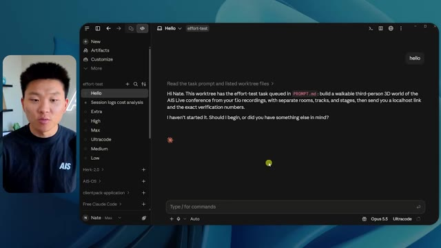
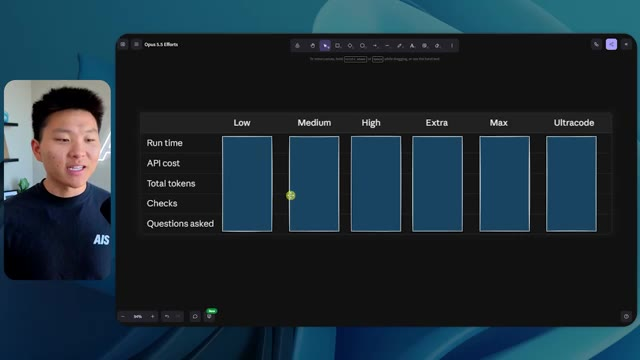
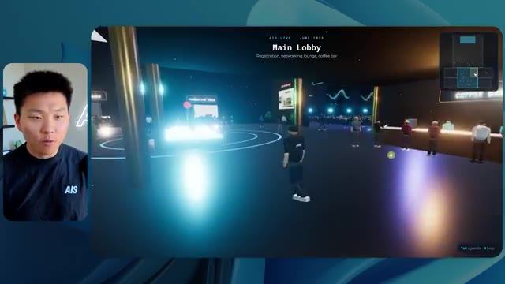
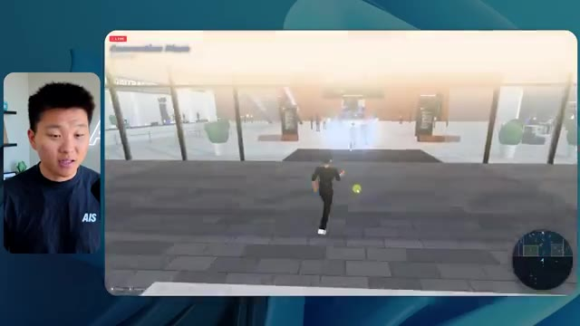
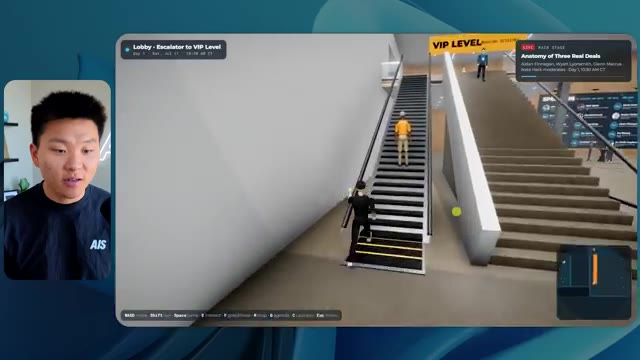
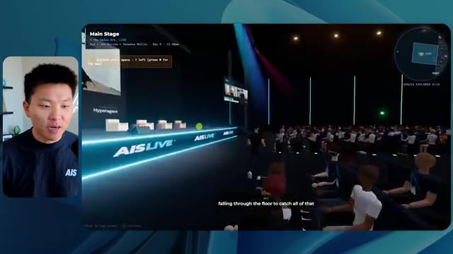
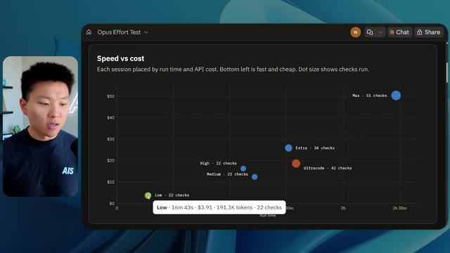

# 🎬 I Built the Ultimate AI Board of Advisors (free claude skill)

> **Chaîne** : [Nate Herk | AI Automation](https://www.youtube.com/@nateherk/featured)  
> **Lien YouTube** : [https://www.youtube.com/watch?v=nRXHWckVxoM](https://www.youtube.com/watch?v=nRXHWckVxoM)  
> **Date de publication** : 20261013  
> **Durée** : 00:14:44  
> **Identifiant vidéo** : `nRXHWckVxoM`  
> **Transcription & Analyse** : `whisper-v3-large-turbo+gemini-3.5-flash-lite`  

---

## 📌 Synthèse Exécutive & Outils

### 💡 Résumé

Dans cette vidéo de la chaîne *Nate Herk | AI Automation*, l'analyste explore l'impact direct du paramètre de niveau d'effort (*effort level*) sur les performances du modèle d'IA de pointe Opus 5.5, dans le cadre d'un cas pratique complexe d'ingénierie logicielle et d'agents autonomes. Le défi confié à l'IA consistait à transformer un dossier Frame.io de 105 gigaoctets contenant les enregistrements vidéo bruts d'un événement virtuel (AIS Live) en un monde 3D interactif et explorable à la troisième personne, reproduisant fidèlement une conférence physique avec ses scènes, ses pistes thématiques, ses stands partenaires et son identité visuelle.

À travers une expérimentation comparative rigoureuse (du niveau d'effort bas au niveau moyen, avant d'aborder les niveaux supérieurs et le parrainage d'Hostinger), la vidéo met en lumière des écarts spectaculaires en matière de rendu visuel, de fidélité contextuelle, de gestion des ressources et de logique d'exécution. Alors que le niveau bas produit un environnement rudimentaire, instable et visuellement déconnecté de la marque (malgré 16 minutes d'exécution et 191 000 jetons consommés), le niveau moyen élève considérablement la barre en intégrant les palettes de couleurs, des PNJ réactifs, des vidéos en lecture réelle et des structures de salles cohérentes, pour un coût de 12,44 $ en équivalent API et une heure et treize minutes de calcul, tout cela sans nécessiter la moindre intervention ou question de clarification de la part de l'agent.

Cette démonstration prouve l'importance critique de calibrer l'effort des modèles de nouvelle génération pour des tâches de développement lourd, transformant un simple prompt d'objectif en une application fonctionnelle prête pour le déploiement.

---

### 🛠️ Outils, Modèles & Logiciels Présentés

* **Opus 5.5** : Modèle d'intelligence artificielle de pointe d'Anthropic, réputé pour son intelligence, son coût abordable et sa polyvalence, exécuté ici à travers différents niveaux d'effort (faible, moyen, élevé, extra, max, code ultra).
* **Claude Code** : Environnement de développement et agent de codage avancé permettant d'exécuter des tâches d'ingénierie logicielle complexes directement depuis l'espace de travail.
* **Frame.io** : Plateforme cloud de gestion et de stockage vidéo utilisée pour héberger les 105 gigaoctets d'enregistrements bruts de l'événement AIS Live.
* **Herc 2** : Système d'exploitation IA propriétaire de Nate Herk, servant de base de ressources et d'automatisations intégrées pour les agents.
* **Hostinger** : Sponsor de la vidéo, fournissant un connecteur et une extension gratuite pour les éditeurs de code (VS Code, Cursor, Claude Code, etc.) facilitant le déploiement et la mise en ligne rapide des applications générées par l'IA.
* **Key.ai / Jev** : Technologies et clés d'API tierces évoquées pour la génération d'actifs visuels (images, vidéos) et le comportement décisionnel des agents et PNJ dans l'environnement 3D.

---

### 🔑 Points Clés & Enseignements Stratégiques

* **Impact direct du niveau d'effort sur la qualité** : Modifier le paramètre d'effort d'un modèle comme Opus 5.5 ne change pas seulement la durée d'exécution, mais transforme radicalement la complexité architecturale, la stabilité visuelle et la précision sémantique du code généré.
* **Évolution de la fidélité visuelle et fonctionnelle** : En effort faible, l'environnement 3D généré souffre de bugs d'affichage majeurs, de personnages fantômes qui disparaissent et d'une absence totale de charte graphique, tandis qu'en effort moyen, l'application intègre les couleurs de la marque, des PNJ animés et des flux vidéo fonctionnels.
* **Rapport coût-temps-performance mesurable** : L'expérimentation montre qu'un niveau d'effort supérieur (moyen) passe à 1 heure et 13 minutes d'exécution (contre 16 minutes pour le niveau bas) et 490 000 jetons (contre 191 000), un investissement en ressources amplement rentabilisé par la qualité opérationnelle du produit fini.
* **Autonomie totale des agents autonomes** : Dans les deux configurations testées (faible et moyen), l'agent a atteint l'objectif complet sans poser une seule question de clarification à l'utilisateur, démontrant une excellente capacité d'interprétation contextuelle des prompts d'objectifs globaux (*slash objectives*).
* **Exploitation de données massives hétérogènes** : L'IA a démontré sa capacité à ingérer et à structurer un volume brut massif (105 Go de vidéos sur Frame.io) pour en extraire une logique temporelle et spatiale (ordre du jour des deux jours de conférence, emplacements des salles A, B, C et du salon VIP).
* **Recommandation officielle d'Anthropic** : Pour les flux de travail complexes basés sur Opus 5.5, il est recommandé de démarrer au niveau d'effort moyen, puis d'ajuster le curseur à la hausse ou à la baisse en fonction de la criticité du livrable et des contraintes de temps.
* **Le goulet d'étranglement du déploiement** : La création par l'IA d'un prototype ou d'une application complète sur l'ordinateur local pose le défi classique de la mise en production rapide, un fossé que les extensions d'hébergement intégrées aux environnements de code cherchent à combler immédiatement.
* **Intégration d'écosystèmes logiciels propriétaires** : Le prompt exploitait la capacité du modèle à puiser dans des systèmes d'exploitation IA personnalisés (comme le projet Herc 2) pour enrichir la sémantique et le design du monde virtuel généré.
* **Simulation d'expériences immersives par le code** : L'utilisation de modèles de pointe permet de concevoir des métavers événementiels fonctionnels (vues à la troisième personne, mini-carte synchronisée en direct, stands interactifs) à partir de simples instructions textuelles descriptives.
* **Optimisation des flux de vérification automatisée** : L'agent effectue des boucles de validation itératives (de l'ordre de 22 à 23 cycles de vérification par le navigateur dans les cas présentés), testant activement ses propres productions pour s'assurer de leur bon comportement avant livraison.

---

## ⏱️ Chronologie & Transcription Complète Audio & Visuelle (Mot pour Mot)

### ⏱️ `[00:00:00 - 00:00:20]` | Segment #01

**🔊 Audio (Transcription Intégrale Mot pour Mot en Français) :**
> Opus 5.5, Opus 5.5, Opus 5.5, Opus 5.5, Opus 5.5. Ce modèle est littéralement partout et pour de très bonnes raisons. Il est intelligent, il est bon marché, il a un goût extraordinaire, c'est un modèle d'IA incroyable. Mais avec chaque modèle d'IA, vous avez le choix de l'effort, que ce soit faible, moyen, élevé, extra, max ou code ultra.

**👁️ Analyse Visuelle d'Écran (gemini-3.5-flash-lite) :**
**Interface & Outils** : Interface du réseau social X (Twitter).

**Contenu textuel & Code** : Un post commentant une expérience de simulation 3D (« technical creatives are about to experience a massive disruption ») avec une vidéo intégrée représentant un environnement insulaire tropical.

**Action / Démonstration** : Affichage d'un exemple concret de création réalisée avec l'IA pour illustrer l'impact sur les métiers créatifs.

*⏱️ 00:00:05 — Capture d'écran d'un post sur le réseau social X montrant une vidéo de simulation visuelle en 3D d'un paysage côtier tropical.*

---

### ⏱️ `[00:00:20 - 00:00:38]` | Segment #02

**🔊 Audio (Transcription Intégrale Mot pour Mot en Français) :**
> Donc, dans cette vidéo, j'ai donné exactement le même prompt à Opus 5.5 et je l'ai exécuté sur chaque niveau d'effort, et nous allons comparer les résultats. Nous examinerons la qualité de toutes les différentes sorties réelles, mais nous allons également regarder combien de temps chacun d'eux a fonctionné, combien cela nous a coûté s'il s'agissait d'une facturation par API, le nombre total de tokens, combien de vérifications ils ont exécutées, et combien de questions ils m'ont réellement posées tout au long du processus.

**👁️ Analyse Visuelle d'Écran (gemini-3.5-flash-lite) :**
**Interface & Outils** : Interface web de tableau blanc / application de notes (type Miro ou Obsidian Canvas).

**Contenu textuel & Code** : Tableau avec les colonnes Low, Medium, High, Extra, Max, Ultracode et les lignes Run time, API cost, Total tokens, Checks, Questions asked.

**Action / Démonstration** : Présentation du tableau comparatif des performances selon les niveaux d'effort.

*⏱️ 00:00:29 — Tableau comparatif sur une interface web montrant les différents niveaux d'effort d'Opus 5.5 (Low, Medium, High, Extra, Max, Ultracode) et leurs métriques.*

---

### ⏱️ `[00:00:39 - 00:00:58]` | Segment #03

**🔊 Audio (Transcription Intégrale Mot pour Mot en Français) :**
> Et les résultats que nous avons obtenus ne sont pas du tout ce à quoi je m'attends, donc j'ai hâte de partager cela avec vous les gars. Ne perdons pas de temps et allons directement à celui-ci. D'accord, alors plongeons directement dans celui-ci. Je veux commencer simplement en vous montrant le prompt réel que nous avons utilisé, que nous avons donné à chacun de ces différents agents. Je vais aller dans les fichiers ici, et nous allons ouvrir ce fichier markdown de prompt, et je vais vous montrer ce que nous avons obtenu. Voici donc le slash objectif que j'ai fourni.

**👁️ Analyse Visuelle d'Écran (gemini-3.5-flash-lite) :**
**Interface & Outils** : Interface logicielle de développement avec panneau latéral de navigation et zone de chat (type interface d'agent IA / outil de dev).

**Contenu textuel & Code** : Texte du prompt affiché : "Hi Nate. This worktree has the effort-test task queued in PROMPT.md : build a walkable third-person 3D world of the AIS Live conference from your fjio recordings..."

**Action / Démonstration** : Présentation de l'interface et du prompt initial de l'outil de développement d'IA.

*⏱️ 00:00:48 — Interface d'un éditeur ou d'un outil de développement avec un panneau de discussion montrant un prompt lié au projet AIS Live conference, avec la webcam du présentateur incrustée à gauche.*

---

### ⏱️ `[00:00:58 - 00:01:34]` | Segment #04

**🔊 Audio (Transcription Intégrale Mot pour Mot en Français) :**
> J'ai dit, tu dois me créer un monde 3D qui est une conférence tech réaliste dans laquelle je peux me promener en vue à la troisième personne. Tu vas regarder ce dossier, qui contient mes ressources d'enregistrement d'événements provenant d'AIS Live. Et ce dossier est un dossier Frame.io de 105 gigaoctets d'enregistrements vidéo. C'était un événement entièrement virtuel. Tout a été enregistré et tous les enregistrements sont juste ici. J'ai dit, ton objectif est de prendre cet événement et de le transformer en un monde 3D explorable qui me donne l'impression d'avoir réellement assisté à une vraie conférence en personne avec différentes salles, différentes pistes, différentes scènes, bla, bla, bla. N'hésite pas à utiliser key.ai si tu as besoin de générer des images ou des vidéos. Et tu peux aussi utiliser tout ce qui se trouve dans mon projet Herc 2, qui est comme mon système d'exploitation IA. J'ai dit,

**👁️ Analyse Visuelle d'Écran (gemini-3.5-flash-lite) :**
**Interface & Outils** : IDE de code (VS Code ou Cursor) et interface web Frame.io

**Contenu textuel & Code** : Fichier Markdown PROMPT.md détaillant la création d'un monde 3D de conférence tech explorable en vue à la troisième personne à partir de ressources Frame.io.

**Action / Démonstration** : Présentation du prompt initial et du dossier de ressources Frame.io contenant les enregistrements vidéo de l'événement virtuel.

*⏱️ 00:01:07 — Éditeur affichant le fichier PROMPT.md contenant les instructions pour créer un monde 3D interactif d'une conférence tech.*

*⏱️ 00:01:16 — Interface Frame.io montrant le dossier des ressources d'enregistrement d'événements AIS Live d'une taille de 105,69 Go.*

*⏱️ 00:01:25 — Retour sur l'éditeur affichant le fichier PROMPT.md avec les instructions détaillées du projet.*

---

### ⏱️ `[00:01:34 - 00:02:08]` | Segment #05

**🔊 Audio (Transcription Intégrale Mot pour Mot en Français) :**
> vous serez jugé sur la créativité, le design, la physique et la sensation générale lorsque j'explorerai le monde en 3D que vous avez construit. Et c'était essentiellement la fin des instructions. Donc, comme vous pouvez le voir sur ce côté gauche, j'ai exécuté ceci à travers tous les différents niveaux d'effort. Commençons par le niveau bas et remontons jusqu'à ultra code. Très bien. Donc, voici le résultat du niveau bas. Ouvrons ceci et jetons un coup d'œil. Donc, nous avons AIS live, le sommet des services IA en personne enfin, et nous avons pu cliquer partout. Tout d'abord, cela ne fait pas très personnalisé. Genre, ce n'is pas le logo d'IS Live. Ce n'est même pas nos couleurs. Donc, je n'aime pas trop ça, mais entrons ici. D'accord. C'est bien trop lumineux. Hum, nous avons une carte en haut à droite. Nous avons une ville par ici. Je ne peux pas dire quelle ville c'est

**👁️ Analyse Visuelle d'Écran (gemini-3.5-flash-lite) :**
**Interface & Outils** : Interface web d'agent / application de développement IA (style Claude Code / interface personnalisée) avec un panneau de navigation latéral et une zone de chat.

**Contenu textuel & Code** : Texte du prompt dans la zone principale demandant de construire un monde 3D en vue à la troisième personne pour une conférence AIS Live, ainsi que la liste des sessions "effort-test" dans la barre latérale.

**Action / Démonstration** : Le présentateur survole ou sélectionne différents niveaux d'effort de test dans la barre latérale gauche pour comparer les résultats de l'agent IA.

*⏱️ 00:01:42 — Interface d'une application d'agent IA montrant un panneau latéral avec des sessions de test par niveau d'effort (Hello, Extra, High, Max, Ultracode, Medium, Low) et un panneau de discussion principal affichant un prompt concernant la création d'un monde 3D.*

---

### ⏱️ `[00:02:08 - 00:02:40]` | Segment #06

**🔊 Audio (Transcription Intégrale Mot pour Mot en Français) :**
> c'est. D'accord. C'est Chicago, ce qui est plutôt cool parce que tu sais, j'habite à Chicago, mais bref, en haut à droite, on peut voir une carte. Nous avons un hall d'accueil. Nous avons un hall d'exposition. Nous avons un salon VIP sur la scène principale. La carte montre également où se trouve chaque autre personne et cela se synchronise en direct. Donc on peut voir l'inscription. On peut voir le premier jour, la keynote de l'hyper agent, le débriefing en direct. Cool. Donc ça connaît réellement l'ordre du jour et puis il y a le deuxième jour. Donc ça l'a trouvé, c'est bien. Nous avons ces petites boules ici que je peux espérer botter. D'accord. Le visage, Oh, regarde ça. Si je vais par ici, tous les gens disparaissent tout simplement. Très mauvais. Très mauvais. D'accord. Alors voyons voir. Est-ce que je peux sprinter ? D'accord.

**👁️ Analyse Visuelle d'Écran (gemini-3.5-flash-lite) :**
**Interface & Outils** : Environnement virtuel 3D interactif (plateforme d'événement en ligne type metaverse).

**Contenu textuel & Code** : Carte de navigation, programme « Day 1 », avatars de participants, zones thématiques.

**Action / Démonstration** : Exploration et navigation interactive à travers les différents espaces de l'événement virtuel.

*⏱️ 00:02:16 — Vue d'un espace virtuel 3D avec un avatar et une mini-carte en haut à droite montrant la position actuelle dans le hall d'accueil.*

*⏱️ 00:02:24 — Navigation dans le hall virtuel avec un panneau affichant le programme du premier jour de l'événement.*

*⏱️ 00:02:32 — Exploration de l'Expo Hall virtuel avec des stands et des participants représentés par des avatars colorés.*

---

### ⏱️ `[00:02:40 - 00:03:04]` | Segment #07

**🔊 Audio (Transcription Intégrale Mot pour Mot en Français) :**
> Je peux aller un peu plus vite. Je vais d'abord aller par ici. Il y a des produits promotionnels, euh, certifié AIS plus glido. D'accord. Donc, il y a les stands réels que nous avions dans l'événement virtuel. Nous avions des stands. Donc c'est plutôt cool. Un petit endroit pour prendre des photos. Salle C. En ce moment, nous avons Tangy Frederick qui anime un atelier. D'accord. Mais ce n'est pas une vidéo. Comme vous pouvez le voir, c'est juste une image. Elle ne bouge pas. Donc c'est juste une image. Ces gens sont en train de disparaître. Ce doivent être des fantômes. Allons par ici vers la salle A.

**👁️ Analyse Visuelle d'Écran (gemini-3.5-flash-lite) :**
**Interface & Outils** : Application de métavers / environnement virtuel 3D d'événement en ligne.

**Contenu textuel & Code** : Textes explicatifs sur écran virtuel et éléments graphiques d'un salon virtuel 3D.
[DESC_IMAGE_3] Navigation et exploration de l'espace virtuel par un avatar.

**Action / Démonstration** : Explications face caméra et démonstration conceptuelle.

*⏱️ 00:02:46 — Le présentateur présente un espace virtuel 3D (type salon ou hall d'exposition) avec des stands de sponsors (Glaido) et des cubes promotionnels marqués "AIS".*

*⏱️ 00:02:52 — Navigation dans une autre section de l'événement virtuel avec des tables lumineuses et des panneaux explicatifs sur les murs.*

*⏱️ 00:02:58 — Approche d'un écran géant interactif à l'intérieur d'une salle d'atelier affichant des instructions techniques sur les clés API.*

---

### ⏱️ `[00:03:04 - 00:03:30]` | Segment #08

**🔊 Audio (Transcription Intégrale Mot pour Mot en Français) :**
> Nous avons Liberty White. D'accord. Très cool. Vos 30 premiers jours en automatisation. Encore une fois, c'est juste une image fixe et les gens ont des bugs d'affichage. Donc ce n'est pas très bien ici. Je vais aller sur la scène principale pour voir ce que nous avons. D'accord, cool. Donc nous avons une scène principale. Les gens ont des bugs d'affichage. Vraiment beaucoup. Ce n'est vraiment pas terrible. Notre vidéo est en train de bouger. Genre, j'ai vu mon visage ici et j'ai vu celui de Devin, mais maintenant ils ont disparu. Donc je ne sais pas ce qui s'est passé. D'accord. Ça ressemble plutôt à un diaporama. Rien n'est vraiment diffusé pour l'instant. Bref, entrons ici.

**👁️ Analyse Visuelle d'Écran (gemini-3.5-flash-lite) :**
**Interface & Outils** : Application de conférence virtuelle en 3D (type métavers / Gather / espace virtuel interactif).

**Contenu textuel & Code** : Environnement virtuel 3D avec affichage de textes "Now showing: Hyperagent Workshop" et "AIS LIVE AI Services Summit".
[DESC_IMAGE_1] AUCUNE
[DESC_IMAGE_2] Navigation d'un avatar dans un auditorium virtuel rempli de participants virtuels.
[DESC_IMAGE_3] Déplacement de l'avatar vers la scène principale affichant l'écran géant du sommet.
[INTERFACE] Application de conférence virtuelle 3D (espace virtuel interactif).

**Action / Démonstration** : Navigation et exploration de l'espace virtuel par le présentateur.

*⏱️ 00:03:17 — Vue de l'auditorium principal de la plateforme virtuelle rempli d'avatars de participants assistant à une conférence.*

*⏱️ 00:03:24 — Vue en face de la grande scène principale affichant le logo "AIS LIVE AI Services Summit" dans l'environnement virtuel.*

---

### ⏱️ `[00:03:30 - 00:03:58]` | Segment #09

**🔊 Audio (Transcription Intégrale Mot pour Mot en Français) :**
> Nous avons plus de stands. Nous avons hyper agent. Nous avons Claude Code. Nous avons plus de goodies. La salle B, c'est Dave Ebelor. Je suppose que c'est exactement la même chose. Nous avons du café. Et ensuite, je suppose que le salon VIP, accès VIP seulement. C'est plutôt cool, mais il n'y a vraiment rien qui se passe ici. Cet écran est beaucoup trop lumineux. D'accord. Donc je pense que vous comprenez l'ambiance que nous obtenons ici avec Opus 5.5 en effort faible. Et c'est là que les choses deviennent intéressantes. À combien est-ce que vous pensez que cela a tourné ? Combien de temps ? Celui-ci a duré 16 minutes et 43 secondes. Combien est-ce que vous pensez que cela a coûté ?

**👁️ Analyse Visuelle d'Écran (gemini-3.5-flash-lite) :**
**Interface & Outils** : Tableau de bord / application web interactive sur fond sombre

**Contenu textuel & Code** : Tableau comparatif des performances (Run time, API cost, Total tokens, Checks, Questions asked) selon différents niveaux de réglage (Low, Medium, High, Extra, Max, Ultracode)

**Action / Démonstration** : Navigation et présentation des différents niveaux de performance et de configuration des agents IA

*⏱️ 00:03:51 — Interface montrant un tableau comparatif avec les niveaux 'Low', 'Medium', 'High', 'Extra', 'Max', 'Ultracode' et des métriques telles que Run time, API cost, Total tokens.*

---

### ⏱️ `[00:03:58 - 00:04:26]` | Segment #10

**🔊 Audio (Transcription Intégrale Mot pour Mot en Français) :**
> 3,91 dollars si c'était une facturation par API. J'utilise évidemment mon abonnement ici, mais nous allons simplement calculer cela en facturation API. Le nombre total de jetons était de 191 000. Il a effectué 22 vérifications. Donc la vérification, 22 fois il a ouvert le navigateur et a exécuté différents types de vérifications. Donc 22 catégories de vérifications. Et combien de questions m'a-t-il posées ? Il m'a posé un total de zéro question tout au long de cette invite de commande d'objectif. D'accord. Alors, ouvrons l'effort moyen et voyons ce que nous avons. D'accord, c'est parti. Effort moyen. Nous avons Nate Herc. Nous avons mon badge. C'est de la marque AI's Life.

**👁️ Analyse Visuelle d'Écran (gemini-3.5-flash-lite) :**
**Interface & Outils** : Outil de tableau blanc ou de diagramme (type Excalidraw)

**Contenu textuel & Code** : Tableau de données chiffrées : Run time (16m 43s), API cost ($3.91), Total tokens (191.3K), Checks, et Questions asked, répartis par niveau d'effort (Low, Medium, High, Ex...).

**Action / Démonstration** : Présentation et analyse des coûts et des performances d'exécution des tâches d'automatisation.

*⏱️ 00:04:05 — Un tableau comparatif des performances et des coûts affiché sur un écran, montrant les métriques pour le niveau 'Low' (Run time : 16m 43s, API cost : $3.91, Total tokens : 191.3K, Checks, Questions asked), avec le présentateur visible en incrustation à gauche.*

---

### ⏱️ `[00:04:26 - 00:04:46]` | Segment #11

**🔊 Audio (Transcription Intégrale Mot pour Mot en Français) :**
> Alors ça a déjà l'air un petit peu mieux. Ça ressemble à nos palettes de couleurs qui ont utilisé nos directives de marque. Premier jour de construction, deuxième jour de gain, VIP. Cool. D'accord. Je vais entrer dans le lieu. D'accord. Waouh. Une ambiance similaire, en somme. C'est en arrière-plan. Ça ne ressemble pas à Chicago, n'est-ce pas ? Non, ça ressemble à un, honnêtement, ça ressemble à une ville inventée. Quoi qu'il en soit, c'est drôle qu'ils aient décidé de faire ça. Voyons si je peux me déplacer un peu plus vite. Oh, waouh.

**👁️ Analyse Visuelle d'Écran (gemini-3.5-flash-lite) :**
**Interface & Outils** : Application web interactive en 3D / Interface utilisateur d'un événement virtuel (AIS Live).

**Contenu textuel & Code** : Textes de bienvenue, badge VIP, contrôles de navigation (WASD walk, Shift sprint, etc.), et interface graphique de l'événement.
[DESC_IMAGE_1] Le présentateur clique sur le bouton pour entrer dans l'événement virtuel après avoir configuré son badge de marque.
[DESC_IMAGE_2] Navigation du présentateur à l'intérieur du lieu virtuel en 3D ("Enter the Venue").

**Action / Démonstration** : Explications face caméra et démonstration conceptuelle.

*⏱️ 00:04:31 — Écran d'accueil de l'application 'AIS Live' avec un badge nominatif interactif au nom de Nate Herk et un bouton 'Enter the Venue'.*

*⏱️ 00:04:41 — Vue à la première ou troisième personne à l'intérieur de l'espace virtuel 3D de l'application, montrant des avatars et un décor de salon avec vue sur la ville.*

---

### ⏱️ `[00:04:46 - 00:05:21]` | Segment #12

**🔊 Audio (Transcription Intégrale Mot pour Mot en Français) :**
> Les gens interagissent avec moi. Regardez. Si je m'approche de ce type, il vient de lever le bras. Bon, maintenant il ne veut plus du tout avoir affaire à moi. Mais tous ces petits robots ici doivent prendre des décisions. Je ne sais pas s'ils utilisent Jev. C'est sûr que non. Je ne le lui ai pas dit. En fait, ma clé Jev est à l'arrière. Je ne sais pas. Peut-être qu'il l'a utilisée. Quoi qu'il en soit, nous pouvons voir ici que nous avons la salle d'atelier C, le laboratoire des agents. Sympa. Donc celui-ci est en fait en train d'être exécuté. Vous pouvez voir qu'il s'agit d'une vraie vidéo lue par Tangy. Tout le monde ici est en train de travailler sur un ordinateur portable. Ils ne buguent pas. C'est plutôt cool. De plus, mon badge est sur ma poitrine, ce qui est plutôt cool. Je peux venir par ici. Nous avons une carte en haut à droite, comme vous pouvez le voir, mais je peux venir par ici. Nous avons un

**👁️ Analyse Visuelle d'Écran (gemini-3.5-flash-lite) :**
**Interface & Outils** : Environnement virtuel 3D / Jeu de simulation sociale ou spatiale

**Contenu textuel & Code** : Avatars virtuels, interface de navigation, mini-carte en haut à droite

**Action / Démonstration** : Exploration d'un espace virtuel 3D avec des personnages animés

---

### ⏱️ `[00:05:21 - 00:05:47]` | Segment #13

**🔊 Audio (Transcription Intégrale Mot pour Mot en Français) :**
> hall d'exposition. C'est là que nous avons le stand Glido. Et ça diffuse en ce moment. Oui, ça diffuse la vidéo de nous parlant de Glido. Ça diffuse la vidéo d'Ed et moi parlant de notre programme de certification. Nous avons le logo AIS Plus juste ici, qui est un peu mal placé. Ce sont les diapositives des conférenciers et les points clés. Alors wow, ce sont toutes les ressources que nous avons distribuées après l'événement. Elles sont toutes là aussi. Nous pouvons voir que nous avons un coup de projecteur sur la communauté. C'est donc Aiden qui parle de son contrat qu'il a décroché et c'est diffusé en direct. Ces gens regardent.

**👁️ Analyse Visuelle d'Écran (gemini-3.5-flash-lite) :**
**Interface & Outils** : Environnement virtuel 3D / plateforme d'événements virtuels en ligne.

**Contenu textuel & Code** : Présentations et affiches textuelles sur les murs de l'exposition virtuelle.

**Action / Démonstration** : Navigation et exploration d'un espace d'exposition virtuel par le présentateur.

---

### ⏱️ `[00:05:47 - 00:06:21]` | Segment #14

**🔊 Audio (Transcription Intégrale Mot pour Mot en Français) :**
> Ils sont plutôt engagés. On a un hyper agent. C'était, c'est ce que je voulais dire. Si vous avez vu ces gens lever les bras en disant bonjour, c'était plutôt marrant. Regardez, regardez, le voilà qui recommence. Bref. Bon. Où est-ce que je suis maintenant ? Maintenant, je suis dans le hall principal. On a un bar à café. On a un grand logo, qui est le vrai logo. Il est trop lumineux, mais on a le logo. On peut voir si on peut entrer ici dans le parcours fondation. On a Sabrina Romanov et Liberty White. Donc différentes formations juste là. On peut entrer dans cette salle. C'est le parcours avancé. Alors qu'est-ce qui se passe ici. On a Dave Ebelar et Saman qui parlent de différentes choses là-dedans. Et maintenant, allons jeter un œil à la scène principale. Oh, attendez, il y a une vidéo de moi là-haut. C'est du genre un VIP

**👁️ Analyse Visuelle d'Écran (gemini-3.5-flash-lite) :**
**Interface & Outils** : Application de métavers ou plateforme d'événements virtuels en 3D.

**Contenu textuel & Code** : Environnement virtuel interactif 3D avec avatars d'utilisateurs et interface de navigation.

**Action / Démonstration** : Navigation et déplacement d'un avatar à travers le hall principal et les espaces virtuels de la plateforme.

*⏱️ 00:05:55 — Vue principale du hall virtuel 3D (Main Lobby) avec des avatars et un présentateur incrusté à gauche.*

*⏱️ 00:06:04 — L'avatar se dirige vers une salle de conférence ou un amphithéâtre virtuel bondé.*

*⏱️ 00:06:12 — Vue en contre-plongée montrant plusieurs avatars interactifs regroupés dans un espace virtuel en 3D.*

---

### ⏱️ `[00:06:21 - 00:06:50]` | Segment #15

**🔊 Audio (Transcription Intégrale Mot pour Mot en Français) :**
> section ? Ouais, on ira voir ça dans une minute. Mais bref, voici la scène principale. Ça a l'air vraiment, vraiment très bien. On a une grande scène. On a genre quatre personnes assises ici. On a les trois écrans d'Alex là-haut avec Hyper Agent. Est-ce que j'ai le droit de monter sur scène ? Oh, et il me laisse monter sur scène. D'accord. C'est plutôt sympa. Bon les gars, prenons un selfie. Laissez-moi mettre tout le monde en arrière-plan. Venez par ici. Bref, c'est plutôt, plutôt cool. Par contre, toutes les places ne sont pas occupées. Donc il faut qu'on travaille là-dessus. Mais bref, je vais y retourner en courant pour voir ce qu'était cette section VIP. D'accord. Salon VIP. J'ai l'impression que c'est comme un aéroport ou quelque chose comme ça.

**👁️ Analyse Visuelle d'Écran (gemini-3.5-flash-lite) :**
**Interface & Outils** : Application virtuelle 3D / plateforme de conférence Hyper Agent

**Contenu textuel & Code** : Interface utilisateur virtuelle avec affichage de la session "Hyperagent Keynote" et mini-carte de navigation.

**Action / Démonstration** : Navigation et exploration de l'espace virtuel de la keynote par l'avatar de l'utilisateur.

---

### ⏱️ `[00:06:51 - 00:07:14]` | Segment #16

**🔊 Audio (Transcription Intégrale Mot pour Mot en Français) :**
> D'accord, super. Donc maintenant nous avons les sessions VIP ici. Une foire aux questions VIP avec la lecture vidéo en direct de Nate juste ici. Très, très cool. Et nous avons comme un bar ou quelque chose. Génial. Je dirais que c'est un assez bon résultat. Maintenant, en ce qui concerne les statistiques ici, celle-ci a pris une heure et 13 minutes à s'exécuter. Cela nous aurait coûté 12 dollars et 44 cents. Elle a utilisé 490 000 jetons et a fait 23 vérifications.

**👁️ Analyse Visuelle d'Écran (gemini-3.5-flash-lite) :**
**Interface & Outils** : Application virtuelle 3D (espace VIP) et tableau de statistiques (Opus 5.5 Efforts).

**Contenu textuel & Code** : Session VIP Q&A with Nate, métriques de coût et d'exécution d'IA (Run time, API cost, Total tokens, Checks, Questions asked).

**Action / Démonstration** : Navigation et présentation de l'espace virtuel VIP puis passage aux statistiques d'utilisation de l'IA.

*⏱️ 00:06:56 — Vue d'un espace virtuel VIP avec un écran affichant le présentateur en direct, et à gauche le présentateur réel en incrustation.*

*⏱️ 00:07:02 — Tableau de statistiques montrant les performances de l'IA (Run time 16m 43s, API cost $3.91, Total tokens 191.3K, Checks 22, Questions asked 0).*

---

### ⏱️ `[00:07:14 - 00:07:48]` | Segment #17

**🔊 Audio (Transcription Intégrale Mot pour Mot en Français) :**
> Et il nous a posé exactement zéro question une fois de plus. Très bien, passons au niveau élevé. C'était déjà un résultat plutôt correct et Anthropic eux-mêmes dans leur vidéo sur comment prompter Opus 5.5, ou désolé, pas une vidéo, un article. Ils ont dit de commencer simplement par le niveau moyen et de l'ajuster à la hausse ou à la baisse si nécessaire. C'était donc un résultat moyen. Passons au niveau élevé et voyons ce qu'on a obtenu. Très rapidement, les gars, je dois prendre une seconde pour vous parler du sponsor de la vidéo d'aujourd'hui, Hostinger. Donc ces deux modèles viennent de me créer une version fonctionnelle de la même chose. Et maintenant, je me retrouve exactement là où je finis toujours, avec un produit fini sur mon ordinateur portable et aucun moyen rapide de le mettre en ligne. Et c'est précisément le fossé que comble le connecteur d'Hostinger. C'est une extension gratuite

**👁️ Analyse Visuelle d'Écran (gemini-3.5-flash-lite) :**
**Interface & Outils** : Tableau comparatif type tableau blanc/canvas pour l'image 1, et environnement de développement de type IDE/éditeur avec agents IA pour l'image 2.

**Contenu textuel & Code** : Métriques de performance (Run time, API cost, Total tokens, Checks, Questions asked) pour l'image 1, et instructions de prompt pour un calculateur Northwind ROI avec des logs de réflexion de l'IA pour l'image 2.

**Action / Démonstration** : Comparaison des coûts et des temps de calcul selon les niveaux d'effort d'Opus 5.5, puis génération de code pour une application web d'une page.

*⏱️ 00:07:22 — Un tableau comparatif des performances d'Opus 5.5 selon différents niveaux d'effort (Low, Medium, High, Extra) montrant les temps d'exécution, les coûts API et le nombre de tokens.*

*⏱️ 00:07:39 — Une interface de développement avec deux panneaux divisés affichant l'exécution d'un prompt pour créer un calculateur de ROI et le panneau de discussion associé.*

---

### ⏱️ `[00:07:48 - 00:08:23]` | Segment #18

**🔊 Audio (Transcription Intégrale Mot pour Mot en Français) :**
> pour votre éditeur qui intègre votre compte Hostinger dans l'outil de programmation que vous utilisez déjà, que ce soit VS Code, Cursor, Cloud Code, Codex, et j'en passe. Vous vous connectez une seule fois en un clic, et à partir de là, votre agent peut déployer le site, y associer un domaine, configurer les enregistrements DNS et vérifier votre VPS sans que vous ayez à quitter votre éditeur. Ainsi, quel que soit celui que vous finirez par préférer, ce qu'il a construit se trouve à quelques minutes d'une vraie URL sur un hébergement géré. L'extension Connector est gratuite sur tous les hébergements ou forfaits, donc si vous avez toujours besoin de l'hébergement en dessous, prenez le forfait illimité avec le lien dans la description et utilisez le code NATEHERK pour obtenir 10 % de réduction. Cela comprend également un nom de domaine gratuit et un e-mail professionnel pour l'année. Et c'est toujours le moyen le plus économique que j'ai trouvé pour obtenir quelque chose

**👁️ Analyse Visuelle d'Écran (gemini-3.5-flash-lite) :**
**Interface & Outils** : Interface de gestion Hostinger pour IDE et Claude Code (terminal/éditeur)

**Contenu textuel & Code** : "Manage Hostinger from your IDE", statut "Connected VIA OAUTH", Node.js 24.13.0, liste des outils disponibles (Websites, Domains, Subscriptions & Payments, Email Marketing)

**Action / Démonstration** : Connexion unique du compte Hostinger à l'éditeur et affichage des outils accessibles par l'agent

*⏱️ 00:07:57 — Interface montrant la connexion du compte Hostinger depuis un IDE via OAuth avec les outils disponibles (Websites, Domains, Subscriptions, Email Marketing), aux côtés de Claude Code.*

---

### ⏱️ `[00:08:23 - 00:08:47]` | Segment #19

**🔊 Audio (Transcription Intégrale Mot pour Mot en Français) :**
> Tu as construit sur une vraie URL. Donc revenons à la vidéo. D'accord. Encore une fois, très, très thématisé par la marque. C'est un écran de chargement encore mieux que le précédent. Nous avons ce petit effet sympa en arrière-plan. Nous avons le logo. Nous allons entrer dans le lieu. D'accord. Nous y voilà. Ça a l'air plutôt pas mal. Nous commençons à l'extérieur et vous pouvez voir que nous avons ces drapeaux pour tous les intervenants, Wyatt, Casper, Alex, Ed, Aiden, Sabrina, Liberty. C'est plutôt cool. Nous avons des blocs en direct ici.

**👁️ Analyse Visuelle d'Écran (gemini-3.5-flash-lite) :**
**Interface & Outils** : Environnement virtuel interactif de type métavers pour un événement.

**Contenu textuel & Code** : Aucune information technique visible (code, commandes, etc.).

**Action / Démonstration** : Passage d'un écran de chargement à l'exploration d'un lieu virtuel.

*⏱️ 00:08:29 — Écran de chargement du logo "AIS LIVE" avec des informations sur l'événement et des commandes pour naviguer dans le monde virtuel.*

*⏱️ 00:08:35 — Vue d'une place virtuelle nommée "AIS Live Plaza" avec des avatars se déplaçant dans un environnement urbain. Une bannière indique "Welcome to AIS Live. Head through the arch to Registration".*

*⏱️ 00:08:41 — La même place virtuelle, montrant des bannières avec des noms, un objet sphérique flottant et des avatars.*

---

### ⏱️ `[00:08:47 - 00:09:23]` | Segment #20

**🔊 Audio (Transcription Intégrale Mot pour Mot en Français) :**
> Il a pris cette photo de moi, votre hôte, Nate Herc, John, Dave, Nate Herc. Voilà. D'accord. Les portes. Génial. Ce sont des portes automatiques coulissantes en verre. J'adore ça. Nous pouvons voir l'enregistrement VIP. Nous pouvons voir l'admission générale. Nous pouvons venir ici et nous pouvons découvrir l'exposition avec différents stands, le coin de la communauté. Vous pouvez également voir qu'en haut à gauche, j'ai un passeport. Donc c'est comme si, cela montrera combien d'endroits j'ai visités. Tout cela est une lecture réelle. Nous avons un mur de ressources avec tous les différents intervenants. Ils ont également une session de networking ici. Je vais donc venir très vite et voir de quoi il s'agit. Nous avons donc le bar à cold brew AIS. Nous avons différents membres de la communauté qui ont été mis en avant ou mis en lumière.

**👁️ Analyse Visuelle d'Écran (gemini-3.5-flash-lite) :**
**Interface & Outils** : Application web 3D / Monde virtuel interactif

**Contenu textuel & Code** : Interface utilisateur affichant "Registration Concourse", "VIP Check-in" et des éléments de gamification.

**Action / Démonstration** : Exploration et navigation dans l'environnement virtuel 3D avec un avatar.

*⏱️ 00:08:56 — Vue d'un monde virtuel interactif montrant l'accueil d'un événement avec des stands VIP et GA.*

*⏱️ 00:09:05 — Navigation dans un hall d'exposition virtuel avec des stands d'information et des avatars de visiteurs.*

*⏱️ 00:09:14 — Déplacement dans le hall d'enregistrement virtuel au milieu d'autres avatars de participants.*

---

### ⏱️ `[00:09:23 - 00:09:56]` | Segment #21

**🔊 Audio (Transcription Intégrale Mot pour Mot en Français) :**
> On a l'aile VIP. Attends, quoi ? Récupère un bracelet. Oh, je dois vraiment aller chercher le bracelet. D'accord. Laisse-moi m'enregistrer rapidement. Le bracelet est déjà mis. Attends, quoi ? D'accord. Oh, d'accord. Maintenant, les portes se sont ouvertes pour moi. Cool. Je peux entrer ici. Oh, ça mène juste à la scène principale. Salon VIP. Il y a une séance de questions-réponses en cours. Ça a l'air très sympa. Je veux dire, je suis très impressionné par la façon dont il parvient à faire ça. Waouh. D'accord. Donc c'est vraiment bien. Ce qu'on a fait, c'est qu'on a eu des salles de discussion VIP avec différentes personnes. Tu peux voir qu'il y a différentes salles, différents membres de l'équipe AIS qui participent à des trucs. C'est vraiment cool. C'est très cool. C'est un VIP bien meilleur

**👁️ Analyse Visuelle d'Écran (gemini-3.5-flash-lite) :**
**Interface & Outils** : Environnement virtuel 3D interactif (Metaverse / application de réunion virtuelle).

**Contenu textuel & Code** : Interface utilisateur affichant des zones de réunion, des indications textuelles ('Registration Concourse', 'VIP Lounge', 'VIP Working Sessions') et des mini-cartes.

**Action / Démonstration** : Navigation et exploration d'un espace de réunion virtuel 3D avec un avatar.

*⏱️ 00:09:32 — Le présentateur navigue dans un espace virtuel 3D représentant une zone de congrès avec des panneaux d'affichage.*

*⏱️ 00:09:40 — Le présentateur explore une salle de salon VIP virtuelle avec un écran affichant des participants en visioconférence.*

*⏱️ 00:09:48 — Le présentateur se déplace dans une section de sessions de travail VIP virtuelle avec plusieurs tables thématiques.*

---

### ⏱️ `[00:09:56 - 00:10:30]` | Segment #22

**🔊 Audio (Transcription Intégrale Mot pour Mot en Français) :**
> expérience que ce qui a été montré dans le premier élément. D'accord. After party VIP. Regardez ça. On a une piste de danse. On a tous ces éléments ici. On a la lecture de l'after party VIP juste ici. Et il y a une estrade de DJ. C'est tellement marrant. Il y a un petit bug ici, un petit glitch par là, mais c'est génial. Oh, chouette. Donc quand je suis ici sur la scène principale, on a des sous-titres. Vous pouvez voir juste ici en bas de mon écran, on a ces sous-titres de Wyatt qui est en train de parler là-haut. On a des lumières. On a le panneau. Très chouette. Belle scène principale. Je vais aller par ici. On peut aller à la fondation,

**👁️ Analyse Visuelle d'Écran (gemini-3.5-flash-lite) :**
**Interface & Outils** : Application web 3D d'événement virtuel.

**Contenu textuel & Code** : Interface utilisateur de type métavers avec affichage des participants en direct sur écran géant.

**Action / Démonstration** : Navigation et exploration de l'espace virtuel de l'after-party et de la scène principale.

*⏱️ 00:10:04 — Vue d'un espace virtuel d'after-party VIP avec piste de danse et avatars animés.*

*⏱️ 00:10:13 — Vue de l'after-party VIP montrant un écran affichant des flux vidéo de participants.*

*⏱️ 00:10:21 — Vue de la scène principale d'un événement virtuel avec des avatars assis dans une salle de conférence.*

---

### ⏱️ `[00:10:30 - 00:11:06]` | Segment #23

**🔊 Audio (Transcription Intégrale Mot pour Mot en Français) :**
> avancé, et les parcours d'entreprise par ici. Donc voyons voir. Nous avons l'anatomie de trois vrais contrats. Nous avons hyper agent. Nous avons les évaluations avec Nate et Ed ici. Nous avons Dave qui intervient sur les trucs avancés. C'est vraiment bien. Je veux dire, évidemment, chacun, chacun de ces résultats jusqu'à présent, faible était correct. Moyen était meilleur. Élevé a été encore meilleur. Voyons si cette tendance se poursuit et allons voir ce que cela nous a coûté. Donc élevé a tourné pendant une heure et sept minutes. Donc un peu plus rapide que moyen, cela nous aurait coûté 16 dollars et 31 cents. Il a utilisé un demi-million de jetons, 509 000. Il a fait 22 vérifications. Et il nous a aussi demandé, enfin, non, je me suis trompé. Ce

**👁️ Analyse Visuelle d'Écran (gemini-3.5-flash-lite) :**
**Interface & Outils** : Application de tableau blanc / interface de présentation (style Excalidraw) avec un tableau de données et un panneau de configuration latéral.

**Contenu textuel & Code** : Tableau montrant les métriques pour Low (16m 43s, $3.91, 191.3K tokens, 22 checks), Medium (1h 13m, $12.44, 419.2K tokens, 23 checks), et High (1h 7m, $16.31).

**Action / Démonstration** : Analyse et présentation comparative des coûts et des performances d'exécution des modèles d'IA selon différents niveaux d'effort.

*⏱️ 00:10:57 — Tableau comparatif des performances et coûts de modèles d'IA (intitulé 'Opus 5.5 Efforts') avec des colonnes Low, Medium, High et Extra détaillant le temps d'exécution, le coût API, les tokens et les vérifications.*

---

### ⏱️ `[00:11:06 - 00:11:25]` | Segment #24

**🔊 Audio (Transcription Intégrale Mot pour Mot en Français) :**
> L'un m'a posé une question, et spoiler, c'était le seul qui nous a posé une question pendant tout ça. Donc voyons voir, il nous en reste trois : Extra, Max et Ultra Code. Laissez-moi ouvrir Extra et nous verrons ce que nous avons. D'accord. Donc celui-ci a l'air plutôt bien. Je dirais honnêtement que jusqu'à présent, l'écran de chargement haut était le meilleur, celui qu'on vient juste de voir, mais bref, entrons dans AIS Live.

**👁️ Analyse Visuelle d'Écran (gemini-3.5-flash-lite) :**
**Interface & Outils** : Interface web de tableau de bord ou canvas d'analyse.

**Contenu textuel & Code** : Tableau de données montrant les métriques : Run time (ex: 16m 43s, 1h 13m...), API cost ($3.91, $12.44...), Total tokens (191.3K, 419.2K...), Checks (22, 23...), et Questions asked (0, 0, 1).

**Action / Démonstration** : Le présentateur commente les résultats du tableau et sélectionne la colonne correspondant à "Extra".

*⏱️ 00:11:11 — Tableau comparatif des performances de différents modèles ou configurations (Low, Medium, High, Extra) incluant le temps d'exécution, le coût API, le nombre total de tokens, les vérifications et les questions posées.*

---

### ⏱️ `[00:11:26 - 00:11:51]` | Segment #25

**🔊 Audio (Transcription Intégrale Mot pour Mot en Français) :**
> Whoa. D'accord. Donc on a comme de petits extraits sonores. Je peux discuter avec des gens. Le panneau sur la guerre des outils a réglé quelques débats pour moi. Sympa. Bonne perspective là-bas. On est dehors à nouveau. On a ces différentes bannières, bien qu'elles soient toutes les mêmes. Elles n'affichent pas de noms de personnes différentes. Donc grand logo AIS Live. L'aile des ateliers est par ici. Et passons par les portes coulissantes en verre pour voir ce qu'on a. Donc on a le café AIS. La carte est en bas à droite, et elle n'est pas très descriptive.

**👁️ Analyse Visuelle d'Écran (gemini-3.5-flash-lite) :**
**Interface & Outils** : Environnement virtuel 3D / Jeu en ligne / Plateforme de métavers.

**Contenu textuel & Code** : Interface utilisateur affichant une mini-carte en bas à droite, des éléments de HUD et des bulles de dialogue.

**Action / Démonstration** : Navigation et déplacement d'un avatar dans un espace virtuel 3D interactif.

*⏱️ 00:11:32 — Vue d'un monde virtuel 3D de type métavers ou jeu montrant un avatar se déplaçant sur une place de convention avec des bannières 'AIS LIVE'.*

*⏱️ 00:11:38 — L'avatar continue de marcher dans l'environnement virtuel en extérieur près d'une zone arborée et de bâtiments futuristes.*

*⏱️ 00:11:45 — L'avatar court en direction de l'entrée principale d'un grand hall d'exposition virtuel baigné de lumière.*

---

### ⏱️ `[00:11:51 - 00:12:26]` | Segment #26

**🔊 Audio (Transcription Intégrale Mot pour Mot en Français) :**
> J'aime bien comment les autres cartes nous ont dit quoi, genre où étaient les choses, mais celle-ci a l'air très professionnelle. On peut voir ici la scène principale. Allons y faire un saut rapidement. Ils ont tous ces ballons qui volent partout, ce que je trouve assez marrant. Les ballons de plage AIS. On nous voit là-haut en train de parler. Je crois que j'introduisais l'un des jours. Continuons à avancer par ici vers la salle d'atelier sur ce côté gauche. D'accord. Donc ici, nous avons le théâtre Hyper Agent. Nous avons cette session sponsorisée ici par Hyper Agent, mais cela nous montre aussi ce qui va s'y passer. C'est vraiment drôle qu'on puisse discuter avec des gens. Salmon a créé un représentant commercial vocal en direct. La salle du juste prix était comble. Tu as récupéré le guide du compagnon VIP ? C'est tellement marrant. Nous avons le parcours avancé dans

**👁️ Analyse Visuelle d'Écran (gemini-3.5-flash-lite) :**
**Interface & Outils** : Monde virtuel interactif (probablement une plateforme de metaverse ou de conférence virtuelle).

**Contenu textuel & Code** : Des dialogues et des indications textuelles dans le monde virtuel, comme "You see, like, the events, you see the stage, and the..." et "Keep scrolling down the list...".

**Action / Démonstration** : Navigation dans un environnement virtuel, observation de la scène principale et d'autres espaces, et interaction potentielle via des dialogues textuels.

*⏱️ 00:12:00 — Une scène virtuelle avec une scène principale où un conférencier est visible, entouré d'une foule d'avatars et de ballons virtuels.*

*⏱️ 00:12:09 — Un espace virtuel présentant des stands de "AI Workshops" avec des indications pour "Foundation", "Advanced" et "Enterprise".*

*⏱️ 00:12:17 — Un couloir virtuel avec plusieurs avatars se tenant et discutant, avec des indications textuelles flottantes.*

---

### ⏱️ `[00:12:26 - 00:12:58]` | Segment #27

**🔊 Audio (Transcription Intégrale Mot pour Mot en Français) :**
> ici. Encore une fois, nous avons la lecture en direct. Est-ce que c'est la lecture en direct ? Oh, d'accord. Ça a commencé une fois que je suis entré, mais je peux m'asseoir. Oh la la. Je peux regarder ça. Je peux me lever. Je veux m'asseoir au premier rang. C'est plutôt cool. C'est très bien. J'aime ça. Et tu sais ce que j'ai remarqué jusqu'à présent ? Le personnage que j'incarne me ressemble un peu. Je pense qu'il s'est inspiré de mes photos de profil ou quelque chose comme ça. Bref, nous avons Sabrina ici, l'animatrice de la salle ici, prenez n'importe quel siège libre. D'accord, cool. Et j'ai vraiment aimé la fonctionnalité pour s'asseoir. C'est plutôt marrant. Genre, on pourrait vraiment assister à cet atelier et participer. Bref, ça nous montre les intervenants. Ça nous montre les

**👁️ Analyse Visuelle d'Écran (gemini-3.5-flash-lite) :**
**Interface & Outils** : Espace virtuel (type métavers), écran de présentation

**Contenu textuel & Code** : Texte sur l'écran de présentation, fenêtres affichées à l'écran.

**Action / Démonstration** : Le présentateur interagit dans l'espace virtuel et semble guider la présentation.

*⏱️ 00:12:34 — Un présentateur dans un espace virtuel, présentant une salle remplie d'avatars d'auditeurs assistant à une présentation sur un grand écran.*

*⏱️ 00:12:42 — Gros plan sur l'avatar du présentateur dans l'espace virtuel, qui semble expliquer une partie de la présentation sur l'écran.*

*⏱️ 00:12:50 — Vue rapprochée sur un écran virtuel affichant des fenêtres de navigateur ou d'application.*

---

### ⏱️ `[00:12:58 - 00:13:31]` | Segment #28

**🔊 Audio (Transcription Intégrale Mot pour Mot en Français) :**
> ordre du jour. Il y a un petit tapis rouge ici pour prendre des photos. Nous pouvons poser. Oh, wow. C'est plutôt cool. Bibliothèque de ressources, obtenez la certification AIS Plus, Glido, Hyper Agent, AIS Plus, trois vraies affaires. Génial. Je veux dire, je dirais certainement que jusqu'à présent, chacun s'améliore. Et nous n'avons même pas encore regardé la section VIP, le salon VIP. Allons-y rapidement. J'espère que je pourrai y entrer. Sympa. Nous avons la réinitialisation des outils. Ce sont les différentes salles dans lesquelles nous pouvons aller. Donc, une fois de plus, je pourrais prendre la feuille de travail et essayer de comprendre comment fixer le prix de mes affaires. C'est tellement cool. C'est certainement mieux que le précédent où nous avions juste

**👁️ Analyse Visuelle d'Écran (gemini-3.5-flash-lite) :**
**Interface & Outils** : Application ou plateforme virtuelle 3D interactive (metaverse/événement virtuel).

**Contenu textuel & Code** : Environnement virtuel 3D avec affichage d'éléments d'interface utilisateur (mini-map, options de chat, agenda).
[DESC_IMAGE_1] Navigation et exploration d'un espace d'événement virtuel en 3D par le présentateur.

**Action / Démonstration** : Explications face caméra et démonstration conceptuelle.

---

### ⏱️ `[00:13:31 - 00:13:59]` | Segment #29

**🔊 Audio (Transcription Intégrale Mot pour Mot en Français) :**
> comme regardé des trucs. Génial. Je peux aller derrière le bar et entrer ici. C'est très bien. OK. Donc en ce qui concerne les statistiques, celui-ci a duré une heure et demie. Il a coûté 25,92 dollars. Je ne sais pas pourquoi je dis 25 dollars, 92 cents. Il y avait 733 000 tokens et 34 vérifications. Il avait donc de loin le plus de vérifications jusqu'à présent. Et il nous a posé zéro question. J'ai hâte de voir ce que nous avons ici de Max et d'Ultra Code. OK. Voici Max, écrans de chargement, ennuyeux, mais c'est dans la marque et il y a notre logo.

**👁️ Analyse Visuelle d'Écran (gemini-3.5-flash-lite) :**
**Interface & Outils** : Tableau blanc ou application de notes et diagrammes (type Excalidraw ou similaire).

**Contenu textuel & Code** : Tableau comparatif avec les colonnes : Medium, High, Extra, Max, Ultracode, et des lignes pour la durée, le coût, le nombre de tokens et de vérifications.

**Action / Démonstration** : Le présentateur passe en revue les statistiques de la colonne 'Extra' affichées à l'écran.

*⏱️ 00:13:38 — Un tableau comparatif montrant les statistiques de performance de différents niveaux d'effort, avec une colonne 'Extra' affichant 1h 31m, 25,92 dollars (ou un coût similaire), 733 000 tokens.*

---

### ⏱️ `[00:14:00 - 00:14:35]` | Segment #30

**🔊 Audio (Transcription Intégrale Mot pour Mot en Français) :**
> Donc c'était bien. J'aime ça. Nous allons entrer dans AIS en direct. Ooh, jolie petite animation qui nous amène. Encore une fois, le personnage me ressemble. Ils me ressemblent tous. Je veux dire, plus ou moins, nous avons assis en arrière-plan. Cela ressemble à Chicago. Comme je l'ai mentionné plus tôt, beaucoup d'entre eux jouent des sons et je n'inclue pas cela car ce serait très distrayant pour vous d'essayer d'écouter ce qui se passe en même temps que moi qui parle. Il y a donc de la musique légère dans tout cela. Je déteste la façon dont ça marche. Cette démarche est vraiment, vraiment mauvaise. Je veux dire, la démarche, ouais, je n'aime pas du tout ça. Donc ce n'est pas génial. Mais à part ça, allons explorer. Remarquez ces ombres quand je marche, elles changent vraiment. Je ne suis pas sûr pourquoi c'est,

**👁️ Analyse Visuelle d'Écran (gemini-3.5-flash-lite) :**
**Interface & Outils** : Application web ou metaverse interactif en 3D (AIS en direct).

**Contenu textuel & Code** : Interface de monde virtuel avec mini-carte en bas à droite, panneaux d'information de conférence en haut à droite, et commandes de navigation en bas.

**Action / Démonstration** : Navigation et exploration de l'environnement virtuel 3D par le présentateur.

*⏱️ 00:14:08 — Vue d'une plateforme virtuelle en 3D représentant une place urbaine (Arrival Plaza) avec des avatars et des bâtiments style metaverse.*

*⏱️ 00:14:17 — Navigation dans l'environnement virtuel 3D montrant l'approche d'un bâtiment moderne de type centre d'exposition avec des bannières publicitaires.*

*⏱️ 00:14:26 — L'avatar du présentateur se déplace à l'extérieur d'un bâtiment vitré dans le monde virtuel 3D.*

---

### ⏱️ `[00:14:35 - 00:15:11]` | Segment #31

**🔊 Audio (Transcription Intégrale Mot pour Mot en Français) :**
> mais bref, on peut aussi discuter avec des gens ici. Le stand Hyperagent est juste à l'entrée de l'expo. Tout est bon. Ok, cool. Je peux continuer à cliquer sur E pour les faire changer ce qu'ils disent. On a les intervenants juste ici. Ça a l'air plutôt bien. Bien qu'on ait vraiment la photo de profil de tout le monde. Donc je ne suis pas sûr pourquoi ce n'est pas inclus ici. On voit des gens prendre des photos juste ici. J'adore ça. Et ça sauvegarde une petite photo. Ok. La carte non plus n'est pas super, comme elle ne me donne pas une bonne explication de ce qui se passe, mais j'aime ces stands. Ils sont cools. Je pense que ces stands sont les meilleurs que j'ai vus jusqu'à présent. Comme ils sont beaux. Ils ont des représentants. Il y a de belles comme des présentations derrière eux. Ouais. Ces stands sont cools. Ok. On a un petit théâtre mis en avant

**👁️ Analyse Visuelle d'Écran (gemini-3.5-flash-lite) :**
**Interface & Outils** : Application web de monde virtuel interactif / métavers de conférence

**Contenu textuel & Code** : Environnement 3D interactif avec affichage de stands, mini-carte, liste des intervenants et panneaux de discussion.

**Action / Démonstration** : Navigation de l'avatar dans le monde virtuel, interaction avec les éléments et exploration de l'exposition.

*⏱️ 00:14:44 — Vue principale de l'espace virtuel de conférence avec des avatars se déplaçant et des panneaux d'affichage des intervenants.*

*⏱️ 00:14:53 — Aperçu du hall virtuel montrant des avatars en discussion autour d'une table et une photo prise lors de l'événement.*

*⏱️ 00:15:02 — Exploration de l'Expo Hall virtuel avec différents stands thématiques comme 'Evals Lab' et 'Enterprise AI'.*

---

### ⏱️ `[00:15:11 - 00:15:35]` | Segment #32

**🔊 Audio (Transcription Intégrale Mot pour Mot en Français) :**
> qui se passe par ici. C'sest Casper. Bien que, pourquoi est-ce que ça ne joue pas ? J'ai l'impression que ça devrait jouer, non ? Comme dans les autres, ils étaient toujours en train de jouer. On peut parler à d'autres personnes par ici. Le café est gratuit. Blabla. Amy Simpson, Matt Wolf. Sympa. D'accord. C'est juste la zone de réseautage dans laquelle nous sommes en ce moment, mais on peut voir en haut à droite. On peut aussi voir ce qui est en direct sur la scène principale en ce moment. C'est un panel de guerre des outils. Alors allons par ici. Nous avons Devin, Cole, Dave et Russ qui discutent ici. Nous avons en quelque sorte de l'audiovisuel, des petits trucs d'éclairage qui se passent ici à l'arrière.

**👁️ Analyse Visuelle d'Écran (gemini-3.5-flash-lite) :**
**Interface & Outils** : Application web de monde virtuel 3D (type Gather ou équivalent métavers).

**Contenu textuel & Code** : Environnement virtuel 3D affichant des stands, des panneaux informatifs et des avatars d'utilisateurs.

**Action / Démonstration** : Navigation et exploration de l'espace virtuel par le présentateur.

---

### ⏱️ `[00:15:36 - 00:15:55]` | Segment #33

**🔊 Audio (Transcription Intégrale Mot pour Mot en Français) :**
> Bascule la scène principale sur ce qui importe vraiment en ce moment. Comme ça, je peux changer de sujet. Cool. Je viens de basculer sur moi et Matt. On peut passer à l'anatomie de trois vraies transactions. C'est plutôt cool. La scène a l'air bien. On a un petit panneau sympathique ici. Je peux monter sur la scène ? Sympa. Sympa. Enfin, je ne peux pas aller trop loin, en fait. Bon, tout le monde, laissez-moi prendre le selfie. Tout le monde vient là-dedans. Je peux aussi prendre place dans ce public par ici et juste profiter de la session.

**👁️ Analyse Visuelle d'Écran (gemini-3.5-flash-lite) :**
**Interface & Outils** : Environnement virtuel 3D interactif (metavers de conférence).

**Contenu textuel & Code** : Aucun code source, terminal ou prompt visible, uniquement des éléments d'interface utilisateur de navigation 3D.

**Action / Démonstration** : Navigation et interaction dans un espace virtuel 3D pour changer de scène de conférence.

---

### ⏱️ `[00:15:55 - 00:16:14]` | Segment #34

**🔊 Audio (Transcription Intégrale Mot pour Mot en Français) :**
> Très cool, très cool. OK, allons par ici. Je vois une section à l'étage. C'est marrant comme ils choisissent tous de mettre la section VIP à l'étage. Je veux dire, je ne déteste pas ça. Oh la la, ils ont un escalator. Pas possible. Je vais discuter avec ce type sur l'escalator. Glenn a 15 ans d'expérience en agence. Ses trucs de "land and expand" étaient en or. Du bon travail, Glenn. Cool, donc je vais... je n'arrive même pas à passer devant ce type, par contre.

**👁️ Analyse Visuelle d'Écran (gemini-3.5-flash-lite) :**
**Interface & Outils** : Application virtuelle 3D / plateforme de conférence en ligne interactive

**Contenu textuel & Code** : Environnement 3D, avatars d'utilisateurs, interface de navigation, mini-carte et bulles de dialogue textuelles

**Action / Démonstration** : Navigation de l'avatar dans le monde virtuel vers l'étage VIP et interaction avec un autre participant sur l'escalier mécanique

*⏱️ 00:16:00 — Vue d'un espace virtuel en 3D avec un avatar se déplaçant dans un hall d'accueil lumineux.*

*⏱️ 00:16:04 — L'avatar s'approche d'un escalier mécanique menant au niveau VIP dans l'environnement virtuel.*

*⏱️ 00:16:09 — L'avatar monte sur l'escalier mécanique et une bulle de dialogue affiche des informations sur un participant (« Glenn a 15 ans d'expérience... »).*

---

### ⏱️ `[00:16:14 - 00:16:48]` | Segment #35

**🔊 Audio (Transcription Intégrale Mot pour Mot en Français) :**
> Oh, j'ai dû sauter par-dessus lui. D'accord, niveau VIP, badge requis. Oh la vache. Tu te moques de moi ? Je dois aller chercher mon badge. D'accord, cool. Maintenant, ça montre que je suis un vrai VIP et je peux aller ici dans la section VIP. On a de superbes petites sessions de travail là-bas, qu'on peut rejoindre. Je me demande si ça va me laisser m'asseoir ici. Je peux juste discuter. Je peux participer ? Ça ne me laisse pas m'asseoir et participer. C'est pas grave. On a la "war room" des prix. Oh, ça c'est peut-être l'after-party. Allons voir ce qui se passe par ici. Ou alors je dois juste entrer par là. D'accord. C'est bizarre. Je devais juste entrer par ici. Cette after-party n'est pas aussi cool que l'autre. Mais bref, allons voir ce qui se passe par ici.

**👁️ Analyse Visuelle d'Écran (gemini-3.5-flash-lite) :**
**Interface & Outils** : Application web virtuelle 3D / Métaverse de conférence

**Contenu textuel & Code** : Interface utilisateur virtuelle de conférence en ligne avec badges VIP, mini-carte et interactions textuelles

**Action / Démonstration** : Navigation et exploration d'un environnement virtuel 3D par le présentateur

*⏱️ 00:16:23 — Vue d'un espace virtuel 3D de type métaverse montrant un avatar dans un hall de réception avec des escaliers.*

*⏱️ 00:16:31 — Vue de l'espace virtuel 3D montrant des avatars autour d'une table ronde dans une salle de réunion VIP avec des présentations projetées.*

*⏱️ 00:16:39 — Vue de l'espace virtuel 3D montrant l'avatar naviguant dans une section VIP avec des panneaux d'affichage et d'autres participants.*

---

### ⏱️ `[00:16:48 - 00:17:07]` | Segment #36

**🔊 Audio (Transcription Intégrale Mot pour Mot en Français) :**
> dans les ateliers. D'accord. Ce n'était pas bien. Regardez ça. On peut tout voir et je viens de bugger et maintenant boum. Donc ce n'est pas bon. Je dirais qu'globalement, je veux dire, vous captez l'ambiance de comment ça fonctionne, mais je dirais que celui d'avant, qui était, je crois, élevé, celui-là, je l'aimais mieux. Je ne peux pas m'asseoir dans ces chaises non plus. Ouais. Donc je n'aime pas la façon de marcher dans celui-ci.

**👁️ Analyse Visuelle d'Écran (gemini-3.5-flash-lite) :**
**Interface & Outils** : Application web de monde virtuel 3D / métavers pour ateliers en ligne.

**Contenu textuel & Code** : Interface de navigation virtuelle avec mini-carte, commandes (WASD) et panneaux d'information sur les événements.

**Action / Démonstration** : Navigation et exploration de l'espace virtuel par le présentateur.

*⏱️ 00:16:53 — Vue d'un avatar dans un couloir virtuel 3D avec des éléments d'interface utilisateur en haut et en bas.*

*⏱️ 00:16:57 — L'avatar s'approche d'une porte ouverte menant à une salle de conférence virtuelle (Room C).*

*⏱️ 00:17:02 — L'avatar entre dans la salle de conférence virtuelle où se trouvent d'autres avatars assis à des bureaux.*

---

### ⏱️ `[00:17:07 - 00:17:43]` | Segment #37

**🔊 Audio (Transcription Intégrale Mot pour Mot en Français) :**
> Je n'aime pas trop l'ambiance et il y a quelques bugs. Donc, jusqu'à présent, si nous voulons regarder notre liste, j'aime bien Extra Extra, c'est celui que j'ai préféré jusqu'à présent. Mais bref, celui-ci était au maximum. Celui-ci était au maximum juste ici. Voyons donc combien de temps cela a duré : deux heures et 28 minutes. Ça a donc duré longtemps, 50 dollars et 38 cents, 1,18 million de jetons. Il a donc atteint une compaction et a dû s'auto-compacter. Et puis il a fait 51 vérifications. L'a-t-il vraiment fait, par contre ? Parce qu'il y avait beaucoup de bugs là-dedans. Et de toute façon, celui-ci ne nous a posé aucune question. Donc, jusqu'à présent, chaque fois, c's'est avéré à peu près plus cher et a pris plus de temps, à part ici. Mais ceux-ci en gros

**👁️ Analyse Visuelle d'Écran (gemini-3.5-flash-lite) :**
**Interface & Outils** : Application de tableau de bord ou interface web de comparaison de modèles d'IA.

**Contenu textuel & Code** : Tableau comparatif avec les colonnes Medium (1h 13m, $12.44, 419.2K, 23, 0), High (1h 7m, $16.31, 509.3K, 22, 1), Extra (1h 31m, $25.92, 733.7K, 34, 0), Max et Ultracode.

**Action / Démonstration** : Le présentateur commente les résultats et compare les performances des différents niveaux d'efforts.

*⏱️ 00:17:16 — Un tableau comparatif affichant les performances de différents niveaux (Medium, High, Extra, Max, Ultracode) avec des durées, des coûts en dollars et d'autres métriques. Le présentateur apparaît dans une petite fenêtre à gauche.*

---

### ⏱️ `[00:17:43 - 00:18:17]` | Segment #38

**🔊 Audio (Transcription Intégrale Mot pour Mot en Français) :**
> a pris à peu près le même laps de temps, mais à chaque fois, il a utilisé plus de jetons parce qu'il a davantage réfléchi. Et puis, vous savez, ces jetons vont coûter plus cher. Mais bref, passons au dernier, qui est Ultra Code. Donc, nous espérons vraiment que celui-ci est le meilleur. Alors, allons voir sur ce localhost ce que nous avons. D'accord, super. Regardez ce badge. C'est un joli badge "host all access". Nous avons un petit visuel sympa juste ici. Nous allons entrer "AIS Live". Super. D'accord. Bienvenue, Nate. J'aime bien la marche, ça fait réaliste. J'aime le logo, même s'il manque le petit point rouge qui donne l'air d'un direct. La carte en haut à droite

**👁️ Analyse Visuelle d'Écran (gemini-3.5-flash-lite) :**
**Interface & Outils** : Tableau blanc/tableau de données et application web interactive 3D.

**Contenu textuel & Code** : Tableau de métriques comparatives et environnement virtuel 3D de type jeu vidéo ou métavers.

**Action / Démonstration** : Présentation des résultats comparatifs et visualisation d'une application ou d'un prototype généré.

*⏱️ 00:17:52 — Un tableau comparatif affichant les performances de différents niveaux de modèles (High, Extra, Max, Ultracode) avec des métriques de temps, de coût et d'utilisation de jetons.*

*⏱️ 00:18:09 — Une interface virtuelle 3D représentant un événement 'AIS LIVE' avec un avatar de personnage au centre d'un hall d'accueil.*

---

### ⏱️ `[00:18:17 - 00:18:49]` | Segment #39

**🔊 Audio (Transcription Intégrale Mot pour Mot en Français) :**
> est un tout petit peu mieux étiqueté, donc je peux voir ce qui se passe. Je vais venir ici et récupérer mon bracelet VIP très rapidement. D'accord, sympa. Ça me dit aussi quoi faire. Donc en haut à gauche, il est écrit de scanner au portail VIP sur le mur est du hall. Donc je crois que l'est serait par là, non ? Never eat soggy waffles. Oui. Ailes VIP, scanner le bracelet. D'accord, cool. Maintenant je suis dans la section VIP. Je peux voir ces différentes salles. La réinitialisation des outils. Une vidéo en direct est diffusée. Je peux voir les sous-titres juste là de ce dont on parle. Ça diffuse aussi les sons, mais je ne diffuse tout simplement pas l'audio pour vous les gars parce que je ne veux pas submerger.

**👁️ Analyse Visuelle d'Écran (gemini-3.5-flash-lite) :**
**Interface & Outils** : Application ou plateforme virtuelle 3D (environnement de type métavers ou événement virtuel).

**Contenu textuel & Code** : Interface utilisateur virtuelle affichant des instructions de quête ou de navigation ("Scan in at the VIP gate", "VIP Wing", "VIP Room 5").

**Action / Démonstration** : Exploration et navigation d'un avatar dans un espace virtuel d'événement pour accéder à une salle VIP.

*⏱️ 00:18:25 — Vue d'un monde virtuel 3D avec un avatar se déplaçant dans le hall d'enregistrement (Registration & Lobby) sous le texte "Already on your wrist".*

*⏱️ 00:18:33 — L'avatar franchit l'entrée débloquée menant à la zone "VIP Wing".*

*⏱️ 00:18:41 — L'avatar arrive dans "VIP Room 5 - Tooling Reset / Solo to Real Business" où des avatars sont assis autour d'une table ronde.*

---

### ⏱️ `[00:18:50 - 00:19:08]` | Segment #40

**🔊 Audio (Transcription Intégrale Mot pour Mot en Français) :**
> Encore une fois, celui-ci fonctionne avec Cody et Mustafa là-dedans. C'est génial. Vidéo en direct. La vidéo ne se lance pas tant qu'on n'entre pas, par contre. Donc, honnêtement, je pense que c'est un bon choix. Dès que j'entre, par contre, la vidéo commence. Sympathique. Belle attention. Toutes ces pièces. Génial. Ouais. Je veux dire, ça fait très haut de gamme. Voici une salle de guerre des prix. Allons voir ça. Moi et John là-dedans.

**👁️ Analyse Visuelle d'Écran (gemini-3.5-flash-lite) :**
**Interface & Outils** : Interface web d'un monde virtuel interactif / plateforme de réunion 3D.

**Contenu textuel & Code** : Environnement virtuel 3D avec affichage textuel ('VIP Wing', 'VIP ROOM 1 - WORKING SESSION'), un mini-carte en haut à droite et une salle de réunion avec écran vidéo.

**Action / Démonstration** : Navigation d'un avatar dans l'espace virtuel et approche d'une salle de réunion pour activer le flux vidéo.

*⏱️ 00:18:54 — Un espace virtuel 3D interactif (type metaverse) représentant une aile VIP avec un avatar qui se déplace et une salle de réunion où une vidéo en direct est visible.*

---

### ⏱️ `[00:19:08 - 00:19:42]` | Segment #41

**🔊 Audio (Transcription Intégrale Mot pour Mot en Français) :**
> Et ensuite nous avons l'after-party sympa. Cet after-party n'est pas encore aussi animé. Et nous avons plus de ballons de plage pour une raison quelconque, mais cet after-party est cool. Je veux dire, ça nous donne une bonne ambiance et il y a la rediffusion juste ici de notre questions-réponses de l'after-party, tout cela est en direct aussi. Génial. Ok. Allons vers la grande scène. Ça m'invite aussi à prendre une place côté allée à la grande scène, qui est tout droit à travers l'expo. Donc en fait, allons d'abord à travers l'expo. Qu'est-ce que vous construisez ? Il y a beaucoup de gens qui parlent de différentes choses par ici. Waouh. Il y a aussi comme un petit truc de basketball. Est-ce que je peux le lancer ? Je peux. Est-ce que je dois regarder en haut pour le lancer ? Ok.

**👁️ Analyse Visuelle d'Écran (gemini-3.5-flash-lite) :**
**Interface & Outils** : Application de monde virtuel 3D / plateforme communautaire en ligne.

**Contenu textuel & Code** : Environnement virtuel 3D avec avatars, mini-carte en haut à droite et interface de navigation.

**Action / Démonstration** : Navigation et visite guidée d'un espace virtuel interactif.

*⏱️ 00:19:17 — Vue d'un espace virtuel en 3D représentant une after-party avec des avatars, un dance-floor et des écrans, commentée par le présentateur.*

---

### ⏱️ `[00:19:42 - 00:20:08]` | Segment #42

**🔊 Audio (Transcription Intégrale Mot pour Mot en Français) :**
> Eh bien, pas terrible. Mais bref, nous avons un stand AIS plus. Nous avons le stand Glido. Est-ce que ça diffuse en direct ? Oui, ça diffuse définitivement en direct. Sympa. Nous avons le stand de l'hyper agent. Nous avons d'autres trucs par ici. Ok, cool. Je vais aller sur la scène principale et voir si on peut choper un siège côté allée. Dès qu'on entre, tout se met à jouer. On a une très bonne ambiance de scène. Comment je fais pour choper un siège côté allée, par contre. Voilà. Il a fallu que je trouve le bon. Choper le siège côté allée. Il n'y a personne sur la scène, ce qui est bizarre. J'aimais bien quand il y avait du monde sur la scène dans les versions précédentes.

**👁️ Analyse Visuelle d'Écran (gemini-3.5-flash-lite) :**
**Interface & Outils** : Application web virtuelle 3D / Metaverse (AIS LIVE)

**Contenu textuel & Code** : Environnement virtuel 3D avec avatars, panneaux d'affichage et mini-carte de navigation.

**Action / Démonstration** : Navigation et exploration de l'espace virtuel 3D vers la scène principale.

---

### ⏱️ `[00:20:08 - 00:20:31]` | Segment #43

**🔊 Audio (Transcription Intégrale Mot pour Mot en Français) :**
> Prenons un petit selfie. Bref, il y a Pat et moi là-haut. Pat est habillé comme un ouvrier du bâtiment. Comme vous pouvez le voir, nous faisions une petite simulation d'appel de découverte dans cet exemple. Je vais revenir par l'exposition et nous allons aller ici dans l'aile de l'atelier et vérifier si ces salles sont fondamentalement exactement telles qu'elles devraient être. Maintenant, je ne peux pas vraiment discuter avec les gens. Avant, je le pouvais, dans les versions précédentes, discuter avec les gens, ce que je trouvais vraiment très agréable. Et nous avons l'atelier d'une piste de base. Est-ce que je peux m'asseoir ?

**👁️ Analyse Visuelle d'Écran (gemini-3.5-flash-lite) :**
**Interface & Outils** : Application de monde virtuel 3D en ligne.

**Contenu textuel & Code** : Environnement virtuel interactif avec des avatars, des cartes de navigation et des indications textuelles.

**Action / Démonstration** : Navigation et exploration des différents espaces virtuels de l'événement.

*⏱️ 00:20:14 — Vue d'une scène principale virtuelle avec des avatars dans un espace 3D interactif.*

*⏱️ 00:20:20 — Vue de l'exposition virtuelle avec un panneau 'Expo Hall' et différents avatars en discussion.*

*⏱️ 00:20:25 — Vue de l'aile de l'atelier virtuel avec des couloirs et des avatars se déplaçant.*

---

### ⏱️ `[00:20:32 - 00:21:04]` | Segment #44

**🔊 Audio (Transcription Intégrale Mot pour Mot en Français) :**
> Je ne peux pas m'asseoir. Je ne sais pas. Nous avons Liberty qui parle en ce moment et elle est en train de parler et nous pouvons l'entendre. Donc c'est bien, mais ça ne me laisse pas m'asseoir. Et regardez ça. Je deviens assez instable juste ici. Ça faisait des bugs de la façon dont je marchais. Ça ne voulait pour ainsi dire pas me laisser marcher. Ce n'est pas bon. Pareil. Nous avons cette piste avancée là-dedans. Super. Donc dans l'ensemble, ils ont une ambiance très similaire. Je dirai que je suis impressionné par la façon dont ils ont été capables de raconter une histoire à partir de ce que nous faisions. Bibliothèque de points clés des intervenants. D'accord. C'est cool. Je ne pense pas qu'on ait vu ça depuis différents endroits, mais ce sont comme les ressources et ça montre des trucs sympas. Oh, waouh. Je

**👁️ Analyse Visuelle d'Écran (gemini-3.5-flash-lite) :**
**Interface & Outils** : Environnement virtuel 3D interactif (type monde virtuel ou plateforme de conférence en ligne).

**Contenu textuel & Code** : Textes d'indication de zones (Workshop A, Workshop B, Speaker Takeaways Library) et sous-titres de dialogue.

**Action / Démonstration** : Navigation et exploration de différentes salles thématiques au sein d'un espace virtuel 3D.

*⏱️ 00:20:40 — Vue d'un environnement virtuel 3D interactif 'Workshop A - Foundation Track' avec le présentateur en incrustation vidéo à gauche.*

*⏱️ 00:20:48 — Navigation dans la zone 'Workshop B - Advanced Track' d'un espace virtuel 3D avec des avatars et des écrans informatifs.*

*⏱️ 00:20:56 — Exploration de l'espace virtuel 3D 'Speaker Takeaways Library' montrant des avatars et des présentations affichées sur les murs.*

---

### ⏱️ `[00:21:04 - 00:21:41]` | Segment #45

**🔊 Audio (Transcription Intégrale Mot pour Mot en Français) :**
> peut réellement ouvrir toutes ces choses et nous pouvons prendre des photos juste ici aussi. Super. Prendre une photo. Je peux enregistrer ça aussi. Genre, je peux vraiment télécharger ceci. Et maintenant nous avons cette photo que nous venons de prendre à cet événement en direct d'AIS. Très bien. Eh bien, je pense qu'il est temps pour moi de tirer quelques conclusions, mais d'abord, voyons ce que cette exécution nous a coûté. Cela a pris une heure et 35 minutes. C'était donc beaucoup plus rapide que max. Cela n'a coûté que 18 dollars et 69 cents. Waouh. C'était donc un peu plus cher que high, moins cher que extra et beaucoup moins cher que max. Cela a également consommé 606 000 jetons et 42 vérifications avec zéro question. Maintenant, une autre chose intéressante à noter est que tout

**👁️ Analyse Visuelle d'Écran (gemini-3.5-flash-lite) :**
**Interface & Outils** : Visionneuse d'images Windows et outil de diagramme/tableau (type Excalidraw ou équivalent).

**Contenu textuel & Code** : Photo de l'événement AIS Live affichée dans la visionneuse avec un fond de scène de type photocall, et un tableau de métriques/efforts dans l'autre interface.

**Action / Démonstration** : Affichage de la photo prise lors de la démonstration en direct pour illustrer la capacité à capturer et sauvegarder des images.

*⏱️ 00:21:13 — Visualisation d'une photo prise lors de l'événement en direct d'AIS, affichant des avatars virtuels sur un tapis rouge avec le logo AIS LIVE en arrière-plan.*

---

### ⏱️ `[00:21:41 - 00:22:13]` | Segment #46

**🔊 Audio (Transcription Intégrale Mot pour Mot en Français) :**
> ces exécutions, aucune d'entre elles n'a utilisé de sous-agent. J'ai vérifié et je me suis assuré qu'aucune d'elles n'avait utilisé de sous-agents. Elles ne voulaient déléguer aucun travail, ce qui était intéressant. Donc ces jetons sont ce qui a été reflété à l'intérieur de cette session. Évidemment, comme je l'ai dit, celle-ci a dépassé, vous savez, 950K, donc, ou peu importe quelle est la fenêtre de compaction. Je ne laisse jamais habituellement monter aussi haut, mais comme c'était un objectif global et que je n'étais pas impliqué, celle-ci a dû se compacter, mais le reste d'entre elles a simplement fonctionné dans cette unique session. Et ce sont les statistiques globales. Et aussi, très rapidement concernant les trucs d'UltraCode, les gars, je ne sais pas si vous avez remarqué cela, mais quand j'ai exécuté UltraCode ces derniers temps, ça a juste semblé bizarre. Ça a semblé un peu buggé. Je, à quelques reprises, je l'ai exécuté

**👁️ Analyse Visuelle d'Écran (gemini-3.5-flash-lite) :**
**Interface & Outils** : Application de tableau ou outil de présentation en ligne (interface sombre).

**Contenu textuel & Code** : Tableau de données comparatives : Run time (16m 43s à 2h 28m), API cost ($3.91 à $50.38), Total tokens (191.3K à 1.18M), Checks, Questions asked.

**Action / Démonstration** : Présentation et analyse des résultats de différentes exécutions d'agents selon les niveaux d'effort configurés.

*⏱️ 00:21:49 — Tableau comparatif affichant les performances selon différents niveaux d'effort (Low, Medium, High, Extra, Max, Ultracode) avec le temps d'exécution, le coût API, le nombre total de jetons, les vérifications et les questions posées.*

---

### ⏱️ `[00:22:13 - 00:22:34]` | Segment #47

**🔊 Audio (Transcription Intégrale Mot pour Mot en Français) :**
> et s'est dit, est-ce que ça tourne vraiment sur UltraCode ? Il a fait pas mal de vérifications de plus que ces autres-là, mais pour une raison quelconque, ça ne semblait tout simplement pas correct, car essentiellement ce qu'est UltraCode, c'est un effort supplémentaire et c'est juste comme utiliser des flux de travail plus dynamiques afin de faire les choses. Et donc à travers toutes mes recherches dans les journaux de session et même quand je regardais cette chose se construire dans UltraCode, il ne lançait aucun de ces flux de travail dynamiques et j'ai essayé cela plusieurs fois.

**👁️ Analyse Visuelle d'Écran (gemini-3.5-flash-lite) :**
**Interface & Outils** : Tableau de bord d'analyse ou application web de type tableau blanc/comparatif.

**Contenu textuel & Code** : Tableau avec des colonnes de niveaux d'effort et des lignes de données (Run time, API cost, Total tokens, Checks, Questions asked).

**Action / Démonstration** : Le présentateur commente les résultats et les métriques affichées dans le tableau comparatif.

*⏱️ 00:22:18 — Un tableau comparatif montrant les métriques de différents niveaux d'effort (Low, Medium, High, Extra, Max, Ultracode) incluant le temps d'exécution, le coût API, le nombre total de tokens, les vérifications et les questions posées.*

---

### ⏱️ `[00:22:35 - 00:23:00]` | Segment #48

**🔊 Audio (Transcription Intégrale Mot pour Mot en Français) :**
> Donc je ne sais pas si c'est un bug actuellement dans le harnais de CloudCode ou si c'est juste avec Opus 5.5, c'est un tout petit peu pire avec UltraCode en ce moment ou quelque chose comme ça, mais de toute façon, ce sont les véritables niveaux d'effort en masse et tout cela semble tout à fait logique quand on examine un peu leur progression. Jetons donc un œil à ceci. Coût maximum par rapport au coût minimum, nous avons eu 12,9 fois sur l'exécution la moins chère par rapport à l'exécution la plus chère, ce qui, je crois, allait de 3,98 dollars à 50,38 dollars.

**👁️ Analyse Visuelle d'Écran (gemini-3.5-flash-lite) :**
**Interface & Outils** : Application web ou tableau de bord avec une vue de type tableau de données.

**Contenu textuel & Code** : Tableau de benchmark avec les colonnes Low, Medium, High, Extra, Max, Ultracode et les lignes Run time, API cost, Total tokens, Checks, Questions asked.

**Action / Démonstration** : Présentation et analyse comparative des performances et coûts des différents niveaux d'effort des modèles.

*⏱️ 00:22:41 — Un tableau comparatif montrant les différents niveaux d'effort (Low, Medium, High, Extra, Max, Ultracode) avec leurs métriques associées (Run time, API cost, Total tokens, Checks, Questions asked).*

---

### ⏱️ `[00:23:01 - 00:23:19]` | Segment #49

**🔊 Audio (Transcription Intégrale Mot pour Mot en Français) :**
> Donc c'était bas et maximum. En ce qui concerne les vérifications maximales par rapport aux minimales, nous avons eu un multiplicateur de 2,3. Le total pour les six était de 127 dollars et l'ultracode était de 18,69 dollars. Examinons la vitesse par rapport au coût ici. Laissez-moi donc dézoomer un peu pour que nous puissions voir tout cela. Sur l'axe des X, nous avons le temps d'exécution. Sur l'axe des Y, nous avons le coût.

**👁️ Analyse Visuelle d'Écran (gemini-3.5-flash-lite) :**
**Interface & Outils** : Interface web de test et de suivi de données (Chat / Partage).

**Contenu textuel & Code** : Statistiques sur les sessions d'IA : 12.9x (Max cost vs Low), 2.3x (Max checks vs Low), $18.69 (Ultracode cost, 42 checks), $127.65 (Total across all six).

**Action / Démonstration** : Le présentateur commente les différentes métriques de coûts et de vérifications affichées sur le tableau de bord.

*⏱️ 00:23:05 — Capture d'écran montrant l'interface utilisateur d'un tableau de bord de test (Opus Effort Test) avec des métriques de coûts et de performances, aux côtés du présentateur en incrustation.*

---

### ⏱️ `[00:23:19 - 00:23:42]` | Segment #50

**🔊 Audio (Transcription Intégrale Mot pour Mot en Français) :**
> Donc j'ai l'impression que le mieux serait en bas à gauche, mais pas vraiment. Donc de toute façon, vous pouvez voir que low était bon marché et rapide. Max était lent et cher. Mais ce genre de graphique a généralement du sens. Plus vous augmentez l'effort, plus ça va coûter cher et plus ça va prendre un peu plus de temps. C'est logique. Maintenant, voyons la croissance par rapport à low. Nous avons le temps d'exécution en bleu, les coûts de l'API en orange, les jetons en vert, et les vérifications en or jaunâtre, moutarde.

**👁️ Analyse Visuelle d'Écran (gemini-3.5-flash-lite) :**
**Interface & Outils** : Interface web de test comparatif (Opus Effort Test) avec graphique de dispersion.

**Contenu textuel & Code** : Graphique montrant la vitesse en fonction du coût pour différents niveaux d'effort (Low, Medium, High, Extra, Ultracode, Max), avec une info-bulle détaillée pour le point 'Low' (16m 43s - $3.91 - 191.3K tokens - 22 checks).

**Action / Démonstration** : Le présentateur analyse le graphique montrant la corrélation entre le coût, le temps d'exécution et le niveau d'effort des différents tests.

*⏱️ 00:23:25 — Capture d'écran montrant le présentateur à gauche et un graphique de résultats intitulé 'Speed vs cost' sur une interface web intitulée 'Opus Effort Test' à droite.*

---

### ⏱️ `[00:23:42 - 00:24:01]` | Segment #51

**🔊 Audio (Transcription Intégrale Mot pour Mot en Français) :**
> Et d'ailleurs, la raison pour laquelle UltraCode apparaît comme ça, c'est parce qu'il utilise réellement un niveau d'effort supplémentaire. Il est simplement incité et il utilise plutôt des flux de travail dynamiques et des choses comme ça, ce qui fait que, vous savez, c'est logique parce qu'en gros, il utilisait des éléments supplémentaires sous le capot. C'est aussi pour cela que Claude l'a étiqueté ici en orange. Bref, si nous continuons plus bas ici, c'est généralement logique, n'est-ce pas ?

**👁️ Analyse Visuelle d'Écran (gemini-3.5-flash-lite) :**
**Interface & Outils** : Interface web d'analyse de performances de modèles d'IA (Opus Effort Test).

**Contenu textuel & Code** : Graphique linéaire comparant le temps d'exécution (Run time), le coût API (API cost), les jetons (Tokens) et les vérifications (Checks) avec des courbes de progression.

**Action / Démonstration** : Le présentateur explique les résultats des différents niveaux d'effort, pointant vers les statistiques affichées sur le graphique.

*⏱️ 00:23:47 — Un graphique montrant la croissance relative des coûts, du temps d'exécution, des jetons et des vérifications en fonction de différents niveaux d'effort (Low, Medium, High, Extra, Max, Ultracode).*

---

### ⏱️ `[00:24:02 - 00:24:21]` | Segment #52

**🔊 Audio (Transcription Intégrale Mot pour Mot en Français) :**
> Au fur et à mesure que le niveau d'effort augmente, encore une fois, ces métriques vont augmenter. Le temps d'exécution, les coûts d'API, les jetons et les vérifications. C'est la même chose ici avec le temps d'exécution. Cela nous donne simplement des graphiques linéaires individuels maintenant pour chacune de ces différentes métriques, comme le coût d'API, les vérifications, le total des jetons, le coût par vérification, et tous les chiffres au même endroit. Donc des données plutôt cool.

**👁️ Analyse Visuelle d'Écran (gemini-3.5-flash-lite) :**
**Interface & Outils** : Interface web de test ou de tableau de bord (Opus Effort Test).

**Contenu textuel & Code** : Graphiques multilignes illustrant la hausse des coûts API, du temps d'exécution, des jetons et des vérifications du niveau "Low" à "Max".

**Action / Démonstration** : Présentation et analyse des résultats de performance selon le niveau d'effort.

*⏱️ 00:24:06 — Un graphique montrant la croissance relative de différentes métriques (Run time, API cost, Tokens, Checks) en fonction du niveau d'effort, avec le présentateur visible à gauche.*

---

### ⏱️ `[00:24:21 - 00:24:40]` | Segment #53

**🔊 Audio (Transcription Intégrale Mot pour Mot en Français) :**
> Je dirais que rien ici n'est trop choquant. Ce qui m'a le plus choqué, ce sont ces résultats. Mes deux principaux candidats étaient "high", qui est celui-ci, et "extra", qui est celui-ci. Je dois donc retourner ici et me rappeler ce que j'en pensais. J'ai vraiment aimé cette sensation. Celui-ci donne aussi l'impression d'être le plus fluide. La physique était agréable. La porte coulissante en verre était agréable. Je n'ai pas vraiment remarqué beaucoup de bugs dans celui-ci, ce qui est ce que j'ai vraiment aimé.

**👁️ Analyse Visuelle d'Écran (gemini-3.5-flash-lite) :**
**Interface & Outils** : Application web interactive de type monde virtuel 3D (AIS Live)

**Contenu textuel & Code** : Interface d'accueil avec titre 'AIS LIVE - Real Projects, Real Revenue', instructions de déplacement (WASD, Mouse) et vue d'un espace virtuel 3D avec avatars.

**Action / Démonstration** : Navigation et exploration de l'espace virtuel 3D de l'événement.

*⏱️ 00:24:26 — Écran d'accueil de la plateforme 'AIS LIVE' affichant les détails de l'événement et les contrôles de navigation clavier/souris.*

*⏱️ 00:24:31 — Vue dans un espace virtuel en 3D ('AIS Live Plaza') montrant des avatars et des bannières informatives.*

*⏱️ 00:24:35 — Navigation de l'avatar dans la place virtuelle 3D avec des éléments interactifs et des bannières de salles.*

---

### ⏱️ `[00:24:40 - 00:25:13]` | Segment #54

**🔊 Audio (Transcription Intégrale Mot pour Mot en Français) :**
> Je ne me rappelle pas si celui-ci était un de ceux où, oh, je ne pouvais pas parler aux gens par contre. Je pouvais juste passer à travers eux. Je ne pouvais pas m'asseoir dans celui-là non plus. Voici un autre petit truc visuel où je passe simplement à travers ce mur. Donc je n'aime pas trop ça. Mais je crois, est-ce que c'était celui où je pouvais m'asseoir dans ces sessions ? Non. D'accord. Donc je ne pense pas que c'était mon gagnant alors. Celui-ci est extra haut. Je pense que c'est le gagnant. Ouais. Je pense que c'était celui que j'aimais le plus. J'adorais toute cette ambiance. J'adorais le fait de pouvoir discuter avec les gens. C'était définitivement celui où l'on pouvait venir ici et s'asseoir où on voulait, prendre une place, se lever. Je pouvais lire ces trois offres et je pouvais discuter avec eux. J'ai aussi réalisé qu'il y avait de petites sections pour simuler des appels de découverte ici aussi.

**👁️ Analyse Visuelle d'Écran (gemini-3.5-flash-lite) :**
**Interface & Outils** : Interface web de la plateforme virtuelle AIS LIVE.

**Contenu textuel & Code** : Environnement virtuel 3D interactif avec avatars, écran vidéo et commandes de déplacement.

**Action / Démonstration** : Navigation et exploration de l'espace virtuel 3D de la conférence.

*⏱️ 00:24:48 — Vue dans l'espace virtuel 3D montrant l'avatar près de la scène principale.*

*⏱️ 00:24:57 — Écran d'accueil de la plateforme "AIS LIVE" avec le bouton pour entrer.*

*⏱️ 00:25:05 — Navigation de l'avatar dans le grand hall virtuel (Grand Lobby) d'un événement en ligne.*

---

### ⏱️ `[00:25:13 - 00:25:51]` | Segment #55

**🔊 Audio (Transcription Intégrale Mot pour Mot en Français) :**
> Nous avons des goodies et des sacs cabas, ce qui est de la vraie physique. J'aime bien ça. C'était celui où nous pouvions nous asseoir partout. Oui, j'ai vraiment, vraiment aimé celui-ci. Bien que je pense que le seul inconvénient de celui-ci, c'est qu'il n'y avait pas genre d'after-party VIP, parce que je pense que c'était le salon. Et je pense que c'était la seule partie de la section VIP, qui était ces différentes pièces dans lesquelles vous pouviez entrer et vous asseoir. Mais à part ça, il n'avait pas une super expérience VIP par rapport à certains des autres que nous avons vus. Donc mon gagnant ici va définitivement être Extra. Extra a fait un travail phénoménal. C'erait environ la moitié de la durée et la moitié du coût de Max. Donc Max, je pense, c'était vraiment trop pour pas assez de bien. Je pense que les points forts étaient corrects. Ça aurait pu,

**👁️ Analyse Visuelle d'Écran (gemini-3.5-flash-lite) :**
**Interface & Outils** : Environnement virtuel 3D de conférence en ligne et interface de tableau comparatif (Opus 5.5 Efforts).

**Contenu textuel & Code** : Éléments graphiques d'un monde virtuel interactif (couloirs, avatars assis, écrans de présentation) et tableau de données chiffrées (Run time, API cost, Total tokens).

**Action / Démonstration** : Navigation et exploration d'un monde virtuel 3D, puis visualisation d'un tableau comparatif de performances d'IA.

*⏱️ 00:25:23 — Un avatar virtuel navigue dans un couloir 3D étiqueté "West Concourse" dans un environnement virtuel immersif.*

*⏱️ 00:25:32 — Des avatars assis autour d'une table dans un salon VIP virtuel, illustrant les interactions sociales dans l'espace virtuel.*

*⏱️ 00:25:42 — Un tableau comparatif montrant les métriques d'effort "Opus 5.5" avec différentes configurations (Low, Medium, High, Extra, Max, Ultracode).*

---

### ⏱️ `[00:25:51 - 00:26:25]` | Segment #56

**🔊 Audio (Transcription Intégrale Mot pour Mot en Français) :**
> avec peut-être un ou deux prompts de plus, arrivé là où je l'aimais vraiment. Mais pour un objectif de slash, Extra a fourni un résultat incroyable ici. Je n'ai pas adoré Medium. Et pour une grande partie de mon travail de réflexion et de ce que je fais, Medium fonctionne très bien. Mais pour cette tâche précisément, j'avais besoin de beaucoup de raisonnement. Il devait passer au peigne fin des tonnes de choses. Il devait passer au peigne fin des tonnes de vidéos. Il devait trouver beaucoup de choses à l'intérieur de mes projets. Il devait créer une expérience et raconter une histoire à partir de tout cela. Je pense qu'Extra a fait un travail phénoménal. En général, cependant, j'ai aimé beaucoup de ces résultats, mais Extra est celui avec lequel je voudrais commencer dès maintenant. Si je voulais vraiment en faire une application et un univers super, super léchés et cool, je commencerais par le résultat d'Extra et probablement

**👁️ Analyse Visuelle d'Écran (gemini-3.5-flash-lite) :**
**Interface & Outils** : Application web ou tableau de bord de performance (interface sombre) avec une incrustation vidéo du présentateur en bas à gauche.

**Contenu textuel & Code** : Tableau de données : Low (16m 43s, $3.91, 191.3K, 22, 0), Medium (1h 13m, $12.44, 419.2K, 23, 0), High (1h 7m, $16.31, 509.3K, 22, 1), Extra (1h 31m, $25.92, 733.7K, 34, 0), Max (2h 28m, $50.38, 1.18M, 51, 0), Ultracode (1h 35m, $18.69, 606.2K, 42, 0).

**Action / Démonstration** : Le présentateur commente et analyse les performances et les coûts des différents modes présentés dans le tableau.

*⏱️ 00:26:00 — Un tableau comparatif des différents niveaux d'effort (Low, Medium, High, Extra, Max, Ultracode) avec des métriques telles que Run time, API cost, Total tokens, Checks et Questions asked.*

---

### ⏱️ `[00:26:25 - 00:26:37]` | Segment #57

**🔊 Audio (Transcription Intégrale Mot pour Mot en Français) :**
> continuez à itérer avec Extra. Donc de toute façon, les gars, c'était l'expérience. J'espère que vous avez trouvé cela instructif. J'espère que vous avez appris quelque chose de nouveau. Et si c'est le cas, veuillez mettre un pouce bleu. Ça m'aide énormément. Et comme toujours, je vous remercie d'être arrivés jusqu'à la fin de la vidéo, et je vous dis à la prochaine. Merci à tous.

**👁️ Analyse Visuelle d'Écran (gemini-3.5-flash-lite) :**
**Interface & Outils** : Aucune interface logicielle ou technique visible.

**Contenu textuel & Code** : Aucun code, terminal ou données affichés.

**Action / Démonstration** : Le présentateur fait ses adieux et demande un pouce bleu.

---

