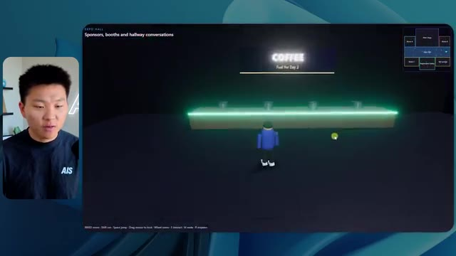
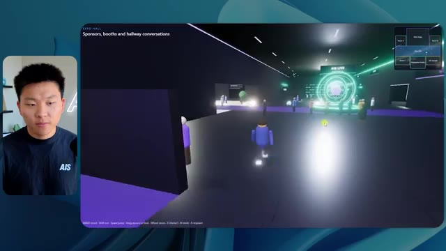
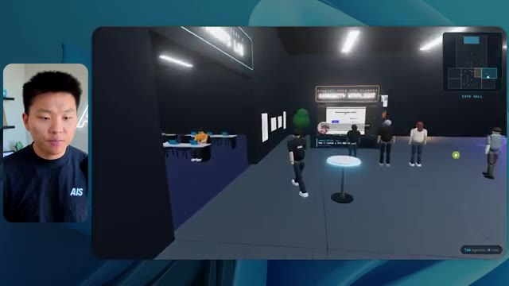
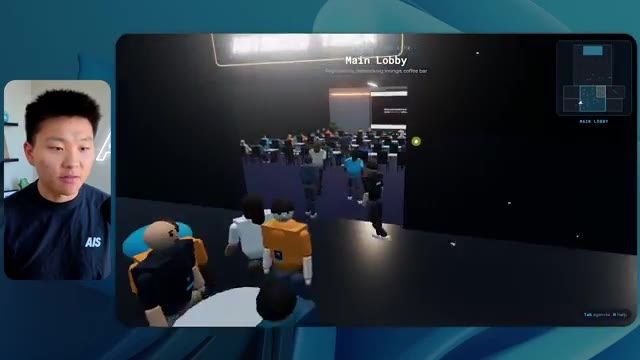
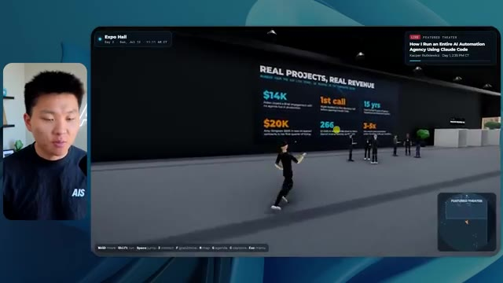

# 🎬 I Tested the Viral Reverse Engineer Anything Skill. What You Need to Know.

> **Chaîne** : [Nate Herk | AI Automation](https://www.youtube.com/@nateherk/featured)  
> **Lien YouTube** : [https://www.youtube.com/watch?v=rL5tw6h78zo](https://www.youtube.com/watch?v=rL5tw6h78zo)  
> **Date de publication** : 20261013  
> **Durée** : 00:14:58  
> **Identifiant vidéo** : `rL5tw6h78zo`  
> **Transcription & Analyse** : `whisper-v3-large-turbo+gemini-3.5-flash-lite`  

---

## 📌 Synthèse Exécutive & Outils

### 💡 Résumé
Dans cette vidéo intitulée **J'ai testé la compétence virale Reverse Engineer Anything. Ce qu'il faut savoir.**, Nate Herk décortique les capacités pratiques d'automatisation et de développement propulsées par les modèles de pointe.

### 🛠️ Outils, Modèles & Logiciels Présentés
- **Opus 5.5 & Claude Code** : Modèles d'ingénierie et agents de codage autonome.

### 🔑 Points Clés & Enseignements Stratégiques
- Optimiser le niveau d'effort et le raisonnement des modèles IA pour des résultats industriels.
- Automatiser les cycles de création logicielle de bout en bout.

---

## ⏱️ Chronologie & Transcription Complète Audio & Visuelle (Mot pour Mot)

### ⏱️ `[00:00:00 - 00:00:20]` | Segment #01

**🔊 Audio (Transcription Intégrale Mot pour Mot en Français) :**
> Opus 5.5, Opus 5.5, Opus 5.5, Opus 5.5, Opus 5.5. Ce modèle est littéralement partout et pour de très bonnes raisons. Il est intelligent, il est bon marché, il a un goût incroyable, c'est un modèle d'IA incroyable. Mais avec chaque modèle d'IA, vous avez un choix d'effort, qu'il soit bas, moyen, élevé, extra, max, ou ultra code.

**👁️ Analyse Visuelle d'Écran (gemini-3.5-flash-lite) :**
**Interface & Outils** : Twitter

**Contenu textuel & Code** : Texte du tweet : "It's a great time for hobbyists, bad time for professionals. This experiment has further cemented my view that technical creatives are about to experience a massive disruption."

**Action / Démonstration** : Affichage d'un tweet.

*⏱️ 00:00:05 — Capture d'écran d'un tweet affichant une image d'un monde 3D généré.*

---

### ⏱️ `[00:00:20 - 00:00:38]` | Segment #02

**🔊 Audio (Transcription Intégrale Mot pour Mot en Français) :**
> Donc, dans cette vidéo, j'ai donné à Opus 5.5 la même requête exacte et je l'ai exécutée à chaque niveau d'effort et nous allons comparer les résultats. Nous allons examiner la qualité de toutes les différentes sorties réelles, mais nous allons également examiner combien de temps chacune d'entre elles a fonctionné, combien cela nous a coûté s'il s'agissait d'une facturation par API, le nombre total de jetons, combien de vérifications elles ont effectuées et combien de questions elles m'ont réellement posées tout au long du processus.

**👁️ Analyse Visuelle d'Écran (gemini-3.5-flash-lite) :**
**Interface & Outils** : Interface web, Tableau comparatif

**Contenu textuel & Code** : Tableau comparatif des métriques d'effort pour Opus 5.5 (Run time, API cost, Total tokens, Checks, Questions asked)

**Action / Démonstration** : Comparaison des résultats de différentes exécutions d'Opus 5.5 à différents niveaux d'effort.

*⏱️ 00:00:29 — Tableau comparant les niveaux d'effort (Low, Medium, High, Extra, Max, Ultracode) pour Opus 5.5, avec des métriques telles que le temps d'exécution, le coût de l'API, le nombre total de tokens, les vérifications et les questions posées. Les données sont floutées.*

---

### ⏱️ `[00:00:39 - 00:00:58]` | Segment #03

**🔊 Audio (Transcription Intégrale Mot pour Mot en Français) :**
> Et les résultats que nous avons obtenus ne correspondent pas du tout à ce que j'attendais, donc j'ai hâte de partager cela avec vous. Ne perdons pas de temps et allons droit au but. Ok, alors plongeons directement dans ceci. Je veux commencer juste en vous montrant l'invite réelle que nous avons utilisée, que nous avons donnée à chacun de ces agents différents. Je vais aller dans les fichiers ici, et nous allons ouvrir ce fichier markdown d'invite, et je vais vous montrer ce que nous avons obtenu. Alors voici la barre oblique objectif que j'ai entrée.

**👁️ Analyse Visuelle d'Écran (gemini-3.5-flash-lite) :**
**Interface & Outils** : Cursor (éditeur de code)

**Contenu textuel & Code** : Invite : "Read the task prompt and listed worktree files. Hi Nate. This worktree has the effort-test task queued in PROMPT, build a walkable third-person 3D world of the AIS Live conference from your fjo recordings, with separate rooms, tracks, and stages, then send you a localhost link and the exact verification numbers. I haven't started it. Should I begin, or did you have something else in mind?"

**Action / Démonstration** : Démonstration d'une invite dans un éditeur de code pour la génération d'un monde 3D.

*⏱️ 00:00:48 — Un montage montrant le présentateur dans un petit coin de l'écran, et à droite une interface de chat avec un texte affichant une invite pour construire un monde 3D.*

---

### ⏱️ `[00:00:58 - 00:01:34]` | Segment #04

**🔊 Audio (Transcription Intégrale Mot pour Mot en Français) :**
> J'ai dit, tu dois me créer un monde 3D qui est une conférence technologique réaliste dans laquelle je peux me promener en vue à la troisième personne. Tu vas regarder ce dossier, qui contient mes ressources d'enregistrement d'événements d'AIS Live. Et ce dossier est un dossier Frame.io de 105 gigaoctets d'enregistrements vidéo. C'était un événement complètement virtuel. Tout a été enregistré et tous les enregistrements sont juste ici. J'ai dit, ton objectif est de prendre cet événement et de le transformer en un monde 3D explorable qui me donne l'impression d'être réellement allé à une vraie conférence en personne avec différentes salles, différentes pistes, différentes scènes, blablabla. N'hésite pas à utiliser key.ai si tu as besoin de générer des images ou des vidéos. Et tu peux aussi utiliser tout ce qui se trouve dans mon projet Herc 2, qui est comme mon système d'exploitation IA. J'ai dit,

**👁️ Analyse Visuelle d'Écran (gemini-3.5-flash-lite) :**
**Interface & Outils** : Éditeur de code (probablement VS Code ou similaire), interface de gestion de fichiers/stockage cloud

**Contenu textuel & Code** : Texte décrivant la création d'un monde 3D pour une conférence technologique, le lien vers un dossier Frame.io, et des instructions pour générer des images ou des vidéos.

**Action / Démonstration** : Présentation de la tâche et des ressources disponibles pour la création d'un monde virtuel.

*⏱️ 00:01:07 — Vue d'un éditeur de code montrant un fichier nommé "PROMPT.md" avec du texte dans le panneau de droite décrivant la tâche à accomplir.*

*⏱️ 00:01:25 — Vue d'un éditeur de code montrant un fichier nommé "PROMPT.md" avec du texte dans le panneau de droite décrivant la tâche à accomplir.*

---

### ⏱️ `[00:01:34 - 00:02:08]` | Segment #05

**🔊 Audio (Transcription Intégrale Mot pour Mot en Français) :**
> you'll be judged on creativity, design, physics, and the overall feel as I explore the 3D world that you built. And that was basically the end of the instructions. So as you can see on this left-hand side, I ran this through all of the different effort levels. Let's start off with low and work our way up to ultra code. All right. So here we have the result from low. Let's open this up and take a look. So we have AIS live, AI services summit in person finally, and we were able to click around. First of all, this doesn't feel very branded. Like this isn't the IS Live logo. It's not even our colors. So I don't love that, but let's get in here. Okay. This is way too bright. Um, we have a map in the top, right? We have a city back here. I can't tell what city

**👁️ Analyse Visuelle d'Écran (gemini-3.5-flash-lite) :**
**Interface & Outils** : Éditeur de code (probablement VS Code ou similaire, avec une interface utilisateur personnalisée)

**Contenu textuel & Code** : Le texte de l'invite de chat comprend des instructions pour construire un monde 3D. La liste des options d'effort comprend "Low", "Medium", "Ultracode", "Max", "High", "Extra", et "Hello".

**Action / Démonstration** : L'utilisateur a sélectionné l'option "Low" dans la liste déroulante des efforts.

*⏱️ 00:01:42 — L'interface utilisateur montre une liste déroulante d'options d'effort, avec "Low" actuellement sélectionné. Le panneau principal affiche une invite de chat avec un texte lié à la création d'un monde 3D.*

---

### ⏱️ `[00:02:08 - 00:02:40]` | Segment #06

**🔊 Audio (Transcription Intégrale Mot pour Mot en Français) :**
> voici. D'accord. C'est Chicago, ce qui est plutôt cool parce que tu sais, j'habite à Chicago, mais bref, en haut, à droite, on peut voir une carte. Nous avons un lobby. Nous avons une salle d'exposition. Nous avons un salon VIP, la scène principale. La carte montre également où se trouve chaque autre personne et ça se synchronise en direct. Donc, on peut voir l'enregistrement. On peut voir le jour un, le keynote de l'hyper agent, le débriefing en direct. Cool. Donc en fait, il connaît l'ordre du jour et ensuite il y a le jour deux. Donc il a trouvé ça, c'est bien. Nous avons ces petites balles ici que j'espère pouvoir faire bouger. D'accord. La face, Oh, regarde ça. Si je vais par là, toutes les personnes disparaissent. Très mauvais. Très mauvais. D'accord. Alors voyons. Je peux sprinter? D'accord.

**👁️ Analyse Visuelle d'Écran (gemini-3.5-flash-lite) :**
**Interface & Outils** : Interface 3D d'un événement virtuel.

**Contenu textuel & Code** : Aucune information textuelle claire visible dans les images qui puisse être classifiée comme contenu code, commande, prompt ou données.

**Action / Démonstration** : Exploration d'un environnement virtuel d'événement.

*⏱️ 00:02:16 — Le présentateur est à gauche, et à droite, une interface 3D montre une zone de récupération de badges.*

*⏱️ 00:02:24 — Le présentateur est à gauche, et à droite, une interface 3D montre un emploi du temps du "Jour 1" avec plusieurs sessions.*

*⏱️ 00:02:32 — Le présentateur est à gauche, et à droite, une interface 3D montre une zone d'exposition avec des sponsors et des stands.*

---

### ⏱️ `[00:02:40 - 00:03:04]` | Segment #07

**🔊 Audio (Transcription Intégrale Mot pour Mot en Français) :**
> Je peux aller un peu plus vite. Je vais d'abord aller par ici. Il y a des articles promotionnels, hum, glido certifié AIS plus. Ok. Donc il y a les vrais stands que nous avions dans l'événement virtuel. Nous avions des stands. C'est donc assez cool. Un petit endroit pour prendre des photos. Salle C. Actuellement, nous avons Tangy Frederick qui anime un atelier. Ok. Mais ce n'est pas une vidéo. Comme vous pouvez le voir, c'est juste une image. Elle ne bouge pas. Donc c'est juste une image. Ces gens disparaissent. Ce doivent être des fantômes. Allons par ici dans la salle A.

**👁️ Analyse Visuelle d'Écran (gemini-3.5-flash-lite) :**
**Interface & Outils** : Environnement virtuel 3D (type métavers)

**Contenu textuel & Code** : Instructions pour obtenir une clé API (Step 1: Go to..., Step 2: Go to..., Step 3: Go to...)

**Action / Démonstration** : Navigation dans un environnement virtuel, affichage d'informations promotionnelles et d'instructions.

*⏱️ 00:02:46 — Le présentateur est à côté d'un environnement virtuel 3D représentant un hall d'exposition avec des stands.*

*⏱️ 00:02:52 — Le présentateur se trouve dans un espace virtuel 3D qui ressemble à une salle de conférence, avec des tables et des écrans au mur.*

*⏱️ 00:02:58 — Le présentateur est dans une pièce virtuelle où un écran mural affiche des instructions pour obtenir une clé API.*

---

### ⏱️ `[00:03:04 - 00:03:30]` | Segment #08

**🔊 Audio (Transcription Intégrale Mot pour Mot en Français) :**
> Nous avons Liberty White. D'accord. Très cool. Vos 30 premiers jours en automatisation. Encore une fois, c'est juste une image fixe et les gens sont glitchés. Donc pas très bon ici. Je vais aller sur la scène principale et voir ce que nous avons. D'accord, cool. Donc nous avons une scène d'apparence principale. Les gens glitch. Vraiment mauvais. Ce n'est pas très bon du tout. Notre vidéo bouge en fait. Comme j'ai vu mon visage ici et j'ai vu celui de Devin, mais maintenant ils ont disparu. Donc je ne suis pas sûr de ce qui s'est passé. D'accord. On dirait que c'est plus un diaporama. Rien n'est vraiment joué encore. Quoi qu'il en soit, entrons ici.

**👁️ Analyse Visuelle d'Écran (gemini-3.5-flash-lite) :**
**Interface & Outils** : Plateforme virtuelle de conférence (probablement similaire à Spatial, AltspaceVR ou une plateforme personnalisée).

**Contenu textuel & Code** : Texte du titre de l'atelier et du titre de l'événement : "Now showing: Hyperagent Workshop: How to Build an Always-On Fleet of Agents" et "AIS LIVE AI Services Summit".

**Action / Démonstration** : Navigation dans un environnement virtuel, potentiellement lors d'un événement ou d'une présentation.

*⏱️ 00:03:17 — Une scène virtuelle de conférence avec un avatar de personne marchant vers une scène où est projeté le titre "AIS LIVE AI Services Summit". Il y a des sièges et des ballons décoratifs dans la salle.*

*⏱️ 00:03:24 — La même scène que l'image 2, mais l'avatar est plus proche de la scène.*

---

### ⏱️ `[00:03:30 - 00:03:58]` | Segment #09

**🔊 Audio (Transcription Intégrale Mot pour Mot en Français) :**
> Nous avons plus de stands. Nous avons hyper agent. Nous avons Claude Code. Nous avons plus de goodies. La salle B est Dave Ebelor. Je suppose que c'est exactement la même chose. Nous avons du café. Et puis je suppose que le salon VIP, accès VIP uniquement. C'est assez cool, mais il ne se passe vraiment rien ici. Cet écran est beaucoup trop lumineux. Ok. Donc je pense que vous comprenez l'ambiance que nous obtenons ici de Opus 5.5 sur faible effort. Et c'est là que les choses deviennent intéressantes. Combien pensez-vous que cela a coûté ? Pendant combien de temps ? Celui-ci a duré 16 minutes et 43 secondes. Combien pensez-vous que cela a coûté ?

**👁️ Analyse Visuelle d'Écran (gemini-3.5-flash-lite) :**
**Interface & Outils** : Espace virtuel interactif, Opus 5.5 Effects

**Contenu textuel & Code** : N/A

**Action / Démonstration** : Présentation des différentes zones et fonctionnalités de l'événement virtuel.

*⏱️ 00:03:37 — Vue de l'espace virtuel montrant un comptoir avec une enseigne "COFFEE" et des verres.*

*⏱️ 00:03:44 — Vue générale de la salle d'exposition virtuelle avec des avatars d'utilisateurs et des stands.*

*⏱️ 00:03:51 — Interface utilisateur de "Opus 5.5 Effects" présentant un tableau comparatif de différentes options (Low, Medium, High, Extra, Max, Ultracode) avec des catégories comme "Run time", "API cost", etc.*

---

### ⏱️ `[00:03:58 - 00:04:26]` | Segment #10

**🔊 Audio (Transcription Intégrale Mot pour Mot en Français) :**
> 3,91 $ si c'était facturé à l'API. J'utilise évidemment mon abonnement ici, mais nous allons simplement calculer cela en facturation API. Le total des tokens était de 191 000. Il a effectué 22 vérifications. Donc la vérification, 22 fois, il a ouvert le navigateur et a effectué différents types de vérifications. Donc 22 catégories de vérifications. Et combien de questions m'a-t-il posées ? Il m'a posé un total de zéro question tout au long de cette invite slash objectif. D'accord. Alors ouvrons l'effort moyen et voyons ce que nous avons. D'accord, nous y voilà. Effort moyen. Nous avons Nate Herc. Nous avons mon badge. C'est la marque AI's life.

**👁️ Analyse Visuelle d'Écran (gemini-3.5-flash-lite) :**
**Interface & Outils** : Tableau de bord d'une application.

**Contenu textuel & Code** : Run time : 16m 43s ; API cost : $3.91 ; Total tokens : 191.3K ; Checks : 22

**Action / Démonstration** : Affichage des données d'un tableau comparatif.

*⏱️ 00:04:05 — Un tableau présentant les coûts d'exécution d'une API, les jetons totaux et le nombre de vérifications.*

---

### ⏱️ `[00:04:26 - 00:04:46]` | Segment #11

**🔊 Audio (Transcription Intégrale Mot pour Mot en Français) :**
> Donc, cela commence déjà à avoir l'air un peu mieux. On dirait que nos palettes de couleurs correspondent à nos directives de marque. Construction jour un, gain jour deux, VIP. Cool. D'accord. Je vais entrer dans le lieu. D'accord. Wow. Donc, une ambiance un peu similaire. Ça se trouve en arrière-plan. Ça ne ressemble pas à Chicago, n'est-ce pas ? Non, ça ressemble à une, honnêtement, ça ressemble à une ville inventée. Quoi qu'il en soit, c'est drôle qu'ils aient décidé de faire ça. Voyons si je peux aller un peu plus vite. Oh, wow.

**👁️ Analyse Visuelle d'Écran (gemini-3.5-flash-lite) :**
**Interface & Outils** : Présentation ou face-caméra explicatif sans interface logicielle partagée.

**Contenu textuel & Code** : Explications orales et mise en contexte méthodologique.

**Action / Démonstration** : Explications face caméra et démonstration conceptuelle.

---

### ⏱️ `[00:04:46 - 00:05:21]` | Segment #12

**🔊 Audio (Transcription Intégrale Mot pour Mot en Français) :**
> The people are interacting with me. Watch. If I go up to this guy, he just like raised his arm. Well, now he doesn't want anything to do with me at all. But all of these little robots here must be making decisions. I'm not sure if they're using Jev. They're definitely not. I didn't tell it to. Actually, my Jev key is in the back. I don't know. Maybe it did use it. Anyways, we can see here we have Workshop Room C, Agents Lab. Nice. So this one is actually being run. You can see that is a real video being played by Tangy. Everyone here is actually like working on a laptop. They're not glitching. This is pretty cool. Also, my badge is on my chest, which is pretty cool. I can come this way. We have a map up in the top right, as you guys can see, but I can come this way. We have an

**👁️ Analyse Visuelle d'Écran (gemini-3.5-flash-lite) :**
**Interface & Outils** : Présentation ou face-caméra explicatif sans interface logicielle partagée.

**Contenu textuel & Code** : Explications orales et mise en contexte méthodologique.

**Action / Démonstration** : Explications face caméra et démonstration conceptuelle.

---

### ⏱️ `[00:05:21 - 00:05:47]` | Segment #13

**🔊 Audio (Transcription Intégrale Mot pour Mot en Français) :**
> expo hall. This is where we have the Glido booth. And this is actually playing. Yeah, it's playing the video of us talking about Glido. It's playing the video of Ed and I talking about our certification program. We've got the AIS Plus logo back here, which is kind of in a weird spot. This is a speaker slides and takeaways. So wow, this is all the resources that we gave out after the event. They're all sitting right there as well. We can see we've got a community spotlight. So this is Aiden talking about his deal that he landed and it's playing live. These people are watching.

**👁️ Analyse Visuelle d'Écran (gemini-3.5-flash-lite) :**
**Interface & Outils** : Aucune

**Contenu textuel & Code** : Aucune

**Action / Démonstration** : Aucune

*⏱️ 00:05:28 — Présentateur masculin regardant une scène virtuelle d'un hall d'exposition avec des avatars se tenant autour d'une cabine.*

*⏱️ 00:05:34 — Présentateur masculin regardant une scène virtuelle d'un hall d'exposition avec des avatars se tenant devant un mur d'écrans de diapositives.*

*⏱️ 00:05:40 — Présentateur masculin regardant une scène virtuelle d'un hall d'exposition, montrant des avatars interagissant dans l'espace virtuel.*

---

### ⏱️ `[00:05:47 - 00:06:21]` | Segment #14

**🔊 Audio (Transcription Intégrale Mot pour Mot en Français) :**
> Ils sont plutôt engagés. Nous avons hyper agent. C'était, c'est ce que je voulais dire. Si vous avez vu ces gens lever les bras en disant bonjour, c'était assez drôle. Regardez, regardez, il recommence. Quoi qu'il en soit. D'accord. Où suis-je maintenant ? Maintenant je suis dans le lobby principal. Nous avons un bar à café. Nous avons un grand logo, qui est le vrai logo. Il fait trop sombre, mais nous avons le logo. Nous pouvons voir si nous pouvons entrer ici dans la voie de la fondation. Nous avons Sabrina Romanov et Liberty White. Donc différentes formations juste là. Nous pouvons entrer dans cette pièce. C'est la voie avancée. Alors qu'est-ce qui se passe ici. Nous avons Dave Ebelar et Saman qui parlent de différentes choses là-dedans. Et maintenant, allons jeter un œil à la scène principale. Oh, attendez, il y a une vidéo de moi là-haut. Est-ce comme un VIP

**👁️ Analyse Visuelle d'Écran (gemini-3.5-flash-lite) :**
**Interface & Outils** : Environnement virtuel 3D (probablement un espace d'événement en ligne)

**Contenu textuel & Code** : AUCUNE information pertinente (pas de code, de commandes ou de données affichées)

**Action / Démonstration** : Navigation dans un lobby virtuel et observation des interactions des avatars.

*⏱️ 00:05:55 — L'image montre un lobby virtuel animé avec des avatars de personnes. En haut de l'écran, un titre indique "Main Lobby" avec des sous-titres comme "Registration, networking lounge, coffee bar". Une carte miniature est visible dans le coin supérieur droit.*

*⏱️ 00:06:04 — Cette image montre une salle de conférence virtuelle, également peuplée d'avatars. Il y a une grande scène à l'avant avec un écran blanc, et des sièges remplis de personnes. La même carte miniature est présente dans le coin supérieur droit, indiquant "Main Lobby".*

*⏱️ 00:06:12 — L'image montre une scène intérieure où plusieurs avatars sont regroupés, certains semblant interagir. Il y a des tables et des chaises suggérant un espace de socialisation. Le texte "Main Lobby" et la carte miniature sont à nouveau présents.*

---

### ⏱️ `[00:06:21 - 00:06:50]` | Segment #15

**🔊 Audio (Transcription Intégrale Mot pour Mot en Français) :**
> section? Yeah, we'll go check that out in a sec. But anyways, this is the main stage. This looks very, very nice. We've got a big stage. We've got like four people sitting up here. We've got the the three screens of Alex up there with hyper agent. Am I allowed to get on stage? Oh, and lets me up on stage. Okay. That's pretty nice. All right, guys, let's take a selfie. Let me get everyone in the background. Get in here. Anyways, that is pretty, pretty cool. Not every seat is filled though. So we need to work on that. But anyways, I'm going to run back over and see what that VIP section was. Okay. VIP lounge. I feel like this is like a worth the airport or something.

**👁️ Analyse Visuelle d'Écran (gemini-3.5-flash-lite) :**
**Interface & Outils** : Présentation ou face-caméra explicatif sans interface logicielle partagée.

**Contenu textuel & Code** : Explications orales et mise en contexte méthodologique.

**Action / Démonstration** : Explications face caméra et démonstration conceptuelle.

---

### ⏱️ `[00:06:51 - 00:07:14]` | Segment #16

**🔊 Audio (Transcription Intégrale Mot pour Mot en Français) :**
> Okay, cool. So now we've got the VIP sessions up here. VIP Q and a with Nate live video playback right here. Very, very cool. And we've got like a bar or something. Awesome. I would say that this is a pretty good output. Now, as far as the stats here, this one took one hour and 13 minutes to run. It would have cost us $12 and 44 cents. It used 490,000 tokens and it did 23 checks.

**👁️ Analyse Visuelle d'Écran (gemini-3.5-flash-lite) :**
**Interface & Outils** : Présentation ou face-caméra explicatif sans interface logicielle partagée.

**Contenu textuel & Code** : Explications orales et mise en contexte méthodologique.

**Action / Démonstration** : Explications face caméra et démonstration conceptuelle.

---

### ⏱️ `[00:07:14 - 00:07:48]` | Segment #17

**🔊 Audio (Transcription Intégrale Mot pour Mot en Français) :**
> Et il nous a posé un grand total de zéro question, une fois de plus. Très bien, passons à high. C'était déjà un résultat plutôt correct, et Anthropic eux-mêmes, dans leur vidéo sur la façon de prompter Opus 5.5, ou pardon, pas une vidéo, un article, ils ont dit de simplement commencer sur medium et de l'augmenter ou de le réduire si vous en avez besoin. C'était donc un résultat en medium. Passons à high et voyons ce qu'on a obtenu. Très rapidement, les gars, je dois prendre une seconde pour vous parler du sponsor de la vidéo d'aujourd'hui, Hostinger. Donc, ces deux modèles viennent de me construire une version fonctionnelle de la même chose. Et maintenant, je me retrouve exactement là où je finis toujours, avec quelque chose de terminé qui reste sur mon ordinateur portable et aucun moyen rapide de le mettre en ligne. Et c'est ce fossé que le connecteur d'Hostinger vient combler. C'est une extension gratuite

**👁️ Analyse Visuelle d'Écran (gemini-3.5-flash-lite) :**
**Interface & Outils** : Présentation ou face-caméra explicatif sans interface logicielle partagée.

**Contenu textuel & Code** : Explications orales et mise en contexte méthodologique.

**Action / Démonstration** : Explications face caméra et démonstration conceptuelle.

---

### ⏱️ `[00:07:48 - 00:08:23]` | Segment #18

**🔊 Audio (Transcription Intégrale Mot pour Mot en Français) :**
> for your editor that pulls your Hostinger account into whatever you're already coding in. So VS Code, cursor, cloud code, codex, you name it. You sign in once with a single click, and from there, your agent can deploy the site, point a domain at it, set the DNS records, and check on your VPS without you ever having to leave the editor. So whichever one of these you end up liking better, the thing it built is a couple minutes away from a real URL on managed hosting. Connector is free on every hosting or plan, so if you still need the hosting underneath it, grab the unlimited plan with the link in the description and use code NATEHERK for 10% off. That also comes with a free domain and business email for the year. And it's still the cheapest way that I found to get something

**👁️ Analyse Visuelle d'Écran (gemini-3.5-flash-lite) :**
**Interface & Outils** : Présentation ou face-caméra explicatif sans interface logicielle partagée.

**Contenu textuel & Code** : Explications orales et mise en contexte méthodologique.

**Action / Démonstration** : Explications face caméra et démonstration conceptuelle.

---

### ⏱️ `[00:08:23 - 00:08:47]` | Segment #19

**🔊 Audio (Transcription Intégrale Mot pour Mot en Français) :**
> you built onto a real URL. So let's get back to the video. Okay. Once again, very, very branded. This is even better of a loading screen than the previous one. We've got this nice little effect in the background. We've got the logo. We'll enter the venue. Okay. Here we are. This looks pretty nice. We start outside and you can see that we have these flags for all the speakers, Wyatt, Casper, Alex, Ed, Aiden, Sabrina, Liberty. This is pretty cool. We got live blocks here.

**👁️ Analyse Visuelle d'Écran (gemini-3.5-flash-lite) :**
**Interface & Outils** : Présentation ou face-caméra explicatif sans interface logicielle partagée.

**Contenu textuel & Code** : Explications orales et mise en contexte méthodologique.

**Action / Démonstration** : Explications face caméra et démonstration conceptuelle.

---

### ⏱️ `[00:08:47 - 00:09:23]` | Segment #20

**🔊 Audio (Transcription Intégrale Mot pour Mot en Français) :**
> it took this picture from me, your host, Nate Herc, John, Dave, Nate Herc. There we go. Okay. The doors. Awesome. They're automatic sliding glass doors. I love that. We can see VIP check-in. We can see GA. We can come over here and we can check out the expo with different booths, community spotlight. You can also see that in the top left, I have a passport. So it's like, it will be showing how many of the places I've visited. All of these are real playback. We've got a resource wall with all of the different speakers. They've also got a networking session over here. So I'm going to come over real quick and see what that's all about. So we've got the AIS cold brew bar. We've got different community members that were spotlighted or highlighted.

**👁️ Analyse Visuelle d'Écran (gemini-3.5-flash-lite) :**
**Interface & Outils** : Environnement virtuel 3D (metaverse / plateforme d'événement virtuel)

**Contenu textuel & Code** : Interface utilisateur d'un monde virtuel avec bannières d'événements et avatars

**Action / Démonstration** : Navigation et visite guidée d'un espace virtuel 3D par le présentateur

---

### ⏱️ `[00:09:23 - 00:09:56]` | Segment #21

**🔊 Audio (Transcription Intégrale Mot pour Mot en Français) :**
> We've got the VIP wing. Wait, what? Pick up a wristband. Oh, I have to actually go get the wristband. Okay. Let me check in real quick. Wristband's already on. Wait, what? Okay. Oh, okay. Now the doors have opened for me. Cool. I can come into here. Oh, that just goes to the main stage. VIP lounge. This is a Q and A going on. It looks like very cool. I mean, I'm very impressed by how it's able to do this. Wow. Okay. So this is really good. What we did is we had VIP breakout rooms with different people. You can see that there's different rooms, different members of the AIS team going into stuff. This is really cool. This is very cool. That's a much better VIP

**👁️ Analyse Visuelle d'Écran (gemini-3.5-flash-lite) :**
**Interface & Outils** : Présentation ou face-caméra explicatif sans interface logicielle partagée.

**Contenu textuel & Code** : Explications orales et mise en contexte méthodologique.

**Action / Démonstration** : Explications face caméra et démonstration conceptuelle.

---

### ⏱️ `[00:09:56 - 00:10:30]` | Segment #22

**🔊 Audio (Transcription Intégrale Mot pour Mot en Français) :**
> experience than what was shown in the first piece. Okay. VIP after party. Look at this. We've got a dance floor. We've got all these elements in here. We have the actual VIP after party playback right here. And there's a DJ booth. That is so funny. There's a bit of a bug right here, a glitch right there, but this is awesome. Oh, cool. So when I'm in here in the main stage, we get closed captions. You can see right here in the bottom of my screen, we're getting these closed captions of Wyatt actually talking up here. We've got lights. We've got the panel. Very cool. Nice main stage. I'm going to go over here. We can go to the foundation,

**👁️ Analyse Visuelle d'Écran (gemini-3.5-flash-lite) :**
**Interface & Outils** : Présentation ou face-caméra explicatif sans interface logicielle partagée.

**Contenu textuel & Code** : Explications orales et mise en contexte méthodologique.

**Action / Démonstration** : Explications face caméra et démonstration conceptuelle.

---

### ⏱️ `[00:10:30 - 00:11:06]` | Segment #23

**🔊 Audio (Transcription Intégrale Mot pour Mot en Français) :**
> advanced, and the enterprise tracks over here. So let's see. We have anatomy of a three real deals. We've got hyper agent. We've got the evals with Nate and Ed in here. We've got Dave going on in the advanced stuff. This is really nice. I mean, obviously each, each of these outputs so far, low was okay. Medium was better. High has been even better. Let's see if that trend continues and let's go ahead and see what this cost us. So high ran for one hour and seven minutes. So a little bit quicker than medium, it would have cost us $16 and 31 cents. It used half a million tokens, 509,000. It did 22 checks. And it also asked us, well, actually, no, I was wrong. This

**👁️ Analyse Visuelle d'Écran (gemini-3.5-flash-lite) :**
**Interface & Outils** : Présentation ou face-caméra explicatif sans interface logicielle partagée.

**Contenu textuel & Code** : Explications orales et mise en contexte méthodologique.

**Action / Démonstration** : Explications face caméra et démonstration conceptuelle.

---

### ⏱️ `[00:11:06 - 00:11:25]` | Segment #24

**🔊 Audio (Transcription Intégrale Mot pour Mot en Français) :**
> one asked me one question and spoiler, it was the only one that asked us a question throughout all of this. So let's see, we've got three left extra max and ultra code. Let me pull open extra and we'll see what we got. Okay. So this one looks pretty good. I would honestly say so far, the loading screen high was the best. The one that we just saw, but anyways, let's enter AIS live.

**👁️ Analyse Visuelle d'Écran (gemini-3.5-flash-lite) :**
**Interface & Outils** : Présentation ou face-caméra explicatif sans interface logicielle partagée.

**Contenu textuel & Code** : Explications orales et mise en contexte méthodologique.

**Action / Démonstration** : Explications face caméra et démonstration conceptuelle.

---

### ⏱️ `[00:11:26 - 00:11:51]` | Segment #25

**🔊 Audio (Transcription Intégrale Mot pour Mot en Français) :**
> Whoa. Okay. So we have like little sound bites. I can chat with people. The tool war panel settled a few debates for me. Nice. Good perspective there. We're outside again. We have these different banners, although they're all the same. They don't say like different people's names. So big AIS live logo. Workshop wing is over here. And let's go through the sliding glass doors and see what we've got. So we've got the AIS cafe. The map is in the bottom right, and it's not too descriptive.

**👁️ Analyse Visuelle d'Écran (gemini-3.5-flash-lite) :**
**Interface & Outils** : Présentation ou face-caméra explicatif sans interface logicielle partagée.

**Contenu textuel & Code** : Explications orales et mise en contexte méthodologique.

**Action / Démonstration** : Explications face caméra et démonstration conceptuelle.

---

### ⏱️ `[00:11:51 - 00:12:26]` | Segment #26

**🔊 Audio (Transcription Intégrale Mot pour Mot en Français) :**
> I like how the other maps have told us what, like where things were, but this one looks very professional. We can see here's the main stage. Let's hop in here real quick. They've all got these balls flying around, which I think is pretty funny. The AIS beach balls. We have me up there speaking. I think I was introing one of the days. Let's keep on moving here to the workshop room on this left side. Okay. So here we've got the Hyper Agent Theater. We've got this sponsored session in here by Hyper Agent, but it's showing us what's coming up in here as well. It's really funny that we can chat to people. Salmon built a voice sales rep live. The price it right room was packed. Did you grab the VIP companion guide? That's so funny. We have the advanced track in

**👁️ Analyse Visuelle d'Écran (gemini-3.5-flash-lite) :**
**Interface & Outils** : Présentation ou face-caméra explicatif sans interface logicielle partagée.

**Contenu textuel & Code** : Explications orales et mise en contexte méthodologique.

**Action / Démonstration** : Explications face caméra et démonstration conceptuelle.

---

### ⏱️ `[00:12:26 - 00:12:58]` | Segment #27

**🔊 Audio (Transcription Intégrale Mot pour Mot en Français) :**
> here. Once again, we've got live playback. Is that live playback? Oh, okay. It started once I got in, but I can take a seat. Oh my. I can watch this. I can stand up. I want to sit in the front. That's pretty cool. That's very nice. I like that. And you know what I noticed so far? The actual character that I'm playing kind of looks like me. I think it modeled it off of my thumbnail pictures or something. Anyways, we have Sabrina in here, room host here, grab any open seat. Okay, cool. And I really liked the sitting functionality. It's kind of funny. Like we could actually attend this workshop and participate. Anyways, it's showing us the speakers. It's showing us the

**👁️ Analyse Visuelle d'Écran (gemini-3.5-flash-lite) :**
**Interface & Outils** : Présentation ou face-caméra explicatif sans interface logicielle partagée.

**Contenu textuel & Code** : Explications orales et mise en contexte méthodologique.

**Action / Démonstration** : Explications face caméra et démonstration conceptuelle.

---

### ⏱️ `[00:12:58 - 00:13:31]` | Segment #28

**🔊 Audio (Transcription Intégrale Mot pour Mot en Français) :**
> agenda. There's a little red carpet here to take some pictures. We can strike a pose. Oh, wow. That's pretty cool. Resource library, get AIS Plus certified, Glido, Hyper Agent, AIS Plus, three real deals. Awesome. I mean, I would definitely say so far, each one is getting better. And we didn't even check out the VIP section yet, the VIP lounge. Let's go up here real quick. Hopefully I can get in. Nice. We've got tooling reset. These are the different rooms we could go in. So once again, I could grab the worksheet and I could try to understand how to price my stuff. This is so cool. This is definitely better than the previous one where we kind of just

**👁️ Analyse Visuelle d'Écran (gemini-3.5-flash-lite) :**
**Interface & Outils** : Présentation ou face-caméra explicatif sans interface logicielle partagée.

**Contenu textuel & Code** : Explications orales et mise en contexte méthodologique.

**Action / Démonstration** : Explications face caméra et démonstration conceptuelle.

---

### ⏱️ `[00:13:31 - 00:13:59]` | Segment #29

**🔊 Audio (Transcription Intégrale Mot pour Mot en Français) :**
> like looked at stuff. Awesome. I can get behind the bar and come in here. This is very nice. Okay. So as far as statistics go, this one ran for an hour and a half. It costs 25.92 bucks. I don't know why I say point $25, 92 cents. It was 733,000 tokens and 34 checks. So it had the most checks so far by far. And it asked us zero questions. I can't wait to see what we got here from max and ultra code. Okay. Here is max loading screens, boring, but it's on brand and it has our logo.

**👁️ Analyse Visuelle d'Écran (gemini-3.5-flash-lite) :**
**Interface & Outils** : Présentation ou face-caméra explicatif sans interface logicielle partagée.

**Contenu textuel & Code** : Explications orales et mise en contexte méthodologique.

**Action / Démonstration** : Explications face caméra et démonstration conceptuelle.

---

### ⏱️ `[00:14:00 - 00:14:35]` | Segment #30

**🔊 Audio (Transcription Intégrale Mot pour Mot en Français) :**
> So that was good. I like that. We will go ahead and enter AIS live. Ooh, nice little animation here that brings us in. Once again, the character looks like me. They've all looked like me. I mean, sort of, we have sitting in the background. This looks like Chicago. Like I mentioned earlier, a lot of these are playing sounds and I'm not including that because it would be very distracting for you guys to try to listen to what's going on as well as me speaking. So there is like some slight music in all these. I hate how this is walking. This walking is really, really bad. I mean, the walking, yeah, I don't like this at all. So that's not great. But besides that, let's go in and explore. Notice these shadows when I walk in, they like really switch. I'm not sure why that is,

**👁️ Analyse Visuelle d'Écran (gemini-3.5-flash-lite) :**
**Interface & Outils** : Présentation ou face-caméra explicatif sans interface logicielle partagée.

**Contenu textuel & Code** : Explications orales et mise en contexte méthodologique.

**Action / Démonstration** : Explications face caméra et démonstration conceptuelle.

---

### ⏱️ `[00:14:35 - 00:15:11]` | Segment #31

**🔊 Audio (Transcription Intégrale Mot pour Mot en Français) :**
> but anyways, we can chat with people in here too. Hyperagent booth is right where you walk into the expo. All good. Okay, cool. I can keep clicking E to make them change what they say. We've got the speakers right here. That looks pretty good. Although we definitely had everyone's profile picture. So I'm not sure why that's not included there. We see people taking pictures right here. I love that. And it saves a little picture. Okay. The map also isn't super, like doesn't give me a great explanation of what's going on, but I like these booths. These are cool. I think these booths are the best that I've seen so far. Like they just look nice. They've got reps. There's nice like slides behind them. Yeah. These booths are cool. Okay. We have a little featured theater

**👁️ Analyse Visuelle d'Écran (gemini-3.5-flash-lite) :**
**Interface & Outils** : Présentation ou face-caméra explicatif sans interface logicielle partagée.

**Contenu textuel & Code** : Explications orales et mise en contexte méthodologique.

**Action / Démonstration** : Explications face caméra et démonstration conceptuelle.

---

### ⏱️ `[00:15:11 - 00:15:35]` | Segment #32

**🔊 Audio (Transcription Intégrale Mot pour Mot en Français) :**
> going on over here. It's Casper. Although why is this not playing? I feel like this should be playing, right? Like in the other ones, they were always playing. We can talk to some other people over here. Coffee's free. Blah, blah, blah. Amy Simpson, Matt Wolf. Nice. Okay. This is just the networking area that we're in right now, but we can see in the top right. We can also see what's live on the main stage right now. It is a tool war panel. So let's head in here. We've got Devin, Cole, Dave, and Russ chatting in here. We've got sort of AV, some light stuff going on back here.

**👁️ Analyse Visuelle d'Écran (gemini-3.5-flash-lite) :**
**Interface & Outils** : Application ou plateforme virtuelle web 3D (type monde virtuel ou salon virtuel interactif).

**Contenu textuel & Code** : Éléments graphiques 3D, avatars, panneaux d'affichage textuels de statistiques et interfaces de navigation virtuelle.
[DESC_IMAGE_3]

**Action / Démonstration** : Navigation à l'intérieur d'un environnement virtuel de conférence 3D.

*⏱️ 00:15:17 — Vue d'un espace d'exposition virtuel en 3D (Expo Hall) montrant un avatar se déplaçant devant un grand panneau affichant des statistiques de projets.*

*⏱️ 00:15:23 — Navigation dans le salon de réseautage virtuel (Networking Lounge) où l'avatar explore différents stands et espaces de discussion.*

*⏱️ 00:15:29 — Entrée dans la salle de conférence principale (Main Stage) montrant un public virtuel assistant à une retransmission en direct sur grand écran.*

---

### ⏱️ `[00:15:36 - 00:15:55]` | Segment #33

**🔊 Audio (Transcription Intégrale Mot pour Mot en Français) :**
> Switch the main stage to what actually matters right now. So I can switch the topic. Cool. So I just switched to me and Matt. We can go to anatomy of three real deals. That's pretty cool. The stage looks good. We've got a nice little panel up here. Can I get on the stage? Nice. Nice. Well, I can't go too far, actually. All right, everyone, let me take the selfie. Everyone get in this. I can also take a seat in this audience over here and just enjoy the session.

**👁️ Analyse Visuelle d'Écran (gemini-3.5-flash-lite) :**
**Interface & Outils** : Environnement virtuel 3D de conférence (plateforme événementielle type Gather ou similaire).

**Contenu textuel & Code** : Interface utilisateur virtuelle avec mini-carte, commandes de navigation et affichage de la scène principale.

**Action / Démonstration** : Navigation et déplacement d'un avatar dans l'espace virtuel pour changer de sujet ou interagir sur la scène.

---

### ⏱️ `[00:15:55 - 00:16:14]` | Segment #34

**🔊 Audio (Transcription Intégrale Mot pour Mot en Français) :**
> Très cool, très cool. OK, allons par ici. Je vois une section à l'étage. C'est marrant comme ils choisissent tous de mettre la section VIP à l'étage. Je veux dire, je ne déteste pas ça. Oh la la, ils ont un escalator. Pas possible. Je vais discuter avec ce type sur l'escalator. Glenn a 15 ans d'expérience en agence. Ses trucs de "land and expand" étaient en or. Du bon boulot, Glenn. Cool, donc je vais, je n'arrive même pas à passer devant ce type par contre.

**👁️ Analyse Visuelle d'Écran (gemini-3.5-flash-lite) :**
**Interface & Outils** : Application web de monde virtuel 3D (type événement virtuel ou métavers).

**Contenu textuel & Code** : Textes d'interface ("Reception", "VIP LEVEL", "Chat with this attendee", et bulle de dialogue "Glenn has 15 years of agency experience...").

**Action / Démonstration** : Navigation de l'avatar dans l'environnement virtuel 3D et interaction avec un autre participant.

*⏱️ 00:16:00 — Vue d'un espace virtuel en 3D avec des avatars dans un hall d'accueil moderne.*

*⏱️ 00:16:04 — Approche des escaliers mécaniques menant au niveau VIP dans l'environnement virtuel.*

*⏱️ 00:16:09 — Interaction avec un avatar sur l'escalier mécanique affichant une bulle de dialogue avec du texte.*

---

### ⏱️ `[00:16:14 - 00:16:48]` | Segment #35

**🔊 Audio (Transcription Intégrale Mot pour Mot en Français) :**
> Oh, I had to jump over him. Okay, VIP level, badge required. Oh my gosh. Are you kidding me? I have to go get my badge. Okay, cool. Now it shows that I'm an actual VIP and I can go up here to the VIP section. We have nice little working sessions back there, which we can hop in. I wonder if it'll let me like sit down in here. I can just chat. Can I participate? It's not letting me sit and participate. That's okay. We've got the pricing war room. Oh, this might be the after party. Let's go see what's going on back here. Or maybe I just have to enter from over here. Okay. That's weird. I just had to enter from over here. This after party is not as cool as the other one. But anyways, let's go see what's going on back here

**👁️ Analyse Visuelle d'Écran (gemini-3.5-flash-lite) :**
**Interface & Outils** : Présentation ou face-caméra explicatif sans interface logicielle partagée.

**Contenu textuel & Code** : Explications orales et mise en contexte méthodologique.

**Action / Démonstration** : Explications face caméra et démonstration conceptuelle.

---

### ⏱️ `[00:16:48 - 00:17:07]` | Segment #36

**🔊 Audio (Transcription Intégrale Mot pour Mot en Français) :**
> dans les ateliers. D'accord. Ce n'était pas bien. Regardez ça. On peut tout voir et j'ai juste eu un bug et maintenant boum. Donc ce n'est pas bon. Je dirais qu'globalement, je veux dire, vous captez l'ambiance de comment ça fonctionne, mais je dirais que celui d'avant, qui était, je crois, élevé, j'aimais mieux celui-là. Je ne peux pas m'asseoir dans ces chaises non plus. Ouais. Donc je n'aime pas la marche dans celui-ci.

**👁️ Analyse Visuelle d'Écran (gemini-3.5-flash-lite) :**
**Interface & Outils** : Présentation ou face-caméra explicatif sans interface logicielle partagée.

**Contenu textuel & Code** : Explications orales et mise en contexte méthodologique.

**Action / Démonstration** : Explications face caméra et démonstration conceptuelle.

---

### ⏱️ `[00:17:07 - 00:17:43]` | Segment #37

**🔊 Audio (Transcription Intégrale Mot pour Mot en Français) :**
> I don't like the vibe as much and there's some bugs. So, so far, if we want to go to our list, I like extra extra was the one that I liked the most so far. But anyways, this one was max. This one was max right here. So let's see how long this ran for two hours and 28 minutes. So it ran for a long time, $50 and 38 cents, 1.18 million tokens. So it actually hit a compaction and had to auto compact. And then it did 51 checks. Did it really though? Cause there was a lot of bugs in there. And anyways, this one asked us zero questions. So, so far each time pretty much has gotten more expensive and took longer besides right here. But these basically

**👁️ Analyse Visuelle d'Écran (gemini-3.5-flash-lite) :**
**Interface & Outils** : Présentation ou face-caméra explicatif sans interface logicielle partagée.

**Contenu textuel & Code** : Explications orales et mise en contexte méthodologique.

**Action / Démonstration** : Explications face caméra et démonstration conceptuelle.

---

### ⏱️ `[00:17:43 - 00:18:17]` | Segment #38

**🔊 Audio (Transcription Intégrale Mot pour Mot en Français) :**
> a pris un temps très similaire, mais à chaque fois il a utilisé plus de tokens parce qu'il a réfléchi davantage. Et puis, vous savez, ces tokens vont coûter plus cher. Mais bref, passons au dernier, qui est ultra code. Donc on espère vraiment que celui-ci est le meilleur. Allons donc sur ce localhost et voyons ce qu'on a. Ok, super. Regardez ce badge. C'est un joli badge host all access. On a un petit visuel sympa juste ici. On va aller de l'avant et entrer AIS Live. Cool. Ok. Bienvenue, Nate. J'aime bien la marche. Ça a l'air réaliste. J'aime le logo, même s'il manque le petit point rouge qui fait penser à du direct. La carte en haut à droite

**👁️ Analyse Visuelle d'Écran (gemini-3.5-flash-lite) :**
**Interface & Outils** : Présentation ou face-caméra explicatif sans interface logicielle partagée.

**Contenu textuel & Code** : Explications orales et mise en contexte méthodologique.

**Action / Démonstration** : Explications face caméra et démonstration conceptuelle.

---

### ⏱️ `[00:18:17 - 00:18:49]` | Segment #39

**🔊 Audio (Transcription Intégrale Mot pour Mot en Français) :**
> is labeled a little bit better, so I can see what's going on. I'm going to come in here and collect my VIP wristband real quick. Okay, nice. It's also telling me what to do. So in the top left, it says scan in at the VIP gate at the lobby east wall. So I believe east would be this way, right? Never eat soggy waffles. Yeah. VIP wings, scan wristband. Okay, cool. Now I'm in the VIP section. I can see these different rooms. The tooling reset. Live video is being played. I'm able to see the closed captions right there of what's being talked about. It's also playing the sounds, but I'm just not playing the audio for you guys because I don't want to overwhelm.

**👁️ Analyse Visuelle d'Écran (gemini-3.5-flash-lite) :**
**Interface & Outils** : Présentation ou face-caméra explicatif sans interface logicielle partagée.

**Contenu textuel & Code** : Explications orales et mise en contexte méthodologique.

**Action / Démonstration** : Explications face caméra et démonstration conceptuelle.

---

### ⏱️ `[00:18:50 - 00:19:08]` | Segment #40

**🔊 Audio (Transcription Intégrale Mot pour Mot en Français) :**
> Encore une fois, celui-ci fonctionne avec Cody et Mustafa là-dedans. C'est génial. Vidéo en direct. La vidéo ne se lance pas tant qu'on n'entre pas, par contre. Donc, honnêtement, je pense que c'est un bon choix. Dès que j'entre, par contre, la vidéo démarre. Sympathique. Belle attention. Toutes ces pièces. Génial. Ouais. Je veux dire, ça fait très haut de gamme. Voici une salle de crise pour les prix. Allons voir ça. Moi et John là-dedans.

**👁️ Analyse Visuelle d'Écran (gemini-3.5-flash-lite) :**
**Interface & Outils** : Présentation ou face-caméra explicatif sans interface logicielle partagée.

**Contenu textuel & Code** : Explications orales et mise en contexte méthodologique.

**Action / Démonstration** : Explications face caméra et démonstration conceptuelle.

---

### ⏱️ `[00:19:08 - 00:19:42]` | Segment #41

**🔊 Audio (Transcription Intégrale Mot pour Mot en Français) :**
> And then we have nice the after party. This after party is not as busy yet. And we have more beach balls for some reason, but this after party is cool. I mean, it gives us the good vibe and there's the playback right here of our after party Q and a, this is all live as well. Sweet. Okay. Let's head into the main stage. It's also prompting me to grab an aisle seat at the main stage, which is straight through the expo. So actually let's go through the expo first. What are you building. There's a lot of people talking about different things over here. Wow. There's also like a little, a basketball thing. Can I throw it? I can. Do I have to look up to throw it up? Okay.

**👁️ Analyse Visuelle d'Écran (gemini-3.5-flash-lite) :**
**Interface & Outils** : Environnement virtuel 3D / Metavers.

**Contenu textuel & Code** : Éléments graphiques d'un jeu ou monde virtuel (avatars, interface de navigation, mini-carte).

**Action / Démonstration** : Navigation et exploration de différentes zones du monde virtuel.

---

### ⏱️ `[00:19:42 - 00:20:08]` | Segment #42

**🔊 Audio (Transcription Intégrale Mot pour Mot en Français) :**
> Well, not great. But anyways, we have an AIS plus booth. We have the Glido booth. Is that playing live? Yeah, that definitely is playing live. Nice. We have the hyper agent booth. We have other stuff over here. Okay, cool. I'm going to go into the main stage and see if we can grab an aisle seat. As soon as we walk in, everything starts playing. We've got a very nice stage vibe. How do I grab an aisle seat though. There we go. I had to find the right one. Grab the aisle seat. There's no one on the stage, which is weird. I liked when they had people on the stage in the past versions.

**👁️ Analyse Visuelle d'Écran (gemini-3.5-flash-lite) :**
**Interface & Outils** : Présentation ou face-caméra explicatif sans interface logicielle partagée.

**Contenu textuel & Code** : Explications orales et mise en contexte méthodologique.

**Action / Démonstration** : Explications face caméra et démonstration conceptuelle.

---

### ⏱️ `[00:20:08 - 00:20:31]` | Segment #43

**🔊 Audio (Transcription Intégrale Mot pour Mot en Français) :**
> Let's take a quick selfie. Anyways, we got me and Pat up there. Pat is all dressed up like a construction worker. As you can see, we were doing a little mock discovery call in that example. I'm going to come back through the expo and we're going to go out here to the workshop wing and just check out if these rooms basically are the exact same as they should. Now I can't actually chat with people. I used to be able to, in the previous versions, chat with people, which I thought was a really nice touch. And we have workshop a foundation track. Can I sit down?

**👁️ Analyse Visuelle d'Écran (gemini-3.5-flash-lite) :**
**Interface & Outils** : Application ou plateforme virtuelle 3D collaborative (style métavers / conférence virtuelle).

**Contenu textuel & Code** : Environnement virtuel 3D interactif avec interface de navigation et mini-carte.

**Action / Démonstration** : Navigation et exploration de l'espace virtuel par le présentateur.

---

### ⏱️ `[00:20:32 - 00:21:04]` | Segment #44

**🔊 Audio (Transcription Intégrale Mot pour Mot en Français) :**
> I can't sit down. I don't know. We do have Liberty actually talking right now and she is speaking and we can hear it. So that's nice, but it's not letting me sit down. And look at this. I'm getting pretty glitchy right here. That was glitching the way I was walking. It like wasn't letting me walk. That's not good. Same thing. We got this advanced track in there. Awesome. So overall, they have a very similar vibe. I will say I'm impressed by the way they were able to tell a story out of what we were doing. Speaker takeaways library. Okay. This is cool. I don't think we saw this from different places, but these are like the resources and showing some cool stuff. Oh, wow. I

**👁️ Analyse Visuelle d'Écran (gemini-3.5-flash-lite) :**
**Interface & Outils** : Présentation ou face-caméra explicatif sans interface logicielle partagée.

**Contenu textuel & Code** : Explications orales et mise en contexte méthodologique.

**Action / Démonstration** : Explications face caméra et démonstration conceptuelle.

---

### ⏱️ `[00:21:04 - 00:21:41]` | Segment #45

**🔊 Audio (Transcription Intégrale Mot pour Mot en Français) :**
> can actually open all of these things and we can take pictures right here as well. Nice. Take a photo. I can save this as well. Like I can actually download this. And now we have this photo that we just took at this AIS live event. All right. Well, I think it is time for me to make some conclusions, but first let us see what this run cost us. This took a one hour and 35 minutes. So it was much faster than max. It only took $18 and 69 cents. Wow. So it was a little bit more expensive than high, cheaper than extra and much cheaper than max. It also ran 606,000 tokens and 42 checks with zero questions. Now, one other thing that's interesting to note is that all of

**👁️ Analyse Visuelle d'Écran (gemini-3.5-flash-lite) :**
**Interface & Outils** : Présentation ou face-caméra explicatif sans interface logicielle partagée.

**Contenu textuel & Code** : Explications orales et mise en contexte méthodologique.

**Action / Démonstration** : Explications face caméra et démonstration conceptuelle.

---

### ⏱️ `[00:21:41 - 00:22:13]` | Segment #46

**🔊 Audio (Transcription Intégrale Mot pour Mot en Français) :**
> ces exécutions, aucune d'entre elles n'a utilisé de sous-agent. J'ai vérifié et je me suis assuré qu'aucune d'entre elles n'avait utilisé de sous-agents. Elles ne voulaient déléguer aucun travail, ce qui était intéressant. Donc ces jetons sont ce qui a été reflété à l'intérieur de cette session. Évidemment, comme je l'ai dit, celle-ci a dépassé, vous savez, 950 000, donc, ou peu importe quelle est la fenêtre de compaction. Je ne la laisse généralement jamais monter si haut, mais comme c'était un objectif global et que je n'étais pas impliqué, celle-ci a dû se compacter, mais le reste d'entre elles a simplement tourné dans cette unique session. Et ce sont les statistiques globales. Et aussi, très rapidement concernant le truc UltraCode, les gars, je ne sais pas si vous l'avez remarqué, mais quand j'ai fait tourner UltraCode ces derniers temps, ça a juste fait bizarre. Ça a semblé un peu buggé. J'ai, à quelques reprises, je l'ai fait tourner

**👁️ Analyse Visuelle d'Écran (gemini-3.5-flash-lite) :**
**Interface & Outils** : Logiciel de présentation/tableur avec un titre "Opus 5.5 Efforts".

**Contenu textuel & Code** : Données de performance de l'IA sous forme de tableau :
Catégories : Run time, API cost, Total tokens, Checks, Questions asked.
Configurations : Low, Medium, High, Extra, Max, Ultracode.
Valeurs correspondantes pour chaque configuration et catégorie.

**Action / Démonstration** : Affichage des résultats de différentes exécutions de l'IA.

*⏱️ 00:21:49 — Tableau comparatif des performances de l'IA pour différentes configurations, incluant le temps d'exécution, le coût de l'API, le nombre de jetons, les vérifications effectuées et le nombre de questions posées.*

---

### ⏱️ `[00:22:13 - 00:22:34]` | Segment #47

**🔊 Audio (Transcription Intégrale Mot pour Mot en Français) :**
> et je me suis dit, est-ce que ça tourne vraiment sous UltraCode ? Ça a fait pas mal de vérifications de plus que ces autres, mais pour une raison quelconque, ça ne me semblait pas correct, car essentiellement, ce qu'est UltraCode, c'est un effort supplémentaire et c'est tout simplement l'utilisation de flux de travail plus dynamiques afin de faire les choses. Et donc, à force de fouiller dans les journaux de session et même quand je regardais ce truc se construire dans UltraCode, ça ne lançait aucun de ces flux de travail dynamiques et j'ai essayé plusieurs fois.

**👁️ Analyse Visuelle d'Écran (gemini-3.5-flash-lite) :**
**Interface & Outils** : Pas d'interface logicielle spécifique identifiable, mais l'image montre un tableau de données affiché sur un écran.

**Contenu textuel & Code** : Un tableau avec les colonnes "Low", "Medium", "High", "Extra", "Max", et "Ultracode", et les lignes "Run time", "API cost", "Total tokens", "Checks", "Questions asked" avec des valeurs numériques et des durées.

**Action / Démonstration** : Pas d'action observable, il s'agit d'une capture d'écran d'un tableau de données.

*⏱️ 00:22:18 — Tableau comparatif des performances de différents efforts avec des métriques telles que le temps d'exécution, le coût de l'API, le nombre total de tokens, les vérifications et les questions posées.*

---

### ⏱️ `[00:22:35 - 00:23:00]` | Segment #48

**🔊 Audio (Transcription Intégrale Mot pour Mot en Français) :**
> So I don't know if that's a bug right now in the CloudCode harness or if it's just with Opus 5.5, it's a little bit worse with UltraCode right now or something, but either way, these are the actual bulk effort levels and this all seems to make a lot of sense when you kind of look through how they progress. So let's take a look at this. Max cost versus low, we had 12.9X on the cheapest run compared to the most expensive run, which I believe was $3.98 to $50.38.

**👁️ Analyse Visuelle d'Écran (gemini-3.5-flash-lite) :**
**Interface & Outils** : Présentation ou face-caméra explicatif sans interface logicielle partagée.

**Contenu textuel & Code** : Explications orales et mise en contexte méthodologique.

**Action / Démonstration** : Explications face caméra et démonstration conceptuelle.

---

### ⏱️ `[00:23:01 - 00:23:19]` | Segment #49

**🔊 Audio (Transcription Intégrale Mot pour Mot en Français) :**
> Donc c'était le minimum et le maximum. En ce qui concerne les vérifications maximales par rapport au minimum, nous avons eu un multiple de 2,3. Le total pour les six était de 127 dollars et ultra code était de 18,69 dollars. Examinons la vitesse par rapport au coût ici. Laissez-moi donc dézoomer un peu pour que nous puissions voir tout cela. Sur l'axe des X, nous avons le temps d'exécution. Sur l'axe des Y, nous avons le coût.

**👁️ Analyse Visuelle d'Écran (gemini-3.5-flash-lite) :**
**Interface & Outils** : Application web / Tableau de bord analytique personnalisé

**Contenu textuel & Code** : Texte explicatif : 'Six sessions ran the same prompt at different effort settings. Low through Max are plotted in order; Ultracode (xhigh plus workflows) sits off the line as a hollow orange point.' et cartes de métriques chiffrées (12.9x, 2.3x, $18.69, $127.65).

**Action / Démonstration** : Présentation des résultats comparatifs de coûts et de vérifications entre différentes configurations d'effort sur Claude Opus.

*⏱️ 00:23:05 — Capture d'écran montrant le présentateur à gauche et un tableau de bord analytique à droite intitulé 'Opus Effort Test', affichant plusieurs métriques de performance et de coûts sous forme de cartes (12.9x Max cost vs Low, 2.3x Max checks vs Low, $18.69 Ultracode cost, $127.65 Total across all six).*

---

### ⏱️ `[00:23:19 - 00:23:42]` | Segment #50

**🔊 Audio (Transcription Intégrale Mot pour Mot en Français) :**
> So I feel like what the best would be is in the bottom left, but not really. So anyways, you can see that low was cheap and fast. Max was slow and expensive. But this sort of chart typically makes sense. As you increase in effort, it's gonna cost more and it's gonna run a little bit longer. That makes sense. Now let's see growth relative to low. So we have runtime in blue, API costs in orange, tokens in green, and checks in yellowish gold, mustard.

**👁️ Analyse Visuelle d'Écran (gemini-3.5-flash-lite) :**
**Interface & Outils** : Présentation ou face-caméra explicatif sans interface logicielle partagée.

**Contenu textuel & Code** : Explications orales et mise en contexte méthodologique.

**Action / Démonstration** : Explications face caméra et démonstration conceptuelle.

---

### ⏱️ `[00:23:42 - 00:24:01]` | Segment #51

**🔊 Audio (Transcription Intégrale Mot pour Mot en Français) :**
> Et d'ailleurs, la raison pour laquelle UltraCode apparaît comme ça, c'est parce qu'il utilise réellement un niveau d'effort supplémentaire. Il est simplement incité et il utilise plutôt des flux de travail dynamiques et des choses comme ça, ce qui fait que, vous savez, c'est logique parce qu'en gros, il utilisait un effort supplémentaire en arrière-plan. C'est aussi pour cela que Claude l'a étiqueté ici en orange. Bref, si nous continuons plus bas ici, c'est généralement logique, n'est-ce pas ?

**👁️ Analyse Visuelle d'Écran (gemini-3.5-flash-lite) :**
**Interface & Outils** : Présentation ou face-caméra explicatif sans interface logicielle partagée.

**Contenu textuel & Code** : Explications orales et mise en contexte méthodologique.

**Action / Démonstration** : Explications face caméra et démonstration conceptuelle.

---

### ⏱️ `[00:24:02 - 00:24:21]` | Segment #52

**🔊 Audio (Transcription Intégrale Mot pour Mot en Français) :**
> À mesure que le niveau d'effort augmente, encore une fois, ces métriques vont augmenter. Le temps d'exécution, les coûts d'API, les jetons et les vérifications. C'est la même chose ici avec le temps d'exécution. Cela nous donne simplement des graphiques linéaires individuels maintenant pour chacune de ces différentes métriques, comme le coût d'API, les vérifications, le total des jetons, le coût par vérification, et tous les chiffres au même endroit. Des données plutôt cool donc.

**👁️ Analyse Visuelle d'Écran (gemini-3.5-flash-lite) :**
**Interface & Outils** : Présentation ou face-caméra explicatif sans interface logicielle partagée.

**Contenu textuel & Code** : Explications orales et mise en contexte méthodologique.

**Action / Démonstration** : Explications face caméra et démonstration conceptuelle.

---

### ⏱️ `[00:24:21 - 00:24:40]` | Segment #53

**🔊 Audio (Transcription Intégrale Mot pour Mot en Français) :**
> I will say nothing here is too shocking. What was more shocking to me was those results. My top two contenders were high, which is this one, and extra, which is this one. So I need to go back in here and just remember what I thought about them. I really liked this feel. This one also just feels the smoothest. The physics were nice. The sliding glass door was nice. I didn't really notice many bugs in this one, which is what I really liked.

**👁️ Analyse Visuelle d'Écran (gemini-3.5-flash-lite) :**
**Interface & Outils** : Présentation ou face-caméra explicatif sans interface logicielle partagée.

**Contenu textuel & Code** : Explications orales et mise en contexte méthodologique.

**Action / Démonstration** : Explications face caméra et démonstration conceptuelle.

---

### ⏱️ `[00:24:40 - 00:25:13]` | Segment #54

**🔊 Audio (Transcription Intégrale Mot pour Mot en Français) :**
> I can't remember if this one was one where, oh, I couldn't talk to people though. I could just walk right through them. I couldn't sit in this one either. Here is another little visual thing where I basically just walk right through this wall. So don't love that. But I think, was this the one where I could sit in these sessions? No. Okay. So I don't think this was my winner then. This is extra high. I think this is the winner. Yeah. I think this was the one that I liked the most. I loved this whole vibe. I loved that I could chat to people. This was definitely the one where we could come in here and we could sit wherever we wanted, take a seat, stand up. I could read these three deals and I could chat with them. I also realized that there was little sections to mock discovery calls in here too.

**👁️ Analyse Visuelle d'Écran (gemini-3.5-flash-lite) :**
**Interface & Outils** : Présentation ou face-caméra explicatif sans interface logicielle partagée.

**Contenu textuel & Code** : Explications orales et mise en contexte méthodologique.

**Action / Démonstration** : Explications face caméra et démonstration conceptuelle.

---

### ⏱️ `[00:25:13 - 00:25:51]` | Segment #55

**🔊 Audio (Transcription Intégrale Mot pour Mot en Français) :**
> We have some swag and totes, which is real physics. I like that. This was the one where we could sit down everywhere. Yeah, I really, really liked this one. Although I think the one downside about this one was that it didn't have like a VIP after party because I think this was the lounge. And I think this was the only piece of the VIP section, which was these being the different rooms that you could come in and sit in. But besides that, it didn't have a great VIP experience compared to some of the other ones that we saw. So my winner here is definitely going to be Extra. Extra did a phenomenal job. It was about half the runtime and half the cost of Max. So Max, I think, was just way too much for not enough good. I think that highs was decent. It could have,

**👁️ Analyse Visuelle d'Écran (gemini-3.5-flash-lite) :**
**Interface & Outils** : Présentation ou face-caméra explicatif sans interface logicielle partagée.

**Contenu textuel & Code** : Explications orales et mise en contexte méthodologique.

**Action / Démonstration** : Explications face caméra et démonstration conceptuelle.

---

### ⏱️ `[00:25:51 - 00:26:25]` | Segment #56

**🔊 Audio (Transcription Intégrale Mot pour Mot en Français) :**
> avec peut-être un ou deux prompts de plus, arrivé là où je l'aimais vraiment. Mais pour un objectif de slash, Extra a fourni un résultat incroyable ici. Je n'ai pas adoré Medium. Et pour une grande partie de mon travail de réflexion et de ce que je fais, Medium fonctionne très bien. Mais pour cette tâche précisément, j'avais besoin de beaucoup de raisonnement. Il devait passer au peigne fin des tonnes de choses. Il devait passer au peigne fin des tonnes de vidéos. Il devait trouver beaucoup de choses à l'intérieur de mes projets. Il devait créer une expérience et raconter une histoire à partir de tout cela. Je pense qu'Extra a fait un travail phénoménal. En général, cependant, j'ai aimé beaucoup de ces résultats, mais Extra est celui avec lequel je voudrais commencer dès maintenant. Si je voulais vraiment faire de cette application et de ce monde quelque chose de super, super polissé et cool, je commencerais par le résultat d'Extra et probablement

**👁️ Analyse Visuelle d'Écran (gemini-3.5-flash-lite) :**
**Interface & Outils** : Application web ou tableau de bord de performance (Opus 5.5 Efforts) avec incrustation vidéo du présentateur en bas à gauche.

**Contenu textuel & Code** : Tableau de données comparatif : Run time, API cost, Total tokens, Checks, Questions asked pour chaque niveau de performance.

**Action / Démonstration** : Analyse et présentation visuelle des résultats comparatifs des différents niveaux d'effort par le présentateur.

*⏱️ 00:26:00 — Un tableau comparatif montrant les performances de différents niveaux d'effort (Low, Medium, High, Extra, Max, Ultracode) avec des métriques comme le temps d'exécution, le coût API, les tokens totaux, les vérifications et les questions posées.*

---

### ⏱️ `[00:26:25 - 00:26:37]` | Segment #57

**🔊 Audio (Transcription Intégrale Mot pour Mot en Français) :**
> continuez à itérer avec Extra. Donc de toute façon, les gars, c'was ça l'expérience. J'espère que vous avez trouvé ça instructif. J'espère que vous avez appris quelque chose de nouveau. Et si c'est le cas, veuillez mettre un pouce bleu. Ça m'aide énormément. Et comme toujours, je vous remercie d'être arrivés jusqu'à la fin de la vidéo, et je vous dis à la prochaine. Merci à tous.

**👁️ Analyse Visuelle d'Écran (gemini-3.5-flash-lite) :**
**Interface & Outils** : Présentation ou face-caméra explicatif sans interface logicielle partagée.

**Contenu textuel & Code** : Explications orales et mise en contexte méthodologique.

**Action / Démonstration** : Explications face caméra et démonstration conceptuelle.

---

