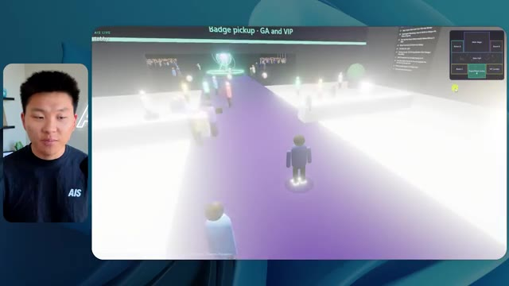
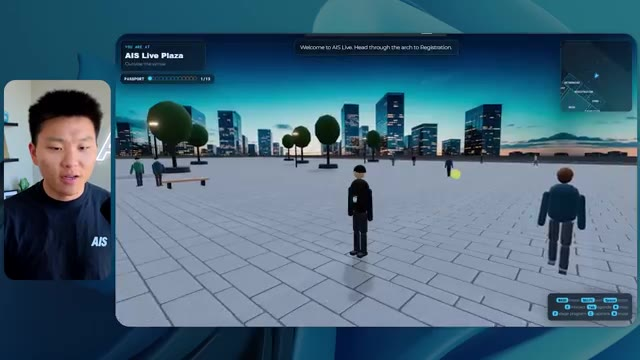
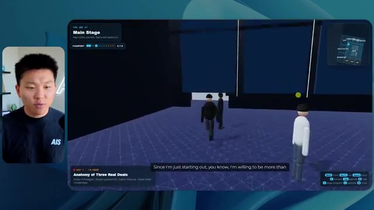

# 🎬 Claude has completely changed how I edit videos

> **Chaîne** : [Nate Herk | AI Automation](https://www.youtube.com/@nateherk/featured)  
> **Lien YouTube** : [https://www.youtube.com/watch?v=CV-k6rPJvJY](https://www.youtube.com/watch?v=CV-k6rPJvJY)  
> **Date de publication** : 20261014  
> **Durée** : 00:00:51  
> **Identifiant vidéo** : `CV-k6rPJvJY`  
> **Transcription & Analyse** : `whisper-v3-large-turbo+gemini-3.5-flash-lite`  

---

## 📌 Synthèse Exécutive & Outils

### 💡 Résumé

Cette vidéo, présentée par la chaîne *Nate Herk | AI Automation*, explore l'impact et la configuration des niveaux d'effort des modèles d'IA de pointe, en se concentrant sur les performances du modèle **Opus 5.5**. L'expérience centrale consiste à fournir un prompt complexe et identique à travers différents niveaux d'effort (du mode bas jusqu'aux modes supérieurs) pour concevoir un monde virtuel en 3D explorable à la troisième personne. Ce monde est directement alimenté par 105 gigaoctets de ressources vidéo issues d'un événement virtuel (*AIS Live*), transformant des enregistrements bruts, des PDF et des logos en une conférence interactive dotée de salles, de scènes, de pistes de formation et de PNJ dynamiques. 

Les résultats démontrent des variations spectaculaires entre les niveaux d'exécution, tant sur le plan qualitatif qu'économique. Le niveau bas (*Low*), bien qu'ayant nécessité 16 minutes d'exécution pour un coût estimé de 3,91 $ (191 000 jetons, 22 vérifications), a produit un résultat médiocre : des couleurs non conformes à la charte graphique, des images statiques sans lecture vidéo, des bugs d'affichage importants et des PNJ fantômes disparaissant à l'approche. À l'inverse, le niveau moyen (*Medium*), exécuté en 1 heure et 13 minutes pour 12,44 $ (490 000 jetons, 23 vérifications), a généré un monde hautement fonctionnel, esthétiquement fidèle aux directives de marque, avec des PNJ interactifs, des flux vidéo réels intégrés dans les salles d'atelier et un salon VIP pleinement opérationnel.

Au-delà de la démonstration technique, la vidéo met en lumière le goulet d'étranglement classique du développement assisté par IA : le passage du code fonctionnel local à un déploiement en ligne rapide. Pour combler ce fossé, le créateur intègre une solution de parrainage avec *Hostinger*, illustrant comment l'automatisation de bout en bout requiert non seulement des agents capables de concevoir des environnements immersifs complexes, mais aussi des outils d'infrastructure intégrés directement dans l'environnement de développement.

---

### 🛠️ Outils, Modèles & Logiciels Présentés

* **Opus 5.5** : Modèle d'IA de pointe développé par Anthropic, salué pour son intelligence, son coût abordable et ses capacités de raisonnement avancées dans des tâches de développement complexes.
* **Claude Code** : Outil de développement et d'ingénierie logicielle d'Anthropic permettant d'exécuter des agents de codage directement depuis l'environnement de travail.
* **Hostinger (Connecteur)** : Extension gratuite pour éditeurs de code (VS Code, Cursor, Claude Code, etc.) permettant d'intégrer le compte d'hébergement pour un déploiement rapide et direct en ligne.
* **Frame.io** : Plateforme de gestion de contenu multimédia utilisée ici pour stocker et alimenter l'agent avec 105 Go d'enregistrements vidéo d'événements.
* **Cursor & VS Code** : Éditeurs de code de référence compatibles avec les extensions d'automatisation et de connectivité cloud.

---

### 🔑 Points Clés & Enseignements Stratégiques

* **L'impact critique du paramètre d'effort** : Le choix du niveau d'effort (bas, moyen, haut, ultra code) modifie radicalement la qualité, la complexité structurelle et la fiabilité du livrable final généré par l'IA à partir d'un prompt identique.
* **Validation de la recommandation d'Anthropic** : Les directives officielles d'Anthropic conseillent de débuter les tâches complexes au niveau d'effort moyen, un compromis idéal validé par l'expérience qui surpasse nettement le niveau bas sans nécessiter immédiatement les coûts maximaux.
* **Corrélation entre temps de calcul et complexité** : Le passage du niveau bas au niveau moyen a multiplié le temps d'exécution par plus de 4 (de 16 minutes à 1 heure 13) et le coût par plus de 3 (de 3,91 $ à 12,44 $), illustrant l'investissement informatique requis pour des agents autonomes plus profonds.
* **Autonomie des agents et absence d'intervention** : Dans les deux configurations testées, l'agent a exécuté l'intégralité du prompt sans poser une seule question à l'utilisateur, démontrant une forte autonomie mais soulignant la nécessité de spécifications initiales extrêmement rigoureuses.
* **Gestion des boucles de rétroaction visuelle (Vérifications)** : L'utilisation de vérifications autonomes (22 à 23 ouvertures de navigateur par l'agent pour tester son propre travail) est un indicateur clé de la capacité d'auto-correction et d'assurance qualité des agents modernes.
* **Intégration de données massives hétérogènes** : Capacité démontrée d'un agent IA à ingérer, structurer et exploiter 105 Go de données non structurées (vidéos, ressources marketing, agendas) pour les contextualiser dans un espace 3D interactif.
* **Respect de la charte graphique et branding** : Alors que le niveau bas a échoué à reproduire l'identité visuelle (logos, palettes de couleurs), le niveau moyen a intégré avec succès les directives de marque, prouvant que les niveaux d'effort supérieurs gèrent mieux les contraintes contextuelles complexes.
* **Dynamisme et interactivité des environnements** : Le niveau moyen a su introduire des PNJ réactifs (mouvements, interactions) et des flux vidéo dynamiques en temps réel dans les salles d'atelier, transformant un simple diaporama statique en une véritable simulation immersive.
* **Le fossé du déploiement post-développement** : Le cycle de vie du développement assisté par IA se heurte fréquemment à la friction du passage d'une application fonctionnelle locale à une mise en ligne accessible, nécessitant des intégrations d'infrastructure natives.
* **Rôle des extensions d'infrastructure pour développeurs** : L'utilisation d'outils comme le connecteur Hostinger au sein des environnements de code (Claude Code, Cursor) élimine la rupture de charge entre le prototypage par agent et la publication Web en direct.

---

## ⏱️ Chronologie & Transcription Complète Audio & Visuelle (Mot pour Mot)

### ⏱️ `[00:00:00 - 00:00:20]` | Segment #01

**🔊 Audio (Transcription Intégrale Mot pour Mot en Français) :**
> Opus 5.5, Opus 5.5, Opus 5.5, Opus 5.5, Opus 5.5. Ce modèle est littéralement partout et pour de très bonnes raisons. Il est intelligent, il est bon marché, il a un goût incroyable, c'est un modèle d'IA extraordinaire. Mais avec chaque modèle d'IA, vous avez le choix de l'effort, que ce soit faible, moyen, haut, extra, max ou ultra code.

**👁️ Analyse Visuelle d'Écran (gemini-3.5-flash-lite) :**
**Interface & Outils** : Navigateur web (plateforme X / Twitter)

**Contenu textuel & Code** : Publication sur X avec un visuel de paysage tropical et du texte en anglais sur les créateurs et l'IA.

**Action / Démonstration** : Affichage d'un exemple de publication sur les réseaux sociaux pour illustrer le sujet abordé.

*⏱️ 00:00:05 — Capture d'écran d'un tweet sur X montrant un rendu visuel ou un paysage généré par IA.*

---

### ⏱️ `[00:00:20 - 00:00:38]` | Segment #02

**🔊 Audio (Transcription Intégrale Mot pour Mot en Français) :**
> Donc dans cette vidéo, j'ai donné exactement le même prompt à Opus 5.5 et je l'ai exécuté sur chaque niveau d'effort et nous allons comparer les résultats. Nous allons examiner la qualité de toutes les différentes sorties réelles, mais nous allons aussi examiner combien de temps chacun d'eux a fonctionné, combien cela nous a coûté s'il s'agissait de facturation par API, le total des jetons, combien de vérifications ils ont exécutées et combien de questions ils m'ont réellement posées tout au long du processus.

**👁️ Analyse Visuelle d'Écran (gemini-3.5-flash-lite) :**
**Interface & Outils** : Application web ou tableau de bord de type canvas / tableau comparatif.

**Contenu textuel & Code** : Tableau comparatif avec les lignes : Run time, API cost, Total tokens, Checks, Questions asked, pour différents niveaux d'effort d'Opus 5.5.

**Action / Démonstration** : Comparaison visuelle des performances, coûts et temps d'exécution selon les niveaux d'effort du modèle d'IA.

*⏱️ 00:00:29 — Capture d'un tableau comparatif intitulé 'Opus 5.5 Efforts' montrant différents niveaux d'effort (Low, Medium, High, Extra, Max, Ultracode) et métriques.*

---

### ⏱️ `[00:00:39 - 00:00:58]` | Segment #03

**🔊 Audio (Transcription Intégrale Mot pour Mot en Français) :**
> Et les résultats que nous avons obtenus ne sont pas du tout ce à quoi je m'attends, donc j'ai hâte de partager cela avec vous les gars. Ne perdons pas de temps et entrons directement dans le vif du sujet. D'accord, alors plongeons directement dans celui-ci. Je veux commencer simplement en vous montrant le prompt réel que nous avons utilisé, que nous avons donné à chacun de ces différents agents. Je vais aller dans les fichiers ici, et nous allons ouvrir ce fichier markdown de prompt, et je vais vous montrer ce que nous avons obtenu. Voici donc le slash objectif que j'ai fourni.

**👁️ Analyse Visuelle d'Écran (gemini-3.5-flash-lite) :**
**Interface & Outils** : Interface graphique de l'application de développement IA (Opus 5.5 / CLI) avec une vue sur les sessions, les worktrees et une zone de chat.

**Contenu textuel & Code** : Texte du prompt : 'Hi Nate. This worktree has the effort-test task queued in PROMPT.md : build a walkable third-person 3D world of the AIS Live conference...'

**Action / Démonstration** : Le présentateur introduit l'interface de l'application d'IA et le prompt de test de niveau d'effort configuré pour le projet.

*⏱️ 00:00:48 — Interface sombre d'une application d'IA (Opus 5.5 CLI ou assistant de code) montrant un prompt demandant de créer un monde 3D interactif.*

---

### ⏱️ `[00:00:58 - 00:01:34]` | Segment #04

**🔊 Audio (Transcription Intégrale Mot pour Mot en Français) :**
> J'ai dit, tu dois me créer un monde en 3D qui est une conférence tech réaliste dans laquelle je peux me promener en vue à la troisième personne. Tu vas regarder ce dossier, qui contient mes ressources d'enregistrement d'événements d'AIS Live. Et ce dossier est un dossier Frame.io de 105 gigaoctets d'enregistrements vidéo. C'était un événement entièrement virtuel. Tout a été enregistré et tous les enregistrements sont juste ici. J'ai dit, ton objectif est de prendre cet événement et de le transformer en un monde explorable en 3D qui me donne l'impression d'être réellement allé à une vraie conférence en personne avec différentes salles, différentes pistes, différentes scènes, bla, bla, bla. N'hésite pas à utiliser key.ai si tu as besoin de générer des images ou des vidéos. Et tu peux aussi utiliser tout ce qui se trouve dans mon projet Herc 2, qui est comme mon système d'exploitation IA. J'ai dit,

**👁️ Analyse Visuelle d'Écran (gemini-3.5-flash-lite) :**
**Interface & Outils** : Éditeur de code (VS Code / Cursor) et interface web Frame.io.

**Contenu textuel & Code** : Fichier PROMPT.md contenant les instructions pour concevoir une conférence tech 3D interactive et lien Frame.io.
[DESC_ACTION] Présentation du prompt détaillé et du dossier de ressources vidéo de 105 Go pour le projet.

**Action / Démonstration** : Explications face caméra et démonstration conceptuelle.

*⏱️ 00:01:07 — Éditeur de texte affichant le fichier PROMPT.md avec les instructions de création du monde 3D.*

*⏱️ 00:01:16 — Interface web Frame.io montrant le dossier de ressources d'événements AIS Live de 105 Go.*

*⏱️ 00:01:25 — Éditeur de texte montrant le détail du prompt demandant de convertir les enregistrements en univers 3D explorable.*

---

### ⏱️ `[00:01:34 - 00:02:08]` | Segment #05

**🔊 Audio (Transcription Intégrale Mot pour Mot en Français) :**
> tu seras jugé sur la créativité, le design, la physique et la sensation générale lorsque j'explorerai le monde en 3D que tu as construit. Et c'était fondamentalement la fin des instructions. Donc, comme vous pouvez le voir sur ce côté gauche, j'ai exécuté ceci à travers tous les différents niveaux d'effort. Commençons par le niveau bas et remontons jusqu'à l'ultra code. Très bien. Donc ici, nous avons le résultat du niveau bas. Ouvrons ceci et jetons un œil. Nous avons donc AIS Live, le sommet des services IA enfin en personne, et nous avons pu cliquer partout. Tout d'abord, cela ne fait pas très personnalisé. Genre, ce n'ce n'est pas le logo d'IS Live. Ce n'est même pas nos couleurs. Donc je n'aime pas trop ça, mais entrons là-dedans. D'accord. C'est beaucoup trop lumineux. Euh, nous avons une carte en haut à droite, nous avons une ville par ici, je ne peux pas dire quelle ville c'est.

**👁️ Analyse Visuelle d'Écran (gemini-3.5-flash-lite) :**
**Interface & Outils** : Application logicielle avec panneau latéral de gestion de sessions et zone de chat (type interface LLM / éditeur avancé).

**Contenu textuel & Code** : Texte du prompt dans la zone de chat : "Hi Nate. This worktree has the effort-test task queued in PROMPT.md : build a walkable third-person 3D world of the AIS Live conference from your f.io recordings..." et réponse utilisateur dans la barre de saisie : "yes, start the task in PROMPT.md".

**Action / Démonstration** : L'utilisateur navigue et sélectionne différents niveaux d'effort dans le panneau latéral gauche pour exécuter et tester la génération d'un monde 3D.

*⏱️ 00:01:42 — Interface d'une application montrant une liste de sessions de test avec différents niveaux d'effort (Hello, Extra, High, Max, Ultracode, Medium, Low) sur le panneau de gauche, et une conversation avec un assistant IA sur le panneau de droite.*

---

### ⏱️ `[00:02:08 - 00:02:40]` | Segment #06

**🔊 Audio (Transcription Intégrale Mot pour Mot en Français) :**
> c'est. D'accord. C'est Chicago, ce qui est plutôt cool parce que vous savez, j'habite à Chicago, mais bref, en haut à droite, nous pouvons voir une carte. Nous avons un hall d'accueil. Nous avons un hall d'exposition. Nous avons la scène principale du salon VIP. La carte montre également où se trouve chaque autre personne et cela se synchronise en direct. Nous pouvons donc voir l'enregistrement. Nous pouvons voir le premier jour, la keynote de l'agent hyper, le débriefing en direct. Cool. Donc ça connaît réellement l'agenda et puis il y a le deuxième jour. Donc il a trouvé ça, c'est bien. Nous avons ces petites boules ici que je peux espérer botter. D'accord. Le visage, Oh, regardez ça. Si je vais par ici, tous les gens disparaissent tout simplement. Très mauvais. Très mauvais. D'accord. Alors voyons voir. Est-ce que je peux sprinter ? D'accord.

**👁️ Analyse Visuelle d'Écran (gemini-3.5-flash-lite) :**
**Interface & Outils** : Application web 3D immersive et interactive.

**Contenu textuel & Code** : Carte de navigation, programmes de conférences et avatars d'utilisateurs.

**Action / Démonstration** : Exploration et navigation dans l'environnement virtuel 3D.

*⏱️ 00:02:16 — Vue d'un espace virtuel 3D avec un avatar et une carte interactive en haut à droite.*

*⏱️ 00:02:24 — Vue du hall d'accueil virtuel affichant le programme du premier jour sur un panneau.*

*⏱️ 00:02:32 — Vue de l'Expo Hall virtuel avec des avatars et des éléments lumineux interactifs.*

---

### ⏱️ `[00:02:40 - 00:03:04]` | Segment #07

**🔊 Audio (Transcription Intégrale Mot pour Mot en Français) :**
> Je peux avancer un peu plus vite. Je vais d'abord aller par ici. Il y a des produits promotionnels, euh, certifiés AIS plus glido. D'accord. Donc, il y a les stands réels que nous avions dans l'événement virtuel. Nous avions des stands. Donc c'est plutôt cool. Un petit endroit pour prendre des photos. Salle C. En ce moment, nous avons Tangy Frederick qui anime un atelier. D'accord. Mais ce n'est pas une vidéo. Comme vous pouvez le voir, c'est juste une image. Elle ne bouge pas. C'est donc juste une image. Ces gens sont en train de disparaître. Ça doit être des fantômes. Allons par ici vers la salle A.

**👁️ Analyse Visuelle d'Écran (gemini-3.5-flash-lite) :**
**Interface & Outils** : Application de monde virtuel / événement virtuel 3D (type Gather.town ou similaire).

**Contenu textuel & Code** : Environnement virtuel 3D avec des stands d'exposition, des écrans explicatifs et des affichages textuels.

**Action / Démonstration** : Navigation et exploration d'un événement virtuel à travers un avatar en 3D.

*⏱️ 00:02:46 — Vue d'un monde virtuel style métavers montrant un stand d'exposition avec le logo Glaido et des cubes publicitaires au sol.*

*⏱️ 00:02:52 — Le personnage virtuel navigue dans une salle d'atelier aux lumières vertes avec plusieurs tables rondes.*

*⏱️ 00:02:58 — Le personnage s'approche d'un écran géant affichant des instructions sur l'utilisation de clés API et d'intégrations.*

---

### ⏱️ `[00:03:04 - 00:03:30]` | Segment #08

**🔊 Audio (Transcription Intégrale Mot pour Mot en Français) :**
> Nous avons Liberty White. D'accord. Très cool. Vos 30 premiers jours en automatisation. Encore une fois, c'est juste une image fixe et les gens ont des bugs d'affichage. Donc ce n'est pas très bien ici. Je vais aller sur la scène principale et voir ce que nous avons. D'accord, cool. Donc nous avons une scène principale. Les gens ont de gros bugs d'affichage. Vraiment mauvais. Ce n'est vraiment pas terrible. Notre vidéo est en train de bouger. Genre, j'ai vu mon visage ici et j'ai vu celui de Devin, mais maintenant ils ont disparu. Donc je ne sais pas ce qui s'est passé. D'accord. Ça ressemble plutôt à un diaporama. Rien n'est vraiment joué pour l'instant. Bref, entrons ici.

**👁️ Analyse Visuelle d'Écran (gemini-3.5-flash-lite) :**
**Interface & Outils** : Environnement virtuel 3D de type métaverse/conférence en ligne.

**Contenu textuel & Code** : Interface utilisateur virtuelle avec mini-carte de navigation et affichage d'ateliers ("Hyperagent Workshop").

**Action / Démonstration** : Exploration et navigation d'un avatar dans un espace de conférence virtuel.

*⏱️ 00:03:11 — Vue dans une salle virtuelle "Workshop Room A" montrant un avatar dans un espace 3D minimaliste avec des plateformes lumineuses.*

*⏱️ 00:03:17 — Navigation dans la scène principale virtuelle ("Main Stage") montrant un public virtuel assis face à une estrade.*

*⏱️ 00:03:24 — Vue générale de la scène principale virtuelle avec l'écran géant "AIS LIVE - AI Services Summit" et des avatars s'y déplaçant.*

---

### ⏱️ `[00:03:30 - 00:03:58]` | Segment #09

**🔊 Audio (Transcription Intégrale Mot pour Mot en Français) :**
> Nous avons d'autres stands. Nous avons hyper agent. Nous avons Claude Code. Nous avons plus de cadeaux publicitaires. La salle B, c'est Dave Ebelor. Je suppose que c'est exactement la même chose. Nous avons du café. Et ensuite, je suppose, le salon VIP, accès VIP uniquement. C'est plutôt cool, mais il ne se passe vraiment rien ici. Cet écran est bien trop lumineux. Bon. Donc je pense que vous comprenez l'ambiance qu'on obtient ici d'Opus 5.5 en effort faible. Et c'est là que les choses deviennent intéressantes. À combien est-ce que vous pensez que cela a tourné ? Combien de temps ? Celui-ci a tourné pendant 16 minutes et 43 secondes. Combien est-ce que vous pensez que cela a coûté ?

**👁️ Analyse Visuelle d'Écran (gemini-3.5-flash-lite) :**
**Interface & Outils** : Tableau blanc ou application de mind mapping "Opus 5.5 Efforts".

**Contenu textuel & Code** : Tableau comparatif avec les lignes : Run time, API cost, Total tokens, Checks, Questions asked, et les colonnes de Low à Ultracode.
[DESC_IMAGE_3] Présentation des niveaux d'effort d'un modèle d'IA (Opus 5.5).

**Action / Démonstration** : Explications face caméra et démonstration conceptuelle.

*⏱️ 00:03:51 — Interface de tableau comparatif "Opus 5.5 Efforts" affichant des niveaux de performance (Low, Medium, High, Extra, Max, Ultracode) et des métriques.*

---

### ⏱️ `[00:03:58 - 00:04:26]` | Segment #10

**🔊 Audio (Transcription Intégrale Mot pour Mot en Français) :**
> 3,91 dollars si c' تھا۔ J'utilise évidemment mon abonnement ici, mais on va simplement calculer ça avec la facturation par API. Le total des jetons était de 191 000. Il a fait 22 vérifications. Donc la vérification, 22 fois il a ouvert le navigateur et a exécuté différentes sortes de vérifications. Donc 22 catégories de vérifications. Et combien de questions m'a-t-il posées ? Il m'a posé un total de zéro question tout au long de cette invite de commande d'objectif. D'accord. Alors, ouvrons l'effort moyen et voyons ce que nous avons. D'accord, c'est parti. Effort moyen. Nous avons Nate Herc. Nous avons mon badge. C'est de la marque AI's Life.

**👁️ Analyse Visuelle d'Écran (gemini-3.5-flash-lite) :**
**Interface & Outils** : Outil de tableau blanc ou de diagramme (type Excalidraw ou similaire).

**Contenu textuel & Code** : Tableau avec les lignes 'Run time', 'API cost', 'Total tokens', 'Checks', 'Questions asked' et les colonnes 'Low', 'Medium', 'High', 'Ex'.

**Action / Démonstration** : Présentation des résultats d'analyse et des coûts associés à l'exécution de l'agent.

*⏱️ 00:04:05 — Un tableau comparatif montrant les métriques de performance et de coût pour le niveau 'Low', incluant le temps d'exécution (16m 43s), le coût API ($3.91) et le total des jetons (191.3K).*

---

### ⏱️ `[00:04:26 - 00:04:46]` | Segment #11

**🔊 Audio (Transcription Intégrale Mot pour Mot en Français) :**
> Donc ça a déjà l'air un tout petit peu mieux. Ça ressemble à nos palettes de couleurs qui utilisaient nos directives de marque. Premier jour, construction, deuxième jour, gagner, VIP. Cool. D'accord. Je vais entrer dans le lieu. D'accord. Wouah. Une ambiance un peu similaire. C'est en arrière-plan. Ça ne ressemble pas à Chicago pourtant, si ? Non, ça ressemble à, honnêtement, ça ressemble à une ville imaginaire. Quoi qu'il en soit, c'est marrant qu'ils aient décidé de faire ça. Voyons si je peux me déplacer un peu plus vite. Oh, wouah.

**👁️ Analyse Visuelle d'Écran (gemini-3.5-flash-lite) :**
**Interface & Outils** : Application web interactive / Environnement virtuel 3D (style metaverse)

**Contenu textuel & Code** : Interface d'accueil avec badge (« Welcome to AIS Live », « NATE HERK ») et commandes clavier pour la navigation virtuelle.

**Action / Démonstration** : Navigation et entrée dans le lieu virtuel de l'événement avec les avatars 3D.

*⏱️ 00:04:31 — Interface web de l'application « AIS Live » avec un badge nominatif de conférence, un bouton « Enter the Venue » et les commandes du jeu.*

*⏱️ 00:04:41 — Vue dans l'espace virtuel 3D avec des avatars d'utilisateurs et une vue panoramique d'une ville illuminée en arrière-plan.*

---

### ⏱️ `[00:04:46 - 00:05:21]` | Segment #12

**🔊 Audio (Transcription Intégrale Mot pour Mot en Français) :**
> Les gens interagissent avec moi. Regardez. Si je m'approche de ce type, il vient de lever le bras. Bon, maintenant il ne veut plus du tout avoir affaire à moi. Mais tous ces petits robots ici doivent prendre des décisions. Je ne sais pas s'ils utilisent Jev. C'est sûr que non. Je ne le lui ai pas dit. En fait, ma clé Jev est à l'arrière. Je ne sais pas. Peut-être qu'il l'a utilisée. Quoi qu'il en soit, nous pouvons voir ici que nous avons la salle d'atelier C, le laboratoire des agents. Sympa. Donc celui-ci est en fait en train d'être exécuté. Vous pouvez voir qu'il s'agit d'une vraie vidéo lue par Tangy. Tout le monde ici est en train de travailler sur un ordinateur portable. Ils ne buguent pas. C'est plutôt cool. De plus, mon badge est sur ma poitrine, ce qui est plutôt cool. Je peux venir par ici. Nous avons une carte en haut à droite, comme vous pouvez le voir, mais je peux venir par ici. Nous avons un

**👁️ Analyse Visuelle d'Écran (gemini-3.5-flash-lite) :**
**Interface & Outils** : Application de monde virtuel 3D en ligne / espace de réunion virtuel.

**Contenu textuel & Code** : Environnement 3D avec des avatars d'utilisateurs et une mini-carte en haut à droite.

**Action / Démonstration** : Navigation et exploration de l'espace virtuel par le présentateur.

---

### ⏱️ `[00:05:21 - 00:05:47]` | Segment #13

**🔊 Audio (Transcription Intégrale Mot pour Mot en Français) :**
> hall d'exposition. C'est là que nous avons le stand Glido. Et ça diffuse en ce moment. Oui, ça diffuse la vidéo de nous parlant de Glido. Ça diffuse la vidéo d'Ed et moi parlant de notre programme de certification. Nous avons le logo AIS Plus juste ici, qui est un peu mal placé. Ce sont les diapositives des conférenciers et les points clés. Donc wow, ce sont toutes les ressources que nous avons distribuées après l'événement. Elles sont toutes là également. On peut voir que nous avons un coup de projecteur sur la communauté. C'est donc Aiden qui parle de son contrat qu'il a décroché et c'est diffusé en direct. Ces gens regardent.

**👁️ Analyse Visuelle d'Écran (gemini-3.5-flash-lite) :**
**Interface & Outils** : Environnement virtuel 3D / plateforme de métavers d'événement en ligne.

**Contenu textuel & Code** : Affiches, diapositives de présentation et panneaux d'information virtuels.
[DESC_IMAGE_1] Navigation d'un avatar et présentation du stand Glido dans l'espace virtuel.

**Action / Démonstration** : Explications face caméra et démonstration conceptuelle.

---

### ⏱️ `[00:05:47 - 00:06:21]` | Segment #14

**🔊 Audio (Transcription Intégrale Mot pour Mot en Français) :**
> Ils sont plutôt engagés. On a un hyper agent. C'était, c'est ce que je voulais dire. Si vous avez vu ces gens lever les bras en disant bonjour, c'était plutôt drôle. Regardez, regardez, le voilà qui recommence. Bref. Bon. Où est-ce que je suis maintenant ? Maintenant, je suis dans le hall principal. On a un bar à café. On a un grand logo, qui est le vrai logo. C'est trop lumineux, mais on a le logo. On peut voir si on peut entrer ici dans le parcours fondation. On a Sabrina Romanov et Liberty White. Donc différentes formations juste là. On peut entrer dans cette salle. C'est le parcours avancé. Donc qu'est-ce qui se passe ici. On a Dave Ebelar et Saman qui parlent de différentes choses là-dedans. Et maintenant, allons jeter un œil à la scène principale. Oh, attendez, il y a une vidéo de moi là-haut. C'est genre un VIP

**👁️ Analyse Visuelle d'Écran (gemini-3.5-flash-lite) :**
**Interface & Outils** : Application virtuelle 3D / Metavers

**Contenu textuel & Code** : Environnement virtuel en 3D avec des avatars d'utilisateurs et une mini-carte dans le coin supérieur droit.

**Action / Démonstration** : Navigation et déplacement de l'avatar du présentateur dans l'espace virtuel.

---

### ⏱️ `[00:06:21 - 00:06:50]` | Segment #15

**🔊 Audio (Transcription Intégrale Mot pour Mot en Français) :**
> section ? Ouais, on ira voir ça dans une minute. Mais bref, voici la scène principale. Ça a l'air vraiment, vraiment très bien. On a une grande scène. On a genre quatre personnes assises ici. On a les trois écrans d'Alex là-haut avec Hyper Agent. Est-ce que j'ai le droit de monter sur scène ? Oh, et il me laisse monter sur scène. D'accord. C'est plutôt sympa. Bon, les gars, faisons un selfie. Laissez-moi prendre tout le monde en arrière-plan. Venez par ici. Bref, c'est plutôt, plutôt cool. Par contre, toutes les places ne sont pas occupées. Donc il faut qu'on travaille là-dessus. Mais bref, je vais y retourner en courant pour voir ce qu'était cette section VIP. D'accord. Le salon VIP. J'ai l'impression que c'est comme un aéroport ou quelque chose comme ça.

**👁️ Analyse Visuelle d'Écran (gemini-3.5-flash-lite) :**
**Interface & Outils** : Environnement virtuel 3D / Plateforme de métavers ou événement virtuel.

**Contenu textuel & Code** : Interface utilisateur affichant les détails de la keynote (Hyperagent Keynote - Alex McDonnell) dans un encadré en bas à gauche.

**Action / Démonstration** : Navigation et exploration de l'espace de conférence virtuel par l'utilisateur.

---

### ⏱️ `[00:06:51 - 00:07:14]` | Segment #16

**🔊 Audio (Transcription Intégrale Mot pour Mot en Français) :**
> Ok, super. Donc maintenant nous avons les sessions VIP ici. Une session VIP de questions-réponses avec Nate, lecture vidéo en direct juste ici. Très, très cool. Et nous avons comme un bar ou quelque chose comme ça. Génial. Je dirais que c'est un très bon résultat. Maintenant, en ce qui concerne les statistiques ici, celle-ci a pris une heure et 13 minutes à s'exécuter. Cela nous aurait coûté 12 dollars et 44 cents. Elle a utilisé 490 000 jetons et elle a effectué 23 vérifications.

**👁️ Analyse Visuelle d'Écran (gemini-3.5-flash-lite) :**
**Interface & Outils** : Environnement virtuel 3D type metaverse et tableau de bord analytique.

**Contenu textuel & Code** : Métriques de performance, coûts API et statistiques de tokens pour différents niveaux d'effort (Low, Medium, High).
[DESC_IMAGE_2_DETAIL] Le tableau montre les détails de la colonne 'Low' avec un temps d'exécution de 16m 43s, un coût API de 3.91$, et 191.3K tokens totaux.

**Action / Démonstration** : Présentation des résultats d'une session VIP virtuelle et analyse des coûts d'API associés.

*⏱️ 00:06:56 — Vue d'un espace virtuel 3D (salon VIP) avec des avatars et une grande vidéo projetée à l'écran montrant le présentateur.*

*⏱️ 00:07:02 — Tableau comparatif affichant les métriques d'exécution (Run time: 16m 43s, API cost: $3.91, Total tokens: 191.3K, Checks: 22).*

---

### ⏱️ `[00:07:14 - 00:07:48]` | Segment #17

**🔊 Audio (Transcription Intégrale Mot pour Mot en Français) :**
> Et il nous a posé un total de zéro question une fois de plus. Très bien, passons au niveau élevé. C'était déjà un résultat plutôt correct et Anthropic eux-mêmes dans leur vidéo sur comment prompter Opus 5.5, ou désolé, pas une vidéo, un article. Ils ont dit de commencer simplement par le niveau moyen et de l'ajuster à la hausse ou à la baisse si nécessaire. C'était donc un résultat moyen. Passons au niveau élevé et voyons ce que nous avons obtenu. Très rapidement, les gars, je dois prendre une seconde pour vous parler du sponsor de la vidéo d'aujourd'hui, Hostinger. Donc ces deux modèles viennent de me construire une version fonctionnelle de la même chose. Et maintenant, je suis exactement là où je finis toujours, avec quelque chose de terminé sur mon ordinateur portable et aucun moyen rapide de le mettre en ligne. Et c'est le fossé que le connecteur d'Hostinger comble. C'est une extension gratuite

**👁️ Analyse Visuelle d'Écran (gemini-3.5-flash-lite) :**
**Interface & Outils** : Tableau blanc interactif (Image 1) et IDE / Interface de développement assistée par IA (Image 2)

**Contenu textuel & Code** : Tableau de métriques comparatives (Run time, API cost, Total tokens, Checks, Questions asked) et interface de chat/code pour le projet "Northwind ROI calculator"

**Action / Démonstration** : Présentation comparative des résultats d'exécution des différents modes d'effort d'Opus 5.5.

*⏱️ 00:07:22 — Tableau comparatif des performances selon les niveaux d'effort (Low, Medium, High, Extra) montrant le temps d'exécution, le coût API, les tokens et le nombre de questions posées.*

*⏱️ 00:07:39 — Interface de développement avec un éditeur de code en double panneau, affichant le prompt de création d'un calculateur de ROI et l'activité de l'agent IA.*

---

### ⏱️ `[00:07:48 - 00:08:23]` | Segment #18

**🔊 Audio (Transcription Intégrale Mot pour Mot en Français) :**
> pour votre éditeur qui intègre votre compte Hostinger dans l'outil où vous êtes déjà en train de coder. Que ce soit VS Code, Cursor, Cloud Code, Codex, peu importe. Vous vous connectez une seule fois en un seul clic, et à partir de là, votre agent peut déployer le site, y pointer un domaine, configurer les enregistrements DNS et vérifier votre VPS sans que vous n'ayez jamais à quitter l'éditeur. Ainsi, peu importe celui de ces outils que vous finirez par préférer, ce qu'il a construit se trouve à quelques minutes d'une vraie URL sur un hébergement géré. Connector est gratuit avec chaque formule d'hébergement, donc si vous avez toujours besoin de l'hébergement en dessous, prenez la formule illimitée avec le lien dans la description et utilisez le code NATEHERK pour obtenir 10 % de réduction. Cela inclut également un nom de domaine gratuit et un e-mail professionnel pour l'année. Et c'est toujours le moyen le moins cher que j'ai trouvé pour obtenir quelque

**👁️ Analyse Visuelle d'Écran (gemini-3.5-flash-lite) :**
**Interface & Outils** : Interface de gestion Hostinger (MCP) et terminal Claude Code

**Contenu textuel & Code** : Panneau de configuration "Manage Hostinger from your IDE" avec statut "Connected (VIA OAUTH)" et liste des outils accessibles (Websites, Domains, Subscriptions & Payments, Email Marketing).

**Action / Démonstration** : Connexion du compte Hostinger à l'IDE et affichage des outils de gestion intégrés.

*⏱️ 00:07:57 — Interface montrant la connexion du compte Hostinger depuis l'IDE, avec les outils disponibles (Websites, Domains, Subscriptions, Email Marketing) et Claude Code ouvert sur le côté.*

---

### ⏱️ `[00:08:23 - 00:08:47]` | Segment #19

**🔊 Audio (Transcription Intégrale Mot pour Mot en Français) :**
> vous avez construit sur une vraie URL. Donc revenons à la vidéo. D'accord. Encore une fois, très, très marqué par la marque. C'est un écran de chargement encore meilleur que le précédent. Nous avons ce petit effet sympa en arrière-plan. Nous avons le logo. Nous allons entrer dans le lieu. D'accord. Nous y voilà. Ça a l'air plutôt bien. Nous commençons à l'extérieur et vous pouvez voir que nous avons ces drapeaux pour tous les intervenants, Wyatt, Casper, Alex, Ed, Aiden, Sabrina, Liberty. C'est plutôt cool. Nous avons des blocs en direct ici.

**👁️ Analyse Visuelle d'Écran (gemini-3.5-flash-lite) :**
**Interface & Outils** : Application web interactive en 3D / environnement virtuel hébergé.

**Contenu textuel & Code** : Interface utilisateur avec bannières d'événements, panneaux d'information, indications de contrôles clavier/souris (WASD, SHIFT, SPACE, MOUSE, E, P).

**Action / Démonstration** : Navigation et exploration de l'espace virtuel 3D de l'événement par le présentateur.

*⏱️ 00:08:29 — Écran de chargement de l'application 'AIS LIVE' avec logo, informations sur l'événement et touches de contrôle.*

*⏱️ 00:08:35 — Vue dans un monde virtuel 3D en style isométrique montrant une place urbaine ('AIS Live Plaza') avec des avatars et des instructions de déplacement.*

*⏱️ 00:08:41 — Exploration de l'espace virtuel 3D montrant des bannières verticales avec des noms de conférenciers ('Wyatt Lyonsmith', 'Alex McDonnell') dans une rue de la plaza.*

---

### ⏱️ `[00:08:47 - 00:09:23]` | Segment #20

**🔊 Audio (Transcription Intégrale Mot pour Mot en Français) :**
> il a pris cette photo de moi, votre hôte, Nate Herc, John, Dave, Nate Herc. Voilà. OK. Les portes. Génial. Ce sont des portes coulissantes automatiques en verre. J'adore ça. Nous pouvons voir l'enregistrement VIP. Nous pouvons voir l'admission générale. Nous pouvons venir par ici et nous pouvons découvrir l'exposition avec différents stands, le projecteur sur la communauté. Vous pouvez également voir qu'en haut à gauche, j'ai un passeport. Donc c'est dugenre, ça va montrer combien d'endroits j'ai visités. Tout cela est une vraie lecture. Nous avons un mur de ressources avec tous les différents conférenciers. Ils ont aussi une session de networking par ici. Je vais donc venir très vite et voir de quoi il s'agit. Nous avons donc le bar à cold brew AIS. Nous avons différents membres de la communauté qui ont été mis en avant ou mis en lumière.

**👁️ Analyse Visuelle d'Écran (gemini-3.5-flash-lite) :**
**Interface & Outils** : Application ou plateforme virtuelle 3D interactive, flux vidéo du présentateur en incrustation.

**Contenu textuel & Code** : Environnement virtuel 3D interactif avec des éléments d'interface utilisateur (panneaux, menus de navigation, badges).

**Action / Démonstration** : Exploration d'un espace virtuel 3D représentant un salon ou une conférence en ligne.

*⏱️ 00:08:56 — Vue d'un monde virtuel 3D représentant une zone d'enregistrement avec des comptoirs VIP et d'admission générale, le présentateur apparaissant en médaillon à gauche.*

*⏱️ 00:09:05 — Navigation dans un hall d'exposition virtuel en 3D avec des stands et des avatars d'utilisateurs, le présentateur visible en incrustation vidéo.*

*⏱️ 00:09:14 — Déplacement d'un avatar dans le hall virtuel aux côtés d'autres personnages 3D, le présentateur commentant en direct sur la gauche.*

---

### ⏱️ `[00:09:23 - 00:09:56]` | Segment #21

**🔊 Audio (Transcription Intégrale Mot pour Mot en Français) :**
> On a l'aile VIP. Attends, quoi ? Récupère un bracelet. Oh, je dois vraiment aller chercher le bracelet. D'accord. Laisse-moi m'enregistrer rapidement. Le bracelet est déjà mis. Attends, quoi ? D'accord. Oh, d'accord. Maintenant les portes se sont ouvertes pour moi. Cool. Je peux entrer ici. Oh, ça mène juste à la scène principale. Salon VIP. Il y a une séance de questions-réponses en cours. Ça a l'air très cool. Je veux dire, je suis très impressionné par la façon dont il est capable de faire ça. Waouh. D'accord. Donc c'est vraiment bien. Ce qu'on a fait, c'est qu'on a eu des salles de discussion VIP avec différentes personnes. Vous pouvez voir qu'il y a différentes salles, différents membres de l'équipe AIS qui participent à des trucs. C'est vraiment cool. C'est très cool. C'est un bien meilleur VIP

**👁️ Analyse Visuelle d'Écran (gemini-3.5-flash-lite) :**
**Interface & Outils** : Application web d'événement virtuel 3D avec avatars et interfaces de visioconférence intégrées.

**Contenu textuel & Code** : Navigation dans un espace virtuel interactif, interface de conférence en ligne et sessions de travail VIP.

**Action / Démonstration** : Navigation et exploration d'un environnement virtuel 3D par le présentateur.

*⏱️ 00:09:32 — L'avatar du présentateur se déplace dans le hall de la zone d'enregistrement d'un espace virtuel 3D.*

*⏱️ 00:09:40 — L'avatar arrive dans le salon VIP où un écran diffuse une vidéoconférence avec le présentateur en direct.*

*⏱️ 00:09:48 — L'avatar explore une zone de sessions de travail VIP avec différents ateliers thématiques affichés sur des panneaux.*

---

### ⏱️ `[00:09:56 - 00:10:30]` | Segment #22

**🔊 Audio (Transcription Intégrale Mot pour Mot en Français) :**
> expérience que celle qui a été montrée dans le premier morceau. D'accord. After party VIP. Regardez ça. On a une piste de danse. On a tous ces éléments ici. On a la lecture réelle de l'after party VIP juste ici. Et il y a une estrade de DJ. C'est tellement marrant. Il y a un petit bug ici, un petit glitch juste là, mais c'est génial. Oh, super. Donc quand je suis ici sur la scène principale, on a des sous-titres. Vous pouvez voir juste ici en bas de mon écran, on a ces sous-titres de Wyatt qui est en train de parler ici. On a des lumières. On a le panneau. Très cool. Belle scène principale. Je vais aller par ici. On peut aller à la fondation,

**👁️ Analyse Visuelle d'Écran (gemini-3.5-flash-lite) :**
**Interface & Outils** : Application web ou environnement virtuel 3D interactif (metaverse/plateforme d'événement en ligne).

**Contenu textuel & Code** : Interface utilisateur virtuelle affichant "VIP After-Party", "Main Stage", des barres de progression de passeport et des commandes clavier en bas à droite.

**Action / Démonstration** : Navigation et visite guidée d'un environnement virtuel interactif en 3D avec des avatars par le présentateur.

*⏱️ 00:10:04 — Capture d'écran montrant l'espace virtuel de l'after-party VIP avec des avatars qui dansent, une piste de danse lumineuse, un écran vidéo affichant des participants et le présentateur Nate Herk visible dans une incrustation vidéo à gauche.*

*⏱️ 00:10:13 — Vue légèrement différente de la salle virtuelle VIP avec un plus grand angle montrant l'ambiance de fête, les ballons de plage et les écrans de visioconférence intégrés.*

*⏱️ 00:10:21 — Capture d'écran montrant la scène principale (Main Stage) de l'événement virtuel avec des rangées de sièges, des avatars assis et un écran géant affichant un intervenant.*

---

### ⏱️ `[00:10:30 - 00:11:06]` | Segment #23

**🔊 Audio (Transcription Intégrale Mot pour Mot en Français) :**
> avancé, et les parcours d'entreprise par ici. Alors voyons voir. Nous avons l'anatomie de trois vraies transactions. Nous avons hyper agent. Nous avons les évaluations avec Nate et Ed ici. Nous avons Dave qui s'occupe des trucs avancés. C'est vraiment bien. Je veux dire, évidemment, chacun, chacun de ces résultats jusqu'à présent, le niveau bas était correct. Le niveau moyen était meilleur. Le niveau élevé a été encore meilleur. Voyons si cette tendance se poursuit et voyons combien cela nous a coûté. Donc, le niveau élevé a fonctionné pendant une heure et sept minutes. Donc un peu plus rapide que le niveau moyen, cela nous aurait coûté 16 dollars et 31 cents. Il a utilisé un demi-million de jetons, 509 000. Il a fait 22 vérifications. Et il nous a aussi demandé, enfin, non, je me suis trompé. Ce

**👁️ Analyse Visuelle d'Écran (gemini-3.5-flash-lite) :**
**Interface & Outils** : Tableau de bord graphique / application de type tableau comparatif.

**Contenu textuel & Code** : Données chiffrées de performance pour des niveaux d'effort (Low : 16m 43s, $3.91, 191.3K tokens ; Medium : 1h 13m, $12.44, 419.2K tokens ; High : 1h 7m, $16.31).

**Action / Démonstration** : Présentation et analyse comparative des coûts d'API, temps d'exécution et utilisation de tokens par niveau d'effort.

*⏱️ 00:10:57 — Tableau comparatif montrant les métriques de performance (Run time, API cost, Total tokens, Checks) selon différents niveaux d'effort (Low, Medium, High, Extra).*

---

### ⏱️ `[00:11:06 - 00:11:25]` | Segment #24

**🔊 Audio (Transcription Intégrale Mot pour Mot en Français) :**
> l'un m'a posé une question et spoiler, c'était le seul qui nous a posé une question pendant tout ça. Donc voyons voir, il nous en reste trois : extra, max et ultra code. Laissez-moi ouvrir extra et nous verrons ce que nous avons. D'accord. Donc celui-ci a l'air plutôt bien. Je dirais honnêtement que jusqu'à présent, l'écran de chargement haut était le meilleur. Celui qu'on vient de voir, mais bref, entrons dans le direct d'AIS.

**👁️ Analyse Visuelle d'Écran (gemini-3.5-flash-lite) :**
**Interface & Outils** : Tableau de bord d'analyse ou interface de présentation (type canvas ou tableau web sombre).

**Contenu textuel & Code** : Tableau avec des lignes : Run time (16m 43s, 1h 13m, 1h 7m), API cost ($3.91, $12.44, $16.31), Total tokens (191.3K, 419.2K, 509.3K), Checks (22, 23, 22), Questions asked (0, 0, 1).

**Action / Démonstration** : Le présentateur analyse et commente les résultats du tableau comparatif.

*⏱️ 00:11:11 — Un tableau comparatif montrant les métriques de différents niveaux (Low, Medium, High, Extra) avec le présentateur incrusté à gauche.*

---

### ⏱️ `[00:11:26 - 00:11:51]` | Segment #25

**🔊 Audio (Transcription Intégrale Mot pour Mot en Français) :**
> Whoa. D'accord. Donc on a comme de petits extraits sonores. Je peux discuter avec des gens. Le panneau sur la guerre des outils a réglé quelques débats pour moi. Sympa. Bonne perspective là-bas. On est dehors à nouveau. On a ces différentes bannières, bien qu'elles soient toutes les mêmes. Elles n'affichent pas de noms de personnes différentes. Donc gros logo AIS live. L'aile des ateliers est par ici. Et passons par les portes coulissantes en verre pour voir ce qu'on a. Donc on a le café AIS. La carte est en bas à droite, et elle n'est pas très descriptive.

**👁️ Analyse Visuelle d'Écran (gemini-3.5-flash-lite) :**
**Interface & Outils** : Environnement virtuel interactif

**Contenu textuel & Code** : AUCUN

**Action / Démonstration** : Le présentateur navigue dans un monde virtuel.

*⏱️ 00:11:32 — Présentateur regardant une scène virtuelle avec deux avatars.*

*⏱️ 00:11:38 — Présentateur regardant une scène virtuelle avec plusieurs avatars et des panneaux publicitaires.*

*⏱️ 00:11:45 — Présentateur regardant une scène virtuelle, où un avatar court vers un bâtiment.*

---

### ⏱️ `[00:11:51 - 00:12:26]` | Segment #26

**🔊 Audio (Transcription Intégrale Mot pour Mot en Français) :**
> J'aime bien comment les autres cartes nous ont dit quoi, genre où étaient les choses, mais celle-ci a l'air très professionnelle. On peut voir ici la scène principale. Allons y faire un tour rapidement. Ils ont tous ces ballons qui volent partout, ce que je trouve assez marrant. Les ballons de plage AIS. On me voit là-haut en train de parler. Je crois que j'introduisais l'un des jours. Continuons par ici vers la salle d'atelier sur ce côté gauche. D'accord. Donc ici nous avons le Hyper Agent Theater. Nous avons cette session sponsorisée ici par Hyper Agent, mais cela nous montre aussi ce qui va s'y passer. C'est vraiment drôle qu'on puisse discuter avec les gens. Salmon a créé un commercial vocal en direct. La salle du Juste Prix était comble. As-tu pris le guide du compagnon VIP ? C'est tellement marrant. Nous avons le parcours avancé dans

**👁️ Analyse Visuelle d'Écran (gemini-3.5-flash-lite) :**
**Interface & Outils** : Environnement virtuel, interface de scène virtuelle

**Contenu textuel & Code** : Texte "LIVE", "Main Stage", "Grand Ballroom", "Day 2 Open Now Let's Turn This Into Money", "AIS Live in the Room", "AI WORKSHOPS", "Foundation · Advanced · Enterprise", "ENTERPRISE AI SERVICES"

**Action / Démonstration** : Navigation dans un environnement virtuel lors d'un événement

*⏱️ 00:12:00 — La scène principale d'un événement virtuel, avec des avatars et des ballons qui flottent.*

*⏱️ 00:12:09 — Un groupe d'avatars dans un espace intérieur, près d'un panneau indiquant "AI WORKSHOPS".*

*⏱️ 00:12:17 — Trois avatars se tenant dans un couloir virtuel, avec des panneaux indiquant "EXHIBITION HALL" et "FOUNDATION ADVANCED ENTERPRISE".*

---

### ⏱️ `[00:12:26 - 00:12:58]` | Segment #27

**🔊 Audio (Transcription Intégrale Mot pour Mot en Français) :**
> ici. Encore une fois, nous avons la lecture en direct. Est-ce que c'est la lecture en direct ? Oh, d'accord. Ça a commencé une fois que je suis entré, mais je peux prendre place. Oh la la. Je peux regarder ça. Je peux me lever. Je veux m'asseoir au premier rang. C'est plutôt cool. C'est très bien. J'aime ça. Et vous savez ce que j'ai remarqué jusqu'à présent ? Le personnage réel que j'incarne me ressemble un peu. Je pense qu'il a été modélisé à partir de mes photos de profil ou quelque chose comme ça. Quoi qu'il en soit, nous avons Sabrina ici, l'animatrice de la salle ici, prenez n'importe quel siège libre. D'accord, cool. Et j'ai vraiment aimé la fonction pour s'asseoir. C'est plutôt marrant. Genre, nous pourrions réellement assister à cet atelier et participer. Bref, ça nous montre les intervenants. Ça nous montre les

**👁️ Analyse Visuelle d'Écran (gemini-3.5-flash-lite) :**
**Interface & Outils** : Plateforme de conférence virtuelle

**Contenu textuel & Code** : Non applicable

**Action / Démonstration** : Visualisation d'une conférence virtuelle

*⏱️ 00:12:34 — Une conférence virtuelle où les avatars sont assis dans une salle de présentation. Un conférencier est visible à l'écran.*

*⏱️ 00:12:42 — Une conférence virtuelle avec des avatars assis dans une salle de présentation, éclairée par des néons. Un conférencier est montré en gros plan sur un écran.*

*⏱️ 00:12:50 — La même conférence virtuelle, avec une vue plus rapprochée sur l'écran montrant le conférencier.*

---

### ⏱️ `[00:12:58 - 00:13:31]` | Segment #28

**🔊 Audio (Transcription Intégrale Mot pour Mot en Français) :**
> ordre du jour. Il y a un petit tapis rouge ici pour prendre des photos. On peut prendre la pose. Oh, wouah. C'est plutôt cool. Bibliothèque de ressources, devenir certifié AIS Plus, Glido, Hyper Agent, AIS Plus, trois vraies affaires. Génial. Je veux dire, je dirais vraiment que jusqu'à présent, chacune est meilleure. Et on n'a même pas encore vérifié la section VIP, le salon VIP. Montons par ici très vite. J'espère que je pourrai entrer. Sympa. On a la réinitialisation des outils. Ce sont les différentes salles dans lesquelles nous pourrions aller. Donc encore une fois, je pourrais prendre la feuille de calcul et je pourrais essayer de comprendre comment tarifer mes trucs. C'est tellement cool. C'est vraiment mieux que la précédente où on a juste en quelque sorte

**👁️ Analyse Visuelle d'Écran (gemini-3.5-flash-lite) :**
**Interface & Outils** : AIS+ Live, Glido, HyperAgent, VIP Lounge, YOUR MONDAY NOW

**Contenu textuel & Code** : 1. What's your gut floor number? 2. What's your gut floor number? 3. Would doubled your vote, what would change?

**Action / Démonstration** : Navigation dans un environnement virtuel, interaction avec des éléments interactifs dans le hall d'exposition virtuel.

*⏱️ 00:13:07 — Vue d'ensemble d'un hall d'exposition virtuel avec des avatars et des panneaux publicitaires.*

*⏱️ 00:13:15 — Une autre vue d'une zone virtuelle avec des avatars, un escalier et une pancarte "VIP Lounge".*

*⏱️ 00:13:23 — Une vue de près d'une table virtuelle dans le "VIP Lounge" avec des avatars assis et un texte affiché.*

---

### ⏱️ `[00:13:31 - 00:13:59]` | Segment #29

**🔊 Audio (Transcription Intégrale Mot pour Mot en Français) :**
> like looked at stuff. Awesome. I can get behind the bar and come in here. This is very nice. Okay. So as far as statistics go, this one ran for an hour and a half. It costs 25.92 bucks. I don't know why I say point $25, 92 cents. It was 733,000 tokens and 34 checks. So it had the most checks so far by far. And it asked us zero questions. I can't wait to see what we got here from max and ultra code. Okay. Here is max loading screens, boring, but it's on brand and it has our logo.

**👁️ Analyse Visuelle d'Écran (gemini-3.5-flash-lite) :**
**Interface & Outils** : Tableau blanc ou outil de mind-mapping/diagramme (style Excalidraw ou similaire).

**Contenu textuel & Code** : Tableau avec les colonnes Medium (1h 13m, $12.44, 419.2K, 23, 0), High (1h 7m, $16.31, 509.3K, 22, 1), et Extra (1h 31m).

**Action / Démonstration** : Le présentateur commente et analyse les statistiques de performance des différents niveaux d'effort affichées à l'écran.

*⏱️ 00:13:38 — Un tableau comparatif montrant les statistiques des différents niveaux d'effort ("Medium", "High", "Extra", "Max", "Ultracode") incluant le temps d'exécution, le coût, les tokens et le nombre de vérifications.*

---

### ⏱️ `[00:14:00 - 00:14:35]` | Segment #30

**🔊 Audio (Transcription Intégrale Mot pour Mot en Français) :**
> Alors c'était bien. J'aime ça. Nous allons lancer AIS en direct. Ooh, jolie petite animation ici qui nous amène. Encore une fois, le personnage me ressemble. Ils m'ont tous ressemblé. Je veux dire, plus ou moins, nous avons là au fond. Cela ressemble à Chicago. Comme je l'ai mentionné plus tôt, beaucoup de ces éléments jouent des sons et je n'inclus pas cela car ce serait très distrayant pour vous d'essayer d'écouter ce qui se passe ainsi que moi qui parle. Il y a donc une légère musique dans tous ces éléments. Je déteste la façon dont ça marche. Cette marche est vraiment, vraiment mauvaise. Je veux dire, la marche, oui, je n'aime pas du tout ça. Donc ce n'est pas génial. Mais à part ça, allons explorer. Remarquez ces ombres quand je marche, elles changent vraiment. Je ne suis pas sûr de pourquoi c'est ça,

**👁️ Analyse Visuelle d'Écran (gemini-3.5-flash-lite) :**
**Interface & Outils** : Application ou plateforme virtuelle 3D (Metaverse/monde virtuel)

**Contenu textuel & Code** : Interface de monde virtuel avec mini-carte, indicateurs de touches et affichage du flux en direct

**Action / Démonstration** : Exploration et navigation dans l'environnement virtuel 3D avec les avatars

*⏱️ 00:14:08 — Vue d'un monde virtuel 3D (Arrival Plaza) avec des avatars et des bâtiments, le présentateur apparaissant dans un encadré à gauche.*

*⏱️ 00:14:17 — Navigation dans le monde virtuel montrant des arbres, des bannières et de grands bâtiments modernes.*

*⏱️ 00:14:26 — Avatars animés se déplaçant devant un bâtiment vitré dans l'environnement virtuel 3D.*

---

### ⏱️ `[00:14:35 - 00:15:11]` | Segment #31

**🔊 Audio (Transcription Intégrale Mot pour Mot en Français) :**
> but anyways, we can chat with people in here too. Hyperagent booth is right where you walk into the expo. All good. Okay, cool. I can keep clicking E to make them change what they say. We've got the speakers right here. That looks pretty good. Although we definitely had everyone's profile picture. So I'm not sure why that's not included there. We see people taking pictures right here. I love that. And it saves a little picture. Okay. The map also isn't super, like doesn't give me a great explanation of what's going on, but I like these booths. These are cool. I think these booths are the best that I've seen so far. Like they just look nice. They've got reps. There's nice like slides behind them. Yeah. These booths are cool. Okay. We have a little featured theater

**👁️ Analyse Visuelle d'Écran (gemini-3.5-flash-lite) :**
**Interface & Outils** : Application de métavers / monde virtuel 3D dans le navigateur web.

**Contenu textuel & Code** : Environnement virtuel interactif représentant une conférence en ligne avec des avatars, des panneaux d'information et des flux vidéo en direct.

**Action / Démonstration** : Navigation et exploration de l'espace virtuel 3D par le présentateur sous forme d'avatar.

---

### ⏱️ `[00:15:11 - 00:15:35]` | Segment #32

**🔊 Audio (Transcription Intégrale Mot pour Mot en Français) :**
> ce qui se passe ici. C'est Casper. Bien que pourquoi ça ne joue pas? J'ai l'impression que ça devrait jouer, n'est-ce pas? Comme dans les autres, ils jouaient toujours. On peut parler à d'autres personnes ici. Le café est gratuit. Blah, blah, blah. Amy Simpson, Matt Wolf. Sympa. D'accord. C'est juste la zone de réseautage dans laquelle nous sommes en ce moment, mais nous pouvons voir en haut à droite. Nous pouvons également voir ce qui est en direct sur la scène principale en ce moment. C'est un panel de guerre d'outils. Alors entrons ici. Nous avons Devin, Cole, Dave et Russ qui discutent ici. Nous avons une sorte de son et lumière, des trucs de lumière qui se passent là-bas.

**👁️ Analyse Visuelle d'Écran (gemini-3.5-flash-lite) :**
**Interface & Outils** : Application web de monde virtuel 3D / métaverse interactif avec mini-carte et commandes de déplacement.

**Contenu textuel & Code** : Environnement virtuel 3D avec avatars, panneaux d'affichage de données financières, stands et streaming vidéo en direct.

**Action / Démonstration** : Navigation et exploration de différentes zones d'un événement virtuel en ligne via un avatar 3D.

*⏱️ 00:15:17 — Vue d'un monde virtuel 3D de type métaverse (Expo Hall) où un avatar navigue près d'un mur affichant des statistiques de projets et revenus.*

*⏱️ 00:15:23 — Navigation dans la zone 'Networking Lounge' de l'environnement virtuel avec des avatars d'utilisateurs et des stands d'exposition.*

*⏱️ 00:15:29 — Entrée dans une salle de conférence virtuelle ('Main Stage') montrant un écran géant avec des flux vidéo en direct de participants.*

---

### ⏱️ `[00:15:36 - 00:15:55]` | Segment #33

**🔊 Audio (Transcription Intégrale Mot pour Mot en Français) :**
> Switch the main stage to what actually matters right now. So I can switch the topic. Cool. So I just switched to me and Matt. We can go to anatomy of three real deals. That's pretty cool. The stage looks good. We've got a nice little panel up here. Can I get on the stage? Nice. Nice. Well, I can't go too far, actually. All right, everyone, let me take the selfie. Everyone get in this. I can also take a seat in this audience over here and just enjoy the session.

**👁️ Analyse Visuelle d'Écran (gemini-3.5-flash-lite) :**
**Interface & Outils** : Environnement virtuel 3D de conférence en ligne (plateforme de type Metaverse/événement virtuel).

**Contenu textuel & Code** : Interface utilisateur affichant des commandes de déplacement et les détails d'une session "Anatomy of Three Real Deals".

**Action / Démonstration** : Navigation et exploration d'un espace virtuel 3D pour la gestion de scène de conférence.

---

### ⏱️ `[00:15:55 - 00:16:14]` | Segment #34

**🔊 Audio (Transcription Intégrale Mot pour Mot en Français) :**
> Très cool, très cool. OK, allons par ici. Je vois une section à l'étage. C'est marrant comme ils choisissent tous de mettre la section VIP à l'étage. Je veux dire, je ne déteste pas ça. Oh la la, ils ont un escalator. Pas possible. Je vais discuter avec ce type sur l'escalator. Glenn a 15 ans d'expérience en agence. Ses trucs de "land and expand" étaient en or. Du bon travail, Glenn. Cool, donc je vais... je n'arrive même pas à dépasser ce type, par contre.

**👁️ Analyse Visuelle d'Écran (gemini-3.5-flash-lite) :**
**Interface & Outils** : Environnement virtuel 3D interactif (plateforme de conférence ou salon virtuel)

**Contenu textuel & Code** : Interface utilisateur avec mini-carte, commandes de déplacement (WASD, Shift, Space), et bulles de discussion textuelles au-dessus des avatars.

**Action / Démonstration** : Navigation de l'avatar dans l'espace virtuel et interaction avec un autre participant sur l'escalator.

*⏱️ 00:16:00 — Vue d'un espace virtuel en 3D représentant un hall d'accueil moderne avec de grandes baies vitrées.*

*⏱️ 00:16:04 — L'avatar s'approche d'un escalator menant au niveau VIP dans l'environnement virtuel.*

*⏱️ 00:16:09 — L'avatar emprunte l'escalator tout en discutant avec un autre participant affichant une infobulle de dialogue.*

---

### ⏱️ `[00:16:14 - 00:16:48]` | Segment #35

**🔊 Audio (Transcription Intégrale Mot pour Mot en Français) :**
> Oh, je devais sauter par-dessus lui. D'accord, niveau VIP, badge requis. Oh mon Dieu. Tu te moques de moi ? Je dois aller chercher mon badge. D'accord, cool. Maintenant, ça montre que je suis un vrai VIP et je peux aller ici dans la section VIP. Nous avons de petites sessions de travail sympas là-bas, auxquelles nous pouvons participer. Je me demande si ça va me laisser genre m'asseoir ici. Je peux juste discuter. Est-ce que je peux participer ? Ça ne me laisse pas m'asseoir et participer. C'est pas grave. Nous avons la salle de crise des prix. Oh, c'est peut-être l'after-party. Allons voir ce qui se passe par ici. Ou peut-être que je dois juste entrer par ici. D'accord. C'est bizarre. Je devais juste entrer par ici. Cet after-party n'est pas aussi cool que l'autre. Mais bref, allons voir ce qui se passe par ici.

**👁️ Analyse Visuelle d'Écran (gemini-3.5-flash-lite) :**
**Interface & Outils** : Environnement virtuel 3D / plateforme de métavers ou événement virtuel.

**Contenu textuel & Code** : Interface d'un événement virtuel montrant des avatars, un panneau "VIP Level", un mini-carte et des infobulles de chat.

**Action / Démonstration** : Navigation et exploration d'un espace virtuel 3D par l'avatar de l'utilisateur.

---

### ⏱️ `[00:16:48 - 00:17:07]` | Segment #36

**🔊 Audio (Transcription Intégrale Mot pour Mot en Français) :**
> dans les ateliers. D'accord. Ce n'était pas bien. Regardez ça. On peut tout voir et j'ai juste eu un bug et maintenant boum. Donc ce n'est pas bon. Je dirais qu'globalement, je veux dire, vous captez l'ambiance de comment ça fonctionne, mais je dirais que celui d'avant, qui était, je crois, élevé, j'aimais mieux celui-là. Je ne peux pas m'asseoir dans ces chaises non plus. Ouais. Donc je n'aime pas la marche dans celui-ci.

**👁️ Analyse Visuelle d'Écran (gemini-3.5-flash-lite) :**
**Interface & Outils** : Application de métavers / plateforme virtuelle interactive d'événements en ligne.

**Contenu textuel & Code** : Interface utilisateur virtuelle 3D avec bannières d'événements, mini-carte et bulles de discussion.

**Action / Démonstration** : Exploration et navigation d'un avatar à travers l'espace virtuel d'un atelier.

*⏱️ 00:16:53 — Vue d'un monde virtuel 3D de type métavers représentant un couloir d'ateliers (Workshop Wing) avec le présentateur incrusté à gauche.*

*⏱️ 00:16:57 — Navigation dans le monde virtuel 3D approchant de l'entrée d'une salle d'atelier (Room C).*

*⏱️ 00:17:02 — Entrée dans la salle de conférence virtuelle (Room C - HyperAgent Lab) avec des avatars et des écrans de présentation.*

---

### ⏱️ `[00:17:07 - 00:17:43]` | Segment #37

**🔊 Audio (Transcription Intégrale Mot pour Mot en Français) :**
> Je n'aime pas trop l'ambiance et il y a quelques bugs. Donc, jusqu'à présent, si nous voulons regarder notre liste, j'aime extra extra, c'était celui que j'aimais le plus jusqu'à présent. Mais de toute façon, celui-ci était au maximum. Celui-ci était au maximum juste ici. Voyons donc combien de temps cela a duré : deux heures et 28 minutes. Ça a donc duré longtemps, 50 dollars et 38 cents, 1,18 million de jetons. Il a donc réellement atteint une compaction et a dû s'auto-compacter. Et puis il a fait 51 vérifications. L'a-t-il vraiment fait, hein ? Parce qu'il y avait beaucoup de bugs là-dedans. Et de toute façon, celui-ci ne nous a posé aucune question. Donc, jusqu'à présent, à chaque fois, ça a presque été plus cher et ça a pris plus de temps, à part ici. Mais ceux-là essentiellement

**👁️ Analyse Visuelle d'Écran (gemini-3.5-flash-lite) :**
**Interface & Outils** : Application web de tableau comparatif ou d'évaluation de modèles IA.

**Contenu textuel & Code** : Tableau comparatif avec les colonnes Medium, High, Extra, Max, Ultracode contenant des données chiffrées (temps, coûts, tokens/métriques).

**Action / Démonstration** : Comparaison visuelle des différents niveaux de performance et d'effort pour sélectionner le modèle ou le niveau optimal.

*⏱️ 00:17:16 — Tableau comparatif affichant les différents niveaux d'effort (Medium, High, Extra, Max, Ultracode) avec des métriques de temps, de coût et de performance, et le présentateur visible à l'écran.*

---

### ⏱️ `[00:17:43 - 00:18:17]` | Segment #38

**🔊 Audio (Transcription Intégrale Mot pour Mot en Français) :**
> a pris à peu près le même laps de temps, mais à chaque fois, il a utilisé plus de jetons parce qu'il a davantage réfléchi. Et puis, vous savez, ces jetons vont coûter plus cher. Mais bref, passons au dernier, qui est Ultra Code. Donc on espère vraiment que celui-ci sera le meilleur. Alors allons sur ce localhost et voyons ce qu'on a. D'accord, super. Regardez ce badge. C'est un joli badge "host all access". On a un joli petit visuel juste ici. On va continuer et entrer "AIS Live". Super. D'accord. Bienvenue, Nate. J'aime bien la marche. Ça a l'air réaliste. J'aime le logo, même s'il manque le petit point rouge qui donne l'impression que c'est du direct. La carte en haut à droite

**👁️ Analyse Visuelle d'Écran (gemini-3.5-flash-lite) :**
**Interface & Outils** : Tableau comparatif sur interface web / application de gestion.

**Contenu textuel & Code** : Données chiffrées de performance pour différents modes d'IA (temps d'exécution, coûts en dollars, nombre de tokens).

**Action / Démonstration** : Présentation et analyse comparative des différentes configurations d'effort d'IA.

*⏱️ 00:17:52 — Un tableau comparatif montrant les performances des modes High, Extra, Max et Ultracode (temps, coûts, jetons).*

---

### ⏱️ `[00:18:17 - 00:18:49]` | Segment #39

**🔊 Audio (Transcription Intégrale Mot pour Mot en Français) :**
> est un petit peu mieux étiqueté, donc je peux voir ce qui se passe. Je vais venir ici et récupérer mon bracelet VIP très rapidement. D'accord, super. Ça me dit aussi quoi faire. Donc en haut à gauche, il est écrit de scanner au portail VIP sur le mur est du hall. Je crois donc que l'est serait par ici, non ? Ne mange jamais de gaufres détrempées. Ouais. Ailes VIP, scanner le bracelet. D'accord, cool. Maintenant, je suis dans la section VIP. Je peux voir ces différentes salles. La réinitialisation des outils. Une vidéo en direct est diffusée. Je suis capable de voir les sous-titres juste là de ce dont on est en train de parler. Ça joue aussi les sons, mais je ne diffuse tout simplement pas l'audio pour vous les gars parce que je ne veux pas submerger.

**👁️ Analyse Visuelle d'Écran (gemini-3.5-flash-lite) :**
**Interface & Outils** : Application ou plateforme virtuelle 3D (metaverse / événement virtuel).

**Contenu textuel & Code** : Interface utilisateur virtuelle avec mini-carte, instructions textuelles et noms de salles ('VIP Wing', 'VIP Room 5').

**Action / Démonstration** : Navigation et exploration de l'espace virtuel par l'avatar du présentateur pour accéder aux zones VIP.

*⏱️ 00:18:25 — Vue dans le monde virtuel montrant le présentateur se déplaçant dans le hall d'enregistrement avec des indications textuelles et le message 'Already on your wrist'.*

*⏱️ 00:18:33 — Passage de la zone VIP (VIP Wing) dans l'environnement virtuel avec un portail éclairé en vert.*

*⏱️ 00:18:41 — Intérieur de la 'VIP Room 5' avec plusieurs avatars assis autour d'une table ronde pour une session de travail.*

---

### ⏱️ `[00:18:50 - 00:19:08]` | Segment #40

**🔊 Audio (Transcription Intégrale Mot pour Mot en Français) :**
> Encore une fois, celui-ci fonctionne avec Cody et Mustafa là-dedans. C'est génial. Vidéo en direct. La vidéo ne se lance pas tant qu'on n'entre pas, par contre. Donc, honnêtement, je pense que c'est un bon choix. Dès que j'entre, par contre, la vidéo démarre. Sympa. Belle attention. Toutes ces pièces. Génial. Ouais. Je veux dire, ça fait très haut de gamme. Voici une salle de guerre des prix. Entrons ici. Moi et John là-dedans.

**👁️ Analyse Visuelle d'Écran (gemini-3.5-flash-lite) :**
**Interface & Outils** : Interface web d'un monde virtuel 3D interactif (type Gather Town ou salon virtuel)

**Contenu textuel & Code** : Un environnement virtuel avec des indications textuelles ('VIP Wing', 'Price It Right - First 10 Clients Plan') et un avatar en mouvement.

**Action / Démonstration** : Navigation et exploration de l'espace virtuel par l'avatar dans une pièce interactive.

*⏱️ 00:18:54 — Capture d'écran montrant l'avatar du présentateur naviguant dans un espace virtuel 3D représentant une aile VIP avec des salles de réunion.*

---

### ⏱️ `[00:19:08 - 00:19:42]` | Segment #41

**🔊 Audio (Transcription Intégrale Mot pour Mot en Français) :**
> Et ensuite, nous avons une super after-party. Cette after-party n'est pas encore aussi animée. Et nous avons plus de ballons de plage pour une raison quelconque, mais cette after-party est cool. Je veux dire, ça nous donne une bonne ambiance et il y a la rediffusion juste ici de notre séance de questions-réponses de l'after-party, tout cela est en direct aussi. Génial. Bon, allons sur la scène principale. Ça m'invite aussi à prendre une place côté allée sur la scène principale, qui est tout droit en traversant l'expo. Donc en fait, allons d'abord traverser l'expo. Qu'est-ce que vous construisez ? Il y a beaucoup de gens qui parlent de différentes choses par ici. Waouh. Il y a aussi comme un petit truc de basketball. Est-ce que je peux le lancer ? Je peux. Est-ce que je dois regarder en haut pour le lancer vers le haut ? D'accord.

**👁️ Analyse Visuelle d'Écran (gemini-3.5-flash-lite) :**
**Interface & Outils** : Environnement virtuel 3D / plateforme de type métavers ou espace communautaire virtuel.

**Contenu textuel & Code** : Interface d'un monde virtuel avec avatars, mini-carte en haut à droite, indications textuelles et affichages contextuels (« VIP Lounge & After-Party », « Expo Hall »).

**Action / Démonstration** : Navigation et exploration d'un espace virtuel 3D par un avatar sous forme de démonstration.

---

### ⏱️ `[00:19:42 - 00:20:08]` | Segment #42

**🔊 Audio (Transcription Intégrale Mot pour Mot en Français) :**
> Eh bien, pas terrible. Mais bref, nous avons un stand AIS plus. Nous avons le stand Glido. Est-ce que ça diffuse en direct ? Ouais, ça diffuse définitivement en direct. Sympa. Nous avons le stand de l'hyper agent. Nous avons d'autres trucs par ici. OK, cool. Je vais aller dans la salle principale et voir si on peut trouver une place côté allée. Dès qu'on entre, tout se met à jouer. On a une très bonne ambiance de scène. Comment faire pour trouver une place côté allée par contre. Voilà. Il fallait que je trouve la bonne. Je prends la place côté allée. Il n'y a personne sur scène, ce qui est bizarre. J'aimais bien quand il y avait du monde sur scène dans les versions précédentes.

**👁️ Analyse Visuelle d'Écran (gemini-3.5-flash-lite) :**
**Interface & Outils** : Application ou plateforme virtuelle 3D (metaverse / événement virtuel)

**Contenu textuel & Code** : Environnement virtuel 3D interactif avec des avatars, des stands d'exposition et une scène principale.

**Action / Démonstration** : Navigation et exploration de l'espace virtuel par le présentateur.

---

### ⏱️ `[00:20:08 - 00:20:31]` | Segment #43

**🔊 Audio (Transcription Intégrale Mot pour Mot en Français) :**
> Prenons un petit selfie. Bref, on a moi et Pat là-haut. Pat est habillé en ouvrier du bâtiment. Comme vous pouvez le voir, nous faisions un petit appel de découverte simulé dans cet exemple. Je vais revenir par l'expo et nous allons aller ici dans l'aile de l'atelier et simplement vérifier si ces pièces sont fondamentalement exactement les mêmes qu'elles devraient l'être. Maintenant, je ne peux pas vraiment discuter avec les gens. Je le pouvais avant, dans les versions précédentes, discuter avec les gens, ce que je trouvais être une très belle attention. Et nous avons l'atelier d'une piste de fondation. Est-ce que je peux m'asseoir ?

**👁️ Analyse Visuelle d'Écran (gemini-3.5-flash-lite) :**
**Interface & Outils** : Application ou plateforme virtuelle 3D interactive (metaverse/événement virtuel type Gather ou similaire).

**Contenu textuel & Code** : Environnement virtuel en 3D avec des interfaces utilisateur textuelles et des mini-cartes de navigation.

**Action / Démonstration** : Navigation et exploration virtuelle à travers différents espaces de l'événement.

*⏱️ 00:20:14 — Vue principale d'une scène virtuelle 3D (Main Stage) avec des avatars et des écrans interactifs.*

*⏱️ 00:20:20 — Navigation dans un hall d'exposition virtuel (Expo Hall) montrant divers avatars de participants et l'entrée de l'aile des ateliers.*

*⏱️ 00:20:25 — Exploration de l'aile des ateliers (Workshop Wing) dans l'environnement virtuel avec des avatars en discussion.*

---

### ⏱️ `[00:20:32 - 00:21:04]` | Segment #44

**🔊 Audio (Transcription Intégrale Mot pour Mot en Français) :**
> Je ne peux pas m'asseoir. Je ne sais pas. Nous avons Liberty qui parle en ce moment même et elle est en train de parler et nous pouvons l'entendre. Donc c'est bien, mais ça ne me laisse pas m'asseoir. Et regardez ça. Je deviens assez instable juste ici. Ça buggait de la façon dont je marchais. Ça ne voulait pour ainsi dire pas me laisser marcher. Ce n'est pas bon. Pareil. Nous avons cette piste avancée là-dedans. Génial. Donc dans l'ensemble, ils ont une ambiance très similaire. Je dirai que je suis impressionné par la façon dont ils ont été capables de raconter une histoire à partir de ce que nous faisions. Bibliothèque de points clés des intervenants. D'accord. C'est cool. Je ne pense pas que nous ayons vu cela depuis différents endroits, mais ce sont comme les ressources et ça montre des choses cool. Oh, wow. Je

**👁️ Analyse Visuelle d'Écran (gemini-3.5-flash-lite) :**
**Interface & Outils** : Environnement virtuel 3D interactif (metaverse/plateforme de conférence virtuelle).

**Contenu textuel & Code** : Textes informatifs sur les ateliers (ex. 'Workshop A - Foundation Track', 'Speaker Takeaways Library') et sous-titres de discussion.
[DESC_IMAGE_3] Navigation et exploration de l'espace virtuel 3D par l'utilisateur.

**Action / Démonstration** : Explications face caméra et démonstration conceptuelle.

*⏱️ 00:20:40 — Vue d'un monde virtuel 3D (Workshop A - Foundation Track) avec un avatar de personnage et du texte à l'écran.*

*⏱️ 00:20:48 — Navigation dans un espace virtuel 3D nommé 'Workshop B - Advanced Track' avec plusieurs pupitres et participants.*

*⏱️ 00:20:56 — Exploration de l'espace virtuel 'Speaker Takeaways Library' montrant des présentations et des avatars d'utilisateurs.*

---

### ⏱️ `[00:21:04 - 00:21:41]` | Segment #45

**🔊 Audio (Transcription Intégrale Mot pour Mot en Français) :**
> peut effectivement ouvrir toutes ces choses et nous pouvons prendre des photos ici même aussi. Super. Prends une photo. Je peux sauvegarder ça aussi. Genre je peux vraiment télécharger ceci. Et maintenant nous avons cette photo que nous venons de prendre à cet événement en direct de l'AIS. Très bien. Eh bien, je pense qu'il est temps pour moi de tirer quelques conclusions, mais voyons d'abord ce que cette exécution nous a coûté. Cela a pris une heure et 35 minutes. C'était donc beaucoup plus rapide que max. Cela n'a coûté que 18 dollars et 69 cents. Waouh. C'était donc un peu plus cher que high, moins cher que extra et beaucoup moins cher que max. Cela a également consommé 606 000 jetons et 42 vérifications avec zéro question. Maintenant, une autre chose intéressante à noter est que tout

**👁️ Analyse Visuelle d'Écran (gemini-3.5-flash-lite) :**
**Interface & Outils** : Visionneuse d'images Windows et application de tableau/diagramme (style Excalidraw ou outil similaire).

**Contenu textuel & Code** : Photo d'un événement virtuel avec le logo "AIS LIVE" et tableau comparatif avec des colonnes "Extra", "Max", "Ultracode".

**Action / Démonstration** : Affichage de la photo prise lors de l'événement en direct puis présentation de données tabulaires.

*⏱️ 00:21:13 — Visionneuse de photos affichant l'image capturée lors de l'événement virtuel "AIS LIVE" avec des avatars sur un tapis rouge.*

*⏱️ 00:21:22 — Interface de tableau ou de diagramme montrant des métriques comparatives (durées, coûts, tokens) avec une colonne Ultracode mise en avant.*

---

### ⏱️ `[00:21:41 - 00:22:13]` | Segment #46

**🔊 Audio (Transcription Intégrale Mot pour Mot en Français) :**
> ces exécutions, aucune d'entre elles n'a utilisé de sous-agent. J'ai vérifié et je me suis assuré qu'aucune d'elles n'avait utilisé de sous-agents. Elles ne voulaient déléguer aucun travail, ce qui était intéressant. Donc ces jetons sont ce qui a été reflété à l'intérieur de cette session. Évidemment, comme je l'ai dit, celle-ci a dépassé, vous savez, 950 000, donc, ou peu importe quelle est la fenêtre de compaction. Je ne la laisse généralement jamais monter si haut, mais comme c'était un objectif global et que je n'étais pas impliqué, celle-ci a dû se compacter, mais les autres ont simplement tourné dans cette unique session. Et ce sont les statistiques globales. Et aussi, très rapidement concernant les trucs d'UltraCode, les gars, je ne sais pas si vous l'avez remarqué, mais quand j'ai fait tourner UltraCode ces derniers temps, ça a juste fait bizarre. Ça a semblé un peu buggé. Moi, à quelques reprises, je l'ai fait tourner

**👁️ Analyse Visuelle d'Écran (gemini-3.5-flash-lite) :**
**Interface & Outils** : Application de tableau ou outil de présentation (style interface web ou tableau blanc numérique) affichant des données comparatives.

**Contenu textuel & Code** : Tableau avec les colonnes : Low, Medium, High, Extra, Max, Ultracode. Lignes : Run time, API cost, Total tokens, Checks, Questions asked.

**Action / Démonstration** : Présentation des résultats expérimentaux sur les coûts et l'utilisation des jetons par l'agent IA.

*⏱️ 00:21:49 — Un tableau comparatif montrant les métriques de performance et de coûts selon différents niveaux d'effort (Low, Medium, High, Extra, Max, Ultracode) pour Opus 5.5, avec le présentateur visible dans une vignette à gauche.*

---

### ⏱️ `[00:22:13 - 00:22:34]` | Segment #47

**🔊 Audio (Transcription Intégrale Mot pour Mot en Français) :**
> et on s'est dit, est-ce que ça tourne vraiment sur UltraCode ? Il a fait pas mal de vérifications de plus que ces autres-là, mais pour une raison quelconque, ça ne donnait pas l'impression d'être correct, parce qu'essentiellement, ce qu'est UltraCode, c'est un effort supplémentaire, et ensuite c'est juste comme utiliser des flux de travail plus dynamiques afin de faire les choses. Et donc, à travers toutes mes recherches dans les journaux de session et même quand je regardais ce truc se construire dans UltraCode, il ne lançait aucun de ces flux de travail dynamiques, et j'ai essayé cela plusieurs fois.

**👁️ Analyse Visuelle d'Écran (gemini-3.5-flash-lite) :**
**Interface & Outils** : Application web ou tableau de bord avec une interface sombre.

**Contenu textuel & Code** : Tableau de données comparatives incluant des métriques de temps (ex: 16m 43s à 2h 28m), de coûts API (ex: $3.91 à $50.38), de tokens (191.3K à 1.18M), de vérifications (22 à 51) et de questions (0 ou 1).

**Action / Démonstration** : Présentation et analyse des résultats comparatifs des différents modes d'effort de l'IA.

*⏱️ 00:22:18 — Un tableau comparatif montrant les performances de différents niveaux d'effort (Low, Medium, High, Extra, Max, Ultracode) avec des métriques telles que le temps d'exécution, le coût API, le nombre total de tokens, les vérifications et les questions posées.*

---

### ⏱️ `[00:22:35 - 00:23:00]` | Segment #48

**🔊 Audio (Transcription Intégrale Mot pour Mot en Français) :**
> Donc je ne sais pas si c'est un bug en ce moment dans le harnais de CloudCode ou si c'est juste avec Opus 5.5, c'est un petit peu pire avec UltraCode en ce moment ou quelque chose comme ça, mais de toute façon, ce sont les véritables niveaux d'effort globaux et tout cela semble tout à fait logique quand on examine un peu la façon dont ils progressent. Jetez donc un œil à ceci. Coût maximum par rapport au minimum, nous avions 12,9 fois sur l'exécution la moins chère par rapport à l'exécution la plus chère, ce qui, je crois, allait de 3,98 $ à 50,38 $.

**👁️ Analyse Visuelle d'Écran (gemini-3.5-flash-lite) :**
**Interface & Outils** : Application de tableau de bord ou interface web de présentation de données avec incrustation vidéo du présentateur.

**Contenu textuel & Code** : Tableau de données chiffrées comparant les performances et coûts de différents modèles d'effort (Low, Medium, High, Extra, Max, Ultracode).

**Action / Démonstration** : Le présentateur commente et analyse les résultats chiffrés du tableau comparatif affiché à l'écran.

*⏱️ 00:22:41 — Un tableau comparatif montrant les différents niveaux d'effort (Low, Medium, High, Extra, Max, Ultracode) avec des métriques comme le temps d'exécution (Run time), le coût API (API cost), le nombre total de jetons (Total tokens), les vérifications (Checks) et les questions posées (Questions asked).*

---

### ⏱️ `[00:23:01 - 00:23:19]` | Segment #49

**🔊 Audio (Transcription Intégrale Mot pour Mot en Français) :**
> Donc c'était bas et maximum. En ce qui concerne les vérifications maximales par rapport aux basses, nous avons eu un multiplicateur de 2,3. Le total pour les six était de 127 dollars et ultra code était de 18,69 dollars. Examinons la vitesse par rapport au coût ici. Laissez-moi donc dézoomer un peu pour que nous puissions voir tout cela. Sur l'axe des X, nous avons le temps d'exécution. Sur l'axe des Y, nous avons le coût.

**👁️ Analyse Visuelle d'Écran (gemini-3.5-flash-lite) :**
**Interface & Outils** : Interface web d'analyse / tableau de bord de données (Opus Effort Test).

**Contenu textuel & Code** : Texte et métriques chiffrées : 'Max cost vs Low (12.9x)', 'Max checks vs Low (2.3x)', 'Ultracode cost, 42 checks ($18.69)', 'Total across all six ($127.65)'.

**Action / Démonstration** : Analyse et présentation des résultats comparatifs de coûts et de performances entre différents niveaux d'effort (faible, maximum, ultracode).

*⏱️ 00:23:05 — Capture d'écran montrant l'interface d'un tableau de bord de résultats de test d'effort sur Opus, avec le présentateur en médaillon à gauche et des statistiques financières et de performance affichées dans des blocs (12,9x, 2,3x, 18,69 $, 127,65 $).*

---

### ⏱️ `[00:23:19 - 00:23:42]` | Segment #50

**🔊 Audio (Transcription Intégrale Mot pour Mot en Français) :**
> Donc j'ai l'impression que le mieux serait en bas à gauche, mais pas vraiment. Donc de toute façon, vous pouvez voir que low était bon marché et rapide. Max était lent et cher. Mais ce genre de graphique a généralement du sens. Plus l'effort augmente, plus ça va coûter cher et plus ça va prendre un peu plus de temps. C'est logique. Maintenant, voyons la croissance par rapport à low. Nous avons donc le temps d'exécution en bleu, les coûts de l'API en orange, les jetons en vert, et les vérifications en or jaunâtre, moutarde.

**👁️ Analyse Visuelle d'Écran (gemini-3.5-flash-lite) :**
**Interface & Outils** : Interface web d'analyse affichant un graphique de dispersion (scatterplot) avec une info-bulle détaillée sur le point 'Low'.

**Contenu textuel & Code** : Graphique avec axes "Run time" (temps d'exécution) et coût en USD, comparant les performances des différents niveaux d'effort (ex: Low : 16m 43s - $3.91 - 191.3K tokens).

**Action / Démonstration** : Le présentateur commente le graphique et survole le point 'Low' pour afficher ses métriques détaillées.

*⏱️ 00:23:25 — Un graphique montrant la vitesse par rapport au coût (Speed vs cost) d'un test d'effort d'Opus avec différentes configurations (Low, Medium, High, Extra, Ultracode, Max).*

---

### ⏱️ `[00:23:42 - 00:24:01]` | Segment #51

**🔊 Audio (Transcription Intégrale Mot pour Mot en Français) :**
> Et d'ailleurs, la raison pour laquelle UltraCode apparaît comme ça, c'est parce qu'il utilise réellement un niveau d'effort supplémentaire. Il est simplement incité et il utilise plutôt des flux de travail dynamiques et des choses comme ça, ce qui fait que, vous savez, cela a du sens parce qu'il utilisait essentiellement un effort supplémentaire sous le capot. C'est aussi pourquoi Claude l'a marqué ici en orange. Quoi qu'il en soit, si nous continuons plus bas ici, cela a généralement du sens, n'est-ce pas ?

**👁️ Analyse Visuelle d'Écran (gemini-3.5-flash-lite) :**
**Interface & Outils** : Interface web de test et de visualisation de données (graphique de performance).

**Contenu textuel & Code** : Graphique "Growth relative to Low" avec des courbes pour Run time, API cost, Tokens et Checks, incluant une infobulle sur le niveau "Extra".

**Action / Démonstration** : Présentation des résultats comparatifs des différents niveaux d'effort d'un modèle d'IA.

*⏱️ 00:23:47 — Un graphique montrant la croissance relative de différents niveaux d'effort (Low, Medium, High, Extra, Max, Ultracode) en fonction du temps d'exécution, du coût API, des tokens et des vérifications.*

---

### ⏱️ `[00:24:02 - 00:24:21]` | Segment #52

**🔊 Audio (Transcription Intégrale Mot pour Mot en Français) :**
> À mesure que le niveau d'effort augmente, encore une fois, ces métriques vont augmenter. Le temps d'exécution, les coûts d'API, les jetons et les vérifications. C'est la même chose ici avec le temps d'exécution. Cela nous donne simplement des graphiques linéaires individuels pour chacune de ces différentes métriques, comme le coût d'API, les vérifications, le total des jetons, le coût par vérification, et tous les chiffres au même endroit. Des données plutôt cool donc.

**👁️ Analyse Visuelle d'Écran (gemini-3.5-flash-lite) :**
**Interface & Outils** : Interface web de tableau de bord analytique ou d'application de test.

**Contenu textuel & Code** : Graphique linéaire comparant l'évolution du coût API, du temps d'exécution (Run time), des jetons (Tokens) et des vérifications (Checks) selon différents niveaux d'effort (Low, Medium, High, Extra, Max, Ultracode).

**Action / Démonstration** : Le présentateur commente l'augmentation des différentes métriques en fonction du niveau d'effort configuré.

*⏱️ 00:24:06 — Capture d'écran montrant un graphique de résultats d'un test d'effort ("Opus Effort Test") avec le présentateur à gauche.*

---

### ⏱️ `[00:24:21 - 00:24:40]` | Segment #53

**🔊 Audio (Transcription Intégrale Mot pour Mot en Français) :**
> Je dirais que rien ici n'est trop choquant. Ce qui a été le plus choquant pour moi, ce sont ces résultats. Mes deux principaux favoris étaient high, qui est celui-ci, et extra, qui est celui-ci. Je dois donc retourner ici et me rappeler ce que j'en pensais. J'ai vraiment aimé cette sensation. Celui-ci donne aussi simplement l'impression d'être le plus fluide. La physique était agréable. La porte coulissante en verre était agréable. Je n'ai pas vraiment remarqué beaucoup de bugs dans celui-ci, ce qui est ce que j'ai vraiment aimé.

**👁️ Analyse Visuelle d'Écran (gemini-3.5-flash-lite) :**
**Interface & Outils** : Application web interactive en 3D (Metaverse / Virtual Venue)

**Contenu textuel & Code** : Interface utilisateur avec mini-carte, instructions de déplacement (WASD, Mouse), et bannières textuelles "AIS Live Plaza"

**Action / Démonstration** : Navigation et exploration de l'environnement virtuel interactif de la conférence

*⏱️ 00:24:26 — Écran d'accueil de l'application web 'AIS LIVE' avec des instructions de contrôle clavier et souris pour entrer dans le lieu virtuel.*

*⏱️ 00:24:31 — Vue de la place virtuelle 'AIS Live Plaza' en 3D avec des avatars de personnages et des bannières informatives.*

*⏱️ 00:24:35 — Navigation de l'avatar dans la place virtuelle 'AIS Live Plaza' montrant les façades de bâtiments et des éléments textuels 3D.*

---

### ⏱️ `[00:24:40 - 00:25:13]` | Segment #54

**🔊 Audio (Transcription Intégrale Mot pour Mot en Français) :**
> Je ne me rappelle pas si celui-ci était un de ceux où, oh, je ne pouvais pas parler aux gens par contre. Je pouvais juste traverser tout droit à travers eux. Je ne pouvais pas m'asseoir dans celui-ci non plus. Voici un autre petit truc visuel où je fais essentiellement juste traverser tout droit ce mur. Donc je n'aime pas trop ça. Mais je pense, est-ce que c'était celui où je pouvais m'asseoir dans ces sessions ? Non. D'accord. Donc je ne pense pas que c'était mon gagnant alors. Celui-ci est super haut. Je pense que c'est le gagnant. Ouais. Je pense que c'était celui que j'aimais le plus. J'ai adoré toute cette ambiance. J'ai adoré que je pouvais discuter avec les gens. C'était définitivement celui où nous pouvions venir ici et nous pouvions nous asseoir où nous voulions, prendre un siège, nous lever. Je pouvais lire ces trois offres et je pouvais discuter avec eux. J'ai aussi réalisé qu'il y avait de petites sections pour simuler des appels de découverte ici aussi.

**👁️ Analyse Visuelle d'Écran (gemini-3.5-flash-lite) :**
**Interface & Outils** : Application web interactive 3D, plateforme virtuelle AIS LIVE.

**Contenu textuel & Code** : Éléments d'interface de jeu/monde virtuel (commandes de mouvement W A S D, mini-carte, indicateurs de lieu).

**Action / Démonstration** : Exploration d'un monde virtuel 3D, navigation et entrée dans la plateforme événementielle.

*⏱️ 00:24:48 — Vue à la troisième personne dans l'environnement virtuel 3D montrant des avatars et l'interface utilisateur de la conférence.*

*⏱️ 00:24:57 — Écran d'accueil de la plateforme 'AIS LIVE' avec le titre 'Real Projects, Real Revenue' et le bouton 'ENTER AIS LIVE'.*

*⏱️ 00:25:05 — Navigation dans le grand hall virtuel (Grand Lobby) menant vers la scène principale (Main Stage) de l'événement.*

---

### ⏱️ `[00:25:13 - 00:25:51]` | Segment #55

**🔊 Audio (Transcription Intégrale Mot pour Mot en Français) :**
> Nous avons des goodies et des sacs cabas, ce qui est de la physique réelle. J'aime bien. C'était celui où nous pouvions nous asseoir partout. Ouais, j'ai vraiment, vraiment aimé celui-là. Bien que je pense que le seul inconvénient de celui-ci était qu'il n'y avait pas vraiment d'after-party VIP, parce que je pense que c'était le salon. Et je crois que c'était la seule partie de la section VIP, c'est-à-dire ces différentes pièces dans lesquelles on pouvait entrer et s'asseoir. Mais à part ça, il n'offrait pas une super expérience VIP par rapport à certains des autres que nous avons vus. Donc mon gagnant ici sera définitivement Extra. Extra a fait un travail phénoménal. C'était environ la moitié de la durée et la moitié du coût de Max. Donc Max, je pense, c'était vraiment trop pour pas assez de bien. Je pense que le niveau haut était correct. Ça pouvait,

**👁️ Analyse Visuelle d'Écran (gemini-3.5-flash-lite) :**
**Interface & Outils** : Tableau de bord analytique / Application web Opus 5.5 Efforts

**Contenu textuel & Code** : Tableau comparatif avec les métriques : Run time, API cost, Total tokens, Checks, Questions asked pour différents niveaux (Low à Ultracode).

**Action / Démonstration** : Sélection ou surbrillance d'une colonne ("Extra") dans le tableau comparatif de l'interface.

*⏱️ 00:25:42 — Tableau comparatif des performances et coûts de différents niveaux d'efforts (Low, Medium, High, Extra, Max, Ultracode) pour "Opus 5.5 Efforts" incluant le temps d'exécution, le coût API, les tokens et les questions posées.*

---

### ⏱️ `[00:25:51 - 00:26:25]` | Segment #56

**🔊 Audio (Transcription Intégrale Mot pour Mot en Français) :**
> avec peut-être un ou deux prompts de plus, arrivé là où je l'aimais vraiment. Mais pour un objectif de niveau slash, Extra a fourni un résultat incroyable ici. Je n'ai pas adoré Medium. Et pour une grande partie de mon travail de réflexion et de ce que je fais, Medium fonctionne très bien. Mais pour cette tâche précisément, j'avais besoin de beaucoup de raisonnement. Il devait passer par des tonnes de trucs. Il devait passer par des tonnes de vidéos. Il devait trouver beaucoup de choses dans mes projets. Il devait créer une expérience et raconter une histoire à partir de tout. Je pense qu'Extra a fait un travail phénoménal. En général, cependant, j'ai aimé beaucoup de ces résultats, mais Extra est celui avec lequel je voudrais commencer dès maintenant. Si je voulais vraiment en faire une application et un univers super, super polis et sympas, je commencerais par le résultat d'Extra et probablement

**👁️ Analyse Visuelle d'Écran (gemini-3.5-flash-lite) :**
**Interface & Outils** : Application web ou tableau de bord avec un tableau de données analytiques.

**Contenu textuel & Code** : Tableau de benchmark affichant les colonnes Low, Medium, High, Extra, Max, Ultracode et les lignes Run time, API cost, Total tokens, Checks, Questions asked.

**Action / Démonstration** : Le présentateur commente les résultats du benchmark pour les différents niveaux d'effort.

*⏱️ 00:26:00 — Un tableau comparatif montrant les performances de différents niveaux d'effort (Low, Medium, High, Extra, Max, Ultracode) avec des métriques comme le temps d'exécution (Run time), le coût API (API cost), le total des tokens, les vérifications (Checks) et les questions posées.*

---

### ⏱️ `[00:26:25 - 00:26:37]` | Segment #57

**🔊 Audio (Transcription Intégrale Mot pour Mot en Français) :**
> continuez à itérer avec Extra. Donc de toute façon, les gars, c'était l'expérience. J'espère que vous avez trouvé cela instructif. J'espère que vous avez appris quelque chose de nouveau. Et si c'est le cas, veuillez mettre un pouce bleu. Ça m'aide énormément. Et comme toujours, je vous remercie d'être arrivés jusqu'à la fin de la vidéo, et je vous dis à la prochaine. Merci à tous.

**👁️ Analyse Visuelle d'Écran (gemini-3.5-flash-lite) :**
**Interface & Outils** : Aucune interface logicielle ou technique visible.

**Contenu textuel & Code** : Aucun code source, terminal ou donnée affiché.

**Action / Démonstration** : Le présentateur parle face caméra pour faire ses adieux et demander un pouce bleu.

---

