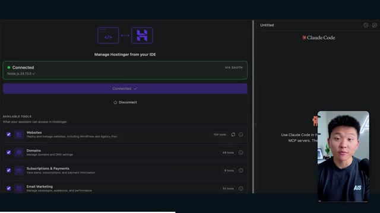
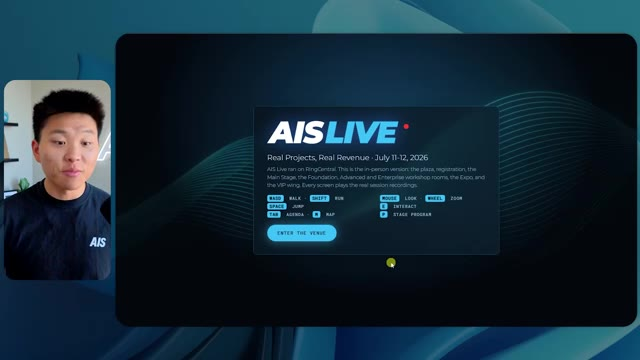
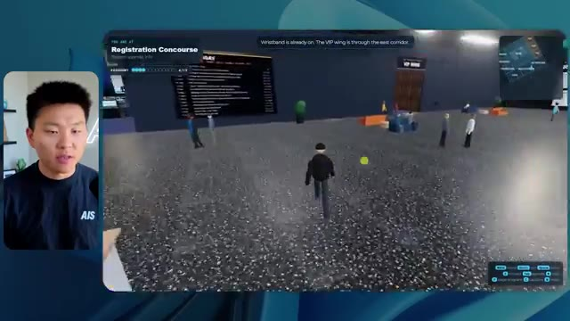
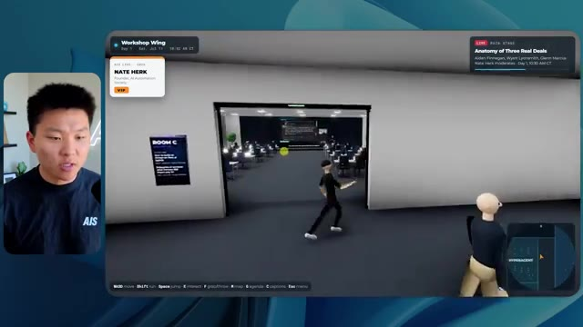
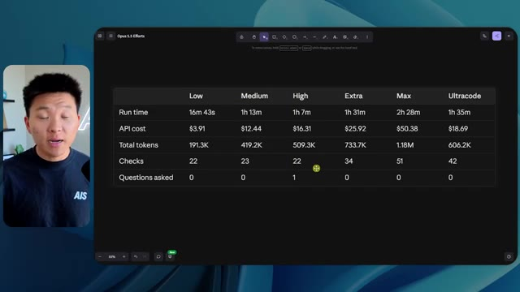

# 🎬 Why the Reverse Engineer Anything Repo Gained 100k Stars in a Day

> **Chaîne** : [Nate Herk | AI Automation](https://www.youtube.com/@nateherk/featured)  
> **Lien YouTube** : [https://www.youtube.com/watch?v=CklLenf9fNc](https://www.youtube.com/watch?v=CklLenf9fNc)  
> **Date de publication** : 20261014  
> **Durée** : 00:01:06  
> **Identifiant vidéo** : `CklLenf9fNc`  
> **Transcription & Analyse** : `whisper-v3-large-turbo+gemini-3.5-flash-lite`  

---

## 📌 Synthèse Exécutive & Outils

### 💡 Résumé

La vidéo de la chaîne *Nate Herk | AI Automation* propose une expérience comparative fascinante et hautement pragmatique autour de l'utilisation du modèle **Opus 5.5**. L'objectif soumis à l'agent IA était d'envergure : transformer un dossier brut de 105 gigaoctets de ressources vidéo (provenant d'un événement virtuel baptisé *AIS Live* enregistré sur Frame.io) en un monde 3D interactif et explorable à la troisième personne, simulant une conférence tech en personne complète avec ses salles, ses pistes thématiques, ses scènes et son identité visuelle.

À travers l'évaluation des différents niveaux d'effort proposés par le modèle (de l'effort *faible* jusqu'à l'effort *élevé*, en passant par l'effort *moyen*), Nate Herk analyse de manière exhaustive la qualité du code généré, le rendu visuel, le temps d'exécution, le coût théorique en API, le volume de jetons consommés, le nombre de vérifications autonomes effectuées dans le navigateur ainsi que le degré d'interaction avec l'utilisateur. Les résultats démontrent une progression spectaculaire de la fidélité de la marque, de la fluidité des animations et de la pertinence des intégrations multimédias (comme la lecture de flux vidéo en direct et le comportement des personnages non-joueurs) à mesure que l'effort augmente, tout en soulignant la capacité d'autonomie totale des agents qui n'ont posé aucune question durant l'exécution des tâches d'objectifs larges.

### 🛠️ Outils, Modèles & Logiciels Présentés

* **Opus 5.5** : Modèle d'IA de pointe extrêmement performant, économique et polyvalent, utilisé comme agent central pour générer un monde 3D interactif à partir d'un prompt d'objectif.
* **Claude Code** : Environnement de développement et assistant de codage avancé d'Anthropic, utilisé comme l'un des outils de développement de l'écosystème du créateur.
* **Hostinger (Connecteur)** : Extension gratuite pour éditeurs de code permettant d'importer et de connecter son compte d'hébergement directement dans l'environnement de développement en un seul clic pour déployer instantanément des projets finis.
* **Frame.io** : Plateforme cloud de gestion et de stockage vidéo, utilisée ici pour héberger les 105 gigaoctets d'enregistrements bruts de l'événement *AIS Live*.
* **Cursor** : Éditeur de code assisté par IA de pointe, mentionné parmi les environnements compatibles avec les flux de travail de déploiement et de codage moderne.
* **VS Code** : Éditeur de code source extensible de référence, intégrant les extensions de déploiement et les assistants IA du projet.

### 🔑 Points Clés & Enseignements Stratégiques

* **Impact du niveau d'effort sur la qualité** : L'ajustement du niveau d'effort d'un modèle d'IA modifie radicalement la profondeur de l'implémentation, transformant un rendu rudimentaire et bogué (effort faible) en une application immersive, respectueuse de la charte graphique et fonctionnelle (effort moyen et élevé).
* **Gestion de l'identité de marque par l'IA** : Les niveaux d'effort plus élevés permettent à l'agent de respecter avec précision les directives de marque (palettes de couleurs, logos, design des badges), conférant au monde 3D une crédibilité professionnelle absente des versions basiques.
* **Autonomie opérationnelle des agents** : Sur des prompts d'objectifs complexes et globaux, les agents Opus 5.5 font preuve d'une autonomie totale, accomplissant la tâche de bout en bout sans nécessiter de questions ou de clarifications intermédiaires de la part de l'utilisateur.
* **Capacités de vérification autonome** : L'agent intègre des boucles de validation visuelle en ouvrant et en inspectant le rendu dans le navigateur à de multiples reprises (22 à 23 vérifications enregistrées), ce qui garantit une auto-évaluation rudimentaire de son propre travail.
* **Intégration multimédia contextuelle** : Un agent performant sait cartographier et exploiter intelligemment une masse de données brutes (comme 105 Go de vidéos) pour les réinjecter dynamiquement au bon endroit (écrans de scènes, stands d'exposition, salons VIP) sous forme de flux vidéo ou d'images fixes pertinentes.
* **Économie de jetons et métriques d'exécution** : Le passage d'un niveau faible (191k jetons, 16 min 43 s, 3,91 $) à un niveau moyen (490k jetons, 1 h 13 min, 12,44 $) illustre le compromis incontournable entre la complexité de calcul, le coût API estimé et la richesse du livrable final.
* **Recommandation méthodologique officielle** : Selon les directives d'Anthropic pour le prompting d'Opus 5.5, il est recommandé de démarrer au niveau d'effort moyen, puis d'ajuster (à la hausse ou à la baisse) en fonction de la complexité spécifique du projet et des résultats obtenus.
* **Simulation de comportements sociaux basiques** : Les agents configurés avec un niveau d'effort supérieur parviennent à doter les PNJ (personnages non-joueurs) d'interactions visuelles rudimentaires (lever les bras, saluer), renforçant l'immersion dans l'univers virtuel exploré.
* **Le gouffre entre le code et le déploiement** : La création d'une application fonctionnelle par l'IA résout la phase de développement, mais met en lumière le besoin critique d'outils de pontage (comme le connecteur Hostinger) pour combler le fossé entre le code local et la mise en ligne rapide.
* **Évolution des flux de travail en ingénierie logicielle** : L'utilisation conjointe de modèles puissants, d'environnements de code assistés et d'extensions de cloud-hosting redéfinit les standards de l'automatisation, permettant à un seul opérateur de concevoir, tester et préparer le déploiement d'expériences logicielles complexes en un temps record.

---

## ⏱️ Chronologie & Transcription Complète Audio & Visuelle (Mot pour Mot)

### ⏱️ `[00:00:00 - 00:00:20]` | Segment #01

**🔊 Audio (Transcription Intégrale Mot pour Mot en Français) :**
> Opus 5.5, Opus 5.5, Opus 5.5, Opus 5.5, Opus 5.5. Ce modèle est littéralement partout et pour de très bonnes raisons. Il est intelligent, il est bon marché, il a un goût incroyable, c'est un modèle d'IA incroyable. Mais avec chaque modèle d'IA, vous avez le choix de l'effort, que ce soit faible, moyen, élevé, extra, max ou code ultra.

**👁️ Analyse Visuelle d'Écran (gemini-3.5-flash-lite) :**
**Interface & Outils** : Interface du réseau social X (Twitter).

**Contenu textuel & Code** : Un tweet commentant l'impact des modèles d'IA sur les créateurs techniques avec un média vidéo incorporé.

**Action / Démonstration** : Affichage d'un exemple concret de contenu généré par IA pour illustrer le sujet abordé.

*⏱️ 00:00:05 — Une capture d'écran montrant un post sur les réseaux sociaux (X / Twitter) avec une vidéo intégrée illustrant un paysage tropical généré par IA.*

---

### ⏱️ `[00:00:20 - 00:00:38]` | Segment #02

**🔊 Audio (Transcription Intégrale Mot pour Mot en Français) :**
> Donc dans cette vidéo, j'ai donné exactement le même prompt à Opus 5.5 et je l'ai exécuté sur chaque niveau d'effort et nous allons comparer les résultats. Nous allons examiner la qualité de tous les différents résultats réels, mais ensuite nous allons également examiner combien de temps chacun d'eux a pris pour s'exécuter, combien cela nous a coûté si c'était une facturation par API, le total des jetons, combien de vérifications ils ont exécutées et combien de questions ils m'ont réellement posées tout au long du processus.

**👁️ Analyse Visuelle d'Écran (gemini-3.5-flash-lite) :**
**Interface & Outils** : Interface de tableau ou de canevas interactif sombre.

**Contenu textuel & Code** : Tableau comparatif des niveaux d'effort d'Opus 5.5 et leurs paramètres d'exécution.

**Action / Démonstration** : Présentation comparative des différents niveaux d'effort et de leurs performances.

*⏱️ 00:00:29 — Tableau de comparaison montrant les différents niveaux d'effort d'Opus 5.5 (Low, Medium, High, Extra, Max, Ultracode) avec des métriques (Run time, API cost, Total tokens, Checks, Questions asked).*

---

### ⏱️ `[00:00:39 - 00:00:58]` | Segment #03

**🔊 Audio (Transcription Intégrale Mot pour Mot en Français) :**
> Et les résultats que nous avons obtenus ne sont pas du tout ce à quoi je m'attends, donc j'ai hâte de partager cela avec vous les gars. Ne perdons pas de temps et allons directement à celui-ci. D'accord, alors sautons directement dans celui-ci. Je veux commencer juste en vous montrant le prompt réel que nous avons utilisé que nous avons donné à chacun de ces différents agents. Je vais aller dans les fichiers ici, et nous allons ouvrir ce fichier markdown de prompt, et je vais vous montrer ce que nous avons obtenu. Donc voici le slash objectif que j'ai fourni.

**👁️ Analyse Visuelle d'Écran (gemini-3.5-flash-lite) :**
**Interface & Outils** : Interface de l'outil de développement / éditeur IA avec la mention Opus 5.5.

**Contenu textuel & Code** : Texte du prompt affiché : "Hi Nate. This worktree has the effort-test task queued in PROMPT.md : build a walkable third-person 3D world of the AIS Live conference..."

**Action / Démonstration** : Affichage et lecture du prompt initial avant de lancer la tâche de développement de l'application 3D.

*⏱️ 00:00:48 — Interface d'un outil de développement avec un panneau latéral de configuration et une zone de texte affichant un prompt lié à un projet 3D, avec une petite incrustation vidéo du présentateur.*

---

### ⏱️ `[00:00:58 - 00:01:34]` | Segment #04

**🔊 Audio (Transcription Intégrale Mot pour Mot en Français) :**
> J'ai dit, tu dois me créer un monde 3D qui est une conférence tech réaliste dans laquelle je peux me promener en vue à la troisième personne. Tu vas regarder ce dossier, qui contient mes ressources d'enregistrement d'événements de AIS Live. Et ce dossier est un dossier Frame.io de 105 gigaoctets d'enregistrements vidéo. C'était un événement entièrement virtuel. Tout a été enregistré et tous les enregistrements sont juste ici. J'ai dit, ton objectif est de prendre cet événement et de le transformer en un monde 3D explorable qui me donne l'impression d'être réellement allé à une vraie conférence en personne avec différentes salles, différentes pistes, différentes scènes, bla, bla, bla. N'hésite pas à utiliser key.ai si tu as besoin de générer des images ou des vidéos. Et tu peux aussi utiliser tout le reste à l'intérieur de mon projet Herc 2, qui est comme mon système d'exploitation IA. J'ai dit,

**👁️ Analyse Visuelle d'Écran (gemini-3.5-flash-lite) :**
**Interface & Outils** : Éditeur de code (VS Code / interface similaire) et interface web Frame.io.

**Contenu textuel & Code** : Texte de prompt demandant la création d'un monde 3D de conférence tech explorable à partir de ressources vidéo de 105 Go.

**Action / Démonstration** : Présentation du prompt initial et du dossier de ressources Frame.io contenant les enregistrements de l'événement.

*⏱️ 00:01:07 — Vue d'un éditeur de texte affichant le fichier PROMPT.md contenant les instructions détaillées pour créer le monde 3D.*

*⏱️ 00:01:16 — Interface web montrant un dossier Frame.io de 105,69 Go contenant les ressources d'enregistrement de l'événement AIS Live.*

---

### ⏱️ `[00:01:34 - 00:02:08]` | Segment #05

**🔊 Audio (Transcription Intégrale Mot pour Mot en Français) :**
> vous serez jugé sur la créativité, le design, la physique et la sensation générale lorsque j'explorerai le monde 3D que vous avez construit. Et c'était fondamentalement la fin des instructions. Donc comme vous pouvez le voir sur ce côté gauche, j'ai exécuté cela à travers tous les différents niveaux d'effort. Commençons par le niveau bas et remontons jusqu'à l'ultra code. Très bien. Donc ici nous avons le résultat du niveau bas. Ouvrons ceci et jetons un œil. Donc nous avons AIS Live, le sommet des services IA en personne enfin, et nous avons pu cliquer partout. Tout d'abord, on ne sent pas vraiment l'identité de la marque. Genre, ce n'habille pas le logo d'IS Live. Ce n'est même pas nos couleurs. Donc je n'aime pas trop ça, mais entrons ici. D'accord. C'est beaucoup trop lumineux. Euh, nous avons une carte en haut à droite. Nous avons une ville par ici. Je ne peux pas dire quelle ville c'est

**👁️ Analyse Visuelle d'Écran (gemini-3.5-flash-lite) :**
**Interface & Outils** : Interface web d'un assistant de code ou d'un agent IA spécialisé dans les worktrees.

**Contenu textuel & Code** : Un message de l'agent IA : "Hi Nate. This worktree has the effort-test task queued in PROMPT.md : build a walkable third-person 3D world..." et une boîte de saisie avec le prompt "yes, start the task in PROMPT.md".

**Action / Démonstration** : Le curseur survole les différents niveaux d'effort (Hello, Extra, High, Max, Ultracode, Medium, Low) pour tester l'exécution à travers ces différents niveaux.

*⏱️ 00:01:42 — Capture d'écran montrant l'interface d'un outil de développement ou d'un agent IA avec le présentateur incrusté à gauche, et une liste de niveaux d'effort (Hello, Extra, High, Max, Ultracode, Medium, Low) sur le panneau latéral.*

---

### ⏱️ `[00:02:08 - 00:02:40]` | Segment #06

**🔊 Audio (Transcription Intégrale Mot pour Mot en Français) :**
> C'est. D'accord. C'est Chicago, ce qui est plutôt cool parce que tu sais, j'habite à Chicago, mais bref, en haut à droite, on peut voir une carte. Nous avons un hall d'accueil. Nous avons un hall d'exposition. Nous avons le salon VIP, la scène principale. La carte montre également où se trouve chaque autre personne et cela se synchronise en direct. Donc on peut voir l'enregistrement. On peut voir le premier jour, la keynote de l'hyper-agent, le débriefing en direct. Cool. Donc ça connaît vraiment l'agenda et puis il y a le deuxième jour. Donc il a trouvé ça, c'est bien. Nous avons ces petites boules ici que je peux espérer propulser du pied. D'accord. Le visage, oh, regarde ça. Si je vais par ici, toutes les personnes disparaissent tout simplement. Très mauvais. Très mauvais. D'accord. Alors voyons voir. Est-ce que je peux sprinter ? D'accord.

**👁️ Analyse Visuelle d'Écran (gemini-3.5-flash-lite) :**
**Interface & Outils** : Application web de métavers / plateforme événementielle virtuelle 3D

**Contenu textuel & Code** : Carte interactive des zones (Main Stage, Expo Hall, Lobby, VIP Lounge), panneaux d'affichage du programme "Day 1"

**Action / Démonstration** : Navigation et exploration des différentes salles de l'événement virtuel avec un avatar 3D

*⏱️ 00:02:16 — Vue d'un espace virtuel en 3D avec un avatar et une mini-carte en haut à droite montrant différentes zones de l'événement.*

*⏱️ 00:02:24 — Vue de l'interface du hall d'accueil virtuel affichant le programme du jour sur un panneau et une mini-carte.*

*⏱️ 00:02:32 — Vue de l'expo-hall virtuel avec des avatars d'utilisateurs et une mini-carte de navigation en haut à droite.*

---

### ⏱️ `[00:02:40 - 00:03:04]` | Segment #07

**🔊 Audio (Transcription Intégrale Mot pour Mot en Français) :**
> Je peux aller un peu plus vite. Je vais d'abord aller par ici. Il y a des produits promotionnels, euh, certifié AIS plus glido. D'accord. Donc, il y a les stands réels que nous avions lors de l'événement virtuel. Nous avions des stands. Donc c'est plutôt cool. Un petit endroit pour prendre des photos. Salle C. En ce moment, nous avons Tangy Frederick qui anime un atelier. D'accord. Mais ce n'est pas une vidéo. Comme vous pouvez le voir, c'est juste une image. Elle ne bouge pas. C'est donc juste une image. Ces gens sont en train de disparaître. Ce doivent être des fantômes. Allons par ici dans la salle A.

**👁️ Analyse Visuelle d'Écran (gemini-3.5-flash-lite) :**
**Interface & Outils** : Environnement virtuel 3D de type espace d'exposition et salle de conférence.

**Contenu textuel & Code** : Textes informatifs et instructions de configuration de clés API affichés sur les écrans virtuels.
[DESC_IMAGE_3] Exploration de l'événement virtuel et interaction avec les stands et salles d'ateliers.

**Action / Démonstration** : Explications face caméra et démonstration conceptuelle.

*⏱️ 00:02:46 — Vue d'un espace virtuel 3D avec un avatar se déplaçant près d'un stand de sponsor étiqueté 'Glaido' et de cubes promotionnels marqués 'AIS'.*

*⏱️ 00:02:52 — Navigation dans une salle de conférence virtuelle (Workshop Room C - Enterprise track) avec des tables éclairées.*

*⏱️ 00:02:58 — Gros plan sur l'avatar faisant face à un écran de présentation virtuel affichant des instructions étape par étape pour les clés API.*

---

### ⏱️ `[00:03:04 - 00:03:30]` | Segment #08

**🔊 Audio (Transcription Intégrale Mot pour Mot en Français) :**
> Nous avons Liberty White. D'accord. Très cool. Vos 30 premiers jours en automatisation. Encore une fois, c'est juste une image fixe et les gens ont des bugs d'affichage. Donc ce n'est pas très bien ici. Je vais aller sur la scène principale et voir ce que nous avons. D'accord, cool. Donc nous avons une scène principale. Les gens ont des bugs d'affichage. Vraiment grave. Ce n'est vraiment pas terrible. Notre vidéo est en train de bouger. Genre, j'ai vu mon visage ici et j'ai vu celui de Devin, mais maintenant ils ont disparu. Donc je ne sais pas ce qui s'est passé. D'accord. Ça ressemble plutôt à un diaporama. Rien n'est vraiment lu pour l'instant. Bref, entrons ici.

**👁️ Analyse Visuelle d'Écran (gemini-3.5-flash-lite) :**
**Interface & Outils** : Environnement virtuel 3D interactif de type metaverse / événement virtuel.

**Contenu textuel & Code** : Textes d'indication de salle (Workshop Room A, Main Stage, AIS LIVE AI Services Summit).

**Action / Démonstration** : Navigation et déplacement d'un avatar à travers un espace virtuel d'événement.

*⏱️ 00:03:11 — Vue dans une salle d'atelier virtuelle 3D (Workshop Room A) montrant un avatar et des plateformes lumineuses.*

*⏱️ 00:03:17 — Navigation dans la scène principale virtuelle (Main Stage) avec de nombreux avatars assis dans un auditorium virtuel.*

*⏱️ 00:03:24 — Vue large de la scène principale virtuelle affichant le logo "AIS LIVE AI Services Summit" sur grand écran.*

---

### ⏱️ `[00:03:30 - 00:03:58]` | Segment #09

**🔊 Audio (Transcription Intégrale Mot pour Mot en Français) :**
> Nous avons d'autres stands. Nous avons hyper agent. Nous avons Claude Code. Nous avons plus de gadgets. La salle B, c'est Dave Ebelor. Je suppose que c'est exactement la même chose. Nous avons du café. Et puis, je suppose, le salon VIP, accès VIP seulement. C'est plutôt cool, mais il ne se passe vraiment rien ici. Cet écran est bien trop lumineux. Bon. Donc je pense que vous comprenez l'ambiance qu'on obtient ici d'Opus 5.5 en effort faible. Et c'est là que les choses deviennent intéressantes. Combien de temps pensez-vous que cela a duré ? Combien de temps ? Celui-ci a duré 16 minutes et 43 secondes. Combien pensez-vous que cela a coûté ?

**👁️ Analyse Visuelle d'Écran (gemini-3.5-flash-lite) :**
**Interface & Outils** : AUCUNE

**Contenu textuel & Code** : AUCUN

**Action / Démonstration** : AUCUNE

---

### ⏱️ `[00:03:58 - 00:04:26]` | Segment #10

**🔊 Audio (Transcription Intégrale Mot pour Mot en Français) :**
> 3,91 dollars si c'était une facturation par API. J'utilise évidemment mon abonnement ici, mais nous allons juste calculer cela en facturation par API. Le nombre total de jetons était de 191 000. Il a effectué 22 vérifications. Donc, pour la vérification, il a ouvert le navigateur 22 fois et a exécuté différentes sortes de vérifications. Donc, 22 catégories de vérifications. Et combien de questions m'a-t-il posées ? Il m'a posé un total de zéro question tout au long de cette invite de commande d'objectif. D'accord. Alors ouvrons l'effort moyen et voyons ce que nous avons. D'accord, c'est parti. Effort moyen. Nous avons Nate Herc. Nous avons mon badge. C'est de la marque AI's life.

**👁️ Analyse Visuelle d'Écran (gemini-3.5-flash-lite) :**
**Interface & Outils** : Tableau blanc ou outil de mind-mapping/diagramme (style Excalidraw ou similaire).

**Contenu textuel & Code** : Tableau avec des métriques de performance et de coût pour le niveau "Low" : Run time: 16m 43s, API cost: $3.91, Total tokens: 191.3K.

**Action / Démonstration** : Le présentateur explique et commente les coûts d'API et les statistiques d'utilisation des jetons affichés à l'écran.

*⏱️ 00:04:05 — Capture d'écran montrant le présentateur à gauche et un tableau de statistiques sur l'effort de l'IA (Run time 16m 43s, API cost $3.91, Total tokens 191.3K, Checks, Questions asked).*

---

### ⏱️ `[00:04:26 - 00:04:46]` | Segment #11

**🔊 Audio (Transcription Intégrale Mot pour Mot en Français) :**
> Alors, ça a déjà l'air un peu mieux. On dirait nos palettes de couleurs qui ont utilisé nos directives de marque. Premier jour de construction, deuxième jour de gain, VIP. Cool. D'accord. Je vais entrer dans le lieu. D'accord. Waouh. Une ambiance similaire, en somme. C'est en arrière-plan. Ça ne ressemble pas à Chicago, n'est-ce pas ? Non, ça ressemble à un, honnêtement, ça ressemble à une ville inventée. Quoi qu'il en soit, c'est marrant qu'ils aient décidé de faire ça. Voyons si je peux me déplacer un peu plus vite. Oh, waouh.

**👁️ Analyse Visuelle d'Écran (gemini-3.5-flash-lite) :**
**Interface & Outils** : Interface web de l'application interactive 3D 'AIS Live'.

**Contenu textuel & Code** : Écran d'accueil de l'événement virtuel avec badge 'NATE HERK' et interface de jeu 3D avec avatars.

**Action / Démonstration** : Navigation et entrée dans le lieu virtuel 3D depuis l'interface web.

*⏱️ 00:04:31 — Interface web de l'application 'AIS Live' montrant un badge nominatif virtuel aux couleurs de la marque avec les options Day 1, Day 2 et un bouton pour entrer dans le lieu virtuel.*

*⏱️ 00:04:41 — Vue dans le lieu virtuel 3D de l'application montrant des avatars et un environnement intérieur avec vue sur des gratte-ciels la nuit.*

---

### ⏱️ `[00:04:46 - 00:05:21]` | Segment #12

**🔊 Audio (Transcription Intégrale Mot pour Mot en Français) :**
> Les gens interagissent avec moi. Regardez. Si je m'approche de ce type, il vient de lever le bras. Bon, maintenant il ne veut plus du tout avoir affaire à moi. Mais tous ces petits robots ici doivent prendre des décisions. Je ne sais pas s'ils utilisent Jev. C'est sûr que non. Je ne le lui ai pas dit. En fait, ma clé Jev est à l'arrière. Je ne sais pas. Peut-être qu'il l'a utilisée. Quoi qu'il en soit, nous pouvons voir ici que nous avons la salle d'atelier C, le laboratoire des agents. Sympa. Donc celui-ci est réellement en train de fonctionner. Vous pouvez voir qu'il s'agit d'une vraie vidéo lue par Tangy. Tout le monde ici est en train de travailler sur un ordinateur portable. Ils ne buguent pas. C'est plutôt cool. De plus, mon badge est sur ma poitrine, ce qui est plutôt cool. Je peux venir par ici. Nous avons une carte en haut à droite, comme vous pouvez le voir, mais je peux venir par ici. Nous avons un

**👁️ Analyse Visuelle d'Écran (gemini-3.5-flash-lite) :**
**Interface & Outils** : Environnement virtuel 3D / application web interactive

**Contenu textuel & Code** : Interface utilisateur affichant une salle virtuelle avec des avatars animés et des informations textuelles en bas à gauche.

**Action / Démonstration** : Navigation et exploration de l'environnement virtuel avec des avatars interagissant.

---

### ⏱️ `[00:05:21 - 00:05:47]` | Segment #13

**🔊 Audio (Transcription Intégrale Mot pour Mot en Français) :**
> hall d'exposition. C'est là que nous avons le stand Glido. Et ça diffuse en ce moment. Oui, ça diffuse la vidéo de nous parlant de Glido. Ça diffuse la vidéo d'Ed et moi parlant de notre programme de certification. Nous avons le logo AIS Plus juste ici, qui est un peu mal placé. Ce sont les diapositives des conférenciers et les points clés. Alors wow, ce sont toutes les ressources que nous avons distribuées après l'événement. Elles sont toutes là aussi. Nous pouvons voir que nous avons un coup de projecteur sur la communauté. C'est donc Aiden qui parle de son contrat qu'il a décroché et c'est diffusé en direct. Ces gens regardent.

**👁️ Analyse Visuelle d'Écran (gemini-3.5-flash-lite) :**
**Interface & Outils** : Environnement virtuel 3D en ligne (type metaverse / plateforme d'exposition virtuelle).

**Contenu textuel & Code** : Affiches, diapositives de présentation et panneaux d'information textuels de l'événement AIS.

**Action / Démonstration** : Navigation et déplacement d'un avatar dans l'espace d'exposition virtuel.

---

### ⏱️ `[00:05:47 - 00:06:21]` | Segment #14

**🔊 Audio (Transcription Intégrale Mot pour Mot en Français) :**
> Ils sont plutôt engagés. On a un hyper agent. C'était, c'est ce que je voulais dire. Si vous avez vu ces gens lever les bras en disant bonjour, c'était plutôt marrant. Regardez, regardez, le voilà qui recommence. Bref. Bon. Où est-ce que je suis maintenant ? Maintenant, je suis dans le hall principal. On a un bar à café. On a un grand logo, qui est le vrai logo. C'est trop lumineux, mais on a le logo. On peut voir si on peut entrer ici dans le parcours fondation. On a Sabrina Romanov et Liberty White. Donc différentes formations juste là. On peut entrer dans cette salle. C'est le parcours avancé. Alors qu'est-ce qui se passe ici. On a Dave Ebelar et Saman qui parlent de différentes choses là-dedans. Et maintenant, allons jeter un œil à la scène principale. Oh, attendez, il y a une vidéo de moi là-haut. C'est du genre VIP

**👁️ Analyse Visuelle d'Écran (gemini-3.5-flash-lite) :**
**Interface & Outils** : Application de métavers ou de salon virtuel 3D.

**Contenu textuel & Code** : Environnement virtuel interactif montrant un "Main Lobby" avec des avatars d'utilisateurs et une mini-carte en haut à droite.

**Action / Démonstration** : Navigation et déplacement d'un avatar dans un espace d'événement virtuel en 3D.

*⏱️ 00:05:55 — Le présentateur apparaît dans un encadré à gauche, tandis que l'écran principal montre un environnement virtuel 3D (un hall principal d'événement avec des avatars).*

*⏱️ 00:06:04 — Le présentateur est à gauche et l'écran principal montre un avatar se déplaçant vers une salle de conférence virtuelle remplie de participants.*

*⏱️ 00:06:12 — Le présentateur est à gauche, et l'écran principal montre une vue en contre-plongée de l'espace virtuel avec plusieurs avatars interagissant dans le hall.*

---

### ⏱️ `[00:06:21 - 00:06:50]` | Segment #15

**🔊 Audio (Transcription Intégrale Mot pour Mot en Français) :**
> section ? Ouais, on ira voir ça dans une minute. Mais bref, voici la scène principale. Ça a l'air vraiment, vraiment très bien. On a une grande scène. On a genre quatre personnes assises ici. On a les trois écrans d'Alex là-haut avec Hyper Agent. Est-ce que j'ai le droit de monter sur scène ? Oh, et il me laisse monter sur scène. D'accord. C'est plutôt sympa. Bon les gars, prenons un selfie. Laissez-moi mettre tout le monde en arrière-plan. Venez par ici. Bref, c'est plutôt, plutôt cool. Tout le monde n'est pas assis par contre. Donc il faut qu'on travaille là-dessus. Mais bref, je vais y retourner en courant pour voir ce qu'était cette section VIP. D'accord. Salon VIP. J'ai l'impression que c'est comme un aéroport ou un truc du genre.

**👁️ Analyse Visuelle d'Écran (gemini-3.5-flash-lite) :**
**Interface & Outils** : Application ou plateforme virtuelle 3D (Metaverse / Keynote virtuelle).

**Contenu textuel & Code** : Interface utilisateur affichant "Hyperagent Keynote" avec les détails de la session d'Alex McDonnell.

**Action / Démonstration** : Navigation et exploration de l'espace virtuel de la keynote par le présentateur.

---

### ⏱️ `[00:06:51 - 00:07:14]` | Segment #16

**🔊 Audio (Transcription Intégrale Mot pour Mot en Français) :**
> D'accord, super. Donc maintenant nous avons les sessions VIP ici. Une foire aux questions VIP avec la lecture vidéo en direct de Nate juste ici. Très, très cool. Et nous avons comme un bar ou quelque chose. Génial. Je dirais que c'est un assez bon résultat. Maintenant, en ce qui concerne les statistiques ici, celle-ci a pris une heure et 13 minutes à s'exécuter. Cela nous aurait coûté 12 dollars et 44 cents. Elle a utilisé 490 000 jetons et elle a effectué 23 vérifications.

**👁️ Analyse Visuelle d'Écran (gemini-3.5-flash-lite) :**
**Interface & Outils** : Application de monde virtuel / salon VIP et interface de tableau de bord d'analyse.

**Contenu textuel & Code** : Statistiques de performance : Run time 16m 43s, API cost $3.91, Total tokens 191.3K, Checks 22, Questions asked 0.

**Action / Démonstration** : Présentation de l'environnement virtuel VIP et passage à l'analyse des statistiques d'exécution.

*⏱️ 00:06:56 — Vue d'un espace virtuel VIP avec un écran affichant une session vidéo en direct de Nate Herk et des avatars d'utilisateurs.*

*⏱️ 00:07:02 — Tableau de statistiques montrant les performances de l'exécution avec des métriques comme le temps d'exécution (16m 43s), le coût API ($3.91) et le nombre de tokens.*

---

### ⏱️ `[00:07:14 - 00:07:48]` | Segment #17

**🔊 Audio (Transcription Intégrale Mot pour Mot en Français) :**
> Et il nous a posé un total de zéro question une fois de plus. Très bien, passons au niveau élevé. C'était déjà un résultat plutôt correct et Anthropic eux-mêmes dans leur vidéo de comment prompter Opus 5.5, ou désolé, pas une vidéo, un article. Ils ont dit de simplement commencer au niveau moyen et de l'augmenter ou de le réduire si nécessaire. C'était donc un résultat moyen. Passons au niveau élevé et voyons ce qu'on a obtenu. Très rapidement les gars, je dois prendre une seconde pour vous parler du sponsor de la vidéo d'aujourd'hui, Hostinger. Donc ces deux modèles viennent de me construire une version fonctionnelle de la même chose. Et maintenant je suis exactement là où je finis toujours, avec quelque chose de terminé sur mon ordinateur portable et aucun moyen rapide de le mettre en ligne. Et c'est le fossé que le connecteur de Hostinger comble. C'est une extension gratuite.

**👁️ Analyse Visuelle d'Écran (gemini-3.5-flash-lite) :**
**Interface & Outils** : Tableau comparatif de données et interface d'éditeur de code / assistant IA (type VS Code ou Cursor).

**Contenu textuel & Code** : Tableau comparatif chiffré (Run time, API cost, Total tokens, Checks, Questions asked) et invite de prompt pour "Build Northwind ROI calculator".

**Action / Démonstration** : Présentation des résultats comparatifs entre différents niveaux d'effort d'IA et lancement d'un nouveau test de génération de code.

*⏱️ 00:07:22 — Un tableau comparatif des performances et coûts de différents niveaux de configuration d'Opus 5.5 (Low, Medium, High, Extra) montrant les temps d'exécution, coûts API, tokens et questions posées.*

*⏱️ 00:07:39 — Une interface de développement avec un éditeur affichant le prompt de création d'un calculateur ROI (Northwind ROI calculator) et le panneau de suivi d'exécution de l'agent.*

---

### ⏱️ `[00:07:48 - 00:08:23]` | Segment #18

**🔊 Audio (Transcription Intégrale Mot pour Mot en Français) :**
> pour votre éditeur qui importe votre compte Hostinger dans ce sur quoi vous êtes déjà en train de coder. Donc VS Code, Cursor, Cloud Code, Codex, vous l'nommez. Vous vous connectez une seule fois en un seul clic, et à partir de là, votre agent peut déployer le site, y pointer un domaine, configurer les enregistrements DNS, et vérifier votre VPS sans que vous n'ayez jamais à quitter l'éditeur. Donc, peu importe celui de ces outils que vous finirez par préférer, la chose qu'il a construite est à quelques minutes d'une vraie URL sur un hébergement géré. Connector est gratuit sur chaque formule d'hébergement, donc si vous avez toujours besoin de l'hébergement en dessous, prenez la formule illimitée avec le lien dans la description et utilisez le code NATEHERK pour 10 % de réduction. Cela inclut également un domaine gratuit et un e-mail professionnel pour l'année. Et c'est toujours le moyen le moins cher que j'ai trouvé pour obtenir quelque chose

**👁️ Analyse Visuelle d'Écran (gemini-3.5-flash-lite) :**
**Interface & Outils** : Interface de configuration Hostinger et terminal Claude Code dans un IDE.

**Contenu textuel & Code** : Panneau de gestion Hostinger connecté ("Manage Hostinger from your IDE", "Connected VIA OAUTH", liste des outils avec cases à cocher) et interface de Claude Code.

**Action / Démonstration** : Connexion du compte Hostinger à l'éditeur via OAuth pour permettre à l'assistant d'accéder aux outils de gestion.

*⏱️ 00:07:57 — Interface montrant la connexion du compte Hostinger à l'IDE et les outils disponibles (Websites, Domains, Subscriptions, Email Marketing), avec Claude Code affiché à droite.*

---

### ⏱️ `[00:08:23 - 00:08:47]` | Segment #19

**🔊 Audio (Transcription Intégrale Mot pour Mot en Français) :**
> vous avez construit sur une vraie URL. Donc revenons à la vidéo. D'accord. Encore une fois, très, très thématisé par la marque. C'est un écran de chargement encore meilleur que le précédent. Nous avons ce joli petit effet en arrière-plan. Nous avons le logo. Nous allons entrer dans le lieu. D'accord. Nous y voilà. Ça a l'air plutôt bien. Nous commençons à l'extérieur et vous pouvez voir que nous avons ces drapeaux pour tous les intervenants, Wyatt, Casper, Alex, Ed, Aiden, Sabrina, Liberty. C'est plutôt cool. Nous avons des blocs en direct ici.

**👁️ Analyse Visuelle d'Écran (gemini-3.5-flash-lite) :**
**Interface & Outils** : Application web 3D / Navigateur web

**Contenu textuel & Code** : Interface d'un événement virtuel 3D, bannières avec noms d'intervenants, mini-carte en haut à droite, indicateurs de contrôle des touches.

**Action / Démonstration** : Navigation et exploration de l'espace virtuel 3D de l'événement.

*⏱️ 00:08:29 — Écran de chargement et d'accueil de la plateforme virtuelle 'AIS LIVE', avec le logo et les instructions de contrôle.*

*⏱️ 00:08:35 — Entrée dans l'environnement virtuel 3D 'AIS Live Plaza', montrant un avatar de joueur au centre d'une place publique avec des immeubles et des personnages non-joueurs.*

*⏱️ 00:08:41 — Exploration de l'espace virtuel 'AIS Live Plaza' avec des bannières verticales affichant les noms des intervenants.*

---

### ⏱️ `[00:08:47 - 00:09:23]` | Segment #20

**🔊 Audio (Transcription Intégrale Mot pour Mot en Français) :**
> il a pris cette photo de moi, votre hôte, Nate Herc, John, Dave, Nate Herc. Voilà. OK. Les portes. Génial. Ce sont des portes vitrées coulissantes automatiques. J'adore ça. On peut voir l'enregistrement VIP. On peut voir l'admission générale. On peut venir par ici et on peut découvrir l'exposition avec différents stands, le projecteur sur la communauté. Vous pouvez aussi voir qu'en haut à gauche, j'ai un passeport. Donc c'est comme si, ça montrera combien d'endroits j'ai visités. Tout cela est une lecture réelle. Nous avons un mur de ressources avec tous les différents intervenants. Ils ont également une session de réseautage par ici. Je vais donc venir très vite et voir de quoi il s'agit. Nous avons donc le bar à cold brew AIS. Nous avons différents membres de la communauté qui ont été mis en avant ou mis en lumière.

**👁️ Analyse Visuelle d'Écran (gemini-3.5-flash-lite) :**
**Interface & Outils** : Environnement virtuel 3D / Navigateur web ou application immersive

**Contenu textuel & Code** : Interface utilisateur virtuelle affichant "Expo Hall", des bannières de certification ("Get AIS+ Certified") et divers stands d'exposition.

**Action / Démonstration** : Navigation et exploration d'un espace virtuel 3D de type métavers représentant un événement professionnel.

*⏱️ 00:09:05 — Le présentateur Nate Herk s'exprime à gauche, et l'écran principal affiche l'exploration d'un hall d'exposition virtuel en 3D avec divers stands et participants.*

---

### ⏱️ `[00:09:23 - 00:09:56]` | Segment #21

**🔊 Audio (Transcription Intégrale Mot pour Mot en Français) :**
> Nous avons l'aile VIP. Attends, quoi ? Récupère un bracelet. Oh, je dois vraiment aller chercher le bracelet. D'accord. Laisse-moi m'enregistrer rapidement. Le bracelet est déjà mis. Attends, quoi ? D'accord. Oh, d'accord. Maintenant les portes se sont ouvertes pour moi. Cool. Je peux entrer ici. Oh, ça mène juste à la scène principale. Salon VIP. Il y a une séance de questions-réponses en cours. Ça a l'air très cool. Je veux dire, je suis très impressionné par la façon dont il est capable de faire ça. Waouh. D'accord. Donc c'est vraiment bien. Ce qu'on a fait, c'est qu'on a eu des salles de réunion VIP avec différentes personnes. Tu peux voir qu'il y a différentes salles, différents membres de l'équipe AIS qui participent à des trucs. C'est vraiment cool. C'est très cool. C'est un VIP bien meilleur

**👁️ Analyse Visuelle d'Écran (gemini-3.5-flash-lite) :**
**Interface & Outils** : Environnement virtuel 3D de type métavers / plateforme événementielle en ligne

**Contenu textuel & Code** : Interface utilisateur affichant des informations de navigation, des mini-cartes, et des indications de salles VIP (Registration Concourse, VIP Lounge, VIP Working Sessions).

**Action / Démonstration** : Navigation et exploration de différentes zones d'un espace virtuel interactif.

*⏱️ 00:09:32 — L'avatar du présentateur se déplace dans un hall d'exposition virtuel nommé "Registration Concourse".*

*⏱️ 00:09:40 — L'avatar se trouve dans une "VIP Lounge" où un écran affiche une visioconférence.*

*⏱️ 00:09:48 — L'avatar navigue dans un espace de "VIP Working Sessions" avec différentes salles thématiques.*

---

### ⏱️ `[00:09:56 - 00:10:30]` | Segment #22

**🔊 Audio (Transcription Intégrale Mot pour Mot en Français) :**
> expérience que ce qui a été montré dans la première partie. D'accord. After party VIP. Regardez ça. On a une piste de danse. On a tous ces éléments ici. On a la lecture de l'after party VIP juste ici. Et il y a une estrade de DJ. C'est tellement marrant. Il y a un petit bug ici, un petit glitch par là, mais c'est génial. Oh, chouette. Donc quand je suis ici sur la scène principale, on a des sous-titres. Vous pouvez voir juste ici en bas de mon écran, on a ces sous-titres de Wyatt qui est en train de parler là-haut. On a des lumières. On a le panneau. Très chouette. Belle scène principale. Je vais aller par ici, on peut aller vers la fondation,

**👁️ Analyse Visuelle d'Écran (gemini-3.5-flash-lite) :**
**Interface & Outils** : Application web ou univers virtuel 3D interactif (plateforme d'événements en ligne type Gather ou Spatial).

**Contenu textuel & Code** : Interface utilisateur virtuelle affichant les zones 'VIP After-Party' et 'Main Stage', des flux vidéo de participants et des avatars 3D.

**Action / Démonstration** : Navigation et exploration de l'espace virtuel 3D par le présentateur montrant les différentes zones de l'événement.

*⏱️ 00:10:04 — Vue d'un espace virtuel d'after party VIP avec des avatars animés sur une piste de danse et un écran géant affichant des participants.*

*⏱️ 00:10:13 — Vue plus large de l'espace virtuel VIP after party montrant la piste de danse illuminée, des ballons et l'enseigne 'VIP AFTER-PARTY'.*

*⏱️ 00:10:21 — Vue de l'espace virtuel principal (Main Stage) avec un public d'avatars assis et un grand écran montrant une présentation en direct.*

---

### ⏱️ `[00:10:30 - 00:11:06]` | Segment #23

**🔊 Audio (Transcription Intégrale Mot pour Mot en Français) :**
> avancé, et les parcours d'entreprise par ici. Alors voyons voir. Nous avons l'anatomie de trois vraies transactions. Nous avons hyper agent. Nous avons les évaluations avec Nate et Ed ici. Nous avons Dave qui s'occupe des trucs avancés. C'est vraiment bien. Je veux dire, évidemment, chacun, chacun de ces résultats jusqu'à présent, le niveau bas était correct. Le niveau moyen était meilleur. Le niveau haut a été encore meilleur. Voyons si cette tendance se poursuit et allons voir ce que cela nous a coûté. Le niveau haut a donc tourné pendant une heure et sept minutes. Donc un peu plus rapide que le niveau moyen, cela nous aurait coûté 16 dollars et 31 cents. Il a utilisé un demi-million de tokens, 509 000. Il a fait 22 vérifications. Et il nous a aussi demandé, enfin, non, je me suis trompé, ce

**👁️ Analyse Visuelle d'Écran (gemini-3.5-flash-lite) :**
**Interface & Outils** : Tableau de bord / application de mindmapping ou de design (type Excalidraw) affichant un tableau comparatif.

**Contenu textuel & Code** : Tableau avec les colonnes Low, Medium, High, Extra et les lignes Run time ($16.31 max), API cost, Total tokens (191.3K, 419.2K), Checks (22, 23), Questions asked (0).

**Action / Démonstration** : Analyse comparative des performances et des coûts d'exécution de différents niveaux d'effort d'un agent IA.

*⏱️ 00:10:57 — Capture d'écran affichant un tableau comparatif (intitulé Opus 5.5 Efforts) détaillant les métriques Low, Medium, High et Extra (temps d'exécution, coût API, tokens, vérifications, questions posées).*

---

### ⏱️ `[00:11:06 - 00:11:25]` | Segment #24

**🔊 Audio (Transcription Intégrale Mot pour Mot en Français) :**
> l'un m'a posé une question et spoiler, c'était le seul qui nous a posé une question tout au long de tout ça. Donc voyons voir, il nous en reste trois extra, max et ultra code. Laissez-moi ouvrir extra et nous verrons ce que nous avons. D'accord. Donc celui-ci a l'air plutôt bien. Je dirais honnêtement que jusqu'à présent, l'écran de chargement haut était le meilleur. Celui qu'on vient de voir, mais bref, entrons dans le direct d'AIS.

**👁️ Analyse Visuelle d'Écran (gemini-3.5-flash-lite) :**
**Interface & Outils** : Application de tableau blanc ou de prise de notes numérique montrant un tableau de données analytiques.

**Contenu textuel & Code** : Tableau comparatif avec des métriques de temps d'exécution, coûts d'API, tokens, vérifications et questions posées pour chaque niveau d'effort.

**Action / Démonstration** : Le présentateur commente les résultats du tableau et s'apprête à ouvrir les détails de la colonne 'Extra'.

*⏱️ 00:11:11 — Tableau comparatif affichant les métriques de différents modes d'effort (Low, Medium, High, Extra) avec les lignes Run time, API cost, Total tokens, Checks et Questions asked.*

---

### ⏱️ `[00:11:26 - 00:11:51]` | Segment #25

**🔊 Audio (Transcription Intégrale Mot pour Mot en Français) :**
> Wouah. D'accord. Donc on a comme des petits extraits sonores. Je peux discuter avec des gens. Le panneau sur la guerre des outils a réglé quelques débats pour moi. Sympa. Bon point de vue là-dessus. On est dehors à nouveau. On a ces différentes bannières, bien qu'elles soient toutes les mêmes. Elles n'affichent pas les noms de différentes personnes. Donc grand logo AIS Live. L'aile des ateliers est par ici. Et passons par les portes coulissantes en verre pour voir ce qu'on a. Donc on a le café AIS. La carte est en bas à droite, et elle n'est pas très descriptive.

**👁️ Analyse Visuelle d'Écran (gemini-3.5-flash-lite) :**
**Interface & Outils** : Environnement virtuel 3D / plateforme interactive.

**Contenu textuel & Code** : Interface de monde virtuel avec avatars, bannières et mini-carte.

**Action / Démonstration** : Exploration d'un monde virtuel 3D et déplacement d'un avatar.

---

### ⏱️ `[00:11:51 - 00:12:26]` | Segment #26

**🔊 Audio (Transcription Intégrale Mot pour Mot en Français) :**
> J'aime bien comment les autres cartes nous ont indiqué quoi, genre où se trouvaient les choses, mais celle-ci a l'air très professionnelle. On peut voir que voici la scène principale. Allons y faire un saut rapidement. Ils ont tous ces ballons qui volent autour, ce que je trouve plutôt drôle. Les ballons de plage AIS. On nous voit, moi là-haut en train de parler. Je crois que j'introduisais l'un des jours. Continuons à avancer par ici vers la salle d'atelier sur ce côté gauche. D'accord. Donc ici, nous avons le théâtre Hyper Agent. Nous avons cette session sponsorisée ici par Hyper Agent, mais cela nous montre aussi ce qui va s'y passer. C'est vraiment drôle qu'on puisse discuter avec les gens. Salmon a créé un représentant commercial vocal en direct. La salle "Le Juste Prix" était comble. Tu as pris le guide du compagnon VIP ? C'est trop drôle. Nous avons le parcours avancé dans

**👁️ Analyse Visuelle d'Écran (gemini-3.5-flash-lite) :**
**Interface & Outils** : Environnement virtuel de conférence/métavers

**Contenu textuel & Code** : Texte à l'écran indiquant "MAIN STAGE", "Grand Balcon", "LIVE", "Day 2 Open Now Let's Turn This Into Money", "AIS LIVE in the Room", "WORKSHOPS", "Foundation · Advanced · Enterprise", "ENTERPRISE AI SERVICES", "Chat", "Keep looking down the blue road", "Gumtree is a police sales map", "Map", "Agenda", "Captions", "Help".

**Action / Démonstration** : Navigation et exploration dans un environnement virtuel.

*⏱️ 00:12:00 — Vue d'une scène virtuelle de conférence avec une scène principale diffusée en direct et une foule d'avatars assistant à l'événement.*

*⏱️ 00:12:09 — Vue d'une zone d'ateliers virtuels dans un centre de conférence, avec des avatars interagissant et des panneaux publicitaires pour des services d'IA d'entreprise.*

*⏱️ 00:12:17 — Vue d'un couloir virtuel dans un centre de conférence, avec des avatars interagissant et des portes menant à différentes salles.*

---

### ⏱️ `[00:12:26 - 00:12:58]` | Segment #27

**🔊 Audio (Transcription Intégrale Mot pour Mot en Français) :**
> ici. Encore une fois, nous avons la lecture en direct. Est-ce que c'est la lecture en direct ? Oh, d'accord. Ça a commencé une fois que je suis entré, mais je peux prendre place. Oh la la. Je peux regarder ça. Je peux me lever. Je veux m'asseoir au premier rang. C'est plutôt cool. C'est très bien. J'aime bien ça. Et vous savez ce que j'ai remarqué jusqu'à présent ? Le personnage que j'incarne me ressemble un peu. Je pense qu'il a été modélisé à partir de mes photos de profil ou quelque chose comme ça. Quoi qu'il en soir, nous avons Sabrina ici, l'animatrice de la salle, prenez n'importe quelle place libre. D'accord, cool. Et j'ai vraiment aimé la fonctionnalité pour s'asseoir. C'est plutôt marrant. Genre, on pourrait vraiment assister à cet atelier et participer. Bref, ça nous montre les intervenants. Ça nous montre les

**👁️ Analyse Visuelle d'Écran (gemini-3.5-flash-lite) :**
**Interface & Outils** : Environnement virtuel 3D en ligne (plateforme de conférence ou de webinaire immersive).

**Contenu textuel & Code** : Interface utilisateur virtuelle avec des avatars représentant des participants assis dans une salle de conférence et un écran affichant des flux vidéo en direct.

**Action / Démonstration** : Navigation et exploration de l'espace virtuel par l'utilisateur.

---

### ⏱️ `[00:12:58 - 00:13:31]` | Segment #28

**🔊 Audio (Transcription Intégrale Mot pour Mot en Français) :**
> ordre du jour. Il y a un petit tapis rouge ici pour prendre quelques photos. On peut prendre la pose. Oh, wow. C'est plutôt cool. Bibliothèque de ressources, obtenez la certification AIS Plus, Glido, Hyper Agent, AIS Plus, trois vraies affaires. Génial. Je veux dire, je dirais certainement que jusqu'à présent, chacun s'améliore. Et nous n'avons même pas encore regardé la section VIP, le salon VIP. Montons vite ici. J'espère que je pourrai entrer. Bien. Nous avons réinitialisé les outils. Ce sont les différentes salles où nous pourrions aller. Donc, une fois de plus, je pourrais prendre la feuille de travail et essayer de comprendre comment tarifer mes affaires. C'est tellement cool. C'est vraiment mieux que le précédent où nous avions juste un peu

**👁️ Analyse Visuelle d'Écran (gemini-3.5-flash-lite) :**
**Interface & Outils** : Environnement virtuel 3D en ligne de type métavers / plateforme d'événements virtuels.

**Contenu textuel & Code** : Éléments textuels et visuels de stands d'exposition (AIS+, Hyper Agent, Glido) et interfaces de navigation 3D.

**Action / Démonstration** : Navigation et exploration d'un salon virtuel en 3D par le présentateur.

---

### ⏱️ `[00:13:31 - 00:13:59]` | Segment #29

**🔊 Audio (Transcription Intégrale Mot pour Mot en Français) :**
> comme regardé des trucs. Génial. Je peux me mettre derrière le bar et venir ici. C'est très bien. D'accord. Pour ce qui est des statistiques, celui-ci a duré une heure et demie. Il a coûté 25,92 dollars. Je ne sais pas pourquoi je dis point 25 dollars, 92 cents. C'était 733 000 tokens et 34 vérifications. Il avait donc de loin le plus de vérifications jusqu'à présent. Et il nous a posé zéro question. J'ai hâte de voir ce que nous avons ici de la part de Max et Ultra Code. D'accord. Voici les écrans de chargement de Max, ennuyeux, mais c'est fidèle à la marque et il y a notre logo.

**👁️ Analyse Visuelle d'Écran (gemini-3.5-flash-lite) :**
**Interface & Outils** : Tableau blanc ou application de prise de notes/diagramme (style Excalidraw ou similaire).

**Contenu textuel & Code** : Tableau avec des lignes pour le temps (ex: 1h 13m, 1h 31m), le coût ($12.44, $16.31), les tokens (419.2K, 509.3K) et des colonnes de niveaux d'effort.

**Action / Démonstration** : Le présentateur commente et présente les statistiques de durée, de coût et de tokens pour chaque niveau d'effort.

*⏱️ 00:13:38 — Un tableau comparatif affiché à l'écran montrant les statistiques de performance de différents niveaux d'effort (Medium, High, Extra, Max, Ultracode).*

---

### ⏱️ `[00:14:00 - 00:14:35]` | Segment #30

**🔊 Audio (Transcription Intégrale Mot pour Mot en Français) :**
> Alors c'était bien. J'aime ça. Nous allons entrer dans AIS en direct. Ooh, sympa petite animation ici qui nous amène. Une fois de plus, le personnage me ressemble. Ils me ressemblent tous. Je veux dire, en quelque sorte, nous avons assis en arrière-plan. Ça ressemble à Chicago. Comme je l'ai mentionné plus tôt, beaucoup d'entre eux jouent des sons et je n'inclus pas cela parce que ce serait très distrayant pour vous d'essayer d'écouter ce qui se passe ainsi que moi qui parle. Donc il y a comme de la musique légère dans tout ça. Je déteste comment ça marche. Cette marche est vraiment, vraiment mauvaise. Je veux dire, la marche, ouais, je n'aime pas du tout ça. Donc ce n'est pas génial. Mais à part ça, allons explorer. Remarquez ces ombres quand je marche, elles changent vraiment. Je ne suis pas sûr pourquoi c'est,

**👁️ Analyse Visuelle d'Écran (gemini-3.5-flash-lite) :**
**Interface & Outils** : Application web 3D interactive (AIS live)

**Contenu textuel & Code** : Environnement virtuel 3D de type métavers avec interface de navigation et mini-carte

**Action / Démonstration** : Navigation et exploration de l'espace virtuel 3D par le présentateur

*⏱️ 00:14:08 — Vue d'une place virtuelle 3D (Arrival Plaza) dans l'application AIS live, avec le présentateur en incrustation à gauche.*

*⏱️ 00:14:17 — Le personnage virtuel progresse sur la place de l'application AIS live vers un grand bâtiment avec des bannières explicatives.*

*⏱️ 00:14:26 — Le personnage virtuel s'approche de l'entrée principale du bâtiment d'exposition de la plateforme virtuelle AIS live.*

---

### ⏱️ `[00:14:35 - 00:15:11]` | Segment #31

**🔊 Audio (Transcription Intégrale Mot pour Mot en Français) :**
> mais bref, nous pouvons aussi discuter avec des gens ici. Le stand Hyperagent est juste là où vous entrez dans l'expo. Tout va bien. Okay, cool. Je peux continuer à cliquer sur E pour qu'ils changent ce qu'ils disent. Nous avons les conférenciers juste ici. Ça a l'air plutôt bien. Bien que nous ayons absolument la photo de profil de tout le monde. Donc, je ne suis pas sûr pourquoi ce n'est pas inclus ici. Nous voyons des gens prendre des photos juste ici. J'adore ça. Et ça enregistre une petite photo. Okay. La carte n'est pas non plus super, comme si elle ne me donnait pas une bonne explication de ce qui se passe, mais j'aime ces stands. Ils sont cools. Je pense que ces stands sont les meilleurs que j'ai vus jusqu'à présent. Comme ils sont beaux. Ils ont des représentants. Il y a de jolies diapositives derrière eux. Ouais. Ces stands sont cools. Okay. Nous avons un petit théâtre en vedette

**👁️ Analyse Visuelle d'Écran (gemini-3.5-flash-lite) :**
**Interface & Outils** : Application virtuelle 3D / Plateforme d'événement virtuel en ligne de type métavers

**Contenu textuel & Code** : Interface utilisateur avec mini-carte de navigation, commandes clavier affichées en bas (WASD, commandes d'interaction) et affichage en direct des sessions en cours.

**Action / Démonstration** : Exploration et navigation dans l'environnement virtuel 3D, déplacement de l'avatar et interaction avec les stands et les éléments de l'expo.

*⏱️ 00:14:44 — Le présentateur navigue dans une application virtuelle de type métavers représentant la réception d'un événement avec des avatars, des écrans de présentation des conférenciers et une mini-carte en bas à droite.*

*⏱️ 00:14:53 — L'avatar du présentateur se déplace dans le hall virtuel près de petits groupes de discussion interactifs avec des bulles de dialogue et une photo souvenir incrustée.*

*⏱️ 00:15:02 — L'avatar explore l'espace d'exposition (Expo Hall) comportant différents stands thématiques (« Evals Lab », « Enterprise AI ») où les participants virtuels interagissent.*

---

### ⏱️ `[00:15:11 - 00:15:35]` | Segment #32

**🔊 Audio (Transcription Intégrale Mot pour Mot en Français) :**
> ce qui se passe ici. C'est Casper. Bien que pourquoi ça ne joue pas ? J'ai l'impression que ça devrait jouer, n'est-ce pas ? Comme dans les autres, ça jouait toujours. On peut parler à d'autres personnes ici. Le café est gratuit. Blablabla. Amy Simpson, Matt Wolf. Sympa. OK. C'est juste la zone de networking dans laquelle nous sommes en ce moment, mais on peut voir en haut à droite. On peut aussi voir ce qui est en direct sur la scène principale en ce moment. C'est un panel de guerre d'outils. Alors allons-y. Nous avons Devin, Cole, Dave et Russ qui discutent ici. Nous avons une sorte de son et lumière, quelques trucs de lumière qui se passent par ici.

**👁️ Analyse Visuelle d'Écran (gemini-3.5-flash-lite) :**
**Interface & Outils** : Environnement virtuel 3D / Navigateur web

**Contenu textuel & Code** : Interface utilisateur d'un événement virtuel avec affichage de la carte, contrôles de déplacement et panneaux informatifs.

**Action / Démonstration** : Exploration et navigation dans un espace de networking virtuel en 3D.

---

### ⏱️ `[00:15:36 - 00:15:55]` | Segment #33

**🔊 Audio (Transcription Intégrale Mot pour Mot en Français) :**
> Passons la scène principale à ce qui importe vraiment en ce moment. Je peux donc changer de sujet. Cool. Je viens donc de passer à moi et Matt. On peut passer à l'anatomie de trois vraies transactions. C'est plutôt cool. La scène a l'air bien. On a un petit panneau sympa ici. Je peux monter sur la scène ? Sympathetic. Sympa. Bon, je ne peux pas aller trop loin, en fait. Bon, tout le monde, laissez-moi prendre le selfie. Tout le monde vient là-dedans. Je peux aussi m'asseoir dans ce public là-bas et simplement profiter de la session.

**👁️ Analyse Visuelle d'Écran (gemini-3.5-flash-lite) :**
**Interface & Outils** : Espace virtuel 3D interactif (type Gather.town ou monde virtuel de conférence).

**Contenu textuel & Code** : Interface utilisateur avec contrôles (WASD move, Shift run, Space jump), mini-carte radar, et indications textuelles de navigation.
[CONSIDERATIONS] Navigation et déplacement d'un avatar dans un monde virtuel 3D pour assister à une conférence (pas d'outil technique, éditeur de code ou agent IA).

**Action / Démonstration** : Explications face caméra et démonstration conceptuelle.

---

### ⏱️ `[00:15:55 - 00:16:14]` | Segment #34

**🔊 Audio (Transcription Intégrale Mot pour Mot en Français) :**
> Très cool, très cool. OK, allons par ici. Je vois une section à l'étage. C'est marrant comme ils choisissent tous de mettre la section VIP à l'étage. Je veux dire, je ne déteste pas ça. Oh la la, ils ont un escalator. Pas possible. Je vais discuter avec ce type sur l'escalator. Glenn a 15 ans d'expérience en agence. Ses trucs de "land and expand" étaient en or. Du bon travail, Glenn. Cool, donc je vais... je n'arrive même pas à passer devant ce type, par contre.

**👁️ Analyse Visuelle d'Écran (gemini-3.5-flash-lite) :**
**Interface & Outils** : Application web 3D interactive (metaverse / plateforme de conférence virtuelle)

**Contenu textuel & Code** : Interface utilisateur virtuelle affichant le lieu (Reception / Lobby - Escalator to VIP Level), les commandes de navigation et les informations sur les sessions en cours.

**Action / Démonstration** : Navigation et exploration de l'espace virtuel 3D par l'utilisateur.

*⏱️ 00:16:00 — Vue d'un environnement virtuel en 3D représentant un hall d'accueil moderne avec des avatars d'utilisateurs et de grandes baies vitrées.*

*⏱️ 00:16:04 — L'avatar se rapproche d'un escalier mécanique menant au niveau VIP dans l'environnement virtuel.*

*⏱️ 00:16:09 — L'avatar monte sur l'escalier mécanique et une bulle de dialogue affiche des informations sur un autre participant (Glenn).*

---

### ⏱️ `[00:16:14 - 00:16:48]` | Segment #35

**🔊 Audio (Transcription Intégrale Mot pour Mot en Français) :**
> Oh, j'ai dû sauter par-dessus lui. D'accord, niveau VIP, badge requis. Oh la vache. Tu te moques de moi ? Je dois aller chercher mon badge. D'accord, super. Maintenant, ça montre que je suis un vrai VIP et je peux aller ici dans la section VIP. On a de super petites sessions de travail par ici, qu'on peut rejoindre. Je me demande si ça va me laisser m'asseoir ici. Je peux juste discuter. Est-ce que je peux participer ? Ça ne me laisse pas m'asseoir et participer. C'est pas grave. On a la "war room" des tarifs. Oh, c'est peut-être l'after-party. Allons voir ce qui se passe par ici. Ou alors je dois juste entrer par ici. D'accord. C'est bizarre. Je devais juste entrer par ici. Cette after-party n'est pas aussi cool que l'autre. Mais bref, allons voir ce qui se passe par ici.

**👁️ Analyse Visuelle d'Écran (gemini-3.5-flash-lite) :**
**Interface & Outils** : Application virtuelle 3D / plateforme de métavers ou de conférence interactive.

**Contenu textuel & Code** : Interface utilisateur virtuelle affichant le profil du présentateur (Nate Herk, VIP), des panneaux d'information, des commandes de navigation (WASD, shift, space) et des infobulles de chat.

**Action / Démonstration** : Navigation et exploration de l'espace virtuel par le présentateur.

*⏱️ 00:16:23 — Vue d'un espace virtuel en 3D où le présentateur navigue avec un avatar près d'un escalier.*

*⏱️ 00:16:31 — L'avatar se trouve dans une salle de réunion VIP virtuelle avec un écran affichant un programme de travail et des participants autour d'une table.*

*⏱️ 00:16:39 — L'avatar navigue dans une autre section VIP virtuelle avec des affichages de prix et d'autres participants.*

---

### ⏱️ `[00:16:48 - 00:17:07]` | Segment #36

**🔊 Audio (Transcription Intégrale Mot pour Mot en Français) :**
> dans les ateliers. D'accord. Ce n'était pas bien. Regardez ça. On peut tout voir et je viens de bugger et maintenant boum. Donc ce n'est pas bon. Je dirais qu'globalement, je veux dire, vous captez l'ambiance de comment ça fonctionne, mais je dirais que celui d'avant, qui était, je crois, élevé, je préférais celui-là. Je ne peux pas m'asseoir dans ces chaises non plus. Ouais. Donc je n'aime pas la marche dans celui-ci.

**👁️ Analyse Visuelle d'Écran (gemini-3.5-flash-lite) :**
**Interface & Outils** : Environnement virtuel 3D de type métavers / plateforme d'événement virtuel.

**Contenu textuel & Code** : Interface graphique de navigation virtuelle, mini-carte en bas à droite, panneaux d'affichage et dialogues d'avatars.

**Action / Démonstration** : Navigation et déplacement d'un avatar dans un espace virtuel d'ateliers.

*⏱️ 00:16:53 — Vue à la première ou troisième personne dans un monde virtuel 3D représentant un couloir d'événement avec des avatars.*

*⏱️ 00:16:57 — L'avatar s'approche d'une porte étiquetée 'Room C' menant à une salle de conférence virtuelle.*

*⏱️ 00:17:02 — L'avatar entre dans la salle de séminaire virtuelle 'Room C - HyperAgent Lab' où des participants assistants virtuels discutent.*

---

### ⏱️ `[00:17:07 - 00:17:43]` | Segment #37

**🔊 Audio (Transcription Intégrale Mot pour Mot en Français) :**
> Je n'aime pas trop l'ambiance et il y a quelques bugs. Donc, jusqu'à présent, si nous voulons regarder notre liste, j'aime extra extra, c'était celui que j'aimais le plus jusqu'à présent. Mais de toute façon, celui-ci était au maximum. Celui-ci était au maximum juste ici. Voyons donc combien de temps cela a duré : deux heures et 28 minutes. Ça a donc duré longtemps, 50 dollars et 38 cents, 1,18 million de jetons. Il a donc effectivement atteint une compaction et a dû s'auto-compacter. Et puis il a fait 51 vérifications. L'a-t-il vraiment fait, par contre ? Parce qu'il y avait beaucoup de bugs là-dedans. Et de toute façon, celui-ci ne nous a posé aucune question. Donc, jusqu'à présent, à chaque fois, ça a pratiquement coûté plus cher et pris plus de temps, à part ici. Mais ceux-ci en gros

**👁️ Analyse Visuelle d'Écran (gemini-3.5-flash-lite) :**
**Interface & Outils** : Application web de tableau de bord ou d'outil d'analyse (avec incrustation vidéo du présentateur).

**Contenu textuel & Code** : Tableau avec des colonnes Medium, High, Extra, Max, Ultracode montrant des valeurs de temps (ex: 1h 13m), de coûts (ex: $12.44), et d'autres métriques chiffrées.

**Action / Démonstration** : Le présentateur commente et compare les différentes colonnes et métriques du tableau affiché à l'écran.

*⏱️ 00:17:16 — Un tableau comparatif affichant différents niveaux de configuration (Medium, High, Extra, Max, Ultracode) avec des mesures de temps, de coût et de performance, tandis que le présentateur apparaît dans une vignette à gauche.*

---

### ⏱️ `[00:17:43 - 00:18:17]` | Segment #38

**🔊 Audio (Transcription Intégrale Mot pour Mot en Français) :**
> a pris à peu près le même temps, mais à chaque fois il a utilisé plus de tokens parce qu'ils ont réfléchi davantage. Et puis, vous savez, ces tokens vont coûter plus cher. Mais bref, passons au dernier, qui est ultra code. Donc on espérerait vraiment que celui-ci soit le meilleur. Alors allons sur ce localhost et voyons ce qu'on a. OK, cool. Regardez ce badge. C'est un joli badge host all access. On a un petit visuel sympa juste ici. On va aller de l'avant et entrer AIS Live. Cool. OK. Bienvenue, Nate. J'aime bien la marche. Ça a l'air réaliste. J'aime le logo, même s'il lui manque le petit point rouge qui donne l'air d'un direct. La carte en haut à droite

**👁️ Analyse Visuelle d'Écran (gemini-3.5-flash-lite) :**
**Interface & Outils** : Tableau blanc/application de notes et application web interactive 3D.

**Contenu textuel & Code** : Tableau comparatif des performances des modes d'effort de l'IA incluant "Ultracode".

**Action / Démonstration** : Présentation comparative des résultats du modèle d'IA selon différents niveaux d'effort et affichage d'un environnement virtuel.

*⏱️ 00:17:52 — Tableau comparatif affichant les métriques (temps, coûts, tokens) pour les modes High, Extra, Max et Ultracode.*

*⏱️ 00:18:09 — Interface virtuelle 3D "AIS LIVE" montrant un hall d'accueil avec des avatars.*

---

### ⏱️ `[00:18:17 - 00:18:49]` | Segment #39

**🔊 Audio (Transcription Intégrale Mot pour Mot en Français) :**
> est un tout petit peu mieux étiqueté, donc je peux voir ce qui se passe. Je vais venir ici et récupérer mon bracelet VIP très rapidement. D'accord, sympa. Ça me dit aussi quoi faire. Donc en haut à gauche, ça dit de scanner au portail VIP sur le mur est du hall. Donc je crois que l'est serait par là, non ? Never eat soggy waffles. Ouais. Ailes VIP, scanner le bracelet. D'accord, cool. Maintenant je suis dans la section VIP. Je peux voir ces différentes pièces. L'outil a été réinitialisé. Une vidéo en direct est diffusée. Je peux voir les sous-titres juste là de ce dont on parle. Ça joue aussi les sons, mais je ne diffuse tout simplement pas l'audio pour vous les gars parce que je ne veux pas submerger.

**👁️ Analyse Visuelle d'Écran (gemini-3.5-flash-lite) :**
**Interface & Outils** : Environnement virtuel 3D / Jeu de simulation d'événement en ligne.

**Contenu textuel & Code** : Textes d'indication de mission à l'écran : 'Scan in at the VIP gate on the lobby's east wall' et 'VIP Room 5 - Tooling Reset / Solo to Real Business'.

**Action / Démonstration** : Exploration et navigation interactive dans un monde virtuel 3D en ligne.

---

### ⏱️ `[00:18:50 - 00:19:08]` | Segment #40

**🔊 Audio (Transcription Intégrale Mot pour Mot en Français) :**
> Encore une fois, celui-ci fonctionne avec Cody et Mustafa là-dedans. C'est génial. Vidéo en direct. La vidéo ne se lance pas tant qu'on n'entre pas, par contre. Donc, honnêtement, je pense que c'est un bon choix. Dès que j'entre, par contre, la vidéo démarre. Sympa. Belle attention. Toutes ces pièces. Génial. Ouais. Je veux dire, ça fait très haut de gamme. Voici une salle de guerre des prix. Allons voir ça. Moi et John là-dedans.

**👁️ Analyse Visuelle d'Écran (gemini-3.5-flash-lite) :**
**Interface & Outils** : Application web de monde virtuel / espace collaboratif 3D

**Contenu textuel & Code** : Environnement virtuel 3D avec affichage textuel « VIP Wing », mini-carte et aperçu vidéo de participants à l'intérieur d'une salle

**Action / Démonstration** : Le présentateur explore l'espace virtuel et entre dans une salle de réunion en 3D.

*⏱️ 00:18:54 — Capture d'écran montrant l'avatar du présentateur naviguant dans un espace virtuel 3D (« VIP Wing ») où l'on aperçoit une salle de réunion avec des écrans vidéo.*

---

### ⏱️ `[00:19:08 - 00:19:42]` | Segment #41

**🔊 Audio (Transcription Intégrale Mot pour Mot en Français) :**
> Et ensuite, nous avons une belle after-party. Cette after-party n'est pas encore aussi animée. Et nous avons plus de ballons de plage pour une raison quelconque, mais cette after-party est cool. Je veux dire, ça nous donne une bonne ambiance et il y a la redevance juste ici de notre séance de questions-réponses de l'after-party, tout cela est en direct aussi. Génial. D'accord. Dirigeons-nous vers la scène principale. Ça m'invite également à prendre un siège côté allée sur la scène principale, qui se trouve tout droit en traversant l'exposition. Alors, passons d'abord par l'exposition. Qu'est-ce que vous construisez ? Il y a beaucoup de gens qui parlent de différentes choses par ici. Waouh. Il y a aussi genre un petit truc de basketball. Est-ce que je peux le lancer ? Je peux. Est-ce que je dois regarder en l'air pour le lancer ? D'accord.

**👁️ Analyse Visuelle d'Écran (gemini-3.5-flash-lite) :**
**Interface & Outils** : Environnement virtuel 3D de type métavers / plateforme d'événement en ligne.

**Contenu textuel & Code** : Interface de navigation virtuelle avec mini-carte, indications textuelles et affichages de salles.

**Action / Démonstration** : Exploration et navigation interactive de l'animateur à travers différents espaces virtuels de la plateforme.

*⏱️ 00:19:17 — Vue d'une zone VIP Lounge & After-Party virtuelle avec des avatars et des ballons de plage.*

*⏱️ 00:19:25 — Navigation d'un avatar dans un couloir sombre de la VIP Wing d'une application virtuelle.*

*⏱️ 00:19:34 — Vue de l'Expo Hall virtuel avec un grand panneau d'affichage et des notes adhésives colorées.*

---

### ⏱️ `[00:19:42 - 00:20:08]` | Segment #42

**🔊 Audio (Transcription Intégrale Mot pour Mot en Français) :**
> Eh bien, pas terrible. Mais bref, nous avons un stand AIS plus. Nous avons le stand Glido. Est-ce que ça joue en direct ? Oui, ça joue définitivement en direct. Sympa. Nous avons le stand Hyper Agent. Nous avons d'autres trucs par ici. Démarrer, cool. Je vais aller sur la scène principale et voir si nous pouvons prendre une place côté allée. Dès qu'on entre, tout commence à jouer. On a une très belle ambiance de scène. Comment faire pour prendre une place côté allée par contre. Voilà. Il fallait que je trouve la bonne. Prendre la place côté allée. Il n'y a personne sur la scène, ce qui est bizarre. J'aimais bien quand il y avait du monde sur la scène dans les versions précédentes.

**👁️ Analyse Visuelle d'Écran (gemini-3.5-flash-lite) :**
**Interface & Outils** : Environnement virtuel 3D interactif (plateforme d'événement virtuel).

**Contenu textuel & Code** : Interface utilisateur affichant des indications textuelles ('Expo Hall', 'Main Stage', 'Grab a seat').
[DESC_IMAGE_3] Navigation de l'avatar dans l'espace virtuel vers les sièges de la scène principale.

**Action / Démonstration** : Explications face caméra et démonstration conceptuelle.

---

### ⏱️ `[00:20:08 - 00:20:31]` | Segment #43

**🔊 Audio (Transcription Intégrale Mot pour Mot en Français) :**
> Prenons un rapide selfie. Bref, on a moi et Pat là-haut. Pat est tout habillé comme un ouvrier du bâtiment. Comme vous pouvez le voir, nous faisions un petit appel de découverte simulé dans cet exemple. Je vais revenir par l'expo et nous allons aller ici vers l'aile des ateliers et simplement vérifier si ces chambres sont fondamentalement exactement les mêmes qu'elles devraient l'être. Maintenant, je ne peux plus vraiment discuter avec les gens. Je le pouvais avant, dans les versions précédentes, discuter avec les gens, ce que je trouvais être une très belle attention. Et nous avons atelier un parcours fondation. Est-ce que je peux m'asseoir ?

**👁️ Analyse Visuelle d'Écran (gemini-3.5-flash-lite) :**
**Interface & Outils** : Application virtuelle 3D (metaverse / plateforme événementielle en ligne)

**Contenu textuel & Code** : Environnement virtuel 3D avec mini-carte, avatars et interface de navigation

**Action / Démonstration** : Navigation et exploration de l'espace virtuel par le présentateur

*⏱️ 00:20:20 — Navigation dans le hall d'exposition virtuel (Expo Hall) d'une plateforme en ligne.*

*⏱️ 00:20:25 — Déplacement vers l'aile des ateliers (Workshop Wing) dans l'environnement virtuel 3D.*

---

### ⏱️ `[00:20:32 - 00:21:04]` | Segment #44

**🔊 Audio (Transcription Intégrale Mot pour Mot en Français) :**
> Je ne peux pas m'asseoir. Je ne sais pas. Nous avons Liberty qui parle en ce moment même et elle est en train de parler et nous pouvons l'entendre. Donc c'est bien, mais ça ne me laisse pas m'asseoir. Et regardez ça. Je deviens assez buggé juste ici. Ça buggait de la façon dont je marchais. Ça ne me laissera pour ainsi dire pas marcher. Ce n'est pas bon. Pareil. Nous avons cette piste avancée là-dedans. Génial. Donc dans l'ensemble, ils ont une ambiance très similaire. Je dirai que je suis impressionné par la façon dont ils ont été capables de raconter une histoire à partir de ce que nous faisions. Bibliothèque de points clés des intervenants. D'accord. C'est cool. Je ne pense pas que nous ayons vu cela depuis différents endroits, mais ce sont comme les ressources et ça montre des trucs sympas. Oh, waouh. Je

**👁️ Analyse Visuelle d'Écran (gemini-3.5-flash-lite) :**
**Interface & Outils** : Environnement virtuel 3D interactif de type métavers ou plateforme d'apprentissage virtuelle.

**Contenu textuel & Code** : Interface utilisateur affichant des titres de salles ('Workshop A', 'Workshop B', 'Speaker Takeaways Library'), des indications textuelles et des sous-titres de dialogue.

**Action / Démonstration** : Le présentateur navigue et explore différents espaces et salles d'un événement virtuel à l'aide de son avatar.

*⏱️ 00:20:40 — Le présentateur évolue dans un espace virtuel 3D nommé 'Workshop A - Foundation Track' avec un avatar.*

*⏱️ 00:20:48 — L'avatar du présentateur se déplace dans un grand espace virtuel nommé 'Workshop B - Advanced Track' configuré comme une salle de classe.*

*⏱️ 00:20:56 — L'avatar explore une autre salle virtuelle nommée 'Speaker Takeaways Library' contenant des panneaux d'affichage et plusieurs autres avatars.*

---

### ⏱️ `[00:21:04 - 00:21:41]` | Segment #45

**🔊 Audio (Transcription Intégrale Mot pour Mot en Français) :**
> peut effectivement ouvrir toutes ces choses et nous pouvons prendre des photos ici même aussi. Super. Prendre une photo. Je peux aussi l'enregistrer. Genre, je peux vraiment télécharger ceci. Et maintenant nous avons cette photo que nous venons de prendre à cet événement en direct d'AIS. Très bien. Eh bien, je pense qu'il est temps pour moi de tirer quelques conclusions, mais voyons d'abord ce que cette exécution nous a coûté. Cela a pris une heure et 35 minutes. C'était donc beaucoup plus rapide que le maximum. Cela n'a coûté que 18 dollars et 69 cents. Waouh. C'était donc un peu plus cher que le niveau élevé, moins cher que l'extra et beaucoup moins cher que le maximum. Cela a également consommé 606 000 jetons et 42 vérifications avec zéro question. Maintenant, une autre chose intéressante à noter est que tout

**👁️ Analyse Visuelle d'Écran (gemini-3.5-flash-lite) :**
**Interface & Outils** : Visionneuse d'images Windows / Application web de diagramme (Excalidraw ou similaire).

**Contenu textuel & Code** : Photo de l'événement en direct "AIS LIVE" avec des avatars 3D.

**Action / Démonstration** : Affichage et visualisation de la photo capturée lors de l'événement en direct de l'application.

*⏱️ 00:21:13 — Visionneuse d'images affichant une photo prise lors de l'événement en direct d'AIS, montrant des avatars virtuels sur un tapis rouge devant un panneau de fond "AIS LIVE".*

---

### ⏱️ `[00:21:41 - 00:22:13]` | Segment #46

**🔊 Audio (Transcription Intégrale Mot pour Mot en Français) :**
> ces exécutions, aucune d'entre elles n'a utilisé de sous-agent. J'ai vérifié et je me suis assuré qu'aucune d'elles n'avait utilisé de sous-agents. Elles ne voulaient déléguer aucun travail, ce qui était intéressant. Donc ces jetons sont ce qui a été reflété à l'intérieur de cette session. Évidemment, comme je l'ai dit, celle-ci a dépassé, vous savez, 950 000, donc, ou peu importe quelle est la fenêtre de compaction. Je ne laisse jamais habituellement monter ça aussi haut, mais étant donné que c'était un objectif global et que je n'étais pas impliqué, celle-ci a dû se compacter, mais le reste d'entre elles a simplement tourné dans cette seule session. Et ce sont les statistiques globales. Et aussi, très rapidement concernant les trucs d'UltraCode, les gars, je ne sais pas si vous avez remarqué cela, mais quand j'ai fait tourner UltraCode ces derniers temps, ça a juste fait bizarre. Ça a semblé un peu buggé. J'ai, à quelques reprises, je l'ai fait tourner

**👁️ Analyse Visuelle d'Écran (gemini-3.5-flash-lite) :**
**Interface & Outils** : Tableau de bord de métriques / Interface web de résultats

**Contenu textuel & Code** : Tableau avec les lignes : Run time (16m 43s à 2h 28m), API cost ($3.91 à $50.38), Total tokens (191.3K à 1.18M), Checks, et Questions asked.

**Action / Démonstration** : Analyse comparative des différents niveaux d'effort d'exécution des modèles et affichage des métriques correspondantes.

*⏱️ 00:21:49 — Un tableau comparatif montrant les performances et les coûts selon différents niveaux d'effort (Low, Medium, High, Extra, Max, Ultracode) avec le présentateur incrusté à l'écran.*

---

### ⏱️ `[00:22:13 - 00:22:34]` | Segment #47

**🔊 Audio (Transcription Intégrale Mot pour Mot en Français) :**
> et j'ai été du genre, est-ce que ça tourne vraiment sur UltraCode ? Ça a fait pas mal de vérifications de plus que ces autres, mais pour une raison quelconque, ça ne me semblait tout simplement pas correct, car essentiellement ce qu'est UltraCode, c'est un effort supplémentaire et c'est ensuite comme utiliser des flux de travail plus dynamiques afin de faire les choses. Et donc à travers toutes mes recherches dans les journaux de session et même quand je regardais cette chose se construire dans UltraCode, ça ne lançait aucun de ces flux de travail dynamiques et j'ai essayé cela plusieurs fois.

**👁️ Analyse Visuelle d'Écran (gemini-3.5-flash-lite) :**
**Interface & Outils** : Tableau comparatif sur interface web ou outil de visualisation (titré "Opus 5.5 Efforts").

**Contenu textuel & Code** : Tableau avec des colonnes de modes et des lignes de données (Run time, API cost, Total tokens, Checks, Questions asked). Le mode Ultracode affiche 1h 35m, $18.69, 606.2K tokens, 42 checks et 0 questions.

**Action / Démonstration** : Analyse et comparaison des performances et des coûts des différents modes d'effort d'exécution de l'IA.

*⏱️ 00:22:18 — Un tableau comparatif montrant les métriques de différents modes (Low, Medium, High, Extra, Max, Ultracode) incluant le temps d'exécution, le coût API, le nombre total de tokens, les vérifications et les questions posées, avec le présentateur en incrustation à gauche.*

---

### ⏱️ `[00:22:35 - 00:23:00]` | Segment #48

**🔊 Audio (Transcription Intégrale Mot pour Mot en Français) :**
> Donc je ne sais pas si c'est un bug actuellement dans le harnais de CloudCode ou si c'est juste avec Opus 5.5, c'est un tout petit peu pire avec UltraCode en ce moment ou quelque chose comme ça, mais dans les deux cas, ce sont les niveaux d'effort globaux réels et tout cela semble tout à fait logique quand on examine la façon dont ils progressent. Jetez donc un œil à ceci. Coût maximal par rapport au coût minimal, nous avions 12,9 fois plus sur l'exécution la moins chère par rapport à l'exécution la plus chère, ce qui, je crois, allait de 3,98 dollars à 50,38 dollars.

**👁️ Analyse Visuelle d'Écran (gemini-3.5-flash-lite) :**
**Interface & Outils** : Tableau blanc ou application de notes de type Miro / Mural présentant un tableau de données analytiques.

**Contenu textuel & Code** : Tableau avec les colonnes : Low, Medium, High, Extra, Max, Ultracode. Lignes : Run time (ex: 16m 43s à 2h 28m), API cost ($3.91 à $50.38), Total tokens (191.3K à 1.18M), Checks, Questions asked.

**Action / Démonstration** : Le présentateur commente et analyse les résultats de performance et les coûts associés aux différents niveaux d'effort des modèles d'IA.

*⏱️ 00:22:41 — Un tableau comparatif affichant les performances de différents niveaux d'effort (Low, Medium, High, Extra, Max, Ultracode) avec des métriques telles que le temps d'exécution (Run time), le coût API, le total des tokens, les vérifications (Checks) et les questions posées.*

---

### ⏱️ `[00:23:01 - 00:23:19]` | Segment #49

**🔊 Audio (Transcription Intégrale Mot pour Mot en Français) :**
> Donc c'était bas et max. En ce qui concerne les vérifications max par rapport au bas, nous avons eu un multiple de 2,3 fois. Le total pour les six était de 127 dollars et ultra code était de 18,69 dollars. Regardons la vitesse par rapport au coût ici. Laissez-moi donc dézoomer un peu pour que nous puissions voir tout cela. Sur l'axe des X, nous avons le temps d'exécution. Sur l'axe des Y, nous avons le coût.

**👁️ Analyse Visuelle d'Écran (gemini-3.5-flash-lite) :**
**Interface & Outils** : Interface web de tableau de bord / application de notes ou d'analyse (titre 'Opus Effort Test').

**Contenu textuel & Code** : Texte descriptif et blocs de métriques chiffrées : 'Six sessions ran the same prompt...', '12.9x Max cost vs Low', '2.3x Max checks vs Low', '$18.69 Ultracode cost, 42 checks', '$127.65 Total across all six'.

**Action / Démonstration** : Présentation des résultats comparatifs de coûts et de vérifications entre différents niveaux d'effort d'intelligence artificielle.

*⏱️ 00:23:05 — Capture d'écran montrant le présentateur à gauche et une interface de tableau de bord 'Opus Effort Test' à droite affichant des métriques financières et de performance comparant différents niveaux d'effort (Low, Max, Ultracode) avec des blocs de statistiques chiffrés (12.9x, 2.3x, $18.69, $127.65).*

---

### ⏱️ `[00:23:19 - 00:23:42]` | Segment #50

**🔊 Audio (Transcription Intégrale Mot pour Mot en Français) :**
> Donc j'ai l'impression que le mieux serait en bas à gauche, mais pas vraiment. Donc de toute façon, vous pouvez voir que low était bon marché et rapide. Max était lent et cher. Mais ce genre de graphique a généralement du sens. Plus vous augmentez l'effort, plus ça va coûter cher et plus ça va prendre un peu plus de temps. C'est logique. Maintenant, voyons la croissance par rapport à low. Nous avons donc le temps d'exécution en bleu, les coûts de l'API en orange, les jetons en vert et les vérifications en or jaunâtre, moutarde.

**👁️ Analyse Visuelle d'Écran (gemini-3.5-flash-lite) :**
**Interface & Outils** : Application web (Opus Effort Test) avec un graphique de dispersion (scatter plot).

**Contenu textuel & Code** : Graphique montrant la relation entre le temps d'exécution (Run time) et le coût de l'API ($), avec des points étiquetés 'Low', 'Medium', 'High', 'Extra', 'Ultracode' et 'Max', et une infobulle affichant les détails pour le point 'Low'.

**Action / Démonstration** : Le présentateur commente le graphique de performance et de coût des différents niveaux d'effort, pointant le niveau 'Low' en bas à gauche.

*⏱️ 00:23:25 — Capture d'écran montrant le présentateur à gauche et un graphique de résultats intitulé 'Speed vs cost' dans l'application Opus Effort Test, comparant le temps d'exécution et le coût des API pour différents niveaux d'effort.*

---

### ⏱️ `[00:23:42 - 00:24:01]` | Segment #51

**🔊 Audio (Transcription Intégrale Mot pour Mot en Français) :**
> Et d'ailleurs, la raison pour laquelle UltraCode apparaît comme ça, c'est parce qu'il utilise réellement un niveau d'effort supplémentaire. Il est simplement incité et il utilise plutôt des flux de travail dynamiques et des choses comme ça, ce qui fait que, vous savez, cela a du sens parce qu'il utilisait essentiellement un supplément sous le capot. C'est aussi pourquoi Claude l'a étiqueté ici en orange. Bref, si nous continuons plus bas ici, cela a généralement du sens, n'est-ce pas ?

**👁️ Analyse Visuelle d'Écran (gemini-3.5-flash-lite) :**
**Interface & Outils** : Interface web de test des niveaux d'effort d'Opus avec un graphique de performance et de coûts.

**Contenu textuel & Code** : Graphique avec des courbes comparant 'API cost' (12.9x), 'Run time' (8.9x), 'Tokens' (6.2x) et 'Checks' (2.3x) aux différents niveaux d'effort, incluant une colonne spécifique pour 'Ultracode'.

**Action / Démonstration** : Le présentateur commente le graphique statistique illustrant l'impact des différents niveaux d'effort et l'utilisation d'UltraCode.

*⏱️ 00:23:47 — Un graphique montrant la croissance relative par rapport à un niveau bas (Low) en fonction de différents niveaux d'effort (Low, Medium, High, Extra, Max, Ultracode) pour quatre métriques : temps d'exécution (Run time), coût API (API cost), jetons (Tokens) et vérifications (Checks).*

---

### ⏱️ `[00:24:02 - 00:24:21]` | Segment #52

**🔊 Audio (Transcription Intégrale Mot pour Mot en Français) :**
> À mesure que le niveau d'effort augmente, encore une fois, ces métriques vont augmenter. Le temps d'exécution, les coûts d'API, les jetons et les vérifications. C'est la même chose ici avec le temps d'exécution. Cela nous donne simplement des graphiques linéaires individuels maintenant pour chacune de ces différentes métriques, comme le coût d'API, les vérifications, le total des jetons, le coût par vérification, et tous les chiffres au même endroit. Donc, des données plutôt cool.

**👁️ Analyse Visuelle d'Écran (gemini-3.5-flash-lite) :**
**Interface & Outils** : Interface web de visualisation de données ou tableau de bord analytique.

**Contenu textuel & Code** : Graphiques linéaires montrant la croissance relative par rapport à 'Low' pour le coût API (12.9x), le temps d'exécution (8.9x), les jetons (6.2x) et les vérifications (2.3x) sur différents niveaux d'effort (Low, Medium, High, Extra, Max, Ultracode).

**Action / Démonstration** : Le présentateur commente l'augmentation des métriques en fonction du niveau d'effort, illustrée par le graphique.

*⏱️ 00:24:06 — Capture d'écran montrant un graphique de résultats intitulé 'Opus Effort Test' comparant l'impact du niveau d'effort sur différentes métriques (coût API, temps d'exécution, jetons et vérifications).*

---

### ⏱️ `[00:24:21 - 00:24:40]` | Segment #53

**🔊 Audio (Transcription Intégrale Mot pour Mot en Français) :**
> Je dirais que rien ici n'est trop choquant. Ce qui a été le plus choquant pour moi, ce sont ces résultats. Mes deux principaux favoris étaient high, qui est celui-ci, et extra, qui est celui-ci. Je dois donc retourner ici et me rappeler ce que j'en pensais. J'ai vraiment aimé cette sensation. Celui-ci donne aussi simplement l'impression d'être le plus fluide. La physique était agréable. La porte coulissante en verre était agréable. Je n'ai pas vraiment remarqué beaucoup de bugs dans celui-ci, ce qui est ce que j'ai vraiment aimé.

**👁️ Analyse Visuelle d'Écran (gemini-3.5-flash-lite) :**
**Interface & Outils** : Interface web interactive d'un monde virtuel 3D (metaverse/plateforme événementielle).

**Contenu textuel & Code** : Texte de l'événement 'AIS Live: Real Projects, Real Revenue', instructions de déplacement (WASD, Mouse, Space), bannières nominatives et barre de progression du passeport.

**Action / Démonstration** : Navigation et exploration de l'espace virtuel 3D par le présentateur.

*⏱️ 00:24:26 — Écran d'accueil de l'application virtuelle 'AIS Live' avec le logo, les dates (11-12 juillet 2026), les contrôles clavier/souris et un bouton pour entrer dans le lieu virtuel.*

*⏱️ 00:24:31 — Vue immersive 3D de la place 'AIS Live Plaza' avec des avatars de personnages, des bannières et une interface utilisateur indiquant les objectifs (passeport 1/13).*

*⏱️ 00:24:35 — Navigation en vue subjective à la troisième personne dans le monde virtuel 'AIS Live Plaza' montrant les façades de bâtiments et des bannières d'événements.*

---

### ⏱️ `[00:24:40 - 00:25:13]` | Segment #54

**🔊 Audio (Transcription Intégrale Mot pour Mot en Français) :**
> Je ne me rappelle pas si celui-ci était un de ceux où, oh, je ne pouvais pas parler aux gens par contre. Je pouvais juste passer à travers eux. Je ne pouvais pas m'asseoir dans celui-là non plus. Voici un autre petit truc visuel où je passe basiquement juste à travers ce mur. Donc je n'aime pas trop ça. Mais je pense, est-ce que c'était celui où je pouvais m'asseoir dans ces sessions ? Non. D'accord. Donc je ne pense pas que c'était mon gagnant alors. Celui-ci est super haut. Je pense que c'est le gagnant. Ouais. Je pense que c'était celui que j'aimais le plus. J'adorais toute cette ambiance. J'adorais le fait que je pouvais discuter avec les gens. C'était vraiment celui où nous pouvions venir ici et nous pouvions nous asseoir où nous voulions, prendre une place, nous lever. Je pouvais lire ces trois offres et je pouvais discuter avec eux. J'ai aussi réalisé qu'il y avait de petites sections pour simuler des appels de découverte ici aussi.

**👁️ Analyse Visuelle d'Écran (gemini-3.5-flash-lite) :**
**Interface & Outils** : Application web interactive / Plateforme d'événement virtuel en 3D (AIS Live)

**Contenu textuel & Code** : Interface utilisateur d'un métavers avec commandes de navigation (W A S D, Shift, Space, E) et interface de streaming vidéo.

**Action / Démonstration** : Navigation et exploration de l'espace virtuel 3D avec les contrôles de déplacement et d'interaction.

*⏱️ 00:24:48 — Vue à l'intérieur d'un monde virtuel 3D (AIS Live) montrant un avatar traversant des salles et des personnages non-joueurs.*

*⏱️ 00:24:57 — Écran d'accueil de la plateforme web interactive « AIS LIVE - Real Projects, Real Revenue » avec un bouton « ENTER AIS LIVE ».*

*⏱️ 00:25:05 — Vue en 3D isométrique d'un espace événementiel virtuel avec un grand écran montrant une retransmission en direct et des avatars de participants.*

---

### ⏱️ `[00:25:13 - 00:25:51]` | Segment #55

**🔊 Audio (Transcription Intégrale Mot pour Mot en Français) :**
> Nous avons des produits promotionnels et des sacs en toile, ce qui est de la vraie physique. J'aime bien ça. C'était celui où l'on pouvait s'asseoir partout. Oui, j'ai vraiment, vraiment aimé celui-ci. Bien que je pense que le seul inconvénient de celui-ci, c'était qu'il n'avait pas vraiment d'after party VIP, parce que je pense que c'était le salon. Et je pense que c'était la seule partie de la section VIP, c'est-à-dire ces différentes pièces dans lesquelles on pouvait entrer et s'asseoir. Mais à part ça, il n'offrait pas une super expérience VIP par rapport à certains des autres que nous avons vus. Donc mon gagnant ici va définitivement être Extra. Extra a fait un travail phénoménal. C'était à peu près moitié moins long et moitié moins cher que Max. Donc Max, je pense, c'était vraiment beaucoup trop pour pas assez de bien. Je pense que les points forts étaient corrects. Ça aurait pu,

**👁️ Analyse Visuelle d'Écran (gemini-3.5-flash-lite) :**
**Interface & Outils** : Application virtuelle 3D / Navigateur web de tableau comparatif

**Contenu textuel & Code** : Tableaux de métriques de modèles IA (Run time, API cost, Total tokens, Checks, Questions asked) et scènes d'espace virtuel

**Action / Démonstration** : Navigation et présentation d'une interface d'espace virtuel 3D et d'un tableau comparatif d'efforts d'IA

*⏱️ 00:25:23 — Vue dans un espace virtuel 3D avec des avatars d'utilisateurs naviguant dans un couloir d'exposition ("West Concourse").*

*⏱️ 00:25:32 — Vue dans une salle de réunion virtuelle 3D (VIP Lounge) avec des avatars assis autour d'une table et des écrans affichant du texte.*

*⏱️ 00:25:42 — Tableau comparatif des performances et coûts de différents niveaux d'efforts ("Opus 5.5 Efforts") affichant des durées d'exécution, coûts API et nombre de tokens.*

---

### ⏱️ `[00:25:51 - 00:26:25]` | Segment #56

**🔊 Audio (Transcription Intégrale Mot pour Mot en Français) :**
> avec peut-être un ou deux prompts de plus, arrivé à un point où je l'aimais vraiment. Mais pour un objectif global, Extra a fourni un résultat incroyable ici. Je n'ai pas adoré Medium. Et pour une grande partie de mon travail intellectuel et de ce que je fais, Medium fonctionne très bien. Mais pour cette tâche précisément, j'avais besoin de beaucoup de raisonnement. Il devait passer par des tonnes de choses. Il devait passer par des tonnes de vidéos. Il devait trouver beaucoup de choses à l'intérieur de mes projets. Il devait créer une expérience et raconter une histoire à partir de tout cela. Je pense qu'Extra a fait un travail phénoménale. En général, cependant, j'ai aimé beaucoup de ces résultats, mais Extra est celui avec lequel je voudrais commencer dès maintenant. Si je voulais vraiment faire de cette application et de cet univers quelque chose de super, super poli et cool, je commencerais par le résultat d'Extra et probablement

**👁️ Analyse Visuelle d'Écran (gemini-3.5-flash-lite) :**
**Interface & Outils** : Application de tableau ou interface web de benchmark (type Opus 5.5 Efforts).

**Contenu textuel & Code** : Un tableau de données comparant Low, Medium, High, Extra, Max et Ultracode à travers les critères : Run time, API cost, Total tokens, Checks, Questions asked.

**Action / Démonstration** : Le présentateur commente les résultats de performance affichés dans le tableau pour chaque niveau d'effort.

*⏱️ 00:26:00 — Tableau comparatif affichant les performances selon différents niveaux d'effort (Low, Medium, High, Extra, Max, Ultracode) avec des métriques telles que le temps d'exécution, le coût API, les tokens totaux, les vérifications et les questions posées.*

---

### ⏱️ `[00:26:25 - 00:26:37]` | Segment #57

**🔊 Audio (Transcription Intégrale Mot pour Mot en Français) :**
> continuez d'itérer avec Extra. Donc de toute façon, les gars, c'était l'expérience. J'espère que vous avez trouvé cela instructif. J'espère que vous avez appris quelque chose de nouveau. Et si c'est le cas, veuillez mettre un pouce bleu. Ça m'aide énormément. Et comme toujours, je vous remercie d'être arrivés jusqu'à la fin de la vidéo, et je vous dis à la prochaine. Merci à tous.

**👁️ Analyse Visuelle d'Écran (gemini-3.5-flash-lite) :**
**Interface & Outils** : Aucune interface logicielle visible.

**Contenu textuel & Code** : Aucun code, terminal ou interface n'est affiché.

**Action / Démonstration** : Le présentateur conclut la vidéo en parlant à la caméra.

---

