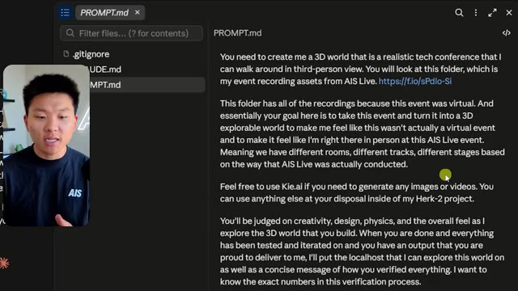
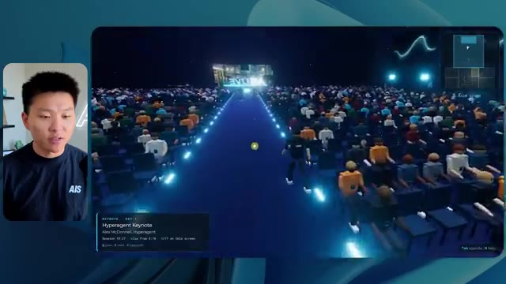
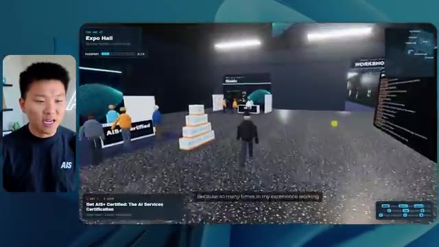
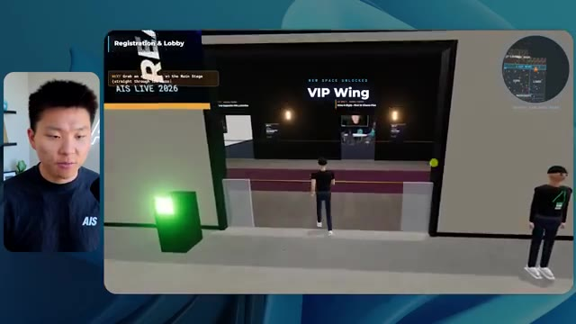

# 🎬 McKinsey Explains: Build an AI Operating System

> **Chaîne** : [Nate Herk | AI Automation](https://www.youtube.com/@nateherk/featured)  
> **Lien YouTube** : [https://www.youtube.com/watch?v=K70Qf06XBLE](https://www.youtube.com/watch?v=K70Qf06XBLE)  
> **Date de publication** : 20261015  
> **Durée** : 00:00:49  
> **Identifiant vidéo** : `K70Qf06XBLE`  
> **Transcription & Analyse** : `whisper-v3-large-turbo+gemini-3.5-flash-lite`  

---

## 📌 Synthèse Exécutive & Outils

### 💡 Résumé

La vidéo de la chaîne *Nate Herk | AI Automation* explore l'utilisation du modèle de pointe **Opus 5.5** configuré sous différents niveaux d'effort (de faible à ultra code) pour automatiser un projet de développement logiciel complexe et créatif : transformer 105 gigaoctets d'enregistrements vidéo d'un événement virtuel (AIS Live) en un monde 3D interactif et explorable à la troisième personne. L'objectif est d'offrir une réplication réaliste d'une conférence physique dotée de multiples salles, pistes et scènes, tout en intégrant dynamiquement les ressources graphiques et textuelles du projet d'exploitation IA de l'auteur.

À travers une méthodologie d'évaluation rigoureuse, la vidéo compare les résultats générés selon les niveaux d'effort en mesurant la qualité visuelle, le temps d'exécution, les coûts théoriques par API, la consommation de tokens, le nombre de vérifications automatisées via navigateur et l'autonomie des agents. Les résultats démontrent de nettes variations : le mode **faible effort** produit un monde rudimentaire, visuellement incohérent (éléments manquants, bugs d'affichage, images statiques) en 16 minutes pour 3,91 $, tandis que le mode **moyen effort** livre une application nettement plus soignée, respectant les chartes graphiques, intégrant des vidéos en streaming fonctionnelles et des PNJ (personnages non-joueurs) interactifs, pour un coût de 12,44 $ et un temps d'exécution d'une heure et treize minutes.

Enfin, la vidéo met en lumière le goulet d'étranglement classique du développement assisté par IA : le passage du code fonctionnel local à un déploiement en ligne fluide et instantané, introduit par le sponsor **Hostinger** et son extension d'éditeur qui comble le fossé entre l'environnement de code et la mise en production web en un seul clic.

---

### 🛠️ Outils, Modèles & Logiciels Présentés

* **Opus 5.5** : Modèle d'IA de pointe extrêmement performant et économique, utilisé au cœur de l'expérimentation pour exécuter un prompt d'ingénierie complexe à travers différents niveaux d'effort.
* **Claude Code** : Environnement de développement et agent de codage avancé utilisé pour orchestrer la construction du système et l'écriture du logiciel 3D.
* **Cursor** : Éditeur de code assisté par IA de nouvelle génération intégrant des agents logiciels pour le développement de projets complexes.
* **VS Code** : Éditeur de code source populaire et extensible, utilisé pour centraliser les flux de travail de développement logiciel.
* **Frame.io** : Plateforme de collaboration vidéo cloud hébergeant les 105 gigaoctets d'enregistrements bruts de l'événement AIS Live.
* **Hostinger** : Hébergeur web dont l'extension gratuite pour éditeur de code permet de connecter directement l'environnement de développement (VS Code, Cursor, Claude Code) pour un déploiement en ligne en un clic.

---

### 🔑 Points Clés & Enseignements Stratégiques

* **Hiérarchisation des niveaux d'effort** : La sélection d'un niveau d'effort (faible, moyen, élevé, ultra code) modifie drastiquement la profondeur de traitement, la logique algorithmique et le soin du détail apporté par l'IA.
* **Évolution de la qualité visuelle** : Le mode à faible effort génère des environnements génériques truffés de bugs d'affichage (fantômes, images fixes, absence de respect de l'identité visuelle), tandis que le mode moyen effort structure un monde cohérent aux couleurs de la marque avec des flux vidéo dynamiques.
* **Arbitrage temps-ressources** : Le mode faible effort s'exécute en 16 minutes pour 191 000 tokens et 3,91 $, contre une heure et treize minutes, 490 000 tokens et 12,44 $ pour le mode moyen effort, illustrant le coût de l'autonomie et de la précision accrue.
* **Autonomie totale des agents** : Dans les deux cas analysés, l'agent a fait preuve d'une autonomie absolue en exécutant des dizaines de vérifications automatisées (jusqu'à 23 ouvertures de navigateurs pour valider le rendu) sans nécessiter de clarification ni poser de questions à l'utilisateur.
* **Recommandation officielle d'utilisation** : Les directives d'Anthropic préconisent de démarrer systématiquement les projets complexes à un niveau d'effort moyen, puis d'ajuster l'intensité à la hausse ou à la baisse en fonction des besoins spécifiques constatés.
* **Intégration multimédia contextuelle** : Un agent performant est capable d'analyser un répertoire massif de données brutes (105 Go) pour en extraire la structure événementielle (agenda, conférenciers, pistes, stands) et l'injecter dynamiquement dans une architecture 3D interactive.
* **Résolution des bugs de PNJ** : Les niveaux d'effort supérieurs corrigent les comportements erratiques des personnages non-joueurs, transformant des artéfacts visuels dérangeants en interactions fluides et en animations de foule crédibles.
* **Le fossé du déploiement** : La création d'un prototype fonctionnel sur l'ordinateur local ne résout pas la friction liée à la mise en ligne, nécessitant des intégrations de type connecteur cloud pour industrialiser le passage du code à la production.
* **Automatisation du no-code/low-code visuel** : L'utilisation d'agents d'IA de niveau Opus 5.5 permet de concevoir des environnements virtuels immersifs complets (salons, scènes principales, salons VIP) à partir d'un simple prompt textuel d'objectifs, révolutionnant le prototypage rapide d'événements virtuels.

---

## ⏱️ Chronologie & Transcription Complète Audio & Visuelle (Mot pour Mot)

### ⏱️ `[00:00:00 - 00:00:20]` | Segment #01

**🔊 Audio (Transcription Intégrale Mot pour Mot en Français) :**
> Opus 5.5, Opus 5.5, Opus 5.5, Opus 5.5, Opus 5.5. Ce modèle est littéralement partout et pour de très bonnes raisons. Il est intelligent, il est bon marché, il a un goût incroyable, c'est un modèle d'IA incroyable. Mais avec chaque modèle d'IA, vous avez le choix de l'effort, que ce soit faible, moyen, élevé, extra, max ou code ultra.

**👁️ Analyse Visuelle d'Écran (gemini-3.5-flash-lite) :**
**Interface & Outils** : Interface du réseau social X (Twitter).

**Contenu textuel & Code** : Un post de réseau social incluant une vidéo intégrée montrant un environnement 3D réaliste (plage, palmiers, maisons) et du texte descriptif.

**Action / Démonstration** : Affichage d'une publication virale illustrant les capacités des modèles d'IA récents.

*⏱️ 00:00:05 — Capture d'écran d'un tweet sur X montrant une vidéo générée de paysage tropical et un texte sur la perturbation des créatifs techniques.*

---

### ⏱️ `[00:00:20 - 00:00:38]` | Segment #02

**🔊 Audio (Transcription Intégrale Mot pour Mot en Français) :**
> Donc dans cette vidéo, j'ai donné exactement le même prompt à Opus 5,5 et je l'ai exécuté sur chaque niveau d'effort et nous allons comparer les résultats. Nous examinerons la qualité de tous les différents résultats réels, mais nous examinerons également combien de temps chacun d'eux a pris pour s'exécuter, combien cela nous a coûté si c'était facturé par API, le nombre total de tokens, combien de vérifications ils ont effectuées, et combien de questions ils m'ont réellement posées tout au long du processus.

**👁️ Analyse Visuelle d'Écran (gemini-3.5-flash-lite) :**
**Interface & Outils** : Application web de tableau comparatif (type Notion ou outil de mindmapping).

**Contenu textuel & Code** : Tableau avec les en-têtes de colonnes : Low, Medium, High, Extra, Max, Ultracode, et de lignes : Run time, API cost, Total tokens, Checks, Questions asked.

**Action / Démonstration** : Présentation du tableau comparatif des différents niveaux d'effort d'Opus 5.5.

*⏱️ 00:00:29 — Tableau comparatif sur une interface web intitulé 'Opus 5.5 Efforts' montrant différents niveaux d'effort (Low, Medium, High, Extra, Max, Ultracode) et métriques (Run time, API cost, Total tokens, Checks, Questions asked).*

---

### ⏱️ `[00:00:39 - 00:00:58]` | Segment #03

**🔊 Audio (Transcription Intégrale Mot pour Mot en Français) :**
> Et les résultats que nous avons obtenus ne sont pas du tout ce à quoi je m'attends, donc j'ai hâte de partager cela avec vous les gars. Ne perdons pas de temps et allons directement à celui-ci. D'accord, alors plongeons directement dans celui-ci. Je veux commencer simplement en vous montrant le prompt réel que nous avons utilisé, que nous avons donné à chacun de ces différents agents. Je vais aller dans les fichiers ici, et nous allons ouvrir ce fichier markdown de prompt, et je vais vous montrer ce que nous avons obtenu. Voici donc le slash objectif que j'ai fourni.

**👁️ Analyse Visuelle d'Écran (gemini-3.5-flash-lite) :**
**Interface & Outils** : Interface de l'outil de développement IA / éditeur de code

**Contenu textuel & Code** : Interface affichant une conversation avec un assistant IA, un panneau latéral avec des projets ("effort-test", "AIS-OS"), et un prompt demandant de construire un monde 3D en 3ème personne.

**Action / Démonstration** : Le présentateur présente l'interface et les prompts de test d'effort de l'agent IA.

*⏱️ 00:00:48 — Interface d'une application d'assistant IA ou éditeur (style Cursor/Claude) avec le présentateur en incrustation vidéo sur la gauche.*

---

### ⏱️ `[00:00:58 - 00:01:34]` | Segment #04

**🔊 Audio (Transcription Intégrale Mot pour Mot en Français) :**
> J'ai dit, tu dois me créer un monde en 3D qui est une conférence tech réaliste dans laquelle je peux me promener en vue à la troisième personne. Tu vas regarder ce dossier, qui contient mes ressources d'enregistrement d'événements d'AIS Live. Et ce dossier est un dossier Frame.io de 105 gigaoctets d'enregistrements vidéo. C'était un événement entièrement virtuel. Tout a été enregistré et tous les enregistrements sont juste ici. J'ai dit, ton objectif est de prendre cet événement et de le transformer en un monde explorable en 3D qui me donne l'impression d'être réellement allé à une vraie conférence en personne avec différentes salles, différentes pistes, différentes scènes, bla, bla, bla. N'hésite pas à utiliser key.ai si tu as besoin de générer des images ou des vidéos. Et tu peux aussi utiliser n'importe quoi d'autre à l'intérieur de mon projet Herc 2, qui est comme mon système d'exploitation IA. J'ai dit,

**👁️ Analyse Visuelle d'Écran (gemini-3.5-flash-lite) :**
**Interface & Outils** : Éditeur de code (VS Code ou Cursor) et interface web Frame.io

**Contenu textuel & Code** : Fichier Markdown PROMPT.md contenant le prompt détaillé pour générer un monde 3D interactif d'une conférence tech à partir de données d'événements virtuels.

**Action / Démonstration** : Présentation du prompt de configuration et des fichiers de ressources Frame.io pour la création du monde virtuel.

*⏱️ 00:01:07 — Éditeur de code affichant le fichier PROMPT.md avec les instructions pour créer le monde 3D en vue à la troisième personne à partir d'un dossier Frame.io.*

*⏱️ 00:01:16 — Interface Frame.io affichant un dossier d'enregistrements d'événements de 105,69 Go contenant des sous-dossiers "GA Access (For AIS)" et "VIP Access".*

*⏱️ 00:01:25 — Vue de l'éditeur de code sur le fichier PROMPT.md avec le curseur soulignant le lien vers les ressources Frame.io.*

---

### ⏱️ `[00:01:34 - 00:02:08]` | Segment #05

**🔊 Audio (Transcription Intégrale Mot pour Mot en Français) :**
> vous serez jugé sur la créativité, le design, la physique et la sensation générale lorsque j'explorerai le monde 3D que vous avez construit. Et c'était fondamentalement la fin des instructions. Donc comme vous pouvez le voir sur ce côté gauche, j'ai exécuté ceci à travers tous les différents niveaux d'effort. Commençons par bas et remontons jusqu'à ultra code. Très bien. Donc ici nous avons le résultat de bas. Ouvrons ceci et jetons un œil. Nous avons donc AIS live, le sommet des services IA en personne enfin, et nous avons pu cliquer partout. Tout d'abord, cela ne fait pas très personnalisé. Genre, ce n'is pas le logo d'IS Live. Ce n'est même pas nos couleurs. Donc je n'aime pas trop ça, mais entrons ici. D'accord. C'est beaucoup trop lumineux. Euh, nous avons une carte en haut à droite, nous avons une ville par ici, je ne peux pas dire quelle ville c'est.

**👁️ Analyse Visuelle d'Écran (gemini-3.5-flash-lite) :**
**Interface & Outils** : Interface web d'assistant IA / Claude Code

**Contenu textuel & Code** : Texte de prompt concernant la construction d'un monde 3D en vue à la troisième personne (« build a walkable third-person 3D world ») et liste des niveaux d'effort dans le panneau latéral.

**Action / Démonstration** : Le présentateur montre l'exécution des tests à travers différents niveaux d'effort affichés dans l'interface.

*⏱️ 00:01:42 — Capture d'écran montrant le présentateur à gauche et l'interface d'un assistant IA (Claude Code / interface web) sur la droite avec un panneau latéral listant différents niveaux d'effort (Hello, Extra, High, Max, Ultracode, Medium, Low).*

---

### ⏱️ `[00:02:08 - 00:02:40]` | Segment #06

**🔊 Audio (Transcription Intégrale Mot pour Mot en Français) :**
> c'est. D'accord. C'est Chicago, ce qui est plutôt cool parce que tu sais, j'habite à Chicago, mais bref, en haut à droite, on peut voir une carte. Nous avons un hall d'accueil. Nous avons un hall d'exposition. Nous avons un salon VIP, la scène principale. Aussi, la carte montre où se trouve chaque autre personne et cela se synchronise en direct. Donc nous pouvons voir l'enregistrement. Nous pouvons voir le premier jour, la keynote de l'agent Hyper, le débriefing en direct. Cool. Donc ça connaît vraiment l'agenda et puis il y a le deuxième jour. Donc il a trouvé ça, c'est bien. Nous avons ces petites boules ici que je peux espérer projeter d'un coup de pied. D'accord. Le visage, Oh, regarde ça. Si je vais par ici, tous les gens disparaissent tout simplement. Très mauvais. Très mauvais. D'accord. Alors voyons voir. Est-ce que je peux sprinter ? D'accord.

**👁️ Analyse Visuelle d'Écran (gemini-3.5-flash-lite) :**
**Interface & Outils** : Application web de métavers ou de salon virtuel interactif 3D.

**Contenu textuel & Code** : Carte de navigation, planning du salon ("Day 1"), zones interactives du monde virtuel.

**Action / Démonstration** : Navigation et exploration de différentes zones d'un événement virtuel en 3D.

*⏱️ 00:02:16 — Vue d'un espace virtuel 3D avec un avatar et une carte interactive en haut à droite.*

*⏱️ 00:02:24 — Affichage du hall d'accueil virtuel avec le programme du premier jour affiché sur un panneau.*

*⏱️ 00:02:32 — Vue de l'Expo Hall virtuel avec des avatars d'utilisateurs et une structure lumineuse centrale.*

---

### ⏱️ `[00:02:40 - 00:03:04]` | Segment #07

**🔊 Audio (Transcription Intégrale Mot pour Mot en Français) :**
> Je peux aller un peu plus vite. Je vais d'abord aller par ici. Il y a des produits promotionnels, euh, certifiés AIS plus glido. D'accord. Donc, il y a les vrais stands que nous avions lors de l'événement virtuel. Nous avions des stands. Donc c'est plutôt cool. Un petit endroit pour prendre des photos. Salle C. En ce moment, nous avons Tangy Frederick qui anime un atelier. D'accord. Mais ce n'est pas une vidéo. Comme vous pouvez le voir, c'est juste une image. Elle ne bouge pas. C'est donc juste une image. Ces gens sont en train de disparaître. Ce doivent être des fantômes. Allons par ici dans la salle A.

**👁️ Analyse Visuelle d'Écran (gemini-3.5-flash-lite) :**
**Interface & Outils** : Environnement virtuel 3D interactif (type metaverse/Gather)

**Contenu textuel & Code** : Affichage d'un espace d'exposition virtuel avec des stands et des présentations textuelles sur écran

**Action / Démonstration** : Navigation et exploration de l'événement virtuel par l'avatar

*⏱️ 00:02:46 — Vue d'un espace virtuel 3D de type salon professionnel avec un avatar et des stands sponsorisés (Glaido).*

*⏱️ 00:02:52 — Navigation de l'avatar dans une salle d'atelier virtuelle verdoyante avec des tables éclairées.*

*⏱️ 00:02:58 — Approche d'un écran géant virtuel affichant des instructions sur une API key dans la salle d'atelier.*

---

### ⏱️ `[00:03:04 - 00:03:30]` | Segment #08

**🔊 Audio (Transcription Intégrale Mot pour Mot en Français) :**
> Nous avons Liberty White. D'accord. Très cool. Vos 30 premiers jours en automatisation. Encore une fois, ce n'est qu'une image fixe et les gens ont des bugs d'affichage. Donc ce n'est pas très bien ici. Je vais aller sur la scène principale et voir ce que nous avons. D'accord, cool. Nous avons donc une scène qui a l'air principale. Les gens ont des bugs d'affichage. Vraiment grave. Ce n'est vraiment pas très bien. Notre vidéo est en train de bouger. Comme j'ai vu mon visage ici et j'ai vu celui de Devin, mais maintenant ils ont disparu. Donc je ne sais pas ce qui s'est passé. D'accord. On dirait que c'est plutôt un diaporama. Rien n'est encore vraiment diffusé. Bref, entrons ici.

**👁️ Analyse Visuelle d'Écran (gemini-3.5-flash-lite) :**
**Interface & Outils** : Environnement virtuel 3D interactif (type métavers / plateforme événementielle virtuelle).

**Contenu textuel & Code** : Aucun code source, terminal ou prompt visible ; affichage de bannières d'événements virtuels.

**Action / Démonstration** : Navigation et déplacement d'un avatar dans l'espace virtuel de la conférence.

---

### ⏱️ `[00:03:30 - 00:03:58]` | Segment #09

**🔊 Audio (Transcription Intégrale Mot pour Mot en Français) :**
> Nous avons plus de stands. Nous avons hyper agent. Nous avons Claude Code. Nous avons plus de goodies. La salle B, c'est Dave Ebelor. Je suppose que c'est exactement la même chose. Nous avons du café. Et ensuite, je suppose que le salon VIP est réservé à l'accès VIP uniquement. C'est plutôt cool, mais il ne se passe vraiment rien ici. Cet écran est bien trop lumineux. D'accord. Donc je pense que vous comprenez l'ambiance que nous retirons d'Opus 5.5 en mode faible effort. Et c'est là que les choses deviennent intéressantes. À combien est-ce que vous pensez que cela s'est élevé ? Combien de temps ? Celui-ci a duré 16 minutes et 43 secondes. Combien pensez-vous que cela a coûté ?

**👁️ Analyse Visuelle d'Écran (gemini-3.5-flash-lite) :**
**Interface & Outils** : Interface de tableau/canvas numérique (Opus 5.5 Efforts)

**Contenu textuel & Code** : Tableau comparatif avec les colonnes Low, Medium, High, Extra, Max, Ultracode et les lignes Run time, API cost, Total tokens, Checks, Questions asked.

**Action / Démonstration** : Présentation d'un tableau comparatif des différents niveaux d'effort et de performance du modèle.

*⏱️ 00:03:51 — Capture montrant une interface de tableau comparatif intitulée 'Opus 5.5 Efforts' avec des niveaux (Low, Medium, High, Extra, Max, Ultracode).*

---

### ⏱️ `[00:03:58 - 00:04:26]` | Segment #10

**🔊 Audio (Transcription Intégrale Mot pour Mot en Français) :**
> 3,91 dollars si c' تھا۔ J'utilise évidemment mon abonnement ici, mais on va simplement calculer ça en facturation API. Le total des jetons était de 191 000. Il a fait 22 vérifications. Donc la vérification, 22 fois il a ouvert le navigateur et a exécuté différentes sortes de vérifications. Donc 22 catégories de vérifications. Et combien de questions m'a-t-il posé ? Il m'a posé un total de zéro question tout au long de cette invite de commande d'objectif. D'accord. Alors, ouvrons l'effort moyen et voyons ce que nous avons. D'accord, c'est parti. Effort moyen. Nous avons Nate Herc. Nous avons mon badge. C'est la marque AI's Life.

**👁️ Analyse Visuelle d'Écran (gemini-3.5-flash-lite) :**
**Interface & Outils** : Application de tableau blanc ou de diagramme (type Excalidraw ou similaire).

**Contenu textuel & Code** : Métriques de performance : Run time (16m 43s), API cost ($3.91), Total tokens (191.3K), Checks, Questions asked.

**Action / Démonstration** : Présentation des résultats d'analyse et des coûts par le créateur.

*⏱️ 00:04:05 — Tableau comparatif sous forme de tableau de bord affichant les coûts et performances (Run time : 16m 43s, API cost : $3.91, Total tokens : 191.3K, Checks).*

---

### ⏱️ `[00:04:26 - 00:04:46]` | Segment #11

**🔊 Audio (Transcription Intégrale Mot pour Mot en Français) :**
> Alors ça a déjà l'air un peu mieux. Ça ressemble à nos palettes de couleurs qui ont utilisé nos directives de marque. Premier jour de construction, deuxième jour de gain, VIP. Cool. D'accord. Je vais entrer dans le lieu. D'accord. Waouh. Une ambiance un peu similaire. C'est en arrière-plan. Ça ne ressemble pas à Chicago, n'est-ce pas ? Non, ça ressemble à, honnêtement, ça ressemble à une ville inventée. Quoi qu'il en soit, c'est drôle qu'ils aient décidé de faire ça. Voyons si je peux me déplacer un peu plus vite. Oh, waouh.

**👁️ Analyse Visuelle d'Écran (gemini-3.5-flash-lite) :**
**Interface & Outils** : Navigateur web affichant l'application virtuelle 3D AIS Live.

**Contenu textuel & Code** : Interface d'accueil avec badge (Nate Herk, Host - All Access) et contrôles de navigation (WASD, Shift, Space, etc.).

**Action / Démonstration** : Le présentateur entre dans l'espace virtuel 3D de l'événement et explore le lieu.

*⏱️ 00:04:31 — Interface web 'Welcome to AIS Live' montrant un badge nominatif avec les options 'Enter the Venue' et des contrôles clavier affichés.*

*⏱️ 00:04:41 — Vue dans le lieu virtuel 3D avec des avatars d'utilisateurs et une vue de ville en arrière-plan à travers de grandes fenêtres.*

---

### ⏱️ `[00:04:46 - 00:05:21]` | Segment #12

**🔊 Audio (Transcription Intégrale Mot pour Mot en Français) :**
> Les gens interagissent avec moi. Regardez. Si je m'approche de ce type, il vient de lever le bras. Bon, maintenant il ne veut plus du tout avoir affaire à moi. Mais tous ces petits robots ici doivent prendre des décisions. Je ne sais pas s'ils utilisent Jev. C'est sûr que non. Je ne le lui ai pas dit. En fait, ma clé Jev est à l'arrière. Je ne sais pas. Peut-être qu'il l'a utilisée. Quoi qu'il en soit, nous pouvons voir ici que nous avons la salle d'atelier C, le laboratoire des agents. Sympa. Donc celui-ci est en fait en cours d'exécution. Vous pouvez voir qu'il s'agit d'une vraie vidéo lue par Tangy. Tout le monde ici est en train de travailler sur un ordinateur portable. Ils ne buguent pas. C'est plutôt cool. De plus, mon badge est sur ma poitrine, ce qui est plutôt cool. Je peux venir par ici. Nous avons une carte en haut à droite, comme vous pouvez le voir, mais je peux venir par ici. Nous avons un

**👁️ Analyse Visuelle d'Écran (gemini-3.5-flash-lite) :**
**Interface & Outils** : Environnement virtuel 3D de type métavers ou jeu de simulation.

**Contenu textuel & Code** : Aucun code source, terminal ou texte technique affiché, uniquement une simulation en 3D.

**Action / Démonstration** : Navigation et exploration de l'environnement virtuel 3D par l'utilisateur.

---

### ⏱️ `[00:05:21 - 00:05:47]` | Segment #13

**🔊 Audio (Transcription Intégrale Mot pour Mot en Français) :**
> hall d'exposition. C'est là que nous avons le stand Glido. Et ça diffuse en ce moment. Oui, ça diffuse la vidéo de nous parlant de Glido. Ça diffuse la vidéo d'Ed et moi parlant de notre programme de certification. Nous avons le logo AIS Plus juste ici, qui est un peu mal placé. Ce sont les diapositives des conférenciers et les points clés. Donc wow, ce sont toutes les ressources que nous avons distribuées après l'événement. Elles sont toutes là aussi. Nous pouvons voir que nous avons un coup de projecteur sur la communauté. C'est donc Aiden qui parle de son contrat qu'il a décroché et c'est diffusé en direct. Ces gens regardent.

**👁️ Analyse Visuelle d'Écran (gemini-3.5-flash-lite) :**
**Interface & Outils** : Environnement virtuel 3D / Plateforme d'événement virtuel en ligne

**Contenu textuel & Code** : Diapositives de présentation et panneaux d'information textuels affichés sur les murs virtuels de l'exposition.

**Action / Démonstration** : Navigation et visite guidée de l'espace d'exposition virtuel par le présentateur.

---

### ⏱️ `[00:05:47 - 00:06:21]` | Segment #14

**🔊 Audio (Transcription Intégrale Mot pour Mot en Français) :**
> Ils sont plutôt engagés. On a un hyper agent. C'était, c'est ce que je voulais dire. Si vous avez vu ces gens lever les bras en disant bonjour, c'était plutôt marrant. Regardez, regardez, le voilà qui recommence. Bref. D'accord. Où est-ce que je suis maintenant ? Maintenant, je suis dans le hall principal. On a un bar à café. On a un grand logo, qui est le vrai logo. C'est trop lumineux, mais on a le logo. On peut voir si on peut entrer ici dans la piste des fondations. On a Sabrina Romanov et Liberty White. Donc différentes formations juste là. On peut entrer dans cette pièce. C'est la piste avancée. Alors, qu'est-ce qui se passe ici ? On a Dave Ebelar et Saman qui parlent de différentes choses là-dedans. Et maintenant, allons jeter un œil à la scène principale. Oh, attendez, il y a une vidéo de moi là-haut. C'est genre un VIP

**👁️ Analyse Visuelle d'Écran (gemini-3.5-flash-lite) :**
**Interface & Outils** : Environnement virtuel 3D interactif (plateforme d'événement en ligne).

**Contenu textuel & Code** : Éléments graphiques d'interface utilisateur de jeu/monde virtuel (minimap, texte "Main Lobby").

**Action / Démonstration** : Exploration et navigation dans un espace virtuel 3D avec des avatars d'utilisateurs.

---

### ⏱️ `[00:06:21 - 00:06:50]` | Segment #15

**🔊 Audio (Transcription Intégrale Mot pour Mot en Français) :**
> section ? Ouais, on ira voir ça dans une minute. Mais bref, voici la scène principale. Ça a l'air vraiment, vraiment très bien. On a une grande scène. On a genre quatre personnes assises ici. On a les trois écrans d'Alex là-haut avec hyper agent. Est-ce que j'ai le droit de monter sur scène ? Oh, et il me laisse monter sur scène. D'accord. C'est plutôt sympa. Bon les gars, prenons un selfie. Laissez-moi prendre tout le monde en arrière-plan. Venez par ici. Bref, c'est plutôt, plutôt cool. Par contre, toutes les places ne sont pas occupées. Donc il faut qu'on travaille là-dessus. Mais bon, je vais y retourner en courant pour voir ce que c'était que cette section VIP. D'accord. Salon VIP. J'ai l'impression que c'est comme un aéroport ou un truc du genre.

**👁️ Analyse Visuelle d'Écran (gemini-3.5-flash-lite) :**
**Interface & Outils** : Environnement virtuel 3D de conférence Hyperagent / Metaverse.

**Contenu textuel & Code** : Interface utilisateur virtuelle affichant "Hyperagent Keynote" avec les détails de session et l'intervenant Alex McDonnell.

**Action / Démonstration** : Navigation et exploration de l'espace virtuel de conférence par l'avatar de l'utilisateur.

*⏱️ 00:06:28 — Vue principale de l'auditorium virtuel avec des écrans de présentation Hyperagent et des spectateurs assis.*

*⏱️ 00:06:36 — Vue de l'arrière de la scène montrant quatre personnes assises et l'avatar de l'utilisateur se déplaçant.*

*⏱️ 00:06:43 — Vue en plongée de l'auditorium virtuel montrant l'allée centrale et la grande foule assise.*

---

### ⏱️ `[00:06:51 - 00:07:14]` | Segment #16

**🔊 Audio (Transcription Intégrale Mot pour Mot en Français) :**
> D'accord, super. Donc maintenant nous avons les sessions VIP ici. Une foire aux questions VIP avec la lecture vidéo en direct de Nate juste ici. Très, très cool. Et nous avons comme un bar ou quelque chose. Génial. Je dirais que c'est un assez bon résultat. Maintenant, en ce qui concerne les statistiques ici, celui-ci a pris une heure et 13 minutes à s'exécuter. Il nous aurait coûté 12 dollars et 44 cents. Il a utilisé 490 000 jetons et il a fait 23 vérifications.

**👁️ Analyse Visuelle d'Écran (gemini-3.5-flash-lite) :**
**Interface & Outils** : Application de métaverse / espace virtuel et tableau de bord de statistiques (Opus 5.5 Efforts).

**Contenu textuel & Code** : Statistiques de performance et de coût d'API (Run time : 16m 43s, API cost : $3.91, Total tokens : 191.3K, Checks : 22, Questions asked : 0).

**Action / Démonstration** : Présentation de l'espace virtuel VIP puis transition vers l'analyse des statistiques d'exécution.

*⏱️ 00:06:56 — Vue d'un espace virtuel VIP avec un écran géant affichant une session vidéo en direct (VIP Q&A with Nate) et des avatars de participants.*

*⏱️ 00:07:02 — Tableau de statistiques et de métriques d'exécution (Run time 16m 43s, API cost $3.91, Total tokens 191.3K, Checks 22).*

---

### ⏱️ `[00:07:14 - 00:07:48]` | Segment #17

**🔊 Audio (Transcription Intégrale Mot pour Mot en Français) :**
> Et il nous a posé un total de zéro question une fois de plus. Très bien, passons au niveau élevé. C'était déjà un résultat plutôt correct et Anthropic eux-mêmes dans leur vidéo, ou désolé, pas une vidéo, un article sur comment prompter Opus 5.5, ils ont dit de commencer simplement par moyen et de l'ajuster à la hausse ou à la baisse si nécessaire. C'était donc un résultat moyen. Passons au niveau élevé et voyons ce qu'on a obtenu. Très rapidement, les gars, je dois prendre une seconde pour vous parler du sponsor de la vidéo d'aujourd'hui, Hostinger. Donc ces deux modèles viennent de me construire une version fonctionnelle de la même chose. Et maintenant je suis exactement là où je finis toujours, avec quelque chose de terminé sur mon ordinateur portable et aucun moyen rapide de le mettre en ligne. Et c'est le fossé que le connecteur d'Hostinger comble. C'est une extension gratuite

**👁️ Analyse Visuelle d'Écran (gemini-3.5-flash-lite) :**
**Interface & Outils** : Tableau de bord de configuration des efforts et interface de développement à double panneau.

**Contenu textuel & Code** : Tableau de données comparatives sur les performances des modèles d'IA et logs de génération de code ("Build NorthWind ROI calculator").

**Action / Démonstration** : Analyse comparative des coûts et performances selon les niveaux de configuration du modèle.

*⏱️ 00:07:22 — Un tableau comparatif montrant les métriques d'exécution (temps d'exécution, coût API, jetons totaux, vérifications, questions posées) pour différents niveaux de réglage (Low, Medium, High, Extra).*

*⏱️ 00:07:39 — Une interface de développement avec des panneaux divisés affichant des logs d'exécution, du code et le présentateur en médaillon.*

---

### ⏱️ `[00:07:48 - 00:08:23]` | Segment #18

**🔊 Audio (Transcription Intégrale Mot pour Mot en Français) :**
> pour votre éditeur qui intègre votre compte Hostinger dans l'environnement où vous codez déjà. Que ce soit VS Code, Cursor, Cloud Code, Codex, peu importe. Vous vous connectez une seule fois en un clic, et à partir de là, votre agent peut déployer le site, y pointer un domaine, configurer les enregistrements DNS et vérifier votre VPS sans que vous n'ayez jamais à quitter l'éditeur. Alors, peu importe celui de ces outils que vous finirez par préférer, ce qu'il a construit se trouve à quelques minutes d'une vraie URL sur un hébergement géré. Le connecteur est gratuit sur tous les forfaits d'hébergement, donc si vous avez toujours besoin de l'hébergement sous-jacent, profitez du forfait illimité avec le lien dans la description et utilisez le code NATEHERK pour 10 % de réduction. Cela inclut également un nom de domaine gratuit et un e-mail professionnel pour l'année. Et c'est toujours le moyen le moins cher que j'ai trouvé pour obtenir quelque chose

**👁️ Analyse Visuelle d'Écran (gemini-3.5-flash-lite) :**
**Interface & Outils** : Interface de gestion Hostinger et Claude Code dans un IDE

**Contenu textuel & Code** : Statut "Connected" (Node.js 24.13.0 v), options "Websites", "Domains", "Subscriptions & Payments", "Email Marketing".

**Action / Démonstration** : Connexion et configuration des outils d'assistance Hostinger dans l'environnement de développement.

*⏱️ 00:07:57 — Interface montrant l'intégration de Hostinger dans l'IDE avec le statut connecté via OAuth et les outils disponibles (Websites, Domains, etc.) à gauche, et Claude Code à droite.*

---

### ⏱️ `[00:08:23 - 00:08:47]` | Segment #19

**🔊 Audio (Transcription Intégrale Mot pour Mot en Français) :**
> tu as construit sur une vraie URL. Donc revenons à la vidéo. D'accord. Encore une fois, très, très marqué par la marque. C'est un écran de chargement encore meilleur que le précédent. Nous avons ce petit effet sympa en arrière-plan. Nous avons le logo. Nous allons entrer dans le lieu. D'accord. Nous y voilà. Ça a l'air plutôt bien. Nous commençons à l'extérieur et vous pouvez voir que nous avons ces drapeaux pour tous les intervenants, Wyatt, Casper, Alex, Ed, Aiden, Sabrina, Liberty. C'est plutôt cool. Nous avons des blocs en direct ici.

**👁️ Analyse Visuelle d'Écran (gemini-3.5-flash-lite) :**
**Interface & Outils** : Application web 3D interactive (RingCentral / AIS Live)

**Contenu textuel & Code** : Interface utilisateur avec bannières de noms, mini-carte en haut à droite, commandes de déplacement et affichage du lieu 'AIS Live Plaza'.

**Action / Démonstration** : Navigation et exploration dans l'espace virtuel 3D de la conférence.

*⏱️ 00:08:29 — Écran de chargement et d'accueil de la plateforme 'AIS LIVE' affichant les contrôles de navigation clavier/souris et un bouton pour entrer dans le lieu virtuel.*

*⏱️ 00:08:35 — Vue dans le monde virtuel 3D 'AIS Live Plaza' montrant des avatars de personnages, des bâtiments de ville en arrière-plan et un indicateur de position en haut à gauche.*

*⏱️ 00:08:41 — Exploration de la place virtuelle avec des bannières verticales aux noms de intervenants (Alex McDonnell, Wyatt Lyonsmith) et des éléments interactifs au sol.*

---

### ⏱️ `[00:08:47 - 00:09:23]` | Segment #20

**🔊 Audio (Transcription Intégrale Mot pour Mot en Français) :**
> il a pris cette photo de moi, votre hôte, Nate Herc, John, Dave, Nate Herc. Voilà. D'accord. Les portes. C'est génial. Ce sont des portes coulissantes automatiques en verre. J'adore ça. On peut voir l'enregistrement VIP. On peut voir l'admission générale. On peut venir par ici et on peut découvrir l'expo avec différents stands, le coin de la communauté. Vous pouvez aussi voir qu'en haut à gauche, j'ai un passeport. Donc c'est comme si, ça va montrer combien d'endroits j'ai visités. Tout cela est une vraie lecture. Nous avons un mur de ressources avec tous les différents conférenciers. Ils ont aussi une session de réseautage par ici. Donc je vais venir très vite et voir de quoi il s'agit. Donc nous avons le bar à cold brew AIS. Nous avons différents membres de la communauté qui ont été mis en avant ou mis en lumière.

**👁️ Analyse Visuelle d'Écran (gemini-3.5-flash-lite) :**
**Interface & Outils** : Environnement virtuel 3D / Jeu ou plateforme métavers.

**Contenu textuel & Code** : Interface de navigation virtuelle, compteurs, mini-carte et affichage des stands.

**Action / Démonstration** : Exploration et navigation interactive dans un espace virtuel d'événement.

*⏱️ 00:08:56 — Vue d'un monde virtuel 3D représentant une zone d'enregistrement de conférence avec des avatars.*

*⏱️ 00:09:05 — Navigation dans un hall d'exposition virtuel avec des stands et des avatars d'utilisateurs.*

*⏱️ 00:09:14 — Déplacement d'avatars dans un hall d'accueil vitré d'un événement virtuel.*

---

### ⏱️ `[00:09:23 - 00:09:56]` | Segment #21

**🔊 Audio (Transcription Intégrale Mot pour Mot en Français) :**
> On a l'aile VIP. Attends, quoi ? Récupère un bracelet. Ah, je dois vraiment aller chercher le bracelet. D'accord. Laissez-moi m'enregistrer rapidement. Le bracelet est déjà mis. Attends, quoi ? D'accord. Oh, d'accord. Maintenant, les portes se sont ouvertes pour moi. Cool. Je peux entrer ici. Oh, ça mène juste à la scène principale. Salon VIP. Il y a une séance de questions-réponses en cours. Ça a l'air très cool. Je veux dire, je suis très impressionné par la façon dont il est capable de faire ça. Waouh. D'accord. Donc c'est vraiment bien. Ce qu'on a fait, c'est qu'on a eu des salles de discussion VIP avec différentes personnes. On peut voir qu'il y a différentes salles, différents membres de l'équipe AIS qui participent à des trucs. C'est vraiment cool. C'est très cool. C'est un bien meilleur VIP

**👁️ Analyse Visuelle d'Écran (gemini-3.5-flash-lite) :**
**Interface & Outils** : Application virtuelle 3D / plateforme de conférence en ligne interactive

**Contenu textuel & Code** : Environnement virtuel 3D avec avatars, panneaux d'affichage ('Registration Concourse', 'VIP Lounge', 'VIP Working Sessions'), et mini-carte de navigation.

**Action / Démonstration** : Navigation et exploration de l'espace de conférence virtuel par l'avatar du présentateur.

*⏱️ 00:09:32 — Le présentateur navigue dans une application virtuelle 3D représentant un espace de conférence ('Registration Concourse'), montrant les interfaces et les options de déplacement.*

*⏱️ 00:09:40 — Le présentateur se trouve dans un espace VIP virtuel ('VIP Lounge') avec d'autres avatars et un écran affichant des sessions vidéo.*

*⏱️ 00:09:48 — Le présentateur explore une section de sessions de travail VIP dans l'environnement virtuel avec des tables rondes et des écrans interactifs.*

---

### ⏱️ `[00:09:56 - 00:10:30]` | Segment #22

**🔊 Audio (Transcription Intégrale Mot pour Mot en Français) :**
> expérience que ce qui a été montré dans la première partie. D'accord. After party VIP. Regardez ça. On a une piste de danse. On a tous ces éléments ici. On a la lecture de l'after party VIP juste ici. Et il y a une estrade pour DJ. C'est tellement marrant. Il y a un petit bug ici, un petit glitch ici, mais c'est génial. Oh, cool. Donc quand je suis ici sur la scène principale, on a des sous-titres. Vous pouvez voir juste ici en bas de mon écran, on a ces sous-titres de Wyatt qui est en train de parler ici. On a des lumières. On a le panneau. Très cool. Belle scène principale. Je vais aller par ici, on peut aller à la fondation,

**👁️ Analyse Visuelle d'Écran (gemini-3.5-flash-lite) :**
**Interface & Outils** : Application web virtuelle de type metaverse / événement en ligne (Gather ou plateforme similaire).

**Contenu textuel & Code** : Environnement 3D interactif avec avatars, écrans vidéo en direct et interface utilisateur de navigation.
[DESC_ACTION] Navigation dans l'espace virtuel entre l'after-party VIP et la scène principale.

**Action / Démonstration** : Explications face caméra et démonstration conceptuelle.

*⏱️ 00:10:04 — Vue d'un espace virtuel d'after-party VIP avec piste de danse, avatars et écran affichant des participants en visioconférence.*

*⏱️ 00:10:13 — Vue élargie de l'after-party VIP montrant les avatars sur la piste de danse et les ballons de plage.*

*⏱️ 00:10:21 — Vue de la scène principale de l'événement virtuel avec des avatars assis dans des rangées de sièges face à un grand écran de présentation.*

---

### ⏱️ `[00:10:30 - 00:11:06]` | Segment #23

**🔊 Audio (Transcription Intégrale Mot pour Mot en Français) :**
> avancé, et les parcours d'entreprise par ici. Alors voyons voir. Nous avons l'anatomie de trois vraies transactions. Nous avons hyper agent. Nous avons les évaluations avec Nate et Ed ici. Nous avons Dave qui intervient dans les trucs avancés. C'est vraiment bien. Je veux dire, évidemment, chacun, chacun de ces résultats jusqu'à présent, faible était correct. Moyen était meilleur. Élevé a été encore meilleur. Voyons si cette tendance se poursuit et allons voir ce que cela nous a coûté. Donc, élevé a tourné pendant une heure et sept minutes. Donc un peu plus rapide que moyen, cela nous aurait coûté 16 dollars et 31 cents. Il a utilisé un demi-million de jetons, 509 000. Il a fait 22 vérifications. Et il nous a aussi demandé, enfin, non, je me suis trompé. Ce

**👁️ Analyse Visuelle d'Écran (gemini-3.5-flash-lite) :**
**Interface & Outils** : Application de tableau blanc / tableau de données (type Excalidraw ou similaire) avec une interface sombre.

**Contenu textuel & Code** : Tableau avec les lignes Run time (ex: 16m 43s, 1h 13m), API cost ($3.91, $12.44, $16.31), Total tokens (191.3K, 419.2K), Checks (22, 23) et Questions asked (0, 0).

**Action / Démonstration** : Analyse comparative des coûts et des temps d'exécution selon différents niveaux d'effort configurés.

*⏱️ 00:10:57 — Tableau comparatif montrant les performances et les coûts de l'outil Opus 5.5 Efforts avec des colonnes Low, Medium, High et Extra.*

---

### ⏱️ `[00:11:06 - 00:11:25]` | Segment #24

**🔊 Audio (Transcription Intégrale Mot pour Mot en Français) :**
> l'un m'a posé une question et spoiler, c'était le seul qui nous a posé une question tout au long de tout ça. Donc voyons voir, il nous en reste trois extra, max et ultra code. Laissez-moi ouvrir extra et nous verrons ce que nous avons. D'accord. Donc celui-ci a l'air plutôt bien. Je dirais honnêtement que jusqu'à présent, l'écran de chargement haut était le meilleur. Celui que nous venons de voir, mais de toute façon, entrons dans AIS live.

**👁️ Analyse Visuelle d'Écran (gemini-3.5-flash-lite) :**
**Interface & Outils** : Application de tableau blanc / interface web de type Canvas (marquée "Opus 5.5 Efforts")

**Contenu textuel & Code** : Tableau avec des colonnes Low, Medium, High et Extra, et des lignes Run time (16m 43s, 1h 13m, 1h 7m), API cost ($3.91, $12.44, $16.31), Total tokens, Checks et Questions asked.

**Action / Démonstration** : Le présentateur commente les résultats et les métriques affichées dans le tableau pour chaque niveau d'effort, s'apprêtant à ouvrir la section "Extra".

*⏱️ 00:11:11 — Tableau comparatif affichant les métriques de différents modes d'effort (Low, Medium, High, Extra) incluant le temps d'exécution, le coût API, le nombre de tokens, les vérifications et les questions posées, avec le présentateur en incrustation à gauche.*

---

### ⏱️ `[00:11:26 - 00:11:51]` | Segment #25

**🔊 Audio (Transcription Intégrale Mot pour Mot en Français) :**
> Whoa. D'accord. Donc on a comme de petits extraits sonores. Je peux discuter avec des gens. Le panneau sur la guerre des outils a réglé quelques débats pour moi. Sympa. Bonne perspective là-bas. On est dehors à nouveau. On a ces différentes bannières, bien qu'elles soient toutes les mêmes. Elles n'affichent pas de noms de personnes différentes. Donc grand logo AIS Live. L'aile des ateliers est par ici. Et passons par les portes coulissantes en verre pour voir ce qu'on a. Donc on a le café AIS. La carte est en bas à droite, et elle n'est pas très descriptive.

**👁️ Analyse Visuelle d'Écran (gemini-3.5-flash-lite) :**
**Interface & Outils** : Environnement de métavers ou jeu en ligne (plateforme de conférence virtuelle).

**Contenu textuel & Code** : Aucun code, terminal ou interface technique n'est visible ; il s'agit d'une simulation graphique 3D de type jeu vidéo.

**Action / Démonstration** : Navigation et déplacement d'un avatar au sein de l'espace virtuel.

---

### ⏱️ `[00:11:51 - 00:12:26]` | Segment #26

**🔊 Audio (Transcription Intégrale Mot pour Mot en Français) :**
> J'aime bien comment les autres cartes nous ont dit quoi, genre où étaient les choses, mais celle-ci a l'air très professionnelle. On peut voir ici la scène principale. Allons y faire un tour rapidement. Elles ont toutes ces balles qui volent partout, ce qui, je trouve, est plutôt marrant. Les ballons de plage AIS. On me voit là-haut en train de parler. Je crois que j'introduisais l'un des jours. Continuons à avancer par ici vers la salle d'atelier sur ce côté gauche. OK. Donc ici nous avons le théâtre Hyper Agent. Nous avons cette session sponsorisée ici par Hyper Agent, mais ça nous montre aussi ce qui va se passer ici. C'est vraiment marrant qu'on puisse discuter avec des gens. Salmon a créé un commercial vocal en direct. La salle "The Price Is Right" était comble. Tu as pris le guide du compagnon VIP ? C'est trop marrant. Nous avons la piste avancée en

**👁️ Analyse Visuelle d'Écran (gemini-3.5-flash-lite) :**
**Interface & Outils** : Plateforme d'événement virtuel 3D (type Gather ou métavers professionnel).

**Contenu textuel & Code** : Textes d'interface ("Main Stage", "Grand Lobby", "Enterprise AI Services"), bulles de chat d'avatars.

**Action / Démonstration** : Navigation et exploration de l'espace virtuel par l'utilisateur.

*⏱️ 00:12:00 — Vue d'une scène de conférence virtuelle avec un avatar sur scène et un écran géant diffusant le présentateur.*

*⏱️ 00:12:09 — Hall d'entrée virtuel (Grand Lobby) avec des panneaux indiquant "Workshops" et "Enterprise AI Services".*

*⏱️ 00:12:17 — Vue à la première personne dans un couloir virtuel, montrant des avatars en interaction avec des bulles de texte.*

---

### ⏱️ `[00:12:26 - 00:12:58]` | Segment #27

**🔊 Audio (Transcription Intégrale Mot pour Mot en Français) :**
> here. Once again, we've got live playback. Is that live playback? Oh, okay. It started once I got in, but I can take a seat. Oh my. I can watch this. I can stand up. I want to sit in the front. That's pretty cool. That's very nice. I like that. And you know what I noticed so far? The actual character that I'm playing kind of looks like me. I think it modeled it off of my thumbnail pictures or something. Anyways, we have Sabrina in here, room host here, grab any open seat. Okay, cool. And I really liked the sitting functionality. It's kind of funny. Like we could actually attend this workshop and participate. Anyways, it's showing us the speakers. It's showing us the

**👁️ Analyse Visuelle d'Écran (gemini-3.5-flash-lite) :**
**Interface & Outils** : Environnement virtuel 3D / plateforme de webinaire interactive.

**Contenu textuel & Code** : Interface utilisateur de la plateforme virtuelle avec des options de navigation (Map, Agenda, Captures) et affichage d'un atelier en direct ("Workshop Block 2").

**Action / Démonstration** : Navigation et exploration de l'espace virtuel par l'utilisateur.

---

### ⏱️ `[00:12:58 - 00:13:31]` | Segment #28

**🔊 Audio (Transcription Intégrale Mot pour Mot en Français) :**
> Agenda. Il y a un petit tapis rouge ici pour prendre quelques photos. On peut prendre une pose. Oh, wow. C'est plutôt cool. Bibliothèque de ressources, certifiez-vous AIS Plus, Glido, Hyper Agent, AIS Plus, trois vraies offres. Génial. Je veux dire, je dirais vraiment que jusqu'à présent, chacun est de mieux en mieux. Et on n'a même pas encore exploré la section VIP, le salon VIP. Allons là-haut très vite. J'espère que je pourrai entrer. Sympa. On a la réinitialisation des outils. Ce sont les différentes salles dans lesquelles on pourrait aller. Donc encore une fois, je pourrais prendre la feuille de travail et essayer de comprendre comment fixer le prix de mes produits. C'est tellement cool. C'est vraiment mieux que le précédent où on a juste en quelque sorte

**👁️ Analyse Visuelle d'Écran (gemini-3.5-flash-lite) :**
**Interface & Outils** : Environnement virtuel de conférence 3D (type métavers).

**Contenu textuel & Code** : Texte contextuel affiché : "Your Monday Move", "What's your gut floor number?", "If you doubled your rate, what would change?", et une instruction "Read the 'Price It Right' worksheet".

**Action / Démonstration** : Navigation et exploration de l'espace virtuel par l'avatar, interaction avec les zones de contenu et les stands d'exposition.

*⏱️ 00:13:07 — Vue d'un hall d'exposition virtuel (Expo Hall) avec des stands de sponsors (AIS+, Hyperagent, Gialdo) et des avatars interactifs.*

*⏱️ 00:13:15 — Vue du hall d'entrée principal (Main Lobby) d'un environnement virtuel de conférence avec un escalier, des zones de réception et des avatars en mouvement.*

*⏱️ 00:13:23 — Vue à la première personne dans un salon VIP (VIP Lounge) où des avatars sont assis autour d'une table avec des invites textuelles affichées à l'écran.*

---

### ⏱️ `[00:13:31 - 00:13:59]` | Segment #29

**🔊 Audio (Transcription Intégrale Mot pour Mot en Français) :**
> like looked at stuff. Awesome. I can get behind the bar and come in here. This is very nice. Okay. So as far as statistics go, this one ran for an hour and a half. It costs 25.92 bucks. I don't know why I say point $25, 92 cents. It was 733,000 tokens and 34 checks. So it had the most checks so far by far. And it asked us zero questions. I can't wait to see what we got here from max and ultra code. Okay. Here is max loading screens, boring, but it's on brand and it has our logo.

**👁️ Analyse Visuelle d'Écran (gemini-3.5-flash-lite) :**
**Interface & Outils** : Application de tableau blanc ou de diagramme en ligne (type Excalidraw ou similaire).

**Contenu textuel & Code** : Tableau avec des données de performance : 'Medium' (1h 13m, $12.44, 419.2K, 23), 'High' (1h 7m, $16.31, 509.3K, 22, 1), 'Extra' (1h 31m).

**Action / Démonstration** : Le présentateur commente et analyse les statistiques affichées dans le tableau comparatif des différents niveaux d'effort.

*⏱️ 00:13:38 — Tableau comparatif sous forme de tableau ou graphique avec des colonnes Medium, High, Extra, Max et Ultracode, présentant des statistiques de temps, de coût et de tokens.*

---

### ⏱️ `[00:14:00 - 00:14:35]` | Segment #30

**🔊 Audio (Transcription Intégrale Mot pour Mot en Français) :**
> Donc c'était bien. J'aime bien ça. On va continuer et entrer dans AIS live. Ooh, sympa la petite animation ici qui nous fait entrer. Encore une fois, le personnage me ressemble. Ils m'ont tous ressemblé. Enfin, en quelque sorte, on a... assis à l'arrière-plan. Ça ressemble à Chicago. Comme je l'ai mentionné plus tôt, beaucoup d'entre elles jouent des sons et je ne les inclus pas parce que ce serait très distrayant pour vous d'essayer d'écouter ce qui se passe tout en m'écoutant parler. Donc il y a genre une légère musique dans tout ça. Je déteste la façon dont il marche. Cette façon de marcher est vraiment, vraiment mauvaise. Je veux dire, la démarche, ouais, je n'aime pas du tout ça. Donc ce n'est pas génial. Mais à part ça, entrons et explorons. Remarquez ces ombres quand j'entre, elles changent vraiment brusquement. Je ne sais pas trop pourquoi,

**👁️ Analyse Visuelle d'Écran (gemini-3.5-flash-lite) :**
**Interface & Outils** : Application web 3D immersive / Métavers virtuel ("AIS live")

**Contenu textuel & Code** : Environnement 3D interactif avec interface de navigation (mini-carte, commandes clavier en bas, panneaux d'information en haut).

**Action / Démonstration** : Navigation et déplacement d'un avatar à travers un monde virtuel 3D.

*⏱️ 00:14:08 — Vue principale de l'environnement virtuel 3D de type métavers avec un avatar au premier plan et le présentateur dans une incrustation vidéo à gauche.*

*⏱️ 00:14:17 — Progression dans la visite virtuelle 3D montrant l'approche d'un bâtiment d'exposition avec des bannières informatives et d'autres avatars.*

*⏱️ 00:14:26 — Gros plan sur l'avatar du joueur se dirigeant vers l'entrée vitrée d'un hall d'exposition virtuel.*

---

### ⏱️ `[00:14:35 - 00:15:11]` | Segment #31

**🔊 Audio (Transcription Intégrale Mot pour Mot en Français) :**
> Mais bref, on peut aussi discuter avec les gens ici. Le stand Hyperagent est juste là où on entre dans l'expo. Tout est bon. Okay, cool. Je peux continuer à cliquer sur E pour leur faire changer ce qu'ils disent. On a les intervenants juste ici. Ça a l'air plutôt pas mal. Même si on avait pourtant bien la photo de profil de tout le monde. Donc je ne sais pas trop pourquoi ce n'est pas inclus là. On voit des gens prendre des photos juste ici. J'adore ça. Et ça enregistre une petite photo. Okay. La carte n'est pas super non plus, genre elle ne me donne pas une très bonne explication de ce qui se passe, mais j'aime bien ces stands. Ils sont cool. Je pense que ces stands sont les meilleurs que j'ai vus jusqu'à présent. Genre, ils ont juste l'air sympa. Ils ont des représentants. Il y a de jolies diapos derrière eux. Ouais. Ces stands sont cool. Okay. On a un petit théâtre mis en avant

**👁️ Analyse Visuelle d'Écran (gemini-3.5-flash-lite) :**
**Interface & Outils** : Application web virtuelle en 3D (Metaverse / Salon virtuel)

**Contenu textuel & Code** : Environnement virtuel interactif avec panneaux d'affichage, stands, avatars et mini-carte

**Action / Démonstration** : Navigation et interaction avec les avatars et les stands de l'exposition virtuelle

*⏱️ 00:14:44 — Vue générale de la réception de l'événement virtuel avec des avatars et des écrans d'affichage.*

*⏱️ 00:14:53 — Le présentateur navigue près du stand Hyperagent à l'entrée de l'expo avec des bulles de discussion.*

*⏱️ 00:15:02 — Vue de l'Expo Hall montrant différents stands comme Evals Lab et Enterprise AI.*

---

### ⏱️ `[00:15:11 - 00:15:35]` | Segment #32

**🔊 Audio (Transcription Intégrale Mot pour Mot en Français) :**
> qui se passe par ici. C'est Casper. Bien que pourquoi est-ce que ça ne joue pas ? J'ai l'impression que ça devrait jouer, non ? Comme dans les autres, ils étaient toujours en train de jouer. On peut parler à d'autres personnes par ici. Le café est gratuit. Blabla. Amy Simpson, Matt Wolf. Sympa. D'accord. C'est juste la zone de réseautage dans laquelle nous sommes en ce moment, mais on peut voir en haut à droite. On peut aussi voir ce qui est en direct sur la scène principale en ce moment. C'est un panel sur la guerre des outils. Allons donc par ici. Nous avons Devin, Cole, Dave et Russ qui discourent par ici. Nous avons en quelque sorte de l'audiovisuel, des petits trucs d'éclairage qui se passent ici à l'arrière.

**👁️ Analyse Visuelle d'Écran (gemini-3.5-flash-lite) :**
**Interface & Outils** : Environnement virtuel 3D interactif (type métavers / conférence virtuelle en ligne).

**Contenu textuel & Code** : Avatars 3D, écrans d'affichage virtuels avec statistiques et panneaux de conférence en direct.

**Action / Démonstration** : Exploration et navigation dans un événement virtuel en ligne avec un avatar.

---

### ⏱️ `[00:15:36 - 00:15:55]` | Segment #33

**🔊 Audio (Transcription Intégrale Mot pour Mot en Français) :**
> Basculons la scène principale sur ce qui compte vraiment en ce moment. Je peux donc changer de sujet. Cool. Je viens de basculer sur moi et Matt. Nous pouvons passer à l'anatomie de trois vraies transactions. C'est plutôt cool. La scène a l'air bien. Nous avons un petit panneau sympa ici. Je peux monter sur la scène ? Sympa. Sympa. Enfin, je ne peux pas aller trop loin, en fait. Bon, tout le monde, laissez-moi prendre le selfie. Tout le monde vient là-dedans. Je peux aussi m'asseoir dans ce public par ici et simplement profiter de la session.

**👁️ Analyse Visuelle d'Écran (gemini-3.5-flash-lite) :**
**Interface & Outils** : Environnement virtuel 3D (type Gather.town ou métavers).

**Contenu textuel & Code** : Interface utilisateur de visioconférence et monde virtuel avec avatars.

**Action / Démonstration** : Navigation et présentation dans un espace virtuel 3D.

---

### ⏱️ `[00:15:55 - 00:16:14]` | Segment #34

**🔊 Audio (Transcription Intégrale Mot pour Mot en Français) :**
> Très cool, très cool. OK, allons par ici. Je vois une section à l'étage. C'est marrant comme ils choisissent tous de mettre la section VIP à l'étage. Je veux dire, je ne déteste pas ça. Oh la la, ils ont un escalator. Pas possible. Je vais discuter avec ce type sur l'escalator. Glenn a 15 ans d'expérience en agence. Ses trucs de "land and expand" étaient en or. Du bon travail, Glenn. Cool, donc je vais... je n'arrive même pas à passer devant ce type, par contre.

**👁️ Analyse Visuelle d'Écran (gemini-3.5-flash-lite) :**
**Interface & Outils** : Application web virtuelle interactive en 3D (metaverse / plateforme d'événement virtuel)

**Contenu textuel & Code** : Interface de navigation 3D, indicateurs de position, commandes clavier (WASD), informations sur les sessions live et bulles de discussion avec les avatars.

**Action / Démonstration** : Navigation et déplacement de l'avatar dans l'espace virtuel vers l'étage VIP.

*⏱️ 00:16:00 — Vue d'un environnement virtuel en 3D avec un avatar se déplaçant dans un hall d'accueil spacieux, avec un panneau "Reception" en haut à gauche.*

*⏱️ 00:16:04 — L'avatar s'approche d'un escalier mécanique menant à la zone "VIP LEVEL", avec des panneaux indicateurs et des instructions de contrôle en bas.*

*⏱️ 00:16:09 — L'avatar monte l'escalier mécanique derrière un autre participant, affichant une bulle de dialogue avec du texte descriptif et une option de discussion.*

---

### ⏱️ `[00:16:14 - 00:16:48]` | Segment #35

**🔊 Audio (Transcription Intégrale Mot pour Mot en Français) :**
> Oh, j'ai dû sauter par-dessus lui. D'accord, niveau VIP, badge requis. Oh la vache. Tu te moques de moi ? Je dois aller chercher mon badge. D'accord, super. Maintenant, ça montre que je suis un vrai VIP et je peux aller ici dans la section VIP. On a de super petites sessions de travail par ici, qu'on peut rejoindre. Je me demande si ça va me laisser m'asseoir ici. Je peux juste discuter. Est-ce que je peux participer ? Ça ne me laisse pas m'asseoir et participer. C'est pas grave. On a la "war room" sur les prix. Oh, ça, c'est peut-être l'after-party. Allons voir ce qui se passe par ici. Ou peut-être que je dois juste entrer par ici. D'accord. C'est bizarre. Je devais juste entrer par ici. Cette after-party n'est pas aussi cool que l'autre. Mais bref, allons voir ce qui se passe par ici.

**👁️ Analyse Visuelle d'Écran (gemini-3.5-flash-lite) :**
**Interface & Outils** : Application ou plateforme virtuelle 3D d'événement en ligne (type Gather ou événement virtuel métavers).

**Contenu textuel & Code** : Profil utilisateur de Nate Herk, cartes d'accès VIP, indications de sessions de travail.

**Action / Démonstration** : Exploration d'un environnement virtuel 3D et accès aux sections VIP.

*⏱️ 00:16:23 — Vue d'un espace virtuel 3D avec un avatar et une carte de profil indiquant 'Nate Herk'.*

*⏱️ 00:16:31 — Navigation dans la zone VIP d'un événement virtuel montrant des participants autour d'une table de travail.*

*⏱️ 00:16:39 — Vue en plongée d'une section exclusive VIP avec un écran d'affichage et des avatars.*

---

### ⏱️ `[00:16:48 - 00:17:07]` | Segment #36

**🔊 Audio (Transcription Intégrale Mot pour Mot en Français) :**
> dans les ateliers. D'accord. Ce n'était pas bien. Regardez ça. On peut tout voir et j'ai juste eu un bug et maintenant boum. Donc ce n'est pas bon. Je dirais qu'globalement, je veux dire, vous avez l'ambiance de comment cela fonctionne, mais je dirais que celui d'avant, qui était, je crois, élevé, j'ai préféré celui-là. Je ne peux pas m'asseoir dans ces chaises non plus. Ouais. Donc je n'aime pas la marche dans celui-ci.

**👁️ Analyse Visuelle d'Écran (gemini-3.5-flash-lite) :**
**Interface & Outils** : Environnement virtuel 3D d'événement en ligne.

**Contenu textuel & Code** : Avatars 3D, écrans de présentation virtuels, interface de navigation et de chat.

**Action / Démonstration** : Navigation et exploration dans l'espace virtuel de l'événement.

*⏱️ 00:16:53 — Vue d'un avatar virtuel explorant un couloir de conférence 3D.*

*⏱️ 00:16:57 — L'avatar s'approche de l'entrée d'une salle de conférence étiquetée Room C.*

*⏱️ 00:17:02 — L'avatar se trouve à l'intérieur de la salle de conférence virtuelle (HyperAgent Lab).*

---

### ⏱️ `[00:17:07 - 00:17:43]` | Segment #37

**🔊 Audio (Transcription Intégrale Mot pour Mot en Français) :**
> Je n'aime pas trop l'ambiance et il y a quelques bugs. Donc, jusqu'à présent, si nous voulons regarder notre liste, j'aime bien Extra Extra, c'est celui que j'ai le plus aimé jusqu'à présent. Mais bon, celui-ci était au maximum. Celui-ci était au maximum juste ici. Alors voyons combien de temps cela a tourné, deux heures et 28 minutes. Donc ça a tourné pendant longtemps, 50 dollars et 38 cents, 1,18 million de jetons. Donc il y a eu une compaction et il a dû s'auto-compacter. Et ensuite il a fait 51 vérifications. Est-ce qu'il l'a vraiment fait ? Parce qu'il y avait beaucoup de bugs là-dedans. Et de toute façon, celui-ci ne nous a posé zéro question. Donc, jusqu'à présent, chaque fois, c'est pratiquement devenu plus cher et ça a pris plus de temps, à part ici. Mais ceux-ci en gros

**👁️ Analyse Visuelle d'Écran (gemini-3.5-flash-lite) :**
**Interface & Outils** : Tableau de bord interactif ou outil de mind-mapping/tableaux

**Contenu textuel & Code** : Colonnes Medium, High, Extra, Max, Ultracode avec des lignes de données (durées en heures/minutes, coûts en dollars, et décomptes de tokens ou métriques)

**Action / Démonstration** : Le présentateur commente et compare les résultats du tableau entre les différents modes d'effort.

*⏱️ 00:17:16 — Tableau comparatif affichant les performances de différents niveaux d'effort ("Medium", "High", "Extra", "Max", "Ultracode") avec des métriques de temps, de coût et de tokens, tandis que le présentateur apparaît en incrustation vidéo à gauche.*

---

### ⏱️ `[00:17:43 - 00:18:17]` | Segment #38

**🔊 Audio (Transcription Intégrale Mot pour Mot en Français) :**
> a pris à peu près le même temps, mais à chaque fois, il utilise plus de tokens parce qu'ils ont plus réfléchi. Et puis, vous savez, ces tokens vont coûter plus cher. Mais bref, passons au dernier, qui est ultra code. Donc, on espérerait vraiment que celui-ci soit le meilleur. Alors, allons voir sur ce localhost ce que nous avons. OK, super. Regardez ce badge. C'est un joli badge host all access. Nous avons un petit visuel sympa juste ici. On va y aller et entrer AIS Live. Cool. OK. Bienvenue, Nate. J'aime bien la marche. Ça a l'air réaliste. J'aime le logo, même s'il lui manque le petit point rouge qui donne l'air d'être en direct. La carte en haut à droite

**👁️ Analyse Visuelle d'Écran (gemini-3.5-flash-lite) :**
**Interface & Outils** : Tableau comparatif / Application web 3D (AIS Live)

**Contenu textuel & Code** : Tableau avec des durées, coûts en dollars, et nombre de tokens (High, Extra, Max, Ultracode) / Scène virtuelle 3D avec avatars

**Action / Démonstration** : Présentation comparative des performances des modèles IA et affichage d'un résultat généré en 3D.

*⏱️ 00:17:52 — Tableau de comparaison montrant les métriques de différents niveaux d'effort, dont 'Ultracode'.*

*⏱️ 00:18:09 — Interface d'un monde virtuel 3D avec le logo 'AIS LIVE' et des avatars de personnages.*

---

### ⏱️ `[00:18:17 - 00:18:49]` | Segment #39

**🔊 Audio (Transcription Intégrale Mot pour Mot en Français) :**
> est un tout petit peu mieux étiqueté, donc je peux voir ce qui se passe. Je vais venir ici et récupérer mon bracelet VIP très rapidement. D'accord, super. Ça me dit aussi ce que je dois faire. Donc en haut à gauche, ça dit de scanner au portique VIP sur le mur est du hall. Donc je crois que l'est serait par là, non ? Never eat soggy waffles. Ouais. Ailes VIP, scanner le bracelet. D'accord, cool. Maintenant je suis dans la section VIP. Je peux voir ces différentes salles. La réinitialisation des outils. La vidéo en direct est diffusée. Je peux voir les sous-titres juste là de ce dont on est en train de parler. Ça diffuse aussi les sons, mais je ne diffuse tout simplement pas l'audio pour vous les gars parce que je ne veux pas saturer.

**👁️ Analyse Visuelle d'Écran (gemini-3.5-flash-lite) :**
**Interface & Outils** : Application ou plateforme virtuelle 3D (environnement de type métavers ou événement virtuel)

**Contenu textuel & Code** : Interface utilisateur virtuelle affichant des instructions de quête, une mini-carte et des titres de salles

**Action / Démonstration** : Navigation de l'avatar à travers l'environnement virtuel et entrée dans une salle VIP

*⏱️ 00:18:25 — Vue d'un monde virtuel 3D avec un avatar se déplaçant dans le hall d'enregistrement, avec le texte "Already on your wrist".*

*⏱️ 00:18:33 — L'avatar franchit les portes d'une zone VIP nouvellement déverrouillée dans l'environnement virtuel.*

*⏱️ 00:18:41 — Vue intérieure d'une salle de réunion virtuelle (VIP Room 5) avec des avatars assis autour d'une table ronde.*

---

### ⏱️ `[00:18:50 - 00:19:08]` | Segment #40

**🔊 Audio (Transcription Intégrale Mot pour Mot en Français) :**
> Encore une fois, celui-ci fonctionne avec Cody et Mustafa là-dedans. C'est génial. Vidéo en direct. La vidéo ne se lance pas tant qu'on n'entre pas, par contre. Donc, honnêtement, je pense que c'est un bon choix. Dès que j'entre, par contre, la vidéo démarre. Sympathique. Belle attention. Toutes ces pièces. Génial. Ouais. Je veux dire, ça fait très haut de gamme. Voici une salle de crise pour les prix. Allons voir ça. Moi et John là-dedans.

**👁️ Analyse Visuelle d'Écran (gemini-3.5-flash-lite) :**
**Interface & Outils** : Application web d'événementiel virtuel / espace 3D en ligne.

**Contenu textuel & Code** : Vue en perspective d'un couloir virtuel nommé "VIP Wing" avec des salles de réunion et des écrans vidéo.

**Action / Démonstration** : Le présentateur commente l'exploration de l'espace virtuel et l'interaction avec les salles de réunion en direct.

*⏱️ 00:18:54 — Capture d'écran montrant l'interface d'un espace virtuel en 3D (type Gather ou environnement virtuel similaire) avec un avatar qui se déplace dans une aile VIP.*

---

### ⏱️ `[00:19:08 - 00:19:42]` | Segment #41

**🔊 Audio (Transcription Intégrale Mot pour Mot en Français) :**
> Et ensuite, nous avons l'after-party sympa. Cet after-party n'est pas encore aussi animé. Et nous avons plus de ballons de plage pour une raison quelconque, mais cet after-party est cool. Je veux dire, ça nous donne une bonne ambiance et il y a la rediffusion juste ici de notre séance de questions-réponses de l'after-party, tout cela est en direct aussi. Génial. Bon. Allons sur la scène principale. Cela m'invite aussi à prendre une place côté allée sur la scène principale, qui est tout droit à travers l'expo. Donc en fait, traversons d'abord l'expo. Qu'est-ce que vous construisez ? Il y a beaucoup de gens qui parlent de différentes choses par ici. Waouh. Il y a aussi comme un petit truc de basket-ball. Est-ce que je peux le lancer ? Je peux. Est-ce que je dois regarder en haut pour le lancer vers le haut ? D'accord.

**👁️ Analyse Visuelle d'Écran (gemini-3.5-flash-lite) :**
**Interface & Outils** : Application de monde virtuel 3D en ligne

**Contenu textuel & Code** : Environnement virtuel 3D avec avatars et interfaces de navigation textuelles

**Action / Démonstration** : Navigation et exploration d'un monde virtuel 3D par le présentateur

---

### ⏱️ `[00:19:42 - 00:20:08]` | Segment #42

**🔊 Audio (Transcription Intégrale Mot pour Mot en Français) :**
> Eh bien, pas terrible. Mais bref, nous avons un stand AIS plus. Nous avons le stand Glido. Est-ce que ça joue en direct ? Oui, ça joue définitivement en direct. Sympa. Nous avons le stand Hyper Agent. Nous avons d'autres trucs par ici. OK, super. Je vais aller sur la scène principale et voir si on peut trouver une place côté allée. Dès qu'on entre, tout se met à jouer. On a une très belle ambiance de scène. Comment faire pour choper une place côté allée, par contre. Voilà. Il fallait que je trouve la bonne. Je prends la place côté allée. Il n'y a personne sur la scène, ce qui est bizarre. J'aimais bien quand il y avait du monde sur la scène dans les versions précédentes.

**👁️ Analyse Visuelle d'Écran (gemini-3.5-flash-lite) :**
**Interface & Outils** : Environnement virtuel 3D de type salon ou conférence en ligne.

**Contenu textuel & Code** : Interface de navigation virtuelle avec indications textuelles ("Expo Hall", "Main Stage", "Grab a seat").

**Action / Démonstration** : Exploration d'un salon virtuel en 3D et déplacement vers la scène principale.

---

### ⏱️ `[00:20:08 - 00:20:31]` | Segment #43

**🔊 Audio (Transcription Intégrale Mot pour Mot en Français) :**
> Prenons un petit selfie. Bref, on a moi et Pat là-haut. Pat est tout habillé comme un ouvrier du bâtiment. Comme vous pouvez le voir, nous faisions un petit appel de découverte fictif dans cet exemple. Je vais revenir par l'expo et on va sortir ici vers l'aile des ateliers et juste vérifier si ces salles sont fondamentalement exactement les mêmes qu'elles devraient l'être. Maintenant, je ne peux pas vraiment discuter avec les gens. Je le pouvais avant, dans les versions précédentes, discuter avec les gens, ce que je trouvais être une très jolie touche. Et nous avons l'atelier d'un parcours de base. Est-ce que je peux m'asseoir ?

**👁️ Analyse Visuelle d'Écran (gemini-3.5-flash-lite) :**
**Interface & Outils** : Application de métavers / plateforme virtuelle interactive 3D.

**Contenu textuel & Code** : Environnement virtuel 3D avec interface de navigation et sous-titres textuels.

**Action / Démonstration** : Navigation et exploration de l'espace virtuel par le présentateur.

*⏱️ 00:20:14 — Vue d'une scène virtuelle 3D (Main Stage) montrant un espace de conférence virtuel avec des avatars.*

*⏱️ 00:20:20 — Navigation dans le hall d'exposition virtuel (Expo Hall) montrant divers avatars et panneaux d'indication.*

*⏱️ 00:20:25 — Déplacement dans l'aile des ateliers (Workshop Wing) montrant un couloir virtuel avec des avatars.*

---

### ⏱️ `[00:20:32 - 00:21:04]` | Segment #44

**🔊 Audio (Transcription Intégrale Mot pour Mot en Français) :**
> Je ne peux pas m'asseoir. Je ne sais pas. Nous avons Liberty qui parle en ce moment même et elle est en train de parler et nous pouvons l'entendre. Donc c'est bien, mais ça ne me laisse pas m'asseoir. Et regardez ça. Je deviens assez instable juste ici. Ça faisait des bugs de la façon dont je marchais. Ça ne voulait pour ainsi dire pas me laisser marcher. Ce n'est pas bon. Pareil. Nous avons cette piste avancée là-dedans. Génial. Donc dans l'ensemble, ils ont une ambiance très similaire. Je dirai que je suis impressionné par la façon dont ils ont été capables de raconter une histoire à partir de ce que nous faisions. Bibliothèque de points clés des intervenants. D'accord. C'est cool. Je ne pense pas qu'on ait vu ça depuis différents endroits, mais ce sont comme les ressources et ça montre des choses cool. Oh, wow. Je

**👁️ Analyse Visuelle d'Écran (gemini-3.5-flash-lite) :**
**Interface & Outils** : Environnement virtuel 3D interactif de type métavers ou espace de conférence en ligne.

**Contenu textuel & Code** : Textes d'indication de zones ("Workshop A - Foundation Track", "Workshop B - Advanced Track", "Speaker Takeaways Library") et sous-titres de discussion ("All right.", "One problem.").

**Action / Démonstration** : Exploration et navigation d'un avatar dans différentes salles de conférence virtuelles.

*⏱️ 00:20:40 — Vue d'un environnement virtuel en 3D représentant un espace d'atelier nommé "Workshop A - Foundation Track" avec un avatar de personnage au centre.*

*⏱️ 00:20:48 — Navigation dans la salle virtuelle "Workshop B - Advanced Track" montrant des tables, des écrans de présentation et un avatar en mouvement.*

*⏱️ 00:20:56 — Exploration de l'espace virtuel "Speaker Takeaways Library" avec des avatars de participants et des présentations affichées aux murs.*

---

### ⏱️ `[00:21:04 - 00:21:41]` | Segment #45

**🔊 Audio (Transcription Intégrale Mot pour Mot en Français) :**
> peut réellement ouvrir toutes ces choses et nous pouvons prendre des photos ici même aussi. Sympathique. Prendre une photo. Je peux aussi enregistrer ceci. Genre, je peux vraiment télécharger ceci. Et maintenant nous avons cette photo que nous venons de prendre à cet événement en direct d'AIS. Très bien. Eh bien, je pense qu'il est temps pour moi de tirer quelques conclusions, mais voyons d'abord ce que cette exécution nous a coûté. Cela a pris une heure et 35 minutes. C'était donc beaucoup plus rapide que max. Cela n'a coûté que 18 dollars et 69 cents. Wow. C'était donc un peu plus cher que high, moins cher que extra et beaucoup moins cher que max. Cela a également consommé 606 000 jetons et 42 vérifications avec zéro question. Maintenant, une autre chose intéressante à noter est que tout

**👁️ Analyse Visuelle d'Écran (gemini-3.5-flash-lite) :**
**Interface & Outils** : Visionneuse d'images système et outil de tableau/diagramme en ligne ("Opus 5.5 Efforts").

**Contenu textuel & Code** : Photo d'événement virtuel avec le logo "AIS LIVE" et tableau comparatif avec des colonnes "Extra", "Max", "Ultracode" et des durées/coûts.

**Action / Démonstration** : Visualisation d'une photo capturée lors de la démonstration, puis navigation vers un tableau de données analytiques.

*⏱️ 00:21:13 — Visionneuse d'images affichant une photo prise lors d'un événement virtuel "AIS LIVE" avec des avatars sur un tapis rouge.*

*⏱️ 00:21:22 — Interface d'un outil de tableau/diagramme ("Opus 5.5 Efforts") montrant des données chiffrées et un panneau de configuration des styles.*

---

### ⏱️ `[00:21:41 - 00:22:13]` | Segment #46

**🔊 Audio (Transcription Intégrale Mot pour Mot en Français) :**
> ces exécutions, aucune d'entre elles n'a utilisé de sous-agent. J'ai vérifié et je me suis assuré qu'aucune d'elles n'avait utilisé de sous-agents. Elles ne voulaient déléguer aucun travail, ce qui était intéressant. Donc ces jetons sont ce qui a été reflété à l'intérieur de cette session. Évidemment, comme je l'ai dit, celle-ci a dépassé, vous savez, 950 000, donc, ou peu importe quelle est la fenêtre de compaction. Je ne la laisse généralement jamais monter si haut, mais comme c'était un objectif global et que je n'étais pas impliqué, celle-ci a dû se compacter, mais le reste d'entre elles a simplement tourné dans cette unique session. Et ce sont les statistiques globales. Et aussi, très rapidement, concernant les trucs d'UltraCode, les gars, je ne sais pas si vous avez remarqué cela, mais quand j'ai fait tourner UltraCode ces derniers temps, ça a juste paru bizarre. Ça a paru un peu buggé. J'ai, à quelques reprises, je l'ai fait tourner

**👁️ Analyse Visuelle d'Écran (gemini-3.5-flash-lite) :**
**Interface & Outils** : Application web ou tableau de bord avec une incrustation vidéo du présentateur en bas à gauche.

**Contenu textuel & Code** : Tableau avec les colonnes Low, Medium, High, Extra, Max, Ultracode et les lignes Run time, API cost, Total tokens, Checks, Questions asked.

**Action / Démonstration** : Le présentateur explique les résultats et les métriques d'exécution affichés dans le tableau comparatif.

*⏱️ 00:21:49 — Tableau comparatif affichant les performances selon différents niveaux d'effort (Low, Medium, High, Extra, Max, Ultracode) avec le temps d'exécution, le coût API, le nombre total de jetons, les vérifications et les questions posées.*

---

### ⏱️ `[00:22:13 - 00:22:34]` | Segment #47

**🔊 Audio (Transcription Intégrale Mot pour Mot en Français) :**
> et s'est dit, est-ce que ça tourne vraiment sur UltraCode ? Il a fait pas mal de vérifications de plus que ces autres, mais pour une raison quelconque, ça ne me semblait pas correct, car essentiellement ce qu'est UltraCode, c'est un effort supplémentaire et c'est juste comme utiliser des flux de travail plus dynamiques afin de faire les choses. Et donc à travers toutes mes recherches dans les journaux de session et même quand je regardais cette chose se construire dans UltraCode, il ne lançait aucun de ces flux de travail dynamiques et j'ai essayé cela plusieurs fois.

**👁️ Analyse Visuelle d'Écran (gemini-3.5-flash-lite) :**
**Interface & Outils** : Tableau de données ou interface d'évaluation de modèles d'IA

**Contenu textuel & Code** : Tableau comparatif avec colonnes Low, Medium, High, Extra, Max, Ultracode et lignes Run time, API cost, Total tokens, Checks, Questions asked.

**Action / Démonstration** : Analyse comparative des différents niveaux d'effort et coûts des modèles.

*⏱️ 00:22:18 — Un tableau comparatif montrant les performances de différents niveaux d'effort (Low, Medium, High, Extra, Max, Ultracode) avec des métriques telles que le temps d'exécution (Run time), le coût de l'API, le nombre total de tokens, les vérifications (Checks) et les questions posées.*

---

### ⏱️ `[00:22:35 - 00:23:00]` | Segment #48

**🔊 Audio (Transcription Intégrale Mot pour Mot en Français) :**
> Donc je ne sais pas si c'est un bug actuellement dans le harness de CloudCode ou si c'est juste avec Opus 5.5, c'est un petit peu pire avec UltraCode en ce moment ou quelque chose comme ça, mais dans les deux cas, ce sont les niveaux d'effort globaux réels et tout cela semble tout à fait logique quand on examine la façon dont ils progressent. Alors jetons un coup d'œil à ceci. Coût maximum par rapport au minimum, nous avons eu un facteur de 12,9 sur l'exécution la moins chère par rapport à l'exécution la plus chère, ce qui, je crois, allait de 3,98 dollars à 50,38 dollars.

**👁️ Analyse Visuelle d'Écran (gemini-3.5-flash-lite) :**
**Interface & Outils** : Application de tableau ou interface web de présentation de données (titre : Opus 5.5 Efforts).

**Contenu textuel & Code** : Tableau avec les colonnes : Low, Medium, High, Extra, Max, Ultracode, et les lignes : Run time, API cost, Total tokens, Checks, Questions asked.

**Action / Démonstration** : Présentation des résultats de tests comparatifs d'agents IA selon les niveaux d'effort configurés.

*⏱️ 00:22:41 — Tableau comparatif des performances et des coûts pour différents niveaux d'effort (Low, Medium, High, Extra, Max, Ultracode) avec des métriques comme le temps d'exécution, le coût de l'API, les tokens totaux, les vérifications et les questions posées.*

---

### ⏱️ `[00:23:01 - 00:23:19]` | Segment #49

**🔊 Audio (Transcription Intégrale Mot pour Mot en Français) :**
> So that was low and max. As far as max checks versus low, we had a 2.3X multiple. The total across all six was 127 bucks and ultra code was $18.69. Let's look at speed versus cost here. So let me zoom out a little bit so we can see this whole thing. So on the X axis, we have runtime. In the Y axis, we have cost.

**👁️ Analyse Visuelle d'Écran (gemini-3.5-flash-lite) :**
**Interface & Outils** : Interface web de tableau de bord / application de test (style interface de chat ou document interactif type artifact)

**Contenu textuel & Code** : Métriques affichées : "12.9x Max cost vs Low", "2.3x Max checks vs Low", "$18.69 Ultracode cost, 42 checks", "$127.65 Total across all six", et texte descriptif sur les tests d'effort.

**Action / Démonstration** : Le présentateur commente les résultats chiffrés des tests d'effort et s'apprête à faire défiler vers le graphique comparatif vitesse/coût.

*⏱️ 00:23:05 — Capture d'écran montrant l'interface d'un tableau de bord de résultats de test d'effort sur Claude (Opus Effort Test) avec des métriques de coûts et de vérifications, ainsi que la vidéo du présentateur en incrustation à gauche.*

---

### ⏱️ `[00:23:19 - 00:23:42]` | Segment #50

**🔊 Audio (Transcription Intégrale Mot pour Mot en Français) :**
> So I feel like what the best would be is in the bottom left, but not really. So anyways, you can see that low was cheap and fast. Max was slow and expensive. But this sort of chart typically makes sense. As you increase in effort, it's gonna cost more and it's gonna run a little bit longer. That makes sense. Now let's see growth relative to low. So we have runtime in blue, API costs in orange, tokens in green, and checks in yellowish gold, mustard.

**👁️ Analyse Visuelle d'Écran (gemini-3.5-flash-lite) :**
**Interface & Outils** : Application web de test (interface personnalisée 'Opus Effort Test') avec un graphique de dispersion.

**Contenu textuel & Code** : Graphique à axes cartésiens : axe vertical représentant le coût de l'API (de $0 à $50) et axe horizontal représentant le temps d'exécution (Run time, de 0 à 2h30). Points de données avec info-bulle pour 'Low' (16m 43s - $3.91 - 191.3K tokens - 22 checks).

**Action / Démonstration** : Le présentateur commente le graphique en montrant que les niveaux d'effort faibles ('Low') sont rapides et bon marché, tandis que le niveau maximal ('Max') est plus lent et plus coûteux.

*⏱️ 00:23:25 — Un graphique comparatif intitulé 'Speed vs cost' montrant le coût en API en fonction du temps d'exécution pour différents niveaux d'effort (Low, Medium, High, Extra, Ultracode, Max).*

---

### ⏱️ `[00:23:42 - 00:24:01]` | Segment #51

**🔊 Audio (Transcription Intégrale Mot pour Mot en Français) :**
> Et au passage, la raison pour laquelle UltraCode apparaît comme ceci, c'est parce qu'il utilise en fait un niveau d'effort supplémentaire. Il est simplement incité et utilise plutôt des workflows dynamiques et des choses comme ça, ce qui fait que tout ça, vous savez, ça a du sens parce qu'au fond, il utilisait de l'effort supplémentaire sous le capot. C'est aussi pour cela que Claude l'a étiqueté ici en orange. Quoi qu'il en soit, si nous continuons à descendre ici, cela a généralement du sens, n'est-ce pas ?

**👁️ Analyse Visuelle d'Écran (gemini-3.5-flash-lite) :**
**Interface & Outils** : Interface web d'analyse de données / tableau de bord de graphiques.

**Contenu textuel & Code** : Graphique linéaire comparant le temps d'exécution (Run time), le coût de l'API (API cost), les tokens et les vérifications (Checks) par rapport au niveau d'effort "Low".

**Action / Démonstration** : Présentation des résultats comparatifs illustrant l'impact des différents niveaux d'effort, notamment "Extra" et "Ultracode".

*⏱️ 00:23:47 — Capture d'écran montrant un graphique de résultats d'un test d'effort ("Opus Effort Test") avec différentes métriques de performance et de coût selon les niveaux d'effort (Low, Medium, High, Extra, Max, Ultracode).*

---

### ⏱️ `[00:24:02 - 00:24:21]` | Segment #52

**🔊 Audio (Transcription Intégrale Mot pour Mot en Français) :**
> As the effort level increases, once again, these metrics are gonna increase. Runtime, API costs, tokens, and checks. Same thing here with runtime. It's just kind of giving us more individual line charts now for each of these different metrics, like API cost, checks, total tokens, cost per check, and all the numbers in one spot. So pretty cool data.

**👁️ Analyse Visuelle d'Écran (gemini-3.5-flash-lite) :**
**Interface & Outils** : Interface web de test et de visualisation de données (« Opus Effort Test »)

**Contenu textuel & Code** : Graphique comparatif de la croissance relative (Run time 8.9x, API cost 12.9x, Tokens 6.2x, Checks 2.3x) selon différents niveaux d'effort (Low, Medium, High, Extra, Max, Ultracode)

**Action / Démonstration** : Le présentateur commente l'augmentation des métriques (coûts d'API, temps d'exécution, tokens, vérifications) lorsque le niveau d'effort augmente.

*⏱️ 00:24:06 — Un graphique linéaire montrant l'évolution des métriques (Runtime, API cost, Tokens, Checks) en fonction du niveau d'effort, avec le présentateur visible à gauche.*

---

### ⏱️ `[00:24:21 - 00:24:40]` | Segment #53

**🔊 Audio (Transcription Intégrale Mot pour Mot en Français) :**
> Je dirais que rien ici n'est trop choquant. Ce qui m'a le plus choqué, ce sont ces résultats. Mes deux principaux favoris étaient high, qui est celui-ci, et extra, qui est celui-ci. Je dois donc retourner ici et me rappeler ce que j'en pensais. J'ai vraiment aimé cette sensation. Celui-ci donne aussi simplement l'impression d'être le plus fluide. La physique était agréable. La porte coulissante en verre était agréable. Je n'ai vraiment pas remarqué beaucoup de bugs dans celui-ci, ce qui est ce que j'ai vraiment aimé.

**👁️ Analyse Visuelle d'Écran (gemini-3.5-flash-lite) :**
**Interface & Outils** : Application web interactive en 3D (AIS Live)

**Contenu textuel & Code** : Interface utilisateur affichant les commandes de déplacement (WASD, Mouse, etc.), les informations de l'événement et le monde virtuel 3D.

**Action / Démonstration** : Exploration et navigation dans l'environnement virtuel 3D de l'application AIS Live.

*⏱️ 00:24:26 — Écran d'accueil de la plateforme interactive 'AIS LIVE' avec logo, informations sur l'événement et touches de contrôle.*

*⏱️ 00:24:31 — Vue dans le monde virtuel 3D 'AIS Live Plaza' avec des avatars de personnages et des bannières informatives.*

*⏱️ 00:24:35 — Navigation de l'avatar dans la place virtuelle 'AIS Live Plaza' en direction d'un bâtiment moderne.*

---

### ⏱️ `[00:24:40 - 00:25:13]` | Segment #54

**🔊 Audio (Transcription Intégrale Mot pour Mot en Français) :**
> Je ne me rappelle plus si celui-ci était celui où, oh, je ne pouvais pas parler aux gens par contre. Je pouvais juste passer directement à travers eux. Je ne pouvais pas m'asseoir dans celui-ci non plus. Voici un autre petit détail visuel où en gros je traverse juste ce mur. Donc j'aime pas trop ça. Mais je crois, est-ce que c'était celui où je pouvais m'asseoir pendant ces sessions ? Non. D'accord. Donc je ne pense pas que c'était mon gagnant alors. C'est extrêmement haut. Je pense que c'est celui-ci le gagnant. Ouais. Je pense que c'était celui que j'ai le plus aimé. J'ai adoré toute cette ambiance. J'ai adoré le fait de pouvoir discuter avec les gens. C'était définitivement celui où on pouvait venir ici et s'asseoir où on voulait, prendre place, se lever. Je pouvais lire ces trois deals et je pouvais discuter avec eux. J'ai aussi réalisé qu'il y avait de petites sections pour simuler des appels de découverte ici aussi.

**👁️ Analyse Visuelle d'Écran (gemini-3.5-flash-lite) :**
**Interface & Outils** : Application web interactive en 3D (AIS LIVE)

**Contenu textuel & Code** : Interface utilisateur virtuelle avec des contrôles de déplacement (WASD walk, Shift run, Space jump), des informations sur l'événement et des avatars 3D.

**Action / Démonstration** : Navigation et exploration de l'espace virtuel 3D de la plateforme AIS LIVE.

*⏱️ 00:24:48 — Capture montrant l'intérieur de l'espace virtuel 3D avec des avatars minimalistes et l'interface de navigation en bas.*

*⏱️ 00:25:05 — Vue en 3D d'un hall virtuel avec un avatar se dirigeant vers une grande scène principale (Main Stage) diffusant une vidéo.*

---

### ⏱️ `[00:25:13 - 00:25:51]` | Segment #55

**🔊 Audio (Transcription Intégrale Mot pour Mot en Français) :**
> On a des goodies et des tote bags, ce qui est du vrai physique. J'aime bien ça. C'était celui où on pouvait s'asseoir partout. Ouais, j'ai vraiment, vraiment aimé celui-là. Bien que je pense que le seul inconvénient avec celui-ci, c'est qu'il n'y avait pas genre d'after-party VIP parce que je crois que c'était le lounge. Et je pense que c'était la seule partie de la section VIP, c'est-à-dire ces différentes salles dans lesquelles on pouvait entrer et s'asseoir. Mais mis à part ça, ça n'offrait pas une super expérience VIP par rapport à certaines des autres qu'on a vues. Donc mon gagnant ici va définitivement être Extra. Extra a fait un travail phénoménal. C'était environ la moitié de la durée et la moitié du coût de Max. Donc Max, je pense, c'était juste beaucoup trop pour pas assez de bien. Je pense que les hauts étaient corrects. Ça aurait pu,

**👁️ Analyse Visuelle d'Écran (gemini-3.5-flash-lite) :**
**Interface & Outils** : Tableau de bord / application web affichant un tableau comparatif (Opus 5.5 Efforts).

**Contenu textuel & Code** : Tableau avec des colonnes de niveau d'effort (Low, Medium, High, Extra, Max, Ultracode) et des lignes de métriques (Run time, API cost, Total tokens, Checks, Questions asked).

**Action / Démonstration** : Sélection ou surbrillance d'une colonne de données dans le tableau comparatif des efforts.

*⏱️ 00:25:42 — Le présentateur à gauche et un tableau de données comparatives affichant des métriques par niveau d'effort (Run time, API cost, Total tokens).*

---

### ⏱️ `[00:25:51 - 00:26:25]` | Segment #56

**🔊 Audio (Transcription Intégrale Mot pour Mot en Français) :**
> avec peut-être un ou deux prompts de plus, arrivé là où je l'aimais vraiment. Mais pour un objectif de slash, Extra a fourni un résultat incroyable ici. Je n'ai pas adoré Medium. Et pour une grande partie de mon travail de réflexion et de ce que je fais, Medium fonctionne très bien. Mais pour cette tâche précisément, j'avais besoin de beaucoup de raisonnement. Il devait passer au peigne fin des tonnes de choses. Il devait passer au peigne fin des tonnes de vidéos. Il devait trouver beaucoup de choses à l'intérieur de mes projets. Il devait créer une expérience et raconter une histoire à partir de tout cela. Je pense qu'Extra a fait un travail phénoménal. En général, cependant, j'ai aimé beaucoup de ces résultats, mais Extra est celui avec lequel je voudrais commencer dès maintenant. Si je voulais vraiment en faire une application et un univers super, super léchés et cool, je commencerais par le résultat d'Extra et probablement

**👁️ Analyse Visuelle d'Écran (gemini-3.5-flash-lite) :**
**Interface & Outils** : Application web ou tableau de bord d'analyse de performances (Opus 5.5 Efforts)

**Contenu textuel & Code** : Tableau avec colonnes : Low, Medium, High, Extra, Max, Ultracode. Lignes : Run time (16m 43s à 2h 28m), API cost ($3.91 à $50.38), Total tokens (191.3K à 1.18M), Checks (22 à 51), Questions asked (0 à 1).

**Action / Démonstration** : Présentation et analyse comparative des résultats selon les différents niveaux de réglage.

*⏱️ 00:26:00 — Un tableau comparatif des différents niveaux d'effort (Low, Medium, High, Extra, Max, Ultracode) affichant le temps d'exécution, le coût API, le nombre total de tokens, les vérifications et les questions posées.*

---

### ⏱️ `[00:26:25 - 00:26:37]` | Segment #57

**🔊 Audio (Transcription Intégrale Mot pour Mot en Français) :**
> Continuez à itérer avec Extra. Donc de toute façon, les gars, c'était l'expérience. J'espère que vous avez trouvé cela instructif. J'espère que vous avez appris quelque chose de nouveau. Et si c'est le cas, veuillez mettre un pouce bleu. Ça m'aide énormément. Et comme toujours, je vous remercie d'être arrivés jusqu'à la fin de la vidéo, et je vous dis à la prochaine. Merci à tous, les amis.

**👁️ Analyse Visuelle d'Écran (gemini-3.5-flash-lite) :**
**Interface & Outils** : Aucune interface logicielle ou technique affichée.

**Contenu textuel & Code** : Aucun code, terminal ou diagramme visible.

**Action / Démonstration** : Le présentateur s'adresse directement au public pour conclure la vidéo.

---

