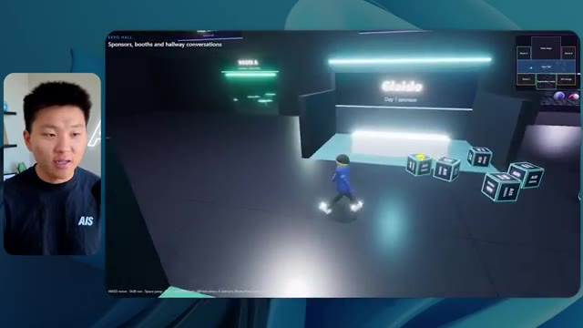
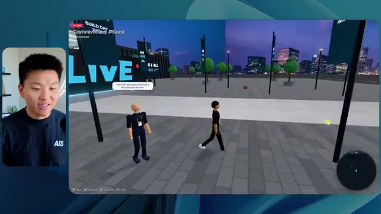
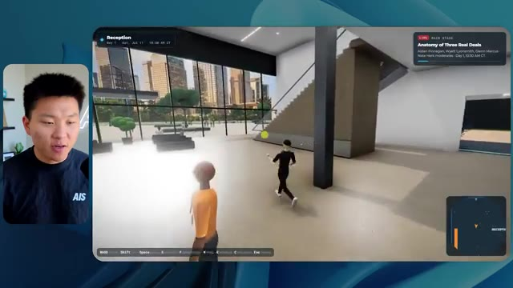
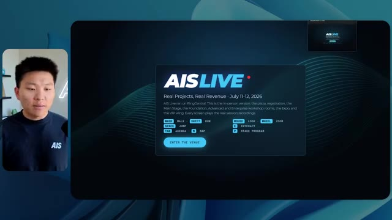
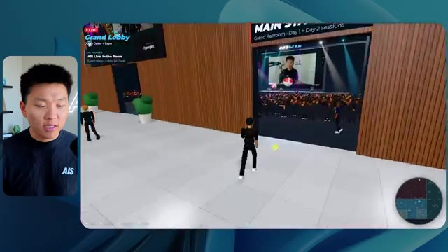

# 🎬 I Built a Team of AI Agents AND Humans That Work Together

> **Chaîne** : [Nate Herk | AI Automation](https://www.youtube.com/@nateherk/featured)  
> **Lien YouTube** : [https://www.youtube.com/watch?v=KZiF2J83zaY](https://www.youtube.com/watch?v=KZiF2J83zaY)  
> **Date de publication** : 20261015  
> **Durée** : 00:22:24  
> **Identifiant vidéo** : `KZiF2J83zaY`  
> **Transcription & Analyse** : `whisper-v3-large-turbo+gemini-3.5-flash-lite`  

---

## 📌 Synthèse Exécutive & Outils

### 💡 Résumé
Cette vidéo de la chaîne *Nate Herk | AI Automation* explore l'impact des différents niveaux d'effort (de faible à code ultra) appliqués au modèle d'IA de pointe **Opus 5.5** (développé par **Anthropic**) pour un cas d'usage d'ingénierie logicielle complexe : transformer un dossier brut de 105 gigaoctets de données vidéo (provenant d'un événement virtuel baptisé *AIS Live*) en un monde 3D explorable en vue à la troisième personne, simulant une conférence technologique physique avec ses salles, pistes, scènes et intégrations de marque. 

À travers l'expérimentation en direct, le créateur compare minutieusement le comportement du modèle sur plusieurs niveaux. Le niveau *Faible* (Low) génère un prototype basique, bogué, visuellement imprécis et peuplé de « fantômes » numériques, mais exécuté en 16 minutes pour environ 3,91 $ d'API. En revanche, le niveau *Moyen* (Medium) — recommandé par Anthropic dans ses guides de prompt engineering — livre un résultat nettement supérieur, respectant les chartes graphiques, intégrant de vraies lectures vidéo fonctionnelles, des PNJ réactifs, des cartes interactives en temps réel et un design d'environnement immersif, pour un coût de 12,44 $ et une exécution d'une heure et 13 minutes.

L'analyse ne se limite pas à la qualité esthétique et fonctionnelle du code généré, elle évalue également des métriques critiques pour l'automatisation par agents : le temps de calcul, le coût théorique en jetons par appel API, le nombre de vérifications autonomes dans le navigateur (exécutions de tests visuels ou fonctionnels) et la fréquence des interactions avec l'humain. Cette démonstration met en lumière la puissance de l'ingénierie d'agents IA autonomes capables de structurer, concevoir, déboguer et déployer des applications riches à partir d'un simple objectif (*slash goal*), tout en soulignant le fossé persistant entre le code fonctionnel généré localement et son déploiement rapide en production.

---

### 🛠️ Outils, Modèles & Logiciels Présentés
* **Opus 5.5** : Le modèle de langage multimodal de pointe d'Anthropic, utilisé comme moteur central d'intelligence pour coder et structurer l'intégralité du monde 3D.
* **Claude Code** : L'outil d'ingénierie logicielle en ligne de commande d'Anthropic servant à exécuter et orchestrer les instructions des agents IA directement dans l'environnement de développement.
* **Anthropic** : L'entreprise conceptrice des modèles et des frameworks méthodologiques sur les niveaux d'effort (*Effort Level*).
* **Frame.io** : La plateforme de stockage cloud utilisée pour héberger et centraliser les 105 gigaoctets d'enregistrements vidéo de l'événement virtuel *AIS Live*.
* **Hostinger** (et son connecteur de code) : Le sponsor de la vidéo, présenté comme un pont d'automatisation permettant de déployer instantanément des projets codés localement vers un hébergement en ligne depuis l'IDE.
* **Cursor / VS Code** : Les environnements de développement intégrés (IDE) mentionnés comme écosystèmes de prédilection pour le développement assisté par IA.
* **Jev** : Le système ou la clé d'infrastructure mentionné(e) pour la prise de décision comportementale ou l'automatisation avancée des agents.

---

### 🔑 Points Clés & Enseignements Stratégiques
* **Granularité des niveaux d'effort** : Ajuster l'effort d'un modèle d'IA (faible, moyen, élevé, extra, max, code ultra) modifie radicalement la complexité du raisonnement, la profondeur du code généré et la tolérance aux erreurs logiques.
* **Impact du niveau *Faible* (Low)** : Un effort faible produit des résultats rapides (16 minutes) et économiques (~3,91 $), mais souffre de tares visuelles majeures (absence de respect de la charte graphique, bugs d'affichage des avatars, images fixes au lieu de vidéos lues).
* **Pertinence du niveau *Moyen* (Medium)** : Conformément aux recommandations d'Anthropic, le niveau moyen constitue un point d'équilibre optimal, générant un monde 3D esthétiquement soigné, fonctionnel, respectueux de l'identité de marque et intégrant des flux vidéo dynamiques.
* **Autonomie opérationnelle des agents** : Dans les tests présentés, l'agent IA n'a posé *aucune* question à l'utilisateur humain (zéro intervention requise), exécutant l'intégralité du projet de manière totalement autonome de bout en bout.
* **Boucles de rétroaction autonomes (Vérifications)** : L'agent effectue de manière proactive des cycles de vérification (22 à 23 ouvertures de navigateurs autonomes pour tester le rendu visuel et fonctionnel du code), simulant le travail d'assurance qualité (QA) d'un ingénieur humain.
* **Consommation de ressources et métriques** : Le passage de l'effort faible à l'effort moyen fait bondir le temps de traitement de 16 minutes à 1 heure et 13 minutes, le coût API de 3,91 $ à 12,44 $, et l'utilisation des jetons de 191 000 à 490 000.
* **Ingénierie du prompt par objectifs (*Slash Goal*)** : L'utilisation d'une instruction claire axée sur les résultats (définissant les critères de jugement : créativité, design, physique et sensation) permet aux agents de structurer des architectures logicielles complexes sans micro-management.
* **Intégration de données massives hétérogènes** : L'IA est capable d'analyser une arborescence de fichiers lourds (105 Go sur Frame.io), d'extraire la logique temporelle d'un agenda (Jour 1, Jour 2) et de l'injecter dynamiquement dans une application interactive.
* **Le fossé du déploiement ("The Last Mile")** : La création d'un prototype logiciel fonctionnel par l'IA crée un besoin immédiat d'outils de mise en ligne fluides, illustré par la nécessité de combler l'écart entre le code local et l'hébergement web en production.
* **Immersion et interactivité contextuelle** : Un niveau d'effort supérieur permet à l'IA d'aller au-delà de la simple mise en page statique en intégrant des PNJ (personnages non-joueurs) dotés d'animations comportementales et des interfaces de cartographie synchronisées en direct.

---

## ⏱️ Chronologie & Transcription Complète Audio & Visuelle (Mot pour Mot)

### ⏱️ `[00:00:00 - 00:00:20]` | Segment #01

**🔊 Audio (Transcription Intégrale Mot pour Mot en Français) :**
> Opus 5.5, Opus 5.5, Opus 5.5, Opus 5.5, Opus 5.5. Ce modèle est littéralement partout et pour de très bonnes raisons. Il est intelligent, il est bon marché, il a un goût extraordinaire, c'est un modèle d'IA incroyable. Mais avec chaque modèle d'IA, vous avez le choix de l'effort, que ce soit faible, moyen, élevé, extra, max ou code ultra.

**👁️ Analyse Visuelle d'Écran (gemini-3.5-flash-lite) :**
**Interface & Outils** : Navigateur web (X / Twitter)

**Contenu textuel & Code** : Publication sur X avec texte et vidéo intégrée montrant un environnement 3D tropical.

**Action / Démonstration** : Affichage d'un exemple concret d'utilisation d'IA générative pour illustrer le propos sur la perturbation du marché.

*⏱️ 00:00:05 — Capture d'écran d'un tweet sur X montrant une vidéo de paysage tropical généré par IA et un commentaire sur l'impact des IA sur les créatifs techniques.*

---

### ⏱️ `[00:00:20 - 00:00:38]` | Segment #02

**🔊 Audio (Transcription Intégrale Mot pour Mot en Français) :**
> Donc dans cette vidéo, j'ai donné exactement le même prompt à Opus 5,5 et je l'ai exécuté sur chaque niveau d'effort et nous allons comparer les résultats. Nous allons examiner la qualité de tous les différents résultats réels, mais ensuite nous allons également examiner combien de temps chacun d'eux a fonctionné, combien cela nous a coûté si c'était une facturation par API, le nombre total de jetons, combien de vérifications ils ont exécutées et combien de questions ils m'ont réellement posées tout au long du processus.

**👁️ Analyse Visuelle d'Écran (gemini-3.5-flash-lite) :**
**Interface & Outils** : Interface web de tableau blanc ou de prise de notes (type Miro ou équivalent).

**Contenu textuel & Code** : Tableau comparatif des niveaux d'effort d'Opus 5.5 affichant les lignes : Run time, API cost, Total tokens, Checks, Questions asked.

**Action / Démonstration** : Présentation et comparaison visuelle des performances d'Opus 5.5 selon différents niveaux d'effort.

*⏱️ 00:00:29 — Tableau comparatif sur interface web intitulé "Opus 5.5 Efforts", présentant différentes métriques (Run time, API cost, Total tokens, etc.) selon les niveaux d'effort (Low, Medium, High, Extra, Max, Ultracode).*

---

### ⏱️ `[00:00:39 - 00:00:58]` | Segment #03

**🔊 Audio (Transcription Intégrale Mot pour Mot en Français) :**
> Et les résultats que nous avons obtenus ne sont pas du tout ce à quoi je m'attends, donc j'ai hâte de partager cela avec vous les gars. Ne perdons pas de temps et allons directement à celui-ci. D'accord, alors plongeons directement dans celui-ci. Je veux commencer juste en vous montrant le prompt réel que nous avons utilisé, que nous avons donné à chacun de ces différents agents. Je vais aller dans les fichiers ici, et nous allons ouvrir ce fichier markdown de prompt, et je vais vous montrer ce que nous avons obtenu. Donc voici le « slash goal » que j'ai fourni.

**👁️ Analyse Visuelle d'Écran (gemini-3.5-flash-lite) :**
**Interface & Outils** : Interface logicielle de type éditeur d'agent IA / assistant de code (Opus 5.5 / Ultracode).

**Contenu textuel & Code** : Un message de l'assistant IA demandant confirmation à Nate : "Hi Nate. This worktree has the effort-test task queued in PROMPT.md : build a walkable third-person 3D world... I haven't started it. Should I begin, or did you have something else in mind?"

**Action / Démonstration** : Affichage et lecture du prompt initial dans l'interface de développement avant le lancement de la tâche.

*⏱️ 00:00:48 — Une interface de développement ou d'agent IA (similaire à Cursor/Claude Code) affichant un prompt textuel demandant de construire un monde 3D interactif.*

---

### ⏱️ `[00:00:58 - 00:01:34]` | Segment #04

**🔊 Audio (Transcription Intégrale Mot pour Mot en Français) :**
> J'ai dit, tu dois me créer un monde 3D qui est une conférence technologique réaliste dans laquelle je peux me promener en vue à la troisième personne. Tu vas regarder ce dossier, qui contient mes éléments d'enregistrement d'événements provenant d'AIS Live. Et ce dossier est un dossier Frame.io de 105 gigaoctets d'enregistrements vidéo. C'était un événement entièrement virtuel. Tout a été enregistré et tous les enregistrements sont juste ici. J'ai dit, ton objectif est de prendre cet événement et de le transformer en un monde 3D explorable qui me donne l'impression d'être réellement allé à une vraie conférence en personne avec différentes salles, différentes pistes, différentes scènes, bla, bla, bla. N'hésite pas à utiliser key.ai si tu as besoin de générer des images ou des vidéos. Et tu peux aussi utiliser tout ce qui se trouve dans mon projet Herc 2, qui est comme mon système d'exploitation IA. J'ai dit,

**👁️ Analyse Visuelle d'Écran (gemini-3.5-flash-lite) :**
**Interface & Outils** : Éditeur de code (VS Code / interface similaire) et interface web Frame.io.

**Contenu textuel & Code** : Instructions du prompt demandant la création d'un monde 3D interactif et lien vers les dossiers d'enregistrement Frame.io.

**Action / Démonstration** : Présentation des instructions du prompt et de l'arborescence des dossiers source pour le projet d'IA.

*⏱️ 00:01:07 — Un éditeur de texte affichant le fichier PROMPT.md contenant les instructions détaillées pour créer le monde 3D.*

*⏱️ 00:01:16 — Une interface web Frame.io montrant les dossiers de ressources d'enregistrement d'événements (GA Access et VIP Access).*

*⏱️ 00:01:25 — L'éditeur de code affichant à nouveau le fichier PROMPT.md avec le curseur de la souris sur le texte.*

---

### ⏱️ `[00:01:34 - 00:02:08]` | Segment #05

**🔊 Audio (Transcription Intégrale Mot pour Mot en Français) :**
> vous serez jugé sur la créativité, le design, la physique et la sensation générale lorsque j'explorerai le monde 3D que vous avez construit. Et c'était fondamentalement la fin des instructions. Donc comme vous pouvez le voir sur ce côté gauche, j'ai exécuté ceci à travers tous les différents niveaux d'effort. Commençons par le niveau bas et progressons jusqu'au code ultra. Très bien. Donc ici nous avons le résultat du niveau bas. Ouvrons ceci et jetons un œil. Donc nous avons AIS Live, le sommet des services IA en personne enfin, et nous avons pu cliquer partout. Tout d'abord, cela ne fait pas très personnalisé. Genre, ce n'est pas le logo d'IS Live. Ce n'est même pas nos couleurs. Donc je n'aimerais pas ça, mais entrons ici. D'accord. C'est beaucoup trop lumineux. Euh, nous avons une carte en haut à droite. Nous avons une ville par ici. Je ne peux pas dire quelle ville c'est.

**👁️ Analyse Visuelle d'Écran (gemini-3.5-flash-lite) :**
**Interface & Outils** : Interface web d'un assistant de code / agent IA (semblable à une interface Claude / Opus 5.5).

**Contenu textuel & Code** : Texte du prompt demandant de construire un monde 3D en vue à la troisième personne avec des salles séparées, des pistes et des scènes pour la conférence AIS Live, ainsi qu'une zone de saisie contenant "yes, start the task in PROMPT.md".

**Action / Démonstration** : Le présentateur commente l'exécution des différents niveaux de test affichés dans le panneau latéral gauche.

*⏱️ 00:01:42 — Capture d'écran montrant le présentateur à gauche et l'interface d'une application d'assistant IA à droite, avec un panneau latéral listant différents niveaux de test (Hello, Extra, High, Max, Ultracode, Medium, Low).*

---

### ⏱️ `[00:02:08 - 00:02:40]` | Segment #06

**🔊 Audio (Transcription Intégrale Mot pour Mot en Français) :**
> C'est. D'accord. C'est Chicago, ce qui est plutôt cool parce que tu sais, j'habite à Chicago, mais bref, en haut, à droite, on peut voir une carte. Nous avons un lobby. Nous avons un hall d'exposition. Nous avons un salon VIP, la scène principale. Aussi, la carte montre où se trouve chaque autre personne et cela se synchronise en direct. Donc on peut voir l'enregistrement. On peut voir le premier jour, la keynote de l'agent Hyper, le débriefing en direct. Cool. Donc ça connaît réellement l'agenda et puis il y a le deuxième jour. Donc il a trouvé ça, c'est bien. Nous avons ces petites boules ici que je peux espérer botter. D'accord. Le visage, Oh, regarde ça. Si je vais par ici, toutes les personnes disparaissent tout simplement. Très mauvais. Très mauvais. D'accord. Donc voyons voir. Est-ce que je peux sprinter ? D'accord.

**👁️ Analyse Visuelle d'Écran (gemini-3.5-flash-lite) :**
**Interface & Outils** : Application web interactive en 3D (metaverse / événement virtuel) avec mini-carte de navigation.

**Contenu textuel & Code** : Interface utilisateur virtuelle 3D, panneaux d'affichage de programmes, avatars et mini-carte de repérage des salles.

**Action / Démonstration** : Navigation et exploration de l'espace virtuel de l'événement en 3D.

*⏱️ 00:02:16 — Vue d'un espace virtuel en 3D avec un avatar et une mini-carte en haut à droite indiquant l'emplacement des zones comme le lobby, le salon VIP et la scène principale.*

*⏱️ 00:02:24 — Vue du lobby virtuel en 3D avec un panneau affichant le programme du jour 'DAY 1' et la mini-carte de navigation.*

*⏱️ 00:02:32 — Vue du hall d'exposition virtuel en 3D montrant des avatars et des éléments lumineux interactifs avec la mini-carte en haut à droite.*

---

### ⏱️ `[00:02:40 - 00:03:04]` | Segment #07

**🔊 Audio (Transcription Intégrale Mot pour Mot en Français) :**
> Je peux aller un peu plus vite. Je vais d'abord aller par ici. Il y a des goodies, euh, certifiés AIS plus glido. D'accord. Donc il y a les stands réels qu'on avait dans l'événement virtuel. On avait des stands. Donc c'est plutôt cool. Un petit endroit pour prendre des photos. Salle C. En ce moment, nous avons Tangy Frederick qui anime un atelier. D'accord. Mais ce n'est pas une vidéo. Comme vous pouvez le voir, c'est juste une image. Elle ne bouge pas. C'est donc juste une image. Ces gens sont en train de disparaître. Ce doivent être des fantômes. Allons par ici dans la salle A.

**👁️ Analyse Visuelle d'Écran (gemini-3.5-flash-lite) :**
**Interface & Outils** : Environnement virtuel 3D interactif (plateforme d'événement virtuel type metaverse ou jeu).

**Contenu textuel & Code** : Affichage de textes explicatifs sur des panneaux virtuels et un écran géant (ex: "Step 1: Go to Settings", "Enterprise track").

**Action / Démonstration** : Exploration et déplacement de l'avatar dans l'espace virtuel de l'événement.

*⏱️ 00:02:46 — Vue d'un espace d'exposition virtuel style jeu vidéo montrant le présentateur avatar se déplaçant devant un stand sponsorisé "Glaido".*

*⏱️ 00:02:52 — Navigation de l'avatar dans une salle d'atelier virtuelle éclairée en vert avec plusieurs tables rondes lumineuses.*

*⏱️ 00:02:58 — L'avatar se rapproche d'un écran géant virtuel affichant des instructions d'intégration d'API (Enterprise AI Services).*

---

### ⏱️ `[00:03:04 - 00:03:30]` | Segment #08

**🔊 Audio (Transcription Intégrale Mot pour Mot en Français) :**
> Nous avons Liberty White. D'accord. Très cool. Vos 30 premiers jours en automatisation. Encore une fois, c'est juste une image fixe et les gens ont des bugs d'affichage. Donc ce n'est pas très bien ici. Je vais aller sur la scène principale et voir ce que nous avons. D'accord, cool. Donc nous avons une scène principale. Les gens ont des bugs d'affichage. Vraiment grave. Ce n'est vraiment pas terrible. Notre vidéo est en train de bouger. Genre, j'ai vu mon visage ici et j'ai vu celui de Devin, mais maintenant ils ont disparu. Donc je ne sais pas ce qui s'est passé. D'accord. On dirait que c'est plutôt un diaporama. Rien n'est vraiment lu pour l'instant. Quoi qu'il en soit, entrons ici.

**👁️ Analyse Visuelle d'Écran (gemini-3.5-flash-lite) :**
**Interface & Outils** : Environnement virtuel 3D de type métavers / plateforme événementielle en ligne.

**Contenu textuel & Code** : Interface utilisateur virtuelle avec mini-carte, affichage 'Now showing: Hyperagent Workshop', et commandes de déplacement (WASD).

**Action / Démonstration** : Navigation et exploration de l'espace virtuel 3D par l'intermédiaire d'un avatar contrôlé par le présentateur.

*⏱️ 00:03:11 — Vue d'une salle d'atelier virtuelle 3D (Workshop Room A) avec un avatar de joueur explorant l'environnement.*

*⏱️ 00:03:17 — Vue de la scène principale virtuelle (Main Stage) avec un amphithéâtre rempli d'avatars et un écran affichant 'Hyperagent Workshop'.*

*⏱️ 00:03:24 — Vue panoramique de la scène principale 'AIS LIVE AI Services Summit' avec des écrans géants et des éléments interactifs 3D.*

---

### ⏱️ `[00:03:30 - 00:03:58]` | Segment #09

**🔊 Audio (Transcription Intégrale Mot pour Mot en Français) :**
> Nous avons d'autres stands. Nous avons hyper agent. Nous avons Claude Code. Nous avons plus de goodies. La salle B, c'est Dave Ebelor. Je suppose que c'est exactement la même chose. Nous avons du café. Et ensuite, je suppose que le salon VIP, c'est accès VIP uniquement. C'est plutôt cool, mais il ne se passe vraiment rien ici. Cet écran est beaucoup trop lumineux. D'accord. Donc je pense que vous comprenez l'ambiance qu'on obtient ici avec Opus 5.5 en effort faible. Et c'est là que les choses deviennent intéressantes. Combien de temps pensez-vous que cela a duré ? Combien de temps ? Celui-ci a duré 16 minutes et 43 secondes. Combien pensez-vous que cela a coûté ?

**👁️ Analyse Visuelle d'Écran (gemini-3.5-flash-lite) :**
**Interface & Outils** : Tableau blanc ou application de mind mapping 'Opus 5.5 Efforts'

**Contenu textuel & Code** : Tableau comparatif avec les colonnes Low, Medium, High, Extra, Max, Ultracode et les lignes Run time, API cost, Total tokens, Checks, Questions asked.

**Action / Démonstration** : Le présentateur affiche et commente le tableau de performance des différents niveaux d'efforts.

*⏱️ 00:03:51 — Interface de tableau comparatif nommée 'Opus 5.5 Efforts' montrant différentes métriques (Run time, API cost, Total tokens, Checks, Questions asked) selon les niveaux (Low à Ultracode).*

---

### ⏱️ `[00:03:58 - 00:04:26]` | Segment #10

**🔊 Audio (Transcription Intégrale Mot pour Mot en Français) :**
> 3,91 dollars si c'eût été une facturation par API. J'utilise évidemment mon abonnement ici, mais nous allons simplement calculer cela en facturation par API. Le nombre total de jetons était de 191 000. Il a effectué 22 vérifications. Donc la vérification, 22 fois il a ouvert le navigateur et a exécuté différentes sortes de vérifications. Donc 22 catégories de vérifications. Et combien de questions m'a-t-il posées ? Il m'a posé un total de zéro question tout au long de cette invite de commande d'objectif. D'accord. Alors ouvrons l'effort moyen et voyons ce que nous avons. D'accord, c'est parti. Effort moyen. Nous avons Nate Herc. Nous avons mon badge. C'est aux couleurs de la marque AI's life.

**👁️ Analyse Visuelle d'Écran (gemini-3.5-flash-lite) :**
**Interface & Outils** : Application de tableau blanc ou d'infographie (ex: Excalidraw ou similaire).

**Contenu textuel & Code** : Tableau avec les lignes : Run time (16m 43s), API cost ($3.91), Total tokens (191.3K), Checks, et Questions asked.

**Action / Démonstration** : Le présentateur commente les données chiffrées du tableau comparatif affichant les coûts et les performances de l'API.

*⏱️ 00:04:05 — Tableau comparatif affichant les métriques de performance et de coût pour le niveau 'Low', incluant le temps d'exécution (16m 43s), le coût API ($3.91), le nombre total de jetons (191.3K) et les vérifications.*

---

### ⏱️ `[00:04:26 - 00:04:46]` | Segment #11

**🔊 Audio (Transcription Intégrale Mot pour Mot en Français) :**
> Alors ça a déjà l'air un peu mieux. Ça ressemble à nos palettes de couleurs qui ont utilisé nos directives de marque. Premier jour de construction, deuxième jour de gain, VIP. Cool. D'accord. Je vais entrer dans le lieu. D'accord. Waouh. Une ambiance similaire, en somme. C'est en arrière-plan. Ça ne ressemble pas à Chicago, hein ? Non, ça ressemble à, honnêtement, ça ressemble à une ville inventée. Quoi qu'il en soit, c'est drôle qu'ils aient décidé de faire ça. Voyons si je peux me déplacer un peu plus vite. Oh, waouh.

**👁️ Analyse Visuelle d'Écran (gemini-3.5-flash-lite) :**
**Interface & Outils** : Interface web d'application virtuelle interactive / environnement 3D.

**Contenu textuel & Code** : Écran d'accueil de l'événement "AIS Live" avec options de badge et contrôles de navigation (WASD, Shift, Space), puis scène virtuelle 3D avec des avatars.

**Action / Démonstration** : Navigation et entrée dans le lieu virtuel de l'événement par le présentateur.

*⏱️ 00:04:31 — Interface web d'accueil d'un événement virtuel "AIS Live" montrant un badge de pass nominatif (Nate Herk) et un bouton "Enter the Venue".*

*⏱️ 00:04:41 — Vue à la première ou troisième personne à l'intérieur de l'espace virtuel 3D avec des avatars d'utilisateurs et une vue sur une ville nocturne en arrière-plan.*

---

### ⏱️ `[00:04:46 - 00:05:21]` | Segment #12

**🔊 Audio (Transcription Intégrale Mot pour Mot en Français) :**
> Les gens interagissent avec moi. Regardez. Si je m'approche de ce type, il vient de lever le bras. Bon, maintenant il ne veut plus du tout avoir affaire à moi. Mais tous ces petits robots ici doivent prendre des décisions. Je ne sais pas s'ils utilisent Jev. C'est sûr que non. Je ne le lui ai pas dit. En fait, ma clé Jev est à l'arrière. Je ne sais pas. Peut-être qu'il l'a utilisée. Quoi qu'il en soit, nous pouvons voir ici que nous avons la salle d'atelier C, le laboratoire des agents. Sympa. Donc celui-ci est réellement en train de fonctionner. Vous pouvez voir qu'il s'agit d'une vraie vidéo lue par Tangy. Tout le monde ici est en train de travailler sur un ordinateur portable. Ils ne buguent pas. C'est plutôt cool. De plus, mon badge est sur ma poitrine, ce qui est plutôt cool. Je peux venir par ici. Nous avons une carte en haut à droite, comme vous pouvez le voir, mais je peux venir par ici. Nous avons un

**👁️ Analyse Visuelle d'Écran (gemini-3.5-flash-lite) :**
**Interface & Outils** : Application de monde virtuel / métavers 3D.

**Contenu textuel & Code** : Environnement virtuel 3D interactif avec des avatars de type personnages.

**Action / Démonstration** : Navigation et exploration d'un espace virtuel peuplé d'avatars animés.

---

### ⏱️ `[00:05:21 - 00:05:47]` | Segment #13

**🔊 Audio (Transcription Intégrale Mot pour Mot en Français) :**
> hall d'exposition. C'est là que nous avons le stand Glido. Et ça diffuse en ce moment. Oui, ça diffuse la vidéo de nous parlant de Glido. Ça diffuse la vidéo d'Ed et moi parlant de notre programme de certification. Nous avons le logo AIS Plus juste ici, qui est un peu mal placé. Ce sont les diapositives des conférenciers et les points clés. Alors wow, ce sont toutes les ressources que nous avons distribuées après l'événement. Elles sont toutes affichées là aussi. Nous pouvons voir que nous avons un coup de projecteur sur la communauté. C'est donc Aiden qui parle de son contrat qu'il a décroché et c'est diffusé en direct. Ces gens regardent.

**👁️ Analyse Visuelle d'Écran (gemini-3.5-flash-lite) :**
**Interface & Outils** : Environnement virtuel 3D / plateforme de salon virtuel (type Gather.town ou similaire)

**Contenu textuel & Code** : Avatars 3D, présentations affichées sur des murs virtuels, mini-carte de l'espace d'exposition

**Action / Démonstration** : Navigation et visite guidée d'un espace d'exposition virtuel en 3D par le présentateur

---

### ⏱️ `[00:05:47 - 00:06:21]` | Segment #14

**🔊 Audio (Transcription Intégrale Mot pour Mot en Français) :**
> Ils sont plutôt engagés. On a un hyper agent. C'était, c'est ce que je voulais dire. Si vous avez vu ces gens lever les bras en disant bonjour, c'était plutôt marrant. Regardez, regardez, le voilà qui recommence. Bref. Bon. Où est-ce que je suis maintenant ? Maintenant, je suis dans le hall principal. On a un bar à café. On a un grand logo, qui est le vrai logo. C'est trop lumineux, mais on a le logo. On peut voir si on peut entrer ici dans le parcours fondation. On a Sabrina Romanov et Liberty White. Donc différentes formations juste là. On peut entrer dans cette salle. C'est le parcours avancé. Alors, qu'est-ce qui se passe ici ? On a Dave Ebelar et Saman qui parlent de différentes choses là-dedans. Et maintenant, allons jeter un œil à la scène principale. Oh, attendez, il y a une vidéo de moi là-haut. C'est genre un VIP

**👁️ Analyse Visuelle d'Écran (gemini-3.5-flash-lite) :**
**Interface & Outils** : Application web 3D immersive et environnement virtuel en ligne

**Contenu textuel & Code** : Interface d'événement virtuel, mini-carte de navigation et avatars d'utilisateurs

**Action / Démonstration** : Navigation et exploration de l'espace virtuel par le présentateur

*⏱️ 00:05:55 — Vue d'un monde virtuel 3D représentant un hall principal avec des avatars d'utilisateurs.*

*⏱️ 00:06:04 — Déplacement de l'avatar dans l'espace virtuel vers une salle de conférence.*

*⏱️ 00:06:12 — Vue en contre-plongée montrant d'autres avatars dans l'environnement virtuel interactif.*

---

### ⏱️ `[00:06:21 - 00:06:50]` | Segment #15

**🔊 Audio (Transcription Intégrale Mot pour Mot en Français) :**
> section ? Ouais, on ira voir ça dans une minute. Mais bref, voici la scène principale. Ça a l'air vraiment, vraiment très bien. On a une grande scène. On a genre quatre personnes assises ici. On a les trois écrans d'Alex là-haut avec hyper agent. Est-ce que j'ai le droit de monter sur scène ? Oh, et il me laisse monter sur scène. D'accord. C'est plutôt sympa. Bon les gars, prenons un selfie. Laissez-moi mettre tout le monde en arrière-plan. Venez par ici. Bref, c'est plutôt, plutôt cool. Par contre, toutes les places ne sont pas occupées. Donc il faut qu'on travaille là-dessus. Mais bon, je vais y retourner en courant pour voir ce que c'était que cette section VIP. D'accord. Salon VIP. J'ai l'impression que c'est comme un aéroport ou un truc du genre.

**👁️ Analyse Visuelle d'Écran (gemini-3.5-flash-lite) :**
**Interface & Outils** : Application web / monde virtuel 3D (Hyperagent Keynote).

**Contenu textuel & Code** : Interface utilisateur virtuelle affichant les détails de la session 'Hyperagent Keynote' par Alex McDonnell, ainsi qu'une mini-carte de navigation.

**Action / Démonstration** : Navigation d'un avatar à travers l'espace virtuel de la conférence.

*⏱️ 00:06:28 — Vue d'un monde virtuel interactif (Hyperagent Keynote) avec un avatar naviguant dans une salle de conférence remplie d'avatars et d'écrans de présentation.*

*⏱️ 00:06:36 — Vue de dos de l'avatar s'approchant de la scène principale avec des participants assis.*

*⏱️ 00:06:43 — Vue en plongée dans l'espace virtuel montrant l'allée centrale de la salle de conférence éclairée.*

---

### ⏱️ `[00:06:51 - 00:07:14]` | Segment #16

**🔊 Audio (Transcription Intégrale Mot pour Mot en Français) :**
> Ok, super. Donc maintenant nous avons les sessions VIP ici. Une foire aux questions VIP avec la lecture vidéo en direct de Nate juste ici. Très, très cool. Et nous avons comme un bar ou quelque chose du genre. Génial. Je dirais que c'est un très bon résultat. Maintenant, en ce qui concerne les statistiques ici, celle-ci a pris une heure et 13 minutes à s'exécuter. Cela nous aurait coûté 12 dollars et 44 cents. Elle a utilisé 490 000 jetons et elle a effectué 23 vérifications.

**👁️ Analyse Visuelle d'Écran (gemini-3.5-flash-lite) :**
**Interface & Outils** : Application de réalité virtuelle / espace virtuel 3D (Image 1) et tableau de bord de suivi de performance (Image 2)

**Contenu textuel & Code** : Tableau avec des métriques de performance et de coûts d'API (Run time, API cost, Total tokens, Checks, Questions asked)

**Action / Démonstration** : Navigation et présentation des fonctionnalités VIP de l'espace virtuel, suivie d'une analyse des coûts et performances d'exécution.

*⏱️ 00:06:56 — Capture montrant un espace virtuel VIP avec un écran affichant une session vidéo en direct (Q&A with Nate) et un bar à l'arrière-plan, tandis que le présentateur apparaît en incrustation à gauche.*

*⏱️ 00:07:02 — Capture montrant un tableau de données et de métriques (Intitulé "Opus 5.5 Efforts") affichant le temps d'exécution (16m 43s), le coût API ($3.91) et le nombre de tokens (191.3K).*

---

### ⏱️ `[00:07:14 - 00:07:48]` | Segment #17

**🔊 Audio (Transcription Intégrale Mot pour Mot en Français) :**
> Et il ne nous a posé absolument zéro question une fois de plus. Très bien, passons au niveau élevé. C'était déjà un résultat plutôt correct et Anthropic eux-mêmes dans leur vidéo, ou désolé, pas une vidéo, un article sur la façon de prompter Opus 5.5. Ils ont dit de commencer simplement par moyen et d'ajuster à la hausse ou à la baisse si nécessaire. C'était donc un résultat moyen. Passons au niveau élevé et voyons ce qu'on obtient. Très rapidement, les gars, je dois prendre un instant pour vous parler du sponsor de la vidéo d'aujourd'hui, Hostinger. Donc ces deux modèles viennent de me créer une version fonctionnelle de la même chose. Et maintenant je me retrouve exactement là où je finis toujours, avec un projet terminé sur mon ordinateur portable et aucun moyen rapide de le mettre en ligne. Et c'est précisément le fossé que comble le connecteur d'Hostinger. C'est une extension gratuite

**👁️ Analyse Visuelle d'Écran (gemini-3.5-flash-lite) :**
**Interface & Outils** : Tableau comparatif sur canevas et interface de développement / éditeur de code.

**Contenu textuel & Code** : Métriques de test (Run time, API cost, Total tokens, Checks, Questions asked) pour "Low" (16m 43s, $3.91, 191.3K, 22, 0) et "Medium" (1h 13m, $12.44, 419.2K, 23, 0), ainsi qu'un prompt de génération "Build NorthWind ROI calculator".

**Action / Démonstration** : Comparaison des performances des différents niveaux de configuration de l'IA et suivi de la génération de code en cours.

*⏱️ 00:07:22 — Un tableau comparatif montrant les métriques de performance pour différents niveaux de prompt (Low, Medium, High, Extra) avec le présentateur à gauche.*

*⏱️ 00:07:39 — Une interface de développement divisée en deux panneaux montrant l'exécution d'un outil de génération avec le présentateur en médaillon dans le coin inférieur droit.*

---

### ⏱️ `[00:07:48 - 00:08:23]` | Segment #18

**🔊 Audio (Transcription Intégrale Mot pour Mot en Français) :**
> pour votre éditeur qui intègre votre compte Hostinger dans l'outil où vous codez déjà. Que ce soit VS Code, Cursor, Cloud Code, Codex, j'en passe. Vous vous connectez une seule fois en un clic, et à partir de là, votre agent peut déployer le site, y pointer un domaine, configurer les enregistrements DNS et vérifier votre VPS sans que vous n'ayez jamais à quitter l'éditeur. Alors, peu importe celui de ces outils que vous finirez par préférer, ce qu'il a construit n'est qu'à quelques minutes d'une vraie URL sur un hébergement géré. L'extension Connector est gratuite avec chaque formule d'hébergement, donc si vous avez encore besoin de l'hébergement sous-jacent, prenez la formule illimitée avec le lien dans la description et utilisez le code NATEHERK pour 10 % de réduction. Cela inclut également un domaine gratuit et un e-mail professionnel pour l'année. Et c'est toujours le moyen le plus économique que j'ai trouvé pour obtenir quelque chose

**👁️ Analyse Visuelle d'Écran (gemini-3.5-flash-lite) :**
**Interface & Outils** : Interface de gestion Hostinger connectée à l'IDE et terminal Claude Code

**Contenu textuel & Code** : Panneau de configuration "Manage Hostinger from your IDE" avec le statut "Connected" (Node.js 24.13.0) et des options d'outils cochées.

**Action / Démonstration** : Affichage de la connexion réussie du compte Hostinger à l'éditeur de code pour permettre le déploiement et la gestion par l'agent.

*⏱️ 00:07:57 — Interface montrant l'intégration de Hostinger dans l'IDE avec le statut connecté via OAuth et la liste des outils disponibles (Websites, Domains, Subscriptions, Email Marketing), ainsi qu'une fenêtre Claude Code à droite.*

---

### ⏱️ `[00:08:23 - 00:08:47]` | Segment #19

**🔊 Audio (Transcription Intégrale Mot pour Mot en Français) :**
> Vous avez construit sur une vraie URL. Donc revenons à la vidéo. D'accord. Encore une fois, très, très marqué par la marque. C'est un écran de chargement encore meilleur que le précédent. Nous avons ce joli petit effet en arrière-plan. Nous avons le logo. Nous allons entrer dans le lieu. D'accord. Nous y voilà. Ça a l'air plutôt bien. Nous commençons à l'extérieur et vous pouvez voir que nous avons ces drapeaux pour tous les intervenants, Wyatt, Casper, Alex, Ed, Aiden, Sabrina, Liberty. C'est plutôt cool. Nous avons des blocs en direct ici.

**👁️ Analyse Visuelle d'Écran (gemini-3.5-flash-lite) :**
**Interface & Outils** : Navigateur web affichant une application virtuelle 3D interactive (RingCentral).

**Contenu textuel & Code** : Écran d'accueil AIS LIVE, instructions de déplacement (WASD, Mouse, etc.), interface de la place virtuelle avec bannières de conférenciers.

**Action / Démonstration** : Entrée dans le lieu virtuel et navigation dans l'environnement 3D de la conférence.

*⏱️ 00:08:29 — Écran de chargement et d'accueil de la plateforme virtuelle 'AIS LIVE' avec logo et instructions de commandes.*

*⏱️ 00:08:35 — Vue de la place virtuelle 'AIS Live Plaza' en 3D avec des avatars d'utilisateurs et des bâtiments en arrière-plan.*

*⏱️ 00:08:41 — Navigation dans la place virtuelle 'AIS Live Plaza' montrant des bannières verticales avec des noms de conférenciers.*

---

### ⏱️ `[00:08:47 - 00:09:23]` | Segment #20

**🔊 Audio (Transcription Intégrale Mot pour Mot en Français) :**
> Il a pris cette photo de moi, votre hôte, Nate Herc, John, Dave, Nate Herc. Voilà. D'accord. Les portes. C'est génial. Ce sont des portes coulissantes automatiques en verre. J'adore ça. On peut voir l'enregistrement VIP. On peut voir l'admission générale. On peut venir par ici et on peut découvrir l'exposition avec différents stands, le coin des membres de la communauté. Vous pouvez aussi voir qu'en haut à gauche, j'ai un passeport. Donc c'est genre, ça va montrer combien d'endroits j'ai visités. Tout cela est une lecture réelle. Nous avons un mur de ressources avec tous les différents conférenciers. Ils ont aussi une session de networking par ici. Donc je vais venir très vite et voir de quoi il s'agit. Nous avons donc le bar à cold brew AIS. Nous avons différents membres de la communauté qui ont été mis en avant ou en valeur.

**👁️ Analyse Visuelle d'Écran (gemini-3.5-flash-lite) :**
**Interface & Outils** : Environnement virtuel 3D / Jeu vidéo en ligne.

**Contenu textuel & Code** : Éléments graphiques d'interface de jeu, bannières d'événements virtuels 'AIS LIVE'.

**Action / Démonstration** : Exploration d'un salon virtuel 3D avec un avatar.

---

### ⏱️ `[00:09:23 - 00:09:56]` | Segment #21

**🔊 Audio (Transcription Intégrale Mot pour Mot en Français) :**
> On a l'aile VIP. Attends, quoi ? Récupère un bracelet. Oh, je dois vraiment aller chercher le bracelet. D'accord. Laisse-moi m'enregistrer rapidement. Le bracelet est déjà mis. Attends, quoi ? D'accord. Oh, d'accord. Maintenant, les portes se sont ouvertes pour moi. Cool. Je peux entrer ici. Oh, ça mène juste à la scène principale. Salon VIP. Il y a une séance de questions-réponses en cours. Ça a l'air très sympa. Je veux dire, je suis très impressionné par la façon dont il est capable de faire ça. Waouh. D'accord. Donc c'est vraiment bien. Ce qu'on a fait, c'est qu'on a eu des salles de discussion VIP avec différentes personnes. Tu peux voir qu'il y a différentes salles, différents membres de l'équipe AIS qui vont dans des trucs. C'est vraiment cool. C'est très cool. Ça, c'est un bien meilleur VIP

**👁️ Analyse Visuelle d'Écran (gemini-3.5-flash-lite) :**
**Interface & Outils** : Application ou plateforme virtuelle 3D (type environnement de conférence en ligne / métaverse)

**Contenu textuel & Code** : Éléments textuels et visuels d'une interface de conférence virtuelle (panneaux d'indication, cartes, avatars, écrans vidéo)

**Action / Démonstration** : Navigation et exploration d'un environnement virtuel 3D avec des avatars et des espaces interactifs

*⏱️ 00:09:32 — Vue d'un espace virtuel 3D de type métaverse montrant un hall d'enregistrement (Registration Concourse) avec des avatars et des indications textuelles à l'écran.*

*⏱️ 00:09:40 — Vue d'un salon VIP virtuel (VIP Lounge) avec un avatar au centre et un écran affichant une visioconférence.*

*⏱️ 00:09:48 — Vue de sessions de travail VIP virtuelles (VIP Working Sessions) avec différentes salles thématiques ("Price It Right", "Land Your First Paying Client").*

---

### ⏱️ `[00:09:56 - 00:10:30]` | Segment #22

**🔊 Audio (Transcription Intégrale Mot pour Mot en Français) :**
> expérience que ce qui a été montré dans la première partie. D'accord. After party VIP. Regardez ça. On a une piste de danse. On a tous ces éléments ici. On a la lecture de l'after party VIP juste ici. Et il y a une estrade de DJ. C'est tellement marrant. Il y a un petit bug ici, un petit glitch par là, mais c'est génial. Oh, chouette. Donc quand je suis ici sur la scène principale, on a des sous-titres. Vous pouvez voir juste ici en bas de mon écran, on a ces sous-titres de Wyatt qui est en train de parler là-haut. On a des lumières. On a le panel. Très sympa. Jolie scène principale. Je vais aller par ici, on peut aller à la fondation,

**👁️ Analyse Visuelle d'Écran (gemini-3.5-flash-lite) :**
**Interface & Outils** : Application web interactive 3D / plateforme virtuelle d'événements.

**Contenu textuel & Code** : Environnement virtuel 3D avec avatars, panneaux d'affichage et interface utilisateur de navigation.

**Action / Démonstration** : Navigation et exploration d'un monde virtuel interactif par le présentateur.

*⏱️ 00:10:04 — Vue d'un espace virtuel d'after party VIP avec des avatars dansants et des ballons de plage.*

*⏱️ 00:10:13 — Vue plus large de la piste de danse virtuelle avec l'enseigne 'VIP After-Party' et un grand écran vidéo.*

*⏱️ 00:10:21 — Vue de l'auditorium principal virtuel (Main Stage) avec des sièges et une estrade de présentation.*

---

### ⏱️ `[00:10:30 - 00:11:06]` | Segment #23

**🔊 Audio (Transcription Intégrale Mot pour Mot en Français) :**
> avancé, et les parcours d'entreprise par ici. Alors voyons voir. Nous avons l'anatomie de trois vraies transactions. Nous avons l'hyper agent. Nous avons les évaluations avec Nate et Ed ici. Nous avons Dave qui intervient sur les trucs avancés. C'est vraiment bien. Je veux dire, évidemment, chacun, chacun de ces résultats jusqu'à présent, "faible" était correct. "Moyen" était meilleur. "Élevé" a été encore meilleur. Voyons si cette tendance se poursuit et allons voir ce que cela nous a coûté. Donc, "élevé" a duré une heure et sept minutes. Donc un peu plus rapide que "moyen", cela nous aurait coûté 16 dollars et 31 cents. Il a utilisé un demi-million de tokens, 509 000. Il a effectué 22 vérifications. Et il nous a aussi demandé, enfin, non, je me suis trompé. Ce

**👁️ Analyse Visuelle d'Écran (gemini-3.5-flash-lite) :**
**Interface & Outils** : Application de tableau blanc / outil de visualisation (type Excalidraw ou similaire nommé "Opus 5.5 Efforts").

**Contenu textuel & Code** : Tableau avec des métriques de performance et de coûts : Run time (16m 43s, 1h 13m, 1h 7m), API cost ($3.91, $12.44, $16.31), Total tokens (191.3K, 419.2K), Checks (22, 23), Questions asked (0).

**Action / Démonstration** : Analyse comparative des coûts et des temps d'exécution en fonction du niveau d'effort configuré.

*⏱️ 00:10:57 — Tableau comparatif affichant les performances de différents niveaux d'effort (Low, Medium, High, Extra) avec les temps d'exécution (Run time), les coûts d'API, le nombre de tokens et de vérifications.*

---

### ⏱️ `[00:11:06 - 00:11:25]` | Segment #24

**🔊 Audio (Transcription Intégrale Mot pour Mot en Français) :**
> l'un m'a posé une question et, spoiler, c'était le seul qui nous a posé une question de tout ça. Voyons voir, il nous en reste trois : extra, max et ultra code. Laissez-moi ouvrir extra et nous verrons ce que nous avons. D'accord. Donc celui-ci a l'air plutôt bien. Je dirais honnêtement que jusqu'à présent, l'écran de chargement le plus haut était le meilleur, celui que nous venons de voir, mais bref, entrons dans le live d'AIS.

**👁️ Analyse Visuelle d'Écran (gemini-3.5-flash-lite) :**
**Interface & Outils** : Application de tableau de bord ou interface web de gestion de projets d'IA ("Opus 5.5 Efforts").

**Contenu textuel & Code** : Tableau avec colonnes Low, Medium, High, Extra et lignes Run time (16m 43s à 1h 7m), API cost ($3.91 à $16.31), Total tokens (191.3K à 509.3K), Checks (22 à 23), Questions asked (0 pour Low, Medium, High et 1 pour High/Extra).

**Action / Démonstration** : Le présentateur commente le tableau et s'apprête à ouvrir la section "Extra".

*⏱️ 00:11:11 — Tableau comparatif des performances de différents niveaux d'effort (Low, Medium, High, Extra) avec les métriques Run time, API cost, Total tokens, Checks et Questions asked.*

---

### ⏱️ `[00:11:26 - 00:11:51]` | Segment #25

**🔊 Audio (Transcription Intégrale Mot pour Mot en Français) :**
> Ouaouh. D'accord. Donc nous avons comme de petits extraits sonores. Je peux discuter avec des gens. Le panneau sur la guerre des outils a réglé quelques débats pour moi. Sympas. Bonne perspective là-bas. Nous sommes dehors à nouveau. Nous avons ces différentes bannières, bien qu'elles soient toutes les mêmes. Elles n'affichent pas les noms de différentes personnes. Donc, grand logo AIS live. L'aile de l'atelier est par ici. Et passons par les portes coulissantes en verre et voyons ce que nous avons. Donc nous avons le café AIS. La carte est en bas à droite, et elle n'est pas très descriptive.

**👁️ Analyse Visuelle d'Écran (gemini-3.5-flash-lite) :**
**Interface & Outils** : Application de métavers en 3D / Environnement virtuel interactif.

**Contenu textuel & Code** : Interface utilisateur virtuelle affichant une carte miniature en bas à droite, des indications textuelles "Convention Plaza", et des avatars d'utilisateurs.

**Action / Démonstration** : Navigation et déplacement d'un avatar à travers un espace virtuel 3D pour explorer différents stands et zones de discussion.

*⏱️ 00:11:32 — Vue d'un monde virtuel 3D (style métavers) montrant un avatar en train de marcher en extérieur près d'une place de convention avec des panneaux publicitaires "AIS LIVE".*

*⏱️ 00:11:38 — Poursuite de la navigation dans l'environnement virtuel 3D avec l'avatar se dirigeant vers des groupes de personnages et des bannières informatives.*

*⏱️ 00:11:45 — L'avatar s'approche de l'entrée principale d'un bâtiment futuriste à l'intérieur du même monde virtuel en 3D.*

---

### ⏱️ `[00:11:51 - 00:12:26]` | Segment #26

**🔊 Audio (Transcription Intégrale Mot pour Mot en Français) :**
> J'aime bien comment les autres cartes nous ont dit quoi, genre où étaient les choses, mais celle-ci a l'air très professionnelle. On peut voir ici c'est la scène principale. Allons y faire un saut rapidement. Ils ont tous ces ballons qui volent partout, ce qui je trouve est plutôt marrant. Les ballons de plage AIS. On nous a là-haut en train de parler. Je crois que j'introduisais l'un des jours. Continuons à avancer par ici vers la salle d'atelier sur ce côté gauche. D'accord. Donc ici nous avons le Hyper Agent Theater. Nous avons cette session sponsorisée ici par Hyper Agent, mais cela nous montre aussi ce qui va s'y passer. C'est vraiment marrant qu'on puisse discuter avec des gens. Salmon a créé un commercial vocal en direct. La salle du Juste Prix était comble. Tu as pris le guide du compagnon VIP ? C'est trop marrant. On a le parcours avancé dans

**👁️ Analyse Visuelle d'Écran (gemini-3.5-flash-lite) :**
**Interface & Outils** : Application web 3D interactive / Plateforme d'événement virtuel (metaverse)

**Contenu textuel & Code** : Environnement virtuel 3D avec des avatars, des panneaux informatifs, des écrans de retransmission vidéo en direct et une mini-carte.

**Action / Démonstration** : Exploration et navigation dans l'espace virtuel 3D de la conférence par le présentateur.

*⏱️ 00:12:00 — Vue d'un monde virtuel 3D représentant une grande scène de conférence avec un écran géant montrant un orateur en direct et un public d'avatars.*

*⏱️ 00:12:09 — Vue d'un hall d'entrée virtuel en 3D avec des avatars d'utilisateurs et des panneaux indicateurs pour des ateliers.*

*⏱️ 00:12:17 — Navigation dans un couloir virtuel en 3D à l'intérieur de la plateforme de conférence en ligne.*

---

### ⏱️ `[00:12:26 - 00:12:58]` | Segment #27

**🔊 Audio (Transcription Intégrale Mot pour Mot en Français) :**
> ici. Encore une fois, nous avons la lecture en direct. Est-ce que c'est une lecture en direct ? Oh, d'accord. Ça a commencé une fois que je suis entré, mais je peux prendre place. Oh la la. Je peux regarder ça. Je peux me lever. Je veux m'asseoir au premier rang. C'est plutôt cool. C'est très bien. J'aime bien ça. Et vous savez ce que j'ai remarqué jusqu'à présent ? Le personnage que j'incarne me ressemble un peu. Je pense qu'il a été modélisé à partir de mes photos de profil ou quelque chose comme ça. Quoi qu'il en soir, nous avons Sabrina ici, l'animatrice de la salle ici, prenez n'importe quelle place libre. D'accord, cool. Et j'ai vraiment aimé la fonction pour s'asseoir. C'est plutôt marrant. Genre, on pourrait vraiment assister à cet atelier et participer. Bref, ça nous montre les intervenants. Ça nous montre les

**👁️ Analyse Visuelle d'Écran (gemini-3.5-flash-lite) :**
**Interface & Outils** : Environnement virtuel 3D interactif de type plateforme de conférence en ligne.

**Contenu textuel & Code** : Interface utilisateur virtuelle affichant des informations sur les ateliers (Advanced Track, Foundation Track) et des retransmissions vidéo en direct sur grand écran.

**Action / Démonstration** : Exploration de l'espace virtuel et participation à une session de formation en direct dans un métavers.

*⏱️ 00:12:34 — Le présentateur navigue dans un environnement virtuel 3D représentant une salle de classe ou de conférence violette.*

*⏱️ 00:12:42 — Vue de l'environnement virtuel 3D aux accents verts, avec un écran affichant un atelier sur la construction d'un moteur de contenu IA.*

*⏱️ 00:12:50 — Autre angle de l'environnement virtuel montrant l'auditorium 3D interactif et les présentations à l'écran géant.*

---

### ⏱️ `[00:12:58 - 00:13:31]` | Segment #28

**🔊 Audio (Transcription Intégrale Mot pour Mot en Français) :**
> programme. Il y a un petit tapis rouge ici pour prendre des photos. On peut prendre la pose. Oh, waouh. C'est plutôt cool. Bibliothèque de ressources, obtenez la certification AIS Plus, Glido, Hyper Agent, AIS Plus, trois vraies affaires. Génial. Je veux dire, je dirais vraiment que jusqu'à présent, chacun est de mieux en mieux. Et on n'a même pas encore vérifié la section VIP, le salon VIP. Allons par ici très vite. J'espère que je pourrai entrer. Sympa. On a le réinitialisation des outils. Ce sont les différentes salles dans lesquelles on peut aller. Donc encore une fois, je pourrais prendre la feuille de calcul et je pourrais essayer de comprendre comment tarifer mes trucs. C'est tellement cool. C'est vraiment mieux que le précédent où on a juste en quelque sorte

**👁️ Analyse Visuelle d'Écran (gemini-3.5-flash-lite) :**
**Interface & Outils** : Application de métavers ou plateforme d'événement virtuel en 3D.

**Contenu textuel & Code** : Environnement virtuel 3D avec des stands sponsorisés (Hyperagent, Glido, AIS+).

**Action / Démonstration** : Navigation et exploration de l'espace virtuel par le présentateur.

---

### ⏱️ `[00:13:31 - 00:13:59]` | Segment #29

**🔊 Audio (Transcription Intégrale Mot pour Mot en Français) :**
> genre j'ai regardé des trucs. Génial. Je peux passer derrière le bar et venir ici. C'est très bien. Bon. Alors, en ce qui concerne les statistiques, celle-ci a tourné pendant une heure et demie. Elle a coûté 25,92 dollars. Je ne sais pas pourquoi je dis point 25, 92 cents. Il y a eu 733 000 jetons et 34 vérifications. C'est donc de loin le plus grand nombre de vérifications jusqu'à présent. Et elle ne nous a posé zéro question. J'ai hâte de voir ce qu'on a obtenu ici de max et ultra code. D'accord. Voici les écrans de chargement de max, ennuyeux, mais c'est dans l'esprit de la marque et il y a notre logo.

**👁️ Analyse Visuelle d'Écran (gemini-3.5-flash-lite) :**
**Interface & Outils** : Application de tableau blanc ou de prise de notes numérique avec outils de dessin et de mise en forme.

**Contenu textuel & Code** : Tableau avec des colonnes pour les niveaux d'effort et des lignes montrant des durées (ex: 1h 31m), des coûts (ex: $12.44, $16.31) et des métriques de tokens.

**Action / Démonstration** : Le présentateur commente les statistiques affichées dans le tableau comparatif des différents niveaux d'effort.

*⏱️ 00:13:38 — Tableau comparatif affichant les statistiques de différents niveaux d'effort ("Medium", "High", "Extra", "Max", "Ultracode") incluant le temps, le coût et le nombre de tokens.*

---

### ⏱️ `[00:14:00 - 00:14:35]` | Segment #30

**🔊 Audio (Transcription Intégrale Mot pour Mot en Français) :**
> Donc c'était bien. J'aime bien. On va continuer et entrer dans AIS live. Ooh, petite animation sympa ici qui nous fait entrer. Encore une fois, le personnage me ressemble. Ils m'ont tous ressemblé. Je veux dire, en quelque sorte, on est assis en arrière-plan. Ça ressemble à Chicago. Comme je l'mentionné plus tôt, beaucoup de ceux-ci jouent des sons et je n'inclus pas cela parce que ce serait très distrayant pour vous d'essayer d'écouter ce qui se passe en même temps que je parle. Il y a donc comme une légère musique dans tout ça. Je déteste la façon dont il marche. Cette marche est vraiment, vraiment mauvaise. Je veux dire, la marche, ouais, je n'aime pas du tout ça. Donc ce n'est pas génial. Mais à part ça, entrons et explorons. Remarquez ces ombres quand j'entre, elles changent vraiment, je ne sais pas trop pourquoi,

**👁️ Analyse Visuelle d'Écran (gemini-3.5-flash-lite) :**
**Interface & Outils** : Environnement virtuel 3D interactif (plateforme web) et flux vidéo du présentateur.

**Contenu textuel & Code** : Interface d'un monde virtuel 3D avec bannières, mini-carte et affichage en direct d'événements.

**Action / Démonstration** : Navigation et exploration de l'environnement virtuel 3D par le présentateur.

---

### ⏱️ `[00:14:35 - 00:15:11]` | Segment #31

**🔊 Audio (Transcription Intégrale Mot pour Mot en Français) :**
> Mais de toute façon, on peut discuter avec des gens ici aussi. Le stand Hyperagent est juste là où l'on entre dans l'exposition. Tout va bien. Bon, super. Je peux continuer à appuyer sur E pour changer ce qu'ils disent. Nous avons les conférenciers juste ici. Ça a l'air plutôt bien. Bien qu'on ait définitivement la photo de profil de tout le monde. Je ne sais donc pas pourquoi ce n'est pas inclus là. On voit des gens prendre des photos juste ici. J'adore ça. Et ça sauvegarde une petite photo. D'accord. La carte n'est pas super non plus, genre elle ne donne pas une super explication de ce qui se passe, mais j'aime bien ces stands. Ils sont cool. Je pense que ces stands sont les meilleurs que j'aie vus jusqu'à présent. Genre, ils ont juste l'air bien. Ils ont des représentants. Il y a de superbes diaporamas derrière eux. Ouais. Ces stands sont cool. D'accord. Nous avons un petit théâtre mis en avant

**👁️ Analyse Visuelle d'Écran (gemini-3.5-flash-lite) :**
**Interface & Outils** : Application web 3D interactive (Metaverse / espace virtuel événementiel)

**Contenu textuel & Code** : Environnement virtuel 3D interactif avec avatars, panneaux de navigation, bannières et mini-carte

**Action / Démonstration** : Navigation et déplacement dans l'espace virtuel 3D en interagissant avec l'interface de l'événement

*⏱️ 00:14:44 — Vue générale de la réception de l'événement virtuel 3D avec des avatars d'utilisateurs et des panneaux d'affichage.*

*⏱️ 00:14:53 — L'animateur navigue dans le hall d'entrée virtuel près d'un groupe d'avatars et d'un stand de discussion.*

*⏱️ 00:15:02 — L'avatar progresse dans le hall d'exposition ("Expo Hall") montrant différents stands thématiques comme "Evals Lab" et "Enterprise AI".*

---

### ⏱️ `[00:15:11 - 00:15:35]` | Segment #32

**🔊 Audio (Transcription Intégrale Mot pour Mot en Français) :**
> qui se passe par ici. C'est Casper. Bien que, pourquoi est-ce que ça ne se lit pas ? J'ai l'impression que ça devrait se lire, non ? Comme dans les autres, ils étaient toujours en train de jouer. On peut parler à d'autres personnes par ici. Le café est gratuit. Blabla. Amy Simpson, Matt Wolf. Sympa. D'accord. C'est juste la zone de réseautage où nous sommes en ce moment, mais on peut voir en haut à droite. On peut aussi voir ce qui est en direct sur la scène principale en ce moment. C'est un panel de guerre des outils. Alors allons par ici. Nous avons Devin, Cole, Dave et Russ qui discutent ici. Nous avons en quelque sorte de l'audiovisuel, des petits trucs de lumière qui se passent ici derrière.

**👁️ Analyse Visuelle d'Écran (gemini-3.5-flash-lite) :**
**Interface & Outils** : Application métavers 3D / plateforme virtuelle en ligne

**Contenu textuel & Code** : Environnement virtuel interactif 3D avec interface de navigation et mini-carte

**Action / Démonstration** : Navigation et exploration d'un monde virtuel par un avatar

---

### ⏱️ `[00:15:36 - 00:15:55]` | Segment #33

**🔊 Audio (Transcription Intégrale Mot pour Mot en Français) :**
> Passons la scène principale à ce qui importe vraiment en ce moment. Je peux donc changer de sujet. Cool. Je viens donc de passer à moi et Matt. On peut passer à l'anatomie de trois vraies transactions. C'est plutôt cool. La scène a l'air bien. On a un petit panneau sympa ici. Je peux monter sur la scène ? Sympathetic. Sympa. Enfin, je ne peux pas aller trop loin, en fait. Bon, tout le monde, laissez-moi prendre le selfie. Tout le monde vient là-dedans. Je peux aussi m'asseoir dans le public par ici et juste profiter de la session.

**👁️ Analyse Visuelle d'Écran (gemini-3.5-flash-lite) :**
**Interface & Outils** : Application web de métaverse ou plateforme d'événement virtuel 3D (AIS LIVE)

**Contenu textuel & Code** : Interface d'événement virtuel affichant une scène principale "Anatomy of Three Real Deals", des avatars d'utilisateurs et une mini-carte radar.

**Action / Démonstration** : Navigation et déplacement d'un avatar 3D dans l'environnement virtuel pour rejoindre la scène de conférence.

---

### ⏱️ `[00:15:55 - 00:16:14]` | Segment #34

**🔊 Audio (Transcription Intégrale Mot pour Mot en Français) :**
> Très cool, très cool. OK, allons par ici. Je vois une section à l'étage. C'est marrant comme ils choisissent tous de mettre la section VIP à l'étage. Je veux dire, je ne déteste pas ça. Oh la la, ils ont un escalator. Pas possible. Je vais discuter avec ce type sur l'escalator. Glenn a 15 ans d'expérience en agence. Ses trucs de "land and expand" étaient en or. Du bon boulot, Glenn. Cool, donc je vais, je n'arrive même pas à passer devant ce type par contre.

**👁️ Analyse Visuelle d'Écran (gemini-3.5-flash-lite) :**
**Interface & Outils** : Application web 3D immersive / plateforme virtuelle d'événement en ligne.

**Contenu textuel & Code** : Environnement virtuel interactif 3D, mini-carte en bas à droite, panneaux d'information et interface de discussion avec les participants.
[DESC_IMAGE_3] Navigation de l'avatar et interaction avec un autre participant dans l'espace virtuel.

**Action / Démonstration** : Explications face caméra et démonstration conceptuelle.

*⏱️ 00:16:00 — Vue d'un espace virtuel en 3D avec un avatar se déplaçant dans un hall d'accueil lumineux.*

*⏱️ 00:16:04 — L'avatar s'approche d'un escalator menant au niveau VIP dans l'environnement virtuel.*

*⏱️ 00:16:09 — L'avatar emprunte l'escalator derrière un autre personnage et une bulle de dialogue affiche les informations sur Glenn.*

---

### ⏱️ `[00:16:14 - 00:16:48]` | Segment #35

**🔊 Audio (Transcription Intégrale Mot pour Mot en Français) :**
> Oh, j'ai dû sauter par-dessus lui. D'accord, niveau VIP, badge requis. Oh la vache. Tu te moques de moi ? Je dois aller chercher mon badge. D'accord, cool. Maintenant, ça montre que je suis un vrai VIP et je peux aller ici dans la section VIP. On a de superbes petites sessions de travail là-bas, qu'on peut rejoindre. Je me demande si ça va me laisser genre m'asseoir ici. Je peux juste discuter. Je peux participer ? Ça ne me laisse pas m'asseoir et participer. C'est pas grave. On a la "war room" des prix. Oh, ça, c'est peut-être l'after-party. Allons voir ce qui se passe par ici. Ou peut-être que je dois juste entrer par ici. D'accord. C'est bizarre. Je devais juste entrer par ici. Cette after-party n'est pas aussi cool que l'autre. Mais bref, allons voir ce qui se passe par ici.

**👁️ Analyse Visuelle d'Écran (gemini-3.5-flash-lite) :**
**Interface & Outils** : Application de bureau virtuelle 3D / plateforme de conférence en ligne interactive

**Contenu textuel & Code** : Interface utilisateur virtuelle affichant le profil de Nate Herk, badge VIP, mini-carte et commandes de déplacement (WASD).

**Action / Démonstration** : Navigation et exploration de l'espace virtuel par l'avatar du présentateur.

*⏱️ 00:16:23 — Vue d'un espace virtuel 3D montrant l'avatar du présentateur (Nate Herk) près d'un escalier dans la zone de réception.*

*⏱️ 00:16:31 — L'avatar se trouve dans une section VIP (Working Sessions) avec une table ronde et des participants virtuels en discussion.*

*⏱️ 00:16:39 — L'avatar navigue dans un autre espace VIP virtuel avec des écrans d'affichage et des zones de discussion.*

---

### ⏱️ `[00:16:48 - 00:17:07]` | Segment #36

**🔊 Audio (Transcription Intégrale Mot pour Mot en Français) :**
> dans les ateliers. D'accord. Ce n'était pas bien. Regardez ça. On peut tout voir et j'ai juste bugué et maintenant boum. Donc ce n'est pas bon. Je dirais qu'dans l'ensemble, je veux dire, vous saisissez l'ambiance de la façon dont cela fonctionne, mais je dirais que celui d'avant, qui était, je crois, élevé, celui-là, je l'aimais mieux. Je ne peux pas m'asseoir dans ces chaises non plus. Ouais. Donc je n'aime pas la façon de marcher dans celui-ci.

**👁️ Analyse Visuelle d'Écran (gemini-3.5-flash-lite) :**
**Interface & Outils** : Environnement virtuel 3D (type plateforme de métavers/événements virtuels en ligne)

**Contenu textuel & Code** : Interface d'événement virtuel avec affichage du programme, nom du présentateur, mini-carte et bulles de discussion.

**Action / Démonstration** : Navigation d'un avatar 3D à travers les différents espaces de l'événement virtuel.

*⏱️ 00:16:53 — Vue d'un avatar virtuel explorant un couloir de salon virtuel 3D avec des éléments d'interface utilisateur sur les côtés.*

*⏱️ 00:16:57 — L'avatar s'approche de l'entrée d'une salle de conférence virtuelle (Room C - HyperAgent Lab).*

*⏱️ 00:17:02 — L'avatar entre dans la salle de conférence virtuelle où se déroule une présentation interactive avec des participants virtuels.*

---

### ⏱️ `[00:17:07 - 00:17:43]` | Segment #37

**🔊 Audio (Transcription Intégrale Mot pour Mot en Français) :**
> Je n'aime pas trop l'ambiance et il y a quelques bugs. Donc, jusqu'à présent, si nous voulons regarder notre liste, j'aime extra extra, c'était celui que j'aimais le plus jusqu'à présent. Mais de toute façon, celui-ci était au maximum. Celui-ci était au maximum juste ici. Voyons donc combien de temps cela a duré : deux heures et 28 minutes. Ça a donc duré longtemps, 50 dollars et 38 cents, 1,18 million de jetons. Il a donc effectivement atteint une compaction et a dû s'auto-compacter. Et puis il a fait 51 vérifications. L'a-t-il vraiment fait, hein ? Parce qu'il y avait beaucoup de bugs là-dedans. Et de toute façon, celui-ci ne nous a posé zéro question. Donc, jusqu'à présent, chaque fois, c'est pratiquement devenu plus cher et ça a pris plus de temps, à part ici. Mais ceux-ci fondamentalement

**👁️ Analyse Visuelle d'Écran (gemini-3.5-flash-lite) :**
**Interface & Outils** : Interface web de tableau de bord / application de benchmark (Opus 5.5 Efforts).

**Contenu textuel & Code** : Tableau avec des colonnes Medium, High, Extra, Max, Ultracode et des lignes de données (1h 13m, $12.44, 419.2K, 23, 0 pour Medium ; 1h 7m, $16.31, 509.3K, 22, 1 pour High ; 1h 31m, $25.92, 733.7K, 34, 0 pour Extra ; colonnes Max et Ultracode avec des blocs bleus).

**Action / Démonstration** : Le présentateur commente et analyse les différents niveaux de performance et de coût affichés dans le tableau comparatif.

*⏱️ 00:17:16 — Un tableau comparatif affichant les performances de différents niveaux d'effort (Medium, High, Extra, Max, Ultracode) avec des métriques telles que le temps, le coût ($), le nombre de tokens et d'autres indicateurs.*

---

### ⏱️ `[00:17:43 - 00:18:17]` | Segment #38

**🔊 Audio (Transcription Intégrale Mot pour Mot en Français) :**
> a pris à peu près le même temps, mais à chaque fois il a utilisé plus de tokens parce qu'ils ont réfléchi davantage. Et puis, vous savez, ces tokens vont coûter plus cher. Mais bref, passons au dernier, qui est ultra code. Donc on espère vraiment que celui-ci est le meilleur. Alors allons sur ce localhost et voyons ce qu'on a. OK, super. Regardez ce badge. C'est un beau badge host all access. On a un petit visuel sympa juste ici. On va aller de l'avant et entrer AIS Live. Cool. OK. Bienvenue, Nate. J'aime bien la marche. Ça a l'air réaliste. J'aime le logo, même s'il lui manque le petit point rouge qui donne l'impression que c'est en direct. La carte en haut à droite

**👁️ Analyse Visuelle d'Écran (gemini-3.5-flash-lite) :**
**Interface & Outils** : Tableau blanc de données et interface web interactive 3D.

**Contenu textuel & Code** : Métriques de performance, durées et coûts des différents niveaux de calcul IA, et environnement 3D d'événement virtuel.

**Action / Démonstration** : Présentation comparative des coûts par niveau de token et navigation dans l'application virtuelle.

*⏱️ 00:17:52 — Tableau comparatif affichant les différents modes de performance (High, Extra, Max, Ultracode) avec leurs durées, coûts et nombre de tokens.*

*⏱️ 00:18:09 — Interface virtuelle 3D d'un espace de conférence en ligne intitulé "AIS LIVE".*

---

### ⏱️ `[00:18:17 - 00:18:49]` | Segment #39

**🔊 Audio (Transcription Intégrale Mot pour Mot en Français) :**
> est un petit peu mieux étiqueté, donc je peux voir ce qui se passe. Je vais venir ici et récupérer mon bracelet VIP très rapidement. D'accord, sympa. Ça me dit aussi quoi faire. Donc en haut à gauche, il est écrit de scanner au portique VIP sur le mur est du hall. Donc je crois que l'est serait par là, non ? Ne mange jamais de gaufres détrempées. Ouais. Ailes VIP, scanner le bracelet. D'accord, cool. Maintenant, je suis dans la section VIP. Je peux voir ces différentes pièces. L'outil a été réinitialisé. Une vidéo en direct est en train d'être diffusée. Je suis capable de voir les sous-titres juste là de ce dont on est en train de parler. Ça diffuse aussi les sons, mais je ne diffuse tout simplement pas l'audio pour vous les gars parce que je ne veux pas submerger.

**👁️ Analyse Visuelle d'Écran (gemini-3.5-flash-lite) :**
**Interface & Outils** : Application de simulation ou jeu virtuel en 3D représentant un espace de conférence.

**Contenu textuel & Code** : Interface utilisateur avec des instructions textuelles en jeu (ex: 'Scan in at the VIP gate') et mini-carte.

**Action / Démonstration** : Navigation et déplacement de l'avatar du présentateur à l'intérieur de l'espace virtuel de conférence.

---

### ⏱️ `[00:18:50 - 00:19:08]` | Segment #40

**🔊 Audio (Transcription Intégrale Mot pour Mot en Français) :**
> Encore une fois, celui-ci fonctionne avec Cody et Mustafa là-dedans. C'est génial. Vidéo en direct. La vidéo ne se lance pas tant qu'on n'entre pas, par contre. Donc, honnêtement, je pense que c'est un bon choix. Dès que j'entre, cependant, la vidéo démarre. Sympa. Belle attention. Toutes ces pièces. Génial. Ouais. Je veux dire, ça fait très haut de gamme. Voici une salle de guerre pour la tarification. Allons-hop, entrons ici. Moi et John là-dedans.

**👁️ Analyse Visuelle d'Écran (gemini-3.5-flash-lite) :**
**Interface & Outils** : Interface web d'un espace virtuel 3D type metaverse

**Contenu textuel & Code** : Environnement virtuel avec des salles de réunion, des panneaux indicateurs ('VIP Wing', 'Price It Right'), une mini-carte en haut à droite et un flux vidéo en direct à l'intérieur d'une pièce.

**Action / Démonstration** : Navigation d'un avatar dans un espace virtuel 3D et interaction avec une salle de réunion en direct.

*⏱️ 00:18:54 — Un espace virtuel 3D (metaverse/plateforme d'événement) montrant une aile VIP avec un avatar qui se déplace et une salle de réunion où une vidéo en direct est diffusée.*

---

### ⏱️ `[00:19:08 - 00:19:42]` | Segment #41

**🔊 Audio (Transcription Intégrale Mot pour Mot en Français) :**
> Et ensuite nous avons l'after-party sympa. Cet after-party n'est pas encore aussi animé. Et nous avons plus de ballons de plage pour une raison quelconque, mais cet after-party est cool. Je veux dire, ça nous donne une bonne ambiance et il y a la rediffusion juste ici de notre questions-réponses de l'after-party, tout cela est en direct aussi. Génial. Ok. Allons vers la scène principale. Ça m'invite aussi à prendre une place côté allée à la scène principale, qui est tout droit en traversant l'expo. Donc en fait, allons d'abord à travers l'expo. Qu'est-ce que vous construisez ? Il y a beaucoup de gens qui parlent de différentes choses par ici. Waouh. Il y a aussi comme un petit truc de basketball. Est-ce que je peux le lancer ? Je peux. Est-ce que je dois regarder en l'air pour le lancer ? Ok.

**👁️ Analyse Visuelle d'Écran (gemini-3.5-flash-lite) :**
**Interface & Outils** : Environnement virtuel 3D de type métavers / plateforme événementielle en ligne

**Contenu textuel & Code** : Interface utilisateur virtuelle avec mini-carte, avatars, et affichage textuel des zones (VIP Lounge, After-Party)

**Action / Démonstration** : Navigation et exploration de l'espace virtuel par le présentateur

*⏱️ 00:19:17 — Vue d'un espace virtuel en 3D représentant une after-party avec des avatars et des ballons de plage.*

---

### ⏱️ `[00:19:42 - 00:20:08]` | Segment #42

**🔊 Audio (Transcription Intégrale Mot pour Mot en Français) :**
> Eh bien, pas terrible. Mais bref, nous avons un stand AIS plus. Nous avons le stand Glido. Est-ce que ça diffuse en direct ? Ouais, ça diffuse définitivement en direct. Sympa. Nous avons le stand de l'hyper agent. Nous avons d'autres trucs par ici. Ok, cool. Je vais aller sur la scène principale et voir si on peut prendre un siège côté allée. Dès qu'on entre, tout commence à diffuser. On a une très belle ambiance de scène. Comment faire pour prendre un siège côté allée par contre. Voilà. Il a fallu que je trouve le bon. Je prends le siège côté allée. Il n'y a personne sur la scène, ce qui est bizarre. J'aimais bien quand il y avait du monde sur la scène dans les versions précédentes.

**👁️ Analyse Visuelle d'Écran (gemini-3.5-flash-lite) :**
**Interface & Outils** : Application web ou univers virtuel 3D interactif (plateforme d'événement virtuel).

**Contenu textuel & Code** : Interface utilisateur affichant des indications de navigation, des panneaux et des flux vidéo de conférence.

**Action / Démonstration** : Navigation et exploration de la plateforme virtuelle 3D, puis installation dans l'auditorium.

---

### ⏱️ `[00:20:08 - 00:20:31]` | Segment #43

**🔊 Audio (Transcription Intégrale Mot pour Mot en Français) :**
> Prenons un petit selfie rapidement. Bref, on me voit avec Pat là-haut. Pat est habillé comme un ouvrier du bâtiment. Comme vous pouvez le voir, nous faisions un petit appel de découverte simulé dans cet exemple. Je vais revenir par l'expo et nous allons aller ici dans l'aile des ateliers et simplement vérifier si ces chambres sont fondamentalement exactement telles qu'elles devraient être. Maintenant, je ne peux pas vraiment discuter avec les gens. Je le pouvais avant, dans les versions précédentes, discuter avec les gens, ce que je trouvais être une très belle attention. Et nous avons l'atelier d'un parcours de base. Est-ce que je peux m'asseoir ?

**👁️ Analyse Visuelle d'Écran (gemini-3.5-flash-lite) :**
**Interface & Outils** : Application ou plateforme virtuelle 3D interactive (metaverse/événement virtuel).

**Contenu textuel & Code** : Environnement virtuel 3D avec interface de navigation, mini-carte en haut à droite et sous-titres textuels.
[DESC_IMAGE_1] 
[DESC_IMAGE_2] 
[DESC_IMAGE_3] 
[INTERFACE] Environnement virtuel 3D / metaverse d'événement en ligne.

**Action / Démonstration** : Navigation du présentateur à travers les différents espaces de l'événement virtuel (hall d'exposition vers l'aile des ateliers).

*⏱️ 00:20:25 — Vue de l'aile des ateliers (Workshop Wing) dans l'environnement virtuel avec des avatars d'utilisateurs.*

---

### ⏱️ `[00:20:32 - 00:21:04]` | Segment #44

**🔊 Audio (Transcription Intégrale Mot pour Mot en Français) :**
> Je ne peux pas m'asseoir. Je ne sais pas. Nous avons Liberty qui parle en ce moment et elle est en train de parler et nous pouvons l'entendre. Donc c'est bien, mais ça ne me laisse pas m'asseoir. Et regardez ça. Je deviens assez instable juste ici. Ça buguait de la façon dont je marchais. Ça ne voulait pour ainsi dire pas me laisser marcher. Ce n'est pas bon. Pareil. Nous avons cette piste avancée dedans. Génial. Donc dans l'ensemble, ils ont une ambiance très similaire. Je dirai que je suis impressionné par la façon dont ils ont été capables de raconter une histoire à partir de ce que nous faisions. Bibliothèque de points clés des intervenants. D'accord. C'est cool. Je ne pense pas que nous ayons vu cela depuis différents endroits, mais ce sont comme les ressources et ça montre des trucs sympas. Oh, wow. Je

**👁️ Analyse Visuelle d'Écran (gemini-3.5-flash-lite) :**
**Interface & Outils** : Environnement virtuel 3D / Jeu en ligne type Gather.town ou métavers éducatif

**Contenu textuel & Code** : Interface utilisateur avec mini-map, indications textuelles des salles ('Workshop A', 'Workshop B', 'Speaker Takeaways Library') et sous-titres de discussion

**Action / Démonstration** : Exploration et déplacement de l'avatar à l'intérieur des différentes salles du campus virtuel

*⏱️ 00:20:40 — Vue d'un monde virtuel 3D (Workshop A - Foundation Track) avec un avatar joueur et des éléments textuels à l'écran.*

*⏱️ 00:20:48 — Navigation de l'avatar dans une grande salle de conférence virtuelle (Workshop B - Advanced Track).*

*⏱️ 00:20:56 — Exploration de l'espace virtuel 'Speaker Takeaways Library' avec plusieurs avatars et écrans d'affichage.*

---

### ⏱️ `[00:21:04 - 00:21:41]` | Segment #45

**🔊 Audio (Transcription Intégrale Mot pour Mot en Français) :**
> peut réellement ouvrir toutes ces choses et nous pouvons prendre des photos juste ici aussi. Super. Prends une photo. Je peux sauvegarder ça aussi. Genre, je peux vraiment télécharger ceci. Et maintenant nous avons cette photo que nous venons de prendre à cet événement en direct d'AIS. Très bien. Eh bien, je pense qu'il est temps pour moi de tirer quelques conclusions, mais voyons d'abord ce que cette exécution nous a coûté. Cela a pris une heure et 35 minutes. C'était donc beaucoup plus rapide que max. Cela n'a coûté que 18 dollars et 69 cents. Waouh. C'était donc un peu plus cher que high, moins cher que extra et beaucoup moins cher que max. Cela a également utilisé 606 000 jetons et 42 vérifications avec zéro question. Maintenant, une autre chose intéressante à noter est que tout

**👁️ Analyse Visuelle d'Écran (gemini-3.5-flash-lite) :**
**Interface & Outils** : Visionneuse d'images Windows / Application de tableau blanc en ligne.

**Contenu textuel & Code** : Photo de l'événement AIS Live avec des avatars 3D sur un tapis rouge / Tableau de données comparatives.

**Action / Démonstration** : Affichage et visualisation de la photo téléchargée prise pendant la démonstration.

*⏱️ 00:21:13 — Visionneuse d'images affichant une photo prise lors de l'événement en direct d'AIS montrant deux avatars sur un tapis rouge.*

---

### ⏱️ `[00:21:41 - 00:22:13]` | Segment #46

**🔊 Audio (Transcription Intégrale Mot pour Mot en Français) :**
> ces exécutions, aucune d'entre elles n'a utilisé de sous-agent. J'ai vérifié et je me suis assuré qu'aucune d'entre elles n'avait utilisé de sous-agents. Elles ne voulaient déléguer aucun travail, ce qui était intéressant. Donc ces jetons sont ce qui a été reflété à l'intérieur de cette session. Évidemment, comme je l'ai dit, celle-ci a dépassé, vous savez, 950 000, donc, ou peu importe quelle est la fenêtre de compaction. Je ne la laisse généralement jamais monter si haut, mais comme c'était un objectif global et que je n'étais pas impliqué, celle-ci a dû se compacter, mais les autres ont simplement tourné dans cette session unique. Et ce sont les statistiques globales. Et aussi, très rapidement, concernant les trucs d'UltraCode, les gars, je ne sais pas si vous l'avez remarqué, mais quand j'ai fait tourner UltraCode dernièrement, ça a juste fait bizarre. Ça a semblé un peu buggé. Je, à quelques reprises, je l'ai fait tourner

**👁️ Analyse Visuelle d'Écran (gemini-3.5-flash-lite) :**
**Interface & Outils** : Application web ou tableau de bord de type interface de notes/présentation (avec le présentateur en médaillon vidéo à gauche).

**Contenu textuel & Code** : Tableau de données comparatives : Run time, API cost, Total tokens, Checks, Questions asked pour différents modes.

**Action / Démonstration** : Le présentateur commente le tableau de performances des différents niveaux d'effort.

*⏱️ 00:21:49 — Tableau comparatif affichant les métriques de performance de différents niveaux d'effort (Low, Medium, High, Extra, Max, Ultracode) comprenant le temps d'exécution, le coût API, le nombre total de jetons, les vérifications et les questions posées.*

---

### ⏱️ `[00:22:13 - 00:22:34]` | Segment #47

**🔊 Audio (Transcription Intégrale Mot pour Mot en Français) :**
> et je me suis dit, est-ce que ça tourne vraiment sous UltraCode ? Ça a fait pas mal de vérifications de plus que ces autres, mais pour une raison quelconque, ça ne me semblait pas correct, parce qu'essentiellemment, ce qu'est UltraCode, c'est un effort supplémentaire et c'est juste comme utiliser des flux de travail plus dynamiques afin de faire les choses. Et donc à travers toutes mes recherches dans les journaux de session et même quand je regardais cette chose se construire dans UltraCode, ça ne lançait aucun de ces flux de travail dynamiques et j'ai essayé ça plusieurs fois.

**👁️ Analyse Visuelle d'Écran (gemini-3.5-flash-lite) :**
**Interface & Outils** : Application web ou tableau de bord de type interface de notes/tableaux (avec le présentateur en médaillon vidéo à gauche).

**Contenu textuel & Code** : Tableau de données comparatives : Run time, API cost, Total tokens, Checks, Questions asked pour différents modes.

**Action / Démonstration** : Présentation et analyse comparative des résultats de performances et de coûts des différents niveaux d'effort, avec une attention particulière portée sur la colonne Ultracode.

*⏱️ 00:22:18 — Tableau comparatif affichant les performances selon différents niveaux d'effort (Low, Medium, High, Extra, Max, Ultracode) avec des métriques telles que le temps d'exécution, le coût API, le nombre de tokens, les vérifications et les questions posées.*

---

### ⏱️ `[00:22:35 - 00:23:00]` | Segment #48

**🔊 Audio (Transcription Intégrale Mot pour Mot en Français) :**
> Donc je ne sais pas si c'est un bug actuellement dans le harnais de CloudCode ou si c'est juste avec Opus 5.5, c'est un petit peu pire avec UltraCode en ce moment ou quelque chose comme ça, mais de toute façon, ce sont les niveaux d'effort globaux réels et tout cela semble tout à fait logique quand on regarde un peu comment ils progressent. Jetons donc un œil à ceci. Coût max par rapport au coût bas, nous avons eu 12,9 fois sur l'exécution la moins chère par rapport à l'exécution la plus chère, ce qui, je crois, allait de 3,98 $ à 50,38 $.

**👁️ Analyse Visuelle d'Écran (gemini-3.5-flash-lite) :**
**Interface & Outils** : Tableau de bord / application web avec interface sombre et tableau de données

**Contenu textuel & Code** : Tableau avec les colonnes : Low, Medium, High, Extra, Max, Ultracode ; et les lignes : Run time, API cost, Total tokens, Checks, Questions asked.

**Action / Démonstration** : Présentation et analyse des performances et des coûts en fonction du niveau d'effort sélectionné.

*⏱️ 00:22:41 — Un tableau comparatif montrant les différents niveaux d'effort (Low, Medium, High, Extra, Max, Ultracode) avec leurs temps d'exécution, coûts API, nombre de tokens, vérifications et questions posées.*

---

### ⏱️ `[00:23:01 - 00:23:19]` | Segment #49

**🔊 Audio (Transcription Intégrale Mot pour Mot en Français) :**
> Donc c'était bas et max. En ce qui concerne les vérifications max par rapport au bas, nous avons eu un multiple de 2,3 fois. Le total pour les six était de 127 dollars et ultra code était de 18,69 dollars. Regardons la vitesse par rapport au coût ici. Laissez-moi donc dézoomer un peu pour que nous puissions voir tout cela. Sur l'axe des X, nous avons le temps d'exécution. Sur l'axe des Y, nous avons le coût.

**👁️ Analyse Visuelle d'Écran (gemini-3.5-flash-lite) :**
**Interface & Outils** : Interface web de rapport / tableau de bord analytique (Opus Effort Test).

**Contenu textuel & Code** : Métriques comparatives de sessions d'IA : 12.9x Max cost vs Low, 2.3x Max checks vs Low, $18.69 Ultracode cost, 42 checks, et $127.65 Total across all six.

**Action / Démonstration** : Présentation et analyse comparative des coûts et des vérifications entre différents niveaux d'effort d'IA.

*⏱️ 00:23:05 — Capture d'écran montrant le présentateur à gauche et une interface de rapport de test d'effort 'Opus Effort Test' à droite, affichant des métriques financières et de performance.*

---

### ⏱️ `[00:23:19 - 00:23:42]` | Segment #50

**🔊 Audio (Transcription Intégrale Mot pour Mot en Français) :**
> Donc j'ai l'impression que le mieux serait en bas à gauche, mais pas vraiment. Donc de toute façon, vous pouvez voir que low était bon marché et rapide. Max était lent et cher. Mais ce genre de graphique a généralement du sens. Plus vous augmentez l'effort, plus ça va coûter cher et plus ça va prendre un peu plus de temps. C'est logique. Voyons maintenant la croissance par rapport à low. Nous avons donc le temps d'exécution en bleu, les coûts d'API en orange, les jetons en vert, et les vérifications en or jaunâtre, moutarde.

**👁️ Analyse Visuelle d'Écran (gemini-3.5-flash-lite) :**
**Interface & Outils** : Interface web "Opus Effort Test" avec un graphique de dispersion (scatter plot).

**Contenu textuel & Code** : Graphique "Speed vs cost" avec des points représentant les sessions (Low : 16m 43s - $3.91 - 191.3K tokens - 22 checks, Max : 51 checks).

**Action / Démonstration** : Le présentateur commente le graphique de performance et de coût des différents niveaux d'effort.

*⏱️ 00:23:25 — Un graphique montrant la vitesse en fonction du coût pour différents niveaux d'effort (Low, Medium, High, Extra, Ultracode, Max).*

---

### ⏱️ `[00:23:42 - 00:24:01]` | Segment #51

**🔊 Audio (Transcription Intégrale Mot pour Mot en Français) :**
> Et d'ailleurs, la raison pour laquelle UltraCode apparaît comme ça, c'est parce qu'il utilise réellement un niveau d'effort supplémentaire. Il est simplement incité à le faire et il utilise plutôt des flux de travail dynamiques et des choses de ce genre, ce qui fait que, vous savez, c'est logique puisque fondamentalement il utilisait des fonctionnalités supplémentaires en arrière-plan. C'est aussi pourquoi Claude l'a étiqueté ici en orange. Quoi qu'il en soit, si nous continuons un peu plus bas, c'est généralement logique, n'est-ce pas ?

**👁️ Analyse Visuelle d'Écran (gemini-3.5-flash-lite) :**
**Interface & Outils** : Interface web de test et de visualisation de données.

**Contenu textuel & Code** : Graphique avec des courbes pour 'Run time', 'API cost', 'Tokens' et 'Checks', avec des paliers allant de 'Low' à 'Ultracode'.

**Action / Démonstration** : Analyse comparative des performances et des coûts selon le niveau d'effort appliqué.

*⏱️ 00:23:47 — Un graphique montrant la croissance relative des coûts, du temps d'exécution et des tokens en fonction de différents niveaux d'effort, incluant 'Ultracode'.*

---

### ⏱️ `[00:24:02 - 00:24:21]` | Segment #52

**🔊 Audio (Transcription Intégrale Mot pour Mot en Français) :**
> Alors que le niveau d'effort augmente, encore une fois, ces métriques vont augmenter. Le temps d'exécution, les coûts de l'API, les jetons et les vérifications. C'est la même chose ici avec le temps d'exécution. Cela nous donne en quelque sorte plus de graphiques linéaires individuels maintenant pour chacune de ces différentes métriques, comme le coût de l'API, les vérifications, le total des jetons, le coût par vérification, et tous les chiffres au même endroit. Des données plutôt cool donc.

**👁️ Analyse Visuelle d'Écran (gemini-3.5-flash-lite) :**
**Interface & Outils** : Interface web de test et visualisation de graphiques.

**Contenu textuel & Code** : Graphique linéaire comparant différentes métriques (Run time, API cost, Tokens, Checks) selon les niveaux d'effort (Low, Medium, High, Extra, Max, Ultracode).

**Action / Démonstration** : Le présentateur commente l'augmentation des différentes métriques en fonction du niveau d'effort.

*⏱️ 00:24:06 — Capture d'écran montrant un graphique de résultats d'un test d'effort ("Opus Effort Test") avec le présentateur à gauche.*

---

### ⏱️ `[00:24:21 - 00:24:40]` | Segment #53

**🔊 Audio (Transcription Intégrale Mot pour Mot en Français) :**
> Je dirais que rien ici n'est trop choquant. Ce qui a été le plus choquant pour moi, ce sont ces résultats. Mes deux principaux favoris étaient high, qui est celui-ci, et extra, qui est celui-ci. Je dois donc retourner ici et me rappeler ce que j'en pensais. J'ai vraiment aimé cette sensation. Celui-ci donne aussi simplement l'impression d'être le plus fluide. La physique était agréable. La porte coulissante en verre était agréable. Je n'ai pas vraiment remarqué beaucoup de bugs dans celui-ci, ce qui est ce que j'ai vraiment aimé.

**👁️ Analyse Visuelle d'Écran (gemini-3.5-flash-lite) :**
**Interface & Outils** : Application web interactive 3D 'AIS LIVE'

**Contenu textuel & Code** : Interface d'accueil et environnement virtuel 3D avec bannières de session, mini-carte et instructions de navigation.

**Action / Démonstration** : Connexion et exploration d'un événement virtuel 3D en ligne.

*⏱️ 00:24:26 — Écran d'accueil de l'application virtuelle 'AIS LIVE' avec un bouton 'Enter the Venue'.*

*⏱️ 00:24:31 — Vue de la place virtuelle 'AIS Live Plaza' avec des avatars et des bannières explicatives.*

*⏱️ 00:24:35 — Navigation de l'avatar dans la place virtuelle 'AIS Live Plaza' en vue à la troisième personne.*

---

### ⏱️ `[00:24:40 - 00:25:13]` | Segment #54

**🔊 Audio (Transcription Intégrale Mot pour Mot en Français) :**
> Je ne me souviens pas si celui-ci était un de ceux où, oh, je ne pouvais pas parler aux gens par contre. Je pouvais juste passer à travers eux. Je ne pouvais pas m'asseoir dans celui-ci non plus. Voici un autre petit truc visuel où je fais essentiellement juste passer à travers ce mur. Donc je n'aime pas trop ça. Mais je pense, est-ce que c'était celui où je pouvais m'asseoir dans ces sessions ? Non. D'accord. Donc je ne pense pas que c'était mon gagnant alors. Celui-ci est super haut. Je pense que c'est le gagnant. Ouais. Je pense que c'était celui que j'aimais le plus. J'adorais toute cette ambiance. J'adorais le fait que je pouvais discuter avec les gens. C'était vraiment celui où on pouvait entrer ici et on pouvait s'asseoir où on voulait, s'asseoir, se lever. Je pouvais lire ces trois offres et je pouvais discuter avec eux. J'ai aussi réalisé qu'il y avait de petites sections pour simuler des appels de découverte ici aussi.

**👁️ Analyse Visuelle d'Écran (gemini-3.5-flash-lite) :**
**Interface & Outils** : Application web 3D / Plateforme virtuelle interactive "AIS LIVE"

**Contenu textuel & Code** : Interface d'événement virtuel en 3D avec affichage de scènes, avatars d'utilisateurs et commandes de navigation à l'écran.

**Action / Démonstration** : Navigation et exploration d'un environnement virtuel interactif en 3D par le présentateur.

*⏱️ 00:24:48 — Vue d'un espace virtuel 3D avec des avatars, montrant l'intérieur de la conférence "AIS LIVE" à l'étape "Main Stage".*

*⏱️ 00:25:05 — Vue à la troisième personne d'un avatar naviguant dans le hall principal virtuel (Grand Lobby) d'un événement en ligne.*

---

### ⏱️ `[00:25:13 - 00:25:51]` | Segment #55

**🔊 Audio (Transcription Intégrale Mot pour Mot en Français) :**
> Nous avons des goodies et des sacs cabas, ce qui est de la physique réelle. J'aime bien. C'était celui où nous pouvions nous asseoir partout. Oui, j'ai vraiment, vraiment aimé celui-là. Bien que je pense que le seul inconvénient de celui-ci, c'était qu'il n'y avait pas genre d'after-party VIP, parce que je pense que c'était le salon. Et je pense que c'était la seule partie de la section VIP, qui consistait en ces différentes pièces où l'on pouvait entrer et s'asseoir. Mais à part ça, il n'offrait pas une super expérience VIP comparé à certains des autres que nous avons vus. Donc mon gagnant ici va définitivement être Extra. Extra a fait un travail phénoménal. C'était environ la moitié de la durée et la moitié du coût de Max. Donc Max, je pense, c'était tout simplement beaucoup trop pour pas assez de bien. Je pense que les points forts étaient corrects. Ça pouvait,

**👁️ Analyse Visuelle d'Écran (gemini-3.5-flash-lite) :**
**Interface & Outils** : Application 3D virtuelle / Environnement de métavers et interface de tableau de bord d'analyse.

**Contenu textuel & Code** : Textes de présentation dans le monde virtuel (« VIP Lounge », « Scope to Ship ») et données chiffrées de performances dans le tableau comparatif.

**Action / Démonstration** : Navigation d'un avatar dans l'espace virtuel et sélection d'une colonne dans le tableau de données.

*⏱️ 00:25:23 — Vue d'un monde virtuel 3D de type salon ou conférence en ligne, avec des avatars se déplaçant dans un couloir (« West Concourse »).*

*⏱️ 00:25:32 — Vue de l'intérieur d'un espace virtuel nommé « VIP Lounge », montrant des avatars assis à des tables et un écran affichant du contenu textuel.*

*⏱️ 00:25:42 — Tableau comparatif sous l'interface « Opus 5.5 Efforts » détaillant les temps d'exécution, coûts API, tokens et vérifications selon différents niveaux (Low, Medium, High, Extra, Max, Ultracode).*

---

### ⏱️ `[00:25:51 - 00:26:25]` | Segment #56

**🔊 Audio (Transcription Intégrale Mot pour Mot en Français) :**
> avec peut-être un ou deux prompts de plus, arrivé à un point où je l'aimais vraiment. Mais pour un objectif global, Extra a fourni un résultat incroyable ici. Je n'ai pas adoré Medium. Et pour une grande partie de mon travail de réflexion et de ce que je fais, Medium fonctionne très bien. Mais pour cette tâche précisément, j'avais besoin de beaucoup de raisonnement. Il devait passer au peigne fin des tonnes de choses. Il devait passer au peigne fin des tonnes de vidéos. Il devait trouver beaucoup de choses à l'intérieur de mes projets. Il devait créer une expérience et raconter une histoire à partir de tout cela. Je pense qu'Extra a fait un travail phénoménal. En général, cependant, j'ai aimé beaucoup de ces résultats, mais Extra est celui avec lequel je voudrais commencer dès maintenant. Si je voulais vraiment faire de cela une application et un univers super, super léchés et cool, je commencerais par le résultat d'Extra et probablement

**👁️ Analyse Visuelle d'Écran (gemini-3.5-flash-lite) :**
**Interface & Outils** : Application de tableau ou interface web de benchmark

**Contenu textuel & Code** : Tableau avec les colonnes Low, Medium, High, Extra, Max, Ultracode et les lignes Run time, API cost, Total tokens, Checks, Questions asked.

**Action / Démonstration** : Le présentateur commente et compare les résultats des différents niveaux d'effort affichés dans le tableau.

*⏱️ 00:26:00 — Un tableau comparatif montrant les performances de différents niveaux d'effort (Low, Medium, High, Extra, Max, Ultracode) avec des métriques comme le temps d'exécution, le coût API, le total des tokens, les vérifications et les questions posées.*

---

### ⏱️ `[00:26:25 - 00:26:37]` | Segment #57

**🔊 Audio (Transcription Intégrale Mot pour Mot en Français) :**
> Continuez à itérer avec Extra. Donc de toute façon, les gars, c'était l'expérience. J'espère que vous avez trouvé cela instructif. J'espère que vous avez appris quelque chose de nouveau. Et si c'est le cas, veuillez mettre un pouce bleu. Ça m'aide énormément. Et comme toujours, je vous remercie d'être arrivés jusqu'à la fin de la vidéo, et je vous dis à la prochaine. Merci à tous.

**👁️ Analyse Visuelle d'Écran (gemini-3.5-flash-lite) :**
**Interface & Outils** : Aucune interface logicielle visible (simple plan de présentation).

**Contenu textuel & Code** : Aucun code, terminal ou donnée affiché à l'écran.

**Action / Démonstration** : Le présentateur s'adresse directement au public pour conclure la vidéo.

---

