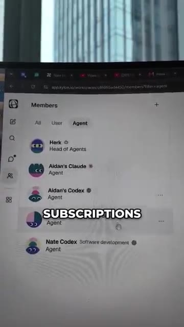
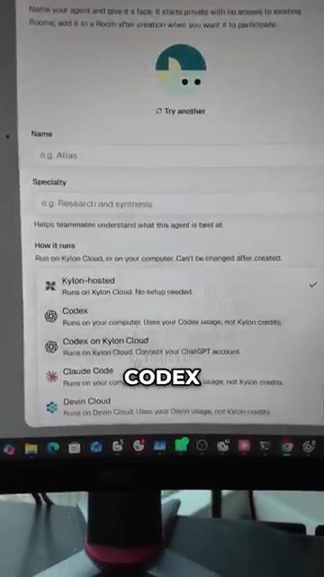
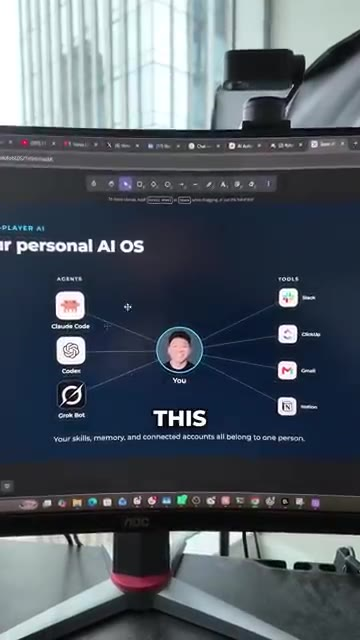
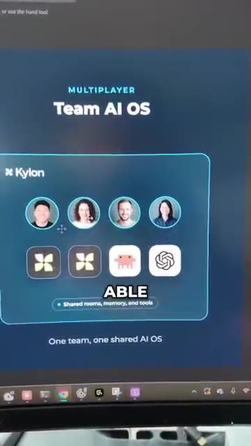
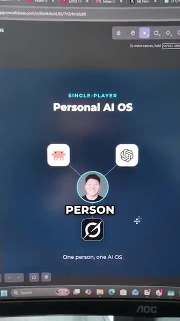

# 🎬 AI Agents Just Became Multiplayer. Here's How to Build Them.

> **Chaîne** : [Nate Herk | AI Automation](https://www.youtube.com/@nateherk/featured)  
> **Lien YouTube** : [https://www.youtube.com/watch?v=saxdE-U_YS8](https://www.youtube.com/watch?v=saxdE-U_YS8)  
> **Date de publication** : 20261015  
> **Durée** : 00:01:08  
> **Identifiant vidéo** : `saxdE-U_YS8`  
> **Transcription & Analyse** : `whisper-v3-large-turbo+gemini-3.5-flash-lite`  

---

## 📌 Synthèse Exécutive & Outils

### 💡 Résumé

La vidéo de Nate Herk marque un tournant paradigmatique dans l'ingénierie des agents conversationnels, en faisant passer l'intelligence artificielle d'un usage strictement solitaire et personnel à un environnement collaboratif et « multijoueur ». À travers une interface inspirée de Slack, la démonstration met en scène un espace de travail unifié où cohabitent en temps réel des humains (Nate, Aiden, Cody) et des agents IA hautement personnalisés. Cette configuration permet non seulement une co-présence fluide, mais aussi une véritable synergie opérationnelle où les collaborateurs en chair et en os et les entités artificielles interagissent, se coordonnent et pilotent des projets communs.

Sur le plan technique, la plateforme présentée révolutionne la gestion des abonnements et l'hébergement des intelligences. Plutôt que de reposer exclusivement sur une facturation à l'utilisation via des API opaques et coûteuses, le système permet d'exploiter directement les abonnements existants des utilisateurs — qu'il s'agisse de Claude Code, de Codex ou d'infrastructures hébergées sur Kylon. Chaque agent peut ainsi être configuré dans ses moindres détails (comportement, rôles cognitifs, abonnements rattachés) et injecté dans des « salles » thématisées où se croisent humains et IA.

Enfin, ces espaces de travail ne se limitent pas à de simples salons de discussion : ils intègrent nativement des applications dynamiques, comme des tableaux de bord de suivi en temps réel, ainsi que des automatisations contextuelles. La vidéo illustre parfaitement ce potentiel avec l'exemple d'un agent agissant comme chef de projet virtuel, programmé pour s'exécuter quotidiennement afin de garantir la redevabilité (*accountability*) de l'équipe. C'est l'avènement d'une architecture où les systèmes d'exploitation d'IA ne sont plus centrés sur un individu, mais sculptés pour dynamiser l'intelligence collective d'une organisation entière.

### 🛠️ Outils, Modèles & Logiciels Présentés

* **Claude Code** : Environnement de développement et assistant de pointe d'Anthropic, utilisé ici à la fois comme agent conversationnel et comme moteur logiciel connecté aux abonnements des utilisateurs.
* **Codex** : Modèle et plateforme d'ingénierie logicielle exploitable pour l'hébergement et l'exécution d'agents intelligents au sein des espaces collaboratifs.
* **Kylon** : Infrastructure d'hébergement cloud et de gestion de salles, servant de socle pour déployer et interconnecter les différents agents et humains.
* **GrokBot (concept)** : Référence d'architecture conversationnelle, ici surpassée par un modèle véritablement multijoueur intégrant coéquipiers humains et agents.
* **Interface type Slack** : Espace de communication unifié structuré en « salles » (*rooms*) étanches ou interconnectées, facilitant la co-création et le suivi de projets.

### 🔑 Points Clés & Enseignements Stratégiques

* **Transition du mono-utilisateur au multijoueur** : Le paradigme des agents IA quitte l'ère de l'assistant personnel isolé pour intégrer des environnements partagés où humains et machines travaillent en symbiose.
* **Mutualisation des abonnements existants** : L'architecture présentée permet d'utiliser directement les abonnements pro (Claude Code, Codex) plutôt que de multiplier les coûts par une facturation à l'appel API brut.
* **Architecture modulaire par « Salles »** : La division de l'espace de travail en salles virtuelles permet de cloisonner les contextes tout en autorisant les interactions croisées entre agents et humains spécifiques.
* **Personnalisation fine des comportements** : Chaque agent peut se voir attribuer des rôles cognitifs, des modes de pensée et des outils distincts, adaptant son profil aux besoins précis du projet.
* **Intégration d'applications natives** : Les salles ne sont pas de simples chats textuels ; elles embarquent des outils logiciels fonctionnels, à l'instar de tableaux de bord de suivi en temps réel.
* **Automatisation proactive des processus** : Des agents programmés (comme le chef de projet virtuel de la démo) s'exécutent de manière autonome à intervalles réguliers pour maintenir l'équipe alignée et responsable.
* **Optimisation de la redevabilité d'équipe (*Accountability*)** : L'IA n'est plus seulement un outil de productivité isolée, mais un garant actif du suivi des tâches et du respect des deadlines collectives.
* **Convergence de l'humain et de la machine** : La frontière entre la contribution humaine et l'intervention de l'agent s'estompe, créant un flux de travail fluide et continu au sein d'une même interface.
* **Scalabilité organisationnelle** : Cette approche permet d'étendre la puissance des agents logiciels à l'ensemble d'une structure, transformant un outil individuel en un véritable système d'exploitation d'équipe.
* **Stratégie d'adoption incitative** : L'écosystème met en avant des mécaniques d'engagement communautaire (tests facilités via des crédits initiaux) pour accélérer l'expérimentation des architectures multi-agents.

---

## ⏱️ Chronologie & Transcription Complète Audio & Visuelle (Mot pour Mot)

### ⏱️ `[00:00:00 - 00:00:18]` | Segment #01

**🔊 Audio (Transcription Intégrale Mot pour Mot en Français) :**
> Donc je parle en ce moment même à CloudCode sur mon téléphone, mais ce n'est pas juste moi parce que vous pouvez voir qu'il y a aussi Cody et qu'il y a aussi Aiden. C'est essentiellement une interface de style Slack qui est un constructeur d'agents, et voici tout le monde qui est ici. C'est ma vraie équipe, donc moi, Aiden et Cody, mais aussi les agents. Donc vous pouvez voir que nous avons les abonnements CloudCode et Codex d'Aiden ainsi que mes abonnements CloudCode et Codex, et nous pouvons personnaliser ce qu'ils font et comment ils pensent.

**👁️ Analyse Visuelle d'Écran (gemini-3.5-flash-lite) :**
**Interface & Outils** : Application web Kylon (app.kylon.io) et application mobile de messagerie.

**Contenu textuel & Code** : Noms des membres humains (Nate Herk, Aidan Stanik, Kodi Zene) et listes d'agents IA (Aidan's Claude, Nate Codex).

**Action / Démonstration** : Navigation à travers l'interface de gestion d'équipe et d'agents sur Kylon.

*⏱️ 00:00:05 — Un téléphone affichant une application de messagerie de type Slack avec des fils de discussion textuels.*

*⏱️ 00:00:09 — Un écran d'ordinateur affichant la liste des membres humains d'une équipe sur l'application Kylon.*

*⏱️ 00:00:14 — Un écran d'ordinateur montrant la liste des agents IA configurés dans l'espace de travail Kylon.*

---

### ⏱️ `[00:00:19 - 00:00:40]` | Segment #02

**🔊 Audio (Transcription Intégrale Mot pour Mot en Français) :**
> C'est en gros GrokBot, mais si vous pouviez inviter vos coéquipiers, vos vrais coéquipiers humains, dans GrokBot. Parce qu'ici, si je voulais créer un nouvel agent, tout ce que j'aurais à faire, c'est de cliquer sur ce bouton, et je peux leur donner un nom, choisir où ils sont hébergés, ce qui peut être sur Kylon, sur Codex, ou Claude Code. Ce qui signifie que vous pouvez réellement utiliser vos abonnements ici plutôt que de payer une facturation par API. Nous avons donc en gros ces différentes salles. Et dans chaque salle, nous pouvons avoir un nombre différent d'agents et d'humains qui vivent dans cette salle et qui peuvent communiquer entre eux.

**👁️ Analyse Visuelle d'Écran (gemini-3.5-flash-lite) :**
**Interface & Outils** : Application web Kylon (app.kylon.io)

**Contenu textuel & Code** : Options de menu (New room, New agent, Invite member) et paramètres de configuration d'un agent IA.
[DESC_IMAGE_3] Navigation dans les différents salons et espaces de travail collaboratifs.

**Action / Démonstration** : Configuration et création d'un nouvel agent IA avec choix du mode d'hébergement.

*⏱️ 00:00:24 — Menu déroulant affichant les options pour créer un salon, un agent ou inviter des membres sur l'interface Kylon.*

*⏱️ 00:00:30 — Formulaire de création d'un agent avec la sélection du lieu d'hébergement (Kylon-hosted, Codex, Claude Code, etc.).*

*⏱️ 00:00:35 — Liste des salons de discussion (chats) et canaux de l'équipe sur l'application Kylon.*

---

### ⏱️ `[00:00:41 - 00:00:59]` | Segment #03

**🔊 Audio (Transcription Intégrale Mot pour Mot en Français) :**
> Ce qui signifie que dans cette pièce, Aiden et Cody peuvent réellement parler à mon abonnement Claude Code. Et à l'intérieur de chaque pièce, vous pouvez créer des applications et des automatisations. Donc, dans cette pièce, nous avons une application pour un véritable tableau de bord de suivi. Et nous avons une automatisation qui se déclenche chaque jour, qui est un chef de projet qui nous aide à maintenir notre responsabilité. L'idée générale est que nous passons de tout cet univers des systèmes d'exploitation d'IA personnels à un environnement où nous en construisons un pour toute l'équipe.

**👁️ Analyse Visuelle d'Écran (gemini-3.5-flash-lite) :**
**Interface & Outils** : Navigateur web affichant un tableau de bord d'OS IA personnel.

**Contenu textuel & Code** : Schéma relationnel montrant les agents IA (Claude Code, Codex, Grok Bot) et les outils connectés (Slack, ClickUp, Gmail, Notion).

**Action / Démonstration** : Présentation visuelle de l'architecture d'un système d'exploitation IA personnel connectant divers agents et outils.

*⏱️ 00:00:54 — Vue large d'un écran d'ordinateur incurvé montrant un tableau de bord d'intelligence artificielle avec des agents (Claude Code, Codex, Grok Bot) connectés à des outils (Slack, ClickUp, Gmail, Notion) autour d'un profil utilisateur.*

---

### ⏱️ `[00:00:59 - 00:01:08]` | Segment #04

**🔊 Audio (Transcription Intégrale Mot pour Mot en Français) :**
> Donc maintenant ça ressemble à ça, où nous avons des humains et des agents et ils sont tous capables de collaborer plutôt que de simplement le construire autour d'une seule personne. Donc si vous voulez essayer l'outil et obtenir 50 dollars gratuits pour faire des tests, commentez simplement Kylon et je vous enverrai le lien.

**👁️ Analyse Visuelle d'Écran (gemini-3.5-flash-lite) :**
**Interface & Outils** : Application web Kylon / Excalidraw

**Contenu textuel & Code** : Schémas conceptuels comparant 'Personal AI OS' (single-player) et 'Team AI OS' (multiplayer) avec des icônes d'utilisateurs et d'outils d'IA.

**Action / Démonstration** : Présentation visuelle et comparaison des architectures d'agents IA en mode individuel vs collaboratif.

*⏱️ 00:01:02 — Interface graphique montrant le mode 'Multiplayer Team AI OS' avec plusieurs utilisateurs et agents interconnectés sur Kylon.*

*⏱️ 00:01:04 — Interface graphique montrant le mode 'Single-Player Personal AI OS' avec une seule personne connectée aux outils d'IA.*

---

