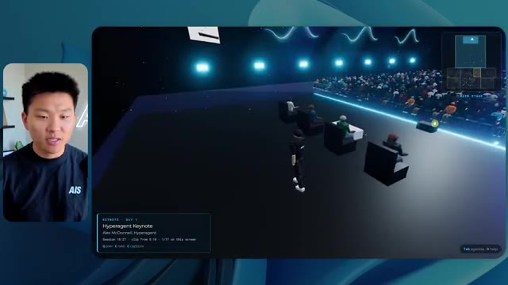
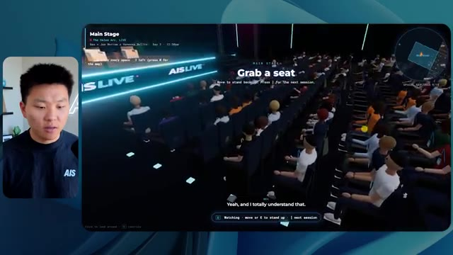
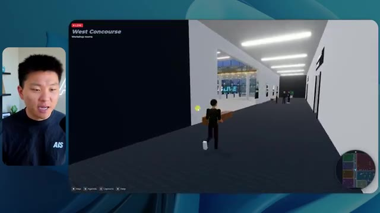

# 🎬 Why I let my Grok Bot doomscroll on TikTok

> **Chaîne** : [Nate Herk | AI Automation](https://www.youtube.com/@nateherk/featured)  
> **Lien YouTube** : [https://www.youtube.com/watch?v=8kH03pGq4V0](https://www.youtube.com/watch?v=8kH03pGq4V0)  
> **Date de publication** : 20261016  
> **Durée** : 00:00:52  
> **Identifiant vidéo** : `8kH03pGq4V0`  
> **Transcription & Analyse** : `whisper-v3-large-turbo+gemini-3.5-flash-lite`  

---

## 📌 Synthèse Exécutive & Outils

### 💡 Résumé

Dans cette vidéo issue de la chaîne de Nate Herk dédiée à l'ingénierie IA et à l'automatisation, l'analyste explore le comportement du modèle de pointe **Opus 5.5** d'Anthropic en le soumettant à un test rigoureux de complexité : générer un monde virtuel 3D interactif et explorable à la troisième personne d'une conférence technologique. Le prompt intègre un dossier massif de 105 gigaoctets de données vidéo (provenant d'AIS Live via Frame.io), exigeant non seulement de la structure et de l'esthétique, mais aussi du design, de la physique et une synchronisation en direct avec l'agenda réel de l'événement. 

Pour mesurer l'impact de l'une des fonctionnalités les plus puissantes des agents IA modernes, Nate a exécuté exactement le même prompt à travers différents niveaux de réglage de l'effort (**Effort Level**), du niveau bas jusqu'aux modes avancés, en passant par le niveau moyen. Les démonstrations montrent la transition flagrante d'un monde 3D rudimentaire, instable, peu personnalisé et truffé de bugs visuels (effort bas : 16 minutes, 3,91 $, 0 question posée) à une simulation nettement plus fidèle, fluide et riche en intégrations vidéo fonctionnelles et en PNJ interactifs (effort moyen : 1h13, 12,44 $, 490k jetons). 

Cette expérimentation met en lumière la subtilité du compromis entre coût, temps d'exécution, consommation de jetons et qualité finale du code généré. Elle démontre également la pertinence des recommandations d'Anthropic qui préconisent de démarrer les tâches complexes au niveau d'effort moyen pour ajuster ensuite selon les besoins, tout en soulignant le défi persistant du déploiement final et de l'hébergement rapide des applications autonomes créées par les agents.

### 🛠️ Outils, Modèles & Logiciels Présentés

* **Opus 5.5** : Le modèle de langage de pointe d'Anthropic, salué pour son intelligence, son coût abordable et sa polyvalence, utilisé ici pour piloter la génération d'un monde 3D complet à partir d'un prompt unique.
* **Effort Level** (Niveaux d'effort) : Le paramètre de contrôle d'Anthropic (bas, moyen, élevé, extra, max, code ultra) permettant d'ajuster la profondeur de calcul, le raisonnement et la persistance des agents IA face à une tâche complexe.
* **Claude Code** : L'outil de développement et d'ingénierie logicielle d'Anthropic intégré aux environnements de code, mentionné comme l'une des interfaces privilégiées pour le codage agentique.
* **Frame.io** : La plateforme cloud de gestion de médias utilisée pour stocker et structurer les 105 gigaoctets d'enregistrements vidéo de l'événement virtuel AIS Live.
* **Herc 2** : Le système d'exploitation IA propriétaire de Nate Herk, servant de socle contextuel et d'écosystème d'outils interconnectés pour les agents.
* **Hostinger & Connecteur Hostinger** : L'outil de cloud/hébergement et son extension gratuite pour éditeurs de code, présentés comme la solution idéale pour combler le fossé entre le développement local par IA et le déploiement en ligne instantané.
* **VS Code / Cursor** : Les environnements de développement de référence intégrés dans les flux de travail d'ingénierie logicielle assistée par IA.

### 🔑 Points Clés & Enseignements Stratégiques

* **Impact direct du niveau d'effort sur la qualité spatiale et graphique** : Le passage du niveau d'effort bas au niveau moyen modifie radicalement le rendu de l'application 3D, transformant un prototype instable aux textures et couleurs génériques en un espace cohérent respectant scrupuleusement la charte graphique de la marque.
* **Gestion des hallucinations visuelles et de la physique** : Les agents IA soumis à des niveaux d'effort faibles tendent à générer des bugs d'affichage importants (disparition de personnages, images fixes non lues, éléments lumineux disproportionnés), tandis qu'un effort accru stabilise les scripts de lecture vidéo et les interactions des PNJ.
* **Corrélation linéaire entre temps d'exécution et complexité agentique** : La génération au niveau d'effort bas a pris 16 minutes et 43 secondes pour 191 000 jetons, alors que le niveau moyen a nécessité 1 heure et 13 minutes pour 490 000 jetons, illustrant l'intensité computationnelle requise pour des boucles de vérification plus denses.
* **Autonomie totale des agents (Zéro intervention humaine)** : Sur l'ensemble des exécutions comparées, l'agent n'a posé aucune question de clarification à l'utilisateur, assumant l'intégralité de la conception, de la structuration des données vidéo de 105 Go et de l'architecture du monde 3D de manière autonome.
* **Maîtrise des coûts par rapport à la valeur générée** : Malgré des coûts API théoriques variant de 3,91 $ (bas) à 12,44 $ (moyen), le rapport investissement/résultat reste extrêmement rentable pour la création instantanée d'un prototype d'événement virtuel immersif et personnalisé.
* **Validation empirique des recommandations d'Anthropic** : L'expérimentation confirme la stratégie officielle préconisant d'initialiser les prompts complexes au niveau d'effort moyen, servant de point d'équilibre optimal avant d'envisager des ajustements à la hausse ou à la baisse.
* **Synchronisation des métadonnées et de l'information contextuelle** : L'agent a démontré une excellente capacité à extraire et exploiter l'agenda réel (jours 1 et 2, keynotes, ateliers) à partir des fichiers bruts pour alimenter dynamiquement la carte et l'interface du monde 3D.
* **Le goulet d'étranglement du déploiement post-génération** : L'expérimentation met en évidence un défi classique de l'ingénierie par agent : la transition fluide entre une application fonctionnelle finalisée localement sur la machine de l'utilisateur et sa mise en ligne rapide sur le web.
* **Intégration d'écosystèmes hétérogènes** : La capacité de l'agent à naviguer dans de larges volumes de données (105 Go sur Frame.io) et à les lier à un environnement interactif démontre la maturité des agents IA pour automatiser la post-production et la valorisation d'événements virtuels.

---

## ⏱️ Chronologie & Transcription Complète Audio & Visuelle (Mot pour Mot)

### ⏱️ `[00:00:00 - 00:00:20]` | Segment #01

**🔊 Audio (Transcription Intégrale Mot pour Mot en Français) :**
> Opus 5.5, Opus 5.5, Opus 5.5, Opus 5.5, Opus 5.5. Ce modèle est littéralement partout et pour de très bonnes raisons. Il est intelligent, il est bon marché, il a un goût extraordinaire, c'est un modèle d'IA incroyable. Mais avec chaque modèle d'IA, vous avez le choix de l'effort, que ce soit faible, moyen, élevé, extra, max ou code ultra.

**👁️ Analyse Visuelle d'Écran (gemini-3.5-flash-lite) :**
**Interface & Outils** : Navigateur web / Réseau social X (Twitter)

**Contenu textuel & Code** : Publication sur X avec texte sur l'expérimentation et une vidéo intégrée montrant un paysage tropical côtier.

**Action / Démonstration** : Affichage d'un exemple de contenu généré par IA issu des réseaux sociaux pour illustrer le sujet.

*⏱️ 00:00:05 — Capture d'écran d'un post sur le réseau social X montrant une vidéo de paysage tropical généré par IA et un texte sur l'impact de l'IA sur les créateurs.*

---

### ⏱️ `[00:00:20 - 00:00:38]` | Segment #02

**🔊 Audio (Transcription Intégrale Mot pour Mot en Français) :**
> Donc dans cette vidéo, j'ai donné à Opus 5.5 exactement le même prompt et je l'ai exécuté à chaque niveau d'effort et nous allons comparer les résultats. Nous allons examiner la qualité de tous les différents résultats réels, mais nous allons aussi examiner combien de temps chacun d'eux a pris, combien cela nous a coûté si c'était une facturation par API, le nombre total de jetons, combien de vérifications ils ont exécutées, et combien de questions ils m'ont réellement posées tout au long du processus.

**👁️ Analyse Visuelle d'Écran (gemini-3.5-flash-lite) :**
**Interface & Outils** : Application web de tableau blanc / mindmap (type Miro ou similaire).

**Contenu textuel & Code** : Tableau comparatif structuré avec les colonnes Low, Medium, High, Extra, Max, Ultracode et les lignes Run time, API cost, Total tokens, Checks, Questions asked.

**Action / Démonstration** : Présentation du tableau comparatif des différents niveaux d'effort de l'outil Opus 5.5.

*⏱️ 00:00:29 — Tableau comparatif sombre affichant différents niveaux d'effort (Low, Medium, High, Extra, Max, Ultracode) et des métriques telles que Run time, API cost, Total tokens, Checks, et Questions asked.*

---

### ⏱️ `[00:00:39 - 00:00:58]` | Segment #03

**🔊 Audio (Transcription Intégrale Mot pour Mot en Français) :**
> Et les résultats que nous avons obtenus ne sont pas du tout ce à quoi je m'attends, donc j'ai hâte de partager ça avec vous les gars. Ne perdons pas de temps et allons directement à celui-ci. D'accord, alors plongeons directement dans celui-ci. Je veux commencer juste en vous montrant le prompt réel que nous avons utilisé que nous avons donné à chacun de ces différents agents. Je vais aller dans les fichiers ici, et nous allons ouvrir ce fichier markdown de prompt, et je vais vous montrer ce que nous avons obtenu. Donc voici le slash objectif que j'ai alimenté.

**👁️ Analyse Visuelle d'Écran (gemini-3.5-flash-lite) :**
**Interface & Outils** : Interface utilisateur d'un outil de développement / éditeur IA avec panneau de chat et gestion de worktrees.

**Contenu textuel & Code** : Texte du prompt dans la zone de discussion : "Hi Nate. This worktree has the effort-test task queued in PROMPT.md : build a walkable third-person 3D world of the AIS Live conference..."

**Action / Démonstration** : Présentation du prompt initial et de l'environnement de travail par le créateur.

*⏱️ 00:00:48 — Interface de l'outil de développement avec le prompt affiché dans la fenêtre de chat et la vidéo du présentateur en vignette à gauche.*

---

### ⏱️ `[00:00:58 - 00:01:34]` | Segment #04

**🔊 Audio (Transcription Intégrale Mot pour Mot en Français) :**
> J'ai dit, tu dois me créer un monde en 3D qui est une conférence tech réaliste dans laquelle je peux me promener en vue à la troisième personne. Tu vas regarder ce dossier, qui contient mes éléments d'enregistrement d'événements provenant d'AIS Live. Et ce dossier est un dossier Frame.io de 105 gigaoctets d'enregistrements vidéo. C'était un événement complètement virtuel. Tout a été enregistré et tous les enregistrements sont ici même. J'ai dit, ton objectif est de prendre cet événement et de le transformer en un monde 3D explorable qui me donne l'impression d'être réellement allé à une vraie conférence en personne avec différentes salles, différentes pistes, différentes scènes, bla, bla, bla. N'hésite pas à utiliser key.ai si tu as besoin de générer des images ou des vidéos. Et tu peux aussi utiliser tout le reste à l'intérieur de mon projet Herc 2, qui est comme mon système d'exploitation IA. J'ai dit,

**👁️ Analyse Visuelle d'Écran (gemini-3.5-flash-lite) :**
**Interface & Outils** : Éditeur de code (type VS Code / Cursor) et interface web Frame.io

**Contenu textuel & Code** : Fichier PROMPT.md contenant des instructions textuelles et un lien Frame.io (https://f.io/sPdlo-Si).

**Action / Démonstration** : Présentation du prompt de configuration et du dossier de ressources multimédias pour le projet 3D.

*⏱️ 00:01:07 — Un éditeur de texte affichant un fichier Markdown nommé PROMPT.md avec les instructions pour créer un monde 3D.*

*⏱️ 00:01:16 — Une interface web Frame.io montrant un dossier d'une taille de 105.69 Go contenant les enregistrements d'événements AIS Live.*

*⏱️ 00:01:25 — Vue rapprochée de l'éditeur affichant le texte complet du prompt détaillé pour la création de la conférence tech 3D.*

---

### ⏱️ `[00:01:34 - 00:02:08]` | Segment #05

**🔊 Audio (Transcription Intégrale Mot pour Mot en Français) :**
> tu seras jugé sur la créativité, le design, la physique et le ressenti général lors de mon exploration du monde en 3D que tu as construit. Et c'était fondamentalement la fin des instructions. Donc, comme vous pouvez le voir sur le côté gauche, j'ai exécuté ceci à tous les différents niveaux d'effort. Commençons par le niveau bas et remontons jusqu'à ultra code. Très bien. Nous avons donc ici le résultat du niveau bas. Ouvrons ceci et jetons un coup d'œil. Nous avons donc AIS live, le sommet des services IA enfin en personne, et nous avons pu cliquer un peu partout. Tout d'abord, cela ne fait pas très personnalisé. Genre, ce n'est pas le logo d'IS Live. Ce n'est même pas nos couleurs. Donc je n'aimes pas trop ça, mais entrons ici. D'accord. C'est bien trop lumineux. Euh, nous avons une carte en haut à droite. Nous avons une ville par ici. Je n'arrive pas à deviner quelle ville c'est

**👁️ Analyse Visuelle d'Écran (gemini-3.5-flash-lite) :**
**Interface & Outils** : Application de développement / Interface agent IA

**Contenu textuel & Code** : "Hi Nate. This worktree has the effort-test task queued in PROMPT.md : build a walkable third-person 3D world..."

**Action / Démonstration** : Navigation et sélection des différents niveaux d'effort dans le panneau latéral de l'application.

*⏱️ 00:01:42 — Interface d'une application de développement avec un panneau latéral affichant les différents niveaux d'effort (Hello, Extra, High, Max, Ultracode, Medium, Low) et la zone de discussion principale à droite.*

---

### ⏱️ `[00:02:08 - 00:02:40]` | Segment #06

**🔊 Audio (Transcription Intégrale Mot pour Mot en Français) :**
> C'est. D'accord. C'est Chicago, ce qui est plutôt cool parce que tu sais, j'habite à Chicago, mais bref, en haut à droite, on peut voir une carte. Nous avons un hall d'accueil. Nous avons un hall d'exposition. Nous avons un salon VIP sur la scène principale. La carte montre également où se trouve chaque autre personne et cela se synchronise en direct. Donc on peut voir l'inscription. On peut voir le premier jour, la keynote de l'hyper agent, le débriefing en direct. Cool. Donc ça connaît réellement l'agenda et puis il y a le deuxième jour. Donc il a trouvé ça, c'est bien. Nous avons ces petites boules ici que je peux espérer botter. D'accord. Le visage, oh, regarde ça. Si je vais par ici, tous les gens disparaissent tout simplement. Très mauvais. Très mauvais. D'accord. Alors voyons voir. Est-ce que je peux sprinter ? D'accord.

**👁️ Analyse Visuelle d'Écran (gemini-3.5-flash-lite) :**
**Interface & Outils** : Environnement virtuel 3D interactif (plateforme d'événement en ligne).

**Contenu textuel & Code** : Menus d'événements, programmes de conférences et indicateurs de navigation en temps réel.
[DESC_IMAGE_3] Navigation et exploration de l'espace virtuel de la conférence par un avatar.

**Action / Démonstration** : Explications face caméra et démonstration conceptuelle.

*⏱️ 00:02:16 — Vue d'un espace virtuel 3D de type métavers montrant la zone de retrait des badges avec une mini-carte en haut à droite.*

*⏱️ 00:02:24 — Vue du hall d'accueil virtuel avec un panneau affichant le programme du premier jour et la mini-carte de navigation.*

*⏱️ 00:02:32 — Vue de l'espace d'exposition virtuel avec des avatars et des animations lumineuses interactives.*

---

### ⏱️ `[00:02:40 - 00:03:04]` | Segment #07

**🔊 Audio (Transcription Intégrale Mot pour Mot en Français) :**
> Je peux avancer un peu plus vite. Je vais d'abord aller par ici. Il y a des produits dérivés, euh, un sweat glido certifié AIS plus. D'accord. Donc il y a les vrais stands qu'on avait lors de l'événement virtuel. On avait des stands. Donc c'est plutôt cool. Un petit endroit pour prendre des photos. Salle C. En ce moment, nous avons Tangy Frederick qui anime un atelier. D'accord. Mais ce n'est pas une vidéo. Comme vous pouvez le voir, c'est juste une image. Elle ne bouge pas. C'est donc juste une image. Ces gens sont en train de disparaître. Ce doivent être des fantômes. Allons par ici vers la salle A.

**👁️ Analyse Visuelle d'Écran (gemini-3.5-flash-lite) :**
**Interface & Outils** : Environnement virtuel 3D interactif (type Roblox ou espace virtuel personnalisé).

**Contenu textuel & Code** : Textes informatifs et tutoriels affichés sur les écrans virtuels des stands (ex: "Step 1: Go to Settings").

**Action / Démonstration** : Exploration et navigation dans l'espace virtuel de l'événement par le présentateur.

*⏱️ 00:02:46 — Vue d'un monde virtuel style métavers représentant un hall d'exposition avec un avatar et des stands sponsorisés (Glaido).*

*⏱️ 00:02:52 — Navigation dans une salle d'atelier virtuelle ("Workshop Room C - Enterprise track") avec des tables éclairées et des écrans d'information.*

*⏱️ 00:02:58 — Gros plan sur une salle d'atelier virtuelle montrant un grand écran affichant des instructions sur les clés API et intégrations.*

---

### ⏱️ `[00:03:04 - 00:03:30]` | Segment #08

**🔊 Audio (Transcription Intégrale Mot pour Mot en Français) :**
> Nous avons Liberty White. D'accord. Très cool. Vos 30 premiers jours en automatisation. Encore une fois, ce n'est qu'une image fixe et les gens ont des bugs d'affichage. Donc ce n'est pas très bien ici. Je vais aller sur la scène principale et voir ce que nous avons. D'accord, cool. Donc nous avons une scène d'apparence principale. Les gens ont de gros bugs d'affichage. Vraiment mauvais. Ce n'est vraiment pas terrible. Notre vidéo est en train de bouger. Genre, j'ai vu mon visage ici et j'ai vu celui de Devin, mais maintenant ils ont disparu. Donc je ne sais pas ce qui s'est passé. D'accord. On dirait que c'est plutôt un diaporama. Rien n'est vraiment lu pour l'instant. Quoi qu'il en soit, entrons ici.

**👁️ Analyse Visuelle d'Écran (gemini-3.5-flash-lite) :**
**Interface & Outils** : Application virtuelle interactive 3D type salon virtuel / monde virtuel (metaverse)

**Contenu textuel & Code** : Interface utilisateur virtuelle affichant 'Main Stage', 'Hyperagent Workshop: How to Build an Always-On Fleet of Agents' et 'AIS LIVE AI Services Summit'.

**Action / Démonstration** : Le présentateur navigue dans l'espace virtuel 3D pour rejoindre la scène principale après avoir constaté un problème d'affichage.

*⏱️ 00:03:17 — Vue de l'avatar naviguant dans l'auditorium rempli d'avatars virtuels (Main Stage - Hyperagent Workshop).*

*⏱️ 00:03:24 — Vue large de la scène principale 'AIS LIVE - AI Services Summit' avec l'avatar qui se déplace dans l'auditorium.*

---

### ⏱️ `[00:03:30 - 00:03:58]` | Segment #09

**🔊 Audio (Transcription Intégrale Mot pour Mot en Français) :**
> Nous avons d'autres stands. Nous avons hyper agent. Nous avons Claude Code. Nous avons plus de goodies. La salle B, c'est Dave Ebelor. Je suppose que c'est exactement la même chose. Nous avons du café. Et ensuite, je suppose que le salon VIP est réservé à l'accès VIP uniquement. C'est plutôt cool, mais il n'y a vraiment rien qui se passe ici. Cet écran est beaucoup trop lumineux. D'accord. Donc je pense que vous comprenez l'ambiance que nous dégageons ici avec Opus 5.5 en effort faible. Et c'est là que les choses deviennent intéressantes. Combien de temps pensez-vous que cela a duré ? Combien de temps ? Celui-ci a duré 16 minutes et 43 secondes. Combien pensez-vous que cela a coûté ?

**👁️ Analyse Visuelle d'Écran (gemini-3.5-flash-lite) :**
**Interface & Outils** : Canevas numérique, application web de tableau comparatif.

**Contenu textuel & Code** : Tableau comparatif avec des colonnes Low, Medium, High, Extra, Max, Ultracode et des lignes Run time, API cost, Total tokens, Checks, Questions asked.
[HONEYPOT_ACTION] Présentation du tableau comparatif des différents niveaux d'effort et coûts associés.

**Action / Démonstration** : Explications face caméra et démonstration conceptuelle.

*⏱️ 00:03:51 — Tableau comparatif sur canevas numérique affichant les niveaux d'effort (Low à Ultracode) et métriques (Run time, API cost, Total tokens).*

---

### ⏱️ `[00:03:58 - 00:04:26]` | Segment #10

**🔊 Audio (Transcription Intégrale Mot pour Mot en Français) :**
> 3,91 dollars si c'était une facturation par API. J'utilise évidemment mon abonnement ici, mais nous allons juste calculer cela en facturation API. Le nombre total de jetons était de 191 000. Il a effectué 22 vérifications. Donc pour la vérification, 22 fois il a ouvert le navigateur et a exécuté différentes sortes de vérifications. Donc 22 catégories de vérifications. Et combien de questions m'a-t-il posées ? Il m'a posé un total de zéro question tout au long de cette invite de tâche principale. D'accord. Alors, ouvrons l'effort moyen et voyons ce que nous avons. D'accord, c'est parti. Effort moyen. Nous avons Nate Herc. Nous avons mon badge. C'est aux couleurs de la marque AI's Life.

**👁️ Analyse Visuelle d'Écran (gemini-3.5-flash-lite) :**
**Interface & Outils** : Tableau blanc ou application de prise de notes/diagramme (style Excalidraw ou similaire).

**Contenu textuel & Code** : Tableau avec les lignes : Run time (16m 43s), API cost ($3.91), Total tokens (191.3K), Checks, Questions asked, et les colonnes : Low, Medium, High.

**Action / Démonstration** : Le présentateur explique les métriques de coûts et d'utilisation des jetons affichées à l'écran.

*⏱️ 00:04:05 — Un tableau comparatif des performances et des coûts selon différents niveaux d'effort, affichant notamment un coût API de 3,91 $ et 191,3K jetons.*

---

### ⏱️ `[00:04:26 - 00:04:46]` | Segment #11

**🔊 Audio (Transcription Intégrale Mot pour Mot en Français) :**
> Alors ça a déjà l'air un peu mieux. Ça ressemble à nos palettes de couleurs qui ont utilisé nos directives de marque. Premier jour de construction, deuxième jour de gain, VIP. Cool. D'accord. Je vais entrer dans le lieu. D'accord. Waouh. Une ambiance similaire, en somme. C'est en arrière-plan. Ça ne ressemble pas à Chicago, n'est-ce pas ? Non, ça ressemble à, honnêtement, ça ressemble à une ville imaginaire. Quoi qu'il en soit, c'est drôle qu'ils aient décidé de faire ça. Voyons si je peux me déplacer un peu plus vite. Oh, waouh.

**👁️ Analyse Visuelle d'Écran (gemini-3.5-flash-lite) :**
**Interface & Outils** : Application web interactive / Plateforme virtuelle 3D 'AIS Live'

**Contenu textuel & Code** : Page d'accueil de l'événement virtuel avec badge d'accès, instructions de navigation (WASD, Shift, Space), et interface graphique en 3D représentant un espace de réunion virtuel.

**Action / Démonstration** : Navigation et entrée dans le monde virtuel de la plateforme 'AIS Live' pour assister à l'événement.

*⏱️ 00:04:31 — Interface web de l'application 'AIS Live' avec un badge nominatif au nom de Nate Herk et des options pour entrer dans le lieu virtuel.*

*⏱️ 00:04:41 — Vue à la première ou troisième personne à l'intérieur du monde virtuel 3D avec des avatars d'utilisateurs et une vue sur une ville nocturne.*

---

### ⏱️ `[00:04:46 - 00:05:21]` | Segment #12

**🔊 Audio (Transcription Intégrale Mot pour Mot en Français) :**
> Les gens interagissent avec moi. Regardez. Si je m'approche de ce type, il vient de lever le bras. Bon, maintenant il ne veut plus du tout avoir affaire à moi. Mais tous ces petits robots ici doivent prendre des décisions. Je ne sais pas s'ils utilisent Jev. C'est sûr que non. Je ne le lui ai pas dit. En fait, ma clé Jev est à l'arrière. Je ne sais pas. Peut-être qu'il l'a utilisée. Quoi qu'il en soit, nous pouvons voir ici que nous avons la salle d'atelier C, le laboratoire des agents. Sympa. Donc celui-ci est en fait en train d'être exécuté. Vous pouvez voir qu'il s'agit d'une vraie vidéo lue par Tangy. Tout le monde ici est en train de travailler sur un ordinateur portable. Ils ne buguent pas. C'est plutôt cool. De plus, mon badge est sur ma poitrine, ce qui est plutôt cool. Je peux venir par ici. Nous avons une carte en haut à droite, comme vous pouvez le voir, mais je peux venir par ici. Nous avons un

**👁️ Analyse Visuelle d'Écran (gemini-3.5-flash-lite) :**
**Interface & Outils** : Application de monde virtuel / métavers en 3D

**Contenu textuel & Code** : Environnement virtuel en 3D avec des avatars interactifs et une mini-carte en haut à droite

**Action / Démonstration** : Navigation et exploration d'un environnement virtuel peuplé d'avatars gérés par des agents ou des utilisateurs

---

### ⏱️ `[00:05:21 - 00:05:47]` | Segment #13

**🔊 Audio (Transcription Intégrale Mot pour Mot en Français) :**
> hall d'exposition. C'est là que nous avons le stand Glido. Et ça diffuse en ce moment. Oui, ça diffuse la vidéo de nous parlant de Glido. Ça diffuse la vidéo d'Ed et moi parlant de notre programme de certification. Nous avons le logo AIS Plus juste ici, qui est un peu mal placé. Ce sont les diapositives des conférenciers et les points clés. Donc wow, ce sont toutes les ressources que nous avons distribuées après l'événement. Elles sont toutes affichées là aussi. Nous pouvons voir que nous avons un projecteur de communauté. Donc c'est Aiden qui parle de son contrat qu'il a décroché et c'est diffusé en direct. Ces gens regardent.

**👁️ Analyse Visuelle d'Écran (gemini-3.5-flash-lite) :**
**Interface & Outils** : Environnement virtuel 3D / Navigateur web de salon virtuel

**Contenu textuel & Code** : Affiches de stands virtuels, diapositives de présentation, avatars d'utilisateurs et mini-carte de navigation

**Action / Démonstration** : Navigation et visite guidée à l'intérieur d'un espace d'exposition virtuel en 3D

---

### ⏱️ `[00:05:47 - 00:06:21]` | Segment #14

**🔊 Audio (Transcription Intégrale Mot pour Mot en Français) :**
> Ils sont plutôt engagés. On a un hyper agent. C'était, c'est ce que je voulais dire. Si vous avez vu ces gens lever les bras en disant salut, c'était plutôt drôle. Regardez, regardez, le voilà qui recommence. Bref. D'accord. Où est-ce que je suis maintenant ? Maintenant, je suis dans le hall principal. On a un bar à café. On a un grand logo, qui est le vrai logo. C'est trop lumineux, mais on a le logo. On peut voir si on peut entrer ici dans la piste des fondations. On a Sabrina Romanov et Liberty White. Donc différentes formations juste là. On peut entrer dans cette salle. C'est la piste avancée. Alors qu'est-ce qui se passe ici. On a Dave Ebelar et Saman qui parlent de différentes choses là-dedans. Et maintenant, allons jeter un œil à la scène principale. Oh, attendez, il y a une vidéo de moi là-haut. Est-ce que c'est genre un VIP

**👁️ Analyse Visuelle d'Écran (gemini-3.5-flash-lite) :**
**Interface & Outils** : Application ou plateforme virtuelle 3D (metaverse / événement virtuel)

**Contenu textuel & Code** : Environnement virtuel 3D avec avatars, mini-carte en haut à droite, et texte d'indication 'Main Lobby'

**Action / Démonstration** : Navigation et déplacement d'un avatar dans l'espace virtuel 3D de l'événement

*⏱️ 00:05:55 — Vue principale montrant l'avatar du présentateur dans un espace virtuel 3D labellisé 'Main Lobby'.*

*⏱️ 00:06:04 — L'avatar se déplace dans le hall virtuel vers une salle de conférence ou une zone d'exposition.*

*⏱️ 00:06:12 — Vue montrant plusieurs avatars de participants interagissant dans l'environnement virtuel 3D.*

---

### ⏱️ `[00:06:21 - 00:06:50]` | Segment #15

**🔊 Audio (Transcription Intégrale Mot pour Mot en Français) :**
> section ? Ouais, on ira voir ça dans une minute. Mais bref, voici la scène principale. Ça a l'air vraiment, vraiment très bien. On a une grande scène. On a genre quatre personnes assises ici. On a les trois écrans d'Alex là-haut avec Hyper Agent. Est-ce que j'ai le droit de monter sur scène ? Oh, et il me laisse monter sur scène. D'accord. C'est plutôt sympa. Bon les gars, prenons un selfie. Laissez-moi mettre tout le monde en arrière-plan. Venez par ici. Bref, c'est plutôt, plutôt cool. Par contre, toutes les places ne sont pas occupées. Donc il faut qu'on travaille là-dessus. Mais bref, je vais y retourner en courant pour voir ce qu'était cette section VIP. D'accord. Salon VIP. J'ai l'impression que c'est comme un aéroport ou un truc comme ça.

**👁️ Analyse Visuelle d'Écran (gemini-3.5-flash-lite) :**
**Interface & Outils** : Application ou plateforme virtuelle 3D Hyper Agent Keynote.

**Contenu textuel & Code** : Interface utilisateur virtuelle affichant les détails de la session ('Hyperagent Keynote - Alex McDonnell') et une mini-carte en haut à droite.

**Action / Démonstration** : Navigation et déplacement d'un avatar dans un environnement virtuel 3D de conférence.

*⏱️ 00:06:28 — Vue générale d'une salle de conférence virtuelle (Hyper Agent Keynote) montrant un avatar se déplaçant dans l'allée centrale face à une grande scène avec des écrans de présentation.*

*⏱️ 00:06:36 — Vue de dos de l'avatar naviguant sur scène près de plusieurs chaises et participants assis, lors de la keynote virtuelle.*

*⏱️ 00:06:43 — Vue en plongée de l'avatar progressant dans l'allée d'une grande salle de conférence remplie d'avatars spectateurs.*

---

### ⏱️ `[00:06:51 - 00:07:14]` | Segment #16

**🔊 Audio (Transcription Intégrale Mot pour Mot en Français) :**
> OK, super. Donc maintenant nous avons les sessions VIP ici. Une foire aux questions VIP avec la lecture vidéo en direct de Nate juste ici. Très, très cool. Et nous avons comme un bar ou quelque chose du genre. Génial. Je dirais que c'est un plutôt bon résultat. Maintenant, en ce qui concerne les statistiques ici, celle-ci a pris une heure et 13 minutes à s'exécuter. Cela nous aurait coûté 12 dollars et 44 cents. Elle a utilisé 490 000 jetons et elle a effectué 23 vérifications.

**👁️ Analyse Visuelle d'Écran (gemini-3.5-flash-lite) :**
**Interface & Outils** : Application de monde virtuel 3D et tableau de bord analytique d'effets (Opus 5.5 Efforts).

**Contenu textuel & Code** : Interface utilisateur virtuelle avec flux vidéo et tableau comparatif de métriques de performance (Run time : 16m 43s, API cost : $3.91, Total tokens : 191.3K).

**Action / Démonstration** : Présentation des fonctionnalités de la zone VIP virtuelle et analyse des coûts et performances d'exécution des modèles.

*⏱️ 00:06:56 — Vue d'un espace virtuel VIP avec un écran géant affichant une session vidéo en direct (VIP Q&A with Nate) et des avatars de participants.*

*⏱️ 00:07:02 — Tableau de bord d'analyse montrant les métriques de performance telles que le temps d'exécution (Run time), le coût API et le total des tokens.*

---

### ⏱️ `[00:07:14 - 00:07:48]` | Segment #17

**🔊 Audio (Transcription Intégrale Mot pour Mot en Français) :**
> Et il nous a posé un total de zéro question une fois de plus. Très bien, passons au niveau élevé. C'était déjà un résultat plutôt correct et Anthropic eux-mêmes dans leur vidéo de comment prompter Opus 5.5, ou désolé, pas une vidéo, un article. Ils ont dit de simplement commencer au niveau moyen et de l'ajuster à la hausse ou à la baisse si nécessaire. C'était donc un résultat moyen. Passons au niveau élevé et voyons ce que nous avons obtenu. Très rapidement, les gars, je dois prendre une seconde pour vous parler du sponsor de la vidéo d'aujourd'hui, Hostinger. Donc, ces deux modèles viennent de me construire une version fonctionnelle de la même chose. Et maintenant, je suis exactement là où je finis toujours, avec quelque chose de terminé sur mon ordinateur portable et aucun moyen rapide de le mettre en ligne. Et c'est le fossé que comble le connecteur d'Hostinger. C'est une extension gratuite

**👁️ Analyse Visuelle d'Écran (gemini-3.5-flash-lite) :**
**Interface & Outils** : Tableau comparatif type tableur/canvas et interface d'éditeur de code de type IDE.

**Contenu textuel & Code** : Tableau avec métriques de performance et interface affichant un prompt "Build Northwind ROI calculator".

**Action / Démonstration** : Comparaison des coûts et temps d'exécution pour différents niveaux de réglage de l'IA.

*⏱️ 00:07:22 — Tableau de comparaison des performances de l'IA (niveaux Low, Medium, High, Extra) affichant le temps d'exécution, le coût API, les tokens et les questions posées.*

*⏱️ 00:07:39 — Interface de développement ou éditeur de code divisé en deux fenêtres montrant l'exécution d'un prompt pour créer un calculateur de ROI.*

---

### ⏱️ `[00:07:48 - 00:08:23]` | Segment #18

**🔊 Audio (Transcription Intégrale Mot pour Mot en Français) :**
> pour votre éditeur qui intègre votre compte Hostinger dans l'outil où vous codez déjà. Donc VS Code, Cursor, Cloud Code, Codex, comme vous voulez. Vous vous connectez une seule fois en un seul clic, et à partir de là, votre agent peut déployer le site, y pointer un domaine, configurer les enregistrements DNS et vérifier votre VPS sans que vous n'ayez jamais à quitter l'éditeur. Alors, peu importe celui de ces outils que vous finirez par préférer, ce qu'il a construit se trouve à quelques minutes d'une vraie URL sur un hébergement géré. Le connecteur est gratuit sur tous les forfaits d'hébergement, donc si vous avez toujours besoin de l'hébergement en dessous, prenez le forfait illimité avec le lien dans la description et utilisez le code NATEHERK pour 10 % de réduction. Cela inclut également un nom de domaine gratuit et un e-mail professionnel pour l'année. Et c'est toujours le moyen le moins cher que j'ai trouvé pour obtenir quelque chose

**👁️ Analyse Visuelle d'Écran (gemini-3.5-flash-lite) :**
**Interface & Outils** : Interface web d'intégration Hostinger et terminal Claude Code

**Contenu textuel & Code** : Panneau "Manage Hostinger from your IDE" avec statut "Connected" et liste des outils disponibles (Websites, Domains, Subscriptions, Email Marketing).

**Action / Démonstration** : Connexion du compte Hostinger à l'IDE pour permettre à l'agent de gérer les sites web et les domaines.

*⏱️ 00:07:57 — Interface montrant l'intégration de Hostinger dans l'IDE via OAuth avec les outils disponibles (Websites, Domains, etc.) à gauche, et le terminal Claude Code à droite.*

---

### ⏱️ `[00:08:23 - 00:08:47]` | Segment #19

**🔊 Audio (Transcription Intégrale Mot pour Mot en Français) :**
> tu as construit sur une vraie URL. Donc revenons à la vidéo. D'accord. Encore une fois, très, très marqué par la marque. C'est un écran de chargement encore meilleur que le précédent. Nous avons ce petit effet sympa en arrière-plan. Nous avons le logo. Nous allons entrer dans le lieu. D'accord. Nous y voilà. Ça a l'air plutôt bien. Nous commençons à l'extérieur et vous pouvez voir que nous avons ces drapeaux pour tous les intervenants, Wyatt, Casper, Alex, Ed, Aiden, Sabrina, Liberty. C'est plutôt cool. Nous avons des blocs en direct ici.

**👁️ Analyse Visuelle d'Écran (gemini-3.5-flash-lite) :**
**Interface & Outils** : Application web interactive en 3D / environnement virtuel en ligne (plateforme AIS Live).

**Contenu textuel & Code** : Interface utilisateur avec instructions de contrôle clavier/souris (WASD, Mouse, Space, E, Tab), bannières nominatives et mini-carte.

**Action / Démonstration** : Navigation et exploration de l'environnement virtuel 3D avec l'avatar.

*⏱️ 00:08:29 — Écran de chargement et d'accueil de la plateforme virtuelle 'AIS LIVE' affichant les touches de contrôle et le bouton 'ENTER THE VENUE'.*

*⏱️ 00:08:35 — Entrée dans le monde virtuel en 3D représentant une place publique ('AIS Live Plaza') avec des avatars et des bâtiments en arrière-plan.*

*⏱️ 00:08:41 — Exploration de la place virtuelle avec des bannières verticales affichant des noms de conférenciers ('Alex McDonnell', 'Wyatt Lyonsmith').*

---

### ⏱️ `[00:08:47 - 00:09:23]` | Segment #20

**🔊 Audio (Transcription Intégrale Mot pour Mot en Français) :**
> il a pris cette photo de moi, votre hôte, Nate Herc, John, Dave, Nate Herc. Voilà. OK. Les portes. Génial. Ce sont des portes coulissantes automatiques en verre. J'adore ça. Nous pouvons voir l'enregistrement VIP. Nous pouvons voir l'admission générale (GA). Nous pouvons venir ici et nous pouvons découvrir l'exposition avec différents stands, le projecteur sur la communauté. Vous pouvez également voir qu'en haut à gauche, j'ai un passeport. Donc c'est comme si, cela montrera combien d'endroits j'ai visités. Tout cela est une vraie lecture. Nous avons un mur de ressources avec tous les différents intervenants. Ils ont aussi une session de réseautage ici. Je vais donc venir très vite et voir de quoi il s'agit. Nous avons donc le bar à cold brew AIS. Nous avons différents membres de la communauté qui ont été mis en avant ou mis en lumière.

**👁️ Analyse Visuelle d'Écran (gemini-3.5-flash-lite) :**
**Interface & Outils** : Application ou plateforme virtuelle 3D (metaverse / événement virtuel).

**Contenu textuel & Code** : Environnement virtuel interactif avec affichage de bannières d'enregistrement, stands d'exposition et interface de contrôle.

**Action / Démonstration** : Exploration et navigation dans un espace virtuel 3D représentant une conférence ou un salon professionnel.

*⏱️ 00:08:56 — Vue d'un espace virtuel 3D de type hall de conférence avec un avatar et des comptoirs 'Registration GA' et 'VIP Check-in'.*

*⏱️ 00:09:05 — Navigation dans un hall d'exposition virtuel 3D avec des stands et des avatars d'utilisateurs.*

*⏱️ 00:09:14 — Déplacement d'un avatar au milieu d'autres avatars dans le couloir virtuel du hall d'enregistrement.*

---

### ⏱️ `[00:09:23 - 00:09:56]` | Segment #21

**🔊 Audio (Transcription Intégrale Mot pour Mot en Français) :**
> Nous avons l'aile VIP. Attends, quoi ? Récupère un bracelet. Oh, je dois vraiment aller chercher le bracelet. D'accord. Laisse-moi m'enregistrer rapidement. Le bracelet est déjà mis. Attends, quoi ? D'accord. Oh, d'accord. Maintenant, les portes se sont ouvertes pour moi. Cool. Je peux entrer ici. Oh, ça mène juste à la scène principale. Salon VIP. Il y a une séance de questions-réponses en cours. Ça a l'air très cool. Je veux dire, je suis très impressionné par la façon dont il est capable de faire ça. Waouh. D'accord. C'est donc vraiment bien. Ce qu'on a fait, c'est qu'on a eu des salles de discussion VIP avec différentes personnes. Tu peux voir qu'il y a différentes salles, différents membres de l'équipe AIS qui participent à des trucs. C'est vraiment cool. C'est très cool. C'est un bien meilleur VIP

**👁️ Analyse Visuelle d'Écran (gemini-3.5-flash-lite) :**
**Interface & Outils** : Application de métavers / espace virtuel 3D interactif (type Gather ou équivalent)

**Contenu textuel & Code** : Interface de monde virtuel avec panneaux d'affichage, mini-carte en haut à droite et indicateurs de statut en bas à droite

**Action / Démonstration** : Navigation et déplacement de l'avatar à travers les différentes sections de l'événement virtuel

*⏱️ 00:09:32 — Un avatar virtuel navigue dans un hall d'exposition virtuel à l'intérieur de la zone Registration Concourse.*

*⏱️ 00:09:40 — L'avatar se trouve dans la zone VIP Lounge, assistant à une session Q&A avec Nate Herk affichée sur un grand écran.*

*⏱️ 00:09:48 — L'avatar explore la zone VIP Working Sessions avec plusieurs salles interactives de travail.*

---

### ⏱️ `[00:09:56 - 00:10:30]` | Segment #22

**🔊 Audio (Transcription Intégrale Mot pour Mot en Français) :**
> expérience que ce qui a été montré dans la première partie. D'accord. After party VIP. Regardez ça. On a une piste de danse. On a tous ces éléments ici. On a la lecture de l'after party VIP juste ici. Et il y a une estrade de DJ. C'est trop marrant. Il y a un petit bug ici, un petit glitch ici, mais c'est génial. Oh, cool. Donc quand je suis ici sur la scène principale, on a des sous-titres. Vous pouvez voir juste ici en bas de mon écran, on a ces sous-titres de Wyatt qui est en train de parler là-haut. On a des lumières. On a le panel. Très cool. Belle scène principale. Je vais aller par ici. On peut aller à la fondation,

**👁️ Analyse Visuelle d'Écran (gemini-3.5-flash-lite) :**
**Interface & Outils** : Application web virtuelle de type salon virtuel / métavers interactif.

**Contenu textuel & Code** : Environnement 3D avec avatars, flux vidéo en direct et interface de conférence.

**Action / Démonstration** : Navigation et exploration de différents espaces virtuels (after party puis scène principale).

*⏱️ 00:10:04 — Le présentateur commente une interface virtuelle d'after party VIP montrant un dancefloor et des avatars.*

*⏱️ 00:10:13 — Vue plus large de l'espace virtuel avec des participants et des écrans vidéo.*

*⏱️ 00:10:21 — Transition vers une autre zone de l'événement virtuel montrant une scène principale avec des spectateurs assis.*

---

### ⏱️ `[00:10:30 - 00:11:06]` | Segment #23

**🔊 Audio (Transcription Intégrale Mot pour Mot en Français) :**
> avancés, et les parcours d'entreprise par ici. Voyons voir. Nous avons l'anatomie de trois vraies transactions. Nous avons hyper agent. Nous avons les évals avec Nate et Ed ici. Nous avons Dave qui intervient dans les trucs avancés. C'est vraiment bien. Je veux dire, évidemment, chacun, chacun de ces résultats jusqu'à présent, bas était correct. Moyen était meilleur. Élevé a été encore meilleur. Voyons si cette tendance se poursuit et allons voir ce que cela nous a coûté. Donc, élevé a fonctionné pendant une heure et sept minutes. Donc, un peu plus rapide que moyen, cela nous aurait coûté 16 dollars et 31 cents. Il a utilisé un demi-million de tokens, 509 000. Il a fait 22 vérifications. Et il nous a aussi demandé, enfin, non, je me suis trompé. Ce

**👁️ Analyse Visuelle d'Écran (gemini-3.5-flash-lite) :**
**Interface & Outils** : Application de tableau blanc / interface de diagramme (type Excalidraw ou similaire).

**Contenu textuel & Code** : Tableau avec des colonnes Low, Medium, High, Extra et des lignes Run time (16m 43s, 1h 13m...), API cost ($3.91, $12.44, $16.31), Total tokens (191.3K, 419.2K...), Checks (22, 23), Questions asked (0).

**Action / Démonstration** : Manipulation d'éléments visuels et mise en avant des statistiques comparatives de performances d'IA.

*⏱️ 00:10:57 — Un tableau comparatif montrant les coûts et performances d'effort (Low, Medium, High, Extra) avec des métriques comme Run time, API cost, Total tokens.*

---

### ⏱️ `[00:11:06 - 00:11:25]` | Segment #24

**🔊 Audio (Transcription Intégrale Mot pour Mot en Français) :**
> l'un m'a posé une question et spoiler, c'était le seul qui nous a posé une question tout au long de tout ça. Donc voyons voir, il nous en reste trois extra, max et ultra code. Laissez-moi ouvrir extra et nous verrons ce que nous avons. D'accord. Donc celui-ci a l'air plutôt bien. Je dirais honnêtement que jusqu'à présent, l'écran de chargement haut était le meilleur. Celui qu'on vient juste de voir, mais bref, entrons dans AIS live.

**👁️ Analyse Visuelle d'Écran (gemini-3.5-flash-lite) :**
**Interface & Outils** : Tableau comparatif sur interface web ou outil de canevas (Opus 5.5 Efforts)

**Contenu textuel & Code** : Tableau avec les colonnes Low, Medium, High, Extra et les lignes Run time, API cost, Total tokens, Checks, Questions asked.

**Action / Démonstration** : Le présentateur commente les résultats du tableau et s'apprête à ouvrir la colonne 'Extra'.

*⏱️ 00:11:11 — Un tableau comparatif montrant les métriques de différents niveaux d'effort (Low, Medium, High, Extra) incluant le temps d'exécution, le coût API, les tokens et les questions posées, avec le présentateur en incrustation à gauche.*

---

### ⏱️ `[00:11:26 - 00:11:51]` | Segment #25

**🔊 Audio (Transcription Intégrale Mot pour Mot en Français) :**
> Ouh là. D'accord. Donc on a comme de petits extraits sonores. Je peux discuter avec des gens. Le panneau sur la guerre des outils a réglé quelques débats pour moi. Sympa. Bon point de vue là-dessus. On est dehors à nouveau. On a ces différentes bannières, bien qu'elles soient toutes les mêmes. Elles n'affichent pas les noms de différentes personnes. Donc grand logo AIS Live. L'aile de l'atelier est par ici. Et passons par les portes coulissantes en verre pour voir ce qu'on a. Donc on a le café AIS. La carte est en bas à droite, et elle n'est pas très descriptive.

**👁️ Analyse Visuelle d'Écran (gemini-3.5-flash-lite) :**
**Interface & Outils** : Environnement virtuel 3D interactif (type métavers / plateforme web 3D)

**Contenu textuel & Code** : Interface de navigation en 3D avec mini-carte en bas à droite et bannières "AIS LIVE"

**Action / Démonstration** : Exploration d'un monde virtuel 3D par un avatar contrôlé par l'utilisateur

*⏱️ 00:11:32 — Le présentateur commente une vue en 3D d'un espace virtuel interactif (Convention Plaza) montrant un personnage en mouvement.*

*⏱️ 00:11:38 — Le présentateur explore un environnement virtuel 3D extérieur avec des bannières publicitaires et des arbres stylisés.*

*⏱️ 00:11:45 — Le personnage virtuel s'approche de l'entrée d'un bâtiment dans l'environnement 3D en ligne.*

---

### ⏱️ `[00:11:51 - 00:12:26]` | Segment #26

**🔊 Audio (Transcription Intégrale Mot pour Mot en Français) :**
> J'aime bien comment les autres cartes nous ont dit quoi, genre où étaient les choses, mais celle-ci a l'air très professionnelle. On peut voir, voici la scène principale. Allons y faire un saut rapidement. Ils ont tous ces ballons qui volent partout, ce qui je trouve est plutôt marrant. Les ballons de plage AIS. On nous voit là-haut en train de parler. Je crois que j'introduisais l'un des jours. Continuons à avancer par ici vers la salle d'atelier sur ce côté gauche. OK. Donc ici nous avons le théâtre Hyper Agent. Nous avons cette session sponsorisée ici par Hyper Agent, mais ça nous montre aussi ce qui va se passer ici. C'est vraiment marrant qu'on puisse discuter avec des gens. Salmon a créé un représentant commercial vocal en direct. La salle "Le Juste Prix" était comble. Tu as pris le guide du compagnon VIP ? C'est trop marrant. Nous avons le parcours avancé dans

**👁️ Analyse Visuelle d'Écran (gemini-3.5-flash-lite) :**
**Interface & Outils** : Environnement virtuel 3D interactif de type métaverse / plateforme d'événement en ligne.

**Contenu textuel & Code** : Interface utilisateur affichant une mini-carte, des options de chat et des bulles de discussion entre avatars.

**Action / Démonstration** : Exploration et navigation en vue à la troisième personne dans un monde virtuel de conférence.

*⏱️ 00:12:00 — Vue dans un monde virtuel 3D montrant une grande scène de conférence avec des avatars, des écrans géants et un ballon volant.*

*⏱️ 00:12:09 — Navigation dans le hall virtuel (Grand Lobby) avec des avatars d'utilisateurs et des panneaux indicateurs d'ateliers.*

*⏱️ 00:12:17 — Déplacement dans un couloir virtuel d'un espace d'événement en ligne avec des avatars discutant entre eux.*

---

### ⏱️ `[00:12:26 - 00:12:58]` | Segment #27

**🔊 Audio (Transcription Intégrale Mot pour Mot en Français) :**
> ici. Encore une fois, nous avons la lecture en direct. Est-ce que c'est la lecture en direct ? Oh, d'accord. Ça a commencé une fois que je suis entré, mais je peux m'asseoir. Oh la la. Je peux regarder ça. Je peux me lever. Je veux m'asseoir au premier rang. C'est plutôt cool. C'est très bien. J'aime ça. Et tu sais ce que j'ai remarqué jusqu'à présent ? Le personnage que j'incarne me ressemble un peu. Je pense qu'il s'est inspiré de mes photos de profil ou quelque chose comme ça. Quoi qu'il en soit, nous avons Sabrina ici, l'animatrice de la salle ici, prenez n'importe quel siège libre. D'accord, cool. Et j'ai vraiment aimé la fonctionnalité pour s'assoir. C'est plutôt marrant. Genre, nous pourrions réellement assister à cet atelier et participer. Bref, ça nous montre les intervenants. Ça nous montre les

**👁️ Analyse Visuelle d'Écran (gemini-3.5-flash-lite) :**
**Interface & Outils** : Application web interactive / plateforme de séminaire virtuel 3D avec visioconférence intégrée.

**Contenu textuel & Code** : Interface utilisateur de la plateforme de conférence virtuelle montrant un grand écran de présentation avec des webcams de formateurs, des avatars d'utilisateurs et des options de navigation (Map, Agenda, Captions).

**Action / Démonstration** : Le créateur navigue et explore l'environnement virtuel en 3D où se déroule l'atelier de formation en direct.

*⏱️ 00:12:34 — Vue d'un espace virtuel en ligne (metaverse/salle de classe virtuelle) montrant un présentateur à gauche et une salle de séminaire avec des avatars 3D et un grand écran à l'avant.*

*⏱️ 00:12:42 — Navigation dans la salle virtuelle du workshop montrant les participants (avatars) assis aux bureaux et l'écran géant affichant le contenu du cours.*

*⏱️ 00:12:50 — Autre angle de vue de l'environnement virtuel interactif pendant le live stream du séminaire sur les workflows IA.*

---

### ⏱️ `[00:12:58 - 00:13:31]` | Segment #28

**🔊 Audio (Transcription Intégrale Mot pour Mot en Français) :**
> ordre du jour. Il y a un petit tapis rouge ici pour prendre des photos. On peut prendre la pose. Oh, wouah. C'est plutôt cool. Bibliothèque de ressources, obtenez la certification AIS Plus, Glido, Hyper Agent, AIS Plus, trois vraies affaires. Génial. Je veux dire, je dirais vraiment que jusqu'à présent, chacune est meilleure. Et on n'a même pas encore vu la section VIP, le salon VIP. Montons ici très vite. J'espère que je pourrai entrer. Sympa. On a une réinitialisation des outils. Ce sont les différentes pièces dans lesquelles nous pouvons aller. Donc encore une fois, je pourrais prendre la feuille d'exercices et je pourrais essayer de comprendre comment tarifer mes trucs. C'est tellement cool. C'est vraiment mieux que le précédent où on a juste un peu

**👁️ Analyse Visuelle d'Écran (gemini-3.5-flash-lite) :**
**Interface & Outils** : Application ou plateforme virtuelle 3D (metaverse / salon virtuel interactif)

**Contenu textuel & Code** : Environnement virtuel 3D interactif avec des avatars d'utilisateurs, des stands d'exposition et des interfaces textuelles contextuelles.

**Action / Démonstration** : Navigation et exploration d'un salon virtuel en 3D avec des avatars par le présentateur.

---

### ⏱️ `[00:13:31 - 00:13:59]` | Segment #29

**🔊 Audio (Transcription Intégrale Mot pour Mot en Français) :**
> Genre a regardé des trucs. Génial. Je peux passer derrière le bar et venir ici. C'est très bien. Bon. Alors, en ce qui concerne les statistiques, celui-ci a tourné pendant une heure et demie. Il a coûté 25,92 dollars. Je ne sais pas pourquoi je dis point 25,92 cents. C'était 733 000 jetons et 34 vérifications. Il a donc eu le plus grand nombre de vérifications de loin jusqu'à présent. Et il nous a posé zéro question. J'ai hâte de voir ce qu'on a obtenu ici de la part de max et ultra code. Bon. Voici les écrans de chargement de max, ennuyeux, mais c'est dans l'esprit de la marque et il y a notre logo.

**👁️ Analyse Visuelle d'Écran (gemini-3.5-flash-lite) :**
**Interface & Outils** : Application de tableau blanc ou de diagramme (type Excalidraw ou similaire).

**Contenu textuel & Code** : Tableau de données avec des en-têtes (Medium, High, Extra, Max, Ultracode) et des lignes pour le temps (ex: 1h 31m), les coûts ($12.44, $16.31), les tokens (419.2K, 509.3K) et des colonnes sélectionnées.

**Action / Démonstration** : Le présentateur commente les statistiques du test affichées dans le tableau à l'écran.

*⏱️ 00:13:38 — Un tableau comparatif montrant les statistiques des différents niveaux d'effort (Medium, High, Extra, Max, Ultracode) avec des durées, des coûts, le nombre de tokens et d'autres mesures.*

---

### ⏱️ `[00:14:00 - 00:14:35]` | Segment #30

**🔊 Audio (Transcription Intégrale Mot pour Mot en Français) :**
> Donc c'était bien. J'aime bien ça. On va continuer et entrer dans AIS live. Oh, une jolie petite animation ici qui nous fait entrer. Encore une fois, le personnage me ressemble. Ils m'ont tous ressemblé. Enfin, en gros, nous sommes assis en arrière-plan. On dirait Chicago. Comme je l'ai mentionné plus tôt, beaucoup de ces éléments jouent des sons et je n'inclura pas cela parce que ce serait très perturbant pour vous d'essayer d'écouter ce qui se passe en même temps que je parle. Il y a donc une légère musique dans tout ça. Je déteste la façon dont il marche. Cette marche est vraiment, vraiment mauvaise. Je veux dire, la marche, ouais, je n'aime pas du tout ça. Donc ce n'est pas génial. Mais à part ça, allons explorer. Remarquez ces ombres quand je rentre, elles basculent vraiment, je ne sais pas trop pourquoi,

**👁️ Analyse Visuelle d'Écran (gemini-3.5-flash-lite) :**
**Interface & Outils** : Application virtuelle 3D / Navigateur web de métaverse (AIS live)

**Contenu textuel & Code** : Interface utilisateur virtuelle 3D montrant un environnement de conférence ou d'exposition avec avatars, bannières informatives et mini-carte.

**Action / Démonstration** : Navigation et exploration de l'environnement virtuel 3D avec un avatar.

---

### ⏱️ `[00:14:35 - 00:15:11]` | Segment #31

**🔊 Audio (Transcription Intégrale Mot pour Mot en Français) :**
> Mais de toute façon, on peut discuter avec des gens ici aussi. Le stand Hyperagent est juste là où on entre dans l'expo. Tout va bien. OK, super. Je peux continuer à cliquer sur E pour changer ce qu'ils disent. On a les conférenciers juste ici. Ça a l'air plutôt bien. Même si on avait clairement la photo de profil de tout le monde. Du coup, je ne sais pas trop pourquoi ce n'est pas inclus là. On voit des gens prendre des photos juste ici. J'adore ça. Et ça enregistre une petite photo. OK. La carte aussi n'est pas super, genre elle ne donne pas vraiment une bonne explication de ce qui se passe, mais j'aime bien ces stands. Ils sont cool. Je pense que ces stands sont les meilleurs que j'ai vus jusqu'à présent. Genre ils ont juste l'air bien. Ils ont des représentants. Il y a de superbes diapos derrière eux. Ouais. Ces stands sont cool. OK. On a un petit théâtre en vedette

**👁️ Analyse Visuelle d'Écran (gemini-3.5-flash-lite) :**
**Interface & Outils** : Application web 3D interactive (metavers ou salon virtuel d'exposition).

**Contenu textuel & Code** : Environnement virtuel 3D interactif avec affichage de panneaux informatifs, listes de conférenciers et mini-carte.

**Action / Démonstration** : Navigation et déplacement d'un avatar dans l'espace virtuel pour visiter le salon d'exposition.

*⏱️ 00:14:44 — Vue d'un espace virtuel 3D montrant l'accueil d'une exposition avec des avatars et des écrans d'affichage.*

*⏱️ 00:14:53 — Navigation dans le monde virtuel près de tables de discussion avec une bulle de dialogue affichant 'Oh! Excuse me.'*

*⏱️ 00:15:02 — Exploration de la zone d'exposition (Expo Hall) montrant divers stands comme 'Evals Lab' et 'Enterprise AI'.*

---

### ⏱️ `[00:15:11 - 00:15:35]` | Segment #32

**🔊 Audio (Transcription Intégrale Mot pour Mot en Français) :**
> qui se passe par ici. C'est Casper. Bien que pourquoi est-ce que ça ne joue pas ? J'ai l'impression que ça devrait jouer, non ? Comme dans les autres, ils étaient toujours en train de jouer. On peut parler à d'autres personnes par ici. Le café est gratuit. Blabla. Amy Simpson, Matt Wolf. Sympa. D'accord. C'est juste la zone de réseautage dans laquelle nous sommes en ce moment, mais on peut voir en haut à droite. On peut aussi voir ce qui est en direct sur la scène principale en ce moment. C'est un panel sur la guerre des outils. Alors allons par ici. Nous avons Devin, Cole, Dave et Russ qui discutent ici. Nous avons en quelque sorte de l'audiovisuel, des trucs de lumière qui se passent par ici.

**👁️ Analyse Visuelle d'Écran (gemini-3.5-flash-lite) :**
**Interface & Outils** : Environnement virtuel 3D interactif (plateforme d'événement virtuel)

**Contenu textuel & Code** : Interface d'un salon virtuel avec mini-carte, commandes de navigation, et affichages de panneaux informatifs.

**Action / Démonstration** : Navigation d'un avatar à travers le monde virtuel 3D pour explorer l'exposition.

---

### ⏱️ `[00:15:36 - 00:15:55]` | Segment #33

**🔊 Audio (Transcription Intégrale Mot pour Mot en Français) :**
> Passons la scène principale à ce qui compte vraiment en ce moment. Comme ça, je peux changer de sujet. Cool. Je viens de basculer sur moi et Matt. On peut passer à l'anatomie de trois vraies transactions. C'est plutôt sympa. La scène a l'air bien. On a un petit panneau sympa ici. Je peux monter sur la scène ? Sympa. Sympa. Bon, je ne peux pas aller trop loin, en fait. Bon, tout le monde, laissez-moi prendre le selfie. Tout le monde vient là-dedans. Je peux aussi m'asseoir dans le public par ici et juste profiter de la session.

**👁️ Analyse Visuelle d'Écran (gemini-3.5-flash-lite) :**
**Interface & Outils** : Environnement virtuel 3D interactif (plateforme de type événement en ligne).

**Contenu textuel & Code** : Interface utilisateur de la simulation 3D avec affichage de la scène principale et instructions de navigation.

**Action / Démonstration** : Navigation et déplacement d'un avatar dans un espace virtuel de conférence en ligne.

---

### ⏱️ `[00:15:55 - 00:16:14]` | Segment #34

**🔊 Audio (Transcription Intégrale Mot pour Mot en Français) :**
> Très cool, très cool. OK, allons par ici. Je vois une section à l'étage. Donc c'est marrant comme ils choisissent tous de mettre la section VIP à l'étage. Je veux dire, je ne déteste pas ça. Oh mon dieu, ils ont un escalator. C'est pas vrai. Je vais discuter avec ce gars sur l'escalator. Glenn a 15 ans d'expérience en agence. Ses trucs sur le « land and expand » étaient de l'or. Beau travail, Glenn. Cool, donc je vais... je ne peux même pas dépasser ce gars, par contre.

**👁️ Analyse Visuelle d'Écran (gemini-3.5-flash-lite) :**
**Interface & Outils** : Application web 3D immersive / Plateforme d'événement virtuel.

**Contenu textuel & Code** : Interface utilisateur affichant la carte, les commandes de déplacement (WASD) et des bulles de dialogue de participants.

**Action / Démonstration** : Navigation et interaction textuelle avec un autre avatar dans l'espace virtuel.

*⏱️ 00:16:09 — L'avatar interagit avec un autre participant sur l'escalator, affichant une bulle de dialogue avec du texte descriptif.*

---

### ⏱️ `[00:16:14 - 00:16:48]` | Segment #35

**🔊 Audio (Transcription Intégrale Mot pour Mot en Français) :**
> Oh, j'ai dû sauter par-dessus lui. D'accord, niveau VIP, badge requis. Oh mon dieu. Vous plaisantez ? Je dois aller chercher mon badge. D'accord, cool. Maintenant, ça montre que je suis un vrai VIP et je peux monter ici dans la section VIP. On a de chouettes petites sessions de travail là-bas, qu'on peut rejoindre. Je me demande si ça va me laisser m'asseoir ici. Je peux juste discuter. Est-ce que je peux participer ? Ça ne me laisse pas m'asseoir et participer. Ce n'est pas grave. On a la war room des prix. Oh, c'est peut-être l'after-party. Allons voir ce qui se passe là-derrière. Ou peut-être que je dois juste entrer par ici. D'accord. C'est bizarre. Je devais juste entrer par ici. Cette after-party n'est pas aussi cool que l'autre. Mais de toute façon, allons voir ce qui se passe là-derrière.

**👁️ Analyse Visuelle d'Écran (gemini-3.5-flash-lite) :**
**Interface & Outils** : Application d'événement virtuel en ligne 3D (type Gather ou plateforme similaire)

**Contenu textuel & Code** : Interface utilisateur virtuelle avec profils d'utilisateurs, mini-carte, chat et zones de discussion.

**Action / Démonstration** : Navigation et exploration de l'espace virtuel de conférence par l'avatar de l'utilisateur.

---

### ⏱️ `[00:16:48 - 00:17:07]` | Segment #36

**🔊 Audio (Transcription Intégrale Mot pour Mot en Français) :**
> dans les ateliers. D'accord. Ce n'était pas bien. Regardez ça. On peut tout voir et je viens de bugger et maintenant boum. Donc ce n'est pas bon. Je dirais qu'globalement, je veux dire, vous avez l'ambiance de la façon dont cela fonctionne, mais je dirais que celui d'avant, qui était, je crois, élevé, j'aimais mieux celui-là. Je ne peux pas m'asseoir dans ces chaises non plus. Ouais. Donc je n'aime pas la marche dans celui-ci.

**👁️ Analyse Visuelle d'Écran (gemini-3.5-flash-lite) :**
**Interface & Outils** : Plateforme événementielle virtuelle 3D (type métavers professionnel).

**Contenu textuel & Code** : Texte affiché sur les murs virtuels : "HyperAgent Workshop: How to Build an Always-On Fleet of Agents" et une bulle de dialogue : "Devin's closing keynote had 266 AI services deals in Q1 2026 alone."

**Action / Démonstration** : Navigation et exploration de l'utilisateur à travers un environnement virtuel interactif pour assister à des ateliers.

*⏱️ 00:16:53 — L'avatar du présentateur se déplace dans un couloir d'une plateforme d'événement virtuel appelée "Workshop Wing".*

*⏱️ 00:16:57 — L'avatar du présentateur arrive devant l'entrée de "Room C" dans l'environnement virtuel.*

*⏱️ 00:17:02 — Vue intérieure de la "Room C" où l'avatar rejoint une conférence sur les "HyperAgent" avec des présentations textuelles visibles sur les murs.*

---

### ⏱️ `[00:17:07 - 00:17:43]` | Segment #37

**🔊 Audio (Transcription Intégrale Mot pour Mot en Français) :**
> Je n'aime pas autant l'ambiance et il y a quelques bugs. Donc, jusqu'ici, si on veut aller voir notre liste, j'aime extra, extra était celui que j'ai le plus aimé jusqu'à présent. Mais bref, celui-ci était max. Celui-ci était max juste ici. Voyons donc combien de temps ça a tourné : deux heures et 28 minutes. Donc ça a tourné pendant un long moment, 50 dollars et 38 cents, 1,18 million de tokens. En fait, il a carrément atteint une compaction et a dû s'auto-compacter. Et ensuite, il a fait 51 vérifications. Est-ce qu'il l'a vraiment fait, cela dit ? Parce qu'il y avait beaucoup de bugs là-dedans. Et de toute façon, celui-ci nous a posé zéro question. Donc, jusqu'à présent, chaque fois est quasiment devenue plus chère et a pris plus de temps, mis à part juste ici. Mais ceux-ci, en gros

**👁️ Analyse Visuelle d'Écran (gemini-3.5-flash-lite) :**
**Interface & Outils** : Application web ou tableau de bord avec une interface sombre.

**Contenu textuel & Code** : Un tableau avec les colonnes Medium (1h 13m, $12.44, 419.2K, 23, 0), High (1h 7m, $16.31, 509.3K, 22, 1), Extra (1h 31m, $25.92, 733.7K, 34, 0), et les colonnes Max et Ultracode avec des blocs bleus.

**Action / Démonstration** : Le présentateur commente et analyse les résultats affichés dans le tableau comparatif.

*⏱️ 00:17:16 — Un tableau comparatif montrant les résultats pour différents niveaux (Medium, High, Extra, Max, Ultracode) avec des durées, des coûts et des métriques.*

---

### ⏱️ `[00:17:43 - 00:18:17]` | Segment #38

**🔊 Audio (Transcription Intégrale Mot pour Mot en Français) :**
> a pris un temps très similaire, mais à chaque fois, il a utilisé plus de tokens parce qu'il a réfléchi davantage. Et puis, vous savez, ces tokens vont coûter plus cher. Mais bref, passons au dernier, qui est Ultra Code. Donc on espérerait vraiment que celui-ci soit le meilleur. Alors allons sur ce localhost et voyons ce qu'on a. Ok, super. Regardez ce badge. C'est un joli badge "host all access". On a un joli petit visuel juste ici. On va aller de l'avant et entrer "AIS Live". Cool. Ok. Bienvenue, Nate. J'aime bien la marche, ça a l'air réaliste. J'aime le logo, même s'il manque le petit point rouge qui donne l'air d'un direct. La carte en haut à droite

**👁️ Analyse Visuelle d'Écran (gemini-3.5-flash-lite) :**
**Interface & Outils** : Tableur/Tableau de bord de données (Image 1), Environnement 3D interactif (Image 2).

**Contenu textuel & Code** : Image 1 : Métriques de performance comparées (temps, dollars, tokens, nombre d'itérations). Image 2 : Interface utilisateur affichant "Registration & Lobby" et "WELCOME TO AIS LIVE".

**Action / Démonstration** : Présentation des résultats comparatifs des modèles d'IA, suivie d'une démonstration visuelle de l'interface de l'événement virtuel AIS LIVE.

*⏱️ 00:17:52 — Un tableau comparatif montrant les performances (temps, coûts, tokens, itérations) de différents modèles d'IA, avec une colonne vide pour "Ultracode".*

*⏱️ 00:18:09 — Une interface d'environnement virtuel 3D de type "lobby" ou métavers pour l'événement "AIS LIVE".*

---

### ⏱️ `[00:18:17 - 00:18:49]` | Segment #39

**🔊 Audio (Transcription Intégrale Mot pour Mot en Français) :**
> est un peu mieux étiqueté, pour que je puisse voir ce qui se passe. Je vais entrer ici et récupérer mon bracelet VIP très rapidement. D'accord, super. Ça me dit aussi quoi faire. Donc, en haut à gauche, il est écrit de scanner à la porte VIP sur le mur est du hall. Donc je crois que l'est, ce serait par là, non ? Ne jamais manger de gaufres détrempées. Ouais. Ailes VIP, scanner le bracelet. D'accord, cool. Maintenant, je suis dans la section VIP. Je peux voir ces différentes salles. La réinitialisation des outils. Une vidéo en direct est en train d'être diffusée. Je peux voir les sous-titres juste là de ce dont on parle. Ça diffuse aussi les sons, mais je ne vous diffuse tout simplement pas l'audio les gars parce que je ne veux pas surcharger.

**👁️ Analyse Visuelle d'Écran (gemini-3.5-flash-lite) :**
**Interface & Outils** : Application virtuelle interactive 3D d'événement en ligne (AIS LIVE 2026).

**Contenu textuel & Code** : Interface utilisateur avec instructions textuelles (« Scan in at the VIP gate »), mini-carte radar, et indications de salles.

**Action / Démonstration** : Navigation et exploration de l'espace virtuel par l'avatar du présentateur pour accéder à la zone VIP et rejoindre une session.

*⏱️ 00:18:25 — L'avatar du présentateur se déplace dans le hall virtuel d'AIS LIVE 2026, avec une consigne affichée en haut à gauche pour scanner le bracelet VIP.*

*⏱️ 00:18:33 — L'avatar entre dans la zone VIP Wing débloquée, avec le texte 'VIP Wing' visible au-dessus de l'entrée.*

*⏱️ 00:18:41 — L'avatar arrive dans la VIP Room 5 pour une session de travail avec des avatars assis autour d'une table ronde.*

---

### ⏱️ `[00:18:50 - 00:19:08]` | Segment #40

**🔊 Audio (Transcription Intégrale Mot pour Mot en Français) :**
> Encore une fois, celui-ci fonctionne avec Cody et Mustafa là-dedans. C'est génial. Vidéo en direct. La vidéo ne se lance pas tant qu'on n'entre pas, par contre. Donc honnêtement, je pense que c'est un très bon choix. Dès que j'entre, par contre, la vidéo démarre. Sympa. Une touche sympa. Toutes ces salles. Génial. Ouais. Je veux dire, ça fait très premium. Voici une war room sur les prix. Entrons ici. Moi et John là-dedans.

**👁️ Analyse Visuelle d'Écran (gemini-3.5-flash-lite) :**
**Interface & Outils** : Application web de monde virtuel / métaverse interactif 3D.

**Contenu textuel & Code** : Environnement virtuel 3D avec affichage textuel « VIP Wing », salles de réunion et flux vidéo en direct des participants.

**Action / Démonstration** : Le présentateur navigue virtuellement dans l'espace 3D à l'aide de son avatar pour rejoindre une salle de réunion.

*⏱️ 00:18:54 — Capture d'écran montrant l'avatar du présentateur naviguant dans un espace virtuel 3D (« VIP Wing ») où des participants interagissent en visioconférence autour d'une table.*

---

### ⏱️ `[00:19:08 - 00:19:42]` | Segment #41

**🔊 Audio (Transcription Intégrale Mot pour Mot en Français) :**
> Et ensuite, on a une chouette after-party. Cette after-party n'est pas encore aussi animée. Et on a plus de ballons de plage pour une raison quelconque, mais cette after-party est cool. Je veux dire, ça donne une bonne ambiance et il y a la rediffusion juste ici de notre séance de questions-réponses de l'after-party, c'est tout en direct aussi. Génial. Bon, allons sur la scène principale. Ça m'invite aussi à prendre une place côté allée sur la scène principale, qui est tout droit à travers l'expo. Donc en fait, allons d'abord à travers l'expo. Qu'est-ce que vous construisez ? Il y a beaucoup de gens qui parlent de différentes choses par ici. Waouh. Il y a aussi comme un petit truc de basketball. Est-ce que je peux le lancer ? Je peux. Est-ce que je dois regarder en haut pour le lancer en l'air ? D'accord.

**👁️ Analyse Visuelle d'Écran (gemini-3.5-flash-lite) :**
**Interface & Outils** : Environnement virtuel 3D de type métavers ou plateforme d'événement en ligne.

**Contenu textuel & Code** : Éléments visuels d'un monde virtuel interactif, avatars, panneaux textuels et mini-carte de navigation.

**Action / Démonstration** : Navigation et visite guidée d'un espace virtuel 3D par le présentateur.

---

### ⏱️ `[00:19:42 - 00:20:08]` | Segment #42

**🔊 Audio (Transcription Intégrale Mot pour Mot en Français) :**
> Eh bien, pas terrible. Mais bref, nous avons un stand AIS plus. Nous avons le stand Glido. Est-ce que ça diffuse en direct ? Ouais, ça diffuse définitivement en direct. Sympa. Nous avons le stand de l'hyper agent. Nous avons d'autres trucs par ici. OK, cool. Je vais aller sur la scène principale et voir si on peut prendre une place côté allée. Dès qu'on entre, tout commence à jouer. On a une très belle ambiance de scène. Comment faire pour prendre une place côté allée par contre. Voilà. Il a fallu que je trouve la bonne. Prendre la place côté allée. Il n'y personne sur la scène, ce qui est bizarre. J'aimais bien quand il y avait du monde sur la scène dans les versions précédentes.

**👁️ Analyse Visuelle d'Écran (gemini-3.5-flash-lite) :**
**Interface & Outils** : Environnement virtuel 3D de conférence (plateforme événementielle en ligne).

**Contenu textuel & Code** : Vues d'un espace d'exposition virtuel et d'un auditorium avec avatars et écrans de diffusion.

**Action / Démonstration** : Exploration des différents stands et déplacement vers la scène principale pour assister à la session.

*⏱️ 00:19:48 — Vue de l'Expo Hall dans l'environnement virtuel avec les différents stands.*

*⏱️ 00:19:55 — Navigation vers la scène principale (Main Stage) de l'événement virtuel.*

*⏱️ 00:20:01 — Arrivée et prise de place dans l'auditorium de la scène principale.*

---

### ⏱️ `[00:20:08 - 00:20:31]` | Segment #43

**🔊 Audio (Transcription Intégrale Mot pour Mot en Français) :**
> Prenons un petit selfie. Bref, il y a moi et Pat là-haut. Pat est habillé comme un ouvrier du bâtiment. Comme vous pouvez le voir, nous avons fait une petite simulation d'appel de découverte dans cet exemple. Je vais revenir par l'expo et nous allons aller ici dans l'aile de l'atelier et simplement vérifier si ces rooms sont fondamentalement exactement les mêmes qu'elles devraient l'être. Maintenant, je ne peux plus vraiment discuter avec les gens. Avant, je pouvais, dans les versions précédentes, discuter avec les gens, ce que je trouvais être une très belle attention. Et nous avons l'atelier d'une piste de fondation. Est-ce que je peux m'asseoir ?

**👁️ Analyse Visuelle d'Écran (gemini-3.5-flash-lite) :**
**Interface & Outils** : Environnement virtuel 3D interactif (Metaverse / plateforme événementielle virtuelle).

**Contenu textuel & Code** : Interface de navigation virtuelle montrant des avatars, des panneaux informatifs et une mini-carte de localisation.

**Action / Démonstration** : Navigation et déplacement du présentateur dans l'environnement virtuel 3D.

---

### ⏱️ `[00:20:32 - 00:21:04]` | Segment #44

**🔊 Audio (Transcription Intégrale Mot pour Mot en Français) :**
> Je ne peux pas m'asseoir. Je ne sais pas. Nous avons Liberty qui parle en ce moment et elle est en train de parler et nous pouvons l'entendre. Donc c'est bien, mais ça ne me laisse pas m'asseoir. Et regardez ça. Je deviens assez instable juste ici. Ça buguait de la façon dont je marchais. Ça ne voulait pour ainsi dire pas me laisser marcher. Ce n'est pas bon. Pareil. Nous avons cette piste avancée là-dedans. Super. Donc dans l'ensemble, ils ont une ambiance très similaire. Je dirai que je suis impressionné par la façon dont ils ont été capables de raconter une histoire à partir de ce que nous faisions. Bibliothèque de points clés des intervenants. D'accord. C'est cool. Je ne pense pas que nous ayons vu ça depuis différents endroits, mais ce sont comme les ressources et ça montre des choses sympas. Oh, waouh. Je

**👁️ Analyse Visuelle d'Écran (gemini-3.5-flash-lite) :**
**Interface & Outils** : Environnement virtuel 3D / Plateforme de métavers éducatif ou événementiel.

**Contenu textuel & Code** : Textes d'indications et de titres de salles virtuelles comme 'Workshop A - Foundation Track' et 'Speaker Takeaways Library'.

**Action / Démonstration** : Exploration et déplacement de l'avatar dans les différents espaces virtuels 3D du campus.

*⏱️ 00:20:40 — Vue d'un environnement virtuel 3D interactif intitulé 'Workshop A - Foundation Track' avec un avatar au premier plan.*

*⏱️ 00:20:48 — Navigation dans la salle virtuelle 'Workshop B - Advanced Track' montrant des tables et des écrans.*

*⏱️ 00:20:56 — Exploration de la section 'Speaker Takeaways Library' dans l'espace virtuel 3D.*

---

### ⏱️ `[00:21:04 - 00:21:41]` | Segment #45

**🔊 Audio (Transcription Intégrale Mot pour Mot en Français) :**
> peut réellement ouvrir toutes ces choses et nous pouvons prendre des photos ici même aussi. Sympathique. Prendre une photo. Je peux aussi l'enregistrer. Genre, je peux vraiment télécharger ceci. Et maintenant nous avons cette photo que nous venons de prendre à cet événement en direct de l'AIS. Très bien. Eh bien, je pense qu'il est temps pour moi de tirer quelques conclusions, mais voyons d'abord combien cela nous a coûté. Cela a pris une heure et 35 minutes. C'était donc beaucoup plus rapide que le maximum. Cela n'a coûté que 18 dollars et 69 cents. Waouh. C'était donc un peu plus cher que le niveau élevé, moins cher que le niveau supplémentaire et beaucoup moins cher que le maximum. Cela a également consommé 606 000 jetons et 42 vérifications avec zéro question. Maintenant, une autre chose intéressante à noter est que tout

**👁️ Analyse Visuelle d'Écran (gemini-3.5-flash-lite) :**
**Interface & Outils** : Visionneuse d'images Windows / Application de visualisation photo

**Contenu textuel & Code** : Photo de l'événement virtuel AIS LIVE avec un arrière-plan aux logos AIS LIVE et deux avatars.

**Action / Démonstration** : Visualisation et présentation d'une photo prise lors de l'événement virtuel.

*⏱️ 00:21:13 — Visionneuse d'images affichant une photo de type événement en direct (AIS LIVE) avec des avatars d'utilisateurs sur un tapis rouge.*

---

### ⏱️ `[00:21:41 - 00:22:13]` | Segment #46

**🔊 Audio (Transcription Intégrale Mot pour Mot en Français) :**
> ces exécutions, aucune d'entre elles n'a utilisé de sous-agent. J'ai vérifié et je me suis assuré qu'aucune d'elles n'avait utilisé de sous-agents. Elles ne voulaient déléguer aucun travail, ce qui était intéressant. Donc ces jetons sont ce qui a été reflété à l'intérieur de cette session. Évidemment, comme je l'ai dit, celle-ci a dépassé, vous savez, 950 000, donc, ou peu importe quelle est la fenêtre de compaction. Je ne la laisse généralement jamais monter aussi haut, mais comme c'était un objectif « slash » et que je n'étais pas impliqué, celle-ci a dû se compacter, mais le reste d'entre elles ont simplement tourné dans cette seule session. Et ce sont les statistiques globales. Et aussi, très rapidement concernant les trucs d'UltraCode, les gars, je ne sais pas si vous avez remarqué cela, mais quand j'ai fait tourner UltraCode ces derniers temps, ça a juste fait bizarre. Ça a semblé un peu buggé. Je, quelques fois je l'ai fait tourner

**👁️ Analyse Visuelle d'Écran (gemini-3.5-flash-lite) :**
**Interface & Outils** : Application de tableau ou outil de présentation (type interface web/markdown) affichant un tableau comparatif, avec la vidéo du présentateur incrustée à gauche.

**Contenu textuel & Code** : Un tableau de données chiffrées : Run time (de 16m 43s à 2h 28m), API cost ($3.91 à $50.38), Total tokens (191.3K à 1.18M), Checks (22 à 51), et Questions asked (0 ou 1).

**Action / Démonstration** : Le présentateur explique et commente les résultats de performance et les coûts en jetons affichés dans le tableau pour chaque niveau d'effort.

*⏱️ 00:21:49 — Un tableau comparatif montrant les différents niveaux d'effort (Low, Medium, High, Extra, Max, Ultracode) avec les métriques associées (Run time, API cost, Total tokens, Checks, Questions asked).*

---

### ⏱️ `[00:22:13 - 00:22:34]` | Segment #47

**🔊 Audio (Transcription Intégrale Mot pour Mot en Français) :**
> et à me dire, est-ce que ça tourne vraiment sous UltraCode ? Il a fait pas mal de vérifications de plus que ces autres-là, mais pour une raison quelconque, ça ne m'a pas semblé correct, car essentiellement, ce qu'est UltraCode, c'est un effort supplémentaire, et c'est tout simplement l'utilisation de flux de travail plus dynamiques pour faire les choses. Et donc, à force de fouiller dans les journaux de session et même quand je regardais cet outil se construire sous UltraCode, il ne lançait aucun de ces flux de travail dynamiques, et j'ai essayé cela plusieurs fois.

**👁️ Analyse Visuelle d'Écran (gemini-3.5-flash-lite) :**
**Interface & Outils** : Tableau de bord analytique ou interface web de comparaison de modèles d'IA (intitulée « Opus 5.5 Efforts »).

**Contenu textuel & Code** : Un tableau de données avec les colonnes Low, Medium, High, Extra, Max, Ultracode et les lignes : Run time (16m 43s à 2h 28m), API cost ($3.91 à $50.38), Total tokens (191.3K à 1.18M), Checks (22 à 51), et Questions asked (0 ou 1).

**Action / Démonstration** : Présentation des résultats comparatifs et analyse des performances de chaque niveau d'effort par le présentateur.

*⏱️ 00:22:18 — Tableau comparatif des performances de différents niveaux d'effort (« Low », « Medium », « High », « Extra », « Max », « Ultracode ») affichant le temps d'exécution, le coût de l'API, le nombre total de tokens, les vérifications et les questions posées.*

---

### ⏱️ `[00:22:35 - 00:23:00]` | Segment #48

**🔊 Audio (Transcription Intégrale Mot pour Mot en Français) :**
> Donc je ne sais pas si c'est un bug en ce moment dans le harnais de CloudCode ou si c'est juste avec Opus 5.5, c'est un tout petit peu pire avec UltraCode en ce moment ou quelque chose comme ça, mais dans les deux cas, ce sont les niveaux d'effort globaux réels et tout cela semble tout à fait logique quand on regarde un peu la façon dont ils progressent. Donc jetons un œil à ceci. Coût maximum par rapport au coût minimum, nous avons eu 12,9 fois sur l'exécution la moins chère par rapport à l'exécution la plus chère, ce qui, je crois, allait de 3,98 dollars à 50,38 dollars.

**👁️ Analyse Visuelle d'Écran (gemini-3.5-flash-lite) :**
**Interface & Outils** : Tableau de bord d'analyse ou tableur en ligne

**Contenu textuel & Code** : Tableau avec colonnes : Low, Medium, High, Extra, Max, Ultracode et lignes : Run time, API cost, Total tokens, Checks, Questions asked.

**Action / Démonstration** : Présentation et analyse des performances et des coûts selon les différents niveaux d'effort des modèles d'IA.

*⏱️ 00:22:41 — Tableau comparatif des niveaux d'effort (Low, Medium, High, Extra, Max, Ultracode) pour Opus 5.5, affichant le temps d'exécution, le coût API, le nombre de tokens, de vérifications et de questions posées.*

---

### ⏱️ `[00:23:01 - 00:23:19]` | Segment #49

**🔊 Audio (Transcription Intégrale Mot pour Mot en Français) :**
> Donc c'était bas et max. En ce qui concerne les vérifications max par rapport au bas, nous avons eu un multiple de 2,3 fois. Le total pour les six était de 127 dollars et ultra code était de 18,69 dollars. Regardons la vitesse par rapport au coût ici. Laissez-moi donc dézoomer un peu pour que nous puissions voir tout cela. Sur l'axe des X, nous avons le temps d'exécution. Sur l'axe des Y, nous avons le coût.

**👁️ Analyse Visuelle d'Écran (gemini-3.5-flash-lite) :**
**Interface & Outils** : Application de notes ou tableau de bord web ("Opus Effort Test")

**Contenu textuel & Code** : Texte explicatif et blocs de métriques chiffrées : "12.9x Max cost vs Low", "2.3x Max checks vs Low", "$18.69 Ultracode cost", "$127.65 Total across all six".

**Action / Démonstration** : Présentation des résultats chiffrés d'un test d'effort comparant différentes configurations (bas, max, ultracode).

*⏱️ 00:23:05 — Capture d'écran montrant le présentateur à gauche et une interface de tableau de bord ou de notes affichant des métriques comparatives sur les tests d'effort Opus (coûts et vérifications).*

---

### ⏱️ `[00:23:19 - 00:23:42]` | Segment #50

**🔊 Audio (Transcription Intégrale Mot pour Mot en Français) :**
> Donc j'ai l'impression que le mieux serait en bas à gauche, mais pas vraiment. Donc de toute façon, vous pouvez voir que low était bon marché et rapide. Max était lent et cher. Mais ce genre de graphique a généralement du sens. Plus vous augmentez l'effort, plus ça va coûter cher et plus ça va prendre un peu plus de temps. C'est logique. Maintenant, voyons la croissance par rapport à low. Nous avons donc le temps d'exécution en bleu, les coûts de l'API en orange, les jetons en vert, et les vérifications en or jaunâtre, moutarde.

**👁️ Analyse Visuelle d'Écran (gemini-3.5-flash-lite) :**
**Interface & Outils** : Interface web de test et de visualisation de données (Opus Effort Test).

**Contenu textuel & Code** : Graphique à dispersion représentant le rapport vitesse/coût pour différents niveaux d'effort (Low, Medium, High, Extra, Ultracode, Max) avec infobulle détaillée pour le niveau 'Low'.

**Action / Démonstration** : Analyse et commentaire du graphique comparant le coût et le temps d'exécution selon l'effort demandé.

*⏱️ 00:23:25 — Capture d'écran montrant le présentateur à gauche et un graphique de résultats intitulé 'Speed vs cost' sur une interface sombre à droite.*

---

### ⏱️ `[00:23:42 - 00:24:01]` | Segment #51

**🔊 Audio (Transcription Intégrale Mot pour Mot en Français) :**
> Et d'ailleurs, la raison pour laquelle UltraCode apparaît comme ça, c'est parce qu'il utilise réellement un niveau d'effort supplémentaire. Il est simplement incité et il utilise plutôt des flux de travail dynamiques et des choses comme ça, ce qui fait que, vous savez, c'est logique parce qu'en gros, il utilisait un supplément sous le capot. C'est aussi pourquoi Claude l'a étiqueté ici en orange. Quoi qu'il en soit, si nous continuons plus bas ici, c'est généralement logique, n'est-ce pas ?

**👁️ Analyse Visuelle d'Écran (gemini-3.5-flash-lite) :**
**Interface & Outils** : Application web affichant un tableau de bord analytique sous forme de graphique linéaire.

**Contenu textuel & Code** : Courbes représentant le coût de l'API (12.9x), le temps d'exécution (8.9x), les tokens (6.2x) et les vérifications (2.3x) en fonction des niveaux d'effort d'Opus.

**Action / Démonstration** : Le présentateur commente les performances comparatives et l'augmentation des coûts et de l'effort des différents niveaux de test.

*⏱️ 00:23:47 — Un graphique montrant la croissance relative de différents niveaux d'effort (Low, Medium, High, Extra, Max, Ultracode) pour divers indicateurs (Run time, API cost, Tokens, Checks).*

---

### ⏱️ `[00:24:02 - 00:24:21]` | Segment #52

**🔊 Audio (Transcription Intégrale Mot pour Mot en Français) :**
> Alors que le niveau d'effort augmente, encore une fois, ces métriques vont augmenter. Le temps d'exécution, les coûts d'API, les jetons et les vérifications. C'est la même chose ici avec le temps d'exécution. Ça nous donne simplement en quelque sorte des graphiques linéaires individuels maintenant pour chacune de ces différentes métriques, comme le coût d'API, les vérifications, le total des jetons, le coût par vérification, et tous les chiffres au même endroit. Des données plutôt cool donc.

**👁️ Analyse Visuelle d'Écran (gemini-3.5-flash-lite) :**
**Interface & Outils** : Interface web de test d'effort (Opus Effort Test) affichant des graphiques de performance.

**Contenu textuel & Code** : Graphiques linéaires montrant la corrélation entre les niveaux d'effort (Low, Medium, High, Extra, Max, Ultracode) et les métriques de performance et de coût.

**Action / Démonstration** : Le présentateur commente l'augmentation des coûts d'API, du temps d'exécution, des jetons et des vérifications en fonction du niveau d'effort.

*⏱️ 00:24:06 — Capture d'écran montrant un graphique de croissance (Growth relative to Low) illustrant l'évolution des métriques (Run time, API cost, Tokens, Checks) en fonction du niveau d'effort, avec le présentateur à gauche.*

---

### ⏱️ `[00:24:21 - 00:24:40]` | Segment #53

**🔊 Audio (Transcription Intégrale Mot pour Mot en Français) :**
> Je dirais que rien ici n'est vraiment choquant. Ce qui m'a le plus choqué, ce sont ces résultats. Mes deux principaux favoris étaient high, qui est celui-ci, et extra, qui est celui-là. Je dois donc retourner ici et me rappeler ce que j'en pensais. J'ai vraiment aimé cette sensation. Celui-ci donne aussi l'impression d'être le plus fluide. La physique était bien. La porte coulissante en verre était bien. Je n'ai pas vraiment remarqué beaucoup de bugs dans celui-ci, ce qui est ce que j'ai vraiment aimé.

**👁️ Analyse Visuelle d'Écran (gemini-3.5-flash-lite) :**
**Interface & Outils** : Application web 3D immersive (plateforme d'événement virtuel AIS Live).

**Contenu textuel & Code** : Interface d'accueil et monde virtuel 3D avec bannières, avatars et mini-carte.

**Action / Démonstration** : Navigation et exploration de l'espace virtuel 3D de la conférence AIS Live.

*⏱️ 00:24:26 — Écran d'accueil de l'application virtuelle AIS LIVE affichant le titre et les instructions de contrôle (WASD pour marcher, espace pour sauter, etc.) avec un bouton 'Enter the Venue'.*

*⏱️ 00:24:31 — Vue de la place virtuelle 'AIS Live Plaza' montrant des avatars d'utilisateurs et des bannières d'événements dans un environnement 3D style métavers.*

*⏱️ 00:24:35 — Navigation de l'avatar dans la place virtuelle 'AIS Live Plaza' en direction de l'entrée principale du bâtiment.*

---

### ⏱️ `[00:24:40 - 00:25:13]` | Segment #54

**🔊 Audio (Transcription Intégrale Mot pour Mot en Français) :**
> Je ne me souviens pas si celui-ci était un de ceux où, oh, je ne pouvais pas parler aux gens par contre. Je pouvais juste passer à travers eux. Je ne pouvais pas m'asseoir dans celui-ci non plus. Voici un autre petit truc visuel où je fais essentiellement juste passer à travers ce mur. Donc je n'aime pas trop ça. Mais je pense, est-ce que c'était celui où je pouvais m'asseoir dans ces sessions ? Non. D'accord. Donc je ne pense pas que c'était mon gagnant alors. Celui-ci est super haut. Je pense que c'est le gagnant. Ouais. Je pense que c'était celui que j'aimais le plus. J'adorais toute cette ambiance. J'adorais le fait de pouvoir discuter avec les gens. C'était définitivement celui où nous pouvions venir ici et nous pouvions nous asseoir où nous voulions, prendre une place, nous lever. Je pouvais lire ces trois offres et je pouvais discuter avec eux. J'ai aussi réalisé qu'il y avait de petites sections pour simuler des appels de découverte ici aussi.

**👁️ Analyse Visuelle d'Écran (gemini-3.5-flash-lite) :**
**Interface & Outils** : Application web interactive de type monde virtuel / métavers (AIS Live)

**Contenu textuel & Code** : Interface utilisateur virtuelle 3D avec affichage de la scène principale, minimap et commandes de déplacement.

**Action / Démonstration** : Navigation et exploration de l'espace virtuel 3D de la conférence AIS Live.

*⏱️ 00:24:48 — Vue d'un espace virtuel 3D avec des avatars (plateforme AIS Live) montrant un utilisateur explorant le décor.*

*⏱️ 00:25:05 — Vue à la troisième personne d'un avatar se déplaçant dans le hall virtuel d'une conférence en ligne (Main Stage).*

---

### ⏱️ `[00:25:13 - 00:25:51]` | Segment #55

**🔊 Audio (Transcription Intégrale Mot pour Mot en Français) :**
> Nous avons des goodies et des sacs en tissu, ce qui est de la vraie physique. J'aime bien ça. C'était celui où l'on pouvait s'asseoir partout. Oui, j'ai vraiment, vraiment aimé celui-là. Bien que je pense que le seul inconvénient de celui-ci, c'est qu'il n'y avait pas vraiment d'after-party VIP, parce que je crois que c'était le salon. Et je pense que c'était la seule partie de la section VIP, c'est-à-dire ces différentes pièces où l'on pouvait entrer et s'asseoir. Mais à part ça, il n'offrait pas une super expérience VIP par rapport à certains des autres qu'on a vus. Donc mon gagnant ici va définitivement être Extra. Extra a fait un travail phénoménal. C'était à peu près la moitié de la durée et la moitié du coût de Max. Donc Max, je pense, c'était vraiment beaucoup trop pour pas assez de bien. Je pense que les points forts étaient corrects. Ça aurait pu,

**👁️ Analyse Visuelle d'Écran (gemini-3.5-flash-lite) :**
**Interface & Outils** : Application virtuelle 3D (Metaverse / Gather Town ou similaire) et tableau de données analytiques.

**Contenu textuel & Code** : Tableau avec des colonnes de niveau d'effort (Low, Medium, High, Extra, Max, Ultracode) détaillant Run time, API cost, Total tokens, Checks et Questions asked.

**Action / Démonstration** : Navigation dans un environnement virtuel 3D et sélection d'une colonne de données dans le tableau comparatif.

*⏱️ 00:25:23 — Vue d'un monde virtuel en 3D représentant un couloir de conférence ("West Concourse") avec un avatar en mouvement.*

*⏱️ 00:25:32 — Vue d'un espace virtuel interactif ("VIP Lounge") avec des avatars assis autour d'une table et un écran affichant des questions textuelles.*

*⏱️ 00:25:42 — Tableau comparatif des performances et coûts par niveau d'effort ("Opus 5.5 Efforts") affichant des métriques telles que le temps d'exécution, le coût API et le nombre de tokens.*

---

### ⏱️ `[00:25:51 - 00:26:25]` | Segment #56

**🔊 Audio (Transcription Intégrale Mot pour Mot en Français) :**
> avec peut-être un ou deux prompts de plus, j'en suis arrivé là où je l'aimais vraiment. Mais pour un objectif global, Extra a fourni un résultat incroyable ici. Je n'ai pas adoré Medium. Et pour une grande partie de mon travail de réflexion et de ce que je fais, Medium fonctionne très bien. Mais pour cette tâche précisément, j'avais besoin de beaucoup de raisonnement. Il devait passer au peigne fin des tonnes de choses. Il devait passer au peigne fin des tonnes de vidéos. Il devait trouver beaucoup de choses dans mes projets. Il devait créer une expérience et raconter une histoire à partir de tout cela. Je pense qu'Extra a fait un travail phénoménal. En général, cependant, j'ai aimé beaucoup de ces résultats, mais Extra est celui avec lequel je voudrais commencer dès maintenant. Si je voulais vraiment en faire une application et un univers super, super léchés et sympas, je commencerais par le résultat d'Extra et probablement

**👁️ Analyse Visuelle d'Écran (gemini-3.5-flash-lite) :**
**Interface & Outils** : Tableau comparatif sur une interface web sombre, avec le présentateur en médaillon vidéo à gauche.

**Contenu textuel & Code** : Tableau de données avec des colonnes : Low, Medium, High, Extra, Max, Ultracode, et des lignes : Run time, API cost, Total tokens, Checks, Questions asked.

**Action / Démonstration** : Le présentateur commente et compare les résultats des différents modes d'effort affichés dans le tableau.

*⏱️ 00:26:00 — Un tableau comparatif montrant les performances de différents niveaux d'effort (Low, Medium, High, Extra, Max, Ultracode) selon le temps d'exécution, le coût d'API, le total des tokens, les vérifications et les questions posées.*

---

### ⏱️ `[00:26:25 - 00:26:37]` | Segment #57

**🔊 Audio (Transcription Intégrale Mot pour Mot en Français) :**
> continuez à itérer avec Extra. Donc de toute façon, les gars, c'était l'expérience. J'espère que vous avez trouvé cela instructif. J'espère que vous avez appris quelque chose de nouveau. Et si c'est le cas, veuillez lui donner un j'aime. Ça m'aide énormément. Et comme toujours, je vous remercie d'être arrivés jusqu'à la fin de la vidéo, et je vous verrai sur la prochaine. Merci, tout le monde.

**👁️ Analyse Visuelle d'Écran (gemini-3.5-flash-lite) :**
**Interface & Outils** : Aucune interface ou logiciel visible.

**Contenu textuel & Code** : Aucun code, terminal ou prompt affiché.

**Action / Démonstration** : Le présentateur s'adresse directement au public pour conclure la vidéo.

---

