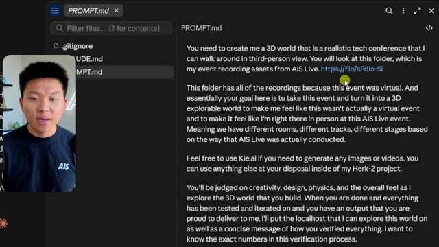
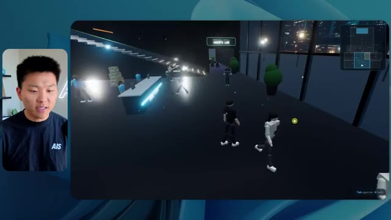
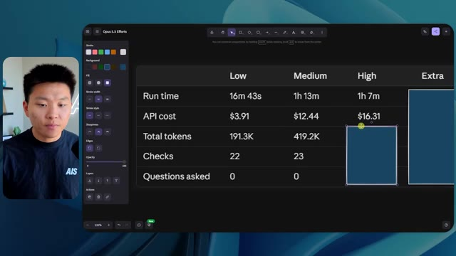
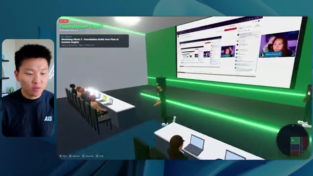
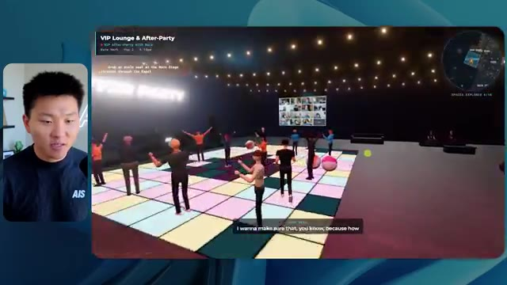
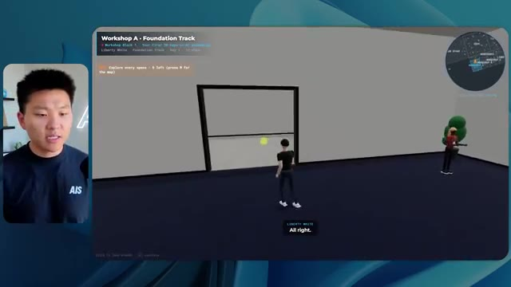
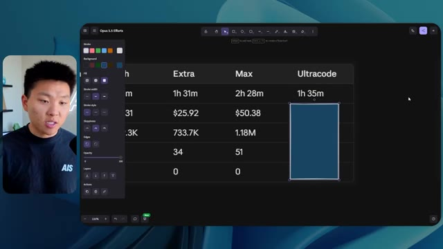
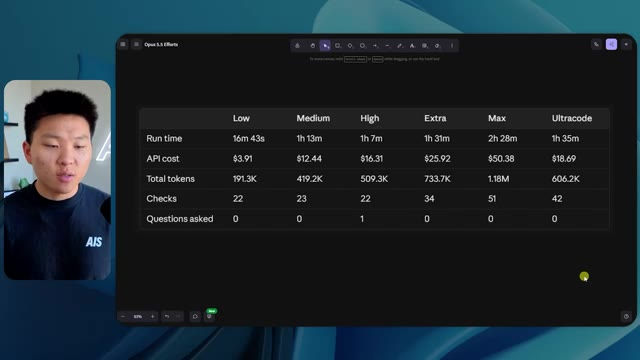
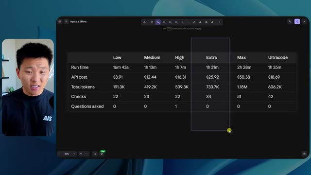

# 🎬 Why I let my Grok Bot doomscroll on TikTok

> **Chaîne** : [Nate Herk | AI Automation](https://www.youtube.com/@nateherk/featured)  
> **Lien YouTube** : [https://www.youtube.com/watch?v=8kH03pGq4V0](https://www.youtube.com/watch?v=8kH03pGq4V0)  
> **Date de publication** : 20261016  
> **Durée** : 00:00:52  
> **Identifiant vidéo** : `8kH03pGq4V0`  
> **Transcription & Analyse** : `whisper-v3-large-turbo+gemini-3.5-flash-lite`  

---

## 📌 Synthèse Exécutive & Outils

### 💡 Résumé
Dans cette vidéo intitulée **Why I let my Grok Bot doomscroll on TikTok**, Nate Herk décortique les capacités pratiques d'automatisation et de développement propulsées par les modèles de pointe.

### 🛠️ Outils, Modèles & Logiciels Présentés
- **Opus 5.5 & Claude Code** : Modèles d'ingénierie et agents de codage autonome.

### 🔑 Points Clés & Enseignements Stratégiques
- Optimiser le niveau d'effort et le raisonnement des modèles IA pour des résultats industriels.
- Automatiser les cycles de création logicielle de bout en bout.

---

## ⏱️ Chronologie & Transcription Complète Audio & Visuelle (Mot pour Mot)

### ⏱️ `[00:00:00 - 00:00:20]` | Segment #01

**🔊 Audio (Transcription Intégrale Mot pour Mot en Français) :**
> Opus 5.5, Opus 5.5, Opus 5.5, Opus 5.5, Opus 5.5. This model is literally everywhere and for very good reason. It's smart, it's cheap, it has amazing taste, it is an incredible AI model. But with every AI model, you have a choice of effort, whether that be low, medium, high, extra, max, or ultra code.

**👁️ Analyse Visuelle d'Écran (gemini-3.5-flash-lite) :**
**Interface & Outils** : X (Twitter) via interface web.

**Contenu textuel & Code** : Texte de tweet : "It's a great time for hobbyists, bad time for professionals. This experiment has further cemented my view that technical creatives are about to experience a massive disruption."

**Action / Démonstration** : Affichage de preuves visuelles de disruption technologique via un post social média.

*⏱️ 00:00:05 — Capture d'écran d'une interface X (anciennement Twitter) affichant un post viral sur la disruption technologique, illustré par une vidéo de paysage généré par IA.*

---

### ⏱️ `[00:00:20 - 00:00:38]` | Segment #02

**🔊 Audio (Transcription Intégrale Mot pour Mot en Français) :**
> So in this video, I gave Opus 5.5 the same exact prompt and I ran it on every single effort level and we're gonna be comparing the results. We will look at the quality of all of the different actual outputs, But then we're also going to look at how long each one of these ran, how much it cost us if it was API billing, the total tokens, how many checks they ran, and how many questions they actually asked me throughout the process.

**👁️ Analyse Visuelle d'Écran (gemini-3.5-flash-lite) :**
**Interface & Outils** : Logiciel de création de diagrammes ou de tableau blanc numérique (type FigJam ou Miro).

**Contenu textuel & Code** : Tableau avec les colonnes : Low, Medium, High, Extra, Max, Ultracode et les lignes : Run time, API cost, Total tokens, Checks, Questions asked.

**Action / Démonstration** : Préparation de l'interface pour afficher les résultats comparatifs de l'expérience sur les niveaux d'effort de l'IA Opus 5.5.

*⏱️ 00:00:29 — Capture d'écran d'un tableau comparatif vide intitulé "Opus 5.5 Efforts" listant des métriques comme le temps d'exécution, le coût API et le nombre de jetons.*

---

### ⏱️ `[00:00:39 - 00:00:58]` | Segment #03

**🔊 Audio (Transcription Intégrale Mot pour Mot en Français) :**
> And the results that we got are not what I expected at all, so I can't wait to share this with you guys. Let's not waste any time and just get straight into this one. Okay, so let's jump right into this one. I want to start off just by showing you guys the actual prompt that we used that we gave to every single one of these different agents. I'm going to go into the files over here, and we're going to open up this prompt markdown file, and I'll show you what we got. So here is the slash goal that I fed in.

**👁️ Analyse Visuelle d'Écran (gemini-3.5-flash-lite) :**
**Interface & Outils** : Opus 5.5 (IDE / Agent de codage IA)

**Contenu textuel & Code** : Le prompt visible dans l'interface indique : "Hi Nate. This worktree has the effort-test task queued in PROMPT.md : build a walkable third-person 3D world of the AIS Live conference from your f.io recordings, with separate rooms, tracks, and stages, then send you a localhost link and the exact verification numbers."

**Action / Démonstration** : Présentation de l'environnement de travail et du prompt initial soumis à l'agent IA pour la génération d'un monde 3D.

*⏱️ 00:00:48 — Interface de l'outil de développement "Opus 5.5" (mode Ultracode) affichant une conversation avec une IA sur un projet nommé "effort-test".*

---

### ⏱️ `[00:00:58 - 00:01:34]` | Segment #04

**🔊 Audio (Transcription Intégrale Mot pour Mot en Français) :**
> I said, you need to create me a 3D world that is a realistic tech conference that I can walk around in third-person view. You will look at this folder, which is my event recording assets from AIS Live. And this folder is a frame IO folder of 105 gigabytes of video recordings. This was a completely virtual event. Everything was recorded and all of the recordings are right here. I said, your goal is to take this event and turn it into a 3D explorable world that makes me feel like I actually went to a real in-person conference with different rooms, different tracks, different stages, blah, blah, blah. Feel free to use key.ai if you need to generate any images or videos. And you can also use anything else inside of my Herc 2 project, which is like my AI operating system. I said,

**👁️ Analyse Visuelle d'Écran (gemini-3.5-flash-lite) :**
**Interface & Outils** : Éditeur de code (type VS Code), Plateforme de gestion de médias (Frame.io).

**Contenu textuel & Code** : Texte du prompt : "You need to create me a 3D world that is a realistic tech conference... look at this folder... AIS Live".

**Action / Démonstration** : Revue et présentation des instructions de développement d'un monde 3D virtuel et consultation des ressources de stockage (fichiers sources de l'événement).

*⏱️ 00:01:07 — Éditeur de code affichant un fichier Markdown contenant le prompt détaillé pour la création d'un monde 3D.*

*⏱️ 00:01:16 — Interface de stockage de fichiers (Frame.io) montrant le dossier des enregistrements vidéo de l'événement avec un poids total de 105 Go.*

*⏱️ 00:01:25 — Identique à l'image 1, montrant le prompt de configuration du projet de conférence virtuelle.*

---

### ⏱️ `[00:01:34 - 00:02:08]` | Segment #05

**🔊 Audio (Transcription Intégrale Mot pour Mot en Français) :**
> you'll be judged on creativity, design, physics, and the overall feel as I explore the 3D world that you built. And that was basically the end of the instructions. So as you can see on this left-hand side, I ran this through all of the different effort levels. Let's start off with low and work our way up to ultra code. All right. So here we have the result from low. Let's open this up and take a look. So we have AIS live, AI services summit in person finally, and we were able to click around. First of all, this doesn't feel very branded. Like this isn't the IS Live logo. It's not even our colors. So I don't love that, but let's get in here. Okay. This is way too bright. Um, we have a map in the top, right? We have a city back here. I can't tell what city

**👁️ Analyse Visuelle d'Écran (gemini-3.5-flash-lite) :**
**Interface & Outils** : Cursor (éditeur de code).

**Contenu textuel & Code** : Liste de sessions ("Session logs cost analysis", "Hello", "Extra", "High", "Max", "Ultracode", "Medium", "Low") et un message système invitant à démarrer une tâche basée sur le fichier "PROMPT.md".

**Action / Démonstration** : Le curseur de la souris survole l'option "Low" dans la barre latérale pour lancer le test avec le niveau d'effort le plus bas.

*⏱️ 00:01:42 — Interface de l'outil de développement Cursor montrant une liste de dossiers de tests d'effort et une fenêtre de chat avec l'IA.*

---

### ⏱️ `[00:02:08 - 00:02:40]` | Segment #06

**🔊 Audio (Transcription Intégrale Mot pour Mot en Français) :**
> this is. Okay. This is Chicago, which is kind of cool because you know, I live in Chicago, but anyways, on the top, right, we can see a map. We have a lobby. We have an expo hall. We have VIP lounge main stage. Also the map shows where every other person is and that's sinking live. So we can see registration. We can see day one, hyper agent keynote, live debrief. Cool. So it actually does know the agenda and then there's day two. So it found that that's good. We have these little balls in here that I can hopefully kick around. Okay. The face, Oh, look at this. If I go over here, all the people just disappear. Very bad. Very bad. Okay. So let's see. Can I sprint? Okay.

**👁️ Analyse Visuelle d'Écran (gemini-3.5-flash-lite) :**
**Interface & Outils** : Application de conférence virtuelle (environnement 3D type "Gather" ou similaire).

**Contenu textuel & Code** : Panneaux d'affichage virtuels (Agenda "Day 1"), indicateurs de position en temps réel sur la mini-carte, instructions de commandes clavier (WASD).

**Action / Démonstration** : Navigation de l'avatar dans les différentes zones de l'événement virtuel, démonstration du suivi en direct des autres participants sur la carte.

*⏱️ 00:02:16 — Vue en perspective d'un espace virtuel typé conférence avec des avatars, une zone "Badge pickup", et une mini-carte en haut à droite.*

*⏱️ 00:02:24 — Vue de l'espace "Lobby" dans l'application virtuelle, affichant un panneau d'informations "DAY 1" avec le programme des sessions.*

*⏱️ 00:02:32 — Vue de l'"Expo Hall" montrant des avatars en interaction autour d'un socle lumineux central, avec la carte de navigation affichée en haut à droite.*

---

### ⏱️ `[00:02:40 - 00:03:04]` | Segment #07

**🔊 Audio (Transcription Intégrale Mot pour Mot en Français) :**
> I can move a little faster. I'll first go over here. There's some swag, um, AIS plus certified glido. Okay. So it's got the actual booths that we had in the virtual event. We had booths. So that's pretty cool. A little place to take pictures. Room C. Right now we have Tangy Frederick doing a workshop. Okay. But this isn't a video. As you can see, it's just an image. She's not moving. So that's just an image. These people are disappearing. They must be ghosts. Let's go over here to room A.

**👁️ Analyse Visuelle d'Écran (gemini-3.5-flash-lite) :**
**Interface & Outils** : Plateforme événementielle virtuelle (type Gather ou équivalent).

**Contenu textuel & Code** : Instructions affichées sur écran virtuel : "Step 1: Go to Settings", "Step 2: Go to API Integrations", "Step 3: Go to Create A New Token".

**Action / Démonstration** : Navigation de l'avatar dans l'espace virtuel pour accéder aux stands d'exposition et aux salles de conférence.

*⏱️ 00:02:46 — Vue d'un hall d'exposition virtuel avec un avatar se déplaçant devant un stand intitulé "Glaido".*

*⏱️ 00:02:52 — Vue de l'intérieur de la "Room C" (Workshop) dans l'environnement virtuel, avec des écrans de présentation.*

*⏱️ 00:02:58 — L'avatar s'approche d'un écran géant dans la "Room C" affichant des instructions étape par étape pour configurer une clé API.*

---

### ⏱️ `[00:03:04 - 00:03:30]` | Segment #08

**🔊 Audio (Transcription Intégrale Mot pour Mot en Français) :**
> We have Liberty White. Okay. Very cool. Your first 30 days in automation. Once again, it's just a still image and the people are glitchy. So not very good here. I'm going to go over to the main stage and see what we've got going. Okay, cool. So we have a main looking stage. The people are glitching. Really bad. That's not very good at all. Our video is actually moving. Like I saw my face here and I saw Devin's, but now they're gone. So I'm not sure what happened. Okay. It's, it looks like it's more of a slideshow. Nothing is actually being played still. Anyways, let's come in here.

**👁️ Analyse Visuelle d'Écran (gemini-3.5-flash-lite) :**
**Interface & Outils** : Environnement de conférence virtuel (type métavers / plateforme d'événement 3D).

**Contenu textuel & Code** : Aucun contenu technique, code source ou interface d'automatisation visible.

**Action / Démonstration** : Déplacement d'un avatar dans un espace virtuel d'événement.

---

### ⏱️ `[00:03:30 - 00:03:58]` | Segment #09

**🔊 Audio (Transcription Intégrale Mot pour Mot en Français) :**
> We have more booths. We have hyper agent. We have Claude Code. We have more swag. Room B is Dave Ebelor. I'm assuming it's the same exact thing. We've got coffee. And then I'm assuming VIP lounge, VIP access only. That's pretty cool, but there's really nothing going on right here. That screen's way too bright. Okay. So I think you guys understand the vibe that we're getting here from Opus 5.5 on low effort. And here's where things get interesting. How much do you guys think that this ran for? How long? This one ran for 16 minutes and 43 seconds. How much do you think this cost?

**👁️ Analyse Visuelle d'Écran (gemini-3.5-flash-lite) :**
**Interface & Outils** : Canvas de travail collaboratif ou outil de gestion de projet (type tableau blanc).

**Contenu textuel & Code** : Tableau de données comparatif avec les colonnes : Low, Medium, High, Extra, Max, Ultracode, et les lignes : Run time, API cost, Total tokens, Checks, Questions asked.

**Action / Démonstration** : Présentation d'un tableau comparatif structuré pour l'analyse des efforts/performances du modèle Opus 5.5.

*⏱️ 00:03:51 — Interface de tableau comparatif "Opus 5.5 Efforts" affichant des métriques de performance.*

---

### ⏱️ `[00:03:58 - 00:04:26]` | Segment #10

**🔊 Audio (Transcription Intégrale Mot pour Mot en Français) :**
> $3.91 if this was API billing. I'm obviously using my subscription here, but we're just going to calculate this in API billing. Total tokens was 191,000. It did 22 checks. So the verification, 22 times it opened up the browser and ran different sorts of checks. So 22 categories of checks. And how many questions did it ask me? It asked me a total of zero questions throughout this slash goal prompt. Okay. So let's open up medium effort and see what we've got. Okay, here we go. Medium effort. We've got Nate Herc. We've got my badge. This is AI's life branded.

**👁️ Analyse Visuelle d'Écran (gemini-3.5-flash-lite) :**
**Interface & Outils** : Opus 5.5 Efforts (application de conception/tableau blanc).

**Contenu textuel & Code** : Tableau affichant les données pour la catégorie "Low" : Run time (16m 43s), API cost ($3.91), Total tokens (191.3K), et des cellules vides pour "Checks" et "Questions asked".

**Action / Démonstration** : Présentation visuelle et édition d'un tableau de suivi des coûts et des performances d'un agent IA.

*⏱️ 00:04:05 — Une capture d'écran montrant l'interface de l'application de dessin/tableau blanc "Opus 5.5 Efforts", présentant un tableau comparatif des performances ("Low", "Medium", "High").*

---

### ⏱️ `[00:04:26 - 00:04:46]` | Segment #11

**🔊 Audio (Transcription Intégrale Mot pour Mot en Français) :**
> So this is already looking a little bit better. This feels like our color schemes that used our brand guidelines. Day one build, day two earn, VIP. Cool. Okay. I'm going to enter the venue. Okay. Wow. So similar sort of vibe. It's sitting in the background. This doesn't look like Chicago though, does it? No, this looks like a, honestly, this looks like a made up city. Either way, it's funny that they decided to do that. Let's see if I can move a little faster. Oh, wow.

**👁️ Analyse Visuelle d'Écran (gemini-3.5-flash-lite) :**
**Interface & Outils** : Application web interactive / Plateforme virtuelle "AIS Live".

**Contenu textuel & Code** : Menus de navigation, listes de commandes clavier (WASD, Shift, etc.), et badges de profil utilisateur.

**Action / Démonstration** : Navigation et interaction de l'utilisateur dans l'interface, passant de l'écran de connexion à l'exploration du lieu virtuel.

*⏱️ 00:04:31 — Interface d'accueil de la plateforme "AIS Live" affichant un badge numérique personnalisé au nom de "Nate Herk" et des instructions de contrôle clavier.*

*⏱️ 00:04:41 — Vue immersive à la première personne dans un environnement virtuel 3D de type métavers, montrant des avatars et une vue panoramique urbaine nocturne.*

---

### ⏱️ `[00:04:46 - 00:05:21]` | Segment #12

**🔊 Audio (Transcription Intégrale Mot pour Mot en Français) :**
> The people are interacting with me. Watch. If I go up to this guy, he just like raised his arm. Well, now he doesn't want anything to do with me at all. But all of these little robots here must be making decisions. I'm not sure if they're using Jev. They're definitely not. I didn't tell it to. Actually, my Jev key is in the back. I don't know. Maybe it did use it. Anyways, we can see here we have Workshop Room C, Agents Lab. Nice. So this one is actually being run. You can see that is a real video being played by Tangy. Everyone here is actually like working on a laptop. They're not glitching. This is pretty cool. Also, my badge is on my chest, which is pretty cool. I can come this way. We have a map up in the top right, as you guys can see, but I can come this way. We have an

**👁️ Analyse Visuelle d'Écran (gemini-3.5-flash-lite) :**
**Interface & Outils** : Environnement de simulation virtuelle / Métavers (type Gather ou plateforme similaire).

**Contenu textuel & Code** : Interface utilisateur affichant "Workshop Block 3", "Day 1", "Enterprise AI Services", "Tangy Frederick", et une mini-carte (radar) en haut à droite.

**Action / Démonstration** : Navigation et exploration de l'espace virtuel par l'avatar de l'utilisateur pour interagir avec des personnages non-joueurs (NPCs).

*⏱️ 00:04:55 — Vue à la troisième personne d'un environnement virtuel de type métavers avec des avatars circulant dans un couloir moderne.*

*⏱️ 00:05:04 — Vue de l'entrée d'une salle de conférence nommée "Agents Lab" où des avatars sont assis, avec une interface contextuelle en bas à gauche.*

*⏱️ 00:05:12 — Vue intérieure de la salle de conférence "Agents Lab" montrant une rangée d'avatars travaillant sur des ordinateurs portables.*

---

### ⏱️ `[00:05:21 - 00:05:47]` | Segment #13

**🔊 Audio (Transcription Intégrale Mot pour Mot en Français) :**
> expo hall. This is where we have the Glido booth. And this is actually playing. Yeah, it's playing the video of us talking about Glido. It's playing the video of Ed and I talking about our certification program. We've got the AIS Plus logo back here, which is kind of in a weird spot. This is a speaker slides and takeaways. So wow, this is all the resources that we gave out after the event. They're all sitting right there as well. We can see we've got a community spotlight. So this is Aiden talking about his deal that he landed and it's playing live. These people are watching.

**👁️ Analyse Visuelle d'Écran (gemini-3.5-flash-lite) :**
**Interface & Outils** : Environnement virtuel de conférence/expo 3D (type Gather.town ou plateforme de métavers).

**Contenu textuel & Code** : Textes informatifs sur les certifications IA, titres de diapositives, menus de navigation de session, et cartes de localisation de l'espace.

**Action / Démonstration** : Navigation et exploration d'un espace d'exposition virtuel par des avatars ; consultation de contenus de présentation en libre accès.

*⏱️ 00:05:28 — Vue en perspective d'un stand dans un environnement virtuel 3D affichant une présentation sur les "AI Services" et des avatars d'utilisateurs.*

*⏱️ 00:05:34 — Mur d'affichage virtuel présentant une galerie de diapositives de conférence et des documents de ressources pour les participants.*

*⏱️ 00:05:40 — Vue panoramique d'un espace de type "Lab" dans le métavers avec des avatars interagissant avec des bornes d'information et des écrans partagés.*

---

### ⏱️ `[00:05:47 - 00:06:21]` | Segment #14

**🔊 Audio (Transcription Intégrale Mot pour Mot en Français) :**
> They're pretty engaged. We've got hyper agent. That was, that's what I meant. If you guys saw those people like raising their arms saying hi, that was kind of funny. Look, look, there he goes again. Anyways. Okay. Where am I now? Now I'm in the main lobby. We've got a coffee bar. We've got a big logo, which is the real logo. It's too bright, but we have the logo. We can see if we can come in here to the foundation track. We've got Sabrina Romanov and Liberty White. So different trainings right there. We can come into this room. This is the advanced track. So what's going on here. We've got Dave Ebelar and Saman talking about some different stuff in there. And now let's go take a look at the main stage. Oh, wait, there's a video of me up there. Is that like a VIP

**👁️ Analyse Visuelle d'Écran (gemini-3.5-flash-lite) :**
**Interface & Outils** : Environnement métavers/plateforme d'événement virtuel 3D.

**Contenu textuel & Code** : Interface utilisateur avec mini-carte (top-right), affichage de lieu ("Main Lobby") et commandes de contrôle.

**Action / Démonstration** : Exploration de l'espace virtuel et interaction sociale entre avatars dans un environnement événementiel numérique.

*⏱️ 00:05:55 — Vue à la première personne dans un environnement virtuel 3D représentant un "Main Lobby" avec un bar à café et des avatars d'utilisateurs.*

*⏱️ 00:06:04 — Navigation de l'avatar dans une zone de conférence virtuelle où d'autres personnages sont assis face à un écran de présentation.*

*⏱️ 00:06:12 — Vue en plongée d'une zone de socialisation virtuelle avec des avatars regroupés autour de tables dans un espace événementiel.*

---

### ⏱️ `[00:06:21 - 00:06:50]` | Segment #15

**🔊 Audio (Transcription Intégrale Mot pour Mot en Français) :**
> section? Yeah, we'll go check that out in a sec. But anyways, this is the main stage. This looks very, very nice. We've got a big stage. We've got like four people sitting up here. We've got the the three screens of Alex up there with hyper agent. Am I allowed to get on stage? Oh, and lets me up on stage. Okay. That's pretty nice. All right, guys, let's take a selfie. Let me get everyone in the background. Get in here. Anyways, that is pretty, pretty cool. Not every seat is filled though. So we need to work on that. But anyways, I'm going to run back over and see what that VIP section was. Okay. VIP lounge. I feel like this is like a worth the airport or something.

**👁️ Analyse Visuelle d'Écran (gemini-3.5-flash-lite) :**
**Interface & Outils** : Environnement de conférence virtuelle 3D (Metaverse/Event Platform).

**Contenu textuel & Code** : Interface utilisateur affichant "Hyperagent Keynote" avec les détails de la session et des noms d'intervenants.

**Action / Démonstration** : Navigation de l'utilisateur (avatar) au sein de l'espace virtuel et observation de la mise en scène de l'événement.

---

### ⏱️ `[00:06:51 - 00:07:14]` | Segment #16

**🔊 Audio (Transcription Intégrale Mot pour Mot en Français) :**
> Okay, cool. So now we've got the VIP sessions up here. VIP Q and a with Nate live video playback right here. Very, very cool. And we've got like a bar or something. Awesome. I would say that this is a pretty good output. Now, as far as the stats here, this one took one hour and 13 minutes to run. It would have cost us $12 and 44 cents. It used 490,000 tokens and it did 23 checks.

**👁️ Analyse Visuelle d'Écran (gemini-3.5-flash-lite) :**
**Interface & Outils** : - Image #1 : Interface d'un espace de réunion virtuel (type métavers).
- Image #2 : Interface d'outil de reporting ou tableau de bord de suivi de projet/IA (Intitulé "Opus 5.5 Efforts").

**Contenu textuel & Code** : - Image #1 : Texte "VIP Q&A with Nate" sur une interface de lecteur vidéo incrustée.
- Image #2 : Données chiffrées : Run time (16m 43s), API cost (3,91 $), Total tokens (191,3K), Checks (22), Questions asked (0).

**Action / Démonstration** : - Image #1 : Présentation de l'environnement virtuel généré et de l'expérience utilisateur.
- Image #2 : Analyse et commentaire sur les statistiques de performance de l'exécution de l'agent IA.

*⏱️ 00:06:56 — Vue d'un environnement virtuel immersif représentant une salle VIP avec un écran géant affichant une session de questions-réponses en direct et un comptoir de bar en arrière-plan.*

*⏱️ 00:07:02 — Tableau récapitulatif des performances ("Opus 5.5 Efforts") affichant des métriques telles que le temps d'exécution (16m 43s), le coût API (3,91 $), le nombre de tokens et le nombre de vérifications.*

---

### ⏱️ `[00:07:14 - 00:07:48]` | Segment #17

**🔊 Audio (Transcription Intégrale Mot pour Mot en Français) :**
> And it asked us a grand total of zero questions once again. All right, let's move on to high. This was already a pretty decent output and Anthropic themselves in their how to prompt Opus 5.5 video, or sorry, not video, article. They said to just start on medium and scale it up or down if you need. So that was a medium output. Let's move over to high and see what we got. Real quick, guys, I need to take a second to tell you about the sponsor of today's video, Hostinger. So both of these models just built me a working version of the same thing. And now I'm right where I always end up with something finished sitting on my laptop and no quick way to get it online. And that's the gap that Hostinger's connector closes. It's a free extension

**👁️ Analyse Visuelle d'Écran (gemini-3.5-flash-lite) :**
**Interface & Outils** : Logiciel de tableau blanc (Canvas) pour l'Image 1 ; Éditeur de code Cursor (avec agent IA intégré) pour l'Image 2.

**Contenu textuel & Code** : Image 1 : Tableau chiffré des métriques d'exécution Opus 5.5. Image 2 : Prompt de demande de création d'un calculateur ROI en fichier HTML unique, logs d'exécution ("dataviz skill", "Ruminating"), et sélection du modèle "Opus 5.5 (1M) Medium".

**Action / Démonstration** : Analyse comparative des coûts et performances des modèles dans l'Image 1 ; exécution d'une requête de génération de code par un agent IA dans l'Image 2.

*⏱️ 00:07:22 — Un tableau comparatif affiché dans une interface de type tableau blanc, détaillant les performances (temps d'exécution, coût API, jetons, vérifications, questions posées) pour différents niveaux de paramètres ("Low", "Medium", "High", "Extra").*

*⏱️ 00:07:39 — L'interface de l'éditeur Cursor (ou similaire) montrant le processus de développement d'un "Northwind ROI calculator" avec l'agent IA actif, le journal des pensées et la zone de saisie de prompt.*

---

### ⏱️ `[00:07:48 - 00:08:23]` | Segment #18

**🔊 Audio (Transcription Intégrale Mot pour Mot en Français) :**
> for your editor that pulls your Hostinger account into whatever you're already coding in. So VS Code, cursor, cloud code, codex, you name it. You sign in once with a single click, and from there, your agent can deploy the site, point a domain at it, set the DNS records, and check on your VPS without you ever having to leave the editor. So whichever one of these you end up liking better, the thing it built is a couple minutes away from a real URL on managed hosting. Connector is free on every hosting or plan, so if you still need the hosting underneath it, grab the unlimited plan with the link in the description and use code NATEHERK for 10% off. That also comes with a free domain and business email for the year. And it's still the cheapest way that I found to get something

**👁️ Analyse Visuelle d'Écran (gemini-3.5-flash-lite) :**
**Interface & Outils** : Interface de gestion Hostinger (intégration IDE) et terminal Claude Code.

**Contenu textuel & Code** : État de connexion "Connected - VIA OAUTH", version "Node.js 24.13.0", et liste des permissions accordées à l'assistant pour gérer les sites, domaines, paiements et emails.

**Action / Démonstration** : Validation de la connexion entre Hostinger et l'IDE, permettant à l'agent IA d'accéder aux outils de gestion d'infrastructure directement depuis l'éditeur.

*⏱️ 00:07:57 — Une interface de configuration montrant la connexion d'un compte Hostinger à un environnement de développement, avec une liste d'outils disponibles (Websites, Domains, Subscriptions, Email Marketing).*

---

### ⏱️ `[00:08:23 - 00:08:47]` | Segment #19

**🔊 Audio (Transcription Intégrale Mot pour Mot en Français) :**
> you built onto a real URL. So let's get back to the video. Okay. Once again, very, very branded. This is even better of a loading screen than the previous one. We've got this nice little effect in the background. We've got the logo. We'll enter the venue. Okay. Here we are. This looks pretty nice. We start outside and you can see that we have these flags for all the speakers, Wyatt, Casper, Alex, Ed, Aiden, Sabrina, Liberty. This is pretty cool. We got live blocks here.

**👁️ Analyse Visuelle d'Écran (gemini-3.5-flash-lite) :**
**Interface & Outils** : Application Web / Plateforme événementielle virtuelle interactive "AIS LIVE".

**Contenu textuel & Code** : Interface utilisateur affichant les contrôles clavier (WASD, SHIFT, SPACE), le nom de l'événement, les noms des intervenants et une mini-map.

**Action / Démonstration** : Entrée dans l'environnement virtuel et navigation de l'avatar dans la place centrale de l'événement.

*⏱️ 00:08:29 — Écran de chargement et d'accueil de la plateforme "AIS LIVE" avec le bouton "ENTER THE VENUE".*

*⏱️ 00:08:35 — Vue immersive du hall virtuel (AIS Live Plaza) avec des personnages en 3D et une interface de navigation HUD.*

*⏱️ 00:08:41 — Exploration du hall virtuel montrant des bannières d'intervenants et une architecture 3D moderne.*

---

### ⏱️ `[00:08:47 - 00:09:23]` | Segment #20

**🔊 Audio (Transcription Intégrale Mot pour Mot en Français) :**
> it took this picture from me, your host, Nate Herc, John, Dave, Nate Herc. There we go. Okay. The doors. Awesome. They're automatic sliding glass doors. I love that. We can see VIP check-in. We can see GA. We can come over here and we can check out the expo with different booths, community spotlight. You can also see that in the top left, I have a passport. So it's like, it will be showing how many of the places I've visited. All of these are real playback. We've got a resource wall with all of the different speakers. They've also got a networking session over here. So I'm going to come over real quick and see what that's all about. So we've got the AIS cold brew bar. We've got different community members that were spotlighted or highlighted.

**👁️ Analyse Visuelle d'Écran (gemini-3.5-flash-lite) :**
**Interface & Outils** : Environnement virtuel 3D multi-joueurs (simulant un centre de conférence).

**Contenu textuel & Code** : Interface utilisateur affichant "Registration Concourse", "Main Stage", "VIP Check-in", "Expo Hall" et des compteurs de progression de type "Passport".

**Action / Démonstration** : Exploration interactive de l'espace virtuel par l'avatar, montrant les différentes zones de l'événement en ligne.

*⏱️ 00:08:56 — Vue à la première personne dans un environnement virtuel 3D montrant la zone de "Registration Concourse" avec des comptoirs VIP et GA.*

*⏱️ 00:09:05 — Navigation dans une section "Expo Hall" de l'environnement virtuel, présentant des stands d'exposition et des avatars d'utilisateurs.*

*⏱️ 00:09:14 — Déplacement de l'avatar principal vers des portes coulissantes automatiques dans le hall d'accueil de l'espace virtuel.*

---

### ⏱️ `[00:09:23 - 00:09:56]` | Segment #21

**🔊 Audio (Transcription Intégrale Mot pour Mot en Français) :**
> We've got the VIP wing. Wait, what? Pick up a wristband. Oh, I have to actually go get the wristband. Okay. Let me check in real quick. Wristband's already on. Wait, what? Okay. Oh, okay. Now the doors have opened for me. Cool. I can come into here. Oh, that just goes to the main stage. VIP lounge. This is a Q and A going on. It looks like very cool. I mean, I'm very impressed by how it's able to do this. Wow. Okay. So this is really good. What we did is we had VIP breakout rooms with different people. You can see that there's different rooms, different members of the AIS team going into stuff. This is really cool. This is very cool. That's a much better VIP

**👁️ Analyse Visuelle d'Écran (gemini-3.5-flash-lite) :**
**Interface & Outils** : Environnement de métavers ou plateforme événementielle virtuelle 3D (type Gather ou similaire).

**Contenu textuel & Code** : Interface utilisateur affichant le statut "VIP", la localisation dans l'espace, les noms des sessions de travail et des mini-cartes de navigation.

**Action / Démonstration** : Navigation et exploration de l'utilisateur au sein des différents espaces virtuels de la conférence (Hall, Lounge, Salle de travail).

*⏱️ 00:09:32 — Vue à la première personne dans un environnement virtuel 3D représentant un hall d'enregistrement d'événement ("Registration Concourse"), avec un avatar qui se déplace vers une zone VIP.*

*⏱️ 00:09:40 — L'avatar est arrivé dans le "VIP Lounge", où une présentation vidéo en direct de l'orateur (Nate Herk) est projetée sur un écran central devant des sièges.*

*⏱️ 00:09:48 — Vue intérieure d'une section "VIP Working Sessions" avec plusieurs îlots de discussion thématiques tels que "Price it Right", "Turn Your Expertise into a Service" et "Land Your First Paying Client".*

---

### ⏱️ `[00:09:56 - 00:10:30]` | Segment #22

**🔊 Audio (Transcription Intégrale Mot pour Mot en Français) :**
> experience than what was shown in the first piece. Okay. VIP after party. Look at this. We've got a dance floor. We've got all these elements in here. We have the actual VIP after party playback right here. And there's a DJ booth. That is so funny. There's a bit of a bug right here, a glitch right there, but this is awesome. Oh, cool. So when I'm in here in the main stage, we get closed captions. You can see right here in the bottom of my screen, we're getting these closed captions of Wyatt actually talking up here. We've got lights. We've got the panel. Very cool. Nice main stage. I'm going to go over here. We can go to the foundation,

**👁️ Analyse Visuelle d'Écran (gemini-3.5-flash-lite) :**
**Interface & Outils** : Plateforme événementielle virtuelle 3D / Metavers.

**Contenu textuel & Code** : Interface utilisateur avec statistiques de passeport, mini-carte en haut à droite, commandes clavier en bas à droite et noms des sessions ("VIP After-Party", "Anatomy of Three Real Deals").

**Action / Démonstration** : Navigation et exploration de différents espaces virtuels (piste de danse, salle de conférence) au sein de la plateforme.

*⏱️ 00:10:04 — Vue d'un environnement virtuel type métavers représentant une "VIP After-Party" avec des avatars dansant et un écran diffusant une mosaïque de participants.*

*⏱️ 00:10:13 — Suite de la scène virtuelle avec une vue légèrement plus large de la piste de danse et des éléments décoratifs (ballons).*

*⏱️ 00:10:21 — Vue de l'environnement virtuel "Main Stage" où un intervenant est projeté sur un écran géant devant une salle remplie d'avatars assis.*

---

### ⏱️ `[00:10:30 - 00:11:06]` | Segment #23

**🔊 Audio (Transcription Intégrale Mot pour Mot en Français) :**
> advanced, and the enterprise tracks over here. So let's see. We have anatomy of a three real deals. We've got hyper agent. We've got the evals with Nate and Ed in here. We've got Dave going on in the advanced stuff. This is really nice. I mean, obviously each, each of these outputs so far, low was okay. Medium was better. High has been even better. Let's see if that trend continues and let's go ahead and see what this cost us. So high ran for one hour and seven minutes. So a little bit quicker than medium, it would have cost us $16 and 31 cents. It used half a million tokens, 509,000. It did 22 checks. And it also asked us, well, actually, no, I was wrong. This

**👁️ Analyse Visuelle d'Écran (gemini-3.5-flash-lite) :**
**Interface & Outils** : Application de tableau blanc interactif ou outil de gestion de projet (interface de type diagramme/tableau).

**Contenu textuel & Code** : Tableau de données techniques : "Run time", "API cost", "Total tokens", "Checks" et "Questions asked" pour les différents niveaux d'effort.

**Action / Démonstration** : Présentation des données chiffrées comparant l'efficacité et les coûts opérationnels des agents IA testés.

*⏱️ 00:10:57 — Tableau comparatif des performances et coûts de l'agent IA, classés par niveau d'effort (Low, Medium, High, Extra).*

---

### ⏱️ `[00:11:06 - 00:11:25]` | Segment #24

**🔊 Audio (Transcription Intégrale Mot pour Mot en Français) :**
> one asked me one question and spoiler, it was the only one that asked us a question throughout all of this. So let's see, we've got three left extra max and ultra code. Let me pull open extra and we'll see what we got. Okay. So this one looks pretty good. I would honestly say so far, the loading screen high was the best. The one that we just saw, but anyways, let's enter AIS live.

**👁️ Analyse Visuelle d'Écran (gemini-3.5-flash-lite) :**
**Interface & Outils** : Interface de type canevas (Canvas/Tableau de bord de données)

**Contenu textuel & Code** : Tableau avec des colonnes "Low", "Medium", "High" et "Extra", détaillant des métriques telles que "Run time", "API cost", "Total tokens", "Checks" et "Questions asked".

**Action / Démonstration** : Le présentateur passe en revue les résultats de performance des modèles IA et se concentre sur la colonne "Extra" du tableau.

*⏱️ 00:11:11 — Tableau comparatif des performances de modèles IA intitulé "Opus 5.5 Efforts" affichant le temps d'exécution, le coût API, le nombre de jetons, les vérifications et les questions posées pour différentes catégories.*

---

### ⏱️ `[00:11:26 - 00:11:51]` | Segment #25

**🔊 Audio (Transcription Intégrale Mot pour Mot en Français) :**
> Whoa. Okay. So we have like little sound bites. I can chat with people. The tool war panel settled a few debates for me. Nice. Good perspective there. We're outside again. We have these different banners, although they're all the same. They don't say like different people's names. So big AIS live logo. Workshop wing is over here. And let's go through the sliding glass doors and see what we've got. So we've got the AIS cafe. The map is in the bottom right, and it's not too descriptive.

**👁️ Analyse Visuelle d'Écran (gemini-3.5-flash-lite) :**
**Interface & Outils** : Environnement virtuel 3D (métavers/plateforme d'événement en ligne).

**Contenu textuel & Code** : Aucun code, commande ou donnée textuelle. Il s'agit d'une interface de navigation dans un espace virtuel.

**Action / Démonstration** : Navigation et déplacement d'un avatar dans un espace 3D.

---

### ⏱️ `[00:11:51 - 00:12:26]` | Segment #26

**🔊 Audio (Transcription Intégrale Mot pour Mot en Français) :**
> I like how the other maps have told us what, like where things were, but this one looks very professional. We can see here's the main stage. Let's hop in here real quick. They've all got these balls flying around, which I think is pretty funny. The AIS beach balls. We have me up there speaking. I think I was introing one of the days. Let's keep on moving here to the workshop room on this left side. Okay. So here we've got the Hyper Agent Theater. We've got this sponsored session in here by Hyper Agent, but it's showing us what's coming up in here as well. It's really funny that we can chat to people. Salmon built a voice sales rep live. The price it right room was packed. Did you grab the VIP companion guide? That's so funny. We have the advanced track in

**👁️ Analyse Visuelle d'Écran (gemini-3.5-flash-lite) :**
**Interface & Outils** : Plateforme événementielle virtuelle 3D (type Gather.town ou environnement similaire basé sur le web).

**Contenu textuel & Code** : Textes informatifs intégrés à l'interface virtuelle : « Main Stage », « Grand Lobby », « Workshops », « Enterprise AI Services », ainsi que des bulles de dialogue textuelles entre avatars.

**Action / Démonstration** : Navigation et exploration de l'espace virtuel par l'utilisateur, passage d'une zone de conférence à un hall d'accueil et à des couloirs de services.

*⏱️ 00:12:00 — Vue à la première personne dans un environnement virtuel 3D montrant une salle de conférence avec des avatars, une scène principale, et un écran diffusant le présentateur en direct.*

*⏱️ 00:12:09 — Vue de navigation dans le lobby virtuel (« Grand Lobby ») montrant des avatars d'utilisateurs près d'entrées marquées « Workshops » et « Enterprise AI Services ».*

*⏱️ 00:12:17 — Exploration d'un couloir virtuel dans la plateforme, où des avatars interagissent, avec des bulles de dialogue affichées au-dessus des personnages.*

---

### ⏱️ `[00:12:26 - 00:12:58]` | Segment #27

**🔊 Audio (Transcription Intégrale Mot pour Mot en Français) :**
> here. Once again, we've got live playback. Is that live playback? Oh, okay. It started once I got in, but I can take a seat. Oh my. I can watch this. I can stand up. I want to sit in the front. That's pretty cool. That's very nice. I like that. And you know what I noticed so far? The actual character that I'm playing kind of looks like me. I think it modeled it off of my thumbnail pictures or something. Anyways, we have Sabrina in here, room host here, grab any open seat. Okay, cool. And I really liked the sitting functionality. It's kind of funny. Like we could actually attend this workshop and participate. Anyways, it's showing us the speakers. It's showing us the

**👁️ Analyse Visuelle d'Écran (gemini-3.5-flash-lite) :**
**Interface & Outils** : Plateforme de conférence virtuelle 3D (type métavers événementiel).

**Contenu textuel & Code** : Intitulés de workshops : "Advanced: Build a Voice AI Sales Bot" et "Foundation: Build Your First AI Content Engine". Interfaces de streaming/présentation intégrées dans l'espace virtuel.

**Action / Démonstration** : Navigation et exploration de l'utilisateur (le présentateur) au sein d'un environnement événementiel virtuel interactif où il peut choisir sa place et suivre des présentations.

*⏱️ 00:12:34 — Vue d'une salle de conférence virtuelle (Advanced Track) avec des avatars d'utilisateurs assis. Au centre, un écran affiche une interface logicielle liée à la création d'un "Voice AI Sales Bot".*

*⏱️ 00:12:42 — Vue d'une salle de conférence virtuelle (Foundation Track) avec une configuration similaire, focalisée sur un atelier intitulé "Build Your First AI Content Engine".*

*⏱️ 00:12:50 — Vue en plongée de la salle de conférence virtuelle montrant l'écran de projection principal affichant une interface de navigation web ou de plateforme de gestion d'IA.*

---

### ⏱️ `[00:12:58 - 00:13:31]` | Segment #28

**🔊 Audio (Transcription Intégrale Mot pour Mot en Français) :**
> agenda. There's a little red carpet here to take some pictures. We can strike a pose. Oh, wow. That's pretty cool. Resource library, get AIS Plus certified, Glido, Hyper Agent, AIS Plus, three real deals. Awesome. I mean, I would definitely say so far, each one is getting better. And we didn't even check out the VIP section yet, the VIP lounge. Let's go up here real quick. Hopefully I can get in. Nice. We've got tooling reset. These are the different rooms we could go in. So once again, I could grab the worksheet and I could try to understand how to price my stuff. This is so cool. This is definitely better than the previous one where we kind of just

**👁️ Analyse Visuelle d'Écran (gemini-3.5-flash-lite) :**
**Interface & Outils** : Plateforme de conférence ou de métavers dédiée aux événements professionnels (type environnement de networking virtuel).

**Contenu textuel & Code** : Textes informatifs sur les stands, signalétique "Workshops", questions interactives de travail (ex: "What's your gut floor number?").

**Action / Démonstration** : Navigation et exploration de l'utilisateur (via son avatar) dans les différents espaces d'un événement virtuel pour accéder aux ressources et sessions.

*⏱️ 00:13:07 — Vue d'un hall d'exposition virtuel avec des stands pour "Hyperagent" et "Glido", illustrant un environnement de conférence numérique.*

*⏱️ 00:13:15 — Hall d'entrée (lobby) d'une plateforme d'événement virtuel montrant des escaliers, une zone de réception et une signalétique pour des workshops.*

*⏱️ 00:13:23 — Espace VIP Lounge virtuel où des avatars sont assis autour d'une table pour une session de travail, avec des questions affichées à l'écran.*

---

### ⏱️ `[00:13:31 - 00:13:59]` | Segment #29

**🔊 Audio (Transcription Intégrale Mot pour Mot en Français) :**
> like looked at stuff. Awesome. I can get behind the bar and come in here. This is very nice. Okay. So as far as statistics go, this one ran for an hour and a half. It costs 25.92 bucks. I don't know why I say point $25, 92 cents. It was 733,000 tokens and 34 checks. So it had the most checks so far by far. And it asked us zero questions. I can't wait to see what we got here from max and ultra code. Okay. Here is max loading screens, boring, but it's on brand and it has our logo.

**👁️ Analyse Visuelle d'Écran (gemini-3.5-flash-lite) :**
**Interface & Outils** : Logiciel de création de diagrammes ou tableau de bord analytique (type Excalidraw ou outil de reporting personnalisé).

**Contenu textuel & Code** : Tableau comparatif avec des colonnes : "Medium", "High", "Extra", "Max", "Ultracode". Lignes visibles : Durée (ex: 1h 31m pour Extra), Coûts (ex: $12.44, $16.31), Volumes de tokens (419.2K, 509.3K) et nombre de vérifications (23, 22).

**Action / Démonstration** : Le présentateur commente les données statistiques affichées, illustrant les performances d'exécution des agents IA testés.

*⏱️ 00:13:38 — Un tableau de bord ou éditeur graphique affichant les statistiques de performance ("Opus 5.5 Efforts") comparant différents modèles (Medium, High, Extra, Max, Ultracode) selon le temps, le coût, le nombre de tokens et les vérifications.*

---

### ⏱️ `[00:14:00 - 00:14:35]` | Segment #30

**🔊 Audio (Transcription Intégrale Mot pour Mot en Français) :**
> So that was good. I like that. We will go ahead and enter AIS live. Ooh, nice little animation here that brings us in. Once again, the character looks like me. They've all looked like me. I mean, sort of, we have sitting in the background. This looks like Chicago. Like I mentioned earlier, a lot of these are playing sounds and I'm not including that because it would be very distracting for you guys to try to listen to what's going on as well as me speaking. So there is like some slight music in all these. I hate how this is walking. This walking is really, really bad. I mean, the walking, yeah, I don't like this at all. So that's not great. But besides that, let's go in and explore. Notice these shadows when I walk in, they like really switch. I'm not sure why that is,

**👁️ Analyse Visuelle d'Écran (gemini-3.5-flash-lite) :**
**Interface & Outils** : Environnement virtuel 3D (type métavers ou jeu de simulation), interface de streaming (overlay).

**Contenu textuel & Code** : Interface utilisateur de navigation (mini-map, touches clavier WASD, Shift, Space), affichage "LIVE" avec le nom d'un panel ("The Tool War Panel").

**Action / Démonstration** : Navigation et déplacement d'un avatar dans un espace virtuel 3D.

*⏱️ 00:14:08 — Vue à la troisième personne dans un environnement virtuel 3D représentant une place urbaine (« Arrival Plaza »), avec un personnage central et des éléments d'interface de jeu.*

*⏱️ 00:14:17 — Le personnage se déplace vers un bâtiment moderne dans l'environnement virtuel ; on aperçoit des bannières publicitaires et une interface de streaming en haut à droite.*

*⏱️ 00:14:26 — Le personnage arrive devant l'entrée d'un bâtiment marqué « EXPO », avec une mini-carte en bas à droite et des commandes clavier affichées en bas.*

---

### ⏱️ `[00:14:35 - 00:15:11]` | Segment #31

**🔊 Audio (Transcription Intégrale Mot pour Mot en Français) :**
> but anyways, we can chat with people in here too. Hyperagent booth is right where you walk into the expo. All good. Okay, cool. I can keep clicking E to make them change what they say. We've got the speakers right here. That looks pretty good. Although we definitely had everyone's profile picture. So I'm not sure why that's not included there. We see people taking pictures right here. I love that. And it saves a little picture. Okay. The map also isn't super, like doesn't give me a great explanation of what's going on, but I like these booths. These are cool. I think these booths are the best that I've seen so far. Like they just look nice. They've got reps. There's nice like slides behind them. Yeah. These booths are cool. Okay. We have a little featured theater

**👁️ Analyse Visuelle d'Écran (gemini-3.5-flash-lite) :**
**Interface & Outils** : Plateforme événementielle virtuelle interactive (probablement de type métavers ou simulateur de conférence en ligne).

**Contenu textuel & Code** : Interface graphique HUD (Heads-Up Display) affichant des commandes de clavier en bas de l'écran, une mini-carte (radar) en bas à droite et des notifications d'événements en direct en haut à droite.

**Action / Démonstration** : Navigation et interaction sociale dans un espace virtuel ; le présentateur explique la manipulation des avatars et l'accès aux stands de l'exposition.

*⏱️ 00:14:44 — Vue à la troisième personne dans un environnement virtuel 3D représentant un hall de réception de conférence avec des avatars, des panneaux d'information et une interface utilisateur de navigation.*

*⏱️ 00:14:53 — Scène de l'environnement virtuel montrant une interaction entre avatars près d'une table haute, incluant une fenêtre contextuelle de type "photo souvenir" prise sur un tapis rouge.*

*⏱️ 00:15:02 — Vue du hall d'exposition ("Expo Hall") avec des stands thématiques (Evals Lab, Enterprise AI) et des avatars circulant dans l'espace virtuel.*

---

### ⏱️ `[00:15:11 - 00:15:35]` | Segment #32

**🔊 Audio (Transcription Intégrale Mot pour Mot en Français) :**
> going on over here. It's Casper. Although why is this not playing? I feel like this should be playing, right? Like in the other ones, they were always playing. We can talk to some other people over here. Coffee's free. Blah, blah, blah. Amy Simpson, Matt Wolf. Nice. Okay. This is just the networking area that we're in right now, but we can see in the top right. We can also see what's live on the main stage right now. It is a tool war panel. So let's head in here. We've got Devin, Cole, Dave, and Russ chatting in here. We've got sort of AV, some light stuff going on back here.

**👁️ Analyse Visuelle d'Écran (gemini-3.5-flash-lite) :**
**Interface & Outils** : Plateforme de conférence ou salon d'exposition virtuel (type métavers).

**Contenu textuel & Code** : Texte informatif sur les performances de projets ("Real Projects, Real Revenue"), noms de intervenants, et interface de navigation 3D.

**Action / Démonstration** : Navigation et exploration d'un utilisateur au sein d'un événement virtuel interactif.

---

### ⏱️ `[00:15:36 - 00:15:55]` | Segment #33

**🔊 Audio (Transcription Intégrale Mot pour Mot en Français) :**
> Switch the main stage to what actually matters right now. So I can switch the topic. Cool. So I just switched to me and Matt. We can go to anatomy of three real deals. That's pretty cool. The stage looks good. We've got a nice little panel up here. Can I get on the stage? Nice. Nice. Well, I can't go too far, actually. All right, everyone, let me take the selfie. Everyone get in this. I can also take a seat in this audience over here and just enjoy the session.

**👁️ Analyse Visuelle d'Écran (gemini-3.5-flash-lite) :**
**Interface & Outils** : Plateforme de conférence virtuelle (métavers) de type "AIS LIVE".

**Contenu textuel & Code** : Textes d'interface de contrôle utilisateur (ex: "AV desk - switch the Main Stage to...", "You are on the Main Stage. Walk to the lectern...").

**Action / Démonstration** : Navigation et déplacement d'un avatar dans un espace 3D interactif pour rejoindre une scène de conférence virtuelle.

---

### ⏱️ `[00:15:55 - 00:16:14]` | Segment #34

**🔊 Audio (Transcription Intégrale Mot pour Mot en Français) :**
> Very cool, very cool. Okay, let's go over here. I see an upstairs section. So it's funny how they all choose to put the VIP section upstairs. I mean, I don't hate it. Oh my gosh, they have an escalator. No way. I'm gonna chat with this guy on the escalator. Glenn has 15 years of agency experience. His land and expand stuff was gold. Great work, Glenn. Cool, so I'm gonna, I can't even get past this guy though.

**👁️ Analyse Visuelle d'Écran (gemini-3.5-flash-lite) :**
**Interface & Outils** : Plateforme d'événement virtuel 3D (type Gather ou environnement de conférence métavers).

**Contenu textuel & Code** : Interface utilisateur affichant des métadonnées contextuelles : "Lobby - Escalator to VIP Level", "VIP LEVEL", nom et expérience de l'avatar ("Glenn has 15 years of agency experience").

**Action / Démonstration** : Déplacement de l'avatar utilisateur dans un espace virtuel et initiation d'une interaction textuelle avec un autre participant (avatar).

*⏱️ 00:16:00 — Vue à la première personne dans un environnement virtuel 3D montrant un hall d'accueil avec des espaces de réception et un escalier.*

*⏱️ 00:16:04 — Navigation vers l'escalier mécanique menant au niveau "VIP", affichant les commandes de mouvement en bas d'écran.*

*⏱️ 00:16:09 — Interaction en cours sur l'escalier mécanique avec un avatar nommé Glenn, affichant une bulle de texte sur son expérience professionnelle.*

---

### ⏱️ `[00:16:14 - 00:16:48]` | Segment #35

**🔊 Audio (Transcription Intégrale Mot pour Mot en Français) :**
> Oh, I had to jump over him. Okay, VIP level, badge required. Oh my gosh. Are you kidding me? I have to go get my badge. Okay, cool. Now it shows that I'm an actual VIP and I can go up here to the VIP section. We have nice little working sessions back there, which we can hop in. I wonder if it'll let me like sit down in here. I can just chat. Can I participate? It's not letting me sit and participate. That's okay. We've got the pricing war room. Oh, this might be the after party. Let's go see what's going on back here. Or maybe I just have to enter from over here. Okay. That's weird. I just had to enter from over here. This after party is not as cool as the other one. But anyways, let's go see what's going on back here

**👁️ Analyse Visuelle d'Écran (gemini-3.5-flash-lite) :**
**Interface & Outils** : Environnement de conférence virtuel 3D (Metaverse) avec overlay UI (mini-map, notifications, touches de contrôle WASD).

**Contenu textuel & Code** : Informations sur les sessions ("Day 1 - Scope to Ship"), noms des intervenants ("Aidan Finnegan, Wyatt Lyonsmith"), et menus contextuels d'interaction avec les avatars.

**Action / Démonstration** : Navigation et exploration de l'espace virtuel par le présentateur pour accéder aux zones VIP et aux sessions de travail.

*⏱️ 00:16:23 — Vue à la première personne dans un environnement virtuel 3D montrant le présentateur naviguant dans un hall d'accueil avec un escalier et des éléments d'interface utilisateur (UI) type jeu vidéo.*

*⏱️ 00:16:31 — Vue de l'intérieur d'une salle de session dans le monde virtuel, avec des avatars autour d'une table et des bulles de texte affichant des discussions en cours.*

*⏱️ 00:16:39 — Vue de l'avatar explorant une zone VIP dans l'espace virtuel, avec des écrans affichant des informations de conférence et une mini-map en bas à droite.*

---

### ⏱️ `[00:16:48 - 00:17:07]` | Segment #36

**🔊 Audio (Transcription Intégrale Mot pour Mot en Français) :**
> in the workshops. Okay. That was not good. Look at this. You can see everything and I just glitched and now boom. So that's not good. I would say overall, I mean, you guys are getting the vibe of how this works, but I would say that the one before, which was, I believe high, I liked that one better. I can't sit in these chairs either. Yeah. So I don't like the walking in this one.

**👁️ Analyse Visuelle d'Écran (gemini-3.5-flash-lite) :**
**Interface & Outils** : Environnement virtuel 3D (type plateforme événementielle métavers) incluant des interfaces HUD (affichage tête haute), des minimapes, des listes d'agenda et des menus d'interaction.

**Contenu textuel & Code** : Textes d'affichage sur les panneaux : "Anatomy of Three Real Deals", "ROOM C", "HyperAgent Workshop: How to Build an Always-On Fleet of Agents". Bulle de dialogue affichée : "Devin's closing keynote had 264 AI services deals in Q1 2026 alone."

**Action / Démonstration** : Navigation et exploration de l'utilisateur dans l'espace virtuel pour atteindre un atelier (workshop) spécifique, avec interaction possible avec d'autres avatars présents dans la salle de conférence.

*⏱️ 00:16:53 — Vue à la première personne dans un environnement virtuel 3D représentant un hall de conférence avec des panneaux informatifs et une mini-carte en bas à droite.*

*⏱️ 00:16:57 — Le personnage de l'utilisateur se déplace dans un couloir virtuel vers une salle marquée "ROOM C" dans un espace de type métavers ou événementiel en ligne.*

*⏱️ 00:17:02 — Vue intérieure de la salle "HyperAgent Lab" montrant un écran de présentation, des avatars d'utilisateurs assis et une interface de chat/interaction.*

---

### ⏱️ `[00:17:07 - 00:17:43]` | Segment #37

**🔊 Audio (Transcription Intégrale Mot pour Mot en Français) :**
> I don't like the vibe as much and there's some bugs. So, so far, if we want to go to our list, I like extra extra was the one that I liked the most so far. But anyways, this one was max. This one was max right here. So let's see how long this ran for two hours and 28 minutes. So it ran for a long time, $50 and 38 cents, 1.18 million tokens. So it actually hit a compaction and had to auto compact. And then it did 51 checks. Did it really though? Cause there was a lot of bugs in there. And anyways, this one asked us zero questions. So, so far each time pretty much has gotten more expensive and took longer besides right here. But these basically

**👁️ Analyse Visuelle d'Écran (gemini-3.5-flash-lite) :**
**Interface & Outils** : Outil de tableau blanc collaboratif ou de prise de notes (type FigJam ou similaire).

**Contenu textuel & Code** : Tableau de données comparatives : 
- Colonnes : Medium, High, Extra, Max, Ultracode.
- Lignes : Temps (ex: 1h 13m), Coût ($12.44, $16.31, $25.92), volume de tokens (ex: 419.2K, 509.3K, 733.7K), nombre d'itérations (23, 22, 34) et erreurs (0, 1, 0).
- Les colonnes "Max" et "Ultracode" sont vides.

**Action / Démonstration** : Le présentateur passe en revue les résultats de tests de performance pour sélectionner le modèle le plus efficace.

*⏱️ 00:17:16 — Tableau comparatif des performances de différents modèles d'IA (Medium, High, Extra, Max, Ultracode) affiché sur un tableau blanc virtuel, incluant le temps d'exécution, le coût et d'autres métriques.*

---

### ⏱️ `[00:17:43 - 00:18:17]` | Segment #38

**🔊 Audio (Transcription Intégrale Mot pour Mot en Français) :**
> took like very similar amount of time, but every time it's used more tokens because they've been thinking more. And then, you know, those tokens are going to cost more. But anyways, let's move on to the final one, which is ultra code. So we would really hope that this one is the best one. So let's hop into this local host and see what we've got. Okay, cool. Look at this badge. It's a nice badge host all access. We've got a nice little visual right here. We'll go ahead and enter AIS Live. Cool. Okay. Welcome in, Nate. I like the walking. It feels realistic. I like the logo, although it's missing the little red dot that makes it look like live. The map in the top right

**👁️ Analyse Visuelle d'Écran (gemini-3.5-flash-lite) :**
**Interface & Outils** : Logiciel de tableau blanc/diagramme type FigJam (Image 1) ; Moteur de jeu ou application métaverse de simulation 3D (Image 2).

**Contenu textuel & Code** : Données chiffrées sur les performances des modèles : temps (h, m), coûts monétaires ($), usage de tokens (K, M) et métriques de réussite (Image 1) ; Interface de jeu avec texte "WELCOME TO AIS LIVE" et "Registration & Lobby" (Image 2).

**Action / Démonstration** : Présentation d'un récapitulatif analytique des modèles avant de passer à la démonstration finale (Image 1) ; Démonstration de l'environnement virtuel 3D généré ou utilisé dans le cadre du projet AIS (Image 2).

*⏱️ 00:17:52 — Tableau comparatif des performances de modèles IA (High, Extra, Max, Ultracode) affichant le temps, le coût, le nombre de jetons et d'autres métriques de performance.*

*⏱️ 00:18:09 — Environnement virtuel 3D en vue à la troisième personne représentant le hall d'accueil "AIS LIVE" avec des avatars, des stands de check-in et une signalétique événementielle.*

---

### ⏱️ `[00:18:17 - 00:18:49]` | Segment #39

**🔊 Audio (Transcription Intégrale Mot pour Mot en Français) :**
> is labeled a little bit better, so I can see what's going on. I'm going to come in here and collect my VIP wristband real quick. Okay, nice. It's also telling me what to do. So in the top left, it says scan in at the VIP gate at the lobby east wall. So I believe east would be this way, right? Never eat soggy waffles. Yeah. VIP wings, scan wristband. Okay, cool. Now I'm in the VIP section. I can see these different rooms. The tooling reset. Live video is being played. I'm able to see the closed captions right there of what's being talked about. It's also playing the sounds, but I'm just not playing the audio for you guys because I don't want to overwhelm.

**👁️ Analyse Visuelle d'Écran (gemini-3.5-flash-lite) :**
**Interface & Outils** : Environnement virtuel 3D de conférence (simulé ou plate-forme métavers type Gather/Spatial).

**Contenu textuel & Code** : Texte contextuel affiché à l'écran : "Registration & Lobby", "Already on your wrist", "New space unlocked: VIP Wing", "VIP Room 5 - Tooling Reset / Solo to Real Business".

**Action / Démonstration** : Navigation et exploration de l'espace virtuel, accomplissement d'objectifs de quête (scan du bracelet, déverrouillage de zones, accès à une salle de réunion).

*⏱️ 00:18:25 — L'avatar du présentateur se déplace dans un hall d'accueil virtuel nommé "Registration & Lobby", avec une instruction en haut à gauche invitant à scanner le bracelet au mur Est.*

*⏱️ 00:18:33 — L'avatar franchit une porte déverrouillée marquée "VIP Wing", avec une nouvelle instruction affichée à l'écran concernant le "Main Stage".*

*⏱️ 00:18:41 — L'avatar est arrivé dans la "VIP Room 5" où une session de travail est en cours, avec des avatars assis autour d'une table ronde.*

---

### ⏱️ `[00:18:50 - 00:19:08]` | Segment #40

**🔊 Audio (Transcription Intégrale Mot pour Mot en Français) :**
> Once again, this one's working with Cody and Mustafa in there. That's awesome. Live video. The video doesn't play until you walk in though. So honestly, I think that's a good call. As soon as I walk in though, the video starts. Nice. Nice touch. All these rooms. Awesome. Yeah. I mean, this feels very premium. Here's a pricing war room. Let's hop in here. Me and John in there.

**👁️ Analyse Visuelle d'Écran (gemini-3.5-flash-lite) :**
**Interface & Outils** : Environnement virtuel 3D interactif (plateforme de conférence ou de collaboration virtuelle).

**Contenu textuel & Code** : Interface utilisateur avec mini-carte (radar) en haut à droite, indicateur de lieu "VIP Wing", instructions de navigation ("Grab an aisle seat at the Main Stage"), et affichage d'une fenêtre vidéo active à l'intérieur de la salle virtuelle.

**Action / Démonstration** : Navigation de l'avatar dans l'espace virtuel déclenchant l'activation automatique du flux vidéo de la salle de réunion.

*⏱️ 00:18:54 — Une vue à la première personne dans un environnement virtuel immersif type métavers, montrant l'entrée du "VIP Wing" où un avatar s'approche d'une salle de réunion où une vidéo est diffusée en direct.*

---

### ⏱️ `[00:19:08 - 00:19:42]` | Segment #41

**🔊 Audio (Transcription Intégrale Mot pour Mot en Français) :**
> And then we have nice the after party. This after party is not as busy yet. And we have more beach balls for some reason, but this after party is cool. I mean, it gives us the good vibe and there's the playback right here of our after party Q and a, this is all live as well. Sweet. Okay. Let's head into the main stage. It's also prompting me to grab an aisle seat at the main stage, which is straight through the expo. So actually let's go through the expo first. What are you building. There's a lot of people talking about different things over here. Wow. There's also like a little, a basketball thing. Can I throw it? I can. Do I have to look up to throw it up? Okay.

**👁️ Analyse Visuelle d'Écran (gemini-3.5-flash-lite) :**
**Interface & Outils** : Plateforme événementielle virtuelle 3D (type Gather, Metaverse ou environnement Unity personnalisé).

**Contenu textuel & Code** : Textes informatifs à l'écran : "VIP Lounge & After-Party", "Grab an aisle seat at the Main Stage", "Expo Hall", et messages communautaires sur le tableau d'affichage.

**Action / Démonstration** : Navigation et exploration de différents espaces virtuels (party, couloir VIP, hall d'exposition) par l'avatar de l'utilisateur.

*⏱️ 00:19:17 — Vue d'un environnement virtuel de type « after-party » avec des avatars, des ballons de plage et un écran affichant un flux vidéo en direct (Q&A).*

*⏱️ 00:19:25 — Navigation d'un avatar à travers un couloir virtuel désigné comme le "VIP Wing", avec une mini-carte en haut à droite.*

*⏱️ 00:19:34 — Vue intérieure de l'« Expo Hall » virtuel, montrant un tableau d'affichage rempli de notes adhésives (post-its) et des instructions de navigation.*

---

### ⏱️ `[00:19:42 - 00:20:08]` | Segment #42

**🔊 Audio (Transcription Intégrale Mot pour Mot en Français) :**
> Well, not great. But anyways, we have an AIS plus booth. We have the Glido booth. Is that playing live? Yeah, that definitely is playing live. Nice. We have the hyper agent booth. We have other stuff over here. Okay, cool. I'm going to go into the main stage and see if we can grab an aisle seat. As soon as we walk in, everything starts playing. We've got a very nice stage vibe. How do I grab an aisle seat though. There we go. I had to find the right one. Grab the aisle seat. There's no one on the stage, which is weird. I liked when they had people on the stage in the past versions.

**👁️ Analyse Visuelle d'Écran (gemini-3.5-flash-lite) :**
**Interface & Outils** : Environnement virtuel 3D interactif (plateforme de conférence en ligne/métavers).

**Contenu textuel & Code** : Interface utilisateur affichant des objectifs de navigation, des notifications de session ("The Sales Arc, LIVE") et des commandes clavier (ex: "Press E to stand up").

**Action / Démonstration** : Navigation de l'avatar dans l'espace virtuel pour passer du hall d'exposition à la salle de conférence principale.

---

### ⏱️ `[00:20:08 - 00:20:31]` | Segment #43

**🔊 Audio (Transcription Intégrale Mot pour Mot en Français) :**
> Let's take a quick selfie. Anyways, we got me and Pat up there. Pat is all dressed up like a construction worker. As you can see, we were doing a little mock discovery call in that example. I'm going to come back through the expo and we're going to go out here to the workshop wing and just check out if these rooms basically are the exact same as they should. Now I can't actually chat with people. I used to be able to, in the previous versions, chat with people, which I thought was a really nice touch. And we have workshop a foundation track. Can I sit down?

**👁️ Analyse Visuelle d'Écran (gemini-3.5-flash-lite) :**
**Interface & Outils** : Plateforme de conférence virtuelle immersive / Métavers professionnel.

**Contenu textuel & Code** : Interface utilisateur de jeu avec minimap, objectifs de mission (« Explore every space ») et titres contextuels de zones.

**Action / Démonstration** : Exploration et navigation au sein d'un salon virtuel multi-utilisateurs.

*⏱️ 00:20:14 — Vue d'un environnement virtuel immersif type conférence (AIS LIVE) avec une scène principale et des participants représentés par des avatars.*

*⏱️ 00:20:20 — Navigation de l'avatar dans une salle d'exposition virtuelle (Expo Hall) où des avatars interagissent près de stands.*

*⏱️ 00:20:25 — Vue du couloir menant au "Workshop Wing" dans l'espace virtuel, avec des avatars en discussion et des affichages muraux informatifs.*

---

### ⏱️ `[00:20:32 - 00:21:04]` | Segment #44

**🔊 Audio (Transcription Intégrale Mot pour Mot en Français) :**
> I can't sit down. I don't know. We do have Liberty actually talking right now and she is speaking and we can hear it. So that's nice, but it's not letting me sit down. And look at this. I'm getting pretty glitchy right here. That was glitching the way I was walking. It like wasn't letting me walk. That's not good. Same thing. We got this advanced track in there. Awesome. So overall, they have a very similar vibe. I will say I'm impressed by the way they were able to tell a story out of what we were doing. Speaker takeaways library. Okay. This is cool. I don't think we saw this from different places, but these are like the resources and showing some cool stuff. Oh, wow. I

**👁️ Analyse Visuelle d'Écran (gemini-3.5-flash-lite) :**
**Interface & Outils** : Environnement virtuel de conférence/workshop en 3D type métavers.

**Contenu textuel & Code** : Titres des salles (Workshop A, Workshop B, Speaker Takeaways Library), mini-carte en haut à droite, sous-titres audio en bas au centre.

**Action / Démonstration** : Navigation et exploration de l'utilisateur dans l'espace virtuel malgré des problèmes de latence et de blocage d'avatar mentionnés.

*⏱️ 00:20:40 — Vue d'un environnement virtuel de type métavers intitulé "Workshop A - Foundation Track", montrant un avatar circulant devant une porte.*

*⏱️ 00:20:48 — Vue d'un autre environnement virtuel "Workshop B - Advanced Track" avec des rangées de tables et un écran de présentation, montrant l'avatar au centre.*

*⏱️ 00:20:56 — Vue d'un espace virtuel nommé "Speaker Takeaways Library" avec des avatars et des panneaux d'affichage informatifs.*

---

### ⏱️ `[00:21:04 - 00:21:41]` | Segment #45

**🔊 Audio (Transcription Intégrale Mot pour Mot en Français) :**
> can actually open all of these things and we can take pictures right here as well. Nice. Take a photo. I can save this as well. Like I can actually download this. And now we have this photo that we just took at this AIS live event. All right. Well, I think it is time for me to make some conclusions, but first let us see what this run cost us. This took a one hour and 35 minutes. So it was much faster than max. It only took $18 and 69 cents. Wow. So it was a little bit more expensive than high, cheaper than extra and much cheaper than max. It also ran 606,000 tokens and 42 checks with zero questions. Now, one other thing that's interesting to note is that all of

**👁️ Analyse Visuelle d'Écran (gemini-3.5-flash-lite) :**
**Interface & Outils** : Visionneuse de photos Windows (Image 1) et outil de création de diagrammes/tableaux (Image 2).

**Contenu textuel & Code** : Image 1 : Une scène virtuelle type "red carpet" avec des avatars devant un fond "AIS LIVE". Image 2 : Tableau de données comparant des métriques (temps, coûts, jetons) entre différents modèles (Extra, Max, Ultracode).

**Action / Démonstration** : Présentation du résultat d'une capture d'écran virtuelle, puis passage à l'analyse des résultats de tests de performance via un tableau récapitulatif.

*⏱️ 00:21:13 — Visualisation d'une photo capturée dans un environnement virtuel, affichée via l'application Visionneuse de photos Windows.*

*⏱️ 00:21:22 — Interface d'un outil de création de diagrammes (type tldraw) présentant un tableau comparatif intitulé "Opus 5.5 Efforts" avec des données de performance.*

---

### ⏱️ `[00:21:41 - 00:22:13]` | Segment #46

**🔊 Audio (Transcription Intégrale Mot pour Mot en Français) :**
> these runs, none of them used a sub agent. I looked through and I made sure none of them used sub agents. They didn't want to delegate any work around, which was interesting. So these tokens are what was reflected inside of that session. Obviously, like I said, this one went over, you know, 950K, so, or whatever the compaction window is. I never usually let it get that high, but because this was a slash goal and I wasn't involved, this one had to compact, but the rest of them just ran in this one session. And these are the overall stats. And also real quick on the UltraCode stuff, guys, I don't know if you've been noticing this, but when I've been running UltraCode lately, it's just felt weird. It's felt a little buggy. I, a couple of times I've ran it

**👁️ Analyse Visuelle d'Écran (gemini-3.5-flash-lite) :**
**Interface & Outils** : Outil de tableau blanc numérique ou logiciel de visualisation de données (type FigJam ou interface similaire).

**Contenu textuel & Code** : Tableau structuré présentant les colonnes : Low, Medium, High, Extra, Max, Ultracode. Données chiffrées corrélées aux performances techniques (Run time, API cost, Total tokens, Checks, Questions asked).

**Action / Démonstration** : Présentation visuelle des métriques de consommation et d'efficacité des agents IA pour appuyer l'analyse du présentateur sur l'usage des jetons.

*⏱️ 00:21:49 — Tableau comparatif des performances de différentes configurations d'exécution d'agents ("Opus 5.5 Efforts"), détaillant le temps d'exécution, le coût API, le nombre de jetons, les vérifications et les questions posées.*

---

### ⏱️ `[00:22:13 - 00:22:34]` | Segment #47

**🔊 Audio (Transcription Intégrale Mot pour Mot en Français) :**
> and been like, is it even running UltraCode? It did quite a few more checks than these other ones, but for some reason it just didn't feel right because essentially what UltraCode is, is it's extra effort and then it's just like using more dynamic workflows in order to do things. And so through all my digging on the session logs and even when I was watching this thing build in UltraCode, it wasn't spinning up any of these dynamic workflows and I tried this a few times.

**👁️ Analyse Visuelle d'Écran (gemini-3.5-flash-lite) :**
**Interface & Outils** : Logiciel de création de diagrammes ou tableau de bord type Miro/FigJam.

**Contenu textuel & Code** : Tableau de données techniques affichant les métriques pour les catégories : Low, Medium, High, Extra, Max, et Ultracode. On y voit notamment que "Ultracode" affiche 1h 35m de temps d'exécution, 18.69 $ de coût API, 606.2K tokens et 42 checks.

**Action / Démonstration** : Présentation visuelle par le créateur pour comparer l'efficacité et les coûts de différentes configurations d'agents IA.

*⏱️ 00:22:18 — Tableau comparatif des performances de différents niveaux d'effort d'agents IA, incluant "Opus 5.5 Efforts" avec des colonnes pour le temps d'exécution, le coût API, le nombre de tokens et le nombre de vérifications effectuées.*

---

### ⏱️ `[00:22:35 - 00:23:00]` | Segment #48

**🔊 Audio (Transcription Intégrale Mot pour Mot en Français) :**
> So I don't know if that's a bug right now in the CloudCode harness or if it's just with Opus 5.5, it's a little bit worse with UltraCode right now or something, but either way, these are the actual bulk effort levels and this all seems to make a lot of sense when you kind of look through how they progress. So let's take a look at this. Max cost versus low, we had 12.9X on the cheapest run compared to the most expensive run, which I believe was $3.98 to $50.38.

**👁️ Analyse Visuelle d'Écran (gemini-3.5-flash-lite) :**
**Interface & Outils** : Application de prise de notes ou tableau blanc virtuel (type Canvas/Excalidraw).

**Contenu textuel & Code** : Tableau de données affichant "Run time", "API cost", "Total tokens", "Checks" et "Questions asked" pour les catégories : Low, Medium, High, Extra, Max et Ultracode.

**Action / Démonstration** : Présentation et analyse comparative des données de consommation de ressources et de coûts d'exécution des modèles IA.

*⏱️ 00:22:41 — Tableau comparatif des niveaux d'effort ("Opus 5.5 Efforts") montrant les métriques de performance et de coût pour différentes catégories de tâches (Low à Ultracode).*

---

### ⏱️ `[00:23:01 - 00:23:19]` | Segment #49

**🔊 Audio (Transcription Intégrale Mot pour Mot en Français) :**
> So that was low and max. As far as max checks versus low, we had a 2.3X multiple. The total across all six was 127 bucks and ultra code was $18.69. Let's look at speed versus cost here. So let me zoom out a little bit so we can see this whole thing. So on the X axis, we have runtime. In the Y axis, we have cost.

**👁️ Analyse Visuelle d'Écran (gemini-3.5-flash-lite) :**
**Interface & Outils** : Interface web de reporting ou d'analyse de données (type dashboard).

**Contenu textuel & Code** : Métriques chiffrées : "12.9x Max cost vs Low", "2.3x Max checks vs Low", "$18.69 Ultracode cost, 42 checks", "$127.65 Total across all six". Texte descriptif sur les paramètres d'effort des sessions.

**Action / Démonstration** : Le présentateur affiche les statistiques récapitulatives de performance et de coût avant de passer à l'analyse visuelle du graphique de corrélation "Speed vs cost".

*⏱️ 00:23:05 — Une interface de tableau de bord d'analyse de données montrant les résultats d'un test "Opus Effort Test" comparant les coûts, les nombres de vérifications et les performances de différents modèles IA.*

---

### ⏱️ `[00:23:19 - 00:23:42]` | Segment #50

**🔊 Audio (Transcription Intégrale Mot pour Mot en Français) :**
> So I feel like what the best would be is in the bottom left, but not really. So anyways, you can see that low was cheap and fast. Max was slow and expensive. But this sort of chart typically makes sense. As you increase in effort, it's gonna cost more and it's gonna run a little bit longer. That makes sense. Now let's see growth relative to low. So we have runtime in blue, API costs in orange, tokens in green, and checks in yellowish gold, mustard.

**👁️ Analyse Visuelle d'Écran (gemini-3.5-flash-lite) :**
**Interface & Outils** : Interface web d'analyse de données ou de tableau de bord (probablement une application de monitoring de sessions IA).

**Contenu textuel & Code** : Le graphique montre une corrélation entre l'augmentation de l'effort, le coût financier (axe Y) et le temps d'exécution (axe X). Une info-bulle est visible sur le point "Low", détaillant : 16m 43s, 3,91 $, 191,3K tokens, 22 checks.

**Action / Démonstration** : Le présentateur commente le graphique pour expliquer la corrélation entre l'augmentation de l'effort des agents IA, le coût et la durée d'exécution.

*⏱️ 00:23:25 — Un graphique de type nuage de points intitulé "Speed vs cost" comparant le temps d'exécution (Run time) et le coût API pour différents niveaux d'effort (Low, Medium, High, Extra, Ultracode, Max).*

---

### ⏱️ `[00:23:42 - 00:24:01]` | Segment #51

**🔊 Audio (Transcription Intégrale Mot pour Mot en Français) :**
> And by the way, the reason why UltraCode shows up like this is because it actually uses extra effort level. It's just incentivized and it uses more like dynamic workflows and things like that, which is why this, you know, this makes sense because it basically was using extra under the hood. That's also why Claude tagged it here in orange. Anyways, if we continue back down here, this typically makes sense, right?

**👁️ Analyse Visuelle d'Écran (gemini-3.5-flash-lite) :**
**Interface & Outils** : Interface de tableau de bord d'analyse de données (type rapport de test ou plateforme d'évaluation d'IA).

**Contenu textuel & Code** : Graphique montrant l'évolution des performances : API cost (12.9x), Run time (8.9x), Tokens (6.2x), et Checks (2.3x) par rapport au niveau de base "Low".

**Action / Démonstration** : Le présentateur illustre les différences de consommation de ressources et d'efficacité entre différents niveaux d'effort IA, en pointant spécifiquement l'utilisation intensive du mode "Ultracode".

*⏱️ 00:23:47 — Un graphique linéaire comparant la croissance de divers paramètres (Run time, API cost, Tokens, Checks) en fonction du niveau d'effort, avec une mise en évidence des performances du mode "Ultracode".*

---

### ⏱️ `[00:24:02 - 00:24:21]` | Segment #52

**🔊 Audio (Transcription Intégrale Mot pour Mot en Français) :**
> As the effort level increases, once again, these metrics are gonna increase. Runtime, API costs, tokens, and checks. Same thing here with runtime. It's just kind of giving us more individual line charts now for each of these different metrics, like API cost, checks, total tokens, cost per check, and all the numbers in one spot. So pretty cool data.

**👁️ Analyse Visuelle d'Écran (gemini-3.5-flash-lite) :**
**Interface & Outils** : Interface de tableau de bord d'analyse de données (type outil de monitoring ou notebook).

**Contenu textuel & Code** : Graphique "Growth relative to Low" affichant les courbes pour "API cost" (12.9x), "Run time" (8.9x), "Tokens" (6.2x) et "Checks" (2.3x) sur une échelle allant de "Low" à "Max".

**Action / Démonstration** : Présentation visuelle des performances comparatives de modèles d'IA en fonction de l'intensité de l'effort fourni.

*⏱️ 00:24:06 — Un graphique linéaire comparant la croissance relative de quatre métriques (Run time, API cost, Tokens, Checks) en fonction du niveau d'effort, avec le présentateur en médaillon.*

---

### ⏱️ `[00:24:21 - 00:24:40]` | Segment #53

**🔊 Audio (Transcription Intégrale Mot pour Mot en Français) :**
> I will say nothing here is too shocking. What was more shocking to me was those results. My top two contenders were high, which is this one, and extra, which is this one. So I need to go back in here and just remember what I thought about them. I really liked this feel. This one also just feels the smoothest. The physics were nice. The sliding glass door was nice. I didn't really notice many bugs in this one, which is what I really liked.

**👁️ Analyse Visuelle d'Écran (gemini-3.5-flash-lite) :**
**Interface & Outils** : Application web/jeu 3D "AIS LIVE" (environnement interactif de conférence virtuelle).

**Contenu textuel & Code** : Interface utilisateur affichant "AIS LIVE - Real Projects, Real Revenue", une mini-carte, des instructions de contrôle (WASD, SHIFT, ESPACE, etc.) et des compteurs de progression.

**Action / Démonstration** : Le présentateur interagit avec l'interface de démarrage puis explore l'environnement virtuel en déplaçant son avatar dans le hall d'entrée.

*⏱️ 00:24:26 — Écran d'accueil de l'application "AIS LIVE" présentant le titre de l'événement et les commandes clavier pour naviguer.*

*⏱️ 00:24:31 — Vue à la troisième personne dans un environnement virtuel 3D représentant une place (AIS Live Plaza) avec des avatars et des panneaux.*

*⏱️ 00:24:35 — Navigation dans l'environnement 3D montrant l'approche de l'entrée du bâtiment avec des éléments graphiques d'interface utilisateur en bas à droite.*

---

### ⏱️ `[00:24:40 - 00:25:13]` | Segment #54

**🔊 Audio (Transcription Intégrale Mot pour Mot en Français) :**
> I can't remember if this one was one where, oh, I couldn't talk to people though. I could just walk right through them. I couldn't sit in this one either. Here is another little visual thing where I basically just walk right through this wall. So don't love that. But I think, was this the one where I could sit in these sessions? No. Okay. So I don't think this was my winner then. This is extra high. I think this is the winner. Yeah. I think this was the one that I liked the most. I loved this whole vibe. I loved that I could chat to people. This was definitely the one where we could come in here and we could sit wherever we wanted, take a seat, stand up. I could read these three deals and I could chat with them. I also realized that there was little sections to mock discovery calls in here too.

**👁️ Analyse Visuelle d'Écran (gemini-3.5-flash-lite) :**
**Interface & Outils** : Application web interactive / Plateforme d'événement virtuel 3D (AIS LIVE).

**Contenu textuel & Code** : Interface utilisateur de jeu (HUD) affichant des noms de lieux ("Main Stage", "Grand Lobby"), des listes de participants/sessions et des contrôles clavier (WASD, Shift, Space, etc.).

**Action / Démonstration** : Navigation et exploration de l'utilisateur au sein de l'environnement virtuel pour tester les interactions et les limites physiques du monde 3D.

*⏱️ 00:24:48 — Vue à la première personne dans un environnement virtuel 3D montrant le "Main Stage" avec des avatars et des indications textuelles en bas à gauche.*

*⏱️ 00:24:57 — Écran d'accueil de l'application web "AIS LIVE" avec un bouton central "ENTER AIS LIVE" et une liste des commandes clavier en dessous.*

*⏱️ 00:25:05 — Vue en jeu montrant un avatar se déplaçant dans un espace appelé "Grand Lobby" vers une zone "Main Stage" diffusant du contenu vidéo.*

---

### ⏱️ `[00:25:13 - 00:25:51]` | Segment #55

**🔊 Audio (Transcription Intégrale Mot pour Mot en Français) :**
> We have some swag and totes, which is real physics. I like that. This was the one where we could sit down everywhere. Yeah, I really, really liked this one. Although I think the one downside about this one was that it didn't have like a VIP after party because I think this was the lounge. And I think this was the only piece of the VIP section, which was these being the different rooms that you could come in and sit in. But besides that, it didn't have a great VIP experience compared to some of the other ones that we saw. So my winner here is definitely going to be Extra. Extra did a phenomenal job. It was about half the runtime and half the cost of Max. So Max, I think, was just way too much for not enough good. I think that highs was decent. It could have,

**👁️ Analyse Visuelle d'Écran (gemini-3.5-flash-lite) :**
**Interface & Outils** : Logiciel de tableau de bord de données / Analyseur de performances (pour l'image 3).

**Contenu textuel & Code** : Tableau présentant des données chiffrées sur les performances (Low, Medium, High, Extra, Max, Ultracode) incluant le coût API, le temps d'exécution et le nombre de tokens.

**Action / Démonstration** : Analyse visuelle et présentation comparative des coûts et performances d'exécution des modèles Opus 5.5.

*⏱️ 00:25:42 — Tableau comparatif détaillé intitulé "Opus 5.5 Efforts" présentant des métriques de performance : temps d'exécution, coût API, jetons, vérifications et questions.*

---

### ⏱️ `[00:25:51 - 00:26:25]` | Segment #56

**🔊 Audio (Transcription Intégrale Mot pour Mot en Français) :**
> with maybe one or two more prompts, gotten to where I really liked it. But for a slash goal, Extra delivered an amazing result here. I didn't love Medium. And for a lot of my knowledge work and stuff I'm doing, Medium works just fine. But for this task specifically, I needed a lot of reasoning. It had to go through tons of stuff. It had to go through tons of videos. It had to find a lot of things inside of my projects. It had to create an experience and tell a story out of everything. I think Extra did a phenomenal job. In general, though, I liked a lot of these outputs, but Extra is the one that I'd want to start from right now. If I wanted to really make that like a super, super polished and cool app and world, I would start with Extra's output and probably

**👁️ Analyse Visuelle d'Écran (gemini-3.5-flash-lite) :**
**Interface & Outils** : Application de type tableau blanc ou éditeur de notes (probablement une application de prise de notes ou de gestion de projets).

**Contenu textuel & Code** : Tableau présentant les métriques : "Run time", "API cost", "Total tokens", "Checks" et "Questions asked" pour les niveaux de modèles allant de "Low" à "Ultracode".

**Action / Démonstration** : Le présentateur commente le tableau pour comparer l'efficacité et les coûts des différents modèles, soulignant la performance de l'option "Extra".

*⏱️ 00:26:00 — Tableau comparatif des performances de différents modèles "Opus 5.5" (Low, Medium, High, Extra, Max, Ultracode) affiché dans une interface de type tableau blanc.*

---

### ⏱️ `[00:26:25 - 00:26:37]` | Segment #57

**🔊 Audio (Transcription Intégrale Mot pour Mot en Français) :**
> keep iterating with Extra. So anyways, guys, that was the experiment. I hope that you found that insightful. I hope that you learned something new. And if you did, please give it a like. It helps me out a ton. And as always, I appreciate you guys making it to the end of the video, and I'll see you on the next one. Thanks, everyone.

**👁️ Analyse Visuelle d'Écran (gemini-3.5-flash-lite) :**
**Interface & Outils** : Aucune interface logicielle montrée.

**Contenu textuel & Code** : Aucun contenu technique, code ou donnée affiché.

**Action / Démonstration** : Le présentateur est en train de conclure sa vidéo et de remercier son audience.

---

