# 🎬 Matt Pocock: The Most Valuable Skill to Learn in the Age of AI

> **Chaîne** : [Nate Herk | AI Automation](https://www.youtube.com/@nateherk/featured)  
> **Lien YouTube** : [https://www.youtube.com/watch?v=Z8lf5oWKfj0](https://www.youtube.com/watch?v=Z8lf5oWKfj0)  
> **Date de publication** : 20261016  
> **Durée** : 00:44:50  
> **Identifiant vidéo** : `Z8lf5oWKfj0`  
> **Transcription & Analyse** : `whisper-v3-large-turbo+gemini-3.5-flash-lite`  

---

## 📌 Synthèse Exécutive & Outils

### 💡 Résumé
Dans cette vidéo intitulée **Matt Pocock : La compétence la plus précieuse à acquérir à l'ère de l'IA**, Nate Herk décortique les capacités pratiques d'automatisation et de développement propulsées par les modèles de pointe.

### 🛠️ Outils, Modèles & Logiciels Présentés
- **Opus 5.5 & Claude Code** : Modèles d'ingénierie et agents de codage autonome.

### 🔑 Points Clés & Enseignements Stratégiques
- Optimiser le niveau d'effort et le raisonnement des modèles IA pour des résultats industriels.
- Automatiser les cycles de création logicielle de bout en bout.

---

## ⏱️ Chronologie & Transcription Complète Audio & Visuelle (Mot pour Mot)

### ⏱️ `[00:00:00 - 00:00:20]` | Segment #01

**🔊 Audio (Transcription Intégrale Mot pour Mot en Français) :**
> Opus 5.5, Opus 5.5, Opus 5.5, Opus 5.5, Opus 5.5. This model is literally everywhere and for very good reason. It's smart, it's cheap, it has amazing taste, it is an incredible AI model. But with every AI model, you have a choice of effort, whether that be low, medium, high, extra, max, or ultra code.

**👁️ Analyse Visuelle d'Écran (gemini-3.5-flash-lite) :**
**Interface & Outils** : Plateforme de réseau social X (Twitter).

**Contenu textuel & Code** : Un post discutant de l'impact des nouvelles technologies sur les "technical creatives" et une vidéo en lecture montrant un rendu 3D haute fidélité.

**Action / Démonstration** : Affichage d'une preuve sociale et d'un exemple visuel de génération 3D pour illustrer le discours sur la disruption technologique.

*⏱️ 00:00:05 — Capture d'écran d'une interface X (anciennement Twitter) affichant une vidéo intégrée montrant un environnement 3D réaliste de type paysage côtier tropical.*

---

### ⏱️ `[00:00:20 - 00:00:38]` | Segment #02

**🔊 Audio (Transcription Intégrale Mot pour Mot en Français) :**
> So in this video, I gave Opus 5.5 the same exact prompt and I ran it on every single effort level and we're gonna be comparing the results. We will look at the quality of all of the different actual outputs, But then we're also going to look at how long each one of these ran, how much it cost us if it was API billing, the total tokens, how many checks they ran, and how many questions they actually asked me throughout the process.

**👁️ Analyse Visuelle d'Écran (gemini-3.5-flash-lite) :**
**Interface & Outils** : Logiciel de tableau blanc ou de diagramme type FigJam/Miro.

**Contenu textuel & Code** : Tableau avec les colonnes de niveaux d'effort (Low à Ultracode) et les lignes de métriques (Run time, API cost, Total tokens, Checks, Questions asked).

**Action / Démonstration** : Préparation de la structure du tableau pour afficher les résultats de l'analyse comparative des performances de l'IA.

*⏱️ 00:00:29 — Tableau comparatif vierge dans une interface de type tableau blanc, classant les "efforts" de Opus 5.5 (Low, Medium, High, Extra, Max, Ultracode) selon divers critères.*

---

### ⏱️ `[00:00:39 - 00:00:58]` | Segment #03

**🔊 Audio (Transcription Intégrale Mot pour Mot en Français) :**
> And the results that we got are not what I expected at all, so I can't wait to share this with you guys. Let's not waste any time and just get straight into this one. Okay, so let's jump right into this one. I want to start off just by showing you guys the actual prompt that we used that we gave to every single one of these different agents. I'm going to go into the files over here, and we're going to open up this prompt markdown file, and I'll show you what we got. So here is the slash goal that I fed in.

**👁️ Analyse Visuelle d'Écran (gemini-3.5-flash-lite) :**
**Interface & Outils** : Cursor / Opus 5.5

**Contenu textuel & Code** : Texte du prompt : "Hi Nate. This worktree has the effort-test task queued in PROMPT.md : build a walkable third-person 3D world of the AIS Live conference..."

**Action / Démonstration** : Initialisation d'une tâche d'IA dans un environnement de développement ("effort-test").

*⏱️ 00:00:48 — Interface de l'éditeur Cursor (ou similaire avec Opus 5.5) montrant une fenêtre de chat avec l'IA.*

---

### ⏱️ `[00:00:58 - 00:01:34]` | Segment #04

**🔊 Audio (Transcription Intégrale Mot pour Mot en Français) :**
> I said, you need to create me a 3D world that is a realistic tech conference that I can walk around in third-person view. You will look at this folder, which is my event recording assets from AIS Live. And this folder is a frame IO folder of 105 gigabytes of video recordings. This was a completely virtual event. Everything was recorded and all of the recordings are right here. I said, your goal is to take this event and turn it into a 3D explorable world that makes me feel like I actually went to a real in-person conference with different rooms, different tracks, different stages, blah, blah, blah. Feel free to use key.ai if you need to generate any images or videos. And you can also use anything else inside of my Herc 2 project, which is like my AI operating system. I said,

**👁️ Analyse Visuelle d'Écran (gemini-3.5-flash-lite) :**
**Interface & Outils** : Éditeur de code (type VS Code), Frame.io (plateforme de gestion média).

**Contenu textuel & Code** : Texte du prompt détaillé : "You need to create me a 3D world that is a realistic tech conference... You will look at this folder...". Contenu du dossier : "Sep 22, 2026", "GA Access (For AIS)", "VIP Access", taille totale "105.69 GB".

**Action / Démonstration** : Présentation du workflow de développement : définition des exigences dans un fichier Markdown et accès aux données sources volumineuses via une plateforme cloud.

*⏱️ 00:01:07 — Éditeur de code affichant un fichier 'PROMPT.md' contenant les instructions pour la création d'un monde 3D basé sur des enregistrements.*

*⏱️ 00:01:16 — Interface de la plateforme Frame.io montrant un répertoire de 105 Go nommé 'Sep 22, 2026' contenant les dossiers 'GA Access' et 'VIP Access'.*

*⏱️ 00:01:25 — Identique à l'image 1, montrant le fichier 'PROMPT.md' avec le détail du cahier des charges pour l'agent IA.*

---

### ⏱️ `[00:01:34 - 00:02:08]` | Segment #05

**🔊 Audio (Transcription Intégrale Mot pour Mot en Français) :**
> you'll be judged on creativity, design, physics, and the overall feel as I explore the 3D world that you built. And that was basically the end of the instructions. So as you can see on this left-hand side, I ran this through all of the different effort levels. Let's start off with low and work our way up to ultra code. All right. So here we have the result from low. Let's open this up and take a look. So we have AIS live, AI services summit in person finally, and we were able to click around. First of all, this doesn't feel very branded. Like this isn't the IS Live logo. It's not even our colors. So I don't love that, but let's get in here. Okay. This is way too bright. Um, we have a map in the top, right? We have a city back here. I can't tell what city

**👁️ Analyse Visuelle d'Écran (gemini-3.5-flash-lite) :**
**Interface & Outils** : Éditeur Windsurf (IDE) avec les modes Opus 5.5 et Ultracode activés.

**Contenu textuel & Code** : Liste de sessions : "Session logs cost analysis", "Hello", "Extra", "High", "Max", "Ultracode", "Medium", "Low". Texte du prompt : "Hi Nate. This worktree has the effort-test task queued in PROMPT.md...".

**Action / Démonstration** : Le curseur survole l'option "Low" dans la barre latérale pour lancer un test de niveau d'effort minimal pour la création du monde 3D.

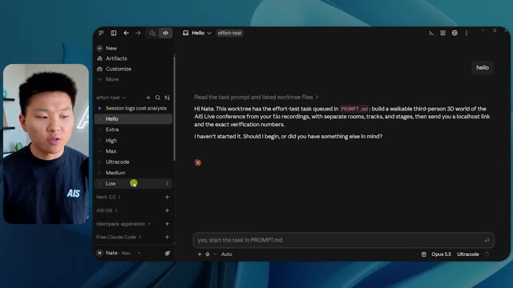
*⏱️ 00:01:42 — Interface de l'éditeur Windsurf affichant une liste de niveaux d'effort (Low, Medium, High, Max) dans la barre latérale gauche et un chat avec l'IA sur la droite.*

---

### ⏱️ `[00:02:08 - 00:02:40]` | Segment #06

**🔊 Audio (Transcription Intégrale Mot pour Mot en Français) :**
> this is. Okay. This is Chicago, which is kind of cool because you know, I live in Chicago, but anyways, on the top, right, we can see a map. We have a lobby. We have an expo hall. We have VIP lounge main stage. Also the map shows where every other person is and that's sinking live. So we can see registration. We can see day one, hyper agent keynote, live debrief. Cool. So it actually does know the agenda and then there's day two. So it found that that's good. We have these little balls in here that I can hopefully kick around. Okay. The face, Oh, look at this. If I go over here, all the people just disappear. Very bad. Very bad. Okay. So let's see. Can I sprint? Okay.

**👁️ Analyse Visuelle d'Écran (gemini-3.5-flash-lite) :**
**Interface & Outils** : Application Web de conférence virtuelle immersive (type metaverse événementiel).

**Contenu textuel & Code** : Mini-carte de navigation (Lobby, Expo Hall, VIP Lounge, Main Stage) et liste des activités de la conférence « DAY 1 ».

**Action / Démonstration** : Navigation et exploration de l'espace virtuel par l'avatar, interaction avec les zones de l'événement en temps réel.

*⏱️ 00:02:16 — Vue d'une plateforme virtuelle interactive (type événementiel) montrant un espace « Badge pickup » avec des avatars d'utilisateurs et une mini-carte en haut à droite.*

*⏱️ 00:02:24 — Vue de l'interface dans la zone « Lobby » affichant un panneau d'information « DAY 1 » listant des sessions, avec la mini-carte de navigation toujours présente.*

*⏱️ 00:02:32 — Vue de l' « Expo Hall » avec des avatars regroupés autour d'une plateforme centrale lumineuse et des affichages textuels sur les stands, avec la mini-carte en haut à droite.*

---

### ⏱️ `[00:02:40 - 00:03:04]` | Segment #07

**🔊 Audio (Transcription Intégrale Mot pour Mot en Français) :**
> I can move a little faster. I'll first go over here. There's some swag, um, AIS plus certified glido. Okay. So it's got the actual booths that we had in the virtual event. We had booths. So that's pretty cool. A little place to take pictures. Room C. Right now we have Tangy Frederick doing a workshop. Okay. But this isn't a video. As you can see, it's just an image. She's not moving. So that's just an image. These people are disappearing. They must be ghosts. Let's go over here to room A.

**👁️ Analyse Visuelle d'Écran (gemini-3.5-flash-lite) :**
**Interface & Outils** : Plateforme d'événement virtuel (type Gather.town ou similaire).

**Contenu textuel & Code** : Instructions à l'écran : "Step 1: Go to 'Settings'", "Step 2: Go to 'API Integrations'", "Step 3: Go to 'Create A New Token'".

**Action / Démonstration** : L'utilisateur déplace son avatar dans l'espace virtuel pour explorer les stands et rejoindre un atelier technique.

*⏱️ 00:02:46 — Vue d'un hall d'exposition virtuel avec un avatar se déplaçant près d'un stand sponsorisé nommé "Glaido".*

*⏱️ 00:02:52 — Navigation de l'avatar dans une salle de conférence virtuelle (Workshop Room C) avec des écrans de présentation affichant des instructions.*

*⏱️ 00:02:58 — L'avatar s'approche d'un écran géant dans la salle de conférence détaillant les étapes pour générer une clé API.*

---

### ⏱️ `[00:03:04 - 00:03:30]` | Segment #08

**🔊 Audio (Transcription Intégrale Mot pour Mot en Français) :**
> We have Liberty White. Okay. Very cool. Your first 30 days in automation. Once again, it's just a still image and the people are glitchy. So not very good here. I'm going to go over to the main stage and see what we've got going. Okay, cool. So we have a main looking stage. The people are glitching. Really bad. That's not very good at all. Our video is actually moving. Like I saw my face here and I saw Devin's, but now they're gone. So I'm not sure what happened. Okay. It's, it looks like it's more of a slideshow. Nothing is actually being played still. Anyways, let's come in here.

**👁️ Analyse Visuelle d'Écran (gemini-3.5-flash-lite) :**
**Interface & Outils** : Environnement de conférence virtuelle 3D (type métavers).

**Contenu textuel & Code** : Texte affiché : "Workshop Room A: Foundation track" et "Now showing: Hyperagent Workshop: How to Build an Always-On Fleet of Agents".

**Action / Démonstration** : Navigation et exploration d'un utilisateur au sein d'un espace de conférence virtuel.

---

### ⏱️ `[00:03:30 - 00:03:58]` | Segment #09

**🔊 Audio (Transcription Intégrale Mot pour Mot en Français) :**
> We have more booths. We have hyper agent. We have Claude Code. We have more swag. Room B is Dave Ebelor. I'm assuming it's the same exact thing. We've got coffee. And then I'm assuming VIP lounge, VIP access only. That's pretty cool, but there's really nothing going on right here. That screen's way too bright. Okay. So I think you guys understand the vibe that we're getting here from Opus 5.5 on low effort. And here's where things get interesting. How much do you guys think that this ran for? How long? This one ran for 16 minutes and 43 seconds. How much do you think this cost?

**👁️ Analyse Visuelle d'Écran (gemini-3.5-flash-lite) :**
**Interface & Outils** : Canvas de travail collaboratif ou outil de gestion de projet (Type Miro ou tableau de bord Opus 5.5).

**Contenu textuel & Code** : Tableau comparatif structuré avec des colonnes : Low, Medium, High, Extra, Max, Ultracode et des lignes : Run time, API cost, Total tokens, Checks, Questions asked.

**Action / Démonstration** : Visualisation d'un tableau comparatif technique évaluant les efforts ou paramètres de performance du modèle Opus 5.5.

*⏱️ 00:03:51 — Interface de tableau de bord nommée "Opus 5.5 Efforts" présentant une matrice comparative de performances.*

---

### ⏱️ `[00:03:58 - 00:04:26]` | Segment #10

**🔊 Audio (Transcription Intégrale Mot pour Mot en Français) :**
> $3.91 if this was API billing. I'm obviously using my subscription here, but we're just going to calculate this in API billing. Total tokens was 191,000. It did 22 checks. So the verification, 22 times it opened up the browser and ran different sorts of checks. So 22 categories of checks. And how many questions did it ask me? It asked me a total of zero questions throughout this slash goal prompt. Okay. So let's open up medium effort and see what we've got. Okay, here we go. Medium effort. We've got Nate Herc. We've got my badge. This is AI's life branded.

**👁️ Analyse Visuelle d'Écran (gemini-3.5-flash-lite) :**
**Interface & Outils** : Outil de diagramme/tableau blanc (type Canvas).

**Contenu textuel & Code** : Tableau comparatif affichant les métriques "Low" : Run time (16m 43s), API cost ($3.91), Total tokens (191.3K), ainsi que les lignes vides pour "Checks" et "Questions asked".

**Action / Démonstration** : Présentation des données récapitulatives de l'exécution de l'agent IA, avec une mise en évidence visuelle des coûts et de la consommation de jetons.

*⏱️ 00:04:05 — Une capture d'écran montrant l'interface d'un outil de design ou de tableau blanc (probablement Obsidian Canvas ou similaire) présentant un tableau de données analytiques sur les performances d'un agent IA.*

---

### ⏱️ `[00:04:26 - 00:04:46]` | Segment #11

**🔊 Audio (Transcription Intégrale Mot pour Mot en Français) :**
> So this is already looking a little bit better. This feels like our color schemes that used our brand guidelines. Day one build, day two earn, VIP. Cool. Okay. I'm going to enter the venue. Okay. Wow. So similar sort of vibe. It's sitting in the background. This doesn't look like Chicago though, does it? No, this looks like a, honestly, this looks like a made up city. Either way, it's funny that they decided to do that. Let's see if I can move a little faster. Oh, wow.

**👁️ Analyse Visuelle d'Écran (gemini-3.5-flash-lite) :**
**Interface & Outils** : Plateforme événementielle virtuelle interactive "AIS Live" (web-based).

**Contenu textuel & Code** : Interface utilisateur affichant "Welcome to AIS Live", commandes clavier (WASD, Shift, Space, etc.) et statut des sessions.

**Action / Démonstration** : Nate Herk présente l'interface de connexion, puis clique sur "Enter the venue" pour accéder à l'espace virtuel 3D.

*⏱️ 00:04:31 — Interface d'accueil de la plateforme virtuelle "AIS Live" affichant un badge d'invité personnalisé et les commandes de navigation.*

*⏱️ 00:04:41 — Vue immersive à la première personne dans l'environnement 3D "AIS Live", montrant des avatars dans un espace événementiel avec vue sur une ville.*

---

### ⏱️ `[00:04:46 - 00:05:21]` | Segment #12

**🔊 Audio (Transcription Intégrale Mot pour Mot en Français) :**
> The people are interacting with me. Watch. If I go up to this guy, he just like raised his arm. Well, now he doesn't want anything to do with me at all. But all of these little robots here must be making decisions. I'm not sure if they're using Jev. They're definitely not. I didn't tell it to. Actually, my Jev key is in the back. I don't know. Maybe it did use it. Anyways, we can see here we have Workshop Room C, Agents Lab. Nice. So this one is actually being run. You can see that is a real video being played by Tangy. Everyone here is actually like working on a laptop. They're not glitching. This is pretty cool. Also, my badge is on my chest, which is pretty cool. I can come this way. We have a map up in the top right, as you guys can see, but I can come this way. We have an

**👁️ Analyse Visuelle d'Écran (gemini-3.5-flash-lite) :**
**Interface & Outils** : Environnement virtuel 3D interactif (type simulation sociale ou métavers).

**Contenu textuel & Code** : Interface utilisateur affichant "Workshop Block 3", "Enterprise AI Services", et le nom "Tangy Frederick".

**Action / Démonstration** : Navigation et exploration d'un environnement virtuel peuplé d'avatars autonomes ("robots") simulant une activité professionnelle ou académique.

*⏱️ 00:04:55 — Vue à la première personne dans un environnement virtuel 3D de type métavers où le personnage évolue dans un hall avec des avatars.*

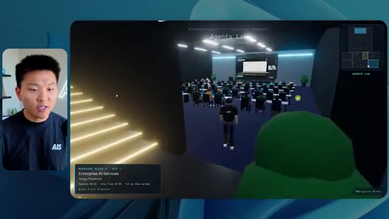
*⏱️ 00:05:04 — Le personnage entre dans une salle de conférence nommée "Agents Lab" remplie d'avatars assis devant des ordinateurs, avec une interface de présentation en bas à gauche.*

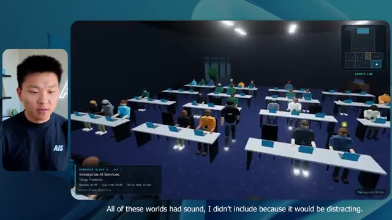
*⏱️ 00:05:12 — Vue en plongée de la salle de conférence "Agents Lab" montrant plusieurs rangées d'avatars occupés à des tâches devant des ordinateurs portables.*

---

### ⏱️ `[00:05:21 - 00:05:47]` | Segment #13

**🔊 Audio (Transcription Intégrale Mot pour Mot en Français) :**
> expo hall. This is where we have the Glido booth. And this is actually playing. Yeah, it's playing the video of us talking about Glido. It's playing the video of Ed and I talking about our certification program. We've got the AIS Plus logo back here, which is kind of in a weird spot. This is a speaker slides and takeaways. So wow, this is all the resources that we gave out after the event. They're all sitting right there as well. We can see we've got a community spotlight. So this is Aiden talking about his deal that he landed and it's playing live. These people are watching.

**👁️ Analyse Visuelle d'Écran (gemini-3.5-flash-lite) :**
**Interface & Outils** : Environnement virtuel de conférence (type métavers) affichant des contenus de présentation, des diaporamas et des zones de ressources.

**Contenu textuel & Code** : Textes informatifs sur la certification "AIS+", titres de sessions, vignettes de diapositives de conférences et navigation de salle.

**Action / Démonstration** : Navigation et exploration de l'espace virtuel de conférence, présentation du stand et visualisation des ressources éducatives disponibles pour les utilisateurs.

*⏱️ 00:05:28 — Vue d'un espace d'exposition virtuel avec des avatars, présentant un stand "AIS+ Certified" avec un écran diffusant du contenu textuel.*

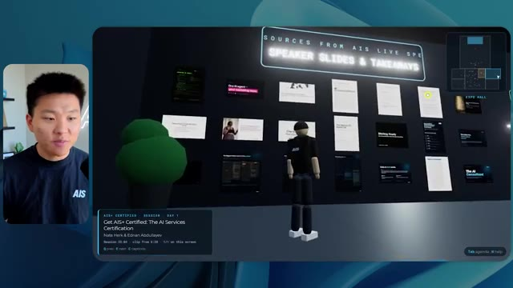
*⏱️ 00:05:34 — Gros plan sur un mur d'exposition virtuel affichant une galerie de diapositives de présentation ("Speaker Slides & Takeaways") sous forme de vignettes.*

*⏱️ 00:05:40 — Vue panoramique de l'espace virtuel montrant une zone de travail ("Consultant's Lab") avec des avatars interagissant avec des interfaces informatiques.*

---

### ⏱️ `[00:05:47 - 00:06:21]` | Segment #14

**🔊 Audio (Transcription Intégrale Mot pour Mot en Français) :**
> They're pretty engaged. We've got hyper agent. That was, that's what I meant. If you guys saw those people like raising their arms saying hi, that was kind of funny. Look, look, there he goes again. Anyways. Okay. Where am I now? Now I'm in the main lobby. We've got a coffee bar. We've got a big logo, which is the real logo. It's too bright, but we have the logo. We can see if we can come in here to the foundation track. We've got Sabrina Romanov and Liberty White. So different trainings right there. We can come into this room. This is the advanced track. So what's going on here. We've got Dave Ebelar and Saman talking about some different stuff in there. And now let's go take a look at the main stage. Oh, wait, there's a video of me up there. Is that like a VIP

**👁️ Analyse Visuelle d'Écran (gemini-3.5-flash-lite) :**
**Interface & Outils** : Plateforme d'événement virtuel 3D (type métavers professionnel).

**Contenu textuel & Code** : Environnement interactif avec interfaces de navigation, mini-carte en haut à droite et indicateurs de lieu ("Main Lobby").

**Action / Démonstration** : Exploration et navigation au sein d'un espace événementiel virtuel, montrant l'interaction entre les avatars.

*⏱️ 00:05:55 — Vue à la première personne dans un environnement virtuel 3D montrant le "Main Lobby" avec un bar à café et des avatars interactifs.*

*⏱️ 00:06:04 — L'avatar se déplace dans un hall principal vers une salle de conférence où d'autres avatars sont assis devant un écran de présentation.*

*⏱️ 00:06:12 — Vue de l'avatar entrant dans la salle de conférence, montrant une foule d'autres participants virtuels en interaction.*

---

### ⏱️ `[00:06:21 - 00:06:50]` | Segment #15

**🔊 Audio (Transcription Intégrale Mot pour Mot en Français) :**
> section? Yeah, we'll go check that out in a sec. But anyways, this is the main stage. This looks very, very nice. We've got a big stage. We've got like four people sitting up here. We've got the the three screens of Alex up there with hyper agent. Am I allowed to get on stage? Oh, and lets me up on stage. Okay. That's pretty nice. All right, guys, let's take a selfie. Let me get everyone in the background. Get in here. Anyways, that is pretty, pretty cool. Not every seat is filled though. So we need to work on that. But anyways, I'm going to run back over and see what that VIP section was. Okay. VIP lounge. I feel like this is like a worth the airport or something.

**👁️ Analyse Visuelle d'Écran (gemini-3.5-flash-lite) :**
**Interface & Outils** : Environnement de conférence virtuelle (application type métavers ou plateforme de keynote virtuel).

**Contenu textuel & Code** : Texte informatif sur l'interface : "Keynote Day 1", "Hyperagent Keynote", "Alex McDonnell, Hyperagent".

**Action / Démonstration** : Navigation et exploration de l'espace virtuel par l'avatar du présentateur.

---

### ⏱️ `[00:06:51 - 00:07:14]` | Segment #16

**🔊 Audio (Transcription Intégrale Mot pour Mot en Français) :**
> Okay, cool. So now we've got the VIP sessions up here. VIP Q and a with Nate live video playback right here. Very, very cool. And we've got like a bar or something. Awesome. I would say that this is a pretty good output. Now, as far as the stats here, this one took one hour and 13 minutes to run. It would have cost us $12 and 44 cents. It used 490,000 tokens and it did 23 checks.

**👁️ Analyse Visuelle d'Écran (gemini-3.5-flash-lite) :**
**Interface & Outils** : Environnement virtuel (metaverse/espace événementiel) et interface de tableau de bord de suivi de projet (type tableur ou outil de gestion).

**Contenu textuel & Code** : Image 1 : Interface de salon "VIP Q&A with Nate". Image 2 : Données chiffrées : "Run time: 16m 43s", "API cost: $3.91", "Total tokens: 191.3K", "Checks: 22".

**Action / Démonstration** : Démonstration de l'interface utilisateur de l'espace événementiel et présentation des statistiques de performance technique d'une exécution de modèle IA.

*⏱️ 00:06:56 — Vue d'un environnement virtuel immersif représentant une salle VIP avec avatars, incluant un écran géant diffusant une vidéo de session Q&A.*

*⏱️ 00:07:02 — Capture d'un tableau de bord de suivi de performance nommé "Opus 5.5 Efforts" affichant des statistiques de runtime, coût API et jetons.*

---

### ⏱️ `[00:07:14 - 00:07:48]` | Segment #17

**🔊 Audio (Transcription Intégrale Mot pour Mot en Français) :**
> And it asked us a grand total of zero questions once again. All right, let's move on to high. This was already a pretty decent output and Anthropic themselves in their how to prompt Opus 5.5 video, or sorry, not video, article. They said to just start on medium and scale it up or down if you need. So that was a medium output. Let's move over to high and see what we got. Real quick, guys, I need to take a second to tell you about the sponsor of today's video, Hostinger. So both of these models just built me a working version of the same thing. And now I'm right where I always end up with something finished sitting on my laptop and no quick way to get it online. And that's the gap that Hostinger's connector closes. It's a free extension

**👁️ Analyse Visuelle d'Écran (gemini-3.5-flash-lite) :**
**Interface & Outils** : Logiciel de tableau blanc (Canvas) pour la gestion de projets ; Éditeur de code Cursor avec intégration d'IA (Claude/Opus 5.5).

**Contenu textuel & Code** : Tableau de métriques de performance IA ; Prompt : "Build a single-page ROI calculator I can put on my agency's website as a lead magnet." ; Étapes de réflexion de l'agent.

**Action / Démonstration** : Analyse comparative des coûts et des performances d'exécution des modèles, et démonstration de la génération de code via un agent IA en mode "Medium".

*⏱️ 00:07:22 — Un tableau comparatif affiché dans une interface de type tableau blanc, détaillant les performances (temps d'exécution, coût API, jetons, vérifications, questions posées) pour différents niveaux de paramètres (Low, Medium, High, Extra).*

*⏱️ 00:07:39 — L'interface de l'éditeur Cursor (ou similaire) montrant le processus de développement d'un agent IA en temps réel, avec le suivi des étapes "Thinking", "Ruminating" et l'historique du prompt utilisateur pour la création d'un calculateur de ROI.*

---

### ⏱️ `[00:07:48 - 00:08:23]` | Segment #18

**🔊 Audio (Transcription Intégrale Mot pour Mot en Français) :**
> for your editor that pulls your Hostinger account into whatever you're already coding in. So VS Code, cursor, cloud code, codex, you name it. You sign in once with a single click, and from there, your agent can deploy the site, point a domain at it, set the DNS records, and check on your VPS without you ever having to leave the editor. So whichever one of these you end up liking better, the thing it built is a couple minutes away from a real URL on managed hosting. Connector is free on every hosting or plan, so if you still need the hosting underneath it, grab the unlimited plan with the link in the description and use code NATEHERK for 10% off. That also comes with a free domain and business email for the year. And it's still the cheapest way that I found to get something

**👁️ Analyse Visuelle d'Écran (gemini-3.5-flash-lite) :**
**Interface & Outils** : Interface de gestion d'agent IA (Hostinger integration) et terminal Claude Code.

**Contenu textuel & Code** : État "Connected" via OAuth, version Node.js 24.13.0, et liste des capacités activées pour l'assistant (gestion de sites web, domaines, paiements et email marketing).

**Action / Démonstration** : Démonstration de l'intégration et de l'autorisation d'un agent IA pour interagir avec les ressources Hostinger directement depuis l'environnement de développement.

*⏱️ 00:07:57 — Une interface de configuration montrant la connexion réussie entre un compte Hostinger et un IDE, avec une liste d'outils disponibles (Websites, Domains, Subscriptions, Email Marketing) et une fenêtre Claude Code ouverte sur la droite.*

---

### ⏱️ `[00:08:23 - 00:08:47]` | Segment #19

**🔊 Audio (Transcription Intégrale Mot pour Mot en Français) :**
> you built onto a real URL. So let's get back to the video. Okay. Once again, very, very branded. This is even better of a loading screen than the previous one. We've got this nice little effect in the background. We've got the logo. We'll enter the venue. Okay. Here we are. This looks pretty nice. We start outside and you can see that we have these flags for all the speakers, Wyatt, Casper, Alex, Ed, Aiden, Sabrina, Liberty. This is pretty cool. We got live blocks here.

**👁️ Analyse Visuelle d'Écran (gemini-3.5-flash-lite) :**
**Interface & Outils** : Plateforme événementielle virtuelle en ligne "AIS LIVE" (basée sur une technologie de type environnement 3D interactif).

**Contenu textuel & Code** : Interface utilisateur affichant des guides de commandes (WASD, Espace, Shift, Souris), une jauge de progression "Passport", une mini-carte en haut à droite et des noms d'intervenants sur des bannières.

**Action / Démonstration** : Navigation et exploration de l'espace virtuel par l'utilisateur, passage de l'écran d'accueil à la zone d'exposition 3D interactive.

*⏱️ 00:08:29 — Écran de chargement et d'accueil de la plateforme "AIS LIVE" présentant les contrôles clavier et le bouton pour entrer dans le lieu virtuel.*

*⏱️ 00:08:35 — Vue immersive du lieu virtuel "AIS Live Plaza" avec des avatars, des bâtiments et une interface de jeu montrant la progression et la localisation.*

*⏱️ 00:08:41 — Vue en jeu de la place virtuelle avec des bannières verticales affichant les noms des intervenants (ex: Alex McDonnell, Wyatt Lynsmith) et un environnement 3D stylisé.*

---

### ⏱️ `[00:08:47 - 00:09:23]` | Segment #20

**🔊 Audio (Transcription Intégrale Mot pour Mot en Français) :**
> it took this picture from me, your host, Nate Herc, John, Dave, Nate Herc. There we go. Okay. The doors. Awesome. They're automatic sliding glass doors. I love that. We can see VIP check-in. We can see GA. We can come over here and we can check out the expo with different booths, community spotlight. You can also see that in the top left, I have a passport. So it's like, it will be showing how many of the places I've visited. All of these are real playback. We've got a resource wall with all of the different speakers. They've also got a networking session over here. So I'm going to come over real quick and see what that's all about. So we've got the AIS cold brew bar. We've got different community members that were spotlighted or highlighted.

**👁️ Analyse Visuelle d'Écran (gemini-3.5-flash-lite) :**
**Interface & Outils** : Environnement de conférence virtuel 3D (type métavers ou plateforme événementielle interactive).

**Contenu textuel & Code** : Textes affichés dans l'interface : "Registration Concourse", "Main Stage", "VIP Check-in", "Expo Hall", "Get AIS+ Certified".

**Action / Démonstration** : Exploration et navigation dans un espace de conférence virtuel avec un avatar.

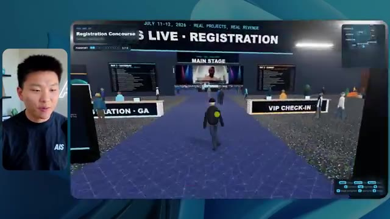
*⏱️ 00:08:56 — Vue à la première personne dans un environnement virtuel 3D montrant le hall d'entrée "Registration Concourse" avec des panneaux "Main Stage" et des comptoirs d'accueil "VIP Check-in".*

*⏱️ 00:09:05 — Navigation dans une zone d'exposition virtuelle ("Expo Hall") avec des stands d'information et des avatars d'utilisateurs.*

*⏱️ 00:09:14 — Déplacement de l'avatar dans le hall de conférence montrant les larges baies vitrées et l'agencement de l'espace événementiel.*

---

### ⏱️ `[00:09:23 - 00:09:56]` | Segment #21

**🔊 Audio (Transcription Intégrale Mot pour Mot en Français) :**
> We've got the VIP wing. Wait, what? Pick up a wristband. Oh, I have to actually go get the wristband. Okay. Let me check in real quick. Wristband's already on. Wait, what? Okay. Oh, okay. Now the doors have opened for me. Cool. I can come into here. Oh, that just goes to the main stage. VIP lounge. This is a Q and A going on. It looks like very cool. I mean, I'm very impressed by how it's able to do this. Wow. Okay. So this is really good. What we did is we had VIP breakout rooms with different people. You can see that there's different rooms, different members of the AIS team going into stuff. This is really cool. This is very cool. That's a much better VIP

**👁️ Analyse Visuelle d'Écran (gemini-3.5-flash-lite) :**
**Interface & Outils** : Environnement virtuel de type "Metaverse" pour conférences professionnelles en ligne.

**Contenu textuel & Code** : Panneaux textuels informatifs, minimap, barre de progression de passeport et noms de sessions de travail.

**Action / Démonstration** : Navigation de l'avatar utilisateur au sein de la plateforme virtuelle pour accéder à différentes zones d'événements.

*⏱️ 00:09:32 — Vue à la première personne dans un environnement virtuel de conférence, montrant le hall d'enregistrement (Registration Concourse) avec des avatars et des indications textuelles sur l'accès à l'aile VIP.*

*⏱️ 00:09:40 — Intérieur du salon VIP (VIP Lounge) avec un écran central diffusant une vidéo de conférence, des avatars assis sur des canapés et une interface de navigation en bas à droite.*

*⏱️ 00:09:48 — Espace de travail VIP (VIP Working Sessions) présentant trois zones thématiques : "Price It Right", "Turn Your Expertise into a Service" et "Land Your First Paying Client".*

---

### ⏱️ `[00:09:56 - 00:10:30]` | Segment #22

**🔊 Audio (Transcription Intégrale Mot pour Mot en Français) :**
> experience than what was shown in the first piece. Okay. VIP after party. Look at this. We've got a dance floor. We've got all these elements in here. We have the actual VIP after party playback right here. And there's a DJ booth. That is so funny. There's a bit of a bug right here, a glitch right there, but this is awesome. Oh, cool. So when I'm in here in the main stage, we get closed captions. You can see right here in the bottom of my screen, we're getting these closed captions of Wyatt actually talking up here. We've got lights. We've got the panel. Very cool. Nice main stage. I'm going to go over here. We can go to the foundation,

**👁️ Analyse Visuelle d'Écran (gemini-3.5-flash-lite) :**
**Interface & Outils** : Plateforme événementielle virtuelle interactive (type métavers avec HUD de navigation et interface de conférence).

**Contenu textuel & Code** : Éléments d'interface utilisateur (UI) : menu de contrôle en bas à droite, barre de progression "Passport", titres des segments ("VIP After-Party", "Main Stage"), et flux vidéo intégrés au décor virtuel.

**Action / Démonstration** : Navigation et exploration de différents espaces virtuels (fête puis conférence) au sein de la plateforme.

*⏱️ 00:10:04 — Vue d'un environnement virtuel type métavers représentant une "VIP After-Party" avec des avatars dansants et un écran affichant une mosaïque de participants.*

*⏱️ 00:10:13 — Vue légèrement différente de la même "VIP After-Party" virtuelle, montrant les avatars et le DJ booth mentionné, avec une interface de navigation et de score de passeport.*

*⏱️ 00:10:21 — Transition vers un autre environnement virtuel, la "Main Stage", montrant un orateur sur grand écran devant une audience d'avatars assis en rangées.*

---

### ⏱️ `[00:10:30 - 00:11:06]` | Segment #23

**🔊 Audio (Transcription Intégrale Mot pour Mot en Français) :**
> advanced, and the enterprise tracks over here. So let's see. We have anatomy of a three real deals. We've got hyper agent. We've got the evals with Nate and Ed in here. We've got Dave going on in the advanced stuff. This is really nice. I mean, obviously each, each of these outputs so far, low was okay. Medium was better. High has been even better. Let's see if that trend continues and let's go ahead and see what this cost us. So high ran for one hour and seven minutes. So a little bit quicker than medium, it would have cost us $16 and 31 cents. It used half a million tokens, 509,000. It did 22 checks. And it also asked us, well, actually, no, I was wrong. This

**👁️ Analyse Visuelle d'Écran (gemini-3.5-flash-lite) :**
**Interface & Outils** : Outil de création de diagrammes ou tableau blanc numérique (type Excalidraw ou similaire pour la gestion de projet Opus 5.5).

**Contenu textuel & Code** : Tableau de données comparatives incluant des colonnes "Low", "Medium", "High", "Extra" avec des variables techniques (Run time, API cost, Total tokens, etc.).

**Action / Démonstration** : Analyse comparative et édition visuelle des performances de l'agent Opus 5.5 via un tableau de bord récapitulatif.

*⏱️ 00:10:57 — Tableau comparatif détaillé intitulé "Opus 5.5 Efforts" affichant les métriques de performance : temps d'exécution, coût API, jetons totaux, vérifications et questions.*

---

### ⏱️ `[00:11:06 - 00:11:25]` | Segment #24

**🔊 Audio (Transcription Intégrale Mot pour Mot en Français) :**
> one asked me one question and spoiler, it was the only one that asked us a question throughout all of this. So let's see, we've got three left extra max and ultra code. Let me pull open extra and we'll see what we got. Okay. So this one looks pretty good. I would honestly say so far, the loading screen high was the best. The one that we just saw, but anyways, let's enter AIS live.

**👁️ Analyse Visuelle d'Écran (gemini-3.5-flash-lite) :**
**Interface & Outils** : Interface de travail type "Canvas" ou outil de suivi de projet IA.

**Contenu textuel & Code** : Tableau de données comparant : Run time, API cost, Total tokens, Checks et Questions asked pour différents niveaux de modèles. La colonne "Extra" est actuellement vide et sélectionnée.

**Action / Démonstration** : Le présentateur analyse les résultats des tests d'agents et s'apprête à consulter les détails pour la catégorie "Extra".

*⏱️ 00:11:11 — Tableau comparatif des performances de modèles IA (Low, Medium, High, Extra) affiché dans une interface de type "Canvas" intitulée "Opus 5.5 Efforts".*

---

### ⏱️ `[00:11:26 - 00:11:51]` | Segment #25

**🔊 Audio (Transcription Intégrale Mot pour Mot en Français) :**
> Whoa. Okay. So we have like little sound bites. I can chat with people. The tool war panel settled a few debates for me. Nice. Good perspective there. We're outside again. We have these different banners, although they're all the same. They don't say like different people's names. So big AIS live logo. Workshop wing is over here. And let's go through the sliding glass doors and see what we've got. So we've got the AIS cafe. The map is in the bottom right, and it's not too descriptive.

**👁️ Analyse Visuelle d'Écran (gemini-3.5-flash-lite) :**
**Interface & Outils** : Environnement virtuel 3D de type métavers / plateforme événementielle en ligne.

**Contenu textuel & Code** : Interface utilisateur de jeu incluant une mini-carte, des icônes d'état et des bulles de discussion textuelles au-dessus des avatars.

**Action / Démonstration** : Navigation et exploration de l'espace virtuel par l'avatar du présentateur.

---

### ⏱️ `[00:11:51 - 00:12:26]` | Segment #26

**🔊 Audio (Transcription Intégrale Mot pour Mot en Français) :**
> I like how the other maps have told us what, like where things were, but this one looks very professional. We can see here's the main stage. Let's hop in here real quick. They've all got these balls flying around, which I think is pretty funny. The AIS beach balls. We have me up there speaking. I think I was introing one of the days. Let's keep on moving here to the workshop room on this left side. Okay. So here we've got the Hyper Agent Theater. We've got this sponsored session in here by Hyper Agent, but it's showing us what's coming up in here as well. It's really funny that we can chat to people. Salmon built a voice sales rep live. The price it right room was packed. Did you grab the VIP companion guide? That's so funny. We have the advanced track in

**👁️ Analyse Visuelle d'Écran (gemini-3.5-flash-lite) :**
**Interface & Outils** : Plateforme d'événement virtuel 3D (Metaverse de conférence).

**Contenu textuel & Code** : Interface utilisateur avec mini-map en bas à droite, bulles de discussion textuelles au-dessus des avatars, et signalétique d'événement (Main Stage, Workshops, Enterprise Services).

**Action / Démonstration** : Navigation et exploration de l'espace événementiel virtuel par l'avatar de l'utilisateur.

*⏱️ 00:12:00 — Vue à la première personne dans un environnement virtuel 3D montrant une salle de conférence avec des avatars, une scène principale, et un écran vidéo affichant le présentateur.*

*⏱️ 00:12:09 — Vue dans le "Grand Lobby" d'une plateforme d'événement virtuel, montrant des avatars d'utilisateurs devant des panneaux indiquant des ateliers (Workshops).*

*⏱️ 00:12:17 — Navigation dans un couloir virtuel au sein de la même plateforme, avec des avatars discutant près d'un espace nommé "Enterprise Services".*

---

### ⏱️ `[00:12:26 - 00:12:58]` | Segment #27

**🔊 Audio (Transcription Intégrale Mot pour Mot en Français) :**
> here. Once again, we've got live playback. Is that live playback? Oh, okay. It started once I got in, but I can take a seat. Oh my. I can watch this. I can stand up. I want to sit in the front. That's pretty cool. That's very nice. I like that. And you know what I noticed so far? The actual character that I'm playing kind of looks like me. I think it modeled it off of my thumbnail pictures or something. Anyways, we have Sabrina in here, room host here, grab any open seat. Okay, cool. And I really liked the sitting functionality. It's kind of funny. Like we could actually attend this workshop and participate. Anyways, it's showing us the speakers. It's showing us the

**👁️ Analyse Visuelle d'Écran (gemini-3.5-flash-lite) :**
**Interface & Outils** : Environnement de conférence virtuelle 3D (type plateforme événementielle IA).

**Contenu textuel & Code** : Interface web de type "Workshops" : "Advanced Build a Voice AI Sales Bot" et "Foundation: Build Your First AI Content Engine".

**Action / Démonstration** : Navigation et immersion dans un événement professionnel virtuel interactif où l'utilisateur (l'avatar) se déplace dans une salle de conférence pour assister à une présentation.

*⏱️ 00:12:34 — Vue d'une salle de conférence virtuelle (Advanced Track) avec des avatars d'utilisateurs et un écran géant affichant une interface de travail.*

*⏱️ 00:12:42 — Vue de la salle de conférence virtuelle (Foundation Track) avec l'animateur et les participants, écran montrant une interface de plateforme de création.*

*⏱️ 00:12:50 — Gros plan sur l'écran de la salle virtuelle affichant une interface web avec des flux vidéo en direct (webinaires) et des outils de navigation.*

---

### ⏱️ `[00:12:58 - 00:13:31]` | Segment #28

**🔊 Audio (Transcription Intégrale Mot pour Mot en Français) :**
> agenda. There's a little red carpet here to take some pictures. We can strike a pose. Oh, wow. That's pretty cool. Resource library, get AIS Plus certified, Glido, Hyper Agent, AIS Plus, three real deals. Awesome. I mean, I would definitely say so far, each one is getting better. And we didn't even check out the VIP section yet, the VIP lounge. Let's go up here real quick. Hopefully I can get in. Nice. We've got tooling reset. These are the different rooms we could go in. So once again, I could grab the worksheet and I could try to understand how to price my stuff. This is so cool. This is definitely better than the previous one where we kind of just

**👁️ Analyse Visuelle d'Écran (gemini-3.5-flash-lite) :**
**Interface & Outils** : Plateforme événementielle virtuelle interactive en 3D (type métavers).

**Contenu textuel & Code** : Noms des sponsors (Hyperagent, Glido), menus de navigation (Agenda, Map), et questions de coaching business affichées à l'écran.

**Action / Démonstration** : Navigation et exploration de l'espace virtuel par l'avatar du présentateur pour visiter les différents stands et zones de networking.

*⏱️ 00:13:07 — Vue panoramique de l'Expo Hall virtuel présentant les stands des sponsors, notamment Hyperagent et Glido.*

*⏱️ 00:13:15 — Hall d'accueil (Lobby) de la plateforme virtuelle avec escaliers, zone de réception et panneaux indiquant l'accès aux ateliers.*

*⏱️ 00:13:23 — Intérieur du salon VIP avec un groupe d'avatars assis autour d'une table, affichant des questions de réflexion professionnelle ("Price It Right" worksheet).*

---

### ⏱️ `[00:13:31 - 00:13:59]` | Segment #29

**🔊 Audio (Transcription Intégrale Mot pour Mot en Français) :**
> like looked at stuff. Awesome. I can get behind the bar and come in here. This is very nice. Okay. So as far as statistics go, this one ran for an hour and a half. It costs 25.92 bucks. I don't know why I say point $25, 92 cents. It was 733,000 tokens and 34 checks. So it had the most checks so far by far. And it asked us zero questions. I can't wait to see what we got here from max and ultra code. Okay. Here is max loading screens, boring, but it's on brand and it has our logo.

**👁️ Analyse Visuelle d'Écran (gemini-3.5-flash-lite) :**
**Interface & Outils** : Application de diagrammes ou tableau de bord de type canvas (probablement Excalidraw ou similaire).

**Contenu textuel & Code** : Tableau de données :
- Colonne "Extra" : 1h 31m, $12.44, 419.2K (tokens), 23 (checks).
- Autres colonnes : Données comparatives pour Medium, High, Max et Ultracode.

**Action / Démonstration** : Le présentateur commente le tableau de statistiques de performance, en mettant l'accent sur les durées d'exécution, les coûts et le nombre de vérifications effectuées par les différents modèles.

*⏱️ 00:13:38 — Capture d'écran montrant un tableau récapitulatif des performances d'un modèle (Opus 5.5 Efforts) avec des colonnes comparatives (Medium, High, Extra, Max, Ultracode) et des statistiques détaillées par ligne (temps d'exécution, coût, jetons, vérifications).*

---

### ⏱️ `[00:14:00 - 00:14:35]` | Segment #30

**🔊 Audio (Transcription Intégrale Mot pour Mot en Français) :**
> So that was good. I like that. We will go ahead and enter AIS live. Ooh, nice little animation here that brings us in. Once again, the character looks like me. They've all looked like me. I mean, sort of, we have sitting in the background. This looks like Chicago. Like I mentioned earlier, a lot of these are playing sounds and I'm not including that because it would be very distracting for you guys to try to listen to what's going on as well as me speaking. So there is like some slight music in all these. I hate how this is walking. This walking is really, really bad. I mean, the walking, yeah, I don't like this at all. So that's not great. But besides that, let's go in and explore. Notice these shadows when I walk in, they like really switch. I'm not sure why that is,

**👁️ Analyse Visuelle d'Écran (gemini-3.5-flash-lite) :**
**Interface & Outils** : Environnement de simulation 3D interactive (métavers/plateforme d'événement virtuel).

**Contenu textuel & Code** : Interface utilisateur HUD : date/heure, mini-carte (Arrival Plaza), état du stream "Live", titre du panel "The Tool War Panel", et guide des commandes clavier (WASD, Shift, Space, etc.).

**Action / Démonstration** : Navigation et exploration de l'avatar dans l'espace virtuel "AIS live" par l'utilisateur.

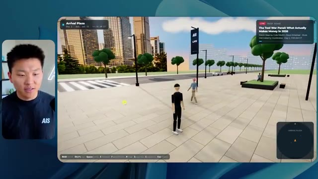
*⏱️ 00:14:08 — Vue à la troisième personne dans un environnement 3D de type métavers intitulé "Arrival Plaza", avec un avatar central et des indicateurs d'interface (mini-carte, encart "Live").*

*⏱️ 00:14:17 — L'avatar se déplace vers l'entrée d'un bâtiment moderne dans l'environnement virtuel, avec des bannières publicitaires et des informations sur un panel "Tool War" en haut à droite.*

*⏱️ 00:14:26 — L'avatar s'approche d'une zone d'entrée vitrée d'un complexe "Expo", avec des éléments de navigation en bas de l'écran affichant les contrôles clavier.*

---

### ⏱️ `[00:14:35 - 00:15:11]` | Segment #31

**🔊 Audio (Transcription Intégrale Mot pour Mot en Français) :**
> but anyways, we can chat with people in here too. Hyperagent booth is right where you walk into the expo. All good. Okay, cool. I can keep clicking E to make them change what they say. We've got the speakers right here. That looks pretty good. Although we definitely had everyone's profile picture. So I'm not sure why that's not included there. We see people taking pictures right here. I love that. And it saves a little picture. Okay. The map also isn't super, like doesn't give me a great explanation of what's going on, but I like these booths. These are cool. I think these booths are the best that I've seen so far. Like they just look nice. They've got reps. There's nice like slides behind them. Yeah. These booths are cool. Okay. We have a little featured theater

**👁️ Analyse Visuelle d'Écran (gemini-3.5-flash-lite) :**
**Interface & Outils** : Plateforme événementielle virtuelle interactive 3D (type métavers).

**Contenu textuel & Code** : Noms des intervenants, listes de sessions, mini-carte (radar) de navigation, indicateurs de contrôle clavier (touches WASD, Shift, E, etc.).

**Action / Démonstration** : Exploration de l'espace virtuel, interaction avec des stands et démonstration de la navigation des avatars par l'utilisateur.

*⏱️ 00:14:44 — Vue à la première personne dans un environnement virtuel de conférence 3D ("AIS Live"), montrant la zone de réception avec des avatars et des panneaux d'affichage listant les intervenants.*

*⏱️ 00:14:53 — Scène dans le hall de réception virtuel avec des avatars interagissant autour d'une table, et une fenêtre incrustée affichant une photo prise lors de l'événement ("AIS Live step-and-repeat").*

*⏱️ 00:15:02 — Navigation dans le hall d'exposition virtuel ("Expo Hall") montrant différents stands dédiés à des thématiques comme "EVALS LAB" et "ENTERPRISE AI".*

---

### ⏱️ `[00:15:11 - 00:15:35]` | Segment #32

**🔊 Audio (Transcription Intégrale Mot pour Mot en Français) :**
> going on over here. It's Casper. Although why is this not playing? I feel like this should be playing, right? Like in the other ones, they were always playing. We can talk to some other people over here. Coffee's free. Blah, blah, blah. Amy Simpson, Matt Wolf. Nice. Okay. This is just the networking area that we're in right now, but we can see in the top right. We can also see what's live on the main stage right now. It is a tool war panel. So let's head in here. We've got Devin, Cole, Dave, and Russ chatting in here. We've got sort of AV, some light stuff going on back here.

**👁️ Analyse Visuelle d'Écran (gemini-3.5-flash-lite) :**
**Interface & Outils** : Environnement virtuel de conférence/événement en ligne (type métavers ou plateforme de conférence 3D).

**Contenu textuel & Code** : Texte informatif sur un panneau mural : "REAL PROJECTS, REAL REVENUE", chiffres de revenus (14K, 20K) et statistiques d'engagement.

**Action / Démonstration** : Navigation et exploration d'un espace virtuel de conférence par un avatar.

---

### ⏱️ `[00:15:36 - 00:15:55]` | Segment #33

**🔊 Audio (Transcription Intégrale Mot pour Mot en Français) :**
> Switch the main stage to what actually matters right now. So I can switch the topic. Cool. So I just switched to me and Matt. We can go to anatomy of three real deals. That's pretty cool. The stage looks good. We've got a nice little panel up here. Can I get on the stage? Nice. Nice. Well, I can't go too far, actually. All right, everyone, let me take the selfie. Everyone get in this. I can also take a seat in this audience over here and just enjoy the session.

**👁️ Analyse Visuelle d'Écran (gemini-3.5-flash-lite) :**
**Interface & Outils** : Plateforme événementielle virtuelle interactive (type Gather.town ou environnement 3D personnalisé).

**Contenu textuel & Code** : Aucun code, commande ou donnée technique. L'interface affiche uniquement des éléments de navigation de jeu (HUD), des noms de panels ("Anatomy of Three Real Deals") et des flux vidéo intégrés dans l'espace 3D.

**Action / Démonstration** : Navigation et interaction dans un espace virtuel pour changer de scène.

---

### ⏱️ `[00:15:55 - 00:16:14]` | Segment #34

**🔊 Audio (Transcription Intégrale Mot pour Mot en Français) :**
> Very cool, very cool. Okay, let's go over here. I see an upstairs section. So it's funny how they all choose to put the VIP section upstairs. I mean, I don't hate it. Oh my gosh, they have an escalator. No way. I'm gonna chat with this guy on the escalator. Glenn has 15 years of agency experience. His land and expand stuff was gold. Great work, Glenn. Cool, so I'm gonna, I can't even get past this guy though.

**👁️ Analyse Visuelle d'Écran (gemini-3.5-flash-lite) :**
**Interface & Outils** : Environnement de conférence virtuelle 3D (plateforme de networking).

**Contenu textuel & Code** : Interface utilisateur de jeu (HUD) avec commandes de mouvement, mini-carte, liste des événements "Main Stage" et bulles de texte contextuelles sur les avatars.

**Action / Démonstration** : Exploration de l'espace virtuel et interaction sociale avec un autre utilisateur (avatar).

*⏱️ 00:16:00 — Vue à la première personne dans un environnement virtuel 3D représentant un hall de réception avec des avatars d'utilisateurs.*

*⏱️ 00:16:04 — Navigation dans l'environnement virtuel vers un escalator menant à une zone étiquetée "VIP LEVEL".*

*⏱️ 00:16:09 — Interaction en temps réel avec un avatar nommé Glenn, affichant une bulle de dialogue sur son expérience professionnelle.*

---

### ⏱️ `[00:16:14 - 00:16:48]` | Segment #35

**🔊 Audio (Transcription Intégrale Mot pour Mot en Français) :**
> Oh, I had to jump over him. Okay, VIP level, badge required. Oh my gosh. Are you kidding me? I have to go get my badge. Okay, cool. Now it shows that I'm an actual VIP and I can go up here to the VIP section. We have nice little working sessions back there, which we can hop in. I wonder if it'll let me like sit down in here. I can just chat. Can I participate? It's not letting me sit and participate. That's okay. We've got the pricing war room. Oh, this might be the after party. Let's go see what's going on back here. Or maybe I just have to enter from over here. Okay. That's weird. I just had to enter from over here. This after party is not as cool as the other one. But anyways, let's go see what's going on back here

**👁️ Analyse Visuelle d'Écran (gemini-3.5-flash-lite) :**
**Interface & Outils** : Environnement virtuel de conférence en ligne (plateforme de métavers pour événements professionnels).

**Contenu textuel & Code** : Texte à l'écran : "Nate Herk", "VIP Level", "Anatomy of Three Real Deals", "Day 1 - Scope to Ship", "Day 2 - First Sales Call Prep".

**Action / Démonstration** : Navigation et exploration de l'utilisateur à travers les différents niveaux et salles de l'espace virtuel.

*⏱️ 00:16:23 — Vue d'un environnement virtuel 3D de type conférence/espace de réseautage avec un personnage utilisateur au rez-de-chaussée près d'un escalier.*

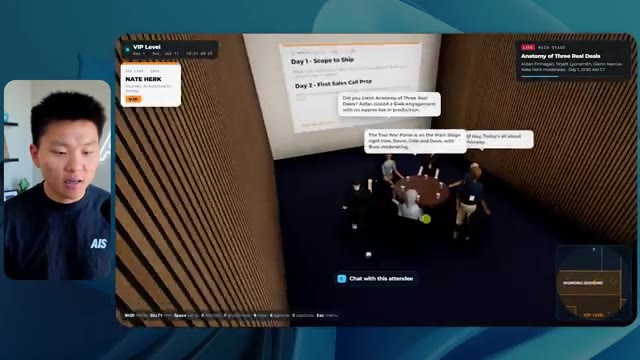
*⏱️ 00:16:31 — Vue de l'intérieur d'une salle de réunion virtuelle dans laquelle des avatars discutent autour d'une table avec des panneaux textuels affichant le programme.*

*⏱️ 00:16:39 — Vue à la première personne dans une section VIP du monde virtuel, montrant un comptoir et des écrans d'information sur les sessions de travail.*

---

### ⏱️ `[00:16:48 - 00:17:07]` | Segment #36

**🔊 Audio (Transcription Intégrale Mot pour Mot en Français) :**
> in the workshops. Okay. That was not good. Look at this. You can see everything and I just glitched and now boom. So that's not good. I would say overall, I mean, you guys are getting the vibe of how this works, but I would say that the one before, which was, I believe high, I liked that one better. I can't sit in these chairs either. Yeah. So I don't like the walking in this one.

**👁️ Analyse Visuelle d'Écran (gemini-3.5-flash-lite) :**
**Interface & Outils** : Plateforme événementielle virtuelle interactive (moteur 3D type Gather ou équivalent).

**Contenu textuel & Code** : Interface utilisateur affichant les commandes de déplacement (WASD, Shift, Space), des informations contextuelles sur la salle (HyperAgent Workshop), et des bulles de texte au-dessus des avatars.

**Action / Démonstration** : Navigation et exploration de l'espace virtuel pour rejoindre un atelier (workshop) spécifique à l'intérieur du simulateur.

*⏱️ 00:16:53 — Vue à la première personne dans un environnement virtuel 3D représentant un hall d'accueil avec des avatars d'utilisateurs.*

*⏱️ 00:16:57 — L'avatar de l'utilisateur se dirige vers l'entrée d'une salle intitulée "ROOM C" dans le monde virtuel.*

*⏱️ 00:17:02 — Vue intérieure de la salle "HyperAgent Lab" où des avatars assistent à une présentation projetée sur un grand écran.*

---

### ⏱️ `[00:17:07 - 00:17:43]` | Segment #37

**🔊 Audio (Transcription Intégrale Mot pour Mot en Français) :**
> I don't like the vibe as much and there's some bugs. So, so far, if we want to go to our list, I like extra extra was the one that I liked the most so far. But anyways, this one was max. This one was max right here. So let's see how long this ran for two hours and 28 minutes. So it ran for a long time, $50 and 38 cents, 1.18 million tokens. So it actually hit a compaction and had to auto compact. And then it did 51 checks. Did it really though? Cause there was a lot of bugs in there. And anyways, this one asked us zero questions. So, so far each time pretty much has gotten more expensive and took longer besides right here. But these basically

**👁️ Analyse Visuelle d'Écran (gemini-3.5-flash-lite) :**
**Interface & Outils** : Application de type tableau blanc collaboratif (type FigJam ou similaire).

**Contenu textuel & Code** : Tableau de données affichant le temps d'exécution (ex: 1h 13m), le coût financier (ex: $12.44), le nombre de tokens (ex: 419.2K) et d'autres métriques techniques pour cinq catégories de modèles. Les colonnes "Max" et "Ultracode" présentent des blocs vides.

**Action / Démonstration** : Analyse visuelle comparative des résultats de tests de performance pour les différents modèles d'IA, avec mise en avant de la colonne "Max".

*⏱️ 00:17:16 — Tableau comparatif des performances de différents modèles ("Medium", "High", "Extra", "Max", "Ultracode") affiché dans une application de type tableau blanc.*

---

### ⏱️ `[00:17:43 - 00:18:17]` | Segment #38

**🔊 Audio (Transcription Intégrale Mot pour Mot en Français) :**
> took like very similar amount of time, but every time it's used more tokens because they've been thinking more. And then, you know, those tokens are going to cost more. But anyways, let's move on to the final one, which is ultra code. So we would really hope that this one is the best one. So let's hop into this local host and see what we've got. Okay, cool. Look at this badge. It's a nice badge host all access. We've got a nice little visual right here. We'll go ahead and enter AIS Live. Cool. Okay. Welcome in, Nate. I like the walking. It feels realistic. I like the logo, although it's missing the little red dot that makes it look like live. The map in the top right

**👁️ Analyse Visuelle d'Écran (gemini-3.5-flash-lite) :**
**Interface & Outils** : Outil de création de diagrammes (type Whimsical/FigJam) pour l'image #1 ; Moteur de rendu d'environnement virtuel 3D pour l'image #2.

**Contenu textuel & Code** : Tableau de données chiffrées (temps, coûts, jetons) ; Interface 3D avec texte "WELCOME TO AIS LIVE".

**Action / Démonstration** : Présentation comparative des performances des modèles IA suivie d'une démonstration visuelle du résultat de l'application générée.

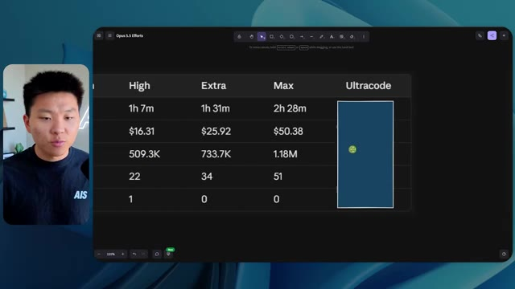
*⏱️ 00:17:52 — Un tableau comparatif des performances de différents modèles (High, Extra, Max, Ultracode) affichant des données sur la durée, le coût, le nombre de jetons et d'autres métriques.*

*⏱️ 00:18:09 — Une vue immersive dans un environnement virtuel 3D représentant un lobby d'événement ("AIS LIVE") avec des avatars, utilisée probablement pour illustrer le résultat final du projet.*

---

### ⏱️ `[00:18:17 - 00:18:49]` | Segment #39

**🔊 Audio (Transcription Intégrale Mot pour Mot en Français) :**
> is labeled a little bit better, so I can see what's going on. I'm going to come in here and collect my VIP wristband real quick. Okay, nice. It's also telling me what to do. So in the top left, it says scan in at the VIP gate at the lobby east wall. So I believe east would be this way, right? Never eat soggy waffles. Yeah. VIP wings, scan wristband. Okay, cool. Now I'm in the VIP section. I can see these different rooms. The tooling reset. Live video is being played. I'm able to see the closed captions right there of what's being talked about. It's also playing the sounds, but I'm just not playing the audio for you guys because I don't want to overwhelm.

**👁️ Analyse Visuelle d'Écran (gemini-3.5-flash-lite) :**
**Interface & Outils** : Environnement de simulation virtuelle 3D / Plateforme d'événementiel en ligne type métavers.

**Contenu textuel & Code** : Textes contextuels de guidage (ex: "Scan in at the VIP gate", "Grab an agile seat at the Apps Stage"), mini-carte interactive, titres de salles.

**Action / Démonstration** : Navigation et exploration de l'espace virtuel pour atteindre une salle de conférence dédiée.

*⏱️ 00:18:25 — L'avatar du présentateur se déplace dans un hall d'exposition virtuel, avec des instructions affichées en haut à gauche pour se diriger vers le portail VIP.*

*⏱️ 00:18:33 — L'avatar franchit l'entrée du "VIP Wing" après avoir validé son accès, avec une notification de "New Space Unlocked" à l'écran.*

*⏱️ 00:18:41 — L'avatar entre dans une salle de réunion virtuelle intitulée "VIP Room 5 - Tooling Reset / Solo to Real Business" où des avatars sont assis autour d'une table.*

---

### ⏱️ `[00:18:50 - 00:19:08]` | Segment #40

**🔊 Audio (Transcription Intégrale Mot pour Mot en Français) :**
> Once again, this one's working with Cody and Mustafa in there. That's awesome. Live video. The video doesn't play until you walk in though. So honestly, I think that's a good call. As soon as I walk in though, the video starts. Nice. Nice touch. All these rooms. Awesome. Yeah. I mean, this feels very premium. Here's a pricing war room. Let's hop in here. Me and John in there.

**👁️ Analyse Visuelle d'Écran (gemini-3.5-flash-lite) :**
**Interface & Outils** : Environnement virtuel de conférence/networking en 3D (type plateforme d'événements virtuels interactifs).

**Contenu textuel & Code** : Textes d'interface affichant "VIP Wing", "NOW ENTERING", "VIP ROOM 2 - WORKING SESSION", "Price It Right - First 10 Clients Plan", et une mini-carte en haut à droite.

**Action / Démonstration** : Navigation de l'avatar dans l'espace virtuel ; déclenchement automatique de la lecture d'une vidéo murale lors de l'approche de la salle.

*⏱️ 00:18:54 — Vue à la première personne dans un environnement virtuel type métavers représentant le "VIP Wing" d'une plateforme d'événement. On y voit un personnage dirigé par l'utilisateur s'approchant d'une salle de réunion où une vidéo est projetée sur un écran mural.*

---

### ⏱️ `[00:19:08 - 00:19:42]` | Segment #41

**🔊 Audio (Transcription Intégrale Mot pour Mot en Français) :**
> And then we have nice the after party. This after party is not as busy yet. And we have more beach balls for some reason, but this after party is cool. I mean, it gives us the good vibe and there's the playback right here of our after party Q and a, this is all live as well. Sweet. Okay. Let's head into the main stage. It's also prompting me to grab an aisle seat at the main stage, which is straight through the expo. So actually let's go through the expo first. What are you building. There's a lot of people talking about different things over here. Wow. There's also like a little, a basketball thing. Can I throw it? I can. Do I have to look up to throw it up? Okay.

**👁️ Analyse Visuelle d'Écran (gemini-3.5-flash-lite) :**
**Interface & Outils** : Plateforme d'événement virtuel (environnement 3D type métavers).

**Contenu textuel & Code** : Interface utilisateur affichant des objectifs (ex: "Get AI+ Certified"), des cartes de navigation, et un mur de texte collaboratif.

**Action / Démonstration** : Déplacement de l'avatar et interaction avec les espaces virtuels de la conférence.

*⏱️ 00:19:17 — Vue d'un environnement virtuel de type « after-party » avec des avatars dansants et un écran affichant une session de questions-réponses.*

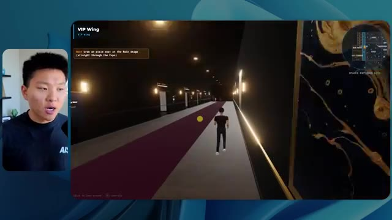
*⏱️ 00:19:25 — Navigation d'un avatar à travers un couloir virtuel désigné comme « VIP Wing » avec une signalétique spécifique.*

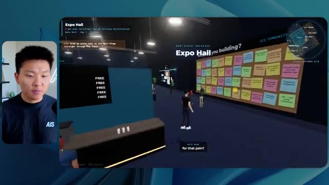
*⏱️ 00:19:34 — Exploration d'un espace nommé « Expo Hall » présentant un grand tableau rempli de notes autocollantes (post-its) et diverses interactions utilisateur.*

---

### ⏱️ `[00:19:42 - 00:20:08]` | Segment #42

**🔊 Audio (Transcription Intégrale Mot pour Mot en Français) :**
> Well, not great. But anyways, we have an AIS plus booth. We have the Glido booth. Is that playing live? Yeah, that definitely is playing live. Nice. We have the hyper agent booth. We have other stuff over here. Okay, cool. I'm going to go into the main stage and see if we can grab an aisle seat. As soon as we walk in, everything starts playing. We've got a very nice stage vibe. How do I grab an aisle seat though. There we go. I had to find the right one. Grab the aisle seat. There's no one on the stage, which is weird. I liked when they had people on the stage in the past versions.

**👁️ Analyse Visuelle d'Écran (gemini-3.5-flash-lite) :**
**Interface & Outils** : Plateforme de conférence virtuelle 3D (type environnement de métavers pour événements).

**Contenu textuel & Code** : Textes d'interface utilisateur, instructions de navigation ("Grab a seat", "Move to stand"), et noms des sessions live.

**Action / Démonstration** : Navigation de l'utilisateur à travers un espace virtuel pour rejoindre une conférence en direct.

---

### ⏱️ `[00:20:08 - 00:20:31]` | Segment #43

**🔊 Audio (Transcription Intégrale Mot pour Mot en Français) :**
> Let's take a quick selfie. Anyways, we got me and Pat up there. Pat is all dressed up like a construction worker. As you can see, we were doing a little mock discovery call in that example. I'm going to come back through the expo and we're going to go out here to the workshop wing and just check out if these rooms basically are the exact same as they should. Now I can't actually chat with people. I used to be able to, in the previous versions, chat with people, which I thought was a really nice touch. And we have workshop a foundation track. Can I sit down?

**👁️ Analyse Visuelle d'Écran (gemini-3.5-flash-lite) :**
**Interface & Outils** : Environnement virtuel 3D (plateforme de conférence virtuelle style Metaverse).

**Contenu textuel & Code** : Textes informatifs à l'écran : "Main Stage", "Expo Hall", "Workshop Wing", "Workshop Week 1 - Your First 30 Days in AI Automation", mini-carte de navigation en haut à droite.

**Action / Démonstration** : Navigation et exploration de l'utilisateur à travers les différentes sections d'un salon virtuel interactif.

*⏱️ 00:20:14 — Vue à la première personne dans un environnement virtuel 3D représentant une conférence "AIS LIVE", montrant la scène principale (Main Stage) avec des avatars d'utilisateurs.*

*⏱️ 00:20:20 — Navigation dans le hall d'exposition virtuel (Expo Hall) où plusieurs avatars interagissent ; le panneau indique "Expo Hall" et l'entrée vers le "Workshop Wing".*

*⏱️ 00:20:25 — Vue intérieure du couloir "Workshop Wing" dans l'espace virtuel, montrant des avatars en discussion et une affiche murale détaillant un programme de workshop.*

---

### ⏱️ `[00:20:32 - 00:21:04]` | Segment #44

**🔊 Audio (Transcription Intégrale Mot pour Mot en Français) :**
> I can't sit down. I don't know. We do have Liberty actually talking right now and she is speaking and we can hear it. So that's nice, but it's not letting me sit down. And look at this. I'm getting pretty glitchy right here. That was glitching the way I was walking. It like wasn't letting me walk. That's not good. Same thing. We got this advanced track in there. Awesome. So overall, they have a very similar vibe. I will say I'm impressed by the way they were able to tell a story out of what we were doing. Speaker takeaways library. Okay. This is cool. I don't think we saw this from different places, but these are like the resources and showing some cool stuff. Oh, wow. I

**👁️ Analyse Visuelle d'Écran (gemini-3.5-flash-lite) :**
**Interface & Outils** : Environnement de métavers ou plateforme d'apprentissage immersive (type Gather Town ou similaire).

**Contenu textuel & Code** : Textes d'interface utilisateur indiquant le nom des salles ("Workshop A", "Workshop B", "Speaker Takeaways Library") et des instructions de navigation ("Explore every space").

**Action / Démonstration** : Déplacement et exploration par l'avatar du présentateur dans différents espaces virtuels dédiés à la formation, avec des problèmes de glitch visuels signalés.

*⏱️ 00:20:40 — L'avatar du présentateur se tient devant une porte dans un environnement virtuel étiqueté "Workshop A - Foundation Track".*

*⏱️ 00:20:48 — Vue intérieure d'une salle de classe virtuelle nommée "Workshop B - Advanced Track" avec des sièges et des écrans.*

*⏱️ 00:20:56 — L'avatar se déplace dans une salle nommée "Speaker Takeaways Library" comportant plusieurs affichages muraux et des avatars interactifs.*

---

### ⏱️ `[00:21:04 - 00:21:41]` | Segment #45

**🔊 Audio (Transcription Intégrale Mot pour Mot en Français) :**
> can actually open all of these things and we can take pictures right here as well. Nice. Take a photo. I can save this as well. Like I can actually download this. And now we have this photo that we just took at this AIS live event. All right. Well, I think it is time for me to make some conclusions, but first let us see what this run cost us. This took a one hour and 35 minutes. So it was much faster than max. It only took $18 and 69 cents. Wow. So it was a little bit more expensive than high, cheaper than extra and much cheaper than max. It also ran 606,000 tokens and 42 checks with zero questions. Now, one other thing that's interesting to note is that all of

**👁️ Analyse Visuelle d'Écran (gemini-3.5-flash-lite) :**
**Interface & Outils** : Visionneuse d'images Windows (Image 1) et outil de création de diagrammes/tableaux de bord (Image 2).

**Contenu textuel & Code** : Image virtuelle d'événement (AIS Live) dans l'image 1 ; Tableau de données comparatives incluant des colonnes "Extra", "Max", "Ultracode" et des lignes de mesures temporelles et chiffrées dans l'image 2.

**Action / Démonstration** : Le présentateur démontre la capture et la sauvegarde d'un fichier image (Image 1) et passe en revue les données de performance de différents modèles/méthodes dans un tableau récapitulatif (Image 2).

*⏱️ 00:21:13 — Visualisation d'une photo capturée dans un environnement virtuel "AIS Live" montrant deux avatars sur un tapis rouge avec un panneau de marque en arrière-plan, affichée dans une visionneuse d'images Windows.*

*⏱️ 00:21:22 — Capture d'écran d'un outil de diagramme ou de tableau de bord nommé "Opus 5.5 Efforts", présentant un tableau comparatif de mesures de performance (temps, coûts, jetons).*

---

### ⏱️ `[00:21:41 - 00:22:13]` | Segment #46

**🔊 Audio (Transcription Intégrale Mot pour Mot en Français) :**
> these runs, none of them used a sub agent. I looked through and I made sure none of them used sub agents. They didn't want to delegate any work around, which was interesting. So these tokens are what was reflected inside of that session. Obviously, like I said, this one went over, you know, 950K, so, or whatever the compaction window is. I never usually let it get that high, but because this was a slash goal and I wasn't involved, this one had to compact, but the rest of them just ran in this one session. And these are the overall stats. And also real quick on the UltraCode stuff, guys, I don't know if you've been noticing this, but when I've been running UltraCode lately, it's just felt weird. It's felt a little buggy. I, a couple of times I've ran it

**👁️ Analyse Visuelle d'Écran (gemini-3.5-flash-lite) :**
**Interface & Outils** : Interface de tableau de bord ou outil de documentation de type tableau blanc (ex: Excalidraw ou similaire).

**Contenu textuel & Code** : Tableau de données montrant : 'Run time', 'API cost', 'Total tokens' (ex: 1.18M pour la colonne 'Max'), 'Checks' et 'Questions asked'.

**Action / Démonstration** : Présentation visuelle des statistiques de performance pour justifier l'analyse de l'usage des tokens et de l'absence de sous-agents.

*⏱️ 00:21:49 — Tableau comparatif des performances de différentes exécutions d'agents IA, catégorisées de 'Low' à 'Ultracode', incluant le temps d'exécution, le coût API, le nombre total de tokens, le nombre de vérifications et les questions posées.*

---

### ⏱️ `[00:22:13 - 00:22:34]` | Segment #47

**🔊 Audio (Transcription Intégrale Mot pour Mot en Français) :**
> and been like, is it even running UltraCode? It did quite a few more checks than these other ones, but for some reason it just didn't feel right because essentially what UltraCode is, is it's extra effort and then it's just like using more dynamic workflows in order to do things. And so through all my digging on the session logs and even when I was watching this thing build in UltraCode, it wasn't spinning up any of these dynamic workflows and I tried this a few times.

**👁️ Analyse Visuelle d'Écran (gemini-3.5-flash-lite) :**
**Interface & Outils** : Interface de type whiteboard/collaboration (probablement FigJam ou Miro) intitulée "Opus 5.5 Efforts".

**Contenu textuel & Code** : Tableau présentant des métriques pour chaque niveau d'effort : "Run time", "API cost", "Total tokens", "Checks" et "Questions asked". La colonne "Ultracode" affiche spécifiquement : 1h 35m, $18.69, 606.2K tokens, 42 checks et 0 questions posées.

**Action / Démonstration** : Le présentateur commente les données du tableau pour illustrer les différences de comportement et de coût entre les modes d'exécution, notamment le nombre élevé de vérifications ("Checks") effectuées par "Ultracode".

*⏱️ 00:22:18 — Un tableau comparatif des performances de différents niveaux d'effort d'agents IA (Low, Medium, High, Extra, Max, Ultracode) affiché dans une interface de type tableau blanc.*

---

### ⏱️ `[00:22:35 - 00:23:00]` | Segment #48

**🔊 Audio (Transcription Intégrale Mot pour Mot en Français) :**
> So I don't know if that's a bug right now in the CloudCode harness or if it's just with Opus 5.5, it's a little bit worse with UltraCode right now or something, but either way, these are the actual bulk effort levels and this all seems to make a lot of sense when you kind of look through how they progress. So let's take a look at this. Max cost versus low, we had 12.9X on the cheapest run compared to the most expensive run, which I believe was $3.98 to $50.38.

**👁️ Analyse Visuelle d'Écran (gemini-3.5-flash-lite) :**
**Interface & Outils** : Application de prise de notes ou tableau blanc virtuel (type Miro ou Obsidian Canvas).

**Contenu textuel & Code** : Tableau de données techniques : Run time, API cost, Total tokens, Checks, Questions asked, classés par intensité d'effort.

**Action / Démonstration** : Analyse et présentation des performances et des coûts associés aux différents niveaux d'effort du modèle Opus 5.5.

*⏱️ 00:22:41 — Tableau comparatif des niveaux d'effort (Low, Medium, High, Extra, Max, Ultracode) pour Opus 5.5, affichant le temps d'exécution, le coût API, le nombre total de jetons, les vérifications effectuées et les questions posées.*

---

### ⏱️ `[00:23:01 - 00:23:19]` | Segment #49

**🔊 Audio (Transcription Intégrale Mot pour Mot en Français) :**
> So that was low and max. As far as max checks versus low, we had a 2.3X multiple. The total across all six was 127 bucks and ultra code was $18.69. Let's look at speed versus cost here. So let me zoom out a little bit so we can see this whole thing. So on the X axis, we have runtime. In the Y axis, we have cost.

**👁️ Analyse Visuelle d'Écran (gemini-3.5-flash-lite) :**
**Interface & Outils** : Dashboard web d'analyse de données (type outil de reporting ou interface interne).

**Contenu textuel & Code** : Tableau de statistiques affichant : "12.9x Max cost vs Low", "2.3x Max checks vs Low", "$18.69 Ultracode cost, 42 checks", et "$127.65 Total across all six". Le texte explicatif mentionne que six sessions ont été exécutées avec différents niveaux d'effort.

**Action / Démonstration** : Le présentateur présente les résultats quantitatifs de ses tests comparatifs avant de passer à l'analyse graphique du rapport vitesse/coût.

*⏱️ 00:23:05 — Une interface de tableau de bord d'analyse de données montrant des métriques de performance et de coût pour le test "Opus Effort Test".*

---

### ⏱️ `[00:23:19 - 00:23:42]` | Segment #50

**🔊 Audio (Transcription Intégrale Mot pour Mot en Français) :**
> So I feel like what the best would be is in the bottom left, but not really. So anyways, you can see that low was cheap and fast. Max was slow and expensive. But this sort of chart typically makes sense. As you increase in effort, it's gonna cost more and it's gonna run a little bit longer. That makes sense. Now let's see growth relative to low. So we have runtime in blue, API costs in orange, tokens in green, and checks in yellowish gold, mustard.

**👁️ Analyse Visuelle d'Écran (gemini-3.5-flash-lite) :**
**Interface & Outils** : Interface de tableau de bord d'analyse de données (probablement une application web personnalisée ou un outil de reporting type Notion/Linear/BI).

**Contenu textuel & Code** : Graphique cartésien avec en abscisse le "Run time" et en ordonnée le coût en dollars. Les points représentent les sessions : "Low", "Medium", "High", "Extra", "Ultracode", et "Max", avec le nombre de vérifications associées ("checks").

**Action / Démonstration** : Le présentateur explique la corrélation entre l'augmentation de l'effort, le coût financier et la durée d'exécution des tâches d'automatisation IA, en survolant le point "Low" du graphique.

*⏱️ 00:23:25 — Un graphique de dispersion "Speed vs cost" affiché dans une interface web, comparant différents niveaux d'effort (Low, Medium, High, Extra, Ultracode, Max) en fonction du temps d'exécution et du coût API. Une infobulle détaille les données du point "Low" (16m 43s, $3.91, 191.3K tokens, 22 checks).*

---

### ⏱️ `[00:23:42 - 00:24:01]` | Segment #51

**🔊 Audio (Transcription Intégrale Mot pour Mot en Français) :**
> And by the way, the reason why UltraCode shows up like this is because it actually uses extra effort level. It's just incentivized and it uses more like dynamic workflows and things like that, which is why this, you know, this makes sense because it basically was using extra under the hood. That's also why Claude tagged it here in orange. Anyways, if we continue back down here, this typically makes sense, right?

**👁️ Analyse Visuelle d'Écran (gemini-3.5-flash-lite) :**
**Interface & Outils** : Interface de type dashboard/outil de reporting de performance.

**Contenu textuel & Code** : Graphique montrant la montée en flèche des coûts API (12.9x), du temps d'exécution (8.9x), des tokens (6.2x) et des vérifications (2.3x) au niveau 'Max' par rapport au niveau 'Low'. Une infobulle affiche "Extra - Checks: 1.5x Low".

**Action / Démonstration** : Analyse visuelle comparative des performances des différents niveaux d'effort de l'agent IA (Opus).

*⏱️ 00:23:47 — Un graphique linéaire comparant la croissance de divers paramètres (Run time, API cost, Tokens, Checks) en fonction des niveaux d'effort, avec une mise en évidence sur le niveau 'Extra'.*

---

### ⏱️ `[00:24:02 - 00:24:21]` | Segment #52

**🔊 Audio (Transcription Intégrale Mot pour Mot en Français) :**
> As the effort level increases, once again, these metrics are gonna increase. Runtime, API costs, tokens, and checks. Same thing here with runtime. It's just kind of giving us more individual line charts now for each of these different metrics, like API cost, checks, total tokens, cost per check, and all the numbers in one spot. So pretty cool data.

**👁️ Analyse Visuelle d'Écran (gemini-3.5-flash-lite) :**
**Interface & Outils** : Dashboard analytique web (type plateforme de monitoring pour agents IA).

**Contenu textuel & Code** : Graphique linéaire affichant des multiplicateurs de performance : API cost (12.9x), Run time (8.9x), Tokens (6.2x) et Checks (2.3x) au niveau "Max".

**Action / Démonstration** : Analyse visuelle et comparaison des coûts et performances des modèles IA selon différents niveaux d'effort.

*⏱️ 00:24:06 — Une capture d'écran montrant un tableau de bord analytique nommé "Opus Effort Test". Il affiche un graphique linéaire comparant la croissance relative de quatre métriques (Run time, API cost, Tokens, Checks) en fonction des niveaux d'effort (Low, Medium, High, Extra, Max, Ultracode). Le présentateur commente les données sur la gauche.*

---

### ⏱️ `[00:24:21 - 00:24:40]` | Segment #53

**🔊 Audio (Transcription Intégrale Mot pour Mot en Français) :**
> I will say nothing here is too shocking. What was more shocking to me was those results. My top two contenders were high, which is this one, and extra, which is this one. So I need to go back in here and just remember what I thought about them. I really liked this feel. This one also just feels the smoothest. The physics were nice. The sliding glass door was nice. I didn't really notice many bugs in this one, which is what I really liked.

**👁️ Analyse Visuelle d'Écran (gemini-3.5-flash-lite) :**
**Interface & Outils** : Application de métavers ou de salon virtuel "AIS LIVE".

**Contenu textuel & Code** : Interface utilisateur affichant "AIS LIVE - Real Projects, Real Revenue", contrôles de navigation (WASD, Espace, Tab), et une mini-carte en haut à droite.

**Action / Démonstration** : Navigation et exploration de l'environnement virtuel interactif, le présentateur teste les mécaniques de déplacement dans le logiciel.

*⏱️ 00:24:26 — Écran d'accueil du portail "AIS LIVE" avec le titre, la description de l'événement et les commandes clavier pour naviguer.*

*⏱️ 00:24:31 — Vue à la troisième personne dans un environnement virtuel 3D représentant une place (AIS Live Plaza) avec des avatars et des panneaux.*

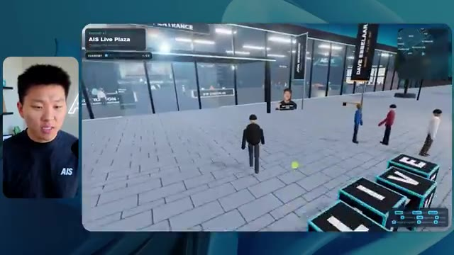
*⏱️ 00:24:35 — Le joueur déplace son avatar sur la place virtuelle 3D, s'approchant de bâtiments avec des structures d'exposition.*

---

### ⏱️ `[00:24:40 - 00:25:13]` | Segment #54

**🔊 Audio (Transcription Intégrale Mot pour Mot en Français) :**
> I can't remember if this one was one where, oh, I couldn't talk to people though. I could just walk right through them. I couldn't sit in this one either. Here is another little visual thing where I basically just walk right through this wall. So don't love that. But I think, was this the one where I could sit in these sessions? No. Okay. So I don't think this was my winner then. This is extra high. I think this is the winner. Yeah. I think this was the one that I liked the most. I loved this whole vibe. I loved that I could chat to people. This was definitely the one where we could come in here and we could sit wherever we wanted, take a seat, stand up. I could read these three deals and I could chat with them. I also realized that there was little sections to mock discovery calls in here too.

**👁️ Analyse Visuelle d'Écran (gemini-3.5-flash-lite) :**
**Interface & Outils** : Application web/jeu 3D "AIS LIVE" (simulation d'événement virtuel).

**Contenu textuel & Code** : Interface utilisateur avec mini-carte, indicateurs de session "Anatomy of Three Real Deals", et contrôles de navigation au clavier (WASD, Shift, E, etc.).

**Action / Démonstration** : Navigation et exploration de l'espace virtuel, interaction avec les éléments de l'interface et déplacement des avatars dans le hall et la salle principale.

*⏱️ 00:24:48 — Vue à la troisième personne dans l'environnement virtuel "AIS LIVE", montrant l'avatar sur la "Main Stage".*

*⏱️ 00:24:57 — Écran d'accueil de l'application "AIS LIVE" avec le bouton d'entrée et les instructions de contrôle.*

*⏱️ 00:25:05 — L'avatar se déplaçant dans le "Grand Lobby" vers la salle de conférence principale.*

---

### ⏱️ `[00:25:13 - 00:25:51]` | Segment #55

**🔊 Audio (Transcription Intégrale Mot pour Mot en Français) :**
> We have some swag and totes, which is real physics. I like that. This was the one where we could sit down everywhere. Yeah, I really, really liked this one. Although I think the one downside about this one was that it didn't have like a VIP after party because I think this was the lounge. And I think this was the only piece of the VIP section, which was these being the different rooms that you could come in and sit in. But besides that, it didn't have a great VIP experience compared to some of the other ones that we saw. So my winner here is definitely going to be Extra. Extra did a phenomenal job. It was about half the runtime and half the cost of Max. So Max, I think, was just way too much for not enough good. I think that highs was decent. It could have,

**👁️ Analyse Visuelle d'Écran (gemini-3.5-flash-lite) :**
**Interface & Outils** : Tableur ou interface de gestion de données (Opus 5.5 Efforts).

**Contenu textuel & Code** : Tableau de métriques comparant différents niveaux d'effort (Low, Medium, High, Extra, Max, Ultracode) avec des données chiffrées précises sur les performances des modèles IA.

**Action / Démonstration** : Analyse et présentation des données de performance et de coûts de différents agents ou modèles.

*⏱️ 00:25:42 — Tableau comparatif des performances "Opus 5.5 Efforts" affichant le temps d'exécution, le coût API, le nombre de jetons, les vérifications et les questions posées.*

---

### ⏱️ `[00:25:51 - 00:26:25]` | Segment #56

**🔊 Audio (Transcription Intégrale Mot pour Mot en Français) :**
> with maybe one or two more prompts, gotten to where I really liked it. But for a slash goal, Extra delivered an amazing result here. I didn't love Medium. And for a lot of my knowledge work and stuff I'm doing, Medium works just fine. But for this task specifically, I needed a lot of reasoning. It had to go through tons of stuff. It had to go through tons of videos. It had to find a lot of things inside of my projects. It had to create an experience and tell a story out of everything. I think Extra did a phenomenal job. In general, though, I liked a lot of these outputs, but Extra is the one that I'd want to start from right now. If I wanted to really make that like a super, super polished and cool app and world, I would start with Extra's output and probably

**👁️ Analyse Visuelle d'Écran (gemini-3.5-flash-lite) :**
**Interface & Outils** : Application de tableau blanc virtuel ou outil de prise de notes (type FigJam ou Miro).

**Contenu textuel & Code** : Tableau de données comparatives "Opus 5.5 Efforts" incluant des métriques comme : Run time, API cost, Total tokens, Checks et Questions asked.

**Action / Démonstration** : Présentation des résultats de test comparant les différents modes de raisonnement du modèle pour justifier le choix du niveau "Extra".

*⏱️ 00:26:00 — Un tableau comparatif des performances de différents modèles "Opus 5.5" (Low, Medium, High, Extra, Max, Ultracode) affichant le temps d'exécution, le coût API, le nombre de tokens, les vérifications et les questions posées.*

---

### ⏱️ `[00:26:25 - 00:26:37]` | Segment #57

**🔊 Audio (Transcription Intégrale Mot pour Mot en Français) :**
> keep iterating with Extra. So anyways, guys, that was the experiment. I hope that you found that insightful. I hope that you learned something new. And if you did, please give it a like. It helps me out a ton. And as always, I appreciate you guys making it to the end of the video, and I'll see you on the next one. Thanks, everyone.

**👁️ Analyse Visuelle d'Écran (gemini-3.5-flash-lite) :**
**Interface & Outils** : Aucune interface logicielle ou technique n'est visible.

**Contenu textuel & Code** : Aucun code, commande ou donnée textuelle n'est affiché.

**Action / Démonstration** : Le présentateur conclut sa vidéo en s'adressant directement à son audience.

---

