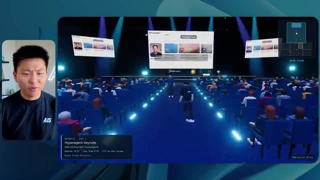

# 🎬 Matt Pocock: The Most Valuable Skill to Learn in the Age of AI

> **Chaîne** : [Nate Herk | AI Automation](https://www.youtube.com/@nateherk/featured)  
> **Lien YouTube** : [https://www.youtube.com/watch?v=Z8lf5oWKfj0](https://www.youtube.com/watch?v=Z8lf5oWKfj0)  
> **Date de publication** : 20261016  
> **Durée** : 00:44:50  
> **Identifiant vidéo** : `Z8lf5oWKfj0`  
> **Transcription & Analyse** : `whisper-v3-large-turbo+gemini-3.5-flash-lite`  

---

## 📌 Synthèse Exécutive & Outils

### 💡 Résumé

Cette vidéo immersive de la chaîne *Nate Herk | AI Automation* explore l'impact critique des niveaux d'effort sur un modèle de pointe — **Opus 5.5** — à travers un cas d'usage réel et ambitieux d'ingénierie logicielle et d'automatisation. L'expérimentation consiste à fournir exactement le même prompt complexe à l'agent IA : concevoir un monde 3D interactif et explorable en vue à la troisième personne, simulant une conférence tech réaliste (AIS Live) à partir de 105 gigaoctets d'enregistrements vidéo bruts stockés sur Frame.io, tout en exploitant les outils locaux du système d'exploitation IA de l'auteur.

La confrontation des résultats entre le niveau « bas » et le niveau « moyen » met en lumière des écarts colossaux de qualité, d'ergonomie et de cohérence visuelle. Alors que l'exécution à effort faible génère un prototype grossier, non personnalisé, truffé de bugs d'affichage et d'images fixes en 16 minutes pour 3,91 $ (sans aucune question posée), l'effort moyen livre en 1 heure 13 minutes et pour 12,44 $ un monde 3D riche, doté de la bonne charte graphique, de PNJ (personnages non-joueurs) interactifs, de flux vidéo dynamiques en direct et d'une architecture de salles fonctionnelle. 

Cette analyse démontre que l'ajustement minutieux des paramètres d'effort des agents IA transforme radicalement la fiabilité et la profondeur des livrables de développement. Elle souligne également le défi inhérent à l'ère de l'automatisation par l'IA : passer instantanément d'un prototype généré par la machine à son déploiement en production sur le web.

### 🛠️ Outils, Modèles & Logiciels Présentés

* **Opus 5.5** : Modèle d'intelligence artificielle ultra-performant et économique, utilisé au cœur de l'expérimentation pour exécuter des tâches d'ingénierie complexes et générer des mondes 3D interactifs.
* **Claude Code** : Environnement de programmation et assistant de développement avancé pour orchestrer des agents de code.
* **Anthropic** : Entreprise conceptrice des modèles de pointe, fournissant des directives et des bonnes pratiques de prompting adaptées aux différents niveaux d'effort.
* **Frame.io** : Plateforme cloud de gestion vidéo utilisée pour stocker et structurer les 105 gigaoctets d'enregistrements de la conférence AIS Live.
* **Herc 2** : Système d'exploitation IA personnel de l'auteur, servant d'écosystème de référence pour l'intégration de scripts, d'actifs et d'automatisations.
* **Hostinger** : Sponsor de la vidéo et solution d'hébergement web, dont l'extension gratuite connecte directement les IDE et assistants de code (VS Code, Cursor, Claude Code) pour un déploiement en ligne instantané.
* **Cursor / VS Code** : Éditeurs de code de pointe utilisés dans les flux de travail de développement logiciel assisté par IA.
* **Key.ai / Jev** : Technologies d'intelligence artificielle et de génération visuelle/comportementale mentionnées pour la création d'actifs multimédias et la gestion des PNJ.

### 🔑 Points Clés & Enseignements Stratégiques

* **L'impact critique des niveaux d'effort** : Faire varier le paramètre d'effort (bas, moyen, haut, extra, max, code ultra) sur un même prompt modifie drastiquement la complexité architecturale, la robustesse et la finition visuelle du code produit par l'IA.
* **Évolution de la qualité visuelle et fonctionnelle** : Le niveau bas génère un prototype simpliste, dépourvu de la charte graphique de la marque, truffé de bugs d'affichage et utilisant des images statiques, tandis que le niveau moyen structure un environnement immersif complet et cohérent.
* **Autonomie excessive des agents** : Dans les deux niveaux testés, l'agent IA a exécuté l'intégralité de la tâche complexe sans poser la moindre question de clarification, illustrant une autonomie totale mais potentiellement risquée en cas de malentendu sur les spécifications.
* **Corrélation temps-coût-performance** : L'effort faible s'exécute en 16 minutes pour 191 000 tokens et 3,91 $, alors que l'effort moyen requiert 1 heure 13 minutes, 490 000 tokens et 12,44 $, un surcoût largement justifié par la qualité professionnelle du résultat obtenu.
* **Immersion et interactivité contextuelle** : L'effort moyen permet à l'agent d'intégrer des flux vidéo en direct fonctionnels, des PNJ dotés de comportements réactifs rudimentaires et une disposition spatiale fidèle à une véritable conférence physique.
* **Intégration de données massives hétérogènes** : L'agent démontre une capacité remarquable à ingérer, trier et exploiter 105 Go de données brutes issues de Frame.io pour alimenter dynamiquement un monde virtuel en contenu contextuel pertinent.
* **La recommandation officielle d'Anthropic** : Les concepteurs préconisent de débuter systématiquement l'ingénierie de prompt au niveau « moyen » avant d'ajuster itérativement vers le haut ou vers le bas selon la criticité et la complexité du livrable attendu.
* **Le goulet d'étranglement du déploiement** : L'IA moderne résout brillamment la phase de création et de prototypage logiciel, déplaçant le véritable défi technologique vers le pont opérationnel entre l'environnement de développement local et la mise en production en ligne.
* **Suppression des frictions de publication** : L'utilisation d'intégrations directes d'hébergement au sein des éditeurs de code (comme l'extension Hostinger) élimine les frictions entre l'achèvement d'un produit par l'IA et sa mise en ligne immédiate sur le web.
* **Industrialisation des événements virtuels** : Cette approche démontre qu'il est désormais possible d'automatiser entièrement la transformation d'archives vidéo massives en expériences 3D gamifiées et explorables, ouvrant la voie à de nouveaux standards dans l'événementiel numérique.

---

## ⏱️ Chronologie & Transcription Complète Audio & Visuelle (Mot pour Mot)

### ⏱️ `[00:00:00 - 00:00:20]` | Segment #01

**🔊 Audio (Transcription Intégrale Mot pour Mot en Français) :**
> Opus 5.5, Opus 5.5, Opus 5.5, Opus 5.5, Opus 5.5. Ce modèle est littéralement partout et pour de très bonnes raisons. Il est intelligent, il est bon marché, il a un goût extraordinaire, c'est un modèle d'IA incroyable. Mais avec chaque modèle d'IA, vous avez le choix de l'effort, que ce soit bas, moyen, haut, extra, max ou code ultra.

**👁️ Analyse Visuelle d'Écran (gemini-3.5-flash-lite) :**
**Interface & Outils** : Interface de type réseau social (Twitter/X) affichant une publication sur l'impact de l'IA.

**Contenu textuel & Code** : Texte de publication sur l'impact des modèles d'IA sur les créatifs et vidéo de paysage tropical en aperçu.

**Action / Démonstration** : Affichage à l'écran d'un exemple de publication illustrant les capacités des modèles d'IA générative.

*⏱️ 00:00:05 — Capture d'écran montrant un tweet ou post sur une plateforme sociale avec une vidéo intégrée représentant un paysage tropical généré par IA.*

---

### ⏱️ `[00:00:20 - 00:00:38]` | Segment #02

**🔊 Audio (Transcription Intégrale Mot pour Mot en Français) :**
> Donc dans cette vidéo, j'ai donné exactement le même prompt à Opus 5.5 et je l'ai exécuté à chaque niveau d'effort, et nous allons comparer les résultats. Nous examinerons la qualité de tous les différents résultats réels, mais nous examinerons également le temps d'exécution de chacun d'eux, le coût que cela nous a coûté si c'était une facturation par API, le nombre total de tokens, combien de vérifications ils ont exécutées, et combien de questions ils m'ont réellement posées tout au long du processus.

**👁️ Analyse Visuelle d'Écran (gemini-3.5-flash-lite) :**
**Interface & Outils** : Interface de tableau de bord / application web interactive.

**Contenu textuel & Code** : Tableau comparatif avec les lignes : Run time, API cost, Total tokens, Checks, Questions asked, et les colonnes de niveaux d'effort (Low à Ultracode).

**Action / Démonstration** : Présentation des critères de comparaison des performances du modèle selon le niveau d'effort.

*⏱️ 00:00:29 — Tableau comparatif sur une interface de type canvas montrant les niveaux d'effort d'Opus 5.5 (Low, Medium, High, Extra, Max, Ultracode) et leurs métriques.*

---

### ⏱️ `[00:00:39 - 00:00:58]` | Segment #03

**🔊 Audio (Transcription Intégrale Mot pour Mot en Français) :**
> Et les résultats que nous avons obtenus ne sont pas du tout ce à quoi je m'attends, donc j'ai hâte de partager cela avec vous les gars. Ne perdons pas de temps et entrons directement dans le vif du sujet. D'accord, alors plongeons directement dans celui-ci. Je veux commencer juste en vous montrant, les gars, le prompt réel que nous avons utilisé, que nous avons donné à chacun de ces différents agents. Je vais aller dans les fichiers ici, et nous allons ouvrir ce fichier markdown de prompt, et je vais vous montrer ce que nous avons obtenu. Alors voici le slash objectif que j'ai fourni.

**👁️ Analyse Visuelle d'Écran (gemini-3.5-flash-lite) :**
**Interface & Outils** : Interface utilisateur de l'éditeur de code IA / agent (Opus 5.5, Ultracode) avec panneau de discussion et gestion des projets.

**Contenu textuel & Code** : Un message de l'assistant IA demandant si l'on doit commencer à construire un monde 3D interactif pour la conférence AIS Live à partir d'enregistrements audio/vidéo (`PROMPT.md`), ainsi que les options de niveau d'effort (Hello, Extra, High, Max, Ultracode, Medium, Low).

**Action / Démonstration** : Le présentateur introduit l'interface de travail et le prompt de l'agent IA en vue de lancer une tâche de développement automatisé.

*⏱️ 00:00:48 — Interface de l'éditeur IA affichant un assistant de codage avec une conversation en cours, la webcam du présentateur incrustée à gauche et le panneau latéral de gestion des sessions (effort-test, worktree).*

---

### ⏱️ `[00:00:58 - 00:01:34]` | Segment #04

**🔊 Audio (Transcription Intégrale Mot pour Mot en Français) :**
> J'ai dit, tu dois me créer un monde 3D qui est une conférence tech réaliste dans laquelle je peux me promener en vue à la troisième personne. Tu vas regarder ce dossier, qui contient mes éléments d'enregistrement d'événements d'AIS Live. Et ce dossier est un dossier Frame.io de 105 gigaoctets d'enregistrements vidéo. C'était un événement entièrement virtuel. Tout a été enregistré et tous les enregistrements sont juste ici. J'ai dit, ton objectif est de prendre cet événement et de le transformer en un monde 3D explorable qui me donne l'impression d'être réellement allé à une vraie conférence en personne avec différentes salles, différentes pistes, différentes scènes, bla, bla, bla. N'hésite pas à utiliser key.ai si tu as besoin de générer des images ou des vidéos. Et tu peux aussi utiliser n'importe quoi d'autre à l'intérieur de mon projet Herc 2, qui est comme mon système d'exploitation IA. J'ai dit,

**👁️ Analyse Visuelle d'Écran (gemini-3.5-flash-lite) :**
**Interface & Outils** : Éditeur de code (VS Code / interface similaire) et interface cloud Frame.io

**Contenu textuel & Code** : Fichier PROMPT.md contenant le prompt complet demandant de transformer des enregistrements virtuels en un monde 3D explorable, et interface Frame.io avec les dossiers GA Access et VIP Access.
[DESC_IMAGE_1] Affichage du prompt de configuration et navigation dans les fichiers du projet.

**Action / Démonstration** : Explications face caméra et démonstration conceptuelle.

*⏱️ 00:01:07 — Vue d'un éditeur de texte affichant le fichier PROMPT.md avec les instructions détaillées pour créer le monde 3D.*

*⏱️ 00:01:16 — Interface Frame.io montrant le dossier des éléments d'enregistrement d'événements d'AIS Live d'une taille de 105,69 Go.*

*⏱️ 00:01:25 — Retour sur l'éditeur de texte affichant le fichier PROMPT.md avec la description des objectifs de modélisation 3D.*

---

### ⏱️ `[00:01:34 - 00:02:08]` | Segment #05

**🔊 Audio (Transcription Intégrale Mot pour Mot en Français) :**
> vous serez jugé sur la créativité, le design, la physique et la sensation générale lorsque j'explorerai le monde 3D que vous avez construit. Et c'était fondamentalement la fin des instructions. Donc comme vous pouvez le voir sur ce côté gauche, j'ai exécuté cela à travers tous les différents niveaux d'effort. Commençons par le niveau bas et remontons jusqu'au code ultra. Très bien. Donc ici, nous avons le résultat du niveau bas. Ouvrons ceci et jetons un coup d'œil. Donc nous avons AIS Live, le sommet des services IA en personne enfin, et nous avons pu cliquer partout. Tout d'abord, cela ne fait pas très personnalisé. Genre, ce n'habille pas le logo d'AIS Live. Ce ne sont même pas nos couleurs. Donc je n'aime pas trop ça, mais entrons ici. D'accord. C'est beaucoup trop lumineux. Euh, nous avons une carte en haut à droite. Nous avons une ville par ici. Je ne peux pas dire quelle ville c'est.

**👁️ Analyse Visuelle d'Écran (gemini-3.5-flash-lite) :**
**Interface & Outils** : Interface web d'un assistant de code / agent IA avec panneau latéral de gestion des sessions.

**Contenu textuel & Code** : Texte du prompt demandant de construire un monde 3D navigable à la troisième personne avec des salles, pistes et scènes, et réponse de l'assistant IA demandant si l'on doit commencer.

**Action / Démonstration** : Navigation et sélection des différents niveaux d'effort (tests) dans la barre latérale gauche par l'utilisateur.

*⏱️ 00:01:42 — Capture d'écran montrant l'interface d'une application d'agent IA avec un volet latéral listant différents niveaux de test (Hello, Extra, High, Max, Ultracode, Medium, Low) et une conversation avec l'assistant.*

---

### ⏱️ `[00:02:08 - 00:02:40]` | Segment #06

**🔊 Audio (Transcription Intégrale Mot pour Mot en Français) :**
> c'est. D'accord. C'est Chicago, ce qui est plutôt cool parce que tu sais, j'habite à Chicago, mais bref, en haut à droite, on peut voir une carte. Nous avons un hall d'accueil. Nous avons un hall d'exposition. Nous avons un salon VIP, la scène principale. Aussi, la carte montre où se trouve chaque autre personne et cela se synchronise en direct. Donc on peut voir l'enregistrement. On peut voir le premier jour, la keynote sur l'agent hyper, le débriefing en direct. Cool. Donc il connaît réellement l'agenda et ensuite il y a le deuxième jour. Donc il a trouvé ça, c'est bien. Nous avons ces petites boules ici que je peux espérer lancer un peu partout. D'accord. Le visage, oh, regarde ça. Si je vais par ici, toutes les personnes disparaissent tout simplement. Très mauvais. Très mauvais. D'accord. Donc voyons voir. Est-ce que je peux courir ? D'accord.

**👁️ Analyse Visuelle d'Écran (gemini-3.5-flash-lite) :**
**Interface & Outils** : Application ou plateforme virtuelle 3D interactive (type événement virtuel en ligne).

**Contenu textuel & Code** : Plan du site en haut à droite, noms des zones (Lobby, Expo Hall, Badge pickup) et programme des sessions.
[DESC_IMAGE_3] Navigation et exploration de l'environnement virtuel 3D en vue subjective/troisième personne.

**Action / Démonstration** : Explications face caméra et démonstration conceptuelle.

*⏱️ 00:02:16 — Vue d'un espace virtuel 3D avec avatars montrant la zone de récupération des badges.*

*⏱️ 00:02:24 — Vue du hall d'accueil virtuel affichant le programme du premier jour sur un panneau interactif.*

*⏱️ 00:02:32 — Vue de l'Expo Hall virtuel avec des avatars et des éléments lumineux interactifs.*

---

### ⏱️ `[00:02:40 - 00:03:04]` | Segment #07

**🔊 Audio (Transcription Intégrale Mot pour Mot en Français) :**
> Je peux avancer un peu plus vite. Je vais d'abord aller par ici. Il y a des produits dérivés, euh, un sweat "AIS plus certified". D'accord. Donc, il y a les stands réels qu'on avait lors de l'événement virtuel. On avait des stands. Donc c'est plutôt cool. Un petit endroit pour prendre des photos. La salle C. En ce moment, nous avons Tangy Frederick qui anime un atelier. D'accord. Mais ce n'est pas une vidéo. Comme vous pouvez le voir, c'est juste une image. Elle ne bouge pas. Donc c'est juste une image. Ces gens sont en train de disparaître. Ce doivent être des fantômes. Allons par ici vers la salle A.

**👁️ Analyse Visuelle d'Écran (gemini-3.5-flash-lite) :**
**Interface & Outils** : Application de monde virtuel 3D / métavers pour événement en ligne

**Contenu textuel & Code** : Panneaux d'exposition virtuelle, bannières de stands et instructions d'utilisation affichées sur des écrans virtuels.

**Action / Démonstration** : Navigation et déplacement d'un avatar 3D à travers l'espace virtuel de l'événement.

---

### ⏱️ `[00:03:04 - 00:03:30]` | Segment #08

**🔊 Audio (Transcription Intégrale Mot pour Mot en Français) :**
> Nous avons Liberty White. D'accord. Très cool. Vos 30 premiers jours en automatisation. Encore une fois, ce n'est qu'une image fixe et les gens ont des bugs d'affichage. Donc ce n'est pas très bien ici. Je vais aller sur la scène principale et voir ce que nous avons. D'accord, cool. Nous avons donc une scène qui a l'air principale. Les gens ont des bugs d'affichage. Vraiment grave. Ce n'est vraiment pas très bien. Notre vidéo est en train de bouger. Comme j'ai vu mon visage ici et j'ai vu celui de Devin, mais maintenant ils ont disparu. Donc je ne sais pas ce qui s'est passé. D'accord. On dirait que c'est plutôt un diaporama. Rien n'est encore vraiment diffusé. Bref, entrons ici.

**👁️ Analyse Visuelle d'Écran (gemini-3.5-flash-lite) :**
**Interface & Outils** : Environnement virtuel 3D de type métavers / plateforme de conférence en ligne.

**Contenu textuel & Code** : Interface utilisateur avec mini-carte de navigation et affichage de la scène active en cours.

**Action / Démonstration** : Navigation et déplacement d'un avatar 3D dans un espace de conférence virtuel.

*⏱️ 00:03:11 — Vue dans une salle virtuelle "Workshop Room A" avec des cercles lumineux au sol et un avatar de joueur.*

*⏱️ 00:03:17 — Vue de la scène principale "Main Stage" montrant un amphithéâtre virtuel rempli d'avatars de participants.*

*⏱️ 00:03:24 — Vue de l'auditorium principal "AIS Live AI Services Summit" avec des écrans géants et des ballons de plage.*

---

### ⏱️ `[00:03:30 - 00:03:58]` | Segment #09

**🔊 Audio (Transcription Intégrale Mot pour Mot en Français) :**
> Nous avons d'autres stands. Nous avons hyper agent. Nous avons Claude Code. Nous avons plus de gadgets. La salle B, c'est Dave Ebelor. Je suppose que c'est exactement la même chose. Nous avons du café. Et puis, je suppose, le salon VIP, accès VIP seulement. C'est plutôt cool, mais il ne se passe vraiment rien ici. Cet écran est bien trop lumineux. Bon. Donc je pense que vous comprenez l'ambiance qu'on obtient ici avec Opus 5.5 en effort faible. Et c'est là que les choses deviennent intéressantes. Combien de temps pensez-vous que cela a duré ? Combien de temps ? Celui-ci a duré 16 minutes et 43 secondes. Combien pensez-vous que cela a coûté ?

**👁️ Analyse Visuelle d'Écran (gemini-3.5-flash-lite) :**
**Interface & Outils** : Application de tableau blanc / canvas numérique (Opus 5.5 Efforts)

**Contenu textuel & Code** : Tableau comparatif évaluant Run time, API cost, Total tokens, Checks et Questions asked selon différents niveaux d'effort (Low à Ultracode)

**Action / Démonstration** : Présentation et analyse comparative des niveaux de performance et de coût d'Opus 5.5

*⏱️ 00:03:51 — Tableau comparatif sur une interface de type canvas intitulé 'Opus 5.5 Efforts' avec des niveaux (Low, Medium, High, Extra, Max, Ultracode)*

---

### ⏱️ `[00:03:58 - 00:04:26]` | Segment #10

**🔊 Audio (Transcription Intégrale Mot pour Mot en Français) :**
> 3,91 dollars si c'eût été une facturation par API. J'utilise évidemment mon abonnement ici, mais nous allons juste calculer cela en facturation par API. Le nombre total de jetons était de 191 000. Il a fait 22 vérifications. Donc, la vérification, 22 fois il a ouvert le navigateur et a exécuté différentes sortes de vérifications. Donc 22 catégories de vérifications. Et combien de questions m'a-t-il posées ? Il m'a posé un total de zéro question tout au long de cette invite de commande d'objectif. D'accord. Alors ouvrons l'effort moyen et voyons ce que nous avons. D'accord, c'est parti. Effort moyen. Nous avons Nate Herc. Nous avons mon badge. C'est de la marque AI's life.

**👁️ Analyse Visuelle d'Écran (gemini-3.5-flash-lite) :**
**Interface & Outils** : Outil de tableau blanc ou de diagramme (type Excalidraw ou similaire).

**Contenu textuel & Code** : Tableau avec les lignes : Run time (16m 43s), API cost ($3.91), Total tokens (191.3K), Checks, Questions asked, sous les colonnes Low, Medium, High, Ex.

**Action / Démonstration** : Le présentateur commente les données chiffrées du tableau (coût de l'API à 3,91 $, 191,3K jetons, etc.).

*⏱️ 00:04:05 — Tableau comparatif affichant les métriques de performance et de coût pour différents niveaux d'effort, avec le présentateur visible dans un encadré à gauche.*

---

### ⏱️ `[00:04:26 - 00:04:46]` | Segment #11

**🔊 Audio (Transcription Intégrale Mot pour Mot en Français) :**
> Donc ça a déjà l'air un petit peu mieux. Ça ressemble à nos palettes de couleurs qui ont utilisé nos directives de marque. Premier jour de construction, deuxième jour de gain, VIP. Cool. D'accord. Je vais entrer dans le lieu. D'accord. Waouh. Une ambiance un peu similaire. C'est en arrière-plan. Ça ne ressemble pas à Chicago, n'est-ce pas ? Non, ça ressemble à un, honnêtement, ça ressemble à une ville imaginaire. Quoi qu'il en soit, c'est drôle qu'ils aient décidé de faire ça. Voyons si je peux avancer un peu plus vite. Oh, waouh.

**👁️ Analyse Visuelle d'Écran (gemini-3.5-flash-lite) :**
**Interface & Outils** : Navigateur web affichant l'application interactive "AIS Live".

**Contenu textuel & Code** : Écran d'accueil de l'application web avec badge virtuel, instructions de contrôle (WASD, Shift, Space, etc.) et interface 3D de type jeu en ligne.

**Action / Démonstration** : Le présentateur navigue dans l'interface web, examine le badge d'accès, puis entre dans le lieu virtuel 3D.

*⏱️ 00:04:31 — Interface web de l'application "AIS Live" montrant un badge de bienvenue personnalisé au nom de Nate Herk avec des options de navigation et des commandes clavier.*

*⏱️ 00:04:41 — Vue virtuelle 3D à l'intérieur du lieu (type jeu ou métavers) avec des avatars d'utilisateurs et un décor urbain en arrière-plan à travers de grandes baies vitrées.*

---

### ⏱️ `[00:04:46 - 00:05:21]` | Segment #12

**🔊 Audio (Transcription Intégrale Mot pour Mot en Français) :**
> Les gens interagissent avec moi. Regardez. Si je m'approche de ce type, il vient de lever le bras. Bon, maintenant il ne veut plus du tout avoir affaire à moi. Mais tous ces petits robots ici doivent prendre des décisions. Je ne sais pas s'ils utilisent Jev. C'est sûr que non. Je ne le lui ai pas dit. En fait, ma clé Jev est à l'arrière. Je ne sais pas. Peut-être qu'il l'a utilisée. Quoi qu'il en soit, nous pouvons voir ici que nous avons la salle d'atelier C, le laboratoire des agents. Sympa. Donc celui-ci est réellement en train de tourner. Vous pouvez voir qu'il s'agit d'une vraie vidéo diffusée par Tangy. Tout le monde ici est en train de travailler sur un ordinateur portable. Ils ne buguent pas. C'est plutôt cool. De plus, mon badge est sur ma poitrine, ce qui est plutôt cool. Je peux venir par ici. Nous avons une carte en haut à droite, comme vous pouvez le voir, mais je peux venir par ici. Nous avons un

**👁️ Analyse Visuelle d'Écran (gemini-3.5-flash-lite) :**
**Interface & Outils** : Environnement virtuel 3D / application de métavers ou espace de travail collaboratif virtuel.

**Contenu textuel & Code** : Avatars numériques, interface de navigation, mini-carte en haut à droite, et informations de session en bas à gauche.

**Action / Démonstration** : Navigation et exploration d'un environnement virtuel interactif peuplé d'avatars.

---

### ⏱️ `[00:05:21 - 00:05:47]` | Segment #13

**🔊 Audio (Transcription Intégrale Mot pour Mot en Français) :**
> le hall d'exposition. C'est là que nous avons le stand Glido. Et ça diffuse actuellement. Oui, ça diffuse la vidéo de nous parlant de Glido. Ça diffuse la vidéo d'Ed et moi parlant de notre programme de certification. Nous avons le logo AIS Plus ici derrière, qui est dans un endroit un peu bizarre. Ce sont les diapositives des intervenants et les points clés. Alors ouah, ce sont toutes les ressources que nous avons distribuées après l'événement. Elles sont toutes là aussi. Nous pouvons voir que nous avons un projecteur de communauté. C'est donc Aiden qui parle de son contrat qu'il a décroché et c'est diffusé en direct. Ces gens regardent.

**👁️ Analyse Visuelle d'Écran (gemini-3.5-flash-lite) :**
**Interface & Outils** : Environnement virtuel 3D de type métavers / plateforme d'événement virtuel.

**Contenu textuel & Code** : Écrans affichant des logos ("AIS+ Certified"), des diapositives de conférence et des vidéos de présentation.
[DESC_IMAGE_3] Navigation dans un espace d'exposition virtuel 3D.

**Action / Démonstration** : Explications face caméra et démonstration conceptuelle.

---

### ⏱️ `[00:05:47 - 00:06:21]` | Segment #14

**🔊 Audio (Transcription Intégrale Mot pour Mot en Français) :**
> Ils sont plutôt engagés. On a un hyper agent. C'était, c'est ce que je voulais dire. Si vous avez vu ces gens lever les mains pour dire bonjour, c'était plutôt drôle. Regardez, regardez, le voilà qui recommence. Bref. D'accord. Où est-ce que je suis maintenant ? Maintenant, je suis dans le hall principal. On a un bar à café. On a un grand logo, qui est le vrai logo. C'est trop lumineux, mais on a le logo. On peut voir si on peut entrer ici dans le parcours fondation. On a Sabrina Romanov et Liberty White. Donc différentes formations juste là. On peut entrer dans cette salle. C'est le parcours avancé. Alors qu'est-ce qui se passe ici. On a Dave Ebelar et Saman qui parlent de différentes choses là-dedans. Et maintenant allons jeter un œil à la scène principale. Oh, attendez, il y a une vidéo de moi là-haut. C'est du genre VIP ?

**👁️ Analyse Visuelle d'Écran (gemini-3.5-flash-lite) :**
**Interface & Outils** : Application ou plateforme virtuelle 3D (metaverse / événement virtuel) avec mini-carte et affichage du présentateur en incrustation vidéo.

**Contenu textuel & Code** : Environnement virtuel 3D représentant un espace de conférence en ligne avec des avatars d'utilisateurs.
[DESC_IMAGE_1] Navigation et exploration de l'environnement virtuel en 3D par le présentateur.
[DESC_IMAGE_2] Déplacement de l'avatar vers une salle de réunion virtuelle.
[DESC_IMAGE_3] Visualisation des interactions entre les avatars dans l'espace virtuel.

**Action / Démonstration** : Explications face caméra et démonstration conceptuelle.

*⏱️ 00:05:55 — Vue dans un monde virtuel 3D montrant un avatar dans le hall principal ('Main Lobby') avec plusieurs autres avatars et éléments d'interface.*

*⏱️ 00:06:04 — L'avatar se déplace vers une salle de conférence ou une pièce remplie d'autres avatars assistant à une présentation.*

*⏱️ 00:06:12 — Vue en arrière-plan d'avatars rassemblés dans un espace virtuel interactif de type événement en ligne.*

---

### ⏱️ `[00:06:21 - 00:06:50]` | Segment #15

**🔊 Audio (Transcription Intégrale Mot pour Mot en Français) :**
> section ? Ouais, on ira voir ça dans une minute. Mais bref, voici la scène principale. Ça a l'air vraiment, vraiment très bien. On a une grande scène. On a genre quatre personnes assises ici. On a les trois écrans d'Alex là-haut avec Hyper Agent. Est-ce que j'ai le droit de monter sur scène ? Oh, et ça me laisse monter sur scène. D'accord. C'est plutôt sympa. Bon les gars, faisons un selfie. Laissez-moi prendre tout le monde en fond. Venez par ici. Bref, c'est vraiment, vraiment cool. Toutes les places ne sont pas prises par contre. Donc il va falloir travailler là-dessus. Mais bref, je vais y retourner en courant pour voir ce qu'était cette section VIP. D'accord. Le salon VIP. J'ai l'impression que c'est comme l'aéroport ou un truc du genre.

**👁️ Analyse Visuelle d'Écran (gemini-3.5-flash-lite) :**
**Interface & Outils** : Application virtuelle 3D / Plateforme de conférence Hyper Agent

**Contenu textuel & Code** : Interface utilisateur virtuelle de conférence (Hyperagent Keynote, écrans de présentation, avatars d'utilisateurs).

**Action / Démonstration** : Navigation et exploration de l'espace virtuel de conférence 3D par le présentateur.

*⏱️ 00:06:28 — Vue d'une conférence virtuelle 3D (Hyper Agent) montrant un grand auditorium avec des écrans de présentation et des avatars.*

*⏱️ 00:06:36 — Vue de l'arrière de la scène virtuelle avec des personnes assises et des écrans en arrière-plan.*

*⏱️ 00:06:43 — Vue en contre-plongée depuis l'arrière de la salle de conférence virtuelle montrant les nombreux sièges et l'allée centrale.*

---

### ⏱️ `[00:06:51 - 00:07:14]` | Segment #16

**🔊 Audio (Transcription Intégrale Mot pour Mot en Français) :**
> D'accord, super. Donc maintenant nous avons les sessions VIP ici. Une foire aux questions VIP avec la lecture vidéo en direct de Nate juste ici. Très, très cool. Et nous avons comme un bar ou quelque chose. Génial. Je dirais que c'est un assez bon résultat. Maintenant, en ce qui concerne les statistiques ici, celle-ci a pris une heure et 13 minutes à s'exécuter. Cela nous aurait coûté 12 dollars et 44 cents. Elle a utilisé 490 000 jetons et elle a effectué 23 vérifications.

**👁️ Analyse Visuelle d'Écran (gemini-3.5-flash-lite) :**
**Interface & Outils** : Interface de monde virtuel 3D et tableau de bord de statistiques (Opus 5.5 Efforts).

**Contenu textuel & Code** : Métriques de performance affichées : Run time de 16m 43s, coût API de 3.91$, 191.3K tokens au total, 22 vérifications et 0 questions posées pour le niveau 'Low'.

**Action / Démonstration** : Présentation de la zone VIP virtuelle du projet, puis transition vers l'analyse des statistiques d'exécution et des coûts API associés.

*⏱️ 00:06:56 — Capture montrant l'espace virtuel VIP avec un écran géant affichant une session vidéo en direct avec le présentateur, ainsi qu'un espace bar en arrière-plan.*

*⏱️ 00:07:02 — Capture montrant un tableau de statistiques comparatives avec des colonnes de niveau (Low, Medium, High, etc.) et des métriques telles que Run time (16m 43s), API cost ($3.91), Total tokens (191.3K), Checks (22), et Questions asked (0).*

---

### ⏱️ `[00:07:14 - 00:07:48]` | Segment #17

**🔊 Audio (Transcription Intégrale Mot pour Mot en Français) :**
> Et il nous a posé un total de zéro question une fois de plus. Très bien, passons au niveau élevé. C'était déjà un résultat plutôt correct et Anthropic eux-mêmes dans leur article, ou désolé, pas une vidéo, un article sur comment prompter Opus 5.5, ils ont dit de commencer simplement par moyen et de l'ajuster à la hausse ou à la baisse si nécessaire. C'était donc un résultat moyen. Passons au niveau élevé et voyons ce qu'on a obtenu. Très rapidement, les gars, je dois prendre une seconde pour vous parler du sponsor de la vidéo d'aujourd'hui, Hostinger. Donc ces deux modèles viennent de me créer une version fonctionnelle de la même chose. Et maintenant, je me retrouve exactement là où je finis toujours, avec un produit fini sur mon ordinateur portable et aucun moyen rapide de le mettre en ligne. Et c'est précisément le fossé que comble le connecteur d'Hostinger. C'est une extension gratuite.

**👁️ Analyse Visuelle d'Écran (gemini-3.5-flash-lite) :**
**Interface & Outils** : Tableau blanc interactif (Canvas) et éditeur de code / interface de chat IA (type Cursor ou VS Code).

**Contenu textuel & Code** : Métriques de performance d'exécution (Run time, API cost, Total tokens, etc.) et code/instructions pour créer un "Northwind ROI calculator" en HTML.

**Action / Démonstration** : Comparaison des coûts et temps d'exécution par niveau d'effort, et génération de code par l'assistant IA.

*⏱️ 00:07:22 — Tableau comparatif montrant les métriques (temps d'exécution, coût API, tokens, vérifications, questions posées) selon différents niveaux d'effort (Low, Medium, High, Extra).*

*⏱️ 00:07:39 — Interface de développement montrant un assistant IA en train de générer le code d'un calculateur de ROI avec affichage des étapes de réflexion.*

---

### ⏱️ `[00:07:48 - 00:08:23]` | Segment #18

**🔊 Audio (Transcription Intégrale Mot pour Mot en Français) :**
> pour votre éditeur qui intègre votre compte Hostinger dans l'outil de programmation que vous utilisez déjà, que ce soit VS Code, Cursor, Cloud Code, Codex, et j'en passe. Vous vous connectez une seule fois en un clic, et à partir de là, votre agent peut déployer le site, y associer un domaine, configurer les enregistrements DNS et vérifier votre VPS sans que vous ayez jamais à quitter l'éditeur. Alors, quel que soit celui que vous finissez par préférer, ce qu'il a construit n'est qu'à quelques minutes d'une vraie URL sur un hébergement géré. L'extension Connector est gratuite avec chaque formule d'hébergement, donc si vous avez toujours besoin de l'hébergement en dessous, prenez la formule illimitée avec le lien dans la description et utilisez le code NATEHERK pour obtenir 10 % de réduction. Cela comprend également un nom de domaine gratuit et un e-mail professionnel pour l'année. Et c'est toujours le moyen le moins cher que j'ai trouvé pour obtenir quelque chose

**👁️ Analyse Visuelle d'Écran (gemini-3.5-flash-lite) :**
**Interface & Outils** : Interface de gestion Hostinger et Claude Code

**Contenu textuel & Code** : Statut de connexion OAuth, Node.js 24.13.0, liste des outils disponibles (Websites: 154 tools, Domains: 49 tools, Subscriptions & Payments: 9 tools, Email Marketing: 52 tools)

**Action / Démonstration** : Affichage de la configuration et de l'état de la connexion entre Hostinger et l'environnement de développement

*⏱️ 00:07:57 — Interface montrant la connexion du compte Hostinger depuis un IDE, avec le statut 'Connected' via OAuth et la liste des outils disponibles (Websites, Domains, Subscriptions, Email Marketing), aux côtés de l'interface Claude Code.*

---

### ⏱️ `[00:08:23 - 00:08:47]` | Segment #19

**🔊 Audio (Transcription Intégrale Mot pour Mot en Français) :**
> tu as construit sur une vraie URL. Donc revenons à la vidéo. D'accord. Encore une fois, très, très marqué par la marque. C'est un écran de chargement encore meilleur que le précédent. Nous avons ce petit effet sympa en arrière-plan. Nous avons le logo. Nous allons entrer dans le lieu. D'accord. Nous y voilà. Ça a l'air plutôt bien. Nous commençons à l'extérieur et vous pouvez voir que nous avons ces drapeaux pour tous les intervenants, Wyatt, Casper, Alex, Ed, Aiden, Sabrina, Liberty. C'est plutôt cool. Nous avons des blocs en direct ici.

**👁️ Analyse Visuelle d'Écran (gemini-3.5-flash-lite) :**
**Interface & Outils** : Application web 3D / plateforme virtuelle 'AIS LIVE'.

**Contenu textuel & Code** : Interface utilisateur affichant 'AIS LIVE - Real Projects, Real Revenue' et commandes clavier (WASD, ESPACE, TAB, etc.).
[DESC_IMAGE_3] Navigation et exploration de l'environnement virtuel en 3D.

**Action / Démonstration** : Explications face caméra et démonstration conceptuelle.

*⏱️ 00:08:29 — Écran de chargement et d'accueil de la plateforme 'AIS LIVE' avec logo, description et contrôles de navigation.*

*⏱️ 00:08:35 — Vue dans un monde virtuel en 3D ('AIS Live Plaza') montrant des avatars et des bâtiments urbains au crépuscule.*

*⏱️ 00:08:41 — Navigation dans l'espace virtuel 3D de 'AIS Live Plaza' avec des bannières affichant des noms de intervenants.*

---

### ⏱️ `[00:08:47 - 00:09:23]` | Segment #20

**🔊 Audio (Transcription Intégrale Mot pour Mot en Français) :**
> Il a pris cette photo de moi, votre hôte, Nate Herc, John, Dave, Nate Herc. Voilà. D'accord. Les portes. C'est génial. Ce sont des portes vitrées coulissantes automatiques. J'adore ça. Nous pouvons voir l'enregistrement VIP. Nous pouvons voir l'admission générale. Nous pouvons venir ici et nous pouvons découvrir l'expo avec différents stands, le coin de la communauté. Vous pouvez aussi voir qu'en haut à gauche, j'ai un passeport. C'est donc comme si cela allait montrer combien d'endroits j'ai visités. Tout cela est une lecture réelle. Nous avons un mur de ressources avec tous les différents intervenants. Ils ont aussi une session de réseautage par ici. Je vais donc venir très vite voir de quoi il s'agit. Nous avons donc le bar à cold brew AIS. Nous avons différents membres de la communauté qui ont été mis en avant ou en lumière.

**👁️ Analyse Visuelle d'Écran (gemini-3.5-flash-lite) :**
**Interface & Outils** : Application de monde virtuel 3D / plateforme d'événements en ligne.

**Contenu textuel & Code** : Environnement virtuel 3D avec affichage d'informations d'enregistrement et de bannières d'événements.

**Action / Démonstration** : Exploration et navigation interactive dans un espace virtuel d'événement en ligne.

*⏱️ 00:08:56 — Vue d'un monde virtuel interactif montrant l'accueil d'un événement avec des comptoirs d'enregistrement et une scène principale.*

*⏱️ 00:09:05 — Navigation dans le hall d'exposition virtuel avec des stands d'information et des avatars de participants.*

*⏱️ 00:09:14 — Déplacement dans le hall d'entrée virtuel entouré d'autres avatars en mouvement.*

---

### ⏱️ `[00:09:23 - 00:09:56]` | Segment #21

**🔊 Audio (Transcription Intégrale Mot pour Mot en Français) :**
> On a l'aile VIP. Attends, quoi ? Récupère un bracelet. Oh, je dois vraiment aller chercher le bracelet. D'accord. Laisse-moi m'enregistrer rapidement. Le bracelet est déjà mis. Attends, quoi ? D'accord. Oh, d'accord. Maintenant, les portes se sont ouvertes pour moi. Cool. Je peux entrer ici. Oh, ça mène juste à la scène principale. Salon VIP. Il y a une séance de questions-réponses en cours. Ça a l'air très sympa. Je veux dire, je suis très impressionné par la façon dont il est capable de faire ça. Waouh. D'accord. Donc c'est vraiment bien. Ce qu'on a fait, c'est qu'on a eu des salles de discussion VIP avec différentes personnes. Tu peux voir qu'il y a différentes salles, différents membres de l'équipe AIS qui vont dans des trucs. C'est vraiment cool. C'est très cool. C'est un VIP bien meilleur

**👁️ Analyse Visuelle d'Écran (gemini-3.5-flash-lite) :**
**Interface & Outils** : Application metaverse interactive en vue top-down/3D (plateforme de conférence virtuelle).

**Contenu textuel & Code** : Interface utilisateur avec mini-carte, indicateurs de progression, instructions de navigation et bannières de salles virtuelles.

**Action / Démonstration** : Navigation et exploration de différents espaces virtuels (hall, salon VIP, salles de travail) par l'avatar du présentateur.

*⏱️ 00:09:32 — Vue d'un monde virtuel interactif (type metaverse/Gather) où un avatar explore le hall d'enregistrement (Registration Concourse).*

*⏱️ 00:09:40 — L'avatar navigue dans un salon VIP virtuel (VIP Lounge) avec un écran affichant une session vidéo.*

*⏱️ 00:09:48 — L'avatar se déplace dans une section de sessions de travail VIP avec différentes salles thématiques.*

---

### ⏱️ `[00:09:56 - 00:10:30]` | Segment #22

**🔊 Audio (Transcription Intégrale Mot pour Mot en Français) :**
> expérience que ce qui a été montré dans la première partie. D'accord. After party VIP. Regardez ça. On a une piste de danse. On a tous ces éléments ici. On a la lecture de l'after party VIP juste ici. Et il y a une estrade pour DJ. C'est tellement marrant. Il y a un petit bug ici, un petit glitch ici, mais c'est génial. Oh, cool. Donc quand je suis ici sur la scène principale, on a des sous-titres. Vous pouvez voir juste ici en bas de mon écran, on a ces sous-titres de Wyatt qui est en train de parler ici. On a des lumières. On a le panneau. Très sympa. Belle scène principale. Je vais aller par ici. On peut aller à la fondation,

**👁️ Analyse Visuelle d'Écran (gemini-3.5-flash-lite) :**
**Interface & Outils** : Application de métavers / espace virtuel 3D de réunion.

**Contenu textuel & Code** : Environnement virtuel 3D avec avatars, écrans vidéo et interface utilisateur de navigation.

**Action / Démonstration** : Exploration et navigation dans l'espace virtuel de conférence et de fête.

*⏱️ 00:10:04 — Vue d'un espace virtuel d'after-party VIP montrant des avatars 3D sur une piste de danse et un écran géant affichant des participants en visio.*

*⏱️ 00:10:13 — Autre angle de la piste de danse virtuelle avec des boules de plage et l'enseigne 'VIP After-Party'.*

*⏱️ 00:10:21 — Vue d'une scène principale virtuelle avec des avatars assis dans une salle de conférence et une retransmission vidéo.*

---

### ⏱️ `[00:10:30 - 00:11:06]` | Segment #23

**🔊 Audio (Transcription Intégrale Mot pour Mot en Français) :**
> avancé, et les parcours d'entreprise par ici. Alors voyons voir. Nous avons l'anatomie de trois vraies transactions. Nous avons l'hyper agent. Nous avons les évaluations avec Nate et Ed ici. Nous avons Dave qui intervient sur les sujets avancés. C'est vraiment bien. Je veux dire, évidemment, chacun, chacun de ces résultats jusqu'à présent, faible était correct. Moyen était mieux. Élevé a été encore mieux. Voyons si cette tendance se poursuit et allons voir ce que cela nous a coûté. Donc, élevé a fonctionné pendant une heure et sept minutes. Donc un peu plus rapide que moyen, cela nous aurait coûté 16 dollars et 31 cents. Il a utilisé un demi-million de tokens, 509 000. Il a fait 22 vérifications. Et il nous a aussi demandé, enfin, non, je me suis trompé. Ce

**👁️ Analyse Visuelle d'Écran (gemini-3.5-flash-lite) :**
**Interface & Outils** : Application de tableau blanc / interface de présentation (type Excalidraw ou similaire nommée Opus 5.5 Efforts) et environnement virtuel 3D.

**Contenu textuel & Code** : Tableau comparatif affichant les temps d'exécution (Run time de 16m 43s à 1h 13m), les coûts API (de 3,91 $ à 16,31 $), le nombre total de tokens, les vérifications et les questions posées.

**Action / Démonstration** : Présentation des données d'évaluation des performances et des coûts selon différents niveaux d'effort.

*⏱️ 00:10:57 — Image 3 : capture d'écran montrant un tableau comparatif avec des métriques de performance et de coûts (Run time, API cost, Total tokens, Checks, Questions asked) pour différents niveaux (Low, Medium, High, Extra).*

---

### ⏱️ `[00:11:06 - 00:11:25]` | Segment #24

**🔊 Audio (Transcription Intégrale Mot pour Mot en Français) :**
> l'un m'a posé une question et spoiler, c'est le seul qui nous a posé une question tout au long de tout ça. Donc voyons voir, il nous en reste trois : extra, max et ultra code. Laissez-moi ouvrir extra et nous verrons ce que nous avons. D'accord. Donc celui-ci a l'air plutôt bien. Je dirais honnêtement que jusqu'à présent, l'écran de chargement haut était le meilleur. Celui que nous venons de voir, mais bref, entrons dans le direct d'AIS.

**👁️ Analyse Visuelle d'Écran (gemini-3.5-flash-lite) :**
**Interface & Outils** : Interface web de tableau de bord / application de gestion de projet ou d'analyse d'IA.

**Contenu textuel & Code** : Tableau de données chiffrées : Run time (16m 43s, 1h 13m, 1h 7m), API cost ($3.91, $12.44, $16.31), Total tokens (191.3K, 419.2K, 509.3K), Checks (22, 23, 22), Questions asked (0, 0, 1).

**Action / Démonstration** : Le présentateur commente les résultats et s'apprête à ouvrir la colonne 'Extra'.

*⏱️ 00:11:11 — Un tableau comparatif montrant les métriques de différents efforts (Low, Medium, High, Extra) incluant le temps d'exécution, le coût API, les tokens et les questions posées, avec le présentateur incrusté à gauche.*

---

### ⏱️ `[00:11:26 - 00:11:51]` | Segment #25

**🔊 Audio (Transcription Intégrale Mot pour Mot en Français) :**
> Whoa. D'accord. Donc on a comme de petits extraits sonores. Je peux discuter avec des gens. Le panneau sur la guerre des outils a réglé quelques débats pour moi. Sympa. Bonne perspective là-bas. On est dehors à nouveau. On a ces différentes bannières, bien qu'elles soient toutes les mêmes. Elles n'affichent pas de noms de personnes différents. Donc gros logo AIS live. L'aile des ateliers est par ici. Et passons par les portes coulissantes en verre pour voir ce qu'on a. Donc on a le café AIS. La carte est en bas à droite, et elle n'est pas très descriptive.

**👁️ Analyse Visuelle d'Écran (gemini-3.5-flash-lite) :**
**Interface & Outils** : Application de monde virtuel 3D / environnement de métavers interactif.

**Contenu textuel & Code** : Environnement virtuel en 3D avec avatars, bannières d'événements "AIS LIVE", et mini-carte en bas à droite.

**Action / Démonstration** : Navigation et exploration dans l'espace virtuel 3D par le présentateur.

*⏱️ 00:11:32 — Vue d'un monde virtuel 3D de type métavers ou jeu montrant un avatar se déplaçant sur une place urbaine de convention avec des panneaux publicitaires.*

*⏱️ 00:11:38 — L'avatar poursuit son déplacement dans le monde virtuel 3D, s'approchant d'autres avatars regroupés près d'un bâtiment moderne.*

*⏱️ 00:11:45 — L'avatar s'approche de l'entrée principale lumineuse d'un grand bâtiment de type convention center au crépuscule.*

---

### ⏱️ `[00:11:51 - 00:12:26]` | Segment #26

**🔊 Audio (Transcription Intégrale Mot pour Mot en Français) :**
> J'aime bien comment les autres cartes nous ont indiqué quoi, genre où étaient les choses, mais celle-ci a l'air très professionnelle. On peut voir, voici la scène principale. Allons y faire un tour rapidement. Ils ont tous ces ballons qui volent autour, ce que je trouve plutôt marrant. Les ballons de plage AIS. On me voit là-haut en train de parler. Je crois que j'introduisais l'une des journées. Continuons à avancer par ici vers la salle d'atelier sur ce côté gauche. OK. Donc ici nous avons le Hyper Agent Theater. Nous avons cette session sponsorisée ici par Hyper Agent, mais ça nous montre aussi ce qui va se passer ici. C'est vraiment marrant qu'on puisse discuter avec les gens. Salmon a créé un représentant commercial vocal en direct. La salle "Le Juste Prix" était comble. Tu as pris le guide du compagnon VIP ? C'est trop marrant. On a le parcours avancé dans

**👁️ Analyse Visuelle d'Écran (gemini-3.5-flash-lite) :**
**Interface & Outils** : Application web 3D immersive / plateforme d'événement virtuel.

**Contenu textuel & Code** : Environnement virtuel 3D avec avatars, mini-carte en bas à droite et sous-titres.

**Action / Démonstration** : Exploration et visite guidée de l'espace virtuel par le présentateur.

*⏱️ 00:12:00 — Vue d'une scène principale virtuelle avec des spectateurs avatars et un écran géant affichant le présentateur en direct.*

*⏱️ 00:12:09 — Navigation dans le grand hall virtuel avec des stands d'ateliers et des avatars d'utilisateurs.*

*⏱️ 00:12:17 — Exploration d'un couloir virtuel avec des avatars interagissant et des bulles de discussion.*

---

### ⏱️ `[00:12:26 - 00:12:58]` | Segment #27

**🔊 Audio (Transcription Intégrale Mot pour Mot en Français) :**
> ici. Encore une fois, nous avons la lecture en direct. Est-ce que c'est la lecture en direct ? Oh, d'accord. Ça a commencé une fois que je suis entré, mais je peux prendre place. Oh la la. Je peux regarder ça. Je peux me lever. Je veux m'asseoir au premier rang. C'est plutôt cool. C'est très bien. J'aime ça. Et vous savez ce que j'ai remarqué jusqu'à présent ? Le personnage que j'incarne me ressemble un peu. Je pense qu'il a été modélisé à partir de mes photos de profil ou quelque chose comme ça. Bref, nous avons Sabrina ici, l'animatrice de la salle ici, prenez n'importe quel siège libre. D'accord, cool. Et j'ai vraiment aimé la fonctionnalité pour s'asseoir. C'est plutôt marrant. Genre, on pourrait vraiment assister à cet atelier et participer. Bref, ça nous montre les conférenciers. Ça nous montre les

**👁️ Analyse Visuelle d'Écran (gemini-3.5-flash-lite) :**
**Interface & Outils** : Application de métavers / conférence virtuelle 3D

**Contenu textuel & Code** : Environnement virtuel de type salle de classe ou de conférence en ligne

**Action / Démonstration** : Navigation et exploration de l'espace virtuel 3D par le présentateur

---

### ⏱️ `[00:12:58 - 00:13:31]` | Segment #28

**🔊 Audio (Transcription Intégrale Mot pour Mot en Français) :**
> ordre du jour. Il y a un petit tapis rouge ici pour prendre quelques photos. On peut prendre la pose. Oh, wouah. C'est plutôt cool. Bibliothèque de ressources, obtenez la certification AIS Plus, Glido, Hyper Agent, AIS Plus, trois vraies affaires. Génial. Je veux dire, je dirais certainement qu'jusqu'à présent, chacun est de mieux en mieux. Et on n'a même pas encore vu la section VIP, le salon VIP. Montons par ici rapidement. J'espère que je pourrai entrer. Sympa. On a le réinitialisation des outils. Ce sont les différentes salles dans lesquelles nous pourrions aller. Donc encore une fois, je pourrais prendre la feuille d'exercices et je pourrais essayer de comprendre comment tarifer mes trucs. C'est tellement cool. C'est vraiment mieux que le précédent où on a juste un peu

**👁️ Analyse Visuelle d'Écran (gemini-3.5-flash-lite) :**
**Interface & Outils** : Environnement virtuel 3D / plateforme de métavers ou événement virtuel interactif.

**Contenu textuel & Code** : Éléments graphiques d'un événement virtuel (stands, avatars, textes d'interface).
[DESC_IMAGE_1] Navigation d'un avatar dans l'espace virtuel de l'exposition.

**Action / Démonstration** : Explications face caméra et démonstration conceptuelle.

---

### ⏱️ `[00:13:31 - 00:13:59]` | Segment #29

**🔊 Audio (Transcription Intégrale Mot pour Mot en Français) :**
> genre regardé des trucs. Génial. Je peux aller derrière le bar et venir ici. C'est très bien. Bon. Alors, en ce qui concerne les statistiques, celui-ci a duré une heure et demie. Il a coûté 25,92 dollars. Je ne sais pas pourquoi je dis point 25, 92 cents. C'était 733 000 jetons et 34 vérifications. Il a donc eu le plus grand nombre de vérifications de loin jusqu'à présent. Et il ne nous a posé zéro question. J'ai hâte de voir ce qu'on a obtenu ici de max et ultra code. D'accord. Voici les écrans de chargement de max, ennuyeux, mais c'est dans l'esprit de la marque et il y a notre logo.

**👁️ Analyse Visuelle d'Écran (gemini-3.5-flash-lite) :**
**Interface & Outils** : Application de tableau blanc ou de prise de notes numérique avec des options de style et de dessin à gauche.

**Contenu textuel & Code** : Tableau avec les colonnes Medium (1h 13m, $12.44, 419.2K, 23, 0), High (1h 7m, $16.31, 509.3K, 22, 1), Extra (1h 31m).

**Action / Démonstration** : Le présentateur commente et analyse les statistiques affichées dans le tableau comparatif.

*⏱️ 00:13:38 — Un tableau comparatif montrant les statistiques de performance de différents niveaux d'effort (Medium, High, Extra, Max, Ultracode) avec des durées, des coûts et des métriques de tokens.*

---

### ⏱️ `[00:14:00 - 00:14:35]` | Segment #30

**🔊 Audio (Transcription Intégrale Mot pour Mot en Français) :**
> Donc c'était bien. J'aime bien. On va continuer et entrer dans AIS live. Ooh, petite animation sympa ici qui nous fait entrer. Encore une fois, le personnage me ressemble. Ils m'ont tous ressemblé. Je veux dire, en quelque sorte, on est assis en arrière-plan. Ça ressemble à Chicago. Comme je l'mentionné plus tôt, beaucoup de ceux-ci jouent des sons et je n'inclus pas cela parce que ce serait très distrayant pour vous d'essayer d'écouter ce qui se passe en même temps que je parle. Il y a donc comme une légère musique dans tout ça. Je déteste la façon dont il marche. Cette façon de marcher est vraiment, vraiment mauvaise. Je veux dire, la marche, ouais, je n'aime pas du tout ça. Donc ce n'est pas génial. Mais à part ça, allons explorer. Remarquez ces ombres quand j'entre, elles changent vraiment brusquement, je ne sais pas trop pourquoi,

**👁️ Analyse Visuelle d'Écran (gemini-3.5-flash-lite) :**
**Interface & Outils** : Application web interactive / Environnement virtuel 3D.

**Contenu textuel & Code** : Interface utilisateur affichant une carte miniature, des indications de touches en bas de l'écran et des flux vidéo en direct (panneau "The Tool War Panel: What Actually Makes Money in 2026").

**Action / Démonstration** : Exploration et navigation interactive de l'utilisateur au sein d'une plateforme d'événement virtuel 3D.

---

### ⏱️ `[00:14:35 - 00:15:11]` | Segment #31

**🔊 Audio (Transcription Intégrale Mot pour Mot en Français) :**
> Mais bref, on peut discuter avec des gens ici aussi. Le stand Hyperagent est juste là où l'on entre dans l'exposition. Tout va bien. D'accord, super. Je peux continuer à appuyer sur E pour changer ce qu'ils disent. On a les conférenciers juste ici. Ça a l'air plutôt bien. Bien qu'on ait vraiment eu la photo de profil de tout le monde. Je ne sais donc pas pourquoi ce n'est pas inclus là. On voit des gens prendre des photos juste ici. J'adore ça. Et ça enregistre une petite photo. D'accord. La carte n'est pas non plus super, genre ne me donne pas une super explication de ce qui se passe, mais j'aime ces stands. Ils sont cool. Je pense que ces stands sont les meilleurs que j'aie vus jusqu'à présent. Genre, ils ont juste l'air bien. Ils ont des représentants. Il y a de superbes diaporamas derrière eux. Ouais. Ces stands sont cool. D'accord. Nous avons un petit théâtre mis en avant

**👁️ Analyse Visuelle d'Écran (gemini-3.5-flash-lite) :**
**Interface & Outils** : Application web de monde virtuel 3D (metaverse / événement virtuel)

**Contenu textuel & Code** : Environnement 3D interactif avec des écrans d'information, des stands d'exposition et des avatars d'utilisateurs

**Action / Démonstration** : Navigation et déplacement de l'avatar dans l'espace virtuel de la conférence

*⏱️ 00:14:44 — Vue d'un espace de réception virtuel en 3D avec des avatars d'utilisateurs et des panneaux d'affichage de conférenciers.*

*⏱️ 00:14:53 — Navigation dans le monde virtuel près de l'entrée de l'exposition avec des avatars en discussion et une mini-carte.*

*⏱️ 00:15:02 — Exploration de la salle d'exposition virtuelle montrant différents stands (Evals Lab, Enterprise AI).*

---

### ⏱️ `[00:15:11 - 00:15:35]` | Segment #32

**🔊 Audio (Transcription Intégrale Mot pour Mot en Français) :**
> qui se passe par ici. C'est Casper. Bien que, pourquoi est-ce que ça ne se lit pas ? J'ai l'impression que ça devrait se lire, non ? Comme dans les autres, ils étaient toujours en train de jouer. On peut parler à d'autres personnes par ici. Le café est gratuit. Blabla. Amy Simpson, Matt Wolf. Sympa. D'accord. C'est juste la zone de réseautage dans laquelle nous sommes en ce moment, mais on peut voir en haut à droite. On peut aussi voir ce qui est en direct sur la scène principale en ce moment. C'est un panel de guerre des outils. Alors allons par ici. Nous avons Devin, Cole, Dave et Russ qui discourent ici. Nous avons une sorte d'audiovisuel, des petits trucs qui se passent par ici.

**👁️ Analyse Visuelle d'Écran (gemini-3.5-flash-lite) :**
**Interface & Outils** : Application de métavers / espace virtuel 3D de conférence en ligne.

**Contenu textuel & Code** : Environnement virtuel 3D montrant des avatars, des panneaux informatifs et des écrans vidéo en direct.

**Action / Démonstration** : Navigation et exploration de l'espace virtuel par l'avatar de l'utilisateur.

---

### ⏱️ `[00:15:36 - 00:15:55]` | Segment #33

**🔊 Audio (Transcription Intégrale Mot pour Mot en Français) :**
> Basculons la scène principale vers ce qui compte vraiment en ce moment. Je peux donc changer de sujet. Cool. Je viens donc de passer à moi et Matt. Nous pouvons passer à l'anatomie de trois vraies transactions. C'est plutôt cool. La scène a l'air bien. Nous avons un petit panneau sympa ici. Je peux monter sur scène ? Sympa. Sympa. Bon, je ne peux pas aller trop loin, en fait. Bon, tout le monde, laissez-moi prendre le selfie. Tout le monde vient là-dedans. Je peux aussi m'asseoir dans ce public par ici et juste profiter de la session.

**👁️ Analyse Visuelle d'Écran (gemini-3.5-flash-lite) :**
**Interface & Outils** : Application de métavers ou de conférence virtuelle 3D

**Contenu textuel & Code** : Aucun code, terminal ou interface de développement visible.

**Action / Démonstration** : Navigation et déplacement d'un avatar dans un environnement virtuel 3D.

---

### ⏱️ `[00:15:55 - 00:16:14]` | Segment #34

**🔊 Audio (Transcription Intégrale Mot pour Mot en Français) :**
> Très cool, très cool. OK, allons par ici. Je vois une section à l'étage. C'est marrant comme ils choisissent tous de mettre la section VIP à l'étage. Je veux dire, je ne déteste pas ça. Oh la la, ils ont un escalator. Pas possible. Je vais discuter avec ce type sur l'escalator. Glenn a 15 ans d'expérience en agence. Ses trucs de "land and expand" étaient en or. Du bon boulot, Glenn. Cool, donc je vais, je n'arrive même pas à passer devant ce type par contre.

**👁️ Analyse Visuelle d'Écran (gemini-3.5-flash-lite) :**
**Interface & Outils** : Application web interactive / Plateforme virtuelle 3D (environnement virtuel de type métavers ou espace de conférence en ligne)

**Contenu textuel & Code** : Interface utilisateur virtuelle affichant des informations de navigation, le panneau 'VIP Level', une mini-carte en bas à droite et des bulles de discussion au-dessus des avatars.

**Action / Démonstration** : Navigation et déplacement de l'avatar dans l'espace virtuel vers l'escalator pour accéder à la section VIP.

*⏱️ 00:16:00 — Vue d'un espace virtuel 3D avec des avatars se déplaçant dans un grand hall d'accueil lumineux.*

*⏱️ 00:16:04 — L'avatar s'approche d'un escalator menant au niveau VIP dans l'environnement virtuel.*

*⏱️ 00:16:09 — L'avatar emprunte l'escalator, une bulle de dialogue affichant des informations sur un autre participant (Glenn).*

---

### ⏱️ `[00:16:14 - 00:16:48]` | Segment #35

**🔊 Audio (Transcription Intégrale Mot pour Mot en Français) :**
> Oh, j'ai dû sauter par-dessus lui. D'accord, niveau VIP, badge requis. Oh la vache. Tu te moques de moi ? Je dois aller chercher mon badge. D'accord, cool. Maintenant, ça montre que je suis un vrai VIP et je peux aller par ici dans la section VIP. On a de petites sessions de travail sympas par ici, qu'on peut rejoindre. Je me demande si ça va me laisser genre m'asseoir ici. Je peux juste discuter. Est-ce que je peux participer ? Ça ne me laisse pas m'asseoir et participer. C'est pas grave. On a la salle de crise des prix. Oh, ça c'est peut-être l'after-party. Allons voir ce qui se passe par ici. Ou alors je dois juste entrer par ici. D'accord. C'est bizarre. Je devais juste entrer par ici. Cet after-party n'est pas aussi cool que l'autre. Mais bref, allons voir ce qui se passe par ici.

**👁️ Analyse Visuelle d'Écran (gemini-3.5-flash-lite) :**
**Interface & Outils** : Application web de métavers / espace virtuel 3D interactif

**Contenu textuel & Code** : Interface utilisateur virtuelle montrant le profil de Nate Herk et des panneaux d'événements

**Action / Démonstration** : Navigation et exploration de l'espace virtuel par le présentateur

*⏱️ 00:16:23 — L'avatar de Nate navigue dans le hall d'accueil virtuel de la plateforme 3D.*

*⏱️ 00:16:31 — L'avatar assiste à une session de travail de groupe autour d'une table ronde dans la section VIP.*

*⏱️ 00:16:39 — L'avatar explore une autre zone VIP de la plateforme virtuelle avec des panneaux d'affichage.*

---

### ⏱️ `[00:16:48 - 00:17:07]` | Segment #36

**🔊 Audio (Transcription Intégrale Mot pour Mot en Français) :**
> dans les ateliers. D'accord. Ce n'était pas bien. Regardez ça. On peut tout voir et je viens de bugger et maintenant boum. Donc ce n'est pas bon. Je dirais qu'globalement, je veux dire, vous captez l'ambiance de comment ça fonctionne, mais je dirais que celui d'avant, qui était, je crois, élevé, je préférais celui-là. Je ne peux pas m'asseoir dans ces chaises non plus. Ouais. Donc je n'aime pas la marche dans celui-ci.

**👁️ Analyse Visuelle d'Écran (gemini-3.5-flash-lite) :**
**Interface & Outils** : Environnement virtuel 3D interactif (plateforme d'événement virtuel type Gather/Topia ou metaverse d'entreprise).

**Contenu textuel & Code** : Interface utilisateur virtuelle affichant une mini-carte, des indications de navigation, le profil de Nate Herk et des écrans de présentation de conférence.

**Action / Démonstration** : Navigation et déplacement d'un avatar à travers les différents espaces et salles d'un événement virtuel.

*⏱️ 00:16:53 — Vue à la troisième personne d'un avatar virtuel naviguant dans un couloir d'un espace virtuel 3D (Workshop Wing) avec le présentateur en médaillon à gauche.*

*⏱️ 00:16:57 — L'avatar virtuel s'approche de l'entrée d'une salle de conférence (Room C) dans l'environnement virtuel 3D.*

*⏱️ 00:17:02 — L'avatar entre dans la "Room C - HyperAgent Lab" où des présentations et des discussions virtuelles ont lieu entre avatars.*

---

### ⏱️ `[00:17:07 - 00:17:43]` | Segment #37

**🔊 Audio (Transcription Intégrale Mot pour Mot en Français) :**
> Je n'aime pas trop l'ambiance et il y a quelques bugs. Donc, jusqu'à présent, si on veut regarder notre liste, j'aime bien Extra Extra, c'est celui que j'ai le plus aimé jusqu'à présent. Mais de toute façon, celui-ci était au maximum. Celui-ci était au maximum juste ici. Voyons donc combien de temps cela a duré : deux heures et 28 minutes. Ça a donc duré longtemps, 50 dollars et 38 cents, 1,18 million de tokens. Donc il a en fait atteint une compaction et a dû s'auto-compacter. Et ensuite, il a fait 51 vérifications. Est-ce qu'il l'a vraiment fait ? Parce qu'il y avait beaucoup de bugs là-dedans. Et de toute façon, celui-ci ne nous a posé aucune question. Donc, jusqu'à présent, à chaque fois, ça a été à peu près plus cher et ça a pris plus de temps, à part ici. Mais ceux-ci fondamentalement

**👁️ Analyse Visuelle d'Écran (gemini-3.5-flash-lite) :**
**Interface & Outils** : Logiciel de tableau blanc numérique (type FigJam ou Miro).

**Contenu textuel & Code** : Tableau de données comparatives incluant : 
- Colonnes : Medium, High, Extra, Max, Ultracode.
- Lignes : 1h 13m / 1h 07m / 1h 31m, coûts ($12.44, $16.31, $25.92), valeurs numériques (419.2K, 509.3K, 733.7K), comptages (23, 22, 34) et erreurs (0, 1, 0).

**Action / Démonstration** : Analyse visuelle des performances des différents modèles IA, le présentateur souligne les colonnes "Max" et "Ultracode" qui sont vides de données.

*⏱️ 00:17:16 — Un tableau comparatif intitulé "Opus 5.5 Efforts" affiché sur un canvas numérique, comparant différentes configurations (Medium, High, Extra, Max, Ultracode) selon des métriques de temps, de coût, de volume et d'autres paramètres.*

---

### ⏱️ `[00:17:43 - 00:18:17]` | Segment #38

**🔊 Audio (Transcription Intégrale Mot pour Mot en Français) :**
> a pris à peu près le même temps, mais à chaque fois il a utilisé plus de tokens parce qu'ils ont plus réfléchi. Et puis, vous savez, ces tokens vont coûter plus cher. Mais bref, passons au dernier, qui est ultra code. Donc on espérerait vraiment que celui-ci soit le meilleur. Alors allons sur ce localhost et voyons ce qu'on a. OK, super. Regardez ce badge. C'est un joli badge host all access. On a un petit visuel sympa juste ici. On va aller de l'avant et entrer AIS Live. Cool. OK. Bienvenue, Nate. J'aime bien la marche. Ça a l'air réaliste. J'aime le logo, même s'il lui manque le petit point rouge qui donne l'impression que c'est en direct. La carte en haut à droite

**👁️ Analyse Visuelle d'Écran (gemini-3.5-flash-lite) :**
**Interface & Outils** : Tableau blanc de notes et application virtuelle 3D en ligne.

**Contenu textuel & Code** : Tableau comparatif des performances des modèles d'IA et interface d'un monde virtuel 3D.

**Action / Démonstration** : Présentation des résultats comparatifs et visualisation de l'application générée.

*⏱️ 00:17:52 — Tableau de comparaison montrant les niveaux High, Extra, Max et Ultracode avec les temps d'exécution, coûts et tokens.*

*⏱️ 00:18:09 — Interface virtuelle 3D d'un événement intitulé 'AIS LIVE' avec des avatars et un hall d'accueil.*

---

### ⏱️ `[00:18:17 - 00:18:49]` | Segment #39

**🔊 Audio (Transcription Intégrale Mot pour Mot en Français) :**
> est un petit peu mieux étiqueté, donc je peux voir ce qui se passe. Je vais venir ici et récupérer mon bracelet VIP très rapidement. D'accord, sympa. Ça me dit aussi quoi faire. Donc en haut à gauche, il est écrit de scanner au portail VIP sur le mur est du hall. Je crois donc que l'est serait par ici, non ? Ne mange jamais de gaufres détrempées. Ouais. Ailes VIP, scanner le bracelet. D'accord, cool. Maintenant, je suis dans la section VIP. Je peux voir ces différentes pièces. La réinitialisation des outils. Une vidéo en direct est en cours de lecture. Je suis capable de voir les sous-titres juste là de ce dont on est en train de parler. Ça diffuse aussi les sons, mais je ne diffuse tout simplement pas l'audio pour vous les gars parce que je ne veux pas surcharger.

**👁️ Analyse Visuelle d'Écran (gemini-3.5-flash-lite) :**
**Interface & Outils** : Application ou plateforme virtuelle 3D en ligne (metaverse / événement virtuel).

**Contenu textuel & Code** : Textes informatifs et instructions à l'écran ("Registration & Lobby", "Already on your wrist", "VIP Wing", "VIP Room 5").

**Action / Démonstration** : Navigation et exploration d'un environnement virtuel 3D par un avatar contrôlé par l'utilisateur.

*⏱️ 00:18:25 — Le présentateur évolue dans un monde virtuel 3D représentant un hall d'enregistrement avec des instructions textuelles.*

*⏱️ 00:18:33 — L'avatar franchit un portail menant à la zone VIP Wing du monde virtuel.*

*⏱️ 00:18:41 — L'avatar se trouve dans une salle de réunion VIP virtuelle (VIP Room 5) avec d'autres avatars assis autour d'une table ronde.*

---

### ⏱️ `[00:18:50 - 00:19:08]` | Segment #40

**🔊 Audio (Transcription Intégrale Mot pour Mot en Français) :**
> Encore une fois, celui-ci fonctionne avec Cody et Mustafa là-dedans. C'est génial. Vidéo en direct. La vidéo ne se lance pas tant qu'on n'entre pas, par contre. Donc, honnêtement, je trouve que c'est un bon choix. Dès que j'entre, par contre, la vidéo démarre. Sympathique. Belle attention. Toutes ces pièces. Génial. Ouais. Je veux dire, ça fait très haut de gamme. Voici une salle de crise pour les prix. Entrons ici. Moi et John là-dedans.

**👁️ Analyse Visuelle d'Écran (gemini-3.5-flash-lite) :**
**Interface & Outils** : Application web 3D / Plateforme virtuelle interactive (type événementiel en ligne ou espace collaboratif 3D)

**Contenu textuel & Code** : Environnement virtuel en 3D isométrique/première personne avec affichage textuel "VIP Wing" et incrustation vidéo en direct.

**Action / Démonstration** : Navigation de l'avatar dans l'espace virtuel et interaction avec les salles de réunion en direct.

*⏱️ 00:18:54 — Un espace virtuel 3D interactif (metavers ou plateforme de conférence virtuelle) montrant un avatar circulant dans une aile VIP ("VIP Wing") avec un écran vidéo en direct montrant Cody et Mustafa dans une salle de réunion.*

---

### ⏱️ `[00:19:08 - 00:19:42]` | Segment #41

**🔊 Audio (Transcription Intégrale Mot pour Mot en Français) :**
> Et ensuite nous avons l'after-party sympa. Cet after-party n'est pas encore aussi animé. Et nous avons plus de ballons de plage pour une raison quelconque, mais cet after-party est cool. Je veux dire, ça nous donne une bonne ambiance et il y a la rediffusion juste ici de notre questions-réponses de l'after-party, tout cela est en direct aussi. Génial. Ok. Allons vers la scène principale. Ça m'invite aussi à prendre une place côté allée à la scène principale, qui est tout droit en traversant l'expo. Donc en fait, allons d'abord à travers l'expo. Qu'est-ce que vous construisez. Il y a beaucoup de gens qui parlent de différentes choses par ici. Waouh. Il y a aussi genre un petit truc de basketball. Est-ce que je peux le lancer ? Je peux. Est-ce que je dois regarder en l'air pour le lancer ? Ok.

**👁️ Analyse Visuelle d'Écran (gemini-3.5-flash-lite) :**
**Interface & Outils** : Environnement de conférence virtuel / Métavers type Gather ou similaire.

**Contenu textuel & Code** : Menus d'interface utilisateur, indicateurs de mission ("Grab an aisle seat at the Main Stage"), cartes de navigation (minimap) et notes textuelles sur un tableau.

**Action / Démonstration** : Exploration et navigation au sein d'un espace événementiel virtuel interactif.

*⏱️ 00:19:17 — Vue d'un environnement virtuel type métavers représentant un "VIP Lounge & After-Party" avec des avatars et des ballons.*

*⏱️ 00:19:25 — Navigation d'un avatar dans un couloir virtuel désigné comme "VIP Wing" avec une interface de guidage.*

*⏱️ 00:19:34 — Exploration de l'"Expo Hall" avec un tableau d'affichage rempli de notes colorées type post-it, présentant des informations textuelles.*

---

### ⏱️ `[00:19:42 - 00:20:08]` | Segment #42

**🔊 Audio (Transcription Intégrale Mot pour Mot en Français) :**
> Eh bien, pas terrible. Mais de toute façon, on a un stand AIS plus. On a le stand Glido. Est-ce que ça passe en direct ? Oui, c'est clairement diffusé en direct. Sympa. On a le stand Hyper Agent. On a d'autres trucs par ici. OK, cool. Je vais aller vers la scène principale et voir si on peut choper une place côté couloir. Dès qu'on entre, tout commence à être diffusé. On a une très bonne ambiance sur scène. Comment je fais pour prendre une place côté couloir, par contre ? Et voilà. Il fallait que je trouve la bonne. Prendre la place côté couloir. Il n'y a personne sur scène, ce qui est bizarre. J'aimais bien quand il y avait des gens sur scène dans les versions précédentes.

**👁️ Analyse Visuelle d'Écran (gemini-3.5-flash-lite) :**
**Interface & Outils** : Environnement virtuel 3D en ligne (plateforme de conférence type Gather/Metaverse).

**Contenu textuel & Code** : Interface d'événement virtuel avec mini-carte, indications textuelles et avatars d'utilisateurs.

**Action / Démonstration** : Navigation et exploration de l'espace virtuel par le présentateur.

---

### ⏱️ `[00:20:08 - 00:20:31]` | Segment #43

**🔊 Audio (Transcription Intégrale Mot pour Mot en Français) :**
> Prenons un petit selfie. Bref, il y a moi et Pat là-haut. Pat est habillé comme un ouvrier du bâtiment. Comme vous pouvez le voir, nous faisions un petit appel de découverte simulé dans cet exemple. Je vais revenir par l'expo et nous allons sortir ici dans l'aile de l'atelier et simplement vérifier si ces chambres sont fondamentalement exactement les mêmes qu'elles devraient l'être. Maintenant, je ne peux plus vraiment discuter avec les gens. Je le pouvais avant, dans les versions précédentes, discuter avec les gens, ce que je trouvais être une très belle touche. Et nous avons l'atelier d'une piste de base. Est-ce que je peux m'asseoir ?

**👁️ Analyse Visuelle d'Écran (gemini-3.5-flash-lite) :**
**Interface & Outils** : Application virtuelle 3D / plateforme de simulation d'événements.

**Contenu textuel & Code** : Environnement virtuel interactif montrant une salle d'exposition et des participants sous forme d'avatars.

**Action / Démonstration** : Navigation et exploration virtuelle de l'espace 3D (Expo Hall et Workshop Wing).

*⏱️ 00:20:14 — Vue d'une scène principale virtuelle avec des avatars et un présentateur à l'écran.*

*⏱️ 00:20:20 — Vue de l'Expo Hall virtuel où le présentateur navigue dans l'espace 3D.*

*⏱️ 00:20:25 — Vue de l'aile de l'atelier (Workshop Wing) dans l'environnement virtuel avec des avatars.*

---

### ⏱️ `[00:20:32 - 00:21:04]` | Segment #44

**🔊 Audio (Transcription Intégrale Mot pour Mot en Français) :**
> Je ne peux pas m'asseoir. Je ne sais pas. On a bien Liberty qui parle en ce moment même, elle s'exprime et on peut l'entendre. Donc c'est sympa, mais ça ne me laisse pas m'asseoir. Et regardez ça. Ça bugue pas mal juste ici. Ça glitchait dans ma façon de marcher. C'est comme si ça ne me laissait pas marcher. Ce n'est pas bon. Même chose. On a ce parcours avancé là-dedans. Génial. Donc dans l'ensemble, ils ont une ambiance très similaire. Je dois dire que je suis impressionné par la façon dont ils ont été capables de raconter une histoire à partir de ce qu'on faisait. Bibliothèque des points clés des intervenants. D'accord. C'est cool. Je ne pense pas qu'on ait vu ça depuis différents endroits, mais ce sont en quelque sorte les ressources et ça montre des trucs sympas. Oh, waouh. Je

**👁️ Analyse Visuelle d'Écran (gemini-3.5-flash-lite) :**
**Interface & Outils** : Application de métavers virtuel / environnement 3D interactif

**Contenu textuel & Code** : Interface utilisateur virtuelle 3D avec bannières de salles et avatars en mouvement

**Action / Démonstration** : Navigation et exploration de différents espaces virtuels dans le monde 3D

*⏱️ 00:20:40 — Le présentateur navigue dans un environnement virtuel 3D de type métavers intitulé 'Workshop A - Foundation Track'*

*⏱️ 00:20:48 — Le présentateur explore un autre espace virtuel 3D nommé 'Workshop B - Advanced Track' avec des tables et un écran de présentation*

*⏱️ 00:20:56 — Le présentateur se déplace dans une salle virtuelle étiquetée 'Speaker Takeaways Library' avec des affichages au mur*

---

### ⏱️ `[00:21:04 - 00:21:41]` | Segment #45

**🔊 Audio (Transcription Intégrale Mot pour Mot en Français) :**
> peut réellement ouvrir toutes ces choses et nous pouvons prendre des photos ici même aussi. Sympathique. Prendre une photo. Je peux aussi l'enregistrer. Genre, je peux vraiment télécharger ceci. Et maintenant nous avons cette photo que nous venons de prendre à cet événement en direct de l'AIS. Très bien. Eh bien, je pense qu'il est temps pour moi de tirer quelques conclusions, mais voyons d'abord ce que cette exécution nous a coûté. Cela a pris une heure et 35 minutes. C'était donc beaucoup plus rapide que max. Cela n'a coûté que 18 dollars et 69 cents. Waouh. C'était donc un peu plus cher que high, moins cher que extra et beaucoup moins cher que max. Cela a également consommé 606 000 jetons et 42 vérifications avec zéro question. Maintenant, une autre chose intéressante à noter est que tout

**👁️ Analyse Visuelle d'Écran (gemini-3.5-flash-lite) :**
**Interface & Outils** : Visionneuse d'images Windows / Application web de diagramme

**Contenu textuel & Code** : Photo de l'événement en direct de l'AIS / Tableau de données (UltraCode, Max, Extra, etc.)

**Action / Démonstration** : Visualisation d'une photo prise en direct et affichage d'un tableau comparatif.

*⏱️ 00:21:13 — Visionneuse d'images affichant une photo prise lors d'un événement en direct avec des avatars sur fond rouge.*

---

### ⏱️ `[00:21:41 - 00:22:13]` | Segment #46

**🔊 Audio (Transcription Intégrale Mot pour Mot en Français) :**
> ces exécutions, aucune d'entre elles n'a utilisé de sous-agent. J'ai vérifié et je me suis assuré qu'aucune d'elles n'avait utilisé de sous-agents. Elles ne voulaient déléguer aucun travail, ce qui était intéressant. Donc ces jetons sont ce qui a été reflété à l'intérieur de cette session. Évidemment, comme je l'ai dit, celle-ci a dépassé, vous savez, 950 000, donc, ou peu importe quelle est la fenêtre de compaction. Je ne la laisse généralement jamais monter aussi haut, mais comme c'était un objectif « slash » et que je n'étais pas impliqué, celle-ci a dû se compacter, mais le reste d'entre elles ont simplement tourné dans cette seule session. Et ce sont les statistiques globales. Et aussi, très rapidement concernant les trucs UltraCode, les gars, je ne sais pas si vous l'avez remarqué, mais quand j'ai fait tourner UltraCode ces derniers temps, ça a juste fait bizarre. Ça a semblé un peu buggé. Moi, à quelques reprises, je l'ai fait tourner

**👁️ Analyse Visuelle d'Écran (gemini-3.5-flash-lite) :**
**Interface & Outils** : Application de tableau de bord ou visionneuse de notes/diagrammes (ex: interface web ou outil de présentation type Obsidian/Excalidraw).

**Contenu textuel & Code** : Tableau avec les colonnes Low, Medium, High, Extra, Max, Ultracode et les lignes Run time (16m 43s à 2h 28m), API cost ($3.91 à $50.38), Total tokens (191.3K à 1.18M), Checks (22 à 51), et Questions asked (0 ou 1).

**Action / Démonstration** : Présentation des résultats d'exécutions d'agents selon différents niveaux d'effort.

*⏱️ 00:21:49 — Un tableau comparatif montrant les différents niveaux d'effort (Low, Medium, High, Extra, Max, Ultracode) avec les métriques associées (Run time, API cost, Total tokens, Checks, Questions asked).*

---

### ⏱️ `[00:22:13 - 00:22:34]` | Segment #47

**🔊 Audio (Transcription Intégrale Mot pour Mot en Français) :**
> et je me suis dit, est-ce que ça tourne vraiment sous UltraCode ? Ça a fait pas mal de vérifications de plus que ces autres, mais pour une raison quelconque, ça ne m'a pas semblé correct, parce qu'essentiellemment, ce qu'est UltraCode, c'est un effort supplémentaire et c'est juste comme utiliser des flux de travail plus dynamiques afin de faire les choses. Et donc à travers toutes mes recherches dans les journaux de session et même quand je regardais ce truc se construire dans UltraCode, ça ne lançait aucun de ces flux de travail dynamiques et j'ai essayé plusieurs fois.

**👁️ Analyse Visuelle d'Écran (gemini-3.5-flash-lite) :**
**Interface & Outils** : Tableau de données ou interface de notes/tableur hébergée sur une application web.

**Contenu textuel & Code** : Tableau avec les colonnes : Low, Medium, High, Extra, Max, Ultracode, et les lignes : Run time, API cost, Total tokens, Checks, Questions asked.

**Action / Démonstration** : Analyse et comparaison visuelle des métriques de performance et de coût entre les différents modes d'effort de l'IA.

*⏱️ 00:22:18 — Un tableau comparatif des performances de différents niveaux d'effort (Low, Medium, High, Extra, Max, Ultracode) affichant le temps d'exécution, le coût API, le total des tokens, les vérifications et les questions posées, avec le présentateur en incrustation vidéo à gauche.*

---

### ⏱️ `[00:22:35 - 00:23:00]` | Segment #48

**🔊 Audio (Transcription Intégrale Mot pour Mot en Français) :**
> Donc je ne sais pas si c'est un bug actuellement dans l'environnement de CloudCode ou si c'est simplement avec Opus 5.5, c'est un peu pire avec UltraCode en ce moment ou quelque chose comme ça, mais dans les deux cas, ce sont les niveaux d'effort globaux réels et tout cela semble tout à fait logique quand on examine la façon dont ils progressent. Alors jetons un œil à ceci. Coût maximal par rapport au coût minimal, nous avons eu 12,9 fois sur l'exécution la moins chère par rapport à l'exécution la plus chère, ce qui, je crois, allait de 3,98 $ à 50,38 $.

**👁️ Analyse Visuelle d'Écran (gemini-3.5-flash-lite) :**
**Interface & Outils** : Application web de tableau ou outil de notes (style Miro/Obsidian ou interface personnalisée).

**Contenu textuel & Code** : Tableau avec les colonnes : Low, Medium, High, Extra, Max, Ultracode, et les lignes : Run time, API cost, Total tokens, Checks, Questions asked.

**Action / Démonstration** : Le présentateur commente et analyse les données comparatives des différents niveaux d'effort des modèles d'IA.

*⏱️ 00:22:41 — Un tableau comparatif affichant les performances, les coûts d'API, le nombre de tokens et de vérifications pour différents niveaux d'effort (Low, Medium, High, Extra, Max, Ultracode) d'Opus 5.5.*

---

### ⏱️ `[00:23:01 - 00:23:19]` | Segment #49

**🔊 Audio (Transcription Intégrale Mot pour Mot en Français) :**
> Donc c'était le minimum et le maximum. En ce qui concerne les vérifications maximales par rapport au minimum, nous avons eu un multiple de 2,3. Le total pour les six était de 127 dollars et l'ultra code était de 18,69 dollars. Examinons la vitesse par rapport au coût ici. Laissez-moi donc dézoomer un peu pour que nous puissions voir tout cela. Sur l'axe des X, nous avons le temps d'exécution. Sur l'axe des Y, nous avons le coût.

**👁️ Analyse Visuelle d'Écran (gemini-3.5-flash-lite) :**
**Interface & Outils** : Tableau de bord d'analyse de données / application web personnalisée « Opus Effort Test ».

**Contenu textuel & Code** : Texte descriptif « Six sessions ran the same prompt at different effort settings. Low through Max are plotted in order; Ultracode (xhigh plus workflows) sits off the line as a hollow orange point. » et quatre cartes métriques affichant des multiplicateurs et des coûts en dollars (12.9x, 2.3x, $18.69, $127.65).

**Action / Démonstration** : Présentation et analyse des résultats comparatifs de coûts et de vérifications entre différents niveaux d'effort de l'IA.

*⏱️ 00:23:05 — Capture d'écran montrant le présentateur à gauche et un tableau de bord analytique à droite affichant les résultats d'un test d'effort (Opus Effort Test) avec plusieurs métriques : 12.9x (Max cost vs Low), 2.3x (Max checks vs Low), 18.69 $ (Ultracode cost, 42 checks) et 127.65 $ (Total across all six).*

---

### ⏱️ `[00:23:19 - 00:23:42]` | Segment #50

**🔊 Audio (Transcription Intégrale Mot pour Mot en Français) :**
> Donc j'ai l'impression que le mieux serait en bas à gauche, mais pas vraiment. Donc de toute façon, vous pouvez voir que low était bon marché et rapide. Max était lent et cher. Mais ce genre de graphique a généralement du sens. Plus vous augmentez l'effort, plus ça va coûter cher et plus ça va prendre un peu plus de temps. C'est logique. Maintenant, voyons la croissance par rapport à low. Nous avons donc le temps d'exécution en bleu, les coûts de l'API en orange, les jetons en vert et les vérifications en or jaunâtre, moutarde.

**👁️ Analyse Visuelle d'Écran (gemini-3.5-flash-lite) :**
**Interface & Outils** : Interface web de test de performance (Opus Effort Test) avec un graphique de type nuage de points.

**Contenu textuel & Code** : Graphique "Speed vs cost" avec des points représentant les niveaux (Low, Medium, High, Extra, Ultracode, Max) et une infobulle sur "Low" affichant "16m 43s - $3.91 - 191.3K tokens - 22 checks".

**Action / Démonstration** : Le présentateur commente le graphique comparant le coût et le temps d'exécution selon le niveau d'effort.

*⏱️ 00:23:25 — Un graphique montrant la vitesse en fonction du coût pour différents niveaux d'effort, avec le présentateur incrusté à gauche.*

---

### ⏱️ `[00:23:42 - 00:24:01]` | Segment #51

**🔊 Audio (Transcription Intégrale Mot pour Mot en Français) :**
> Et d'ailleurs, la raison pour laquelle UltraCode apparaît comme ça, c'est parce qu'il utilise en fait un niveau d'effort supplémentaire. Il est simplement incité et il utilise plutôt des flux de travail dynamiques et des choses comme ça, ce qui fait que, vous savez, cela a du sens parce qu'il utilisait essentiellement un supplément sous le capot. C'est aussi pour cela que Claude l'a étiqueté ici en orange. Quoi qu'il en soit, si nous continuons plus bas ici, cela a généralement du sens, n'est-ce pas ?

**👁️ Analyse Visuelle d'Écran (gemini-3.5-flash-lite) :**
**Interface & Outils** : Interface web d'un tableau de bord de test d'effort (Opus Effort Test).

**Contenu textuel & Code** : Graphique linéaire comparant le temps d'exécution, le coût API, les tokens et les vérifications (Checks) de Low à Ultracode.

**Action / Démonstration** : Le présentateur commente le graphique comparant les différents niveaux d'effort des modèles d'IA.

*⏱️ 00:23:47 — Un graphique montrant la croissance relative des coûts et performances en fonction des niveaux d'effort, avec une incitation sur le niveau 'Extra' et 'Ultracode'.*

---

### ⏱️ `[00:24:02 - 00:24:21]` | Segment #52

**🔊 Audio (Transcription Intégrale Mot pour Mot en Français) :**
> Alors que le niveau d'effort augmente, encore une fois, ces métriques vont augmenter. Le temps d'exécution, les coûts d'API, les jetons et les vérifications. C'est la même chose ici avec le temps d'exécution. Cela nous donne simplement des graphiques linéaires individuels maintenant pour chacune de ces différentes métriques, comme le coût d'API, les vérifications, le total des jetons, le coût par vérification, et tous les chiffres au même endroit. Donc, des données plutôt cool.

**👁️ Analyse Visuelle d'Écran (gemini-3.5-flash-lite) :**
**Interface & Outils** : Interface web de test et de visualisation de données ("Opus Effort Test").

**Contenu textuel & Code** : Graphique linéaire comparant "API cost", "Run time", "Tokens" et "Checks" selon différents niveaux d'effort (Low, Medium, High, Extra, Max, Ultracode).

**Action / Démonstration** : Le présentateur commente l'augmentation des métriques (coûts, temps, jetons) en fonction de l'augmentation du niveau d'effort.

*⏱️ 00:24:06 — Capture d'écran montrant un graphique de résultats d'évaluation ("Opus Effort Test") avec le présentateur à gauche, illustrant l'évolution des coûts d'API, du temps d'exécution, des tokens et des vérifications en fonction du niveau d'effort.*

---

### ⏱️ `[00:24:21 - 00:24:40]` | Segment #53

**🔊 Audio (Transcription Intégrale Mot pour Mot en Français) :**
> Je dirais que rien ici n'est trop choquant. Ce qui a été le plus choquant pour moi, ce sont ces résultats. Mes deux principaux favoris étaient high, qui est celui-ci, et extra, qui est celui-ci. Je dois donc retourner ici et me rappeler ce que j'en pensais. J'ai vraiment aimé cette sensation. Celui-ci donne aussi simplement l'impression d'être le plus fluide. La physique était agréable. La porte coulissante en verre était agréable. Je n'ai pas vraiment remarqué beaucoup de bugs dans celui-ci, ce qui est ce que j'ai vraiment aimé.

**👁️ Analyse Visuelle d'Écran (gemini-3.5-flash-lite) :**
**Interface & Outils** : Application web interactive 3D / Navigateur web

**Contenu textuel & Code** : Interface utilisateur virtuelle interactive montrant 'AIS LIVE - Real Projects, Real Revenue' avec instructions de navigation (WASD, MOUSE, E, P).

**Action / Démonstration** : Navigation et exploration de l'espace virtuel interactif 3D avec un avatar.

*⏱️ 00:24:26 — Écran d'accueil de la plateforme virtuelle 'AIS LIVE' avec logo, titre et instructions de contrôle du clavier.*

*⏱️ 00:24:31 — Vue de la place virtuelle 3D 'AIS Live Plaza' avec des avatars de personnages et des bannières d'événements.*

*⏱️ 00:24:35 — Navigation de l'utilisateur à l'intérieur de la plateforme virtuelle 3D en vue à la troisième personne montrant les façades et les bannières.*

---

### ⏱️ `[00:24:40 - 00:25:13]` | Segment #54

**🔊 Audio (Transcription Intégrale Mot pour Mot en Français) :**
> Je ne me rappelle pas si celui-ci était un de ceux où, oh, je ne pouvais pas parler aux gens par contre. Je pouvais juste passer à travers eux. Je ne pouvais pas m'asseoir dans celui-là non plus. Voici un autre petit truc visuel où je passe basiquement juste à travers ce mur. Donc je n'aime pas trop ça. Mais je pense, est-ce que c'était celui où je pouvais m'asseoir dans ces sessions ? Non. D'accord. Donc je ne pense pas que c'était mon gagnant alors. Celui-là est extra haut. Je pense que c'est le gagnant. Ouais. Je pense que c'idait celui que j'aimais le plus. J'ai adoré toute cette ambiance. J'ai adoré que je pouvais discuter avec les gens. C'était définitivement celui où nous pouvions venir ici et nous pouvions nous asseoir où nous voulions, prendre un siège, nous lever. Je pouvais lire ces trois offres et je pouvais discuter avec eux. J'ai aussi réalisé qu'il y avait de petites sections pour simuler des appels de découverte ici aussi.

**👁️ Analyse Visuelle d'Écran (gemini-3.5-flash-lite) :**
**Interface & Outils** : Application web interactive en 3D / environnement virtuel "AIS LIVE".

**Contenu textuel & Code** : Interface utilisateur virtuelle 3D représentant un espace de conférence en ligne avec des avatars et des écrans vidéo.

**Action / Démonstration** : Exploration d'un monde virtuel interactif et navigation à travers les différents espaces de l'événement.

*⏱️ 00:24:48 — Vue d'un espace virtuel 3D avec des avatars où le présentateur navigue et commente l'interface.*

*⏱️ 00:25:05 — Navigation dans la scène virtuelle 3D montrant la "Main Stage" et un public virtuel.*

---

### ⏱️ `[00:25:13 - 00:25:51]` | Segment #55

**🔊 Audio (Transcription Intégrale Mot pour Mot en Français) :**
> Nous avons des objets publicitaires et des sacs, ce qui est de la vraie physique. J'aime bien ça. C'était celui où l'on pouvait s'asseoir partout. Oui, j'ai vraiment, vraiment aimé celui-là. Bien que je pense que le seul inconvénient de celui-ci, c'était qu'il n'avait pas genre d'after-party VIP, parce que je pense que c'était le salon. Et je pense que c'était la seule partie de la section VIP, qui était constituée de ces différentes salles dans lesquelles on pouvait entrer et s'asseoir. Mais à part ça, il n'offrait pas une super expérience VIP par rapport à certains des autres que nous avons vus. Donc mon gagnant ici va définitivement être Extra. Extra a fait un travail phénoménal. C'était environ la moitié de la durée et la moitié du coût de Max. Donc Max, je pense, c'était tout simplement beaucoup trop pour pas assez de bien. Je pense que le niveau était correct. Ça aurait pu,

**👁️ Analyse Visuelle d'Écran (gemini-3.5-flash-lite) :**
**Interface & Outils** : Application de tableau blanc ou de documentation interactive ("Opus 5.5 Efforts").

**Contenu textuel & Code** : Tableau avec des données chiffrées : Run time, API cost, Total tokens, Checks, Questions asked.

**Action / Démonstration** : Sélection ou surbrillance d'une colonne de données dans le tableau comparatif.

*⏱️ 00:25:42 — Un tableau comparatif montrant les métriques de performance et de coûts pour différents niveaux (Low, Medium, High, Extra, Max, Ultracode) d'un modèle ou agent.*

---

### ⏱️ `[00:25:51 - 00:26:25]` | Segment #56

**🔊 Audio (Transcription Intégrale Mot pour Mot en Français) :**
> avec peut-être un ou deux prompts de plus, arrivé là où je l'aimais vraiment. Mais pour un objectif de niveau slash, Extra a fourni un résultat incroyable ici. Je n'ai pas adoré Medium. Et pour une grande partie de mon travail intellectuel et de ce que je fais, Medium fonctionne très bien. Mais pour cette tâche précisément, j'avais besoin de beaucoup de raisonnement. Il devait passer par des tonnes de choses. Il devait passer par des tonnes de vidéos. Il devait trouver beaucoup de choses dans mes projets. Il devait créer une expérience et raconter une histoire à partir de tout. Je pense qu'Extra a fait un travail phénoménal. En général, cependant, j'ai aimé beaucoup de ces résultats, mais Extra est celui avec lequel je voudrais commencer dès maintenant. Si je voulais vraiment en faire une application et un univers super, super polis et sympas, je commencerais par le résultat d'Extra et probablement

**👁️ Analyse Visuelle d'Écran (gemini-3.5-flash-lite) :**
**Interface & Outils** : Interface web ou application de tableau de bord montrant les résultats d'évaluation de modèles d'IA.

**Contenu textuel & Code** : Tableau avec des colonnes de niveaux d'effort (Low à Ultracode) et des lignes de données (Run time, API cost, Total tokens, Checks, Questions asked).

**Action / Démonstration** : Le présentateur commente les performances et les coûts associés aux différents niveaux d'effort affichés dans le tableau.

*⏱️ 00:26:00 — Un tableau comparatif montrant les métriques de différents niveaux d'effort (Low, Medium, High, Extra, Max, Ultracode) incluant le temps d'exécution, le coût API, le nombre total de tokens, les vérifications et les questions posées.*

---

### ⏱️ `[00:26:25 - 00:26:37]` | Segment #57

**🔊 Audio (Transcription Intégrale Mot pour Mot en Français) :**
> continuez à itérer avec Extra. Donc de toute façon, les gars, c'était l'expérience. J'espère que vous avez trouvé cela instructif. J'espère que vous avez appris quelque chose de nouveau. Et si c'est le cas, veuillez mettre un pouce bleu. Ça m'aide énormément. Et comme toujours, je vous remercie d'être arrivés jusqu'à la fin de la vidéo, et je vous dis à la prochaine. Merci à tous.

**👁️ Analyse Visuelle d'Écran (gemini-3.5-flash-lite) :**
**Interface & Outils** : Aucune interface logicielle ou technique visible.

**Contenu textuel & Code** : Aucun code source, terminal ou donnée affiché.

**Action / Démonstration** : Le présentateur parle face caméra pour conclure la vidéo et demander un pouce bleu.

---

