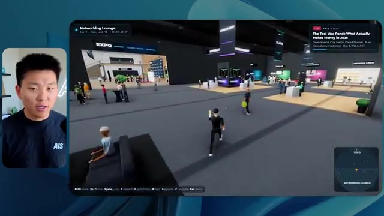

# 🎬 Matt Pocock: The Most Valuable Skill to Learn in the Age of AI

> **Chaîne** : [Nate Herk | AI Automation](https://www.youtube.com/@nateherk/featured)  
> **Lien YouTube** : [https://www.youtube.com/watch?v=Z8lf5oWKfj0](https://www.youtube.com/watch?v=Z8lf5oWKfj0)  
> **Date de publication** : 20261016  
> **Durée** : 00:44:50  
> **Identifiant vidéo** : `Z8lf5oWKfj0`  
> **Transcription & Analyse** : `whisper-v3-large-turbo+gemini-3.5-flash-lite`  

---

## 📌 Synthèse Exécutive & Outils

### 💡 Résumé
Dans cette vidéo intitulée **Matt Pocock: The Most Valuable Skill to Learn in the Age of AI**, Nate Herk décortique les capacités pratiques d'automatisation et de développement propulsées par les modèles de pointe.

### 🛠️ Outils, Modèles & Logiciels Présentés
- **Opus 5.5 & Claude Code** : Modèles d'ingénierie et agents de codage autonome.

### 🔑 Points Clés & Enseignements Stratégiques
- Optimiser le niveau d'effort et le raisonnement des modèles IA pour des résultats industriels.
- Automatiser les cycles de création logicielle de bout en bout.

---

## ⏱️ Chronologie & Transcription Complète Audio & Visuelle (Mot pour Mot)

### ⏱️ `[00:00:00 - 00:00:20]` | Segment #01

**🔊 Audio (Transcription Intégrale Mot pour Mot en Français) :**
> Opus 5.5, Opus 5.5, Opus 5.5, Opus 5.5, Opus 5.5. This model is literally everywhere and for very good reason. It's smart, it's cheap, it has amazing taste, it is an incredible AI model. But with every AI model, you have a choice of effort, whether that be low, medium, high, extra, max, or ultra code.

**👁️ Analyse Visuelle d'Écran (gemini-3.5-flash-lite) :**
**Interface & Outils** : Twitter (X).

**Contenu textuel & Code** : Un post mentionnant : "It's a great time for hobbyists, bad time for professionals. This experiment has further cemented my view that technical creatives are about to experience a massive disruption." accompagné d'une image de paysage 3D photoréaliste.

**Action / Démonstration** : Illustration visuelle du concept de "disruption" technologique par l'IA évoqué dans le segment audio.

*⏱️ 00:00:05 — Capture d'écran montrant une interface de réseau social (Twitter/X) affichant un post viral sur les capacités de génération d'images/vidéos par IA.*

---

### ⏱️ `[00:00:20 - 00:00:38]` | Segment #02

**🔊 Audio (Transcription Intégrale Mot pour Mot en Français) :**
> So in this video, I gave Opus 5.5 the same exact prompt and I ran it on every single effort level and we're gonna be comparing the results. We will look at the quality of all of the different actual outputs, But then we're also going to look at how long each one of these ran, how much it cost us if it was API billing, the total tokens, how many checks they ran, and how many questions they actually asked me throughout the process.

**👁️ Analyse Visuelle d'Écran (gemini-3.5-flash-lite) :**
**Interface & Outils** : Application de tableau blanc virtuel / outil de gestion de projet.

**Contenu textuel & Code** : Tableau comparatif avec les colonnes : "Low", "Medium", "High", "Extra", "Max", "Ultracode" et les lignes : "Run time", "API cost", "Total tokens", "Checks", "Questions asked".

**Action / Démonstration** : Présentation du cadre d'analyse comparative pour l'évaluation des performances de l'IA.

*⏱️ 00:00:29 — Capture d'écran d'une application de type tableau blanc/diagramme (ex: Miro ou équivalent) affichant un tableau comparatif vide pour "Opus 5.5 Efforts".*

---

### ⏱️ `[00:00:39 - 00:00:58]` | Segment #03

**🔊 Audio (Transcription Intégrale Mot pour Mot en Français) :**
> And the results that we got are not what I expected at all, so I can't wait to share this with you guys. Let's not waste any time and just get straight into this one. Okay, so let's jump right into this one. I want to start off just by showing you guys the actual prompt that we used that we gave to every single one of these different agents. I'm going to go into the files over here, and we're going to open up this prompt markdown file, and I'll show you what we got. So here is the slash goal that I fed in.

**👁️ Analyse Visuelle d'Écran (gemini-3.5-flash-lite) :**
**Interface & Outils** : Cursor (éditeur de code avec intégration IA).

**Contenu textuel & Code** : Prompt affiché : "Hi Nate. This worktree has the effort-test task queued in PROMPT.md: build a walkable third-person 3D world of the AIS Live conference...". Menu latéral avec liste de fichiers/projets (Hello, Session logs cost analysis, Extra, High, Max, Ultracode, Medium, Low).

**Action / Démonstration** : L'agent IA attend une instruction de l'utilisateur pour démarrer la tâche de construction du monde 3D définie dans PROMPT.md.

*⏱️ 00:00:48 — Interface de l'éditeur Cursor (ou similaire) affichant une fenêtre de chat avec un agent IA. Le volet latéral gauche montre des dossiers de projet nommés "effort-test", "AIS-OS", etc. La zone de texte affiche un prompt concernant la création d'un monde 3D.*

---

### ⏱️ `[00:00:58 - 00:01:34]` | Segment #04

**🔊 Audio (Transcription Intégrale Mot pour Mot en Français) :**
> I said, you need to create me a 3D world that is a realistic tech conference that I can walk around in third-person view. You will look at this folder, which is my event recording assets from AIS Live. And this folder is a frame IO folder of 105 gigabytes of video recordings. This was a completely virtual event. Everything was recorded and all of the recordings are right here. I said, your goal is to take this event and turn it into a 3D explorable world that makes me feel like I actually went to a real in-person conference with different rooms, different tracks, different stages, blah, blah, blah. Feel free to use key.ai if you need to generate any images or videos. And you can also use anything else inside of my Herc 2 project, which is like my AI operating system. I said,

**👁️ Analyse Visuelle d'Écran (gemini-3.5-flash-lite) :**
**Interface & Outils** : Visual Studio Code (VS Code), Frame.io.

**Contenu textuel & Code** : Texte du prompt : "You need to create me a 3D world that is a realistic tech conference... You will look at this folder, which is my event recording assets from AIS Live."

**Action / Démonstration** : Le présentateur illustre le processus de configuration du projet et de partage des ressources de données (105 Go de vidéos) nécessaires à l'IA pour générer l'environnement 3D.

*⏱️ 00:01:07 — Éditeur de texte (VS Code) affichant un fichier Markdown nommé "PROMPT.md" contenant des instructions détaillées pour la création d'un monde 3D.*

*⏱️ 00:01:16 — Interface de la plateforme Frame.io affichant le contenu d'un dossier intitulé "Sep 22, 2026" avec 105 Go de fichiers de conférence.*

*⏱️ 00:01:25 — Éditeur de texte (VS Code) affichant le même fichier "PROMPT.md" que l'image #1, avec le curseur de la souris positionné sur le texte.*

---

### ⏱️ `[00:01:34 - 00:02:08]` | Segment #05

**🔊 Audio (Transcription Intégrale Mot pour Mot en Français) :**
> you'll be judged on creativity, design, physics, and the overall feel as I explore the 3D world that you built. And that was basically the end of the instructions. So as you can see on this left-hand side, I ran this through all of the different effort levels. Let's start off with low and work our way up to ultra code. All right. So here we have the result from low. Let's open this up and take a look. So we have AIS live, AI services summit in person finally, and we were able to click around. First of all, this doesn't feel very branded. Like this isn't the IS Live logo. It's not even our colors. So I don't love that, but let's get in here. Okay. This is way too bright. Um, we have a map in the top, right? We have a city back here. I can't tell what city

**👁️ Analyse Visuelle d'Écran (gemini-3.5-flash-lite) :**
**Interface & Outils** : Environnement de développement intégré (IDE) assisté par IA (type Windsurf/Cursor).

**Contenu textuel & Code** : Liste de niveaux d'effort ("Low", "Medium", "High", "Max", "Ultracode") et un message système indiquant : "Hi Nate. This worktree has the effort-test task queued in PROMPT.md : build a walkable third-person 3D world...".

**Action / Démonstration** : Le curseur survole l'option "Low" dans la barre latérale pour lancer le test de création d'un monde 3D selon différents niveaux d'effort.

*⏱️ 00:01:42 — Une interface de développement de type agent IA (probablement Windsurf ou Cursor) affichant une liste de dossiers "effort-test" (Low, Medium, High, Max, Ultracode) dans la barre latérale gauche, avec une fenêtre de conversation active à droite.*

---

### ⏱️ `[00:02:08 - 00:02:40]` | Segment #06

**🔊 Audio (Transcription Intégrale Mot pour Mot en Français) :**
> this is. Okay. This is Chicago, which is kind of cool because you know, I live in Chicago, but anyways, on the top, right, we can see a map. We have a lobby. We have an expo hall. We have VIP lounge main stage. Also the map shows where every other person is and that's sinking live. So we can see registration. We can see day one, hyper agent keynote, live debrief. Cool. So it actually does know the agenda and then there's day two. So it found that that's good. We have these little balls in here that I can hopefully kick around. Okay. The face, Oh, look at this. If I go over here, all the people just disappear. Very bad. Very bad. Okay. So let's see. Can I sprint? Okay.

**👁️ Analyse Visuelle d'Écran (gemini-3.5-flash-lite) :**
**Interface & Outils** : Plateforme événementielle virtuelle (type metaverse/spatial web) avec mini-carte intégrée.

**Contenu textuel & Code** : Textes informatifs sur le programme de la journée ("DAY 1") et menus de navigation.

**Action / Démonstration** : Navigation de l'avatar dans l'espace virtuel et interaction avec les zones de l'événement (Lobby, Expo Hall).

*⏱️ 00:02:16 — Vue d'un espace virtuel nommé "Badge pickup - GA and VIP" avec un avatar au centre et une mini-carte interactive en haut à droite.*

*⏱️ 00:02:24 — Vue de la zone "Lobby" dans l'environnement virtuel, affichant un panneau d'informations "DAY 1" listant des sessions d'événements.*

*⏱️ 00:02:32 — Vue de l'"Expo Hall" montrant des avatars en interaction autour de stands, avec une mini-carte en haut à droite indiquant la position des participants.*

---

### ⏱️ `[00:02:40 - 00:03:04]` | Segment #07

**🔊 Audio (Transcription Intégrale Mot pour Mot en Français) :**
> I can move a little faster. I'll first go over here. There's some swag, um, AIS plus certified glido. Okay. So it's got the actual booths that we had in the virtual event. We had booths. So that's pretty cool. A little place to take pictures. Room C. Right now we have Tangy Frederick doing a workshop. Okay. But this isn't a video. As you can see, it's just an image. She's not moving. So that's just an image. These people are disappearing. They must be ghosts. Let's go over here to room A.

**👁️ Analyse Visuelle d'Écran (gemini-3.5-flash-lite) :**
**Interface & Outils** : Plateforme d'événement virtuel de type metaverse/spatial.

**Contenu textuel & Code** : Texte affiché à l'écran : "Step 1: Go to Settings", "Step 2: Go to API Integrations", "Step 3: Go to Create A New Token".

**Action / Démonstration** : Navigation de l'avatar au sein d'un environnement numérique simulant un salon professionnel et une salle d'atelier.

*⏱️ 00:02:46 — Vue d'une plateforme d'événement virtuel montrant un avatar circulant dans un hall d'exposition avec le stand "Glaido".*

*⏱️ 00:02:52 — L'avatar entre dans une salle virtuelle nommée "Workshop Room C" (Enterprise track), avec des tables éclairées.*

*⏱️ 00:02:58 — Gros plan sur un écran projeté dans la salle virtuelle affichant des instructions techniques étape par étape pour configurer une "API Key".*

---

### ⏱️ `[00:03:04 - 00:03:30]` | Segment #08

**🔊 Audio (Transcription Intégrale Mot pour Mot en Français) :**
> We have Liberty White. Okay. Very cool. Your first 30 days in automation. Once again, it's just a still image and the people are glitchy. So not very good here. I'm going to go over to the main stage and see what we've got going. Okay, cool. So we have a main looking stage. The people are glitching. Really bad. That's not very good at all. Our video is actually moving. Like I saw my face here and I saw Devin's, but now they're gone. So I'm not sure what happened. Okay. It's, it looks like it's more of a slideshow. Nothing is actually being played still. Anyways, let's come in here.

**👁️ Analyse Visuelle d'Écran (gemini-3.5-flash-lite) :**
**Interface & Outils** : Environnement de conférence virtuelle 3D (type métavers).

**Contenu textuel & Code** : Texte affiché à l'écran : "Now showing: Hyperagent Workshop: How to Build an Always-On Fleet of Agents".

**Action / Démonstration** : Navigation de l'avatar de l'utilisateur dans les différentes salles de l'événement virtuel.

---

### ⏱️ `[00:03:30 - 00:03:58]` | Segment #09

**🔊 Audio (Transcription Intégrale Mot pour Mot en Français) :**
> We have more booths. We have hyper agent. We have Claude Code. We have more swag. Room B is Dave Ebelor. I'm assuming it's the same exact thing. We've got coffee. And then I'm assuming VIP lounge, VIP access only. That's pretty cool, but there's really nothing going on right here. That screen's way too bright. Okay. So I think you guys understand the vibe that we're getting here from Opus 5.5 on low effort. And here's where things get interesting. How much do you guys think that this ran for? How long? This one ran for 16 minutes and 43 seconds. How much do you think this cost?

**👁️ Analyse Visuelle d'Écran (gemini-3.5-flash-lite) :**
**Interface & Outils** : Application de type tableau blanc interactif ou outil de gestion de projet (canvas).

**Contenu textuel & Code** : Tableau analytique comparant les niveaux de configuration (Low, Medium, High, Extra, Max, Ultracode) selon les métriques : Run time, API cost, Total tokens, Checks, et Questions asked.

**Action / Démonstration** : Présentation statique de la structure de données pour le benchmark Opus 5.5.

*⏱️ 00:03:51 — Tableau comparatif des performances intitulé "Opus 5.5 Efforts" avec des colonnes de niveaux (Low à Ultracode) et des lignes de métriques (Run time, API cost, etc.).*

---

### ⏱️ `[00:03:58 - 00:04:26]` | Segment #10

**🔊 Audio (Transcription Intégrale Mot pour Mot en Français) :**
> $3.91 if this was API billing. I'm obviously using my subscription here, but we're just going to calculate this in API billing. Total tokens was 191,000. It did 22 checks. So the verification, 22 times it opened up the browser and ran different sorts of checks. So 22 categories of checks. And how many questions did it ask me? It asked me a total of zero questions throughout this slash goal prompt. Okay. So let's open up medium effort and see what we've got. Okay, here we go. Medium effort. We've got Nate Herc. We've got my badge. This is AI's life branded.

**👁️ Analyse Visuelle d'Écran (gemini-3.5-flash-lite) :**
**Interface & Outils** : Outil de diagramme/tableau blanc (type Obsidian Canvas).

**Contenu textuel & Code** : Tableau avec les métriques : "Run time" (16m 43s), "API cost" ($3.91), "Total tokens" (191.3K), ainsi que des champs vides pour "Checks" et "Questions asked".

**Action / Démonstration** : Le présentateur illustre les coûts et les ressources consommées par l'agent IA en remplissant ou en affichant un tableau récapitulatif.

*⏱️ 00:04:05 — Une capture d'écran montrant l'interface d'un outil de design ou de tableau blanc (probablement Obsidian Canvas ou similaire) présentant un tableau comparatif des performances d'un agent IA sous la colonne "Low".*

---

### ⏱️ `[00:04:26 - 00:04:46]` | Segment #11

**🔊 Audio (Transcription Intégrale Mot pour Mot en Français) :**
> So this is already looking a little bit better. This feels like our color schemes that used our brand guidelines. Day one build, day two earn, VIP. Cool. Okay. I'm going to enter the venue. Okay. Wow. So similar sort of vibe. It's sitting in the background. This doesn't look like Chicago though, does it? No, this looks like a, honestly, this looks like a made up city. Either way, it's funny that they decided to do that. Let's see if I can move a little faster. Oh, wow.

**👁️ Analyse Visuelle d'Écran (gemini-3.5-flash-lite) :**
**Interface & Outils** : Plateforme web interactive "AIS Live" (environnement de conférence virtuelle 3D).

**Contenu textuel & Code** : Texte d'accueil "Welcome to AIS Live", commandes de navigation clavier (WASD, Shift, Espace, etc.) et informations sur l'événement (sessions, participants).

**Action / Démonstration** : Nate Herk montre l'interface d'accueil avant de cliquer sur "Enter the venue" pour accéder à la simulation 3D.

*⏱️ 00:04:31 — Interface d'accueil de la plateforme virtuelle "AIS Live" présentant un badge d'accès au nom de Nate Herk et des options de navigation.*

*⏱️ 00:04:41 — Vue immersive à la première personne dans un environnement 3D type métavers représentant un espace de conférence virtuel.*

---

### ⏱️ `[00:04:46 - 00:05:21]` | Segment #12

**🔊 Audio (Transcription Intégrale Mot pour Mot en Français) :**
> The people are interacting with me. Watch. If I go up to this guy, he just like raised his arm. Well, now he doesn't want anything to do with me at all. But all of these little robots here must be making decisions. I'm not sure if they're using Jev. They're definitely not. I didn't tell it to. Actually, my Jev key is in the back. I don't know. Maybe it did use it. Anyways, we can see here we have Workshop Room C, Agents Lab. Nice. So this one is actually being run. You can see that is a real video being played by Tangy. Everyone here is actually like working on a laptop. They're not glitching. This is pretty cool. Also, my badge is on my chest, which is pretty cool. I can come this way. We have a map up in the top right, as you guys can see, but I can come this way. We have an

**👁️ Analyse Visuelle d'Écran (gemini-3.5-flash-lite) :**
**Interface & Outils** : Environnement de simulation virtuelle / Métavers (type plateforme de réunion virtuelle).

**Contenu textuel & Code** : Interface utilisateur affichant des informations contextuelles : "WORKSHOP BLOCK 3", "Enterprise AI Services", nom de l'intervenant "Tangy Frederick", et une mini-carte en haut à droite.

**Action / Démonstration** : Navigation et exploration de l'utilisateur à travers un espace de conférence virtuel peuplé d'avatars autonomes.

*⏱️ 00:04:55 — Vue à la troisième personne d'un environnement virtuel de style métavers représentant un hall d'entrée avec des avatars d'utilisateurs.*

*⏱️ 00:05:04 — Le personnage de l'utilisateur pénètre dans une salle de conférence intitulée "Agents Lab" remplie d'avatars assis devant des ordinateurs.*

*⏱️ 00:05:12 — Vue plongeante sur l'intérieur de la salle de conférence "Agents Lab" où de nombreux avatars sont installés à des bureaux.*

---

### ⏱️ `[00:05:21 - 00:05:47]` | Segment #13

**🔊 Audio (Transcription Intégrale Mot pour Mot en Français) :**
> expo hall. This is where we have the Glido booth. And this is actually playing. Yeah, it's playing the video of us talking about Glido. It's playing the video of Ed and I talking about our certification program. We've got the AIS Plus logo back here, which is kind of in a weird spot. This is a speaker slides and takeaways. So wow, this is all the resources that we gave out after the event. They're all sitting right there as well. We can see we've got a community spotlight. So this is Aiden talking about his deal that he landed and it's playing live. These people are watching.

**👁️ Analyse Visuelle d'Écran (gemini-3.5-flash-lite) :**
**Interface & Outils** : Plateforme de conférence virtuelle (Metaverse/Spatial).

**Contenu textuel & Code** : Supports de présentation, logos "AIS+ Certified", slides de conférence et documents de type "Speaker Slides & Takeaways".

**Action / Démonstration** : Navigation et exploration au sein d'un environnement d'exposition virtuel dédié à la certification IA.

*⏱️ 00:05:28 — Vue en perspective d'un stand virtuel "AIS+ Certified" dans un hall d'exposition, avec des avatars et des écrans affichant des supports de présentation.*

*⏱️ 00:05:34 — Gros plan sur un mur de ressources interactif présentant une grille de diapositives de conférence, de guides et de documents de travail.*

*⏱️ 00:05:40 — Vue panoramique du hall d'exposition montrant plusieurs stands, des avatars circulant et une interface de navigation type metaverse.*

---

### ⏱️ `[00:05:47 - 00:06:21]` | Segment #14

**🔊 Audio (Transcription Intégrale Mot pour Mot en Français) :**
> They're pretty engaged. We've got hyper agent. That was, that's what I meant. If you guys saw those people like raising their arms saying hi, that was kind of funny. Look, look, there he goes again. Anyways. Okay. Where am I now? Now I'm in the main lobby. We've got a coffee bar. We've got a big logo, which is the real logo. It's too bright, but we have the logo. We can see if we can come in here to the foundation track. We've got Sabrina Romanov and Liberty White. So different trainings right there. We can come into this room. This is the advanced track. So what's going on here. We've got Dave Ebelar and Saman talking about some different stuff in there. And now let's go take a look at the main stage. Oh, wait, there's a video of me up there. Is that like a VIP

**👁️ Analyse Visuelle d'Écran (gemini-3.5-flash-lite) :**
**Interface & Outils** : Environnement virtuel 3D de type conférence/réseautage (type Gather Town ou plateforme d'événement virtuel).

**Contenu textuel & Code** : Interface utilisateur avec mini-map, noms de zones ("Main Lobby"), et avatars personnalisés dans un espace de travail virtuel.

**Action / Démonstration** : Navigation et exploration de l'espace virtuel par le présentateur au sein de la plateforme.

*⏱️ 00:05:55 — Vue d'un environnement virtuel immersif type métavers représentant un "Main Lobby" avec une barre de café et des avatars d'utilisateurs.*

*⏱️ 00:06:04 — Navigation de l'avatar dans une zone de conférence virtuelle où des participants sont assis devant un écran de présentation.*

*⏱️ 00:06:12 — Vue en contre-plongée depuis l'entrée de la salle de conférence virtuelle, montrant une foule d'avatars interagissant.*

---

### ⏱️ `[00:06:21 - 00:06:50]` | Segment #15

**🔊 Audio (Transcription Intégrale Mot pour Mot en Français) :**
> section? Yeah, we'll go check that out in a sec. But anyways, this is the main stage. This looks very, very nice. We've got a big stage. We've got like four people sitting up here. We've got the the three screens of Alex up there with hyper agent. Am I allowed to get on stage? Oh, and lets me up on stage. Okay. That's pretty nice. All right, guys, let's take a selfie. Let me get everyone in the background. Get in here. Anyways, that is pretty, pretty cool. Not every seat is filled though. So we need to work on that. But anyways, I'm going to run back over and see what that VIP section was. Okay. VIP lounge. I feel like this is like a worth the airport or something.

**👁️ Analyse Visuelle d'Écran (gemini-3.5-flash-lite) :**
**Interface & Outils** : Environnement de conférence virtuelle 3D (type plateforme événementielle métavers).

**Contenu textuel & Code** : Interface utilisateur affichant les détails de l'événement : "Keynote - Day 1", "Hyperagent Keynote", nom de l'intervenant "Alex McDonnell".

**Action / Démonstration** : Navigation et exploration de l'espace virtuel par l'avatar de l'utilisateur.

---

### ⏱️ `[00:06:51 - 00:07:14]` | Segment #16

**🔊 Audio (Transcription Intégrale Mot pour Mot en Français) :**
> Okay, cool. So now we've got the VIP sessions up here. VIP Q and a with Nate live video playback right here. Very, very cool. And we've got like a bar or something. Awesome. I would say that this is a pretty good output. Now, as far as the stats here, this one took one hour and 13 minutes to run. It would have cost us $12 and 44 cents. It used 490,000 tokens and it did 23 checks.

**👁️ Analyse Visuelle d'Écran (gemini-3.5-flash-lite) :**
**Interface & Outils** : Application de métavers/environnement virtuel 3D et interface de tableau de bord de données (type canevas/tableau).

**Contenu textuel & Code** : Dans l'image 1 : "VIP Q&A with Nate", "Day 1", plan du salon VIP. Dans l'image 2 : Tableau comparatif "Low", "Medium", "High" avec des données chiffrées sur l'exécution d'un modèle d'IA.

**Action / Démonstration** : Présentation d'un espace de réunion virtuel et analyse des statistiques de performance d'exécution du modèle suite à une requête précédente.

*⏱️ 00:06:56 — Vue d'un environnement virtuel immersif en 3D représentant un salon VIP, incluant un écran diffusant une vidéo du présentateur et des avatars d'utilisateurs.*

*⏱️ 00:07:02 — Capture d'écran d'un tableau de bord de suivi de performance (Opus 5.5 Efforts) affichant des métriques telles que le temps d'exécution (16m 43s), le coût API (3,91 $), et le nombre de tokens.*

---

### ⏱️ `[00:07:14 - 00:07:48]` | Segment #17

**🔊 Audio (Transcription Intégrale Mot pour Mot en Français) :**
> And it asked us a grand total of zero questions once again. All right, let's move on to high. This was already a pretty decent output and Anthropic themselves in their how to prompt Opus 5.5 video, or sorry, not video, article. They said to just start on medium and scale it up or down if you need. So that was a medium output. Let's move over to high and see what we got. Real quick, guys, I need to take a second to tell you about the sponsor of today's video, Hostinger. So both of these models just built me a working version of the same thing. And now I'm right where I always end up with something finished sitting on my laptop and no quick way to get it online. And that's the gap that Hostinger's connector closes. It's a free extension

**👁️ Analyse Visuelle d'Écran (gemini-3.5-flash-lite) :**
**Interface & Outils** : Canvas (tableur) pour l'image 1, Cursor (IDE) pour l'image 2.

**Contenu textuel & Code** : Image 1 : Données chiffrées sur le coût et le temps des modèles IA. Image 2 : Prompt de création d'un calculateur ROI en HTML, logs d'exécution ("Ruminating...", "Read files, ran a command"), paramètres de sélection de modèle (Opus 5.5 (1M) Medium).

**Action / Démonstration** : Analyse comparative des coûts/performances d'un agent IA (image 1) et exécution d'une tâche de codage par un agent dans Cursor (image 2).

*⏱️ 00:07:22 — Tableau comparatif des performances de différents niveaux de prompt (Low, Medium, High, Extra) incluant le temps d'exécution, le coût API, le nombre de tokens, les vérifications et les questions posées.*

*⏱️ 00:07:39 — Interface de l'éditeur Cursor montrant un agent IA en cours de traitement de la requête "Build Northwind ROI calculator" avec une barre de progression et une fenêtre de chat active.*

---

### ⏱️ `[00:07:48 - 00:08:23]` | Segment #18

**🔊 Audio (Transcription Intégrale Mot pour Mot en Français) :**
> for your editor that pulls your Hostinger account into whatever you're already coding in. So VS Code, cursor, cloud code, codex, you name it. You sign in once with a single click, and from there, your agent can deploy the site, point a domain at it, set the DNS records, and check on your VPS without you ever having to leave the editor. So whichever one of these you end up liking better, the thing it built is a couple minutes away from a real URL on managed hosting. Connector is free on every hosting or plan, so if you still need the hosting underneath it, grab the unlimited plan with the link in the description and use code NATEHERK for 10% off. That also comes with a free domain and business email for the year. And it's still the cheapest way that I found to get something

**👁️ Analyse Visuelle d'Écran (gemini-3.5-flash-lite) :**
**Interface & Outils** : Interface de gestion Hostinger intégrée dans un IDE (potentiellement Cursor ou VS Code) avec une fenêtre de terminal "Claude Code" adjacente.

**Contenu textuel & Code** : État de connexion "Connected" via OAuth, version Node.js 24.13.0, et liste des outils accessibles (Websites, Domains, Subscriptions & Payments, Email Marketing).

**Action / Démonstration** : Démonstration de l'intégration et de l'autorisation d'accès permettant à l'agent IA de gérer les ressources Hostinger directement depuis l'éditeur de code.

*⏱️ 00:07:57 — Une interface de configuration montrant la connexion réussie entre un IDE et le service d'hébergement Hostinger, avec une liste d'outils disponibles pour l'assistant IA.*

---

### ⏱️ `[00:08:23 - 00:08:47]` | Segment #19

**🔊 Audio (Transcription Intégrale Mot pour Mot en Français) :**
> you built onto a real URL. So let's get back to the video. Okay. Once again, very, very branded. This is even better of a loading screen than the previous one. We've got this nice little effect in the background. We've got the logo. We'll enter the venue. Okay. Here we are. This looks pretty nice. We start outside and you can see that we have these flags for all the speakers, Wyatt, Casper, Alex, Ed, Aiden, Sabrina, Liberty. This is pretty cool. We got live blocks here.

**👁️ Analyse Visuelle d'Écran (gemini-3.5-flash-lite) :**
**Interface & Outils** : Application web interactive/métavers "AIS LIVE" construite sur RingCentral.

**Contenu textuel & Code** : Interface utilisateur avec tutoriel de contrôles clavier (WASD, SHIFT, E, P), carte de navigation, compteur de progression ("Passport") et noms d'événements.

**Action / Démonstration** : Entrée dans l'environnement virtuel et navigation dans l'espace 3D du centre de conférence.

*⏱️ 00:08:29 — Écran de chargement et d'accueil de la plateforme "AIS LIVE" avec le bouton "ENTER THE VENUE".*

*⏱️ 00:08:35 — Vue immersive du hall d'accueil (AIS Live Plaza) dans un environnement 3D avec des avatars d'utilisateurs.*

*⏱️ 00:08:41 — Vue à la première personne de la place événementielle, montrant des panneaux signalétiques avec des noms d'intervenants.*

---

### ⏱️ `[00:08:47 - 00:09:23]` | Segment #20

**🔊 Audio (Transcription Intégrale Mot pour Mot en Français) :**
> it took this picture from me, your host, Nate Herc, John, Dave, Nate Herc. There we go. Okay. The doors. Awesome. They're automatic sliding glass doors. I love that. We can see VIP check-in. We can see GA. We can come over here and we can check out the expo with different booths, community spotlight. You can also see that in the top left, I have a passport. So it's like, it will be showing how many of the places I've visited. All of these are real playback. We've got a resource wall with all of the different speakers. They've also got a networking session over here. So I'm going to come over real quick and see what that's all about. So we've got the AIS cold brew bar. We've got different community members that were spotlighted or highlighted.

**👁️ Analyse Visuelle d'Écran (gemini-3.5-flash-lite) :**
**Interface & Outils** : Environnement de métavers interactif/plateforme événementielle virtuelle en 3D.

**Contenu textuel & Code** : Interface utilisateur affichant "Registration Concourse", "Main Stage", "Expo Hall", des jauges de progression "Passport" et des menus de navigation contextuels.

**Action / Démonstration** : Exploration et navigation interactive de l'hôte dans un monde virtuel conçu pour des événements professionnels.

*⏱️ 00:08:56 — Vue à la troisième personne d'un environnement virtuel de type métavers représentant un hall de conférence avec des comptoirs de "VIP Check-in" et "Registration GA".*

*⏱️ 00:09:05 — Navigation dans une zone d'exposition virtuelle ("Expo Hall") avec des stands de marque et des avatars de participants.*

*⏱️ 00:09:14 — Déplacement dans le hall d'entrée principal montrant des portes vitrées automatiques et l'architecture intérieure de l'espace événementiel virtuel.*

---

### ⏱️ `[00:09:23 - 00:09:56]` | Segment #21

**🔊 Audio (Transcription Intégrale Mot pour Mot en Français) :**
> We've got the VIP wing. Wait, what? Pick up a wristband. Oh, I have to actually go get the wristband. Okay. Let me check in real quick. Wristband's already on. Wait, what? Okay. Oh, okay. Now the doors have opened for me. Cool. I can come into here. Oh, that just goes to the main stage. VIP lounge. This is a Q and A going on. It looks like very cool. I mean, I'm very impressed by how it's able to do this. Wow. Okay. So this is really good. What we did is we had VIP breakout rooms with different people. You can see that there's different rooms, different members of the AIS team going into stuff. This is really cool. This is very cool. That's a much better VIP

**👁️ Analyse Visuelle d'Écran (gemini-3.5-flash-lite) :**
**Interface & Outils** : Environnement de conférence virtuelle 3D (Metaverse/Plateforme événementielle interactive).

**Contenu textuel & Code** : Textes informatifs sur les zones de l'événement ("Registration Concourse", "VIP Lounge", "VIP Working Sessions") et intitulés d'ateliers comme "Price It Right" ou "Land Your First Paying Client".

**Action / Démonstration** : Navigation de l'avatar de l'utilisateur à travers différentes zones de l'espace événementiel virtuel pour accéder à des sessions exclusives.

*⏱️ 00:09:32 — Vue d'un environnement virtuel de type métavers représentant un hall d'accueil de conférence avec des avatars, un panneau d'information et un indicateur de zone VIP.*

*⏱️ 00:09:40 — Vue intérieure du "VIP Lounge" dans l'espace virtuel, montrant des avatars assis et un grand écran diffusant une vidéo de l'orateur.*

*⏱️ 00:09:48 — Vue de l'espace "VIP Working Sessions" avec plusieurs stands thématiques et des avatars participant à des ateliers de travail collaboratif.*

---

### ⏱️ `[00:09:56 - 00:10:30]` | Segment #22

**🔊 Audio (Transcription Intégrale Mot pour Mot en Français) :**
> experience than what was shown in the first piece. Okay. VIP after party. Look at this. We've got a dance floor. We've got all these elements in here. We have the actual VIP after party playback right here. And there's a DJ booth. That is so funny. There's a bit of a bug right here, a glitch right there, but this is awesome. Oh, cool. So when I'm in here in the main stage, we get closed captions. You can see right here in the bottom of my screen, we're getting these closed captions of Wyatt actually talking up here. We've got lights. We've got the panel. Very cool. Nice main stage. I'm going to go over here. We can go to the foundation,

**👁️ Analyse Visuelle d'Écran (gemini-3.5-flash-lite) :**
**Interface & Outils** : Plateforme d'événementiel virtuel 3D avec interface utilisateur incrustée (HUD) incluant mini-map et contrôles de navigation.

**Contenu textuel & Code** : Textes informatifs à l'écran : "VIP After-Party", "Main Stage", "Anatomy of Three Real Deals", avec des compteurs de progression de type "Passport".

**Action / Démonstration** : Navigation et exploration de différents espaces de networking virtuel au sein d'une plateforme communautaire.

*⏱️ 00:10:04 — Vue d'un environnement virtuel type "After-party" avec des avatars dansant sur une piste lumineuse, incluant un écran géant affichant des participants en visioconférence.*

*⏱️ 00:10:13 — Plan large de l'espace virtuel "VIP After-Party" montrant la disposition de la salle, la piste de danse et un écran de diffusion vidéo.*

*⏱️ 00:10:21 — Vue intérieure d'un auditorium virtuel ("Main Stage") où des avatars sont assis devant une scène diffusant une présentation vidéo.*

---

### ⏱️ `[00:10:30 - 00:11:06]` | Segment #23

**🔊 Audio (Transcription Intégrale Mot pour Mot en Français) :**
> advanced, and the enterprise tracks over here. So let's see. We have anatomy of a three real deals. We've got hyper agent. We've got the evals with Nate and Ed in here. We've got Dave going on in the advanced stuff. This is really nice. I mean, obviously each, each of these outputs so far, low was okay. Medium was better. High has been even better. Let's see if that trend continues and let's go ahead and see what this cost us. So high ran for one hour and seven minutes. So a little bit quicker than medium, it would have cost us $16 and 31 cents. It used half a million tokens, 509,000. It did 22 checks. And it also asked us, well, actually, no, I was wrong. This

**👁️ Analyse Visuelle d'Écran (gemini-3.5-flash-lite) :**
**Interface & Outils** : Logiciel de dessin/tableau blanc interactif (type tldraw ou équivalent).

**Contenu textuel & Code** : Données quantitatives de performance comparant les niveaux "Low", "Medium", "High" et "Extra" (Runtime, API cost, Total tokens, Checks).

**Action / Démonstration** : Analyse comparative des coûts et de l'efficacité des modèles IA via un tableau récapitulatif.

*⏱️ 00:10:57 — Tableau comparatif "Opus 5.5 Efforts" détaillant les métriques de performance : durée d'exécution, coût API, nombre de tokens et vérifications pour différents niveaux de difficulté.*

---

### ⏱️ `[00:11:06 - 00:11:25]` | Segment #24

**🔊 Audio (Transcription Intégrale Mot pour Mot en Français) :**
> one asked me one question and spoiler, it was the only one that asked us a question throughout all of this. So let's see, we've got three left extra max and ultra code. Let me pull open extra and we'll see what we got. Okay. So this one looks pretty good. I would honestly say so far, the loading screen high was the best. The one that we just saw, but anyways, let's enter AIS live.

**👁️ Analyse Visuelle d'Écran (gemini-3.5-flash-lite) :**
**Interface & Outils** : Interface de type canvas/tableau (probablement Claude Projects ou équivalent).

**Contenu textuel & Code** : Tableau de données comparant "Run time", "API cost", "Total tokens", "Checks" et "Questions asked" pour différents niveaux de modèles (Low, Medium, High). La colonne "Extra" est sélectionnée.

**Action / Démonstration** : Le présentateur consulte et passe en revue les métriques de performance des différentes variantes de modèles pour analyser les résultats obtenus.

*⏱️ 00:11:11 — Tableau comparatif des performances de modèles IA (Low, Medium, High, Extra) affiché dans une interface de type canvas.*

---

### ⏱️ `[00:11:26 - 00:11:51]` | Segment #25

**🔊 Audio (Transcription Intégrale Mot pour Mot en Français) :**
> Whoa. Okay. So we have like little sound bites. I can chat with people. The tool war panel settled a few debates for me. Nice. Good perspective there. We're outside again. We have these different banners, although they're all the same. They don't say like different people's names. So big AIS live logo. Workshop wing is over here. And let's go through the sliding glass doors and see what we've got. So we've got the AIS cafe. The map is in the bottom right, and it's not too descriptive.

**👁️ Analyse Visuelle d'Écran (gemini-3.5-flash-lite) :**
**Interface & Outils** : Environnement virtuel 3D (type métavers de conférence en ligne).

**Contenu textuel & Code** : Interface utilisateur de métavers : mini-carte, indicateurs de lieu ("Convention Plaza"), bannières publicitaires "AIS LIVE".

**Action / Démonstration** : Navigation et exploration d'un utilisateur dans un espace virtuel 3D pour des conférences ou événements en ligne.

---

### ⏱️ `[00:11:51 - 00:12:26]` | Segment #26

**🔊 Audio (Transcription Intégrale Mot pour Mot en Français) :**
> I like how the other maps have told us what, like where things were, but this one looks very professional. We can see here's the main stage. Let's hop in here real quick. They've all got these balls flying around, which I think is pretty funny. The AIS beach balls. We have me up there speaking. I think I was introing one of the days. Let's keep on moving here to the workshop room on this left side. Okay. So here we've got the Hyper Agent Theater. We've got this sponsored session in here by Hyper Agent, but it's showing us what's coming up in here as well. It's really funny that we can chat to people. Salmon built a voice sales rep live. The price it right room was packed. Did you grab the VIP companion guide? That's so funny. We have the advanced track in

**👁️ Analyse Visuelle d'Écran (gemini-3.5-flash-lite) :**
**Interface & Outils** : Plateforme événementielle virtuelle (type Gather.town ou environnement Metaverse propriétaire).

**Contenu textuel & Code** : Signalétique textuelle "Main Stage", "Workshops", "Enterprise AI Services", bulles de dialogue des avatars, mini-carte en bas à droite.

**Action / Démonstration** : Navigation et exploration d'un environnement 3D virtuel interactif.

*⏱️ 00:12:00 — Vue à la première personne d'une scène de conférence virtuelle avec un écran géant diffusant la vidéo du présentateur, entouré d'avatars et d'éléments flottants.*

*⏱️ 00:12:09 — Vue du "Grand Lobby" d'une plateforme d'événement virtuel, montrant des avatars d'utilisateurs et une signalétique pour des ateliers ("Workshops").*

*⏱️ 00:12:17 — Vue à la première personne naviguant dans un couloir d'événement virtuel avec des avatars d'utilisateurs et des indications textuelles ("Enterprise AI Services").*

---

### ⏱️ `[00:12:26 - 00:12:58]` | Segment #27

**🔊 Audio (Transcription Intégrale Mot pour Mot en Français) :**
> here. Once again, we've got live playback. Is that live playback? Oh, okay. It started once I got in, but I can take a seat. Oh my. I can watch this. I can stand up. I want to sit in the front. That's pretty cool. That's very nice. I like that. And you know what I noticed so far? The actual character that I'm playing kind of looks like me. I think it modeled it off of my thumbnail pictures or something. Anyways, we have Sabrina in here, room host here, grab any open seat. Okay, cool. And I really liked the sitting functionality. It's kind of funny. Like we could actually attend this workshop and participate. Anyways, it's showing us the speakers. It's showing us the

**👁️ Analyse Visuelle d'Écran (gemini-3.5-flash-lite) :**
**Interface & Outils** : Plateforme de conférence virtuelle/metavers, interface utilisateur type LMS (Learning Management System) ou environnement de collaboration en ligne.

**Contenu textuel & Code** : Interface de "Workshop" avec panneaux d'information, flux vidéo en direct de l'orateur sur grand écran, et éléments de navigation (Map, Agenda, Captions).

**Action / Démonstration** : Navigation et interaction dans un espace événementiel virtuel, simulation de présence en atelier de formation.

*⏱️ 00:12:34 — Vue d'une salle de conférence virtuelle (Advanced Track) avec des avatars d'utilisateurs et un écran géant affichant une interface de travail.*

*⏱️ 00:12:42 — Vue de la salle de conférence virtuelle (Foundation Track) avec un écran projetant une interface de création de contenu IA.*

*⏱️ 00:12:50 — Gros plan sur l'écran projeté dans la salle virtuelle, montrant une interface logicielle type éditeur de workflow avec des fenêtres de chat vidéo incrustées.*

---

### ⏱️ `[00:12:58 - 00:13:31]` | Segment #28

**🔊 Audio (Transcription Intégrale Mot pour Mot en Français) :**
> agenda. There's a little red carpet here to take some pictures. We can strike a pose. Oh, wow. That's pretty cool. Resource library, get AIS Plus certified, Glido, Hyper Agent, AIS Plus, three real deals. Awesome. I mean, I would definitely say so far, each one is getting better. And we didn't even check out the VIP section yet, the VIP lounge. Let's go up here real quick. Hopefully I can get in. Nice. We've got tooling reset. These are the different rooms we could go in. So once again, I could grab the worksheet and I could try to understand how to price my stuff. This is so cool. This is definitely better than the previous one where we kind of just

**👁️ Analyse Visuelle d'Écran (gemini-3.5-flash-lite) :**
**Interface & Outils** : Plateforme événementielle virtuelle interactive de type métavers.

**Contenu textuel & Code** : Signalétique événementielle : "Expo Hall", "AIS+", "Hyperagent", "Glido", "VIP Lounge", "Workshops". Questions affichées : "What's your gut floor number?", "If you doubled your rate, what would change?".

**Action / Démonstration** : Navigation et exploration de l'espace événementiel par un avatar, interaction sociale dans le salon VIP.

*⏱️ 00:13:07 — Vue d'ensemble d'un hall d'exposition virtuel avec des stands de sponsors (AIS+, Hyperagent, Glido) sous forme d'avatar.*

*⏱️ 00:13:15 — Hall d'entrée virtuel d'une conférence avec escaliers et signalétique pointant vers des "Workshops".*

*⏱️ 00:13:23 — Vue à la première personne dans un salon VIP virtuel, avec un groupe d'avatars assis autour d'une table, affichant une liste de questions de discussion sur un écran.*

---

### ⏱️ `[00:13:31 - 00:13:59]` | Segment #29

**🔊 Audio (Transcription Intégrale Mot pour Mot en Français) :**
> like looked at stuff. Awesome. I can get behind the bar and come in here. This is very nice. Okay. So as far as statistics go, this one ran for an hour and a half. It costs 25.92 bucks. I don't know why I say point $25, 92 cents. It was 733,000 tokens and 34 checks. So it had the most checks so far by far. And it asked us zero questions. I can't wait to see what we got here from max and ultra code. Okay. Here is max loading screens, boring, but it's on brand and it has our logo.

**👁️ Analyse Visuelle d'Écran (gemini-3.5-flash-lite) :**
**Interface & Outils** : Logiciel de dessin/diagramme interactif (type Excalidraw ou similaire).

**Contenu textuel & Code** : Tableau de données montrant : "Medium" (1h 13m, $12.44, 419.2K tokens, 23 checks, 0 layers), "High" (1h 7m, $16.31, 509.3K tokens, 22 checks, 1 layer) et "Extra" (1h 31m).

**Action / Démonstration** : Le présentateur examine ou ajuste visuellement les barres de données dans le graphique "Opus 5.5 Efforts".

*⏱️ 00:13:38 — Une capture d'écran montrant une interface de diagramme ou de tableau de bord intitulée "Opus 5.5 Efforts", présentant des statistiques comparatives de temps, de coût et de jetons pour différents niveaux de performance (Medium, High, Extra, Max, Ultracode).*

---

### ⏱️ `[00:14:00 - 00:14:35]` | Segment #30

**🔊 Audio (Transcription Intégrale Mot pour Mot en Français) :**
> So that was good. I like that. We will go ahead and enter AIS live. Ooh, nice little animation here that brings us in. Once again, the character looks like me. They've all looked like me. I mean, sort of, we have sitting in the background. This looks like Chicago. Like I mentioned earlier, a lot of these are playing sounds and I'm not including that because it would be very distracting for you guys to try to listen to what's going on as well as me speaking. So there is like some slight music in all these. I hate how this is walking. This walking is really, really bad. I mean, the walking, yeah, I don't like this at all. So that's not great. But besides that, let's go in and explore. Notice these shadows when I walk in, they like really switch. I'm not sure why that is,

**👁️ Analyse Visuelle d'Écran (gemini-3.5-flash-lite) :**
**Interface & Outils** : Plateforme de métavers ou événement virtuel en 3D (AIS Live).

**Contenu textuel & Code** : Interface utilisateur avec mini-carte (radar) en bas à droite, commandes clavier affichées en bas, et panneau d'information « LIVE MAIN STAGE » en haut à droite.

**Action / Démonstration** : Navigation et exploration de l'environnement virtuel 3D par l'utilisateur.

*⏱️ 00:14:08 — Vue à la troisième personne d'un environnement virtuel typé « métavers » ou plateforme d'événement numérique intitulée « Arrival Plaza », avec des avatars circulant dans un espace urbain stylisé.*

*⏱️ 00:14:17 — Progression de l'avatar dans l'espace virtuel vers une structure de type hall d'exposition, avec une bannière affichant « REAL OBJECTS! REAL REVENUE ».*

*⏱️ 00:14:26 — L'avatar s'approche de l'entrée d'un bâtiment marqué « EXPO », illustrant la navigation dans cette interface interactive.*

---

### ⏱️ `[00:14:35 - 00:15:11]` | Segment #31

**🔊 Audio (Transcription Intégrale Mot pour Mot en Français) :**
> but anyways, we can chat with people in here too. Hyperagent booth is right where you walk into the expo. All good. Okay, cool. I can keep clicking E to make them change what they say. We've got the speakers right here. That looks pretty good. Although we definitely had everyone's profile picture. So I'm not sure why that's not included there. We see people taking pictures right here. I love that. And it saves a little picture. Okay. The map also isn't super, like doesn't give me a great explanation of what's going on, but I like these booths. These are cool. I think these booths are the best that I've seen so far. Like they just look nice. They've got reps. There's nice like slides behind them. Yeah. These booths are cool. Okay. We have a little featured theater

**👁️ Analyse Visuelle d'Écran (gemini-3.5-flash-lite) :**
**Interface & Outils** : Plateforme de conférence virtuelle 3D (Metaverse événementiel type Gather ou similaire).

**Contenu textuel & Code** : Interface utilisateur avec mini-map, liste d'événements "LIVE", panneaux d'information, avatars interactifs et menu de raccourcis clavier en bas d'écran.

**Action / Démonstration** : Exploration de l'environnement virtuel, interaction avec des avatars, navigation entre les zones de l'exposition et déclenchement de bulles de texte pour le chat.

*⏱️ 00:14:44 — Vue d'un espace d'exposition virtuel avec des avatars, des panneaux d'affichage et une liste des conférenciers, intégrée dans une interface de conférence en ligne.*

*⏱️ 00:14:53 — L'avatar se déplace dans le hall de réception, avec une fenêtre contextuelle montrant une photo prise à un stand et des bulles de dialogue interactives.*

*⏱️ 00:15:02 — Vue du hall d'exposition ("Expo Hall") montrant différents stands thématiques (Evals Lab, Enterprise AI) avec des avatars d'utilisateurs et des interfaces de navigation.*

---

### ⏱️ `[00:15:11 - 00:15:35]` | Segment #32

**🔊 Audio (Transcription Intégrale Mot pour Mot en Français) :**
> going on over here. It's Casper. Although why is this not playing? I feel like this should be playing, right? Like in the other ones, they were always playing. We can talk to some other people over here. Coffee's free. Blah, blah, blah. Amy Simpson, Matt Wolf. Nice. Okay. This is just the networking area that we're in right now, but we can see in the top right. We can also see what's live on the main stage right now. It is a tool war panel. So let's head in here. We've got Devin, Cole, Dave, and Russ chatting in here. We've got sort of AV, some light stuff going on back here.

**👁️ Analyse Visuelle d'Écran (gemini-3.5-flash-lite) :**
**Interface & Outils** : Plateforme de conférence virtuelle 3D (type événement métavers).

**Contenu textuel & Code** : Panneaux informatifs "Real Projects, Real Revenue", liste des intervenants et flux vidéo en direct de la conférence.

**Action / Démonstration** : Navigation et exploration de l'environnement virtuel par l'avatar de l'utilisateur.

*⏱️ 00:15:17 — Vue d'une interface de conférence virtuelle représentant un hall d'exposition avec des panneaux d'affichage de données sur les revenus de projets.*

*⏱️ 00:15:23 — Navigation dans un espace de networking virtuel de la plateforme avec des stands d'exposants et des avatars d'utilisateurs.*

*⏱️ 00:15:29 — Entrée dans une salle de conférence virtuelle (Main Stage) où une présentation vidéo est diffusée sur grand écran.*

---

### ⏱️ `[00:15:36 - 00:15:55]` | Segment #33

**🔊 Audio (Transcription Intégrale Mot pour Mot en Français) :**
> Switch the main stage to what actually matters right now. So I can switch the topic. Cool. So I just switched to me and Matt. We can go to anatomy of three real deals. That's pretty cool. The stage looks good. We've got a nice little panel up here. Can I get on the stage? Nice. Nice. Well, I can't go too far, actually. All right, everyone, let me take the selfie. Everyone get in this. I can also take a seat in this audience over here and just enjoy the session.

**👁️ Analyse Visuelle d'Écran (gemini-3.5-flash-lite) :**
**Interface & Outils** : Plateforme de conférence virtuelle 3D (AIS LIVE).

**Contenu textuel & Code** : Interface utilisateur de jeu avec des commandes de navigation (WASD, Shift, Espace, E) et des notifications d'événements.

**Action / Démonstration** : Navigation et interaction dans un environnement de conférence virtuelle, passage de la zone d'audience à la scène principale.

---

### ⏱️ `[00:15:55 - 00:16:14]` | Segment #34

**🔊 Audio (Transcription Intégrale Mot pour Mot en Français) :**
> Very cool, very cool. Okay, let's go over here. I see an upstairs section. So it's funny how they all choose to put the VIP section upstairs. I mean, I don't hate it. Oh my gosh, they have an escalator. No way. I'm gonna chat with this guy on the escalator. Glenn has 15 years of agency experience. His land and expand stuff was gold. Great work, Glenn. Cool, so I'm gonna, I can't even get past this guy though.

**👁️ Analyse Visuelle d'Écran (gemini-3.5-flash-lite) :**
**Interface & Outils** : Plateforme de conférence virtuelle interactive (type événementiel 3D).

**Contenu textuel & Code** : Interface utilisateur affichant le nom de la section ("Lobby", "VIP LEVEL"), le titre de la conférence ("Anatomy of Three Real Deals"), des contrôles clavier (WASD, Shift, Space) et la bulle d'information sur l'avatar de Glenn.

**Action / Démonstration** : Navigation et exploration de l'espace virtuel par l'utilisateur, déclenchement de l'interaction (chat) avec un autre participant.

*⏱️ 00:16:00 — Vue à la première personne dans un environnement virtuel de type conférence, montrant un hall d'accueil avec des avatars et une architecture moderne.*

*⏱️ 00:16:04 — L'avatar se déplace vers un escalator menant à une zone intitulée "VIP LEVEL", située à l'étage au-dessus d'un escalier traditionnel.*

*⏱️ 00:16:09 — L'avatar monte sur l'escalator derrière un autre utilisateur nommé Glenn, avec une bulle de dialogue affichant ses informations professionnelles ("Glenn has 15 years of agency experience").*

---

### ⏱️ `[00:16:14 - 00:16:48]` | Segment #35

**🔊 Audio (Transcription Intégrale Mot pour Mot en Français) :**
> Oh, I had to jump over him. Okay, VIP level, badge required. Oh my gosh. Are you kidding me? I have to go get my badge. Okay, cool. Now it shows that I'm an actual VIP and I can go up here to the VIP section. We have nice little working sessions back there, which we can hop in. I wonder if it'll let me like sit down in here. I can just chat. Can I participate? It's not letting me sit and participate. That's okay. We've got the pricing war room. Oh, this might be the after party. Let's go see what's going on back here. Or maybe I just have to enter from over here. Okay. That's weird. I just had to enter from over here. This after party is not as cool as the other one. But anyways, let's go see what's going on back here

**👁️ Analyse Visuelle d'Écran (gemini-3.5-flash-lite) :**
**Interface & Outils** : Environnement de conférence virtuelle 3D (metavers/plateforme d'événement en ligne).

**Contenu textuel & Code** : Interface utilisateur de type HUD avec mini-carte, indicateur de niveau VIP, calendrier des événements en direct, et interactions textuelles avec les avatars des autres participants.

**Action / Démonstration** : Navigation et exploration de l'espace virtuel, accès aux zones restreintes (VIP) et interaction avec les autres participants dans des salles de travail.

*⏱️ 00:16:23 — Vue à la première personne dans un environnement virtuel 3D montrant le hall d'entrée avec un escalier et une interface utilisateur affichant le statut "VIP" de l'utilisateur Nate Herk.*

*⏱️ 00:16:31 — L'avatar de l'utilisateur se trouve dans une section "VIP" dédiée avec des participants attablés, affichant des bulles de texte interactives et une interface de discussion de groupe.*

*⏱️ 00:16:39 — Vue de l'espace de travail VIP incluant un tableau d'affichage numérique, un comptoir et une mini-carte en bas à droite indiquant la position de l'utilisateur dans la zone "Pricing War Room".*

---

### ⏱️ `[00:16:48 - 00:17:07]` | Segment #36

**🔊 Audio (Transcription Intégrale Mot pour Mot en Français) :**
> in the workshops. Okay. That was not good. Look at this. You can see everything and I just glitched and now boom. So that's not good. I would say overall, I mean, you guys are getting the vibe of how this works, but I would say that the one before, which was, I believe high, I liked that one better. I can't sit in these chairs either. Yeah. So I don't like the walking in this one.

**👁️ Analyse Visuelle d'Écran (gemini-3.5-flash-lite) :**
**Interface & Outils** : Environnement de conférence virtuel 3D (type métavers professionnel).

**Contenu textuel & Code** : Interfaces de guidage à l'écran, mini-carte en bas à droite, panneaux signalétiques indiquant « Workshop Wing » et « Room C - HyperAgent Lab », bulles de texte au-dessus des avatars.

**Action / Démonstration** : Navigation et déplacement de l'avatar au sein d'un espace de conférence virtuel pour rejoindre un atelier sur les agents IA.

*⏱️ 00:16:53 — Vue à la troisième personne d'un avatar navigant dans un couloir virtuel d'un centre de conférence.*

*⏱️ 00:16:57 — L'avatar s'approche de l'entrée de la « Room C » dans l'environnement virtuel.*

*⏱️ 00:17:02 — Vue intérieure de la « Room C » montrant une présentation en cours avec des participants assis.*

---

### ⏱️ `[00:17:07 - 00:17:43]` | Segment #37

**🔊 Audio (Transcription Intégrale Mot pour Mot en Français) :**
> I don't like the vibe as much and there's some bugs. So, so far, if we want to go to our list, I like extra extra was the one that I liked the most so far. But anyways, this one was max. This one was max right here. So let's see how long this ran for two hours and 28 minutes. So it ran for a long time, $50 and 38 cents, 1.18 million tokens. So it actually hit a compaction and had to auto compact. And then it did 51 checks. Did it really though? Cause there was a lot of bugs in there. And anyways, this one asked us zero questions. So, so far each time pretty much has gotten more expensive and took longer besides right here. But these basically

**👁️ Analyse Visuelle d'Écran (gemini-3.5-flash-lite) :**
**Interface & Outils** : Application de tableau blanc (type Miro ou FigJam).

**Contenu textuel & Code** : Un tableau de données comparant cinq modèles selon quatre critères : durée (h/m), coût ($), tokens (K) et deux autres métriques numériques. Les colonnes "Max" et "Ultracode" présentent des cases vides (rectangles bleus) en attente de données.

**Action / Démonstration** : Analyse visuelle et présentation des résultats de tests de performance des agents IA, avec mise en évidence des cases vides pour les modèles "Max" et "Ultracode".

*⏱️ 00:17:16 — Tableau comparatif des performances de différents modèles ("Medium", "High", "Extra", "Max", "Ultracode") affiché dans une application de tableau blanc collaboratif.*

---

### ⏱️ `[00:17:43 - 00:18:17]` | Segment #38

**🔊 Audio (Transcription Intégrale Mot pour Mot en Français) :**
> took like very similar amount of time, but every time it's used more tokens because they've been thinking more. And then, you know, those tokens are going to cost more. But anyways, let's move on to the final one, which is ultra code. So we would really hope that this one is the best one. So let's hop into this local host and see what we've got. Okay, cool. Look at this badge. It's a nice badge host all access. We've got a nice little visual right here. We'll go ahead and enter AIS Live. Cool. Okay. Welcome in, Nate. I like the walking. It feels realistic. I like the logo, although it's missing the little red dot that makes it look like live. The map in the top right

**👁️ Analyse Visuelle d'Écran (gemini-3.5-flash-lite) :**
**Interface & Outils** : Logiciel de visualisation de données (type tableau blanc collaboratif/Miro) pour l'image 1 ; Application Web/Environnement virtuel 3D pour l'image 2.

**Contenu textuel & Code** : Image 1 : Colonnes de données chiffrées (temps, coûts, jetons). Image 2 : Interface de navigation "Registration & Lobby" et signalétique "WELCOME TO AIS LIVE".

**Action / Démonstration** : Image 1 : Analyse comparative des coûts et performances des modèles IA. Image 2 : Démonstration visuelle de l'environnement généré par l'outil "Ultracode".

*⏱️ 00:17:52 — Un tableau comparatif montrant les métriques de performance pour différents modèles IA (High, Extra, Max, Ultracode), incluant le temps de traitement, le coût en dollars, le nombre de tokens et d'autres paramètres techniques.*

*⏱️ 00:18:09 — Une vue immersive en 3D d'un environnement virtuel intitulé "AIS LIVE - Registration & Lobby", représentant un espace d'accueil avec des avatars et des bornes d'enregistrement.*

---

### ⏱️ `[00:18:17 - 00:18:49]` | Segment #39

**🔊 Audio (Transcription Intégrale Mot pour Mot en Français) :**
> is labeled a little bit better, so I can see what's going on. I'm going to come in here and collect my VIP wristband real quick. Okay, nice. It's also telling me what to do. So in the top left, it says scan in at the VIP gate at the lobby east wall. So I believe east would be this way, right? Never eat soggy waffles. Yeah. VIP wings, scan wristband. Okay, cool. Now I'm in the VIP section. I can see these different rooms. The tooling reset. Live video is being played. I'm able to see the closed captions right there of what's being talked about. It's also playing the sounds, but I'm just not playing the audio for you guys because I don't want to overwhelm.

**👁️ Analyse Visuelle d'Écran (gemini-3.5-flash-lite) :**
**Interface & Outils** : Environnement virtuel 3D de type métavers ou simulateur d'événement professionnel (AIS Live).

**Contenu textuel & Code** : Interface utilisateur affichant des objectifs de navigation en temps réel, des noms de salles et des mini-cartes de navigation.

**Action / Démonstration** : Exploration guidée par des objectifs, déverrouillage de zones et navigation de l'avatar vers une salle de travail VIP.

*⏱️ 00:18:25 — L'avatar du présentateur se déplace dans un hall d'exposition virtuel, avec un objectif affiché en haut à gauche : "Scan in at the VIP gate at the lobby east wall".*

*⏱️ 00:18:33 — L'avatar franchit une entrée marquée "VIP Wing" après avoir validé son accès, avec une notification "NEW SPACE UNLOCKED" à l'écran.*

*⏱️ 00:18:41 — L'avatar arrive dans une salle de réunion nommée "VIP Room 5 - Tooling Reset / Solo to Real Business" où des avatars sont assis autour d'une table.*

---

### ⏱️ `[00:18:50 - 00:19:08]` | Segment #40

**🔊 Audio (Transcription Intégrale Mot pour Mot en Français) :**
> Once again, this one's working with Cody and Mustafa in there. That's awesome. Live video. The video doesn't play until you walk in though. So honestly, I think that's a good call. As soon as I walk in though, the video starts. Nice. Nice touch. All these rooms. Awesome. Yeah. I mean, this feels very premium. Here's a pricing war room. Let's hop in here. Me and John in there.

**👁️ Analyse Visuelle d'Écran (gemini-3.5-flash-lite) :**
**Interface & Outils** : Interface de plateforme d'événements virtuels en 3D (avec mini-carte, indicateurs de lieu et interface utilisateur HUD).

**Contenu textuel & Code** : Texte affiché : "VIP Wing", "VIP ROOM 1 - WORKING SESSION: Price It Right - First 10 Clients Plan", "Grab an aisle seat at the Main Stage".

**Action / Démonstration** : L'avatar du présentateur se déplace dans le couloir virtuel vers une salle de réunion, déclenchant l'activation automatique de la diffusion vidéo à l'intérieur de celle-ci.

*⏱️ 00:18:54 — Un environnement virtuel 3D de type métavers ou espace de conférence en ligne, où l'utilisateur (avatar) approche d'une salle nommée "VIP Room 1" affichant une vidéo interactive sur un écran.*

---

### ⏱️ `[00:19:08 - 00:19:42]` | Segment #41

**🔊 Audio (Transcription Intégrale Mot pour Mot en Français) :**
> And then we have nice the after party. This after party is not as busy yet. And we have more beach balls for some reason, but this after party is cool. I mean, it gives us the good vibe and there's the playback right here of our after party Q and a, this is all live as well. Sweet. Okay. Let's head into the main stage. It's also prompting me to grab an aisle seat at the main stage, which is straight through the expo. So actually let's go through the expo first. What are you building. There's a lot of people talking about different things over here. Wow. There's also like a little, a basketball thing. Can I throw it? I can. Do I have to look up to throw it up? Okay.

**👁️ Analyse Visuelle d'Écran (gemini-3.5-flash-lite) :**
**Interface & Outils** : Environnement virtuel immersif (type métavers professionnel/événementiel).

**Contenu textuel & Code** : Textes informatifs de navigation (« Grab an aisle seat », « New space unlocked »), flux vidéo en direct, et tableau de notes interactif.

**Action / Démonstration** : Exploration et navigation de l'utilisateur (ou de son avatar) à travers les différents espaces de l'événement virtuel.

*⏱️ 00:19:17 — Vue d'un environnement virtuel de type « after-party » avec des avatars, des ballons de plage et un écran affichant un flux vidéo en direct (Q&A).*

*⏱️ 00:19:25 — Navigation dans un couloir virtuel nommé « VIP Wing » avec une signalétique indiquant l'accès à la scène principale.*

*⏱️ 00:19:34 — Exploration de l'« Expo Hall » virtuel présentant un grand mur couvert de post-it colorés et une zone d'information.*

---

### ⏱️ `[00:19:42 - 00:20:08]` | Segment #42

**🔊 Audio (Transcription Intégrale Mot pour Mot en Français) :**
> Well, not great. But anyways, we have an AIS plus booth. We have the Glido booth. Is that playing live? Yeah, that definitely is playing live. Nice. We have the hyper agent booth. We have other stuff over here. Okay, cool. I'm going to go into the main stage and see if we can grab an aisle seat. As soon as we walk in, everything starts playing. We've got a very nice stage vibe. How do I grab an aisle seat though. There we go. I had to find the right one. Grab the aisle seat. There's no one on the stage, which is weird. I liked when they had people on the stage in the past versions.

**👁️ Analyse Visuelle d'Écran (gemini-3.5-flash-lite) :**
**Interface & Outils** : Environnement de conférence virtuel type "AIS Live" (plateforme d'événement virtuel).

**Contenu textuel & Code** : Texte affiché à l'écran : "Expo Hall", "Grab an aisle seat at the Main Stage", "Main Stage", "Grab a seat", "Move to stand back up".

**Action / Démonstration** : Navigation et exploration de l'utilisateur au sein d'une interface de conférence virtuelle.

---

### ⏱️ `[00:20:08 - 00:20:31]` | Segment #43

**🔊 Audio (Transcription Intégrale Mot pour Mot en Français) :**
> Let's take a quick selfie. Anyways, we got me and Pat up there. Pat is all dressed up like a construction worker. As you can see, we were doing a little mock discovery call in that example. I'm going to come back through the expo and we're going to go out here to the workshop wing and just check out if these rooms basically are the exact same as they should. Now I can't actually chat with people. I used to be able to, in the previous versions, chat with people, which I thought was a really nice touch. And we have workshop a foundation track. Can I sit down?

**👁️ Analyse Visuelle d'Écran (gemini-3.5-flash-lite) :**
**Interface & Outils** : Plateforme événementielle virtuelle immersive (type métavers professionnel).

**Contenu textuel & Code** : Interface utilisateur affichant des indicateurs de navigation (mini-carte en haut à droite), des objectifs de mission (« Explore every space ») et des sous-titres contextuels.

**Action / Démonstration** : Le présentateur navigue virtuellement à travers les différentes sections d'un salon professionnel numérique pour illustrer le contexte de ses appels de découverte.

*⏱️ 00:20:14 — Vue d'un environnement virtuel immersif type conférence (« Main Stage ») avec un public d'avatars assis devant une scène.*

*⏱️ 00:20:20 — Vue de l'environnement virtuel dans une zone de hall d'exposition (« Expo Hall ») avec des avatars d'utilisateurs en interaction.*

*⏱️ 00:20:25 — Navigation dans un couloir virtuel désigné comme « Workshop Wing » avec des avatars se déplaçant et des panneaux d'information muraux.*

---

### ⏱️ `[00:20:32 - 00:21:04]` | Segment #44

**🔊 Audio (Transcription Intégrale Mot pour Mot en Français) :**
> I can't sit down. I don't know. We do have Liberty actually talking right now and she is speaking and we can hear it. So that's nice, but it's not letting me sit down. And look at this. I'm getting pretty glitchy right here. That was glitching the way I was walking. It like wasn't letting me walk. That's not good. Same thing. We got this advanced track in there. Awesome. So overall, they have a very similar vibe. I will say I'm impressed by the way they were able to tell a story out of what we were doing. Speaker takeaways library. Okay. This is cool. I don't think we saw this from different places, but these are like the resources and showing some cool stuff. Oh, wow. I

**👁️ Analyse Visuelle d'Écran (gemini-3.5-flash-lite) :**
**Interface & Outils** : Environnement de simulation virtuelle / Plateforme métavers éducative.

**Contenu textuel & Code** : Textes d'interface utilisateur indiquant les pistes de formation ("Foundation Track", "Advanced Track") et le nom de la zone ("Speaker Takeaways Library"). Sous-titres affichés : "All right.", "in whatever programming language, and it will do so.", "One problem."

**Action / Démonstration** : Déplacement et exploration d'un environnement virtuel par l'utilisateur (le présentateur), illustrant des difficultés de navigation (glitchs).

*⏱️ 00:20:40 — Vue d'un environnement virtuel de type métavers avec un avatar devant une porte, affichant l'interface « Workshop A - Foundation Track ».*

*⏱️ 00:20:48 — L'avatar se déplace dans une salle de conférence virtuelle intitulée « Workshop B - Advanced Track » avec des bureaux et des participants.*

*⏱️ 00:20:56 — L'avatar évolue dans une salle nommée « Speaker Takeaways Library » contenant des panneaux d'information et d'autres avatars.*

---

### ⏱️ `[00:21:04 - 00:21:41]` | Segment #45

**🔊 Audio (Transcription Intégrale Mot pour Mot en Français) :**
> can actually open all of these things and we can take pictures right here as well. Nice. Take a photo. I can save this as well. Like I can actually download this. And now we have this photo that we just took at this AIS live event. All right. Well, I think it is time for me to make some conclusions, but first let us see what this run cost us. This took a one hour and 35 minutes. So it was much faster than max. It only took $18 and 69 cents. Wow. So it was a little bit more expensive than high, cheaper than extra and much cheaper than max. It also ran 606,000 tokens and 42 checks with zero questions. Now, one other thing that's interesting to note is that all of

**👁️ Analyse Visuelle d'Écran (gemini-3.5-flash-lite) :**
**Interface & Outils** : Visionneuse d'images Windows (Image 1), outil de diagramme/tableau type Excalidraw ou similaire (Image 2).

**Contenu textuel & Code** : Photo d'événement virtuel "AIS LIVE" (Image 1) ; Tableau comparatif "Opus 5.5 Efforts" avec des colonnes de temps, coûts et statistiques (Image 2).

**Action / Démonstration** : Présentation de la capacité de l'agent à capturer, visualiser et sauvegarder des images, puis transition vers l'analyse de données chiffrées sur la performance du modèle.

*⏱️ 00:21:13 — Visualisation d'une photo capturée dans un environnement virtuel "AIS Live" montrant deux avatars sur un tapis rouge.*

*⏱️ 00:21:22 — Interface de modification de diagramme ou tableau de données intitulée "Opus 5.5 Efforts", affichant des métriques de temps et de coûts.*

---

### ⏱️ `[00:21:41 - 00:22:13]` | Segment #46

**🔊 Audio (Transcription Intégrale Mot pour Mot en Français) :**
> these runs, none of them used a sub agent. I looked through and I made sure none of them used sub agents. They didn't want to delegate any work around, which was interesting. So these tokens are what was reflected inside of that session. Obviously, like I said, this one went over, you know, 950K, so, or whatever the compaction window is. I never usually let it get that high, but because this was a slash goal and I wasn't involved, this one had to compact, but the rest of them just ran in this one session. And these are the overall stats. And also real quick on the UltraCode stuff, guys, I don't know if you've been noticing this, but when I've been running UltraCode lately, it's just felt weird. It's felt a little buggy. I, a couple of times I've ran it

**👁️ Analyse Visuelle d'Écran (gemini-3.5-flash-lite) :**
**Interface & Outils** : Application de type tableau blanc interactif ou outil de gestion de projet (ex: Miro ou outil de reporting personnalisé).

**Contenu textuel & Code** : Tableau de données chiffrées montrant notamment le "Max" avec 1.18M de tokens et un coût API de 50.38$.

**Action / Démonstration** : Le présentateur commente les résultats chiffrés du tableau pour illustrer la consommation de ressources de l'agent sans utilisation de sous-agents.

*⏱️ 00:21:49 — Tableau comparatif des performances de différentes configurations ("Low", "Medium", "High", "Extra", "Max", "Ultracode") listant le temps d'exécution, le coût API, le nombre total de tokens, le nombre de vérifications et les questions posées.*

---

### ⏱️ `[00:22:13 - 00:22:34]` | Segment #47

**🔊 Audio (Transcription Intégrale Mot pour Mot en Français) :**
> and been like, is it even running UltraCode? It did quite a few more checks than these other ones, but for some reason it just didn't feel right because essentially what UltraCode is, is it's extra effort and then it's just like using more dynamic workflows in order to do things. And so through all my digging on the session logs and even when I was watching this thing build in UltraCode, it wasn't spinning up any of these dynamic workflows and I tried this a few times.

**👁️ Analyse Visuelle d'Écran (gemini-3.5-flash-lite) :**
**Interface & Outils** : Interface de type tableau blanc numérique ou outil de documentation type FigJam/Miro.

**Contenu textuel & Code** : Le tableau affiche des métriques détaillées : "Run time", "API cost", "Total tokens", "Checks" et "Questions asked" pour chaque niveau d'effort, avec la colonne "Ultracode" en surbrillance.

**Action / Démonstration** : Le présentateur explique les différences de performances et de coûts entre les différents modes, en soulignant les données chiffrées du tableau.

*⏱️ 00:22:18 — Un tableau comparatif des performances de différents niveaux d'effort d'agents IA (Low, Medium, High, Extra, Max, Ultracode) affiché dans une interface de type tableau blanc.*

---

### ⏱️ `[00:22:35 - 00:23:00]` | Segment #48

**🔊 Audio (Transcription Intégrale Mot pour Mot en Français) :**
> So I don't know if that's a bug right now in the CloudCode harness or if it's just with Opus 5.5, it's a little bit worse with UltraCode right now or something, but either way, these are the actual bulk effort levels and this all seems to make a lot of sense when you kind of look through how they progress. So let's take a look at this. Max cost versus low, we had 12.9X on the cheapest run compared to the most expensive run, which I believe was $3.98 to $50.38.

**👁️ Analyse Visuelle d'Écran (gemini-3.5-flash-lite) :**
**Interface & Outils** : Outil de prise de notes ou tableau blanc virtuel (type Miro ou Obsidian).

**Contenu textuel & Code** : Tableau présentant les colonnes Low, Medium, High, Extra, Max et Ultracode avec des lignes pour le temps d'exécution (Run time), le coût API (API cost), le nombre total de jetons (Total tokens), le nombre de vérifications (Checks) et de questions posées (Questions asked).

**Action / Démonstration** : Analyse et présentation visuelle des données de performance des modèles d'IA pour justifier les variations de coûts et de temps.

*⏱️ 00:22:41 — Tableau comparatif des niveaux d'effort ("Opus 5.5 Efforts") affichant des métriques de performance et de coût pour différents modes de traitement.*

---

### ⏱️ `[00:23:01 - 00:23:19]` | Segment #49

**🔊 Audio (Transcription Intégrale Mot pour Mot en Français) :**
> So that was low and max. As far as max checks versus low, we had a 2.3X multiple. The total across all six was 127 bucks and ultra code was $18.69. Let's look at speed versus cost here. So let me zoom out a little bit so we can see this whole thing. So on the X axis, we have runtime. In the Y axis, we have cost.

**👁️ Analyse Visuelle d'Écran (gemini-3.5-flash-lite) :**
**Interface & Outils** : Application web de type tableau de bord analytique ou interface de gestion de projet (type Claude/Anthropic).

**Contenu textuel & Code** : Données chiffrées affichées dans des cartes : "12.9x Max cost vs Low", "2.3x Max checks vs Low", "$18.69 Ultracode cost, 42 checks", "$127.65 Total across all six". Le texte indique : "Six sessions ran the same prompt at different effort settings."

**Action / Démonstration** : Le présentateur présente les résultats quantitatifs du test de performance avant de passer à l'analyse visuelle du graphique (speed vs cost).

*⏱️ 00:23:05 — Une interface de tableau de bord d'analyse de données montrant les résultats d'un test intitulé « Opus Effort Test », avec des métriques de coûts et de performances comparant différents réglages d'effort (Low à Max).*

---

### ⏱️ `[00:23:19 - 00:23:42]` | Segment #50

**🔊 Audio (Transcription Intégrale Mot pour Mot en Français) :**
> So I feel like what the best would be is in the bottom left, but not really. So anyways, you can see that low was cheap and fast. Max was slow and expensive. But this sort of chart typically makes sense. As you increase in effort, it's gonna cost more and it's gonna run a little bit longer. That makes sense. Now let's see growth relative to low. So we have runtime in blue, API costs in orange, tokens in green, and checks in yellowish gold, mustard.

**👁️ Analyse Visuelle d'Écran (gemini-3.5-flash-lite) :**
**Interface & Outils** : Interface de tableau de bord d'analyse de données (possiblement un outil interne ou un outil de visualisation type Notion/BI).

**Contenu textuel & Code** : Graphique montrant la corrélation entre le temps d'exécution (Run time) et le coût API. Détails pour le point "Low" : 16m 43s, 3,91 $, 191,3K tokens, 22 checks.

**Action / Démonstration** : Le présentateur commente le graphique pour illustrer la relation entre l'effort fourni par l'agent IA, le temps d'exécution et le coût financier.

*⏱️ 00:23:25 — Un graphique de dispersion intitulé "Speed vs cost" comparant le temps d'exécution et le coût API de différentes configurations (Low, Medium, High, Extra, Ultracode, Max). Une infobulle est affichée pour le point "Low".*

---

### ⏱️ `[00:23:42 - 00:24:01]` | Segment #51

**🔊 Audio (Transcription Intégrale Mot pour Mot en Français) :**
> And by the way, the reason why UltraCode shows up like this is because it actually uses extra effort level. It's just incentivized and it uses more like dynamic workflows and things like that, which is why this, you know, this makes sense because it basically was using extra under the hood. That's also why Claude tagged it here in orange. Anyways, if we continue back down here, this typically makes sense, right?

**👁️ Analyse Visuelle d'Écran (gemini-3.5-flash-lite) :**
**Interface & Outils** : Application web de visualisation de données / Tableau de bord analytique.

**Contenu textuel & Code** : Graphique montrant la montée en flèche des coûts API (12.9x) et du temps d'exécution (8.9x) aux niveaux les plus élevés ("Max" et "Ultracode") par rapport au niveau "Low".

**Action / Démonstration** : Le curseur survole la valeur "Extra" pour le graphique "Checks", affichant une infobulle précisant "Extra · Checks: 1.5x Low".

*⏱️ 00:23:47 — Un graphique linéaire comparant la croissance de différentes métriques (Run time, API cost, Tokens, Checks) en fonction du niveau d'effort, avec une surbrillance sur le niveau "Extra".*

---

### ⏱️ `[00:24:02 - 00:24:21]` | Segment #52

**🔊 Audio (Transcription Intégrale Mot pour Mot en Français) :**
> As the effort level increases, once again, these metrics are gonna increase. Runtime, API costs, tokens, and checks. Same thing here with runtime. It's just kind of giving us more individual line charts now for each of these different metrics, like API cost, checks, total tokens, cost per check, and all the numbers in one spot. So pretty cool data.

**👁️ Analyse Visuelle d'Écran (gemini-3.5-flash-lite) :**
**Interface & Outils** : Dashboard d'analyse de données (probablement une application de type notebook ou interface d'agent d'IA).

**Contenu textuel & Code** : Graphique avec axes "Low, Medium, High, Extra, Max" montrant les coefficients multiplicateurs de performance : API cost (12.9x), Run time (8.9x), Tokens (6.2x) et Checks (2.3x).

**Action / Démonstration** : Le présentateur explique la corrélation entre l'augmentation du niveau d'effort et l'accroissement des coûts et ressources consommées par l'agent.

*⏱️ 00:24:06 — Un graphique linéaire comparant la croissance relative de quatre métriques (Run time, API cost, Tokens, Checks) en fonction du niveau d'effort, avec le présentateur en médaillon.*

---

### ⏱️ `[00:24:21 - 00:24:40]` | Segment #53

**🔊 Audio (Transcription Intégrale Mot pour Mot en Français) :**
> I will say nothing here is too shocking. What was more shocking to me was those results. My top two contenders were high, which is this one, and extra, which is this one. So I need to go back in here and just remember what I thought about them. I really liked this feel. This one also just feels the smoothest. The physics were nice. The sliding glass door was nice. I didn't really notice many bugs in this one, which is what I really liked.

**👁️ Analyse Visuelle d'Écran (gemini-3.5-flash-lite) :**
**Interface & Outils** : Application web 3D / Environnement virtuel "AIS LIVE".

**Contenu textuel & Code** : Interface utilisateur de type jeu vidéo avec instructions de contrôle (WASD, SHIFT, MOUSE, etc.), nom des zones et mini-carte.

**Action / Démonstration** : Navigation et exploration de l'espace virtuel par l'utilisateur au sein de l'environnement "AIS Live Plaza".

*⏱️ 00:24:26 — Écran d'accueil de l'application "AIS LIVE" présentant le titre, la date de l'événement et les commandes clavier pour la navigation.*

*⏱️ 00:24:31 — Vue immersive dans l'interface 3D "AIS Live Plaza" avec un personnage contrôlable, des avatars d'autres participants et une mini-carte en haut à droite.*

*⏱️ 00:24:35 — Déplacement du personnage au sein du hall virtuel "AIS Live Plaza" vers une zone d'entrée avec des éléments graphiques 3D et des bannières informatives.*

---

### ⏱️ `[00:24:40 - 00:25:13]` | Segment #54

**🔊 Audio (Transcription Intégrale Mot pour Mot en Français) :**
> I can't remember if this one was one where, oh, I couldn't talk to people though. I could just walk right through them. I couldn't sit in this one either. Here is another little visual thing where I basically just walk right through this wall. So don't love that. But I think, was this the one where I could sit in these sessions? No. Okay. So I don't think this was my winner then. This is extra high. I think this is the winner. Yeah. I think this was the one that I liked the most. I loved this whole vibe. I loved that I could chat to people. This was definitely the one where we could come in here and we could sit wherever we wanted, take a seat, stand up. I could read these three deals and I could chat with them. I also realized that there was little sections to mock discovery calls in here too.

**👁️ Analyse Visuelle d'Écran (gemini-3.5-flash-lite) :**
**Interface & Outils** : Plateforme événementielle virtuelle interactive « AIS LIVE ».

**Contenu textuel & Code** : Interface utilisateur de navigation (WASD, Shift, Space, etc.), indicateurs de zone (Main Stage, Grand Lobby) et titres de sessions (Anatomy of Three Real Deals).

**Action / Démonstration** : Navigation et exploration de l'environnement 3D virtuel par le créateur.

*⏱️ 00:24:48 — Vue à la première personne à l'intérieur de l'espace virtuel « AIS LIVE », montrant l'avatar sur la « Main Stage » avec des éléments d'interface utilisateur en bas.*

*⏱️ 00:24:57 — Écran d'accueil de la plateforme « AIS LIVE » avec le bouton « ENTER AIS LIVE » et la liste des commandes clavier pour le contrôle de l'avatar.*

*⏱️ 00:25:05 — Vue en jeu montrant l'avatar circulant dans le « Grand Lobby » avec une vue sur le hall principal et une mini-carte en bas à droite.*

---

### ⏱️ `[00:25:13 - 00:25:51]` | Segment #55

**🔊 Audio (Transcription Intégrale Mot pour Mot en Français) :**
> We have some swag and totes, which is real physics. I like that. This was the one where we could sit down everywhere. Yeah, I really, really liked this one. Although I think the one downside about this one was that it didn't have like a VIP after party because I think this was the lounge. And I think this was the only piece of the VIP section, which was these being the different rooms that you could come in and sit in. But besides that, it didn't have a great VIP experience compared to some of the other ones that we saw. So my winner here is definitely going to be Extra. Extra did a phenomenal job. It was about half the runtime and half the cost of Max. So Max, I think, was just way too much for not enough good. I think that highs was decent. It could have,

**👁️ Analyse Visuelle d'Écran (gemini-3.5-flash-lite) :**
**Interface & Outils** : Logiciel de présentation de données ou tableau de bord analytique (Opus 5.5).

**Contenu textuel & Code** : Tableau comparatif des performances : Run time, API cost, Total tokens, Checks et Questions asked pour différentes catégories (Low, Medium, High, Extra, Max, Ultracode).

**Action / Démonstration** : Analyse des coûts et de l'efficacité d'exécution pour la version Opus 5.5.

*⏱️ 00:25:42 — Tableau de bord analytique nommé "Opus 5.5 Efforts" présentant des statistiques de performance (temps, coût, tokens) pour différents niveaux de traitement.*

---

### ⏱️ `[00:25:51 - 00:26:25]` | Segment #56

**🔊 Audio (Transcription Intégrale Mot pour Mot en Français) :**
> with maybe one or two more prompts, gotten to where I really liked it. But for a slash goal, Extra delivered an amazing result here. I didn't love Medium. And for a lot of my knowledge work and stuff I'm doing, Medium works just fine. But for this task specifically, I needed a lot of reasoning. It had to go through tons of stuff. It had to go through tons of videos. It had to find a lot of things inside of my projects. It had to create an experience and tell a story out of everything. I think Extra did a phenomenal job. In general, though, I liked a lot of these outputs, but Extra is the one that I'd want to start from right now. If I wanted to really make that like a super, super polished and cool app and world, I would start with Extra's output and probably

**👁️ Analyse Visuelle d'Écran (gemini-3.5-flash-lite) :**
**Interface & Outils** : Tableau comparatif dans une interface logicielle type espace de travail collaboratif ou outil de présentation (type Miro ou similaire).

**Contenu textuel & Code** : Tableau de données techniques intitulé "Opus 5.5 Efforts" comparant six catégories de modèles. Le modèle "Extra" est cité dans le commentaire audio comme ayant fourni un résultat excellent.

**Action / Démonstration** : Présentation visuelle des données de performance pour appuyer l'argumentation sur le choix du modèle optimal selon les besoins en raisonnement.

*⏱️ 00:26:00 — Un tableau comparatif montrant les performances de différents niveaux de modèles (Low, Medium, High, Extra, Max, Ultracode) incluant le temps d'exécution, le coût API, le nombre total de tokens, les vérifications et les questions posées.*

---

### ⏱️ `[00:26:25 - 00:26:37]` | Segment #57

**🔊 Audio (Transcription Intégrale Mot pour Mot en Français) :**
> keep iterating with Extra. So anyways, guys, that was the experiment. I hope that you found that insightful. I hope that you learned something new. And if you did, please give it a like. It helps me out a ton. And as always, I appreciate you guys making it to the end of the video, and I'll see you on the next one. Thanks, everyone.

**👁️ Analyse Visuelle d'Écran (gemini-3.5-flash-lite) :**
**Interface & Outils** : Aucune interface logicielle ou technique n'est présente à l'écran.

**Contenu textuel & Code** : Aucun contenu technique, code ou donnée n'est affiché.

**Action / Démonstration** : Le présentateur parle face caméra pour conclure le segment.

---

