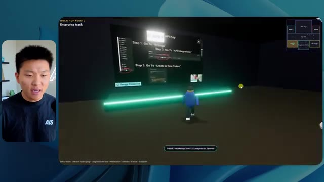

# 🎬 Claude Opus 5.5 is my video editor

> **Chaîne** : [Nate Herk | AI Automation](https://www.youtube.com/@nateherk/featured)  
> **Lien YouTube** : [https://www.youtube.com/watch?v=gNMN-7D9130](https://www.youtube.com/watch?v=gNMN-7D9130)  
> **Date de publication** : 20261016  
> **Durée** : 00:00:44  
> **Identifiant vidéo** : `gNMN-7D9130`  
> **Transcription & Analyse** : `whisper-v3-large-turbo+gemini-3.5-flash-lite`  

---

## 📌 Synthèse Exécutive & Outils

### 💡 Résumé

Dans cette vidéo issue de la chaîne *Nate Herk | AI Automation*, l'analyste et expert en ingénierie IA explore les capacités du modèle d'Anthropic, **Claude Opus 5.5**, en le poussant dans ses retranchements à travers une expérimentation concutable et rigoureuse. L'objectif unique confié au modèle (via un prompt de type *slash goal*) consistait à transformer un dossier brut de 105 gigaoctets d'enregistrements vidéo de l'événement virtuel *AIS Live* (provenant de Frame.io) en un monde 3D interactif et explorable en vue à la troisième personne, simulant une conférence technologique physique avec ses différentes salles, scènes et pistes. 

Pour mesurer l'impact de la configuration des modèles d'IA modernes sur des tâches de développement complexes, Nate a soumis ce même prompt à **Opus 5.5** en faisant varier les niveaux d'effort (faible, moyen, élevé, etc.). Les résultats mettent en lumière des dynamiques surprenantes : si le niveau « Faible » a produit en un peu plus de 16 minutes un monde certes fonctionnel mais truffé de bugs visuels (avatars fantômes, images fixes au lieu de vidéos, incohérences de design), le niveau « Moyen » a révélé un bond qualitatif spectaculaire. Ce dernier a généré, en 1 heure et 13 minutes, un environnement immersif respectant l'identité visuelle de la marque, intégrant des PNJ dynamiques, des flux vidéo réactifs et une navigation fluide, le tout sans nécessiter la moindre intervention humaine ni poser de questions de clarification.

Cette expérimentation met en évidence le fossé existant entre les différentes configurations d'effort des agents IA autonomes. Elle souligne également l'importance cruciale de la phase de déploiement et d'hébergement — habilement comblée par le sponsor Hostinger — pour transformer des prototypes logiciels générés par l'IA en applications web accessibles et prêtes pour la production.

### 🛠️ Outils, Modèles & Logiciels Présentés

* **Claude Opus 5.5 (Anthropic)** : Modèle d'IA de pointe utilisé ici comme agent autonome pour concevoir et développer intégralement un monde 3D interactif à partir de données multimédias brutes.
* **Claude Code** : Environnement de développement et assistant de codage avancé exploité dans le cadre du workflow d'ingénierie logicielle.
* **Frame.io** : Plateforme de collaboration et de stockage cloud utilisée pour héberger les 105 gigaoctets d'enregistrements vidéo de l'événement *AIS Live*.
* **Hostinger** : Solution d'hébergement et connecteur d'éditeur (extension gratuite pour VS Code, Cursor ou Claude Code) permettant de déployer instantanément des applications locales vers le web.
* **Système Herc 2** : Système d'exploitation IA propriétaire et écosystème de développement personnel de Nate Herk.

### 🔑 Points Clés & Enseignements Stratégiques

* **Impact direct des niveaux d'effort sur la qualité** : Ajuster le niveau d'effort d'un modèle comme Opus 5.5 modifie radicalement la profondeur du code généré, transformant un prototype grossier et instable (niveau bas) en une application fluide, esthétique et fonctionnelle (niveau moyen).
* **Autonomie complète des agents IA** : Sur les tests présentés, l'agent n'a posé aucune question de clarification (« zéro question »), démontrant une forte capacité d'autonomie à interpréter des instructions complexes et à prendre des décisions architecturales de manière indépendante.
* **Gestion du temps et de la complexité** : Un niveau d'effort plus élevé exige proportionnellement plus de temps de calcul (passant de 16 minutes à plus d'une heure), un investissement temporel indispensable pour obtenir un rendu de qualité professionnelle.
* **Modélisation des coûts d'API** : Bien que l'expérimentation ait été menée via un abonnement, la simulation de facturation API révèle des coûts prédictibles (de 3,91 $ pour le niveau bas à 12,44 $ pour le niveau moyen) pour des volumes de jetons avoisinant les 200k à 500k tokens.
* **Intégration multimédia contextuelle** : L'agent a su analyser intelligemment une masse importante de données hétérogènes (105 Go de vidéos) pour les replacer dynamiquement dans des contextes spatiaux pertinents (salles de conférence, salons VIP, stands).
* **Respect des chartes graphiques** : Alors que le niveau bas a produit des choix esthétiques génériques et erronés, le niveau moyen a su intégrer avec succès les palettes de couleurs et les directives de marque spécifiques d'« AI's Live ».
* **Comportements dynamiques et agents interactifs** : L'implémentation de PNJ (personnages non-joueurs) réactifs dans le monde 3D au niveau moyen témoigne de la capacité d'Opus 5.5 à générer non seulement des décors statiques, mais aussi des logiques comportementales de base.
* **La transition du prototype au déploiement** : L'expérimentation met en lumière le « dernier kilomètre » du développement assisté par IA : posséder un produit fini sur sa machine locale ne suffit pas, d'où la nécessité d'outils d'intégration et d'hébergement fluides (comme le connecteur Hostinger).
* **Recommandation méthodologique d'Anthropic** : La bonne pratique préconisée par les créateurs du modèle consiste à démarrer les prompts complexes au niveau moyen, puis à ajuster l'effort à la hausse ou à la baisse selon la criticité et la complexité de la tâche.
* **Richesse des métriques d'évaluation** : Pour audoter un agent IA, il est indispensable de suivre des indicateurs croisés : temps d'exécution, coût théorique API, volume de jetons, nombre de cycles de vérification autonome (comme les ouvertures de navigateurs de test) et volume de requêtes de clarification.

---

## ⏱️ Chronologie & Transcription Complète Audio & Visuelle (Mot pour Mot)

### ⏱️ `[00:00:00 - 00:00:20]` | Segment #01

**🔊 Audio (Transcription Intégrale Mot pour Mot en Français) :**
> Opus 5.5, Opus 5.5, Opus 5.5, Opus 5.5, Opus 5.5. Ce modèle est littéralement partout et pour de très bonnes raisons. Il est intelligent, il est bon marché, il a un goût extraordinaire, c'est un modèle d'IA incroyable. Mais avec chaque modèle d'IA, vous avez le choix de l'effort, que ce soit faible, moyen, élevé, extra, max ou code ultra.

**👁️ Analyse Visuelle d'Écran (gemini-3.5-flash-lite) :**
**Interface & Outils** : X (anciennement Twitter)

**Contenu textuel & Code** : Publication sur X avec texte et vidéo intégrée illustrant le sujet.

**Action / Démonstration** : Présentation d'un exemple concret de contenu généré par IA partagé sur les réseaux sociaux.

*⏱️ 00:00:05 — Capture d'écran d'un tweet sur X montrant une vidéo de paysage tropical générée par IA et un commentaire sur la disruption des créatifs techniques.*

---

### ⏱️ `[00:00:20 - 00:00:38]` | Segment #02

**🔊 Audio (Transcription Intégrale Mot pour Mot en Français) :**
> Donc, dans cette vidéo, j'ai donné exactement le même prompt à Opus 5.5 et je l'ai exécuté sur chaque niveau d'effort, et nous allons comparer les résultats. Nous examinerons la qualité de toutes les différentes sorties réelles, mais nous allons également regarder combien de temps chacun d'eux a fonctionné, combien cela nous a coûté s'il s'agissait de la facturation par API, le total des jetons, combien de vérifications ils ont exécutées, et combien de questions ils m'ont réellement posées tout au long du processus.

**👁️ Analyse Visuelle d'Écran (gemini-3.5-flash-lite) :**
**Interface & Outils** : Application de tableau blanc / interface de présentation (type Miro ou Canva).

**Contenu textuel & Code** : Tableau comparatif des niveaux d'effort d'Opus 5.5 avec des lignes pour Run time, API cost, Total tokens, Checks et Questions asked.

**Action / Démonstration** : Présentation du tableau comparatif des différents niveaux d'effort et de leurs métriques d'exécution.

*⏱️ 00:00:29 — Capture d'un tableau comparatif montrant les différents niveaux d'effort (Low, Medium, High, Extra, Max, Ultracode) et métriques (Run time, API cost, Total tokens, etc.).*

---

### ⏱️ `[00:00:39 - 00:00:58]` | Segment #03

**🔊 Audio (Transcription Intégrale Mot pour Mot en Français) :**
> Et les résultats que nous avons obtenus ne sont pas du tout ce à quoi je m'attends, donc j'ai hâte de partager cela avec vous les gars. Ne perdons pas de temps et allons directement à celui-ci. D'accord, alors plongeons directement dans celui-ci. Je veux commencer juste en vous montrant le prompt réel que nous avons utilisé, que nous avons donné à chacun de ces différents agents. Je vais aller dans les fichiers ici, et nous allons ouvrir ce fichier markdown de prompt, et je vais vous montrer ce que nous avons obtenu. Voici donc le slash objectif que j'ai injecté.

**👁️ Analyse Visuelle d'Écran (gemini-3.5-flash-lite) :**
**Interface & Outils** : Interface de l'outil de développement / assistant IA avec panneau latéral de gestion des projets et session active.

**Contenu textuel & Code** : Un message d'un assistant IA demandant confirmation pour démarrer une tâche de création d'un monde 3D interactif basé sur un fichier PROMPT.md.

**Action / Démonstration** : Présentation du prompt initial et des instructions données à l'IA dans l'interface de travail.

*⏱️ 00:00:48 — Interface de l'application affichant un prompt textuel pour un assistant IA avec le modèle Opus 5.5, montrant les instructions pour créer un monde 3D interactif.*

---

### ⏱️ `[00:00:58 - 00:01:34]` | Segment #04

**🔊 Audio (Transcription Intégrale Mot pour Mot en Français) :**
> J'ai dit : tu dois me créer un monde en 3D qui soit une conférence tech réaliste dans laquelle je peux me promener en vue à la troisième personne. Tu vas regarder ce dossier, qui contient mes éléments d'enregistrement d'événements d'AIS Live. Et ce dossier est un dossier Frame.io de 105 gigaoctets d'enregistrements vidéo. C'était un événement entièrement virtuel. Tout a été enregistré et tous les enregistrements sont juste ici. J'ai dit, ton objectif est de prendre cet événement et de le transformer en un monde explorable en 3D qui me donne l'impression d'être réellement allé à une vraie conférence en personne avec différentes salles, différentes pistes, différentes scènes, bla, bla, bla. N'hésite pas à utiliser key.ai si tu as besoin de générer des images ou des vidéos. Et tu peux aussi utiliser tout ce qui se trouve dans mon projet Herc 2, qui est en quelque sorte mon système d'exploitation IA. J'ai dit,

**👁️ Analyse Visuelle d'Écran (gemini-3.5-flash-lite) :**
**Interface & Outils** : Éditeur de code (VS Code / Cursor) et interface web Frame.io

**Contenu textuel & Code** : Fichier Markdown PROMPT.md contenant le prompt demandant de transformer les enregistrements d'un événement virtuel en monde 3D exploitable.

**Action / Démonstration** : Présentation du prompt initial et du dossier Frame.io contenant les ressources vidéo pour le projet de monde 3D.

*⏱️ 00:01:07 — Éditeur de code affichant le fichier PROMPT.md avec les instructions pour créer un monde 3D interactif et le lien vers le dossier d'événements.*

*⏱️ 00:01:16 — Interface Frame.io affichant le dossier de 105,69 Go contenant les enregistrements des événements AIS Live (GA Access et VIP Access).*

*⏱️ 00:01:25 — Vue de l'éditeur de code sur le fichier PROMPT.md montrant les consignes détaillées données à l'agent IA.*

---

### ⏱️ `[00:01:34 - 00:02:08]` | Segment #05

**🔊 Audio (Transcription Intégrale Mot pour Mot en Français) :**
> Vous serez jugé sur la créativité, le design, la physique et la sensation générale lorsque j'explorerai le monde 3D que vous avez construit. Et c'était pratiquement la fin des instructions. Donc, comme vous pouvez le voir sur ce côté gauche, j'ai exécuté ceci à travers tous les différents niveaux d'effort. Commençons par le niveau bas et montons jusqu'à l'ultra code. Très bien. Nous avons donc ici le résultat du niveau bas. Ouvrons ceci et jetons un œil. Nous avons donc AIS Live, le sommet des services IA enfin en personne, et nous avons pu cliquer un peu partout. Tout d'abord, cela ne fait pas très personnalisé. Genre, ce n'is pas le logo d'AIS Live. Ce ne sont même pas nos couleurs. Donc je n'aime pas trop ça, mais entrons ici. D'accord. C'est beaucoup trop lumineux. Euh, nous avons une carte en haut à droite. Nous avons une ville par ici. Je ne peux pas dire quelle ville c'est.

**👁️ Analyse Visuelle d'Écran (gemini-3.5-flash-lite) :**
**Interface & Outils** : Interface web de l'application d'IA, avec un panneau latéral de gestion des sessions (Hello, Extra, High, Max, Ultracode, Medium, Low).

**Contenu textuel & Code** : Texte du prompt demandant de construire un monde 3D à la troisième personne et de fournir un lien localhost.

**Action / Démonstration** : Navigation et sélection des différents niveaux de test d'effort dans le panneau latéral gauche.

*⏱️ 00:01:42 — Interface d'une application d'IA montrant une liste de sessions de tests d'effort sur le panneau latéral gauche et une conversation avec un agent proposant de construire un monde 3D.*

---

### ⏱️ `[00:02:08 - 00:02:40]` | Segment #06

**🔊 Audio (Transcription Intégrale Mot pour Mot en Français) :**
> C'est. D'accord. C'est Chicago, ce qui est plutôt cool parce que tu sais, j'habite à Chicago, mais bref, en haut à droite, on peut voir une carte. Nous avons un hall d'accueil. Nous avons un hall d'exposition. Nous avons un salon VIP, la scène principale. La carte montre également où se trouve chaque autre personne et cela se synchronise en direct. Donc on peut voir l'enregistrement. On peut voir le premier jour, la keynote de l'agent Hyper, le débriefing en direct. Cool. Donc ça connaît réellement le programme et puis il y a le deuxième jour. Donc ça l'a trouvé, c'est bien. Nous avons ces petites boules ici que je peux espérer botter. D'accord. Le visage, oh, regarde ça. Si je vais par ici, tous les gens disparaissent tout simplement. Très mauvais. Très mauvais. D'accord. Donc voyons voir. Est-ce que je peux sprinter ? D'accord.

**👁️ Analyse Visuelle d'Écran (gemini-3.5-flash-lite) :**
**Interface & Outils** : Application web 3D interactive, plateforme d'événement virtuel.

**Contenu textuel & Code** : Menus d'événements, programmes de conférences, cartes de navigation (minimap), avatars 3D.

**Action / Démonstration** : Navigation et exploration de différentes zones d'un espace virtuel 3D représentant une conférence.

*⏱️ 00:02:16 — Vue d'un espace virtuel interactif montrant un avatar et une carte en haut à droite avec la mention "Badge pickup - GA and VIP".*

*⏱️ 00:02:24 — Vue du lobby d'un événement virtuel avec un panneau affichant le programme du "DAY 1" et une minimap en haut à droite.*

*⏱️ 00:02:32 — Vue de l'Expo Hall d'un événement virtuel montrant des avatars et des zones d'exposition, avec une minimap en haut à droite.*

---

### ⏱️ `[00:02:40 - 00:03:04]` | Segment #07

**🔊 Audio (Transcription Intégrale Mot pour Mot en Français) :**
> Je peux aller un peu plus vite. Je vais d'abord aller par ici. Il y a des produits promotionnels, euh, certifiés AIS plus glido. D'accord. Donc il y a les vrais stands qu'on avait dans l'événement virtuel. On avait des stands. Donc c'est plutôt cool. Un petit endroit pour prendre des photos. Salle C. En ce moment, nous avons Tangy Frederick qui anime un atelier. D'accord. Mais ce n'est pas une vidéo. Comme vous pouvez le voir, c'est juste une image. Elle ne bouge pas. C'est donc juste une image. Ces gens sont en train de disparaître. Ce doivent être des fantômes. Allons par ici dans la salle A.

**👁️ Analyse Visuelle d'Écran (gemini-3.5-flash-lite) :**
**Interface & Outils** : Environnement virtuel 3D interactif (type métavers / plateforme événementielle).

**Contenu textuel & Code** : Textes informatifs et tutoriels affichés sur des écrans virtuels (Glaido, Enterprise Track, API Key instructions).

**Action / Démonstration** : Navigation et exploration de l'espace virtuel par l'avatar du présentateur.

*⏱️ 00:02:46 — Vue d'un espace d'exposition virtuel avec le stand d'un sponsor nommé Glaido et des cubes interactifs.*

*⏱️ 00:02:52 — Entrée dans une salle d'atelier verte (Workshop Room C) montrant un espace virtuel de type conférence.*

*⏱️ 00:02:58 — Présentation d'un écran géant à l'intérieur de la salle d'atelier affichant des instructions sur une API.*

---

### ⏱️ `[00:03:04 - 00:03:30]` | Segment #08

**🔊 Audio (Transcription Intégrale Mot pour Mot en Français) :**
> Nous avons Liberty White. D'accord. Très cool. Vos 30 premiers jours en automatisation. Encore une fois, c'est juste une image fixe et les gens ont des bugs d'affichage. Donc ce n'est pas très bien ici. Je vais aller sur la scène principale et voir ce que nous avons. D'accord, cool. Nous avons donc une scène qui a l'air principale. Les gens ont des bugs d'affichage. Vraiment grave. Ce n'est vraiment pas très bien. Notre vidéo est en train de bouger. Comme j'ai vu mon visage ici et j'ai vu celui de Devin, mais maintenant ils ont disparu. Donc je ne sais pas ce qui s'est passé. D'accord. Ça ressemble plutôt à un diaporama. Rien n'est encore vraiment diffusé. Bref, entrons ici.

**👁️ Analyse Visuelle d'Écran (gemini-3.5-flash-lite) :**
**Interface & Outils** : Application de métavers / monde virtuel 3D interactif (similaire à Gather Town ou environnement 3D personnalisé).

**Contenu textuel & Code** : Interface de navigation 3D, avatars d'utilisateurs, mini-carte de positionnement en haut à droite et panneaux d'affichage de conférence.
[DESC_IMAGE_3] Le présentateur navigue dans l'espace virtuel pour rejoindre la scène principale ("Main Stage").

**Action / Démonstration** : Explications face caméra et démonstration conceptuelle.

*⏱️ 00:03:17 — Vue de l'avatar naviguant dans l'auditorium virtuel avec des spectateurs assis, affichant le titre du workshop.*

*⏱️ 00:03:24 — Vue de l'avatar se déplaçant vers la scène principale affichant le logo "AIS LIVE - AI Services Summit".*

---

### ⏱️ `[00:03:30 - 00:03:58]` | Segment #09

**🔊 Audio (Transcription Intégrale Mot pour Mot en Français) :**
> Nous avons d'autres stands. Nous avons hyper agent. Nous avons Claude Code. Nous avons plus de gadgets publicitaires. La salle B, c'est Dave Ebelor. Je suppose que c'est exactement la même chose. Nous avons du café. Et ensuite, je suppose, le salon VIP, accès VIP uniquement. C'est plutôt cool, mais il ne se passe vraiment rien ici. Cet écran est bien trop lumineux. D'accord. Donc je pense que vous comprenez l'ambiance que nous obtenons ici avec Opus 5.5 en effort faible. Et c'est là que les choses deviennent intéressantes. Combien de temps pensez-vous que cela a duré ? Combien de temps ? Celui-ci a duré 16 minutes et 43 secondes. Combien pensez-vous que cela a coûté ?

**👁️ Analyse Visuelle d'Écran (gemini-3.5-flash-lite) :**
**Interface & Outils** : Interface de tableau ou canvas de données ("Opus 5.5 Efforts")

**Contenu textuel & Code** : Tableau avec les colonnes Low, Medium, High, Extra, Max, Ultracode et les lignes Run time, API cost, Total tokens, Checks, Questions asked.

**Action / Démonstration** : Affichage d'un tableau comparatif des efforts et coûts d'exécution d'un modèle d'IA.

*⏱️ 00:03:51 — Capture d'écran d'un tableau comparatif intitulé "Opus 5.5 Efforts" avec des niveaux de performance (Low, Medium, High, Extra, Max, Ultracode) et des critères (Run time, API cost, Total tokens, Checks, Questions asked).*

---

### ⏱️ `[00:03:58 - 00:04:26]` | Segment #10

**🔊 Audio (Transcription Intégrale Mot pour Mot en Français) :**
> 3,91 dollars si c'était une facturation par API. J'utilise évidemment mon abonnement ici, mais nous allons juste calculer cela en facturation API. Le nombre total de jetons était de 191 000. Il a effectué 22 vérifications. Donc pour la vérification, 22 fois il a ouvert le navigateur et a exécuté différentes sortes de vérifications. Donc 22 catégories de vérifications. Et combien de questions m'a-t-il posées ? Il m'a posé un total de zéro question tout au long de cette invite de type slash goal. D'accord. Alors, ouvrons l'effort moyen et voyons ce que nous avons. D'accord, c'est parti. Effort moyen. Nous avons Nate Herc. Nous avons mon badge. C'est aux couleurs de la marque AI's Life.

**👁️ Analyse Visuelle d'Écran (gemini-3.5-flash-lite) :**
**Interface & Outils** : Application de tableau blanc ou de diagramme en ligne (type Excalidraw ou similaire).

**Contenu textuel & Code** : Tableau avec les lignes : Run time (16m 43s), API cost ($3.91), Total tokens (191.3K), Checks, Questions asked ; et les colonnes Low, Medium, High.

**Action / Démonstration** : Le présentateur explique les métriques de coût et de performance affichées dans le tableau.

*⏱️ 00:04:05 — Un tableau comparatif des performances et des coûts selon différents niveaux d'effort, affichant notamment un coût API de 3,91 dollars, 191,3K jetons et le nombre de vérifications.*

---

### ⏱️ `[00:04:26 - 00:04:46]` | Segment #11

**🔊 Audio (Transcription Intégrale Mot pour Mot en Français) :**
> Donc ça a déjà l'air un petit peu mieux. Ça ressemble à nos palettes de couleurs qui ont utilisé nos directives de marque. Premier jour de construction, deuxième jour de gain, VIP. Cool. D'accord. Je vais entrer dans le lieu. D'accord. Waouh. Une ambiance donc un peu similaire. C'est en arrière-plan. Ça ne ressemble pas à Chicago, hein ? Non, ça ressemble à, honnêtement, ça ressemble à une ville inventée. Quoi qu'il en soit, c'est drôle qu'ils aient décidé de faire ça. Voyons si je peux me déplacer un peu plus vite. Oh, waouh.

**👁️ Analyse Visuelle d'Écran (gemini-3.5-flash-lite) :**
**Interface & Outils** : Application web interactive / Plateforme virtuelle 3D AIS Live

**Contenu textuel & Code** : Écran d'accueil avec badge (Nate Herk, Host - All Access), options de contrôle clavier et interface utilisateur de la plateforme d'événement virtuel.

**Action / Démonstration** : Le présentateur clique sur le bouton « Enter the Venue » pour entrer dans l'environnement virtuel 3D de l'événement.

*⏱️ 00:04:31 — L'interface web de l'application « AIS Live » affichant un badge nominatif pour Nate Herk et des boutons de navigation.*

*⏱️ 00:04:41 — L'intérieur virtuel 3D de l'application « AIS Live » avec des avatars de personnages et une vue sur une ville nocturne en arrière-plan.*

---

### ⏱️ `[00:04:46 - 00:05:21]` | Segment #12

**🔊 Audio (Transcription Intégrale Mot pour Mot en Français) :**
> Les gens interagissent avec moi. Regardez. Si je m'approche de ce type, il vient de lever le bras. Bon, maintenant il ne veut plus du tout avoir affaire à moi. Mais tous ces petits robots ici doivent prendre des décisions. Je ne sais pas s'ils utilisent Jev. C'est sûr que non. Je ne le lui ai pas dit. En fait, ma clé Jev est à l'arrière. Je ne sais pas. Peut-être qu'il l'a utilisée. Quoi qu'il en soit, nous pouvons voir ici que nous avons la salle d'atelier C, le laboratoire des agents. Sympa. Donc celui-ci est réellement en train de tourner. Vous pouvez voir qu'il s'agit d'une vraie vidéo diffusée par Tangy. Tout le monde ici est en train de travailler sur un ordinateur portable. Ils ne buguent pas. C'est plutôt cool. De plus, mon badge est sur ma poitrine, ce qui est plutôt cool. Je peux venir par ici. Nous avons une carte en haut à droite, comme vous pouvez le voir, mais je peux venir par ici. Nous avons un

**👁️ Analyse Visuelle d'Écran (gemini-3.5-flash-lite) :**
**Interface & Outils** : Application de monde virtuel 3D / métavers éducatif ou professionnel

**Contenu textuel & Code** : Environnement virtuel 3D interactif avec des avatars de type personnages de jeux vidéo

**Action / Démonstration** : Navigation et exploration de l'espace virtuel par le présentateur au milieu des avatars autonomes

---

### ⏱️ `[00:05:21 - 00:05:47]` | Segment #13

**🔊 Audio (Transcription Intégrale Mot pour Mot en Français) :**
> hall d'exposition. C'est là que nous avons le stand Glido. Et ça diffuse en ce moment. Oui, ça diffuse la vidéo de nous parlant de Glido. Ça diffuse la vidéo d'Ed et moi parlant de notre programme de certification. Nous avons le logo AIS Plus juste ici, qui est un peu mal placé. Ce sont les diapositives des conférenciers et les points clés. Alors wow, ce sont toutes les ressources que nous avons distribuées après l'événement. Elles sont toutes là aussi. Nous pouvons voir que nous avons un coup de projecteur sur la communauté. C'est donc Aiden qui parle de l'affaire qu'il a conclue et c'est diffusé en direct. Ces gens regardent.

**👁️ Analyse Visuelle d'Écran (gemini-3.5-flash-lite) :**
**Interface & Outils** : Environnement virtuel 3D de type metaverse / plateforme d'événements virtuels.

**Contenu textuel & Code** : Diapositives de présentation et panneaux d'information textuels ("AIS+ Certified", "Speaker Slides & Takeaways").

**Action / Démonstration** : Navigation et visite d'un salon d'exposition virtuel sous forme d'avatar 3D.

---

### ⏱️ `[00:05:47 - 00:06:21]` | Segment #14

**🔊 Audio (Transcription Intégrale Mot pour Mot en Français) :**
> Ils sont plutôt engagés. On a un hyper agent. C'était, c'est ce que je voulais dire. Si vous avez vu ces gens lever les mains en disant bonjour, c'était plutôt marrant. Regardez, regardez, le voilà qui recommence. Bref. Bon. Où est-ce que je suis maintenant ? Maintenant, je suis dans le hall principal. On a un bar à café. On a un grand logo, qui est le vrai logo. C'est trop lumineux, mais on a le logo. On peut voir si on peut entrer ici dans le parcours des fondations. On a Sabrina Romanov et Liberty White. Donc différentes formations juste là. On peut entrer dans cette salle. C'est le parcours avancé. Donc qu'est-ce qui se passe ici ? On a Dave Ebelar et Saman qui parlent de différentes choses là-dedans. Et maintenant, allons jeter un œil à la scène principale. Oh, attendez, il y a une vidéo de moi là-haut. C'est genre un VIP

**👁️ Analyse Visuelle d'Écran (gemini-3.5-flash-lite) :**
**Interface & Outils** : Application web interactive / métavers 3D de type espace d'événement virtuel.

**Contenu textuel & Code** : Environnement 3D avec interface utilisateur de navigation, mini-carte et indications textuelles ("Main Lobby").

**Action / Démonstration** : Exploration d'un monde virtuel et navigation entre différentes zones (hall et salles) avec des avatars.

*⏱️ 00:05:55 — Vue d'un monde virtuel interactif (style salon virtuel ou métavers) montrant un hall principal avec des avatars.*

*⏱️ 00:06:04 — Navigation dans l'environnement virtuel vers une salle de conférence ou un espace de présentation.*

*⏱️ 00:06:12 — Déplacement des avatars dans le hall et interaction au sein de l'application virtuelle.*

---

### ⏱️ `[00:06:21 - 00:06:50]` | Segment #15

**🔊 Audio (Transcription Intégrale Mot pour Mot en Français) :**
> section ? Ouais, on ira voir ça dans une minute. Mais bref, voici la scène principale. Ça a l'air vraiment, vraiment très bien. On a une grande scène. On a genre quatre personnes assises ici. On a les trois écrans d'Alex là-haut avec Hyper Agent. Est-ce que j'ai le droit de monter sur scène ? Oh, et il me laisse monter sur scène. D'accord. C'est plutôt sympa. Bon les gars, prenons un selfie. Laissez-moi mettre tout le monde en arrière-plan. Venez par ici. Bref, c'est plutôt, plutôt cool. Par contre, toutes les places ne sont pas occupées. Il va donc falloir qu'on travaille là-dessus. Mais bref, je vais y retourner en courant pour voir ce qu'était cette section VIP. D'accord. Le salon VIP. J'ai l'impression que c'est comme un salon d'aéroport ou un truc du genre.

**👁️ Analyse Visuelle d'Écran (gemini-3.5-flash-lite) :**
**Interface & Outils** : Application virtuelle 3D / Plateforme d'événement en ligne Hyper Agent

**Contenu textuel & Code** : Interface d'une conférence virtuelle avec mini-carte, écrans de présentation et affichage des détails de la session (Keynote, Alex McDonnell).

**Action / Démonstration** : Navigation et exploration de l'espace virtuel 3D par l'utilisateur.

---

### ⏱️ `[00:06:51 - 00:07:14]` | Segment #16

**🔊 Audio (Transcription Intégrale Mot pour Mot en Français) :**
> OK, super. Donc maintenant nous avons les sessions VIP ici. Une FAQ VIP avec la vidéo en direct de Nate lue juste ici. Très, très cool. Et nous avons comme un bar ou quelque chose du genre. Génial. Je dirais que c'est un très bon résultat. Maintenant, en ce qui concerne les statistiques ici, celle-ci a pris une heure et 13 minutes à s'exécuter. Cela nous aurait coûté 12 dollars et 44 cents. Elle a utilisé 490 000 jetons et elle a effectué 23 vérifications.

**👁️ Analyse Visuelle d'Écran (gemini-3.5-flash-lite) :**
**Interface & Outils** : Application de métavers/espace virtuel interactif et tableau de bord de suivi de performance d'IA.

**Contenu textuel & Code** : Interface utilisateur virtuelle affichant une retransmission vidéo en direct et tableau de statistiques détaillant Run time, API cost, Total tokens, Checks et Questions asked.

**Action / Démonstration** : Présentation de l'espace virtuel VIP par le créateur, suivie de la visualisation des statistiques de coût et de performance de l'exécution de l'agent IA.

*⏱️ 00:06:56 — Capture montrant l'espace virtuel VIP avec un grand écran affichant une session vidéo en direct (VIP Q&A with Nate) et des avatars de participants.*

*⏱️ 00:07:02 — Capture montrant un tableau de statistiques de performance (Opus 5.5 Efforts) avec des métriques telles que le temps d'exécution (16m 43s), le coût API ($3.91) et le nombre total de tokens (191.3K).*

---

### ⏱️ `[00:07:14 - 00:07:48]` | Segment #17

**🔊 Audio (Transcription Intégrale Mot pour Mot en Français) :**
> Et il ne nous a posé absolument aucune question une fois de plus. Très bien, passons au niveau élevé. C'était déjà un résultat plutôt correct, et Anthropic eux-mêmes dans leur vidéo, ou désolé, pas une vidéo, un article sur la façon de prompter Opus 5.5. Ils ont dit de commencer simplement par le niveau moyen et de l'ajuster à la hausse ou à la baisse si nécessaire. C'était donc un résultat moyen. Passons au niveau élevé et voyons ce que nous avons obtenu. Très rapidement, les gars, je dois prendre un instant pour vous parler du sponsor de la vidéo d'aujourd'hui, Hostinger. Donc, ces deux modèles viennent de me construire une version fonctionnelle de la même chose. Et maintenant, je suis exactement là où je finis toujours par me retrouver, avec un produit fini sur mon ordinateur portable et aucun moyen rapide de le mettre en ligne. Et c'est précisément le fossé que comble le connecteur d'Hostinger. C'est une extension gratuite.

**👁️ Analyse Visuelle d'Écran (gemini-3.5-flash-lite) :**
**Interface & Outils** : Tableau comparatif de données et interface de l'outil de développement d'agent IA.

**Contenu textuel & Code** : Tableau avec des données de performance (Run time, API cost, Total tokens, Checks, Questions asked) et panneau de configuration avec le modèle Opus 5.5.

**Action / Démonstration** : Présentation des résultats comparatifs selon les différents niveaux d'effort d'Opus 5.5.

*⏱️ 00:07:22 — Un tableau comparatif montrant les performances de différents niveaux d'effort (Low, Medium, High, Extra) avec des métriques comme le temps d'exécution, le coût API, les tokens et le nombre de questions posées.*

*⏱️ 00:07:39 — Une interface de développement avec un éditeur affichant le prompt "Build Northwind ROI calculator" et le panneau d'exécution de l'agent IA.*

---

### ⏱️ `[00:07:48 - 00:08:23]` | Segment #18

**🔊 Audio (Transcription Intégrale Mot pour Mot en Français) :**
> pour votre éditeur qui intègre votre compte Hostinger dans l'outil de programmation que vous utilisez déjà. Que ce soit VS Code, Cursor, Cloud Code, Codex, et j'en passe. Vous vous connectez une seule fois en un clic, et à partir de là, votre agent peut déployer le site, y associer un domaine, configurer les enregistrements DNS et vérifier votre VPS sans que vous ayez jamais à quitter l'éditeur. Alors, quel que soit celui de ces outils que vous finirez par préférer, ce qu'il a construit se trouve à quelques minutes d'une vraie URL sur un hébergement géré. L'extension Connector est gratuite avec chaque forfait d'hébergement, donc si vous avez toujours besoin de l'hébergement en dessous, procurez-vous le forfait illimité avec le lien dans la description et utilisez le code NATEHERK pour obtenir 10 % de réduction. Cela comprend également un nom de domaine gratuit et un e-mail professionnel pour l'année. Et c'est toujours le moyen le moins cher que j'ai trouvé pour obtenir quelque chose

**👁️ Analyse Visuelle d'Écran (gemini-3.5-flash-lite) :**
**Interface & Outils** : Interface web d'intégration Hostinger (Manage Hostinger from your IDE) et terminal Claude Code.

**Contenu textuel & Code** : Statut "Connected via OAuth", Node.js 24.13.0, et liste des outils avec cases à cocher (Websites: 154 tools, Domains: 49 tools, Subscriptions & Payments, Email Marketing).

**Action / Démonstration** : Connexion du compte Hostinger à l'IDE et affichage des outils de gestion autorisés pour l'assistant.

*⏱️ 00:07:57 — Interface montrant la connexion du compte Hostinger à un IDE, avec l'état connecté via OAuth et la liste des outils disponibles (Websites, Domains, Subscriptions, Email Marketing).*

---

### ⏱️ `[00:08:23 - 00:08:47]` | Segment #19

**🔊 Audio (Transcription Intégrale Mot pour Mot en Français) :**
> vous avez construit sur une vraie URL. Donc revenons à la vidéo. D'accord. Encore une fois, très, très marqué par la marque. C'est un écran de chargement encore meilleur que le précédent. Nous avons ce petit effet sympa en arrière-plan. Nous avons le logo. Nous allons entrer dans le lieu. D'accord. Nous y voilà. Ça a l'air plutôt bien. Nous commençons à l'extérieur et vous pouvez voir que nous avons ces drapeaux pour tous les intervenants, Wyatt, Casper, Alex, Ed, Aiden, Sabrina, Liberty. C'est plutôt cool. Nous avons des blocs en direct ici.

**👁️ Analyse Visuelle d'Écran (gemini-3.5-flash-lite) :**
**Interface & Outils** : Application web 3D immersive (plateforme événementielle virtuelle)

**Contenu textuel & Code** : Interface utilisateur avec commandes clavier/souris (WASD, Shift, Space, Tab) et nom de la zone 'AIS Live Plaza'

**Action / Démonstration** : Connexion à l'événement virtuel et entrée dans le lieu (venue) en 3D

*⏱️ 00:08:29 — Écran de chargement de l'application 'AIS LIVE' avec logo, informations sur l'événement et touches de contrôle.*

*⏱️ 00:08:35 — Vue dans le monde virtuel 3D 'AIS Live Plaza' avec un avatar de joueur au centre de la place publique.*

*⏱️ 00:08:41 — Exploration de la 'AIS Live Plaza' en 3D avec des bannières verticales affichant les noms des intervenants.*

---

### ⏱️ `[00:08:47 - 00:09:23]` | Segment #20

**🔊 Audio (Transcription Intégrale Mot pour Mot en Français) :**
> il a pris cette photo de moi, votre hôte, Nate Herc, John, Dave, Nate Herc. Voilà. OK. Les portes. Génial. Ce sont des portes coulissantes automatiques en verre. J'adore ça. Nous pouvons voir l'enregistrement VIP. Nous pouvons voir l'admission générale (GA). Nous pouvons venir ici et nous pouvons découvrir l'exposition avec différents stands, le projecteur sur la communauté. Vous pouvez également voir qu'en haut à gauche, j'ai un passeport. C'est donc comme si, cela montrera combien d'endroits j'ai visités. Tout cela est une vraie lecture. Nous avons un mur de ressources avec tous les différents intervenants. Ils ont également une session de réseautage ici. Je vais donc venir très vite et voir de quoi il s'agit. Nous avons donc le bar à cold brew AIS. Nous avons différents membres de la communauté qui ont été mis en avant ou mis en lumière.

**👁️ Analyse Visuelle d'Écran (gemini-3.5-flash-lite) :**
**Interface & Outils** : Environnement virtuel 3D interactif (type métavers événementiel).

**Contenu textuel & Code** : Interface utilisateur superposée avec des indicateurs de progression "Passport", des noms de zones ("Registration Concourse", "Expo Hall") et des menus contextuels en bas à droite.

**Action / Démonstration** : Exploration et navigation interactive de l'hôte au sein d'un espace événementiel virtuel modélisé.

*⏱️ 00:08:56 — Vue à la première personne dans un environnement virtuel 3D montrant la zone "Registration Concourse" avec des comptoirs "GA" et "VIP Check-in".*

*⏱️ 00:09:05 — Navigation dans un hall d'exposition virtuel ("Expo Hall") avec des stands d'information et une interface utilisateur affichant des objectifs de certification.*

*⏱️ 00:09:14 — Déplacement dans le hall d'accueil virtuel vers les portes coulissantes en verre mentionnées par l'hôte, avec vue sur l'architecture intérieure.*

---

### ⏱️ `[00:09:23 - 00:09:56]` | Segment #21

**🔊 Audio (Transcription Intégrale Mot pour Mot en Français) :**
> On a l'aile VIP. Attends, quoi ? Récupère un bracelet. Oh, je dois vraiment aller chercher le bracelet. D'accord. Laisse-moi m'enregistrer rapidement. Le bracelet est déjà mis. Attends, quoi ? D'accord. Oh, d'accord. Maintenant les portes se sont ouvertes pour moi. Cool. Je peux entrer ici. Oh, ça mène juste à la scène principale. Salon VIP. Il y a une séance de questions-réponses en cours. Ça a l'air très cool. Je veux dire, je suis très impressionné par la façon dont il est capable de faire ça. Waouh. D'accord. Donc c'est vraiment bien. Ce qu'on a fait, c'est qu'on a eu des salles de discussion VIP avec différentes personnes. Vous pouvez voir qu'il y a différentes salles, différents membres de l'équipe AIS qui participent à des trucs. C'est vraiment cool. C'est très cool. C'est un bien meilleur VIP

**👁️ Analyse Visuelle d'Écran (gemini-3.5-flash-lite) :**
**Interface & Outils** : Plateforme d'événement virtuel (type métavers professionnel pour conférences en ligne).

**Contenu textuel & Code** : Textes informatifs sur l'emplacement actuel ("VIP Lounge", "VIP Working Sessions") et listes d'activités/sessions.

**Action / Démonstration** : Navigation et exploration de l'utilisateur à travers les différentes sections VIP de l'événement virtuel.

*⏱️ 00:09:32 — Vue d'un espace virtuel nommé "Registration Concourse" avec un avatar du présentateur naviguant dans un hall d'accueil.*

*⏱️ 00:09:40 — Vue de l'intérieur d'un "VIP Lounge" virtuel, montrant un écran projetant le présentateur et des avatars assis en conférence.*

*⏱️ 00:09:48 — Vue de l'espace "VIP Working Sessions" avec plusieurs zones de travail thématiques affichant des titres de sessions comme "Land Your First Paying Client".*

---

### ⏱️ `[00:09:56 - 00:10:30]` | Segment #22

**🔊 Audio (Transcription Intégrale Mot pour Mot en Français) :**
> expérience que ce qui a été montré dans la première partie. D'accord. L'after-party VIP. Regardez ça. On a une piste de danse. On a tous ces éléments ici. On a la véritable rediffusion de l'after-party VIP juste ici. Et il y a une cabine de DJ. C'est tellement marrant. Il y a un petit bug juste ici, un glitch juste là, mais c'est génial. Oh, cool. Donc quand je suis ici sur la scène principale, on a les sous-titres. Vous pouvez voir juste ici au bas de mon écran, on a ces sous-titres de Wyatt en train de parler là-haut. On a des lumières. On a le panel. Très cool. Belle scène principale. Je vais aller par ici. On peut aller à la fondation,

**👁️ Analyse Visuelle d'Écran (gemini-3.5-flash-lite) :**
**Interface & Outils** : Application ou plateforme virtuelle 3D (metaverse / événement virtuel)

**Contenu textuel & Code** : Interface utilisateur affichant des flux vidéo en direct, une carte miniature et des avatars 3D dans un environnement virtuel.

**Action / Démonstration** : Navigation et exploration d'un espace virtuel interactif pour un événement en ligne.

---

### ⏱️ `[00:10:30 - 00:11:06]` | Segment #23

**🔊 Audio (Transcription Intégrale Mot pour Mot en Français) :**
> avancé, et les parcours entreprise par ici. Alors voyons voir. Nous avons l'anatomie de trois vrais deals. Nous avons Hyper Agent. Nous avons les évaluations avec Nate et Ed là-dedans. Nous avons Dave dans la partie avancée. C'est vraiment bien. Je veux dire, évidemment chacun, chacune de ces sorties jusqu'ici, faible était correct. Moyen était meilleur. Élevé a été encore meilleur. Voyons si cette tendance se poursuit et allons voir ce que cela nous a coûté. Donc élevé a tourné pendant une heure et sept minutes. Donc un peu plus rapide que moyen, cela nous aurait coûté 16 dollars et 31 centimes. Ça a utilisé un demi-million de tokens, 509 000. Ça a fait 22 vérifications. Et cela nous a aussi demandé, enfin, en fait, non, j'avais tort. Cela

**👁️ Analyse Visuelle d'Écran (gemini-3.5-flash-lite) :**
**Interface & Outils** : Application de tableau blanc / outil de visualisation (type Excalidraw ou similaire) avec des données chiffrées.

**Contenu textuel & Code** : Tableau intitulé 'Opus 5.5 Efforts' comparant les métriques Low ($3.91, 191.3K tokens), Medium ($12.44, 419.2K tokens) et High ($16.31).

**Action / Démonstration** : Analyse comparative des coûts d'API, temps d'exécution et tokens pour différents niveaux d'effort de l'agent.

*⏱️ 00:10:57 — Tableau de comparaison des efforts et coûts d'Opus 5.5 affichant Run time, API cost, Total tokens, Checks et Questions pour Low, Medium, High et Extra.*

---

### ⏱️ `[00:11:06 - 00:11:25]` | Segment #24

**🔊 Audio (Transcription Intégrale Mot pour Mot en Français) :**
> L'un d'eux m'a posé une question et spoiler, c'était le seul à nous avoir posé une question tout au long de tout ceci. Alors voyons voir, il nous en reste trois : Extra, Max et Ultra Code. Laissez-moi ouvrir Extra et on va voir ce qu'on a. D'accord. Donc celui-ci a l'air plutôt bien. Honnêtement, je dirais que jusqu'ici, l'écran de chargement high était le meilleur. Celui qu'on vient tout juste de voir, mais de toute façon, entrons dans AIS live.

**👁️ Analyse Visuelle d'Écran (gemini-3.5-flash-lite) :**
**Interface & Outils** : Interface de tableau de bord ou canvas (type tableur ou application de notes) avec le présentateur en incrustation vidéo (PiP) à gauche.

**Contenu textuel & Code** : Un tableau de données : Run time (16m 43s, 1h 13m, 1h 7m), API cost ($3.91, $12.44, $16.31), Total tokens, Checks (22, 23, 22), Questions asked (0, 0, 1).

**Action / Démonstration** : Le présentateur commente les résultats du tableau et s'apprête à examiner la colonne "Extra".

*⏱️ 00:11:11 — Un tableau comparatif montrant les métriques de différents modèles ou configurations (Low, Medium, High, Extra) incluant le temps d'exécution, le coût API, le nombre total de tokens, les vérifications et les questions posées.*

---

### ⏱️ `[00:11:26 - 00:11:51]` | Segment #25

**🔊 Audio (Transcription Intégrale Mot pour Mot en Français) :**
> Whoa. D'accord. Donc on a comme de petits extraits sonores. Je peux discuter avec des gens. Le panneau sur la guerre des outils a réglé quelques débats pour moi. Sympas. Bonne perspective là-bas. On est dehors à nouveau. On a ces différentes bannières, bien qu'elles soient toutes les mêmes. Elles n'affichent pas de noms de personnes différentes. Donc gros logo AIS Live. L'aile des ateliers est par ici. Et passons par les portes coulissantes en verre pour voir ce qu'on a. Donc on a le café AIS. La carte est en bas à droite, et elle n'est pas très descriptive.

**👁️ Analyse Visuelle d'Écran (gemini-3.5-flash-lite) :**
**Interface & Outils** : Application de métavers 3D / plateforme interactive virtuelle

**Contenu textuel & Code** : Environnement virtuel interactif avec avatars, bannières publicitaires et interface de navigation 3D

**Action / Démonstration** : Exploration d'un espace virtuel interactif et discussion avec des avatars dans un monde 3D

---

### ⏱️ `[00:11:51 - 00:12:26]` | Segment #26

**🔊 Audio (Transcription Intégrale Mot pour Mot en Français) :**
> J'aime bien comment les autres cartes nous ont indiqué ce que, genre où se trouvaient les choses, mais celle-ci a l'air très professionnelle. On peut voir ici la scène principale. Allons y faire un saut rapidement. Ils ont tous ces ballons qui volent partout, ce qui je trouve est plutôt marrant. Les ballons de plage AIS. On me voit là-haut en train de parler. Je crois que j'introduisais l'une des journées. Continuons à avancer par ici vers la salle d'atelier sur ce côté gauche. D'accord. Donc ici, nous avons le théâtre Hyper Agent. Nous avons cette session sponsorisée ici par Hyper Agent, mais ça nous montre aussi ce qui va s'y passer. C'est vraiment drôle qu'on puisse discuter avec les gens. Salmon a créé un commercial vocal en direct. La salle "Le Juste Prix" était comble. Tu as pris le guide du compagnon VIP ? C'est trop marrant. On a le parcours avancé dans

**👁️ Analyse Visuelle d'Écran (gemini-3.5-flash-lite) :**
**Interface & Outils** : Application ou plateforme virtuelle 3D de type métavers / salon virtuel de conférence en ligne.

**Contenu textuel & Code** : Environnement virtuel 3D interactif avec avatars, écrans vidéo intégrés, infobulles de chat et mini-carte de navigation.

**Action / Démonstration** : Navigation et exploration de l'espace virtuel par le présentateur au sein du métavers de la conférence.

*⏱️ 00:12:00 — Vue en réalité virtuelle d'une grande scène de conférence virtuelle avec des avatars assis et un écran géant affichant un présentateur.*

*⏱️ 00:12:09 — Hall d'entrée virtuel d'un événement avec des avatars d'utilisateurs et des panneaux indiquant différents ateliers et services.*

*⏱️ 00:12:17 — Couloir virtuel dans l'espace virtuel avec plusieurs avatars interconnectés et des indications de salles d'exposition.*

---

### ⏱️ `[00:12:26 - 00:12:58]` | Segment #27

**🔊 Audio (Transcription Intégrale Mot pour Mot en Français) :**
> ici. Encore une fois, nous avons la lecture en direct. Est-ce que c'est la lecture en direct ? Oh, d'accord. Ça a commencé une fois que je suis entré, mais je peux m'asseoir. Oh la la. Je peux regarder ça. Je peux me lever. Je veux m'asseoir au premier rang. C'est plutôt cool. C'est très bien. J'aime ça. Et tu sais ce que j'ai remarqué jusqu'à présent ? Le personnage que j'incarne me ressemble un peu. Je pense qu'il s'est inspiré de mes photos de profil ou quelque chose comme ça. Bref, nous avons Sabrina ici, l'animatrice de la salon, prenez n'importe quel siège libre. D'accord, cool. Et j'ai vraiment aimé la fonctionnalité pour s'asseoir. C'est plutôt marrant. Genre, on pourrait vraiment assister à cet atelier et participer. Bref, ça nous montre les conférenciers. Ça nous montre les

**👁️ Analyse Visuelle d'Écran (gemini-3.5-flash-lite) :**
**Interface & Outils** : Application ou plateforme d'événement virtuel en 3D (environnement virtuel de type salle de conférence/atelier interactif)

**Contenu textuel & Code** : Interface utilisateur virtuelle affichant "Workshop Block 2 - Foundations: Build Your First AI Content Engine", des avatars 3D et des options de navigation (Map, Agenda, Captions).

**Action / Démonstration** : Exploration d'un environnement virtuel en 3D représentant une conférence interactive avec des ateliers en direct.

*⏱️ 00:12:34 — Vue d'un espace virtuel interactif en 3D (type événement virtuel) montrant une salle de classe ou de conférence avec des avatars, un écran de projection affichant un atelier de formation, et le présentateur en incrustation vidéo à gauche.*

*⏱️ 00:12:42 — Navigation dans la salle virtuelle avec un design aux accents verts (Foundation Track), un grand écran affichant un atelier sur la construction d'un moteur de contenu IA, et des participants modélisés en avatars.*

*⏱️ 00:12:50 — Changement d'angle de caméra dans l'espace virtuel 3D montrant les rangées de tables, un écran géant affichant l'interface web d'un atelier et des flux vidéo de participants.*

---

### ⏱️ `[00:12:58 - 00:13:31]` | Segment #28

**🔊 Audio (Transcription Intégrale Mot pour Mot en Français) :**
> programme. Il y a un petit tapis rouge ici pour prendre des photos. On peut prendre la pose. Oh, wow. C'est plutôt cool. Bibliothèque de ressources, obtenir la certification AIS Plus, Glido, Hyper Agent, AIS Plus, trois vrais deals. Génial. Je veux dire, je dirais vraiment que jusqu'à présent, chacun est de mieux en mieux. Et nous n'avons même pas encore regardé la section VIP, le salon VIP. Montons ici rapidement. En espérant que je puisse entrer. Sympa. On a Tooling Reset. Ce sont les différentes salles dans lesquelles on pourrait aller. Donc, encore une fois, je pourrais prendre la fiche de travail et je pourrais essayer de comprendre comment tarifer mes trucs. C'est tellement cool. C'est clairement mieux que le précédent où on a en quelque sorte juste

**👁️ Analyse Visuelle d'Écran (gemini-3.5-flash-lite) :**
**Interface & Outils** : Plateforme événementielle virtuelle interactive de type métavers.

**Contenu textuel & Code** : Signalétique événementielle, noms de sponsors et questions de travail de groupe (ex: "What's your gut floor number?", "Price It Right worksheet").

**Action / Démonstration** : Navigation et interaction dans un espace virtuel 3D pour la visite de stands et la participation à des ateliers.

*⏱️ 00:13:07 — Vue d'ensemble de l'Expo Hall virtuel montrant les stands des sponsors (AIS+, Hyper Agent, Glido) avec des avatars interactifs.*

*⏱️ 00:13:15 — Hall d'entrée du salon virtuel avec un escalier central, une zone de réception et une signalétique indiquant l'accès aux ateliers.*

*⏱️ 00:13:23 — Vue à l'intérieur du "VIP Lounge" où des avatars sont assis autour d'une table avec une interface textuelle affichant des questions stratégiques et des instructions de travail.*

---

### ⏱️ `[00:13:31 - 00:13:59]` | Segment #29

**🔊 Audio (Transcription Intégrale Mot pour Mot en Français) :**
> Genre regardé des trucs. Génial. Je peux passer derrière le bar et entrer ici. C'est très sympa. OK. Donc, en ce qui concerne les statistiques, celui-ci a tourné pendant une heure et demie. Ça a coûté 25,92 dollars. Je ne sais pas pourquoi je dis virgule... 25 dollars et 92 centimes. C'était 733 000 tokens et 34 vérifications. Donc il a eu le plus de vérifications jusqu'ici, et de loin. Et il nous a posé zéro question. J'ai hâte de voir ce qu'on a obtenu ici de Max et Ultra Code. OK. Voici Max, les écrans de chargement, ennuyeux, mais c'est fidèle à la marque et il y a notre logo.

**👁️ Analyse Visuelle d'Écran (gemini-3.5-flash-lite) :**
**Interface & Outils** : Outil de diagramme ou interface de reporting de données type Excalidraw.

**Contenu textuel & Code** : Tableau avec des lignes pour le temps (ex: 1h 31m), les coûts (ex: $12.44, $16.31), le nombre d'opérations ou tokens (ex: 419.2K, 509.3K) et d'autres paramètres techniques.

**Action / Démonstration** : Le présentateur commente les statistiques affichées à l'écran, notamment la colonne "Extra" avec un temps d'exécution de 1h 31m.

*⏱️ 00:13:38 — Un tableau de bord ou interface de design (type Excalidraw) affichant un tableau comparatif des performances de différents modèles ou configurations (« Medium », « High », « Extra », « Max », « Ultracode »).*

---

### ⏱️ `[00:14:00 - 00:14:35]` | Segment #30

**🔊 Audio (Transcription Intégrale Mot pour Mot en Français) :**
> Alors c'était bien. J'aime bien ça. On va continuer et entrer dans AIS live. Ooh, jolie petite animation ici qui nous fait entrer. Encore une fois, le personnage me ressemble. Ils m'ont tous ressemblé. Enfin, plus ou moins, on a assis à l'arrière-plan. Ça ressemble à Chicago. Comme je l'ai mentionné plus tôt, beaucoup d'entre eux diffusent des sons et je n'inclus pas ça parce que ce serait très distrayant pour vous d'essayer d'écouter ce qui se passe en même temps que moi qui parle. Donc il y a comme une légère musique dans tout ça. Je déteste la façon dont ça marche. Cette démarche est vraiment, vraiment mauvaise. Je veux dire, la démarche, ouais, je n'aime pas du tout ça. Donc ce n'est pas terrible. Mais à part ça, entrons et explorons. Remarquez ces ombres quand j'entre, elles basculent vraiment d'un coup. Je ne sais pas trop pourquoi,

**👁️ Analyse Visuelle d'Écran (gemini-3.5-flash-lite) :**
**Interface & Outils** : Interface web de simulation 3D en ligne (AIS live)

**Contenu textuel & Code** : Environnement virtuel 3D interactif avec avatars, bannières et mini-carte

**Action / Démonstration** : Navigation et exploration d'un monde virtuel 3D avec l'avatar du personnage

*⏱️ 00:14:08 — Le présentateur commente une interface virtuelle 3D (AIS live) représentant une place urbaine animée.*

*⏱️ 00:14:17 — La caméra virtuelle se déplace vers l'entrée d'un bâtiment moderne dans l'environnement 3D.*

*⏱️ 00:14:26 — L'avatar 3D poursuit sa progression et s'approche des portes vitrées du bâtiment d'exposition.*

---

### ⏱️ `[00:14:35 - 00:15:11]` | Segment #31

**🔊 Audio (Transcription Intégrale Mot pour Mot en Français) :**
> Mais de toute façon, on peut aussi discuter avec les gens ici. Le stand d'Hyperagent se trouve pile là où vous entrez dans l'expo. Tout va bien. OK, cool. Je peux continuer à appuyer sur E pour qu'ils changent ce qu'ils disent. On a les intervenants juste ici. Ça rend plutôt bien. Même si on avait vraiment la photo de profil de tout le monde. Donc je ne sais pas pourquoi ce n'est pas inclus là. On voit des gens prendre des photos juste ici. J'adore ça. Et ça enregistre une petite photo. OK. La carte n'est pas super non plus, genre elle ne m'explique pas vraiment ce qui se passe, mais j'aime bien ces stands. Ils sont cool. Je pense que ces stands sont les meilleurs que j'aie vus jusqu'à présent. Genre, ils rendent vraiment bien. Ils ont des représentants. Il y a de belles diapositives derrière eux. Ouais. Ces stands sont cool. OK. On a un petit théâtre en vedette

**👁️ Analyse Visuelle d'Écran (gemini-3.5-flash-lite) :**
**Interface & Outils** : Application virtuelle 3D web / plateforme d'événement virtuel.

**Contenu textuel & Code** : Environnement 3D interactif avec avatars, panneaux d'information et mini-carte de navigation.

**Action / Démonstration** : Navigation et exploration de l'espace virtuel de l'exposition par le présentateur.

*⏱️ 00:14:44 — Vue d'un espace virtuel 3D de réception avec des avatars et des panneaux d'affichage d'intervenants.*

*⏱️ 00:14:53 — Navigation dans le monde virtuel près de l'entrée avec un encadré photo de type 'photomaton'.*

*⏱️ 00:15:02 — Entrée dans le hall d'exposition virtuel montrant différents stands thématiques comme 'Evals Lab' et 'Enterprise AI'.*

---

### ⏱️ `[00:15:11 - 00:15:35]` | Segment #32

**🔊 Audio (Transcription Intégrale Mot pour Mot en Français) :**
> qui se passe par ici. C'est Casper. Quoique, pourquoi ça ne se lance pas ? J'ai l'impression que ça devrait tourner, non ? Comme pour les autres, ça tournait toujours. On peut parler à d'autres personnes par ici. Le café est gratuit. Bla, bla, bla. Amy Simpson, Matt Wolf. Sympa. OK. C'est juste l'espace de réseautage dans lequel on se trouve en ce moment, mais on peut voir en haut à droite. On peut aussi voir ce qui passe en direct sur la scène principale en ce moment. C'est un panel sur la guerre des outils. Alors allons par ici. On a Devin, Cole, Dave et Russ qui discutent ici. On a une sorte d'audiovisuel, des jeux de lumière qui se passent là derrière.

**👁️ Analyse Visuelle d'Écran (gemini-3.5-flash-lite) :**
**Interface & Outils** : Application web de salon virtuel 3D en ligne (style Gather/Metaverse).

**Contenu textuel & Code** : Éléments visuels d'un salon virtuel avec affichage de statistiques de projets, listes d'intervenants (Amy Simpson, Matt Wolf) et retransmission vidéo en direct.

**Action / Démonstration** : Navigation d'un avatar à travers les différentes salles et espaces d'un événement virtuel en ligne.

---

### ⏱️ `[00:15:36 - 00:15:55]` | Segment #33

**🔊 Audio (Transcription Intégrale Mot pour Mot en Français) :**
> Bascule la scène principale sur ce qui importe vraiment en ce moment. Comme ça, je peux changer de sujet. Cool. Je viens de basculer sur moi et Matt. On peut passer à l'anatomie de trois vraies transactions. C'est plutôt cool. La scène a l'air bien. On a un petit panneau sympathique ici. Je peux monter sur la scène ? Sympa. Sympa. Bon, je ne peux pas aller trop loin, en fait. Très bien tout le monde, laissez-moi prendre le selfie. Tout le monde vient là-dedans. Je peux aussi prendre place dans ce public par ici et simplement profiter de la session.

**👁️ Analyse Visuelle d'Écran (gemini-3.5-flash-lite) :**
**Interface & Outils** : Environnement virtuel 3D de type métavers / plateforme de conférence en ligne (AIS LIVE)

**Contenu textuel & Code** : Interface utilisateur virtuelle avec mini-carte, commandes clavier et affichage de la scène principale.

**Action / Démonstration** : Navigation et déplacement d'un avatar dans l'espace virtuel pour changer de scène.

---

### ⏱️ `[00:15:55 - 00:16:14]` | Segment #34

**🔊 Audio (Transcription Intégrale Mot pour Mot en Français) :**
> Très cool, très cool. OK, allons par ici. Je vois une section à l'étage. C'est marrant comme ils choisissent tous de mettre la section VIP à l'étage. Je veux dire, je ne déteste pas ça. Oh la la, ils ont un escalator. Pas possible. Je vais discuter avec ce type sur l'escalator. Glenn a 15 ans d'expérience en agence. Ses trucs de "land and expand" étaient en or. Du beau boulot, Glenn. Cool, donc je vais... Je n'arrive même pas à passer devant ce type, par contre.

**👁️ Analyse Visuelle d'Écran (gemini-3.5-flash-lite) :**
**Interface & Outils** : Environnement virtuel 3D de type événement en ligne (plateforme de metaverse/conférence virtuelle).

**Contenu textuel & Code** : Interface utilisateur avec mini-carte, commandes de navigation, informations sur les sessions en direct (Live Main Stage) et bulles de discussion contextuelles.

**Action / Démonstration** : Navigation et exploration de l'espace virtuel par le présentateur se dirigeant vers l'escalator pour accéder au niveau VIP.

*⏱️ 00:16:00 — Vue dans le hall principal virtuel d'un événement avec des avatars, de larges baies vitrées et des escaliers menant à l'étage.*

*⏱️ 00:16:04 — L'avatar s'approche d'un escalator menant à la zone "VIP Level" dans l'environnement virtuel.*

*⏱️ 00:16:09 — L'avatar monte sur l'escalator derrière un autre participant, avec une bulle de dialogue affichant des informations sur Glenn.*

---

### ⏱️ `[00:16:14 - 00:16:48]` | Segment #35

**🔊 Audio (Transcription Intégrale Mot pour Mot en Français) :**
> Oh, j'ai dû sauter par-dessus lui. D'accord, niveau VIP, badge requis. Oh la la. Tu te moques de moi ? Je dois aller chercher mon badge. D'accord, cool. Maintenant, ça montre que je suis un vrai VIP et je peux aller ici dans la section VIP. On a de superbes petites sessions de travail par ici, qu'on peut rejoindre. Je me demande si ça va me laisser m'asseoir ici. Je peux juste discuter. Je peux participer ? Ça ne me laisse pas m'asseoir et participer. C'est pas grave. On a la salle de crise des prix. Oh, ça pourrait être l'after-party. Allons voir ce qui se passe par ici. Ou peut-être que je dois juste entrer par ici. D'accord. C'est bizarre. Je devais juste entrer par ici. Cet after-party n'est pas aussi cool que l'autre. Mais bref, allons voir ce qui se passe par ici.

**👁️ Analyse Visuelle d'Écran (gemini-3.5-flash-lite) :**
**Interface & Outils** : Application web de métavers 3D / événement virtuel interactif

**Contenu textuel & Code** : Interface utilisateur virtuelle avec mini-map, badge VIP, chat et agenda de la conférence.

**Action / Démonstration** : Navigation et exploration d'un environnement virtuel de conférence 3D.

*⏱️ 00:16:23 — Vue d'un espace virtuel 3D de type métavers avec le présentateur incarné par un avatar, explorant un hall d'accueil.*

*⏱️ 00:16:31 — Vue de l'espace virtuel montrant des avatars réunis autour d'une table ronde pour une session de travail VIP.*

*⏱️ 00:16:39 — Vue de l'espace virtuel montrant l'avatar naviguant vers une zone VIP exclusive avec des affichages de programmes.*

---

### ⏱️ `[00:16:48 - 00:17:07]` | Segment #36

**🔊 Audio (Transcription Intégrale Mot pour Mot en Français) :**
> dans les ateliers. D'accord. Ce n'était pas bien. Regardez ça. On peut tout voir et je viens de bugger et maintenant boum. Donc ce n'est pas bon. Je dirais qu'globalement, je veux dire, vous avez l'ambiance de la façon dont cela fonctionne, mais je dirais que celui d'avant, qui était, je crois, élevé, j'ai préféré celui-là. Je ne peux pas m'asseoir dans ces chaises non plus. Ouais. Donc je n'aime pas la marche dans celui-ci.

**👁️ Analyse Visuelle d'Écran (gemini-3.5-flash-lite) :**
**Interface & Outils** : Interface de métaverse virtuel (plateforme d'événement en ligne 3D type Gather town / spatial platform).

**Contenu textuel & Code** : Environnement virtuel 3D avec des avatars, des panneaux informatifs et des interfaces de flux vidéo en direct.

**Action / Démonstration** : Navigation et exploration d'un événement virtuel en 3D avec des avatars.

---

### ⏱️ `[00:17:07 - 00:17:43]` | Segment #37

**🔊 Audio (Transcription Intégrale Mot pour Mot en Français) :**
> Je n'aime pas trop l'ambiance et il y a quelques bugs. Donc, jusqu'à présent, si on veut regarder notre liste, j'aime bien Extra Extra, c'est celui que j'ai préféré le plus jusqu'à présent. Mais bon, celui-ci était au maximum. Celui-ci était au maximum juste ici. Voyons donc combien de temps cela a duré : deux heures et 28 minutes. Donc ça a duré longtemps, 50 dollars et 38 cents, 1,18 million de jetons. Donc il y a eu une compaction et il a dû s'auto-compacter. Et ensuite, il a fait 51 vérifications. Est-ce vraiment le cas ? Parce qu'il y avait beaucoup de bugs là-dedans. Et de toute façon, celui-ci ne nous a posé aucune question. Donc, jusqu'à présent, à chaque fois, ça a été pratiquement plus cher et ça a pris plus de temps, à part ici. Mais ceux-ci fondamentalement

**👁️ Analyse Visuelle d'Écran (gemini-3.5-flash-lite) :**
**Interface & Outils** : Application web de tableau de bord / interface de visualisation de données.

**Contenu textuel & Code** : Un tableau avec les en-têtes : Medium, High, Extra, Max, Ultracode. Les lignes affichent des durées (ex. 1h 13m, 1h 31m), des coûts en dollars (ex. $12.44, $25.92) et des scores numériques.

**Action / Démonstration** : Le présentateur commente et analyse les résultats affichés dans le tableau comparatif des différents niveaux.

*⏱️ 00:17:16 — Un tableau comparatif montrant différentes options (Medium, High, Extra, Max, Ultracode) avec des métriques de temps, de coût et de performance, tandis que le présentateur apparaît dans une vignette à gauche.*

---

### ⏱️ `[00:17:43 - 00:18:17]` | Segment #38

**🔊 Audio (Transcription Intégrale Mot pour Mot en Français) :**
> a pris à peu près le même temps, mais à chaque fois, il a utilisé plus de tokens parce qu'il a réfléchi davantage. Et puis, vous savez, ces tokens vont coûter plus cher. Mais bref, passons au dernier, qui est Ultra Code. Donc on espère vraiment que celui-ci sera le meilleur. Alors allons sur ce localhost et voyons ce qu'on a. Ok, super. Regardez ce badge. C'est un joli badge "host all access". On a un joli petit visuel juste ici. On va aller de l'avant et entrer "AIS Live". Cool. Ok. Bienvenue, Nate. J'aime bien la marche. Ça a l'air réaliste. J'aime le logo, même s'il manque le petit point rouge qui donne l'impression que c'est du direct. La carte en haut à droite

**👁️ Analyse Visuelle d'Écran (gemini-3.5-flash-lite) :**
**Interface & Outils** : Tableau de données comparatives et interface d'application web 3D.

**Contenu textuel & Code** : Tableau chiffré des métriques d'IA (temps, coûts, tokens) et environnement virtuel 3D de l'événement AIS LIVE.

**Action / Démonstration** : Présentation des résultats comparatifs et navigation dans l'application générée.

*⏱️ 00:17:52 — Tableau de comparaison montrant les performances des différents modes (High, Extra, Max, Ultracode) avec les temps d'exécution, les coûts et le nombre de tokens.*

*⏱️ 00:18:09 — Interface virtuelle 3D "AIS LIVE" avec des avatars représentant un espace de conférence ou d'événement en ligne.*

---

### ⏱️ `[00:18:17 - 00:18:49]` | Segment #39

**🔊 Audio (Transcription Intégrale Mot pour Mot en Français) :**
> est un petit peu mieux étiqueté, donc je peux voir ce qui se passe. Je vais venir ici et récupérer mon bracelet VIP très rapidement. D'accord, super. Ça me dit aussi quoi faire. Donc en haut à gauche, ça dit de scanner au portail VIP sur le mur est du hall. Donc je crois que l'est serait par là, non ? Ne mange jamais de gaufres détrempées. Ouais. Ailes VIP, scanner le bracelet. D'accord, cool. Maintenant, je suis dans la section VIP. Je peux voir ces différentes pièces. L'outil a été réinitialisé. La vidéo en direct est diffusée. Je suis capable de voir les sous-titres juste là de ce dont on est en train de parler. Ça joue aussi les sons, mais je ne diffuse tout simplement pas l'audio pour vous les gars parce que je ne veux pas surcharger.

**👁️ Analyse Visuelle d'Écran (gemini-3.5-flash-lite) :**
**Interface & Outils** : Environnement virtuel 3D de type métavers ou monde virtuel interactif (AIS Live 2026).

**Contenu textuel & Code** : Texte contextuel HUD : « Registration & Lobby », « VIP Wing », « VIP Room 5 · Tooling Reset / Solo to Real Business », et instructions de navigation.

**Action / Démonstration** : Navigation et déplacement d'un avatar dans l'espace virtuel pour accéder à l'aile VIP et assister à une session de travail.

*⏱️ 00:18:25 — Le présentateur évolue dans un espace virtuel 3D (« Registration & Lobby ») montrant un hall d'accueil avec un personnage avatar et des instructions textuelles en haut à gauche.*

*⏱️ 00:18:33 — L'avatar du présentateur franchit l'entrée de la « VIP Wing » dans l'environnement virtuel 3D, avec une indication textuelle invitant à scanner le bracelet.*

*⏱️ 00:18:41 — L'avatar se trouve dans une salle de réunion virtuelle intitulée « VIP Room 5 · Tooling Reset / Solo to Real Business » autour d'une table ronde avec d'autres avatars.*

---

### ⏱️ `[00:18:50 - 00:19:08]` | Segment #40

**🔊 Audio (Transcription Intégrale Mot pour Mot en Français) :**
> Encore une fois, celui-ci fonctionne avec Cody et Mustafa là-dedans. C'est génial. Vidéo en direct. La vidéo ne se lance pas tant qu'on n'entre pas, par contre. Donc, honnêtement, je pense que c'est un bon choix. Dès que j'entre, par contre, la vidéo démarre. Sympathique. Belle attention. Toutes ces pièces. Génial. Ouais. Je veux dire, ça fait très haut de gamme. Voici une salle de crise pour les prix. Entrons ici. Moi et John là-dedans.

**👁️ Analyse Visuelle d'Écran (gemini-3.5-flash-lite) :**
**Interface & Outils** : Navigateur web / Application de monde virtuel 3D

**Contenu textuel & Code** : Environnement virtuel représentant une "VIP Wing" avec affichage des salles de réunion et des participants en direct.

**Action / Démonstration** : Navigation et exploration de l'espace virtuel par l'utilisateur.

*⏱️ 00:18:54 — Capture d'écran montrant l'interface d'un monde virtuel interactif (type salon virtuel ou metaverse) avec un avatar en mouvement dans une aile VIP et une salle de réunion.*

---

### ⏱️ `[00:19:08 - 00:19:42]` | Segment #41

**🔊 Audio (Transcription Intégrale Mot pour Mot en Français) :**
> Et ensuite, nous avons l'after-party sympa. Cet after-party n'est pas encore aussi animé. Et nous avons plus de ballons de plage pour une raison quelconque, mais cet after-party est cool. Je veux dire, ça nous donne une bonne ambiance et il y a la rediffusion juste ici de notre séance de questions-réponses de l'after-party, tout cela est en direct aussi. Génial. Bon, allons vers la scène principale. Cela m'invite aussi à prendre un siège côté allée sur la scène principale, qui est tout droit en traversant l'expo. Donc en fait, allons d'abord à travers l'expo. Qu'est-ce que vous construisez ? Il y a beaucoup de gens qui parlent de différentes choses par ici. Waouh. Il y a aussi comme un petit truc de basketball. Est-ce que je peux le lancer ? Je peux. Est-ce que je dois regarder en l'air pour le lancer ? D'accord.

**👁️ Analyse Visuelle d'Écran (gemini-3.5-flash-lite) :**
**Interface & Outils** : Application virtuelle 3D (espace métavers / virtuel).

**Contenu textuel & Code** : Environnement virtuel 3D interactif avec avatars et affichages textuels.

**Action / Démonstration** : Navigation et exploration de différents espaces virtuels (after-party, couloir VIP, hall d'exposition).

---

### ⏱️ `[00:19:42 - 00:20:08]` | Segment #42

**🔊 Audio (Transcription Intégrale Mot pour Mot en Français) :**
> Eh bien, pas génial. Mais quoi qu'il en soit, on a un stand AIS plus. On a le stand Glido. Est-ce que c'est diffusé en direct ? Ouais, c'est carrément en direct. Sympa. On a le stand Hyper Agent. On a d'autres trucs par ici. OK, cool. Je vais aller vers la scène principale et voir si on peut choper un siège côté couloir. Dès qu'on entre, tout se lance. On a une très bonne ambiance de scène. Comment je fais pour prendre un siège côté couloir, par contre ? Et voilà. Il fallait que je trouve le bon. On prend le siège côté couloir. Il n'y a personne sur la scène, ce qui est bizarre. J'aimais bien quand ils mettaient des gens sur scène dans les versions précédentes.

**👁️ Analyse Visuelle d'Écran (gemini-3.5-flash-lite) :**
**Interface & Outils** : Environnement virtuel 3D interactif (plateforme d'événement en ligne AIS Live).

**Contenu textuel & Code** : Éléments textuels et visuels de navigation virtuelle (Expo Hall, Main Stage, stands de projets).

**Action / Démonstration** : Exploration d'un salon virtuel et déplacement vers la scène principale pour assister à une présentation.

*⏱️ 00:19:48 — Le présentateur navigue dans l'espace virtuel de l'Expo Hall montrant différents stands de projets IA.*

*⏱️ 00:19:55 — L'avatar s'approche de la scène principale (Main Stage) de l'événement virtuel AIS Live.*

*⏱️ 00:20:01 — L'avatar s'installe pour assister à une session en direct avec l'interface "Grab a seat".*

---

### ⏱️ `[00:20:08 - 00:20:31]` | Segment #43

**🔊 Audio (Transcription Intégrale Mot pour Mot en Français) :**
> Let's take a quick selfie. Anyways, we got me and Pat up there. Pat is all dressed up like a construction worker. As you can see, we were doing a little mock discovery call in that example. I'm going to come back through the expo and we're going to go out here to the workshop wing and just check out if these rooms basically are the exact same as they should. Now I can't actually chat with people. I used to be able to, in the previous versions, chat with people, which I thought was a really nice touch. And we have workshop a foundation track. Can I sit down?

**👁️ Analyse Visuelle d'Écran (gemini-3.5-flash-lite) :**
**Interface & Outils** : Application de métavers / espace virtuel 3D (type Gather Town ou plateforme similaire).

**Contenu textuel & Code** : Environnement virtuel en 3D avec interface de navigation, mini-carte et sous-titres textuels.

**Action / Démonstration** : Le présentateur navigue à travers différents espaces virtuels (salle de conférence, hall d'exposition, couloir des ateliers).

---

### ⏱️ `[00:20:32 - 00:21:04]` | Segment #44

**🔊 Audio (Transcription Intégrale Mot pour Mot en Français) :**
> I can't sit down. I don't know. We do have Liberty actually talking right now and she is speaking and we can hear it. So that's nice, but it's not letting me sit down. And look at this. I'm getting pretty glitchy right here. That was glitching the way I was walking. It like wasn't letting me walk. That's not good. Same thing. We got this advanced track in there. Awesome. So overall, they have a very similar vibe. I will say I'm impressed by the way they were able to tell a story out of what we were doing. Speaker takeaways library. Okay. This is cool. I don't think we saw this from different places, but these are like the resources and showing some cool stuff. Oh, wow. I

**👁️ Analyse Visuelle d'Écran (gemini-3.5-flash-lite) :**
**Interface & Outils** : Environnement virtuel 3D interactif (type metaverse/plateforme de conférence virtuelle).

**Contenu textuel & Code** : Textes d'indication de zones ("Workshop A", "Workshop B", "Speaker Takeaways Library") et sous-titres de discussion.

**Action / Démonstration** : Exploration interactive et navigation de l'avatar dans différentes salles de l'espace virtuel.

*⏱️ 00:20:40 — Vue d'un monde virtuel 3D représentant "Workshop A - Foundation Track" avec un avatar au premier plan et le présentateur à gauche.*

*⏱️ 00:20:48 — Navigation dans le monde virtuel 3D montrant l'espace "Workshop B - Advanced Track" avec des tables et un écran de présentation.*

*⏱️ 00:20:56 — Exploration d'une autre zone virtuelle intitulée "Speaker Takeaways Library" avec des avatars et des panneaux d'affichage.*

---

### ⏱️ `[00:21:04 - 00:21:41]` | Segment #45

**🔊 Audio (Transcription Intégrale Mot pour Mot en Français) :**
> peut réellement ouvrir toutes ces choses et nous pouvons prendre des photos juste ici aussi. Super. Prends une photo. Je peux sauvegarder ça aussi. Genre, je peux vraiment télécharger ceci. Et maintenant nous avons cette photo que nous venons de prendre à cet événement en direct de l'AIS. Très bien. Eh bien, je pense qu'il est temps pour moi de tirer quelques conclusions, mais d'abord, voyons ce que cette exécution nous a coûté. Cela a pris une heure et 35 minutes. C'était donc beaucoup plus rapide que max. Cela n'a coûté que 18 dollars et 69 cents. Waouh. C'était donc un peu plus cher que high, moins cher que extra et beaucoup moins cher que max. Cela a également consommé 606 000 jetons et 42 vérifications avec zéro question. Maintenant, une autre chose intéressante à noter est que tout

**👁️ Analyse Visuelle d'Écran (gemini-3.5-flash-lite) :**
**Interface & Outils** : Visionneuse d'images Windows et application de tableau blanc/diagramme (style Excalidraw ou similaire).

**Contenu textuel & Code** : Photo d'événement virtuel, tableau de données avec des métriques de temps et de coûts.

**Action / Démonstration** : Affichage d'une photo capturée lors de l'événement et navigation dans une application de productivité.

*⏱️ 00:21:13 — Visionneuse d'images affichant une photo prise lors d'un événement virtuel "AIS LIVE" avec des avatars d'utilisateurs sur un tapis rouge.*

*⏱️ 00:21:22 — Interface de tableau de bord ou d'outil de diagramme montrant un tableau comparatif avec des colonnes comme Extra, Max et Ultracode.*

---

### ⏱️ `[00:21:41 - 00:22:13]` | Segment #46

**🔊 Audio (Transcription Intégrale Mot pour Mot en Français) :**
> ces exécutions, aucune d'entre elles n'a utilisé de sous-agent. J'ai vérifié et je me suis assuré qu'aucune d'elles n'avait utilisé de sous-agents. Elles ne voulaient déléguer aucun travail, ce qui était intéressant. Donc ces jetons sont ce qui a été reflété à l'intérieur de cette session. Évidemment, comme je l'ai dit, celle-ci a dépassé, vous savez, 950 000, donc, ou peu importe quelle est la fenêtre de compaction. Je ne la laisse généralement jamais monter aussi haut, mais comme c'était un objectif « slash » et que je n'étais pas impliqué, celle-ci a dû se compacter, mais les autres ont simplement tourné dans cette seule session. Et ce sont les statistiques globales. Et aussi, très rapidement concernant les trucs d'UltraCode, les gars, je ne sais pas si vous avez remarqué ça, mais quand j'ai fait tourner UltraCode ces derniers temps, ça a juste fait bizarre. Ça a l'air un peu buggé. À quelques reprises, je l'ai fait tourner

**👁️ Analyse Visuelle d'Écran (gemini-3.5-flash-lite) :**
**Interface & Outils** : Tableau de données interactif / Interface web de présentation (titre : Opus 5.5 Efforts)

**Contenu textuel & Code** : Tableau avec les colonnes Low, Medium, High, Extra, Max, Ultracode et les lignes Run time, API cost, Total tokens, Checks, Questions asked.

**Action / Démonstration** : Présentation et analyse comparative des résultats d'exécution selon les différents niveaux de paramètres d'effort.

*⏱️ 00:21:49 — Tableau comparatif des performances de différents niveaux d'effort (Low, Medium, High, Extra, Max, Ultracode) affichant le temps d'exécution, le coût API, le total des tokens, les vérifications (checks) et le nombre de questions posées.*

---

### ⏱️ `[00:22:13 - 00:22:34]` | Segment #47

**🔊 Audio (Transcription Intégrale Mot pour Mot en Français) :**
> et je me suis dit, est-ce que ça tourne vraiment sous UltraCode ? Ça a fait pas mal de vérifications de plus que ces autres, mais pour une raison quelconque, ça ne me semblait pas correct, parce qu'essentiellemment, ce qu'est UltraCode, c'est un effort supplémentaire et c'est juste comme utiliser des flux de travail plus dynamiques afin de faire les choses. Et donc à travers toutes mes recherches dans les journaux de session et même quand je regardais cette chose se construire dans UltraCode, ça ne lançait aucun de ces flux de travail dynamiques et j'ai essayé cela plusieurs fois.

**👁️ Analyse Visuelle d'Écran (gemini-3.5-flash-lite) :**
**Interface & Outils** : Application web ou tableau de bord de statistiques (Opus 5.5 Efforts)

**Contenu textuel & Code** : Tableau de données comparatives : Run time, API cost, Total tokens, Checks, Questions asked pour différents modes de réglage.

**Action / Démonstration** : Analyse et comparaison des coûts, du temps d'exécution et du nombre de vérifications entre les différents modes d'effort de l'IA.

*⏱️ 00:22:18 — Un tableau comparatif montrant les performances de différents niveaux d'effort (Low, Medium, High, Extra, Max, Ultracode) avec des métriques comme le temps d'exécution, le coût API, les tokens et le nombre de vérifications.*

---

### ⏱️ `[00:22:35 - 00:23:00]` | Segment #48

**🔊 Audio (Transcription Intégrale Mot pour Mot en Français) :**
> Donc je ne sais pas si c'est un bug en ce moment dans le harnais CloudCode ou si c'est juste avec Opus 5.5, c'est un tout petit peu pire avec UltraCode en ce moment ou quelque chose comme ça, mais de toute façon, ce sont les véritables niveaux d'effort globaux et tout cela semble tout à fait logique quand on regarde comment ils progressent. Jetons donc un coup d'œil à cela. Coût maximum par rapport au minimum, nous avions 12,9 fois sur l'exécution la moins chère par rapport à l'exécution la plus chère, ce qui, je crois, allait de 3,98 dollars à 50,38 dollars.

**👁️ Analyse Visuelle d'Écran (gemini-3.5-flash-lite) :**
**Interface & Outils** : Interface web ou application affichant un tableau de données, avec la webcam du présentateur en médaillon à gauche.

**Contenu textuel & Code** : Tableau avec les colonnes : Low, Medium, High, Extra, Max, Ultracode et les lignes : Run time, API cost, Total tokens, Checks, Questions asked.
[DESC_IMAGE_1] Analyse et présentation comparative des performances et des coûts selon les niveaux d'effort des modèles d'IA.

**Action / Démonstration** : Explications face caméra et démonstration conceptuelle.

*⏱️ 00:22:41 — Un tableau comparatif affichant les différents niveaux d'effort (Low, Medium, High, Extra, Max, Ultracode) avec leurs métriques associées (Run time, API cost, Total tokens, Checks, Questions asked).*

---

### ⏱️ `[00:23:01 - 00:23:19]` | Segment #49

**🔊 Audio (Transcription Intégrale Mot pour Mot en Français) :**
> Donc c'était le minimum et le maximum. En ce qui concerne les vérifications maximales par rapport au minimum, nous avons eu un multiplicateur de 2,3 fois. Le total pour les six était de 127 dollars et ultra code était de 18,69 dollars. Examinons la vitesse par rapport au coût ici. Laissez-moi donc dézoomer un peu pour que nous puissions voir tout cela. Sur l'axe des X, nous avons le temps d'exécution. Sur l'axe des Y, nous avons le coût.

**👁️ Analyse Visuelle d'Écran (gemini-3.5-flash-lite) :**
**Interface & Outils** : Interface web de test / tableau de bord avec des cartes de métriques et le flux vidéo du présentateur.

**Contenu textuel & Code** : Texte explicatif sur les sessions de tests avec différents niveaux d'effort et quatre boîtes de métriques chiffrées (12.9x, 2.3x, $18.69, $127.65).

**Action / Démonstration** : Présentation et analyse des résultats chiffrés comparant le coût et les performances selon les paramètres d'effort.

*⏱️ 00:23:05 — Capture d'écran montrant l'interface utilisateur avec des statistiques de tests d'effort Opus, affichant des métriques telles que le coût max vs low (12.9x), les checks max vs low (2.3x), le coût d'Ultracode ($18.69) et le total ($127.65), avec le présentateur visible dans une vignette à gauche.*

---

### ⏱️ `[00:23:19 - 00:23:42]` | Segment #50

**🔊 Audio (Transcription Intégrale Mot pour Mot en Français) :**
> Donc j'ai l'impression que le mieux serait en bas à gauche, mais pas vraiment. Donc de toute façon, vous pouvez voir que low était bon marché et rapide. Max était lent et cher. Mais ce genre de graphique a généralement du sens. Plus vous y mettez d'efforts, plus ça va coûter cher et plus ça va prendre un peu plus de temps. C'est logique. Voyons maintenant la croissance par rapport à low. Nous avons donc le temps d'exécution en bleu, les coûts d'API en orange, les tokens en vert, et les vérifications en jaune doré, moutarde.

**👁️ Analyse Visuelle d'Écran (gemini-3.5-flash-lite) :**
**Interface & Outils** : Application web de test et de visualisation de données.

**Contenu textuel & Code** : Graphique de dispersion (scatter plot) comparant différents niveaux d'effort (Low, Medium, High, Extra, Ultracode, Max) en fonction du temps d'exécution et du coût en API.

**Action / Démonstration** : Le curseur survole le point 'Low' pour afficher les détails de la session (16m 43s - $3.91 - 191.3K tokens - 22 checks).

*⏱️ 00:23:25 — Un graphique montrant la vitesse en fonction du coût (Speed vs Cost) intitulé 'Opus Effort Test' avec le présentateur en médaillon à gauche.*

---

### ⏱️ `[00:23:42 - 00:24:01]` | Segment #51

**🔊 Audio (Transcription Intégrale Mot pour Mot en Français) :**
> Et d'ailleurs, la raison pour laquelle UltraCode apparaît comme ça, c'est parce qu'il utilise réellement un niveau d'effort supplémentaire. Il est simplement incité et il utilise plutôt des flux de travail dynamiques et des choses comme ça, ce qui fait que, vous savez, c'est logique parce qu'en gros, il utilisait un supplément sous le capot. C'est aussi pourquoi Claude l'a étiqueté ici en orange. Bref, si nous continuons plus bas ici, c'est généralement logique, n'est-ce pas ?

**👁️ Analyse Visuelle d'Écran (gemini-3.5-flash-lite) :**
**Interface & Outils** : Application web de test de performance/effort affichant des graphiques statistiques (Opus Effort Test).

**Contenu textuel & Code** : Graphique linéaire comparant "Run time", "API cost", "Tokens" et "Checks" à travers différents niveaux d'effort (Low, Medium, High, Extra, Max, Ultracode).

**Action / Démonstration** : Le présentateur commente les résultats statistiques du graphique en comparant les performances des différents niveaux d'effort.

*⏱️ 00:23:47 — Un graphique montrant la croissance relative des coûts, du temps d'exécution, des jetons et des vérifications en fonction des niveaux d'effort, avec une section pour Ultracode.*

---

### ⏱️ `[00:24:02 - 00:24:21]` | Segment #52

**🔊 Audio (Transcription Intégrale Mot pour Mot en Français) :**
> À mesure que le niveau d'effort augmente, encore une fois, ces métriques vont augmenter. Le temps d'exécution, les coûts d'API, les jetons et les vérifications. C'est la même chose ici avec le temps d'exécution. Cela nous donne simplement des graphiques linéaires individuels maintenant pour chacune de ces différentes métriques, comme le coût d'API, les vérifications, le total des jetons, le coût par vérification, et tous les chiffres au même endroit. Des données plutôt cool, donc.

**👁️ Analyse Visuelle d'Écran (gemini-3.5-flash-lite) :**
**Interface & Outils** : Interface web de type dashboard (application d'analyse de données/métriques).

**Contenu textuel & Code** : Graphique avec les courbes suivantes au niveau "Max" : Coût API (12.9x), Temps d'exécution (8.9x), Jetons (6.2x), Vérifications (2.3x).

**Action / Démonstration** : Présentation visuelle des données de performance d'un modèle IA pour illustrer l'impact de l'augmentation du niveau d'effort sur les coûts et les ressources.

*⏱️ 00:24:06 — Un graphique linéaire comparant la croissance relative de quatre métriques (temps d'exécution, coût API, jetons, vérifications) en fonction du niveau d'effort, de "Low" à "Max".*

---

### ⏱️ `[00:24:21 - 00:24:40]` | Segment #53

**🔊 Audio (Transcription Intégrale Mot pour Mot en Français) :**
> Je dirais que rien ici n'est trop choquant. Ce qui a été le plus choquant pour moi, ce sont ces résultats. Mes deux principaux favoris étaient high, qui est celui-ci, et extra, qui est celui-ci. Je dois donc retourner ici et me rappeler ce que j'en pensais. J'ai vraiment aimé cette sensation. Celui-ci donne aussi simplement l'impression d'être le plus fluide. La physique était agréable. La porte coulissante en verre était agréable. Je n'ai pas vraiment remarqué beaucoup de bugs dans celui-ci, ce qui est ce que j'ai vraiment aimé.

**👁️ Analyse Visuelle d'Écran (gemini-3.5-flash-lite) :**
**Interface & Outils** : Interface web d'un monde virtuel interactif en 3D (AIS Live)

**Contenu textuel & Code** : Écran de démarrage, contrôles clavier/souris (WASD, Mouse, Space, etc.) et environnement 3D avec avatars

**Action / Démonstration** : Navigation et exploration interactive de l'espace virtuel par le présentateur

*⏱️ 00:24:26 — Écran d'accueil du monde virtuel 'AIS LIVE' avec logo, titre, description de l'événement et touches de contrôle.*

*⏱️ 00:24:31 — Vue en 3D isométrique de la place 'AIS Live Plaza' montrant des avatars et des bannières informatives.*

*⏱️ 00:24:35 — Navigation de l'avatar du joueur à travers la place virtuelle 'AIS Live Plaza' en direction d'un bâtiment.*

---

### ⏱️ `[00:24:40 - 00:25:13]` | Segment #54

**🔊 Audio (Transcription Intégrale Mot pour Mot en Français) :**
> Je ne me rappelle plus si celui-ci était un de ceux où, oh, je ne pouvais pas parler aux gens par contre. Je pouvais juste traverser tout droit à travers eux. Je ne pouvais pas m'asseoir dans celui-ci non plus. Voici un autre petit truc visuel où je fais essentiellement juste traverser tout droit à travers ce mur. Donc je n'aime pas trop ça. Mais je pense, est-ce que c'était celui où je pouvais m'asseoir dans ces sessions ? Non. D'accord. Donc je ne pense pas que c'était mon gagnant alors. Celui-ci est extra haut. Je pense que c'est le gagnant. Ouais. Je pense que c'était celui que j'aimais le plus. J'adorais toute cette ambiance. J'adorais que je pouvais clavarder avec des gens. C'était définitivement celui où nous pouvions entrer ici et nous pouvions nous asseoir où nous voulions, prendre un siège, nous lever. Je pouvais lire ces trois offres et je pouvais clavarder avec eux. J'ai aussi réalisé qu'il y avait de petites sections pour simuler des appels de découverte ici aussi.

**👁️ Analyse Visuelle d'Écran (gemini-3.5-flash-lite) :**
**Interface & Outils** : Plateforme événementielle virtuelle "AIS LIVE" (interface web interactive de type monde virtuel).

**Contenu textuel & Code** : Textes informatifs sur l'événement (titres des sessions, noms des intervenants, instructions de navigation "WASD walk", "Space jump").

**Action / Démonstration** : Navigation et exploration de l'utilisateur au sein de l'environnement virtuel 3D de la conférence.

*⏱️ 00:24:48 — Vue à la troisième personne d'un avatar se déplaçant dans un espace virtuel nommé "Main Stage" au sein d'une interface de conférence en ligne.*

*⏱️ 00:24:57 — Écran d'accueil de la plateforme "AIS LIVE" affichant le titre de l'événement et un bouton interactif "ENTER AIS LIVE" avec les contrôles de navigation.*

*⏱️ 00:25:05 — Vue panoramique du "Grand Lobby" virtuel où un avatar se dirige vers une salle principale affichant une vidéo sur un écran géant.*

---

### ⏱️ `[00:25:13 - 00:25:51]` | Segment #55

**🔊 Audio (Transcription Intégrale Mot pour Mot en Français) :**
> Nous avons des objets publicitaires et des sacs, ce qui est de la vraie physique. J'aime bien ça. C'était celui où on pouvait s'asseoir partout. Oui, j'ai vraiment, vraiment aimé celui-là. Bien que je pense que le seul inconvénient de celui-ci, c'était qu'il n'y avait pas genre d'after-party VIP, parce que je pense que c'était le salon. Et je pense que c'était la seule partie de la section VIP, c'est-à-dire ces différentes pièces où l'on pouvait entrer et s'asseoir. Mais à part ça, il n'offrait pas une super expérience VIP par rapport à certains des autres qu'on a vus. Donc mon gagnant ici va définitivement être Extra. Extra a fait un travail phénoménal. C'était environ la moitié de la durée et la moitié du coût de Max. Donc Max, je pense, c'était tout simplement beaucoup trop pour pas assez de bien. Je pense que les points forts étaient corrects. Ça aurait pu,

**👁️ Analyse Visuelle d'Écran (gemini-3.5-flash-lite) :**
**Interface & Outils** : Application virtuelle 3D / Navigateur web, outil de tableau ou de diagramme (Opus 5.5 Efforts).

**Contenu textuel & Code** : Tableau de métriques de modèles d'IA incluant les temps d'exécution, les coûts d'API, le nombre total de tokens, les vérifications et les questions posées.

**Action / Démonstration** : Navigation dans un environnement virtuel 3D et sélection d'éléments dans un tableau de données comparatives.

*⏱️ 00:25:23 — Vue d'un monde virtuel 3D de type jeu montrant un couloir (West Concourse) avec des avatars et un présentateur dans la vignette.*

*⏱️ 00:25:32 — Vue d'un salon VIP virtuel 3D avec des avatars assis autour d'une table et des écrans affichant des questions textuelles.*

*⏱️ 00:25:42 — Tableau comparatif des performances de différents niveaux d'effort (Low, Medium, High, Extra, Max, Ultracode) avec les temps d'exécution et les coûts d'API.*

---

### ⏱️ `[00:25:51 - 00:26:25]` | Segment #56

**🔊 Audio (Transcription Intégrale Mot pour Mot en Français) :**
> avec peut-être un ou deux prompts de plus, être arrivé là où ça me plaisait vraiment. Mais pour un slash goal, Extra a fourni un résultat incroyable ici. Je n'ai pas adoré Medium. Et pour une grande partie de mon travail intellectuel et des choses que je fais, Medium fonctionne très bien. Mais pour cette tâche en particulier, j'avais besoin de beaucoup de raisonnement. Il devait parcourir des tonnes de choses. Il devait parcourir des tonnes de vidéos. Il devait trouver beaucoup de choses à l'intérieur de mes projets. Il devait créer une expérience et raconter une histoire à partir de tout cela. Je pense qu'Extra a fait un travail phénoménal. De manière générale, cependant, j'ai aimé beaucoup de ces résultats, mais Extra est celui à partir duquel je voudrais commencer dès maintenant. Si je voulais vraiment en faire une application et un univers super, super peaufinés et cool, je partirais du résultat d'Extra et probablement

**👁️ Analyse Visuelle d'Écran (gemini-3.5-flash-lite) :**
**Interface & Outils** : Application web ou tableau de bord de test d'IA (intitulé "Opus 5.5 Efforts").

**Contenu textuel & Code** : Tableau avec les colonnes Low, Medium, High, Extra, Max, Ultracode et les lignes Run time, API cost, Total tokens, Checks, Questions asked.

**Action / Démonstration** : Le présentateur commente les résultats comparatifs affichés à l'écran concernant les différents niveaux de performance et de coûts.

*⏱️ 00:26:00 — Tableau comparatif des performances de différents niveaux d'effort (Low, Medium, High, Extra, Max, Ultracode) affichant le temps d'exécution, le coût API, les tokens et les vérifications.*

---

### ⏱️ `[00:26:25 - 00:26:37]` | Segment #57

**🔊 Audio (Transcription Intégrale Mot pour Mot en Français) :**
> continuez à itérer avec Extra. Donc de toute façon, les gars, c'était l'expérience. J'espère que vous avez trouvé cela instructif. J'espère que vous avez appris quelque chose de nouveau. Et si c'est le cas, veuillez lui donner un j'aime. Ça m'aide énormément. Et comme toujours, je vous remercie d'être arrivés jusqu'à la fin de la vidéo, et je vous verrai sur la prochaine. Merci, tout le monde.

**👁️ Analyse Visuelle d'Écran (gemini-3.5-flash-lite) :**
**Interface & Outils** : Aucune

**Contenu textuel & Code** : Aucun

**Action / Démonstration** : Le présentateur conclut sa vidéo.

---

