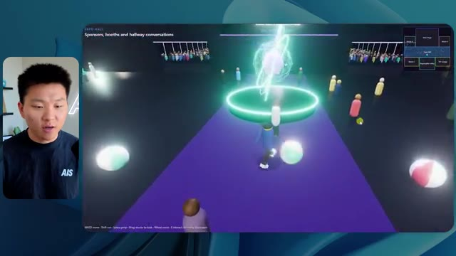
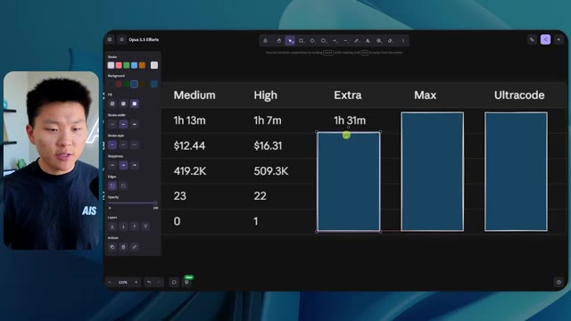
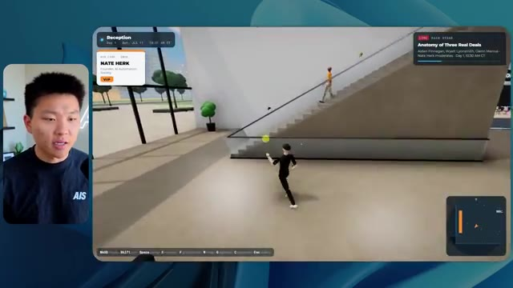
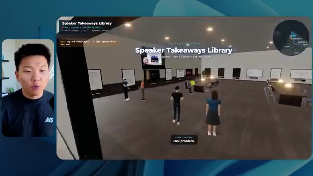
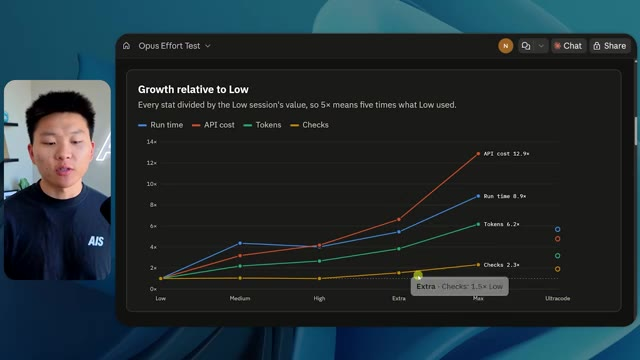

# 🎬 Claude Opus 5.5 is my video editor

> **Chaîne** : [Nate Herk | AI Automation](https://www.youtube.com/@nateherk/featured)  
> **Lien YouTube** : [https://www.youtube.com/watch?v=gNMN-7D9130](https://www.youtube.com/watch?v=gNMN-7D9130)  
> **Date de publication** : 20261016  
> **Durée** : 00:00:44  
> **Identifiant vidéo** : `gNMN-7D9130`  
> **Transcription & Analyse** : `whisper-v3-large-turbo+gemini-3.5-flash-lite`  

---

## 📌 Synthèse Exécutive & Outils

### 💡 Résumé
Dans cette vidéo, Nate Herk explore les capacités d'**Opus 5.5** d'Anthropic — qu'il qualifie ironiquement de monteur vidéo mais qui agît ici en véritable architecte de mondes virtuels et d'agents IA — en testant strictement le même prompt complexe à travers différents niveaux d'effort (de faible à ultra code). L'objectif confié à l'agent était pharaonique : transformer un dossier brut de 105 gigaoctets de ressources vidéo (provenant de l'événement virtuel *AIS Live* sur Frame.io) en un monde 3D interactif et explorable à la troisième personne, simulant une conférence technologique physique dotée de plusieurs salles, scènes et pistes de contenu. 

Les démonstrations révèlent des écarts de qualité, de performance et de comportement saisissants selon le niveau d'effort configuré. Alors que le mode *faible* (exécuté en 16 minutes pour 3,91 $ d'équivalent API) génère un environnement sommaire truffé de bugs graphiques, d'éléments non personnalisés et de PNJ (personnages non-joueurs) fantomatiques, le mode *moyen* (tournant en 1 heure 13 minutes pour 12,44 $) produit un résultat spectaculaire et fonctionnel. Ce dernier intègre les directives de marque, une carte synchronisée en direct, des flux vidéo réactifs (ateliers de Tangy Frederick, présentations de Glido), des PNJ interactifs et des espaces thématiques complets comme un salon VIP ou une scène principale.

L'expérience met en lumière la finesse des réglages d'effort d'Anthropic pour des tâches de développement lourd et d'automatisation agentique. Fait remarquable : quel que soit le niveau d'effort testé, les agents d'Opus 5.5 ont exécuté l'intégralité du pipeline de bout en bout de manière totalement autonome, effectuant des dizaines de vérifications dans le navigateur sans jamais poser la moindre question à l'utilisateur, avant d'aborder la problématique cruciale du déploiement en production.

### 🛠️ Outils, Modèles & Logiciels Présentés
* **Claude Opus 5.5** : Le modèle d'IA de pointe d'Anthropic utilisé comme moteur central d'agent autonome pour concevoir, coder et instancier un monde 3D interactif à partir de données multimédias brutes.
* **Claude Code** : L'outil de développement et d'ingénierie logicielle par la ligne de commande utilisé pour exécuter les agents et manipuler l'environnement de code.
* **Anthropic Effort Level** : Le paramètre de contrôle de l'effort d'inférence (faible, moyen, élevé, extra, max, ultra code) permettant de moduler la profondeur de réflexion, le temps de calcul et la précision des agents IA.
* **Frame.io** : La plateforme cloud de gestion de contenu vidéo et de collaboration qui hébergeait les 105 gigaoctets d'enregistrements bruts de l'événement *AIS Live*.
* **Hostinger Connector** : Une extension gratuite pour éditeur de code présentée comme sponsor, permettant d'importer et de relier directement le compte d'hébergement pour combler le fossé entre le développement local et la mise en ligne.
* **Système d'exploitation IA Herc 2** : L'écosystème propriétaire de Nate Herk intégrant divers dossiers de projets, scripts et ressources d'automatisation exploitables par les agents.
* **Key.ai** : Un outil de génération d'images et de vidéos mobilisé par l'agent pour créer des assets visuels à la volée.

### 🔑 Points Clés & Enseignements Stratégiques
* **Impact direct du niveau d'effort sur la qualité architecturale** : Les tests comparatifs démontrent que les réglages d'effort modifient radicalement non seulement la durée d'exécution et le coût en tokens, mais surtout la cohérence visuelle, la fidélité aux directives de marque et la stabilité des éléments dynamiques (comme l'évitement des bugs d'affichage sur les PNJ).
* **Autonomie totale des agents** : Sur l'ensemble des tests menés avec Opus 5.5, les agents ont accompli des tâches de conception complexes sans nécessiter d'intervention humaine, atteignant un taux de sollicitation de zéro question posée à l'utilisateur.
* **Capacité de traitement multimodale massive** : L'IA a démontré une aptitude redoutable à ingérer, trier et structurer intelligemment un volume brut de 105 Go de vidéos (provenant de Frame.io) pour les recontextualiser dans un espace 3D virtuel cohérent.
* **Synchronisation et agents réactifs** : Les versions à effort moyen ont réussi à lier la géographie d'un monde virtuel (une ville rappelant Chicago) à un véritable agenda de conférence, affichant des flux vidéo en direct fonctionnels pour chaque atelier et scène.
* **Le coût de la complexité** : Le passage du niveau *faible* (16 minutes, 3,91 $, 191k tokens) au niveau *moyen* (1 heure 13 minutes, 12,44 $, 490k tokens) illustre un compromis financier et temporel linéaire, mais indispensable pour obtenir un produit fini de qualité professionnelle.
* **Respect des chartes graphiques** : Les configurations d'effort supérieur exploitent correctement les palettes de couleurs et l'identité visuelle de la marque (*AIS Life*), contrairement aux réglages basiques génériques.
* **Recommandation officielle d'Anthropic** : Comme le soulignent les documentations d'Anthropic, il est méthodologiquement recommandé de démarrer les prompts complexes au niveau *moyen* avant d'ajuster le curseur à la hausse ou à la baisse selon les résultats intermédiaires.
* **Le goulet d'étranglement du déploiement** : La génération d'une application fonctionnelle par l'IA met en évidence le fossé classique du développement logiciel : l'écart entre un code terminé sur l'ordinateur portable et sa mise en ligne rapide sur le web, résolu par des outils d'intégration comme l'extension Hostinger.
* **Gestion des environnements virtuels interactifs** : L'intégration d'éléments de gamification (comme des salons VIP, des cartes interactives synchronisées en direct et des personnages non-joueurs dotés de comportements) prouve qu'Opus 5.5 dépasse la simple génération de code statique pour concevoir des expériences utilisateur immersives.
* **Fiabilité des vérifications automatisées** : L'agent a effectué de manière autonome plus de 20 ouvertures de navigateur et vérifications visuelles successives pour s'auto-corriger au cours de son processus de construction, illustrant la puissance de la boucle de rétroaction des agents IA modernes.

---

## ⏱️ Chronologie & Transcription Complète Audio & Visuelle (Mot pour Mot)

### ⏱️ `[00:00:00 - 00:00:20]` | Segment #01

**🔊 Audio (Transcription Intégrale Mot pour Mot en Français) :**
> Opus 5.5, Opus 5.5, Opus 5.5, Opus 5.5, Opus 5.5. Ce modèle est littéralement partout et pour de très bonnes raisons. Il est intelligent, il est bon marché, il a un goût incroyable, c'est un modèle d'IA extraordinaire. Mais avec chaque modèle d'IA, vous avez le choix de l'effort, que ce soit faible, moyen, élevé, extra, max ou code ultra.

**👁️ Analyse Visuelle d'Écran (gemini-3.5-flash-lite) :**
**Interface & Outils** : X (anciennement Twitter)

**Contenu textuel & Code** : Publication sur X avec une vidéo intégrée et du texte descriptif sur les impacts de l'IA.

**Action / Démonstration** : Présentation d'un exemple concret de création visuelle par IA sur les réseaux sociaux.

*⏱️ 00:00:05 — Capture d'écran d'un post sur X (Twitter) montrant une vidéo de paysage tropical en 3D généré par IA et un texte sur la perturbation des créateurs techniques.*

---

### ⏱️ `[00:00:20 - 00:00:38]` | Segment #02

**🔊 Audio (Transcription Intégrale Mot pour Mot en Français) :**
> Donc, dans cette vidéo, j'ai donné exactement le même prompt à Opus 5.5 et je l'ai exécuté sur chaque niveau d'effort, et nous allons comparer les résultats. Nous examinerons la qualité de tous les différents résultats réels, mais nous examinerons également combien de temps chacun d'eux a pris pour s'exécuter, combien cela nous a coûté si c'était facturé par l'API, le total des jetons, combien de vérifications ils ont effectuées, et combien de questions ils m'ont réellement posées tout au long du processus.

**👁️ Analyse Visuelle d'Écran (gemini-3.5-flash-lite) :**
**Interface & Outils** : Interface de tableau de bord / canevas de comparaison.

**Contenu textuel & Code** : Tableau avec les colonnes Low, Medium, High, Extra, Max, Ultracode et les lignes Run time, API cost, Total tokens, Checks, Questions asked.

**Action / Démonstration** : Affichage du tableau comparatif des différents niveaux d'effort pour l'analyse des résultats.

*⏱️ 00:00:29 — Tableau comparatif sur une interface sombre montrant les différents niveaux d'effort (Low, Medium, High, Extra, Max, Ultracode) avec des métriques floutées.*

---

### ⏱️ `[00:00:39 - 00:00:58]` | Segment #03

**🔊 Audio (Transcription Intégrale Mot pour Mot en Français) :**
> Et les résultats que nous avons obtenus ne sont pas du tout ce à quoi je m'attends, donc j'ai hâte de partager cela avec vous les gars. Ne perdons pas de temps et allons directement à celui-ci. D'accord, alors plongeons directement dans celui-ci. Je veux commencer juste en vous montrant, les gars, le prompt réel que nous avons utilisé, que nous avons donné à chacun de ces différents agents. Je vais aller dans les fichiers ici, et nous allons ouvrir ce fichier markdown de prompt, et je vais vous montrer ce que nous avons obtenu. Voici donc le slash objectif que j'ai fourni.

**👁️ Analyse Visuelle d'Écran (gemini-3.5-flash-lite) :**
**Interface & Outils** : Interface application logicielle (type IDE ou assistant IA avec panneau latéral)

**Contenu textuel & Code** : Texte du prompt affiché : 'Hi Nate. This worktree has the effort-test task queued in PROMPT.md : build a walkable third-person 3D world of the AIS Live conference...'

**Action / Démonstration** : Navigation et présentation de l'interface de travail de l'outil d'IA montrant un prompt en attente d'exécution.

*⏱️ 00:00:48 — Interface d'un éditeur ou d'un outil de développement avec un panneau latéral et une fenêtre de chat affichant un prompt textuel lié à une tâche de test d'effort.*

---

### ⏱️ `[00:00:58 - 00:01:34]` | Segment #04

**🔊 Audio (Transcription Intégrale Mot pour Mot en Français) :**
> J'ai dit : tu dois me créer un monde en 3D qui soit une conférence tech réaliste dans laquelle je peux me promener en vue à la troisième personne. Tu vas regarder ce dossier, qui contient mes ressources d'enregistrement d'événements provenant d'AIS Live. Et ce dossier est un dossier Frame.io de 105 gigaoctets d'enregistrements vidéo. C'était un événement entièrement virtuel. Tout a été enregistré et tous les enregistrements sont juste ici. J'ai dit, ton objectif est de prendre cet événement et de le transformer en un monde 3D explorable qui me donne l'impression d'être réellement allé à une vraie conférence en personne avec différentes salles, différentes pistes, différentes scènes, bla, bla, bla. N'hésite pas à utiliser key.ai si tu as besoin de générer des images ou des vidéos. Et tu peux aussi utiliser n'importe quoi d'autre à l'intérieur de mon projet Herc 2, qui est comme mon système d'exploitation IA. J'ai dit,

**👁️ Analyse Visuelle d'Écran (gemini-3.5-flash-lite) :**
**Interface & Outils** : IDE de type éditeur de code, interface web Frame.io

**Contenu textuel & Code** : Fichier PROMPT.md détaillant le prompt pour générer la conférence tech 3D, lien Frame.io (f.io/sPdlo-Si), dossiers Frame.io (GA Access, VIP Access)

**Action / Démonstration** : Présentation du prompt initial et du dossier de ressources Frame.io contenant les enregistrements vidéo de l'événement AIS Live.

*⏱️ 00:01:07 — Éditeur de code affichant le fichier PROMPT.md contenant les instructions pour créer un monde 3D en vue à la troisième personne basé sur les ressources AIS Live.*

*⏱️ 00:01:16 — Interface Frame.io montrant le dossier de ressources d'enregistrement d'événements AIS Live daté du 22 septembre 2026 (105.69 Go) avec les dossiers GA Access et VIP Access.*

*⏱️ 00:01:25 — Éditeur de code affichant de nouveau le fichier PROMPT.md avec les consignes détaillées pour transformer les enregistrements virtuels en monde 3D explorable.*

---

### ⏱️ `[00:01:34 - 00:02:08]` | Segment #05

**🔊 Audio (Transcription Intégrale Mot pour Mot en Français) :**
> vous serez jugé sur la créativité, le design, la physique et la sensation générale lorsque j'explorerai le monde 3D que vous avez construit. Et c'était fondamentalement la fin des instructions. Donc comme vous pouvez le voir sur ce côté gauche, j'ai exécuté ceci à travers tous les différents niveaux d'effort. Commençons par le niveau bas et progressons jusqu'à l'ultra code. Très bien. Donc ici nous avons le résultat du niveau bas. Ouvrons ceci et jetons un coup d'œil. Nous avons donc AIS Live, le sommet des services IA en personne enfin, et nous avons pu cliquer partout. Tout d'abord, cela ne fait pas très personnalisé. Genre, ce n'est pas le logo d'IS Live. Ce n'est même pas nos couleurs. Donc je n'aime pas trop ça, mais entrons ici. D'accord. C'est beaucoup trop lumineux. Euh, nous avons une carte en haut à droite. Nous avons une ville par ici. Je ne peux pas dire quelle ville c'est

**👁️ Analyse Visuelle d'Écran (gemini-3.5-flash-lite) :**
**Interface & Outils** : Interface web d'un agent de développement ou d'un outil de type Claude Code / interface de gestion de tâches.

**Contenu textuel & Code** : Texte de prompt de l'agent IA proposant de construire un monde 3D marchable ("build a walkable third-person 3D world...") et sélection des différents niveaux d'effort dans le menu de gauche.

**Action / Démonstration** : Le présentateur montre l'exécution des tests à travers différents niveaux listés dans le panneau latéral.

*⏱️ 00:01:42 — Capture d'écran montrant le présentateur à gauche et une interface d'agent IA à droite avec un panneau latéral listant différents niveaux (Hello, Extra, High, Max, Ultracode, Medium, Low).*

---

### ⏱️ `[00:02:08 - 00:02:40]` | Segment #06

**🔊 Audio (Transcription Intégrale Mot pour Mot en Français) :**
> C'est. D'accord. C'est Chicago, ce qui est plutôt cool parce que tu sais, j'habite à Chicago, mais bref, en haut à droite, on peut voir une carte. Nous avons un hall d'accueil. Nous avons un hall d'exposition. Nous avons un salon VIP, la scène principale. La carte montre également où se trouve chaque autre personne et cela se synchronise en direct. Donc nous pouvons voir l'enregistrement. Nous pouvons voir le premier jour, la keynote de l'hyper agent, le débrief en direct. Cool. Donc ça connaît réellement l'agenda et puis il y a le deuxième jour. Donc il a trouvé ça, c'est bien. Nous avons ces petits ballons ici que je peux espérer botter. D'accord. Le visage, oh, regarde ça. Si je vais par ici, toutes les personnes disparaissent tout simplement. Très mauvais. Très mauvais. D'accord. Alors voyons voir. Est-ce que je peux sprinter ? D'accord.

**👁️ Analyse Visuelle d'Écran (gemini-3.5-flash-lite) :**
**Interface & Outils** : Application web de monde virtuel interactif / métavers avec mini-carte et affichage en temps réel.

**Contenu textuel & Code** : Menus d'événements, programmes de conférences ("Day 1", "Badge pickup", "Sponsors, booths and hallway conversations").

**Action / Démonstration** : Navigation et exploration de différentes zones du salon virtuel (lobby, expo hall, zone de badges).

*⏱️ 00:02:16 — Vue d'un monde virtuel interactif montrant un espace de retrait des badges avec une mini-carte en haut à droite.*

*⏱️ 00:02:24 — Vue du hall d'accueil (Lobby) du monde virtuel affichant le programme du premier jour sur un panneau.*

*⏱️ 00:02:32 — Vue de l'Expo Hall montrant des avatars et des zones de discussion thématiques avec une mini-carte globale.*

---

### ⏱️ `[00:02:40 - 00:03:04]` | Segment #07

**🔊 Audio (Transcription Intégrale Mot pour Mot en Français) :**
> Je peux avancer un peu plus vite. Je vais d'abord aller par ici. Il y a des produits promotionnels, euh, certifiés AIS plus glido. D'accord. Donc il y a les vrais stands qu'on avait lors de l'événement virtuel. On avait des stands. Donc c'est plutôt cool. Un petit endroit pour prendre des photos. Salle C. En ce moment, nous avons Tangy Frederick qui anime un atelier. D'accord. Mais ce n'est pas une vidéo. Comme vous pouvez le voir, c'est juste une image. Elle ne bouge pas. C'est donc juste une image. Ces gens sont en train de disparaître. Ce doivent être des fantômes. Allons par ici vers la salle A.

**👁️ Analyse Visuelle d'Écran (gemini-3.5-flash-lite) :**
**Interface & Outils** : Environnement virtuel 3D / Jeu de type métavers ou plateforme d'événement virtuel.

**Contenu textuel & Code** : Affichage d'un espace d'exposition virtuel avec des stands ("Glaido"), des panneaux d'affichage informatifs et des repères de navigation.

**Action / Démonstration** : Navigation et exploration d'un environnement virtuel 3D par un avatar.

---

### ⏱️ `[00:03:04 - 00:03:30]` | Segment #08

**🔊 Audio (Transcription Intégrale Mot pour Mot en Français) :**
> Nous avons Liberty White. D'accord. Très cool. Vos 30 premiers jours en automatisation. Encore une fois, c'est juste une image fixe et les gens ont des bugs d'affichage. Donc ce n'est pas très bien ici. Je vais aller sur la scène principale et voir ce que nous avons. D'accord, cool. Donc nous avons une scène d'apparence principale. Les gens ont de gros bugs d'affichage. Vraiment mauvais. Ce n'est vraiment pas bon du tout. Notre vidéo est en train de bouger. Genre, j'ai vu mon visage ici et j'ai vu celui de Devin, mais maintenant ils ont disparu. Donc je ne sais pas ce qui s'est passé. D'accord. On dirait que c'est plutôt un diaporama. Rien n'est vraiment lu pour l'instant. Quoi qu'il en soit, entrons ici.

**👁️ Analyse Visuelle d'Écran (gemini-3.5-flash-lite) :**
**Interface & Outils** : Environnement virtuel 3D interactif (type métavers / plateforme d'événement virtuel)

**Contenu textuel & Code** : Textes "Foundation track" et "Now showing: Hyperagent Workshop: How to Build an Always-On Fleet of Agents"

**Action / Démonstration** : Navigation et exploration de l'espace virtuel par le présentateur sous forme d'avatar.

*⏱️ 00:03:11 — Vue dans une salle virtuelle "Workshop Room A" montrant un avatar dans un espace 3D minimaliste avec des plateformes lumineuses.*

*⏱️ 00:03:17 — Vue de la scène principale "Main Stage" montrant un avatar naviguant dans un auditorium rempli d'avatars virtuels.*

*⏱️ 00:03:24 — Vue face à l'écran géant de la "Main Stage" affichant "AIS LIVE AI Services Summit" dans l'espace virtuel.*

---

### ⏱️ `[00:03:30 - 00:03:58]` | Segment #09

**🔊 Audio (Transcription Intégrale Mot pour Mot en Français) :**
> Nous avons d'autres stands. Nous avons hyper agent. Nous avons Claude Code. Nous avons plus de cadeaux publicitaires. La salle B, c'est Dave Ebelor. Je suppose que c'est exactement la même chose. Nous avons du café. Et puis, je suppose que le salon VIP, c'est un accès VIP uniquement. C'est plutôt cool, mais il ne se passe vraiment rien ici. Cet écran est bien trop lumineux. D'accord. Donc, je pense que vous comprenez l'ambiance qu'on obtient ici avec Opus 5.5 en effort faible. Et c'est là que les choses deviennent intéressantes. À combien est-ce que vous pensez que cela a tourné ? Combien de temps ? Celui-ci a tourné pendant 16 minutes et 43 secondes. Combien est-ce que vous pensez que cela a coûté ?

**👁️ Analyse Visuelle d'Écran (gemini-3.5-flash-lite) :**
**Interface & Outils** : Application de tableau blanc / interface de présentation Opus 5.5.

**Contenu textuel & Code** : Tableau avec colonnes : Low, Medium, High, Extra, Max, Ultracode et lignes : Run time, API cost, Total tokens, Checks, Questions asked.

**Action / Démonstration** : Présentation du tableau comparatif des performances et coûts selon les niveaux d'effort.

*⏱️ 00:03:51 — Tableau comparatif sur une interface de type tableau blanc affichant les niveaux d'effort (Low, Medium, High, Extra, Max, Ultracode) et métriques associées (Run time, API cost, Total tokens).*

---

### ⏱️ `[00:03:58 - 00:04:26]` | Segment #10

**🔊 Audio (Transcription Intégrale Mot pour Mot en Français) :**
> 3,91 dollars si c'eût été une facturation par API. J'utilise évidemment mon abonnement ici, mais nous allons simplement calculer cela avec la facturation par API. Le nombre total de jetons était de 191 000. Il a effectué 22 vérifications. Donc la vérification, 22 fois il a ouvert le navigateur et a exécuté différentes sortes de vérifications. Donc 22 catégories de vérifications. Et combien de questions m'a-t-il posées ? Il m'a posé un total de zéro question tout au long de cette invite de commande d'objectif globale. D'accord. Alors ouvrons l'effort moyen et voyons ce que nous avons. D'accord, c'est parti. Effort moyen. Nous avons Nate Herc. Nous avons mon badge. C'est de la marque AI's Life.

**👁️ Analyse Visuelle d'Écran (gemini-3.5-flash-lite) :**
**Interface & Outils** : Application de tableau blanc / diagramme en ligne (type Excalidraw ou similaire).

**Contenu textuel & Code** : Tableau avec des colonnes de niveaux (Low, Medium, High, Extreme) et des lignes de métriques : Run time (16m 43s), API cost ($3.91), Total tokens (191.3K), Checks, Questions asked.

**Action / Démonstration** : Le présentateur commente les résultats chiffrés et les métriques d'exécution affichées dans le tableau.

*⏱️ 00:04:05 — Un tableau comparatif affiché dans une application de type tableau blanc, détaillant les performances et coûts (Run time 16m 43s, API cost $3.91, Total tokens 191.3K, Checks, Questions asked) pour différents niveaux d'effort, avec le présentateur visible dans un encadré à gauche.*

---

### ⏱️ `[00:04:26 - 00:04:46]` | Segment #11

**🔊 Audio (Transcription Intégrale Mot pour Mot en Français) :**
> Alors, ça a déjà l'air un peu mieux. On dirait nos palettes de couleurs qui ont utilisé nos directives de marque. Premier jour de construction, deuxième jour de gain, VIP. Cool. D'accord. Je vais entrer dans le lieu. D'accord. Waouh. Une ambiance similaire, en somme. C'est en arrière-plan. Ça ne ressemble pas à Chicago, hein ? Non, ça ressemble à, honnêtement, ça ressemble à une ville inventée. Quoi qu'il en soit, c'est marrant qu'ils aient décidé de faire ça. Voyons si je peux me déplacer un peu plus vite. Oh, waouh.

**👁️ Analyse Visuelle d'Écran (gemini-3.5-flash-lite) :**
**Interface & Outils** : Application web interactive / environnement virtuel 3D 'AIS Live'

**Contenu textuel & Code** : Écran d'accueil de l'événement virtuel, badge de participant 'NATE HERK', instructions de déplacement (WASD, Shift, Espace), et interface de l'espace virtuel 3D.

**Action / Démonstration** : Navigation et entrée dans le lieu virtuel de l'événement interactif.

*⏱️ 00:04:31 — Interface web de l'application 'AIS Live' montrant un badge nominatif virtuel aux couleurs de la marque avec les options de navigation et le bouton 'Enter the Venue'.*

*⏱️ 00:04:41 — Vue dans l'espace virtuel 3D de l'application 'AIS Live' avec des avatars polygonaux dans un décor intérieur moderne avec vue sur la ville la nuit.*

---

### ⏱️ `[00:04:46 - 00:05:21]` | Segment #12

**🔊 Audio (Transcription Intégrale Mot pour Mot en Français) :**
> Les gens interagissent avec moi. Regardez. Si je m'approche de ce type, il a juste levé le bras. Bon, maintenant il ne veut plus rien savoir de moi du tout. Mais tous ces petits robots ici doivent prendre des décisions. Je ne sais pas s'ils utilisent Jev. C'est sûr que non. Je ne le lui ai pas dit. En fait, ma clé Jev est à l'arrière. Je ne sais pas. Peut-être qu'il l'a utilisée. Quoi qu'il en soit, nous pouvons voir ici que nous avons la salle d'atelier C, le laboratoire des agents. Sympa. Donc celui-ci est en fait en cours d'exécution. Vous pouvez voir qu'il s'agit d'une vraie vidéo lue par Tangy. Tout le monde ici est en train de travailler sur un ordinateur portable. Ils ne buguent pas. C'est plutôt cool. De plus, mon badge est sur ma poitrine, ce qui est plutôt cool. Je peux venir par ici. Nous avons une carte en haut à droite, comme vous pouvez le voir, mais je peux venir par ici. Nous avons un

**👁️ Analyse Visuelle d'Écran (gemini-3.5-flash-lite) :**
**Interface & Outils** : Environnement virtuel 3D interactif (type monde virtuel ou métavers).

**Contenu textuel & Code** : Avatars 3D autonomes et interface utilisateur affichant des informations de session de workshop.

**Action / Démonstration** : Exploration et navigation interactive dans un monde virtuel peuplé d'agents.

*⏱️ 00:04:55 — Le présentateur évolue dans un environnement virtuel 3D interactif avec des avatars représentant des agents.*

*⏱️ 00:05:04 — Vue de l'environnement virtuel 3D montrant l'accès à une salle de classe étiquetée "Agents Lab".*

*⏱️ 00:05:12 — Vue en plongée dans une salle de classe virtuelle remplie de bureaux et d'avatars assis devant des ordinateurs.*

---

### ⏱️ `[00:05:21 - 00:05:47]` | Segment #13

**🔊 Audio (Transcription Intégrale Mot pour Mot en Français) :**
> hall d'exposition. C'est là que nous avons le stand Glido. Et ça diffuse en ce moment. Oui, ça diffuse la vidéo de nous en train de parler de Glido. Ça diffuse la vidéo d'Ed et moi parlant de notre programme de certification. Nous avons le logo AIS Plus juste ici, qui est un peu mal placé. Ce sont les diapositives des conférenciers et les points clés. Alors wow, ce sont toutes les ressources que nous avons distribuées après l'événement. Elles sont toutes là également. Nous pouvons voir que nous avons un coup de projecteur sur la communauté. C'est donc Aiden qui parle de son accord qu'il a conclu et c'est diffusé en direct. Ces gens regardent.

**👁️ Analyse Visuelle d'Écran (gemini-3.5-flash-lite) :**
**Interface & Outils** : Environnement virtuel 3D de type salon ou exposition en ligne.

**Contenu textuel & Code** : Éléments graphiques d'un stand virtuel, panneaux d'affichage et avatars de participants.

**Action / Démonstration** : Navigation et exploration de l'espace d'exposition virtuel par le présentateur.

---

### ⏱️ `[00:05:47 - 00:06:21]` | Segment #14

**🔊 Audio (Transcription Intégrale Mot pour Mot en Français) :**
> Ils sont plutôt engagés. On a un hyper agent. C'était, c'est ce que je voulais dire. Si vous avez vu ces gens lever les mains en disant bonjour, c'était plutôt marrant. Regardez, regardez, le voilà qui recommence. Bref. Bon. Où est-ce que je suis maintenant ? Maintenant, je suis dans le hall principal. On a un bar à café. On a un grand logo, qui est le vrai logo. C'est trop lumineux, mais on a le logo. On peut voir si on peut entrer ici dans le parcours des fondations. On a Sabrina Romanov et Liberty White. Donc différentes formations juste là. On peut entrer dans cette salle. C'est le parcours avancé. Alors qu'est-ce qui se passe ici. On a Dave Ebelar et Saman qui parlent de différentes choses là-dedans. Et maintenant, allons jeter un œil à la scène principale. Oh, attendez, il y a une vidéo de moi là-haut. C'est genre un VIP

**👁️ Analyse Visuelle d'Écran (gemini-3.5-flash-lite) :**
**Interface & Outils** : Application ou plateforme virtuelle 3D d'événements (metaverse / événement en ligne).

**Contenu textuel & Code** : Environnement virtuel interactif avec avatars, mini-carte et indicateurs de navigation.

**Action / Démonstration** : Navigation et exploration de l'espace virtuel par le présentateur sous forme d'avatar.

*⏱️ 00:05:55 — Vue principale dans le hall virtuel (Main Lobby) montrant les avatars des participants et l'interface de navigation.*

*⏱️ 00:06:04 — Déplacement de l'avatar vers une salle de conférence virtuelle au sein de l'environnement 3D.*

*⏱️ 00:06:12 — Vue en groupe avec d'autres avatars virtuels attablés et en discussion dans le hall principal.*

---

### ⏱️ `[00:06:21 - 00:06:50]` | Segment #15

**🔊 Audio (Transcription Intégrale Mot pour Mot en Français) :**
> section ? Ouais, on ira voir ça dans une minute. Mais bref, voici la scène principale. Ça a l'air vraiment, vraiment très bien. On a une grande scène. On a genre quatre personnes assises ici. On a les trois écrans d'Alex là-haut avec Hyper Agent. Est-ce que j'ai le droit de monter sur scène ? Oh, et il me laisse monter sur scène. D'accord. C'est plutôt sympa. Bon les gars, prenons un selfie. Laissez-moi mettre tout le monde en arrière-plan. Venez par ici. Bref, c'est vraiment, vraiment cool. Toutes les places ne sont pas occupées par contre. Donc il va falloir qu'on travaille là-dessus. Mais bon, je vais y retourner en courant pour voir ce que c'était que cette section VIP. D'accord. Salon VIP. J'ai l'impression que c'est comme un aéroport ou un truc du genre.

**👁️ Analyse Visuelle d'Écran (gemini-3.5-flash-lite) :**
**Interface & Outils** : Application de conférence virtuelle / plateforme d'événements 3D (Hyper Agent)

**Contenu textuel & Code** : Interface utilisateur virtuelle affichant les détails de la keynote (Hyperagent Keynote - Alex McDonnell) et une mini-carte de la salle.

**Action / Démonstration** : Navigation et exploration de l'espace virtuel 3D de la conférence par l'utilisateur.

---

### ⏱️ `[00:06:51 - 00:07:14]` | Segment #16

**🔊 Audio (Transcription Intégrale Mot pour Mot en Français) :**
> D'accord, super. Donc maintenant nous avons les sessions VIP ici. Une foire aux questions VIP avec la lecture vidéo en direct de Nate juste ici. Très, très cool. Et nous avons comme un bar ou quelque chose. Génial. Je dirais que c'est un assez bon résultat. Maintenant, en ce qui concerne les statistiques ici, celle-ci a pris une heure et 13 minutes à s'exécuter. Cela nous aurait coûté 12 dollars et 44 cents. Elle a utilisé 490 000 jetons et elle a effectué 23 vérifications.

**👁️ Analyse Visuelle d'Écran (gemini-3.5-flash-lite) :**
**Interface & Outils** : Application virtuelle interactive de type salon VIP et tableau de bord de statistiques (Opus 5.5 Efforts).

**Contenu textuel & Code** : Statistiques affichées pour la catégorie 'Low' : Run time 16m 43s, API cost $3.91, Total tokens 191.3K, Checks 22, Questions asked 0.

**Action / Démonstration** : Présentation de l'environnement virtuel VIP et transition vers l'analyse des statistiques d'utilisation.

*⏱️ 00:06:56 — Vue d'un espace virtuel VIP avec un écran affichant le présentateur en direct, un bar et des avatars d'utilisateurs.*

*⏱️ 00:07:02 — Tableau de statistiques affichant les métriques d'exécution (Run time, API cost, Total tokens, Checks, Questions asked).*

---

### ⏱️ `[00:07:14 - 00:07:48]` | Segment #17

**🔊 Audio (Transcription Intégrale Mot pour Mot en Français) :**
> Et il nous a posé un total de zéro question une fois de plus. Très bien, passons à "élevé". C'était déjà un résultat plutôt correct et Anthropic eux-mêmes dans leur vidéo, ou désolé, pas une vidéo, un article sur comment prompter Opus 5.5. Ils ont dit de commencer simplement par "moyen" et de l'ajuster à la hausse ou à la baisse si nécessaire. C'était donc un résultat moyen. Passons à "élevé" et voyons ce que nous avons obtenu. Très rapidement, les gars, je dois prendre une seconde pour vous parler du sponsor de la vidéo d'aujourd'hui, Hostinger. Donc, ces deux modèles viennent de me construire une version fonctionnelle de la même chose. Et maintenant, je suis exactement là où je finis toujours, avec quelque chose de terminé sur mon ordinateur portable et aucun moyen rapide de le mettre en ligne. Et c'est le fossé que comble le connecteur d'Hostinger. C'est une extension gratuite.

**👁️ Analyse Visuelle d'Écran (gemini-3.5-flash-lite) :**
**Interface & Outils** : Tableau comparatif sur fond sombre, interface de développement avec éditeur de code et assistant IA.

**Contenu textuel & Code** : Tableaux de métriques (Run time, API cost, Total tokens, Checks, Questions asked) et code/instructions pour créer un "Northwind ROI calculator".

**Action / Démonstration** : Présentation comparative des performances selon les différents niveaux d'effort configurés pour l'IA.

*⏱️ 00:07:22 — Un tableau comparatif montrant les métriques pour différents niveaux de réglage ("Low", "Medium", "High", "Extra") avec le temps d'exécution, le coût API, les tokens et le nombre de questions posées.*

*⏱️ 00:07:39 — Une interface de développement avec des panneaux divisés affichant des logs d'exécution, des métriques de tokens, et un panneau de chat avec les détails du prompt pour construire un calculateur ROI.*

---

### ⏱️ `[00:07:48 - 00:08:23]` | Segment #18

**🔊 Audio (Transcription Intégrale Mot pour Mot en Français) :**
> pour votre éditeur qui importe votre compte Hostinger dans ce sur quoi vous êtes déjà en train de coder. Donc VS Code, Cursor, Cloud Code, Codex, vous l'nommez. Vous vous connectez une seule fois en un seul clic, et à partir de là, votre agent peut déployer le site, y pointer un domaine, configurer les enregistrements DNS, et vérifier votre VPS sans que vous n'ayez jamais à quitter l'éditeur. Donc, peu importe celui de ces outils que vous finissez par préférer, la chose qu'il a construite est à quelques minutes d'une vraie URL sur un hébergement géré. Connector est gratuit sur chaque plan d'hébergement, donc si vous avez toujours besoin de l'hébergement en dessous, prenez le plan illimité avec le lien dans la description et utilisez le code NATEHERK pour 10 % de réduction. Cela vient aussi avec un domaine gratuit et un e-mail professionnel pour l'année. Et c'est toujours le moyen le moins cher que j'ai trouvé pour obtenir quelque chose

**👁️ Analyse Visuelle d'Écran (gemini-3.5-flash-lite) :**
**Interface & Outils** : Hostinger Integration, Claude Code

**Contenu textuel & Code** : "Manage Hostinger from your IDE", statut connecté (Connected VIA OAUTH), liste des outils disponibles (Websites, Domains, Subscriptions, Email Marketing).

**Action / Démonstration** : Connexion du compte Hostinger via OAuth pour permettre à l'agent de gérer les sites web et domaines directement depuis l'IDE.

*⏱️ 00:07:57 — Interface montrant la connexion du compte Hostinger à un IDE avec les outils disponibles (Websites, Domains, etc.) et l'interface de Claude Code à droite.*

---

### ⏱️ `[00:08:23 - 00:08:47]` | Segment #19

**🔊 Audio (Transcription Intégrale Mot pour Mot en Français) :**
> Vous avez construit sur une vraie URL. Donc revenons à la vidéo. D'accord. Encore une fois, très, très marqué par la marque. C'est un écran de chargement encore meilleur que le précédent. Nous avons ce petit effet sympa en arrière-plan. Nous avons le logo. Nous allons entrer dans le lieu. D'accord. Nous y voilà. Ça a l'air plutôt bien. Nous commençons à l'extérieur et vous pouvez voir que nous avons ces drapeaux pour tous les intervenants, Wyatt, Casper, Alex, Ed, Aiden, Sabrina, Liberty. C'est plutôt cool. Nous avons des blocs en direct ici.

**👁️ Analyse Visuelle d'Écran (gemini-3.5-flash-lite) :**
**Interface & Outils** : Application web interactive en 3D / Navigateur web

**Contenu textuel & Code** : Interface utilisateur affichant "AIS LIVE - Real Projects, Real Revenue", commandes de navigation (WASD, Mouse, Space), et indicateur de lieu "AIS Live Plaza".

**Action / Démonstration** : Navigation et exploration de l'environnement virtuel interactif de l'événement en ligne.

*⏱️ 00:08:29 — Écran de chargement et d'accueil de la plateforme web "AIS LIVE" avec un logo stylisé, les détails de l'événement et un bouton "Enter the Venue".*

*⏱️ 00:08:35 — Vue dans l'espace virtuel 3D "AIS Live Plaza" montrant un environnement urbain stylisé avec des avatars et des indications de navigation en surimpression.*

*⏱️ 00:08:41 — Exploration de l'espace virtuel 3D de la place avec des bannières aux noms de conférenciers et des objets interactifs au sol.*

---

### ⏱️ `[00:08:47 - 00:09:23]` | Segment #20

**🔊 Audio (Transcription Intégrale Mot pour Mot en Français) :**
> Il a pris cette photo de moi, votre hôte, Nate Herc, John, Dave, Nate Herc. Voilà. D'accord. Les portes. Génial. Ce sont des portes coulissantes automatiques en verre. J'adore ça. Nous pouvons voir l'enregistrement VIP. Nous pouvons voir l'admission générale. Nous pouvons venir ici et nous pouvons découvrir l'exposition avec différents stands, le coin de la communauté. Vous pouvez également voir qu'en haut à gauche, j'ai un passeport. Donc c'est comme si, cela montrera combien d'endroits j'ai visités. Tout cela est une lecture réelle. Nous avons un mur de ressources avec tous les différents conférenciers. Ils ont aussi une session de réseautage par ici. Je vais donc venir très vite voir de quoi il s'agit. Nous avons donc le bar à cold brew AIS. Nous avons différents membres de la communauté qui ont été mis en avant ou en lumière.

**👁️ Analyse Visuelle d'Écran (gemini-3.5-flash-lite) :**
**Interface & Outils** : Monde virtuel 3D interactif / Application web d'événement virtuel.

**Contenu textuel & Code** : Interface utilisateur avec mini-carte, indicateurs de progression et affichage d'avatars en 3D.

**Action / Démonstration** : Exploration et navigation dans un espace virtuel d'événement en ligne.

*⏱️ 00:08:56 — Vue d'un monde virtuel interactif montrant l'accueil d'un événement (Registration Concourse) avec des avatars et des comptoirs VIP.*

*⏱️ 00:09:05 — Navigation dans la zone d'exposition virtuelle (Expo Hall) du même univers 3D interactif.*

*⏱️ 00:09:14 — Déplacement d'un avatar aux côtés d'autres personnages dans le hall d'enregistrement virtuel.*

---

### ⏱️ `[00:09:23 - 00:09:56]` | Segment #21

**🔊 Audio (Transcription Intégrale Mot pour Mot en Français) :**
> On a l'aile VIP. Attends, quoi ? Récupère un bracelet. Oh, je dois vraiment aller chercher le bracelet. D'accord. Laisse-moi m'enregistrer rapidement. Le bracelet est déjà mis. Attends, quoi ? D'accord. Oh, d'accord. Maintenant, les portes se sont ouvertes pour moi. Cool. Je peux entrer ici. Oh, ça mène juste à la scène principale. Salon VIP. Il y a une séance de questions-réponses en cours. Ça a l'air très cool. Je veux dire, je suis très impressionné par la façon dont il est capable de faire ça. Waouh. D'accord. Donc c'est vraiment bien. Ce qu'on a fait, c'est qu'on a eu des salles de réunion VIP avec différentes personnes. Tu peux voir qu'il y a différentes salles, différents membres de l'équipe AIS qui participent à des trucs. C'est vraiment cool. C'est très cool. C'est un bien meilleur VIP

**👁️ Analyse Visuelle d'Écran (gemini-3.5-flash-lite) :**
**Interface & Outils** : Application de métaverse ou plateforme virtuelle 3D de conférence en ligne.

**Contenu textuel & Code** : Éléments graphiques d'interface utilisateur incluant la mini-carte, les indicateurs de zone (VIP Lounge, VIP Working Sessions) et les sous-titres audio.

**Action / Démonstration** : Navigation et exploration de différents espaces virtuels (réception, lounge, sessions de travail) par l'avatar de l'utilisateur.

*⏱️ 00:09:32 — Vue d'un espace virtuel 3D de type métaverse montrant la zone de réception (Registration Concourse) où le présentateur navigue avec un avatar.*

*⏱️ 00:09:40 — Vue de la salle VIP Lounge dans l'espace virtuel 3D, avec des avatars assis et un écran affichant une session vidéo.*

*⏱️ 00:09:48 — Vue de la zone des sessions de travail VIP (VIP Working Sessions) avec différents ateliers comme "Land Your First Paying Client".*

---

### ⏱️ `[00:09:56 - 00:10:30]` | Segment #22

**🔊 Audio (Transcription Intégrale Mot pour Mot en Français) :**
> expérience que ce qui a été montré dans la première partie. D'accord. After party VIP. Regardez ça. On a une piste de danse. On a tous ces éléments ici. On a la lecture de l'after party VIP juste ici. Et il y a une estrade de DJ. C'est trop marrant. Il y a un petit bug ici, un petit glitch ici, mais c'est génial. Oh, cool. Donc quand je suis ici sur la scène principale, on a des sous-titres. Vous pouvez voir juste ici en bas de mon écran, on a ces sous-titres de Wyatt qui est en train de parler ici. On a des lumières. On a le panneau. Très cool. Belle scène principale. Je vais aller par ici, on peut aller à la fondation,

**👁️ Analyse Visuelle d'Écran (gemini-3.5-flash-lite) :**
**Interface & Outils** : Application web 3D / Plateforme d'événements virtuels en ligne

**Contenu textuel & Code** : Environnement virtuel 3D avec avatars, écrans de flux vidéo en direct, interface de navigation avec contrôles et passeport utilisateur.

**Action / Démonstration** : Navigation et exploration de différentes zones d'un événement virtuel (After Party VIP et Main Stage).

*⏱️ 00:10:04 — Vue d'un espace virtuel interactif représentant une after-party VIP avec des avatars 3D sur une piste de danse et un écran affichant des participants.*

*⏱️ 00:10:13 — Vue panoramique de l'espace virtuel de l'after-party VIP avec un panneau affichant le titre et de nombreux avatars en mouvement.*

*⏱️ 00:10:21 — Vue d'une scène principale virtuelle avec des avatars assis dans une salle de conférence et un écran géant affichant un intervenant.*

---

### ⏱️ `[00:10:30 - 00:11:06]` | Segment #23

**🔊 Audio (Transcription Intégrale Mot pour Mot en Français) :**
> avancé, et les parcours d'entreprise par ici. Alors voyons voir. Nous avons l'anatomie de trois vraies transactions. Nous avons hyper agent. Nous avons les évaluations avec Nate et Ed ici. Nous avons Dave qui s'occupe des trucs avancés. C'est vraiment bien. Je veux dire, évidemment, chacun, chacun de ces résultats jusqu'à présent, le niveau bas était correct. Le niveau moyen était meilleur. Le niveau élevé a été encore meilleur. Voyons si cette tendance se poursuit et allons voir combien cela nous a coûté. Le niveau élevé a donc tourné pendant une heure et sept minutes. Donc un peu plus rapide que le niveau moyen, cela nous aurait coûté 16 dollars et 31 cents. Il a utilisé un demi-million de jetons, 509 000. Il a fait 22 vérifications. Et il nous a aussi demandé, enfin, non, je me suis trompé. Ce

**👁️ Analyse Visuelle d'Écran (gemini-3.5-flash-lite) :**
**Interface & Outils** : Tableau blanc numérique / outil de diagramme (style Excalidraw) affichant des données comparatives.

**Contenu textuel & Code** : Tableau avec les colonnes Low, Medium, High et Extra montrant le temps d'exécution (Run time), le coût API ($3.91, $12.44, $16.31), les tokens totaux et les vérifications.

**Action / Démonstration** : Présentation des résultats de tests d'agents IA selon différents niveaux de ressources et de coûts.

*⏱️ 00:10:57 — Tableau comparatif sur une interface de type tableau blanc affichant les métriques d'exécution (Run time, API cost, Total tokens) pour différents niveaux d'effort.*

---

### ⏱️ `[00:11:06 - 00:11:25]` | Segment #24

**🔊 Audio (Transcription Intégrale Mot pour Mot en Français) :**
> l'un m'a posé une question et, divulgâcheur, c'était le seul qui nous a posé une question tout au long de tout ça. Voyons voir, il nous en reste trois, extra, max et ultra code. Laissez-moi ouvrir extra et nous verrons ce que nous avons. D'accord. Donc celui-ci a l'air plutôt bien. Je dirais honnêtement que jusqu'à présent, l'écran de chargement haut était le meilleur. Celui que nous venons de voir, mais bref, entrons dans le direct d'AIS.

**👁️ Analyse Visuelle d'Écran (gemini-3.5-flash-lite) :**
**Interface & Outils** : Tableau de bord d'analyse ou interface de canevas (Opus 5.5 Efforts).

**Contenu textuel & Code** : Tableau de données chiffrées : Run time (16m 43s à 1h 07m), API cost ($3.91 à $16.31), Total tokens (191.3K à 509.3K), Checks (22 à 23), Questions asked (0 ou 1).

**Action / Démonstration** : Le présentateur commente les résultats du tableau et sélectionne la colonne 'Extra'.

*⏱️ 00:11:11 — Tableau comparatif affichant les métriques (Run time, API cost, Total tokens, Checks, Questions asked) pour différents niveaux de performance (Low, Medium, High, Extra) avec le présentateur incrusté à gauche.*

---

### ⏱️ `[00:11:26 - 00:11:51]` | Segment #25

**🔊 Audio (Transcription Intégrale Mot pour Mot en Français) :**
> Whoa. D'accord. Donc on a comme de petits extraits sonores. Je peux discuter avec des gens. Le panneau sur la guerre des outils a réglé quelques débats pour moi. Sympa. Bonne perspective là-bas. On est dehors à nouveau. On a ces différentes bannières, bien qu'elles soient toutes les mêmes. Elles n'affichent pas de noms de personnes différentes. Donc grand logo AIS Live. L'aile des ateliers est par ici. Et traversons les portes coulissantes en verre pour voir ce qu'on a. Donc on a le café AIS. La carte est en bas à droite, et elle n'est pas très descriptive.

**👁️ Analyse Visuelle d'Écran (gemini-3.5-flash-lite) :**
**Interface & Outils** : Environnement virtuel 3D / jeu ou application de métavers en ligne

**Contenu textuel & Code** : Interface utilisateur avec mini-carte en bas à droite, indicateur 'LIVE - Convention Plaza' en haut à gauche et avatars virtuels interagissant dans un espace 3D.

**Action / Démonstration** : Exploration et déplacement d'un avatar à travers un monde virtuel 3D représentant une place de convention.

*⏱️ 00:11:32 — Vue dans un monde virtuel 3D de type métavers montrant un avatar se déplaçant sur une place publique près de bâtiments et d'écrans affichant 'AIS LIVE'.*

*⏱️ 00:11:38 — Poursuite de la navigation de l'avatar dans l'environnement 3D virtuel montrant des bannières et des zones extérieures aménagées avec des arbres et des bancs.*

*⏱️ 00:11:45 — L'avatar se dirige vers l'entrée lumineuse d'un grand bâtiment de type centre de convention virtuel.*

---

### ⏱️ `[00:11:51 - 00:12:26]` | Segment #26

**🔊 Audio (Transcription Intégrale Mot pour Mot en Français) :**
> J'aime bien comment les autres cartes nous ont dit quoi, genre où se trouvaient les choses, mais celle-ci a l'air très professionnelle. On peut voir ici c'est la scène principale. Allons y faire un saut rapidement. Ils ont tous ces ballons qui volent partout, ce que je trouve assez marrant. Les ballons de plage AIS. On nous voit là-haut en train de parler. Je crois que j'étais en train de présenter l'un des jours. Continuons à avancer par ici vers la salle d'atelier sur ce côté gauche. D'accord. Donc ici nous avons le théâtre Hyper Agent. Nous avons cette session sponsorisée ici par Hyper Agent, mais ça nous montre aussi ce qui va s'y passer. C'est vraiment marrant qu'on puisse discuter avec les gens. Salmon a créé un représentant commercial vocal en direct. La salle du Juste Prix était comble. As-tu pris le guide du compagnon VIP ? C'est trop marrant. Nous avons le parcours avancé en

**👁️ Analyse Visuelle d'Écran (gemini-3.5-flash-lite) :**
**Interface & Outils** : Application web 3D interactive / environnement virtuel multijoueur.

**Contenu textuel & Code** : Avatars virtuels, panneaux de signalétique (« Main Stage », « Workshops »), bulles de chat et écran vidéo intégré.

**Action / Démonstration** : Navigation et exploration d'un espace événementiel virtuel interactif en 3D.

*⏱️ 00:12:00 — Vue dans un monde virtuel 3D montrant une grande scène principale avec un présentateur sur écran géant et des avatars de spectateurs assis.*

*⏱️ 00:12:09 — Navigation dans le lobby virtuel du hall d'entrée avec des avatars de participants et des indications textuelles pour les ateliers.*

*⏱️ 00:12:17 — Exploration d'un couloir virtuel au sein de l'application interactive 3D avec des avatars en discussion et des bulles de texte.*

---

### ⏱️ `[00:12:26 - 00:12:58]` | Segment #27

**🔊 Audio (Transcription Intégrale Mot pour Mot en Français) :**
> ici. Encore une fois, nous avons la lecture en direct. Est-ce que c'est la lecture en direct ? Oh, d'accord. Ça a commencé une fois que je suis entré, mais je peux m'asseoir. Oh la la. Je peux regarder ça. Je peux me lever. Je veux m'asseoir au premier rang. C'est plutôt cool. C'est très bien. J'aime ça. Et tu sais ce que j'ai remarqué jusqu'à présent ? Le personnage que j'incarne me ressemble un peu. Je pense qu'il s'est inspiré de mes photos de profil ou quelque chose comme ça. Bref, nous avons Sabrina ici, l'animatrice de la salon, prenez n'importe quel siège libre. D'accord, cool. Et j'ai vraiment aimé la fonctionnalité pour s'asseoir. C'est plutôt marrant. Genre, on pourrait vraiment assister à cet atelier et participer. Bref, ça nous montre les intervenants. Ça nous montre les

**👁️ Analyse Visuelle d'Écran (gemini-3.5-flash-lite) :**
**Interface & Outils** : Application de visioconférence et d'événements virtuels en 3D (Metaverse / plateforme de workshop).

**Contenu textuel & Code** : Interface utilisateur virtuelle de conférence affichant les titres des ateliers ("Workshop Block 2") et des flux vidéo de présentateurs.

**Action / Démonstration** : Exploration d'un environnement de conférence virtuel en 3D par le présentateur.

*⏱️ 00:12:34 — Vue d'un espace de conférence virtuel 3D (Metaverse) avec des avatars assis et un écran géant affichant une présentation sur l'Advanced Track.*

*⏱️ 00:12:42 — Navigation dans la salle de conférence virtuelle 3D, montrant un atelier sur la création d'un moteur de contenu IA (Foundation Track).*

*⏱️ 00:12:50 — Vue rapprochée de la salle de conférence virtuelle 3D montrant l'écran de présentation et le public virtuel avatarisé.*

---

### ⏱️ `[00:12:58 - 00:13:31]` | Segment #28

**🔊 Audio (Transcription Intégrale Mot pour Mot en Français) :**
> agenda. Il y a un petit tapis rouge ici pour prendre des photos. On peut prendre la pose. Oh, waouh. C'est plutôt cool. Bibliothèque de ressources, devenir certifié AIS Plus, Glido, Hyper Agent, AIS Plus, trois vraies offres. Génial. Je veux dire, je dirais vraiment que jusqu'à présent, chacune est meilleure. Et on n'a même pas encore visité la section VIP, le salon VIP. Allons par ici très vite. J'espère que je pourrai entrer. Sympa. On a la réinitialisation des outils. Ce sont les différentes salles dans lesquelles on peut aller. Donc encore une fois, je pourrais prendre la feuille d'exercices et je pourrais essayer de comprendre comment tarifer mes trucs. C'est tellement cool. C'est vraiment mieux que le précédent où on a juste en quelque sorte

**👁️ Analyse Visuelle d'Écran (gemini-3.5-flash-lite) :**
**Interface & Outils** : Application ou plateforme virtuelle 3D (metaverse / événement virtuel).

**Contenu textuel & Code** : Environnement virtuel 3D représentant un salon professionnel avec affichage de stands, panneaux d'information et interface de discussion.

**Action / Démonstration** : Navigation et exploration interactive d'un événement virtuel en 3D par l'utilisateur.

---

### ⏱️ `[00:13:31 - 00:13:59]` | Segment #29

**🔊 Audio (Transcription Intégrale Mot pour Mot en Français) :**
> comme regardé des trucs. Génial. Je peux passer derrière le bar et venir ici. C'est très bien. Bon. Alors, en ce qui concerne les statistiques, celui-ci a duré une heure et demie. Il a coûté 25,92 dollars. Je ne sais pas pourquoi je dis point, 25 dollars et 92 cents. C'était 733 000 jetons et 34 vérifications. Il a donc eu le plus grand nombre de vérifications de loin, et il ne nous a posé aucune question. J'ai hâte de voir ce qu'on a obtenu ici de max et ultra code. D'accord. Voici les écrans de chargement de max, ennuyeux, mais c'est dans l'esprit de la marque et il y a notre logo.

**👁️ Analyse Visuelle d'Écran (gemini-3.5-flash-lite) :**
**Interface & Outils** : Application de tableau blanc ou de prise de notes numérique (type Excalidraw).

**Contenu textuel & Code** : Tableau avec des colonnes "Medium", "High", "Extra", "Max", "Ultracode" et des lignes pour la durée (ex: 1h 13m, 1h 7m, 1h 31m), le coût ($12.44, $16.31) et les tokens (419.2K, 509.3K).

**Action / Démonstration** : Le présentateur commente les statistiques du test affichées dans le tableau comparatif.

*⏱️ 00:13:38 — Tableau comparatif affichant les statistiques de différents niveaux d'effort (Medium, High, Extra, Max, Ultracode) comprenant la durée, le coût en dollars et le nombre de tokens.*

---

### ⏱️ `[00:14:00 - 00:14:35]` | Segment #30

**🔊 Audio (Transcription Intégrale Mot pour Mot en Français) :**
> Donc c'était bien. J'aime bien ça. On va continuer et entrer dans AIS live. Oh, une jolie petite animation ici qui nous fait entrer. Encore une fois, le personnage me ressemble. Ils m'ont tous ressemblé. Enfin, en gros, nous sommes assis en arrière-plan. Ça ressemble à Chicago. Comme je l'mentionné plus tôt, beaucoup de ceux-ci jouent des sons et je n'inclus pas cela parce que ce serait très perturbateur pour vous d'essayer d'écouter ce qui se passe en même temps que je parle. Il y a donc comme une légère musique dans tout ça. Je déteste la façon dont il marche. Cette démarche est vraiment, vraiment nulle. Enfin, la marche, ouais, je n'aime pas du tout ça. Donc ce n'est pas génial. Mais à part ça, allons explorer. Remarquez ces ombres quand j'entre, elles changent vraiment brusquement, je ne sais pas trop pourquoi.

**👁️ Analyse Visuelle d'Écran (gemini-3.5-flash-lite) :**
**Interface & Outils** : Interface web d'un monde virtuel interactif (AIS Live) combinée avec la webcam du présentateur.

**Contenu textuel & Code** : Environnement 3D isométrique/à la troisième personne avec bannières textuelles (« Arrival Plaza », « Real Projects Real Revenue »), mini-carte en bas à droite et contrôles affichés en bas.

**Action / Démonstration** : Navigation et exploration en temps réel de l'espace virtuel par le présentateur à travers son avatar.

*⏱️ 00:14:08 — Vue principale dans un environnement virtuel 3D représentant une place urbaine (Arrival Plaza) avec des bâtiments et des avatars, tandis que le présentateur apparaît en incrustation.*

*⏱️ 00:14:17 — Le personnage virtuel avance sur la place de la plateforme AIS Live, montrant de nouveaux bâtiments et des bannières explicatives dans cet univers virtuel.*

*⏱️ 00:14:26 — Gros plan sur l'avatar du présentateur se déplaçant à l'approche de l'entrée d'un grand bâtiment vitré au sein de l'application.*

---

### ⏱️ `[00:14:35 - 00:15:11]` | Segment #31

**🔊 Audio (Transcription Intégrale Mot pour Mot en Français) :**
> Mais de toute façon, on peut discuter avec des gens ici aussi. Le stand Hyperagent est juste là où on entre dans l'expo. Tout va bien. OK, super. Je peux continuer à cliquer sur E pour faire changer ce qu'ils disent. On a les conférenciers juste ici. Ça a l'air plutôt bien. Même si on avait vraiment la photo de profil de tout le monde. Du moins, je ne sais pas pourquoi ce n'est pas inclus là. On voit des gens prendre des photos juste ici. J'adore ça. Et ça enregistre une petite photo. OK. La carte n'est pas super non plus, genre elle ne donne pas une super explication de ce qui se passe, mais j'aime bien ces stands. Ils sont sympas. Je pense que ces stands sont les meilleurs que j'ai vus jusqu'à présent. Genre, ils ont juste l'air bien. Ils ont des représentants. Il y a de superbes diapos derrières eux. Ouais. Ces stands sont sympas. OK. On a un petit théâtre en vedette

**👁️ Analyse Visuelle d'Écran (gemini-3.5-flash-lite) :**
**Interface & Outils** : Application web interactive / Plateforme virtuelle 3D (type Gather.town ou métavers d'événementiel en ligne)

**Contenu textuel & Code** : Environnement virtuel 3D avec affichage de listes de conférenciers, mini-carte en bas à droite et commandes de navigation en bas de l'écran.

**Action / Démonstration** : Exploration d'un salon virtuel en 3D, déplacement de l'avatar et interaction avec l'environnement de l'exposition.

*⏱️ 00:14:44 — Vue d'un espace virtuel 3D de type métavers avec des avatars et des panneaux affichant des informations sur des conférenciers, le présentateur apparaissant dans une vignette à gauche.*

*⏱️ 00:14:53 — Le présentateur navigue dans le hall d'entrée virtuel près d'une zone de discussion et d'un stand photo 'step-and-repeat'.*

*⏱️ 00:15:02 — L'avatar du présentateur entre dans la zone principale de l'exposition (Expo Hall) avec des stands thématisés comme 'Evals Lab' et 'Enterprise AI'.*

---

### ⏱️ `[00:15:11 - 00:15:35]` | Segment #32

**🔊 Audio (Transcription Intégrale Mot pour Mot en Français) :**
> qui se passe par ici. C'est Casper. Bien que pourquoi est-ce que ça ne joue pas ? J'ai l'impression que ça devrait jouer, non ? Comme dans les autres, ils étaient toujours en train de jouer. On peut parler à d'autres personnes par ici. Le café est gratuit. Blabla. Amy Simpson, Matt Wolf. Sympa. D'accord. C'est juste la zone de networking où nous sommes en ce moment, mais on peut voir en haut à droite. On peut aussi voir ce qui est en direct sur la scène principale en ce moment. C'est un panel sur la guerre des outils. Alors allons par ici. Nous avons Devin, Cole, Dave et Russ qui discutent ici. Nous avons en quelque sorte de l'audiovisuel, des petits trucs de lumière qui se passent par ici.

**👁️ Analyse Visuelle d'Écran (gemini-3.5-flash-lite) :**
**Interface & Outils** : Navigateur web affichant un monde virtuel 3D (type métavers / salon virtuel).

**Contenu textuel & Code** : Environnement 3D interactif avec affichage de statistiques et de flux vidéo en direct (Expo Hall, Networking Lounge).

**Action / Démonstration** : Navigation et déplacement d'un avatar dans l'espace virtuel de la conférence en ligne.

---

### ⏱️ `[00:15:36 - 00:15:55]` | Segment #33

**🔊 Audio (Transcription Intégrale Mot pour Mot en Français) :**
> Bascule la scène principale sur ce qui importe vraiment en ce moment. Comme ça, je peux changer de sujet. Cool. Donc je viens de basculer sur moi et Matt. On peut passer à l'anatomie de trois vraies transactions. C'est plutôt cool. La scène a l'air bien. On a un petit panneau sympa ici. Je peux monter sur la scène ? Sympa. Sympa. Bon, je peux pas aller trop loin, en fait. Bon tout le monde, laissez-moi prendre le selfie. Tout le monde vient là-dedans. Je peux aussi m'asseoir dans ce public par ici et juste profiter de la session.

**👁️ Analyse Visuelle d'Écran (gemini-3.5-flash-lite) :**
**Interface & Outils** : Application web de monde virtuel / metaverse de conférence (AIS LIVE)

**Contenu textuel & Code** : Environnement 3D interactif avec avatars, interface de contrôle de déplacement et affichage d'événements en direct.

**Action / Démonstration** : Navigation et interaction dans l'espace virtuel de la conférence en ligne.

---

### ⏱️ `[00:15:55 - 00:16:14]` | Segment #34

**🔊 Audio (Transcription Intégrale Mot pour Mot en Français) :**
> Très cool, très cool. D'accord, allons par là. Je vois une zone à l'étage. C'est marrant de voir comment ils choisissent tous de mettre la section VIP à l'étage. Je veux dire, je ne déteste pas ça. Oh la la, ils ont un escalator. C'est pas vrai. Je vais discuter avec ce mec sur l'escalator. Glenn a 15 ans d'expérience en agence. Son truc sur le « land and expand », c'était de l'or. Beau travail, Glenn. Cool, donc je vais... enfin, j'arrive même pas à dépasser ce gars-là par contre.

**👁️ Analyse Visuelle d'Écran (gemini-3.5-flash-lite) :**
**Interface & Outils** : Application web 3D immersive (plateforme virtuelle d'événement)

**Contenu textuel & Code** : Environnement virtuel 3D, avatars, interface de navigation, mini-carte, bannières d'événements et bulles de discussion

**Action / Démonstration** : Exploration d'un espace virtuel 3D, déplacement vers l'étage VIP et interaction avec un autre utilisateur

*⏱️ 00:16:00 — Le présentateur navigue dans un espace virtuel 3D de réception avec de grandes baies vitrées et des avatars.*

*⏱️ 00:16:04 — L'avatar s'approche d'un escalator menant à la zone VIP dans l'environnement virtuel.*

*⏱️ 00:16:09 — L'avatar monte sur l'escalator virtuel et une bulle de dialogue interactive apparaît avec un autre participant.*

---

### ⏱️ `[00:16:14 - 00:16:48]` | Segment #35

**🔊 Audio (Transcription Intégrale Mot pour Mot en Français) :**
> Oh, j'ai dû sauter par-dessus lui. D'accord, niveau VIP, badge requis. Oh mon Dieu. Vous plaisantez ? Je dois aller chercher mon badge. D'accord, cool. Maintenant, ça montre que je suis un vrai VIP et je peux monter ici dans la section VIP. On a de petites sessions de travail sympas là-bas, dans lesquelles on peut entrer. Je me demande si ça va me laisser genre m'asseoir ici. Je peux juste discuter. Est-ce que je peux participer ? Ça ne me laisse pas m'asseoir et participer. Ce n'est pas grave. On a la war room de tarification. Oh, c'est peut-être l'after-party. Allons voir ce qui se passe par là. Ou peut-être que je dois juste entrer par ici. D'accord. C'est bizarre. Je devais juste entrer par ici. Cet after-party n'est pas aussi cool que l'autre. Mais de toute façon, allons voir ce qui se passe par là.

**👁️ Analyse Visuelle d'Écran (gemini-3.5-flash-lite) :**
**Interface & Outils** : Application web interactive / Plateforme virtuelle 3D de conférence en ligne.

**Contenu textuel & Code** : Interface utilisateur virtuelle affichant le profil utilisateur (Nate Herk, VIP), des indications de navigation et des programmes de sessions.

**Action / Démonstration** : Navigation et exploration de l'espace virtuel de conférence et de la section VIP par le présentateur.

*⏱️ 00:16:23 — Vue d'un espace virtuel 3D de type métaverse/conférence montrant l'avatar du présentateur dans un hall avec des escaliers.*

*⏱️ 00:16:31 — Vue de l'espace virtuel montrant une section de travail VIP avec plusieurs avatars réunis autour d'une table et des écrans affichant des programmes.*

*⏱️ 00:16:39 — Vue de l'espace virtuel montrant un autre angle de la zone VIP avec des panneaux informatifs et des participants virtuels.*

---

### ⏱️ `[00:16:48 - 00:17:07]` | Segment #36

**🔊 Audio (Transcription Intégrale Mot pour Mot en Français) :**
> dans les ateliers. OK. Ce n'était pas bon. Regardez ça. Vous pouvez tout voir et je viens de glitcher et maintenant boum. Donc ce n'est pas bon. Je dirais que globalement, je veux dire, vous captez l'esprit de comment ça fonctionne, mais je dirais que celui d'avant, qui était, je crois, élevé, je préférais celui-là. Je ne peux pas m'asseoir sur ces chaises non plus. Ouais. Donc je n'aime pas la marche dans celui-ci.

**👁️ Analyse Visuelle d'Écran (gemini-3.5-flash-lite) :**
**Interface & Outils** : Environnement virtuel 3D de type metaverse / plateforme de webinaire interactif

**Contenu textuel & Code** : Interface utilisateur virtuelle de conférence en ligne avec mini-carte et commandes de déplacement (WASD)

**Action / Démonstration** : Navigation d'un avatar à travers un espace virtuel 3D représentant une conférence ou un atelier

---

### ⏱️ `[00:17:07 - 00:17:43]` | Segment #37

**🔊 Audio (Transcription Intégrale Mot pour Mot en Français) :**
> Je n'aime pas trop l'ambiance et il y a quelques bugs. Donc, jusqu'à présent, si nous voulons regarder notre liste, j'aime extra extra, c'était celui que j'aimais le plus jusqu'à présent. Mais de toute façon, celui-ci était au maximum. Celui-ci était au maximum juste ici. Voyons donc combien de temps cela a duré, deux heures et 28 minutes. Ça a donc duré longtemps, 50 dollars et 38 centimes, 1,18 million de jetons. Il a donc en fait atteint un seuil de compaction et a dû s'auto-compacter. Et puis il a fait 51 vérifications. L'a-t-il vraiment fait, par contre ? Parce qu'il y avait beaucoup de bugs là-dedans. Et de toute façon, celui-ci ne nous a posé aucune question. Donc, jusqu'à présent, à chaque fois, c'est presque devenu plus cher et ça a pris plus de temps, à part ici. Mais ceux-ci en gros

**👁️ Analyse Visuelle d'Écran (gemini-3.5-flash-lite) :**
**Interface & Outils** : Application web de tableau de bord ou interface de configuration de modèle IA (Opus 5.5 Efforts).

**Contenu textuel & Code** : Tableau avec des colonnes Medium, High, Extra, Max, Ultracode montrant des durées (ex: 1h 13m, 1h 7m, 1h 31m), des coûts en dollars (ex: $12.44, $16.31, $25.92), et des métriques chiffrées.

**Action / Démonstration** : Le présentateur analyse et compare les différents niveaux d'effort et leurs performances affichés dans le tableau.

*⏱️ 00:17:16 — Un tableau comparatif affichant différents niveaux d'effort (Medium, High, Extra, Max, Ultracode) avec des métriques de temps, de coût et de performance, tandis que le présentateur apparaît en incrustation vidéo à gauche.*

---

### ⏱️ `[00:17:43 - 00:18:17]` | Segment #38

**🔊 Audio (Transcription Intégrale Mot pour Mot en Français) :**
> Ça a pris environ la même durée, mais à chaque fois ça a utilisé plus de tokens parce qu'ils ont réfléchi plus longtemps. Et puis, vous savez, ces tokens vont coûter plus cher. Mais bref, passons au dernier, qui est Ultra Code. On espère donc vraiment que celui-ci sera le meilleur. Alors allons sur ce localhost et voyons ce qu'on a. D'accord, cool. Regardez ce badge. C'est un joli badge d'hôte accès illimité. On a un joli petit visuel juste ici. On va entrer dans AIS Live. Cool. D'accord. Bienvenue, Nate. J'aime bien la marche. Ça paraît réaliste. J'aime le logo, même s'il lui manque le petit point rouge qui fait penser au direct. La carte en haut à droite

**👁️ Analyse Visuelle d'Écran (gemini-3.5-flash-lite) :**
**Interface & Outils** : Tableau de données interactif (type tableau blanc ou application de notes) et application 3D.

**Contenu textuel & Code** : Tableau avec des colonnes 'High', 'Extra', 'Max', 'Ultracode' et des lignes de données (temps, prix en $, tokens en K/M, etc.).

**Action / Démonstration** : Présentation comparative des performances et des coûts des différents modes d'IA par le présentateur.

*⏱️ 00:17:52 — Tableau comparatif montrant les métriques de différents modes d'effort (High, Extra, Max, Ultracode) avec des durées, des coûts en dollars, et le nombre de tokens.*

---

### ⏱️ `[00:18:17 - 00:18:49]` | Segment #39

**🔊 Audio (Transcription Intégrale Mot pour Mot en Français) :**
> est un petit peu mieux étiqueté, donc je peux voir ce qui se passe. Je vais venir ici et récupérer mon bracelet VIP très rapidement. D'accord, super. Ça me dit aussi ce que je dois faire. Donc en haut à gauche, il est écrit de badger à l'entrée VIP au mur est du hall. Donc je crois que l'est serait par ici, non ? Ne mange jamais de gaufres détrempées. Ouais. Ailes VIP, badger le bracelet. D'accord, cool. Maintenant, je suis dans la section VIP. Je peux voir ces différentes salles. L'outil a été réinitialisé. La vidéo en direct est diffusée. Je peux voir les sous-titres juste là de ce dont on est en train de parler. Ça diffuse aussi les sons, mais je ne diffuse simplement pas l'audio pour vous les gars parce que je ne veux pas saturer.

**👁️ Analyse Visuelle d'Écran (gemini-3.5-flash-lite) :**
**Interface & Outils** : Application de monde virtuel 3D / plateforme interactive (AIS Live)

**Contenu textuel & Code** : Interface utilisateur virtuelle affichant des instructions de quête (« Scan in at the VIP gate »), une mini-carte et des indications textuelles d'objectifs.
[DESC_IMAGE_1] [DESC_IMAGE_2] [DESC_IMAGE_3] Navigation dans un espace virtuel 3D interactif et exploration des différentes salles VIP.

**Action / Démonstration** : Explications face caméra et démonstration conceptuelle.

*⏱️ 00:18:25 — Vue d'un monde virtuel 3D (AIS Live) où l'avatar du présentateur se déplace dans le hall d'enregistrement avec l'indication « Already on your wrist ».*

*⏱️ 00:18:33 — L'avatar franchit l'entrée de la zone « VIP Wing » dans l'environnement virtuel 3D.*

*⏱️ 00:18:41 — L'avatar arrive dans la pièce « VIP Room 5 - Tooling Reset / Solo to Real Business » autour d'une table ronde avec d'autres avatars.*

---

### ⏱️ `[00:18:50 - 00:19:08]` | Segment #40

**🔊 Audio (Transcription Intégrale Mot pour Mot en Français) :**
> Encore une fois, celui-ci fonctionne avec Cody et Mustafa là-dedans. C'est génial. Vidéo en direct. La vidéo ne se lance pas tant qu'on n'entre pas, cependant. Donc honnêtement, je pense que c'est un bon choix. Dès que j'entre, en revanche, la vidéo démarre. Sympa. Belle touche. Toutes ces salles. Génial. Ouais. Je veux dire, ça fait très haut de gamme. Voici une war room de tarification. Entrons ici. Moi et John là-dedans.

**👁️ Analyse Visuelle d'Écran (gemini-3.5-flash-lite) :**
**Interface & Outils** : Application web / environnement virtuel 3D interactif.

**Contenu textuel & Code** : Un avatar naviguant dans un espace virtuel nommé "VIP Wing" comprenant des salles de réunion et des écrans vidéo en direct.

**Action / Démonstration** : Navigation et exploration de l'espace virtuel par l'utilisateur.

*⏱️ 00:18:54 — Capture d'écran montrant l'interface d'un espace virtuel en 3D (type métavers ou plateforme d'événement virtuel) avec le présentateur incrusté à gauche.*

---

### ⏱️ `[00:19:08 - 00:19:42]` | Segment #41

**🔊 Audio (Transcription Intégrale Mot pour Mot en Français) :**
> Et ensuite nous avons l'after-party sympa. Cet after-party n'est pas encore aussi animé. Et nous avons plus de ballons de plage pour une raison quelconque, mais cet after-party est cool. Je veux dire, ça nous donne une bonne ambiance et il y a la rediffusion juste ici de notre questions-réponses de l'after-party, c'est tout en direct également. Super. D'accord. Dirigeons-nous vers la scène principale. Ça m'invite aussi à prendre un siège côté allée sur la scène principale, qui est tout droit à travers l'expo. Donc en fait, allons d'abord à travers l'expo. Qu'est-ce que vous construisez ? Il y a beaucoup de gens qui parlent de différentes choses par ici. Waouh. Il y a aussi genre un petit truc de basket. Est-ce que je peux le lancer ? Je peux. Est-ce que je dois regarder en haut pour le lancer en l'air ? D'accord.

**👁️ Analyse Visuelle d'Écran (gemini-3.5-flash-lite) :**
**Interface & Outils** : Application de monde virtuel 3D / métavers (type Gather ou similaire)

**Contenu textuel & Code** : Environnement virtuel interactif avec avatars, mur de post-its et interface de navigation

**Action / Démonstration** : Exploration et visite guidée d'un espace virtuel communautaire

*⏱️ 00:19:17 — Vue d'un espace virtuel de type salon ou after-party avec des avatars, un panneau d'affichage et l'intervenant à gauche.*

---

### ⏱️ `[00:19:42 - 00:20:08]` | Segment #42

**🔊 Audio (Transcription Intégrale Mot pour Mot en Français) :**
> Eh bien, pas terrible. Mais bref, nous avons un stand AIS plus. Nous avons le stand Glido. Est-ce que ça diffuse en direct ? Ouais, ça diffuse définitivement en direct. Sympa. Nous avons le stand de l'hyper agent. Nous avons d'autres trucs par ici. OK, super. Je vais aller dans la salle principale et voir si on peut trouver une place côté allée. Dès qu'on entre, tout se met à jouer. On a une très bonne ambiance de scène. Comment faire pour trouver une place côté allée, par contre. Voilà. Il a fallu que je trouve la bonne. Je prends la place côté allée. Il n'y a personne sur scène, ce qui est bizarre. J'aimais bien quand il y avait du monde sur scène dans les versions précédentes.

**👁️ Analyse Visuelle d'Écran (gemini-3.5-flash-lite) :**
**Interface & Outils** : Environnement virtuel 3D interactif (plateforme d'événement en ligne).

**Contenu textuel & Code** : Navigation dans le monde virtuel avec affichage des stands et des salles de conférence.

**Action / Démonstration** : Exploration des différents espaces virtuels par le présentateur.

---

### ⏱️ `[00:20:08 - 00:20:31]` | Segment #43

**🔊 Audio (Transcription Intégrale Mot pour Mot en Français) :**
> Prenons un selfie rapide. Bref, il y a Pat et moi là-haut. Pat est habillé comme un ouvrier du bâtiment. Comme vous pouvez le voir, nous avons fait un petit appel de découverte simulé dans cet exemple. Je vais revenir par l'expo et nous allons aller ici dans l'aile des ateliers et vérifier simplement si ces salles sont fondamentalement exactement telles qu'elles devraient l'être. Maintenant, je ne peux pas vraiment discuter avec les gens. Avant, je le pouvais, dans les versions précédentes, discuter avec les gens, ce que je trouvais être une très belle attention. Et nous avons l'atelier d'un parcours de base. Est-ce que je peux m'asseoir ?

**👁️ Analyse Visuelle d'Écran (gemini-3.5-flash-lite) :**
**Interface & Outils** : Application web virtuelle en 3D (type Metaverse / espace virtuel interactif).

**Contenu textuel & Code** : Interface utilisateur virtuelle affichant une carte miniature, des indications de navigation et des sous-titres.

**Action / Démonstration** : Navigation et exploration de l'espace virtuel par le présentateur.

---

### ⏱️ `[00:20:32 - 00:21:04]` | Segment #44

**🔊 Audio (Transcription Intégrale Mot pour Mot en Français) :**
> Je ne peux pas m'asseoir. Je ne sais pas. Nous avons Liberty qui parle en ce moment et elle est en train de parler et nous pouvons l'entendre. Donc c'est bien, mais ça ne me laisse pas m'asseoir. Et regardez ça. Je deviens assez instable juste ici. Ça buguait de la façon dont je marchais. Ça ne voulait pour ainsi dire pas me laisser marcher. Ce n'est pas bon. Pareil. Nous avons cette piste avancée là-dedans. Super. Donc dans l'ensemble, ils ont une ambiance très similaire. Je dirais que je suis impressionné par la façon dont ils ont pu raconter une histoire à partir de ce que nous faisions. Bibliothèque de points clés des intervenants. D'accord. C'est cool. Je ne pense pas que nous ayons vu cela depuis différents endroits, mais ce sont comme les ressources et ça montre des trucs sympas. Oh, waouh. Je

**👁️ Analyse Visuelle d'Écran (gemini-3.5-flash-lite) :**
**Interface & Outils** : Application de monde virtuel 3D / plateforme interactive en ligne.

**Contenu textuel & Code** : Interface utilisateur virtuelle affichant des titres de salles ("Workshop A - Foundation Track", "Workshop B - Advanced Track", "Speaker Takeaways Library"), des mini-cartes et des sous-titres de discussion ("All right.", "One problem.").

**Action / Démonstration** : Exploration et navigation d'un avatar à travers différentes salles d'un événement virtuel en ligne.

*⏱️ 00:20:40 — Vue d'un monde virtuel 3D (Metaverse) intitulé "Workshop A - Foundation Track" avec un avatar au premier plan et le présentateur à gauche.*

*⏱️ 00:20:48 — Navigation dans la section "Workshop B - Advanced Track" d'un espace virtuel 3D avec des rangées de bureaux et un avatar qui marche.*

*⏱️ 00:20:56 — Exploration de l'espace virtuel 3D "Speaker Takeaways Library" avec des avatars et des panneaux affichant des informations.*

---

### ⏱️ `[00:21:04 - 00:21:41]` | Segment #45

**🔊 Audio (Transcription Intégrale Mot pour Mot en Français) :**
> peut effectivement ouvrir toutes ces choses et nous pouvons prendre des photos ici même aussi. Super. Prends une photo. Je peux sauvegarder ceci également. Genre, je peux vraiment télécharger ceci. Et maintenant nous avons cette photo que nous venons de prendre à cet événement en direct d'AIS. Très bien. Eh bien, je pense qu'il est temps pour moi de tirer quelques conclusions, mais voyons d'abord ce que cette exécution nous a coûté. Cela a pris une heure et 35 minutes. C'était donc beaucoup plus rapide que max. Cela n'a coûté que 18 dollars et 69 cents. Waouh. C'était donc un peu plus cher que high, moins cher que extra et beaucoup moins cher que max. Cela a également consommé 606 000 jetons et 42 vérifications avec zéro question. Maintenant, une autre chose intéressante à noter est que tout

**👁️ Analyse Visuelle d'Écran (gemini-3.5-flash-lite) :**
**Interface & Outils** : Visionneuse d'images Windows / Application de visualisation photo

**Contenu textuel & Code** : Photo de l'événement en direct "AIS LIVE" avec des personnages virtuels sur fond noir et rouge

**Action / Démonstration** : Présentation de la photo téléchargée et sauvegardée suite à la prise de vue dans l'environnement virtuel

*⏱️ 00:21:13 — Visionneuse d'images affichant une photo prise lors d'un événement virtuel "AIS LIVE" avec des avatars sur un tapis rouge.*

---

### ⏱️ `[00:21:41 - 00:22:13]` | Segment #46

**🔊 Audio (Transcription Intégrale Mot pour Mot en Français) :**
> ces exécutions, aucune d'entre elles n'a utilisé de sous-agent. J'ai vérifié et je me suis assuré qu'aucune d'elles n'avait utilisé de sous-agents. Elles ne voulaient déléguer aucun travail, ce qui était intéressant. Donc ces jetons sont ce qui a été reflété à l'intérieur de cette session. Évidemment, comme je l'ai dit, celle-ci a dépassé, vous savez, 950 000, donc, ou peu importe quelle est la fenêtre de compaction. Je ne la laisse généralement jamais monter aussi haut, mais comme c'était un objectif global et que je n'étais pas impliqué, celle-ci a dû se compacter, mais le reste d'entre elles ont simplement tourné dans cette session unique. Et ce sont les statistiques globales. Et aussi, très rapidement, concernant les trucs d'UltraCode, les gars, je ne sais pas si vous avez remarqué cela, mais quand j'ai fait tourner UltraCode ces derniers temps, ça a juste fait bizarre. Ça a l'air un peu buggé. J'ai, plusieurs fois où je l'ai fait tourner

**👁️ Analyse Visuelle d'Écran (gemini-3.5-flash-lite) :**
**Interface & Outils** : Application web ou tableau de bord présentant des données analytiques et comparatives sur les performances d'un modèle d'IA.

**Contenu textuel & Code** : Tableau de données avec des métriques telles que "Run time", "API cost", "Total tokens", "Checks" et "Questions asked" pour chaque niveau (de Low à Ultracode).

**Action / Démonstration** : Le présentateur commente le tableau de données comparatif affiché à l'écran concernant l'utilisation des jetons et les performances.

*⏱️ 00:21:49 — Un tableau comparatif montrant les performances de différents niveaux d'effort (Low, Medium, High, Extra, Max, Ultracode) avec le temps d'exécution, le coût API, le nombre total de jetons, les vérifications et les questions posées.*

---

### ⏱️ `[00:22:13 - 00:22:34]` | Segment #47

**🔊 Audio (Transcription Intégrale Mot pour Mot en Français) :**
> et je me suis dit, est-ce que ça tourne vraiment sous UltraCode ? Ça a fait pas mal de vérifications de plus que ces autres-là, mais pour une raison quelconque, ça ne me semblait pas correct, parce qu'essentiellement, ce qu'est UltraCode, c'est un effort supplémentaire, et ensuite, c'est juste comme utiliser des flux de travail plus dynamiques pour faire les choses. Et donc, à travers toutes mes recherches dans les journaux de session et même quand je regardais ce truc se construire dans UltraCode, ça ne lançait aucun de ces flux de travail dynamiques et j'ai essayé plusieurs fois.

**👁️ Analyse Visuelle d'Écran (gemini-3.5-flash-lite) :**
**Interface & Outils** : Application web ou tableau de bord de benchmark (intitulé "Opus 5.5 Efforts")

**Contenu textuel & Code** : Tableau de données chiffrées comparant plusieurs niveaux d'effort d'IA (Run time, API cost, Total tokens, Checks, Questions asked)

**Action / Démonstration** : Analyse comparative des performances et coûts des différents modes de l'agent IA.

*⏱️ 00:22:18 — Un tableau comparatif montrant les performances de différents niveaux d'effort (Low, Medium, High, Extra, Max, Ultracode) avec des métriques comme le temps d'exécution, le coût API, les tokens, les vérifications et les questions posées.*

---

### ⏱️ `[00:22:35 - 00:23:00]` | Segment #48

**🔊 Audio (Transcription Intégrale Mot pour Mot en Français) :**
> Donc je ne sais pas si c'est un bug actuellement dans l'environnement de CloudCode ou si c'est simplement avec Opus 5.5, c'est un peu pire avec UltraCode en ce moment ou quelque chose comme ça, mais dans les deux cas, ce sont les niveaux d'effort globaux réels et tout cela semble tout à fait logique quand on examine la façon dont ils progressent. Alors jetons un coup d'œil à ceci. Coût maximum par rapport au minimum, nous avons eu 12,9 fois sur l'exécution la moins chère par rapport à l'exécution la plus chère, ce qui, je crois, était de 3,98 $ à 50,38 $.

**👁️ Analyse Visuelle d'Écran (gemini-3.5-flash-lite) :**
**Interface & Outils** : Application web / Tableau de bord de type interface de tableau ou outil de notes (avec le présentateur visible en vignette à gauche).

**Contenu textuel & Code** : Tableau de données comparatives : Run time (16m 43s à 2h 28m), API cost ($3.91 à $50.38), Total tokens (191.3K à 1.18M), Checks (22 à 51), Questions asked (0 ou 1).

**Action / Démonstration** : Analyse et présentation des résultats comparatifs des différents niveaux d'effort des modèles d'IA.

*⏱️ 00:22:41 — Tableau comparatif affichant les performances de différents niveaux d'effort (Low, Medium, High, Extra, Max, Ultracode) avec des métriques telles que le temps d'exécution (Run time), le coût API (API cost), le nombre total de jetons (Total tokens), les vérifications (Checks) et les questions posées (Questions asked).*

---

### ⏱️ `[00:23:01 - 00:23:19]` | Segment #49

**🔊 Audio (Transcription Intégrale Mot pour Mot en Français) :**
> Donc c'était le minimum et le maximum. En ce qui concerne les vérifications maximales par rapport au minimum, nous avons eu un multiplicateur de 2,3 fois. Le total pour les six était de 127 dollars et ultra code était de 18,69 dollars. Examinons la vitesse par rapport au coût ici. Laissez-moi donc dézoomer un peu pour que nous puissions voir tout cela. Sur l'axe des X, nous avons le temps d'exécution. Sur l'axe des Y, nous avons le coût.

**👁️ Analyse Visuelle d'Écran (gemini-3.5-flash-lite) :**
**Interface & Outils** : Interface web de test et de visualisation de données.

**Contenu textuel & Code** : Statistiques : "12.9x Max cost vs Low", "2.3x Max checks vs Low", "$18.69 Ultracode cost, 42 checks", "$127.65 Total across all six".

**Action / Démonstration** : Présentation des résultats comparatifs de coûts et de vérifications pour différentes sessions d'effort.

*⏱️ 00:23:05 — Capture d'écran montrant l'interface utilisateur avec des résultats de tests d'effort et des métriques de performance et de coût.*

---

### ⏱️ `[00:23:19 - 00:23:42]` | Segment #50

**🔊 Audio (Transcription Intégrale Mot pour Mot en Français) :**
> Donc j'ai l'impression que le mieux serait en bas à gauche, mais pas vraiment. Donc de toute façon, vous pouvez voir que low était bon marché et rapide. Max était lent et cher. Mais ce genre de graphique a généralement du sens. Plus vous augmentez l'effort, plus ça va coûter cher et plus ça va prendre un peu plus de temps. C'est logique. Voyons maintenant la croissance par rapport à low. Nous avons donc le temps d'exécution en bleu, les coûts de l'API en orange, les jetons en vert, et les vérifications en or jaunâtre, moutarde.

**👁️ Analyse Visuelle d'Écran (gemini-3.5-flash-lite) :**
**Interface & Outils** : Application web de test et de visualisation de données 'Opus Effort Test'.

**Contenu textuel & Code** : Graphique cartésien intitulé 'Speed vs cost' avec les axes 'Run time' et '$ API cost', affichant des points de données pour 'Low', 'Medium', 'High', 'Extra', 'Ultracode' et 'Max' avec des infobulles détaillées (temps, coût, tokens, vérifications).

**Action / Démonstration** : Le présentateur commente le graphique et survole le point 'Low' pour afficher les détails de la session.

*⏱️ 00:23:25 — Capture d'écran montrant le présentateur à gauche et un graphique de comparatif de performance nommé 'Opus Effort Test' à droite, illustrant la vitesse en fonction du coût pour différents niveaux d'effort (Low, Medium, High, Extra, Ultracode, Max).*

---

### ⏱️ `[00:23:42 - 00:24:01]` | Segment #51

**🔊 Audio (Transcription Intégrale Mot pour Mot en Français) :**
> Et d'ailleurs, la raison pour laquelle UltraCode apparaît comme ça, c'est parce qu'il utilise en fait un niveau d'effort supplémentaire. Il est simplement incité et il utilise plutôt des flux de travail dynamiques et des choses de ce genre, ce qui explique pourquoi cela, vous savez, cela a du sens parce qu'il utilisait essentiellement un supplément sous le capot. C'est aussi pourquoi Claude l'a étiqueté ici en orange. Quoi qu'il en soit, si nous continuons plus bas ici, cela a généralement du sens, n'est-ce pas ?

**👁️ Analyse Visuelle d'Écran (gemini-3.5-flash-lite) :**
**Interface & Outils** : Interface web de test et de visualisation de données graphiques.

**Contenu textuel & Code** : Graphique linéaire comparant le coût API, le temps d'exécution (Run time), le nombre de tokens et de vérifications (Checks) avec des courbes de progression jusqu'à 12.9x pour l'API cost.

**Action / Démonstration** : Analyse comparative des performances et des coûts en fonction du niveau d'effort sélectionné pour le modèle IA.

*⏱️ 00:23:47 — Capture d'écran montrant un graphique de résultats d'un test nommé 'Opus Effort Test', comparant différents niveaux d'effort (Low, Medium, High, Extra, Max, Ultracode) selon plusieurs métriques (Run time, API cost, Tokens, Checks).*

---

### ⏱️ `[00:24:02 - 00:24:21]` | Segment #52

**🔊 Audio (Transcription Intégrale Mot pour Mot en Français) :**
> À mesure que le niveau d'effort augmente, encore une fois, ces métriques vont augmenter. Le temps d'exécution, les coûts d'API, les jetons et les vérifications. C'est la même chose ici avec le temps d'exécution. Cela nous donne simplement des graphiques linéaires individuels maintenant pour chacune de ces différentes métriques, comme le coût d'API, les vérifications, le total des jetons, le coût par vérification, et tous les chiffres au même endroit. Donc, des données plutôt cool.

**👁️ Analyse Visuelle d'Écran (gemini-3.5-flash-lite) :**
**Interface & Outils** : Interface web d'analyse de données ou tableau de bord personnalisé.

**Contenu textuel & Code** : Graphique linéaire comparant quatre métriques (Run time, API cost, Tokens, Checks) selon différents niveaux d'effort (Low, Medium, High, Extra, Max, Ultracode).

**Action / Démonstration** : Le présentateur commente l'augmentation des différentes métriques en fonction du niveau d'effort.

*⏱️ 00:24:06 — Capture d'écran montrant un graphique de résultats d'un test d'effort ('Opus Effort Test') affichant la croissance relative par rapport à un niveau bas pour différentes métriques : coût d'API, temps d'exécution (Run time), jetons (Tokens) et vérifications (Checks).*

---

### ⏱️ `[00:24:21 - 00:24:40]` | Segment #53

**🔊 Audio (Transcription Intégrale Mot pour Mot en Français) :**
> Je dirais que rien ici n'est trop choquant. Ce qui a été le plus choquant pour moi, ce sont ces résultats. Mes deux principaux candidats étaient high, qui est celui-ci, et extra, qui est celui-ci. Je dois donc revenir ici et me rappeler simplement ce que j'en ai pensé. J'ai vraiment aimé cette sensation. Celui-ci donne aussi la sensation d'être le plus fluide. La physique était sympa. La porte vitrée coulissante était sympa. Je n'ai pas vraiment remarqué beaucoup de bugs dans celui-ci, et c'est ce que j'ai vraiment aimé.

**👁️ Analyse Visuelle d'Écran (gemini-3.5-flash-lite) :**
**Interface & Outils** : Application web 3D interactive (environnement virtuel type metaverse).

**Contenu textuel & Code** : Interface d'accueil et monde virtuel 3D 'AIS Live Plaza' avec commandes de déplacement (WASD, Space, Shift).

**Action / Démonstration** : Exploration et navigation dans l'environnement virtuel 3D de la conférence.

*⏱️ 00:24:26 — Écran d'accueil de l'application virtuelle 'AIS Live' avec le bouton 'Enter the Venue' et les contrôles clavier/souris.*

*⏱️ 00:24:31 — Vue immersive 3D de la place virtuelle 'AIS Live Plaza' avec des avatars et des bannières informatives.*

*⏱️ 00:24:35 — Navigation de l'avatar dans la place virtuelle 'AIS Live Plaza' montrant les bâtiments et les stands interactifs.*

---

### ⏱️ `[00:24:40 - 00:25:13]` | Segment #54

**🔊 Audio (Transcription Intégrale Mot pour Mot en Français) :**
> Je ne me rappelle plus si celui-ci était un de ceux où, oh, je ne pouvais pas parler aux gens par contre. Je pouvais juste traverser tout droit. Je ne pouvais pas m'asseoir dans celui-ci non plus. Voici un autre petit truc visuel où je fais essentiellement juste traverser tout droit ce mur. Donc je n'aime pas trop ça. Mais je pense, est-ce que c'était celui où je pouvais m'asseoir dans ces sessions ? Non. D'accord. Donc je ne pense pas que c'était mon gagnant alors. Celui-ci est extra haut. Je pense que c'est le gagnant. Ouais. Je pense que c'était celui que j'aimais le plus. J'adorais toute cette ambiance. J'adorais que je pouvais discuter avec les gens. C'était définitivement celui où nous pouvions venir ici et nous pouvions nous asseoir où nous voulions, prendre une place, nous lever. Je pouvais lire ces trois offres et je pouvais discuter avec eux. J'ai aussi réalisé qu'il y avait de petites sections pour simuler des appels de découverte ici aussi.

**👁️ Analyse Visuelle d'Écran (gemini-3.5-flash-lite) :**
**Interface & Outils** : Application web/plateforme virtuelle interactive "AIS LIVE".

**Contenu textuel & Code** : Interface utilisateur de jeu (HUD) affichant des informations de localisation (Main Stage, Grand Lobby), des touches de contrôle clavier (WASD, Shift, E, etc.) et des détails sur les sessions d'événements.

**Action / Démonstration** : Navigation et exploration de l'espace virtuel par l'utilisateur (déplacement de l'avatar et interaction avec l'interface de lancement).

*⏱️ 00:24:48 — Vue à la première personne dans un environnement virtuel 3D montrant le personnage se déplaçant dans une zone appelée "Main Stage" avec des avatars d'autres utilisateurs.*

*⏱️ 00:24:57 — Écran d'accueil de l'application "AIS LIVE" avec un bouton central "ENTER AIS LIVE" et les contrôles de navigation affichés en bas.*

*⏱️ 00:25:05 — Vue à la troisième personne dans le hall d'accueil ("Grand Lobby") de l'espace virtuel, montrant une grande salle avec une scène et un écran projetant une vidéo.*

---

### ⏱️ `[00:25:13 - 00:25:51]` | Segment #55

**🔊 Audio (Transcription Intégrale Mot pour Mot en Français) :**
> Nous avons des goodies et des sacs en tissu, ce qui est de la physique réelle. J'aime bien ça. C'était celui où nous pouvions nous asseoir partout. Oui, j'ai vraiment, vraiment aimé celui-ci. Bien que je pense que le seul inconvénient de celui-ci, c'était qu'il n'y avait pas vraiment d'after-party VIP, parce que je pense que c'était le salon. Et je pense que c'était la seule partie de la section VIP, qui consistait en ces différentes salles où l'on pouvait entrer et s'asseoir. Mais à part ça, il n'offrait pas une super expérience VIP par rapport à certains des autres que nous avons vus. Donc mon gagnant ici va définitivement être Extra. Extra a fait un travail phénoménal. C'était environ la moitié de la durée et la moitié du coût de Max. Donc Max, je pense, c'était vraiment trop pour pas assez de bien. Je pense que le point culminant était correct. Il pouvait,

**👁️ Analyse Visuelle d'Écran (gemini-3.5-flash-lite) :**
**Interface & Outils** : Application virtuelle 3D (espace de réunion virtuel) et tableau de données chiffrées (Opus 5.5 Efforts).

**Contenu textuel & Code** : Statistiques de coûts API, temps d'exécution, jetons totaux (tokens), nombre de vérifications et questions posées par niveau.

**Action / Démonstration** : Navigation dans un espace virtuel 3D et sélection visuelle d'un tableau comparatif d'efforts.

*⏱️ 00:25:23 — Vue dans un espace virtuel 3D montrant un couloir (West Concourse) avec un avatar numérique en mouvement.*

*⏱️ 00:25:32 — Vue dans un salon virtuel VIP montrant des avatars assis autour d'une table avec une présentation affichée.*

*⏱️ 00:25:42 — Tableau comparatif des performances et coûts de différents niveaux d'efforts (Low, Medium, High, Extra, Max, Ultracode).*

---

### ⏱️ `[00:25:51 - 00:26:25]` | Segment #56

**🔊 Audio (Transcription Intégrale Mot pour Mot en Français) :**
> avec peut-être un ou deux prompts de plus, arrivé là où je l'aimais vraiment. Mais pour un objectif de niveau supérieur, Extra a livré un résultat incroyable ici. Je n'ai pas adoré Medium. Et pour beaucoup de mon travail de réflexion et des choses que je fais, Medium fonctionne très bien. Mais pour cette tâche spécifiquement, j'avais besoin de beaucoup de raisonnement. Il devait passer par des tonnes de choses. Il devait passer par des tonnes de vidéos. Il devait trouver beaucoup de choses à l'intérieur de mes projets. Il devait créer une expérience et raconter une histoire à partir de tout cela. Je pense qu'Extra a fait un travail phénoménale. En général, cependant, j'ai aimé beaucoup de ces résultats, mais Extra est celui avec lequel je voudrais commencer dès maintenant. Si je voulais vraiment faire de cela une application et un monde super, super soignés et cool, je commencerais par le résultat d'Extra et probablement

**👁️ Analyse Visuelle d'Écran (gemini-3.5-flash-lite) :**
**Interface & Outils** : Tableau comparatif / Interface web d'évaluation des performances d'IA.

**Contenu textuel & Code** : Tableau de données avec colonnes : Low, Medium, High, Extra, Max, Ultracode, et lignes : Run time, API cost, Total tokens, Checks, Questions asked.

**Action / Démonstration** : Le présentateur commente et analyse les performances et les coûts des différents niveaux d'effort affichés dans le tableau.

*⏱️ 00:26:00 — Un tableau comparatif montrant les métriques de performance de différents niveaux d'effort (Low, Medium, High, Extra, Max, Ultracode) comprenant le temps d'exécution, le coût de l'API, les tokens totaux, les vérifications et les questions posées, avec le présentateur visible en incrustation à gauche.*

---

### ⏱️ `[00:26:25 - 00:26:37]` | Segment #57

**🔊 Audio (Transcription Intégrale Mot pour Mot en Français) :**
> Continuez d'itérer avec Extra. Quoi qu'il en soit, les gars, c'était l'expérience. J'espère que vous avez trouvé ça instructif. J'espère que vous avez appris quelque chose de nouveau. Et si c'est le cas, s'il vous plaît, mettez un j'aime. Ça m'aide énormément. Et comme toujours, j'apprécie que vous soyez allés jusqu'à la fin de la vidéo, et on se retrouve dans la prochaine. Merci à tous.

**👁️ Analyse Visuelle d'Écran (gemini-3.5-flash-lite) :**
**Interface & Outils** : Aucune interface logicielle ou technique affichée.

**Contenu textuel & Code** : Aucun code, terminal ou données visibles.

**Action / Démonstration** : Le présentateur conclut la vidéo en parlant à son audience.

---

