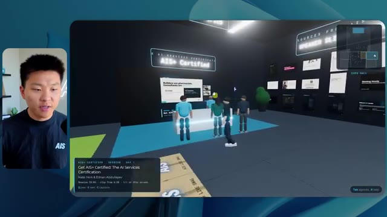
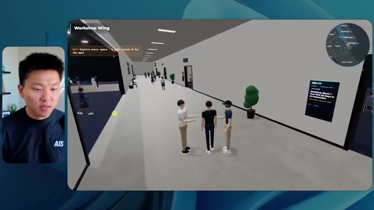

# 🎬 Claude Opus 5.5 is my video editor

> **Chaîne** : [Nate Herk | AI Automation](https://www.youtube.com/@nateherk/featured)  
> **Lien YouTube** : [https://www.youtube.com/watch?v=gNMN-7D9130](https://www.youtube.com/watch?v=gNMN-7D9130)  
> **Date de publication** : 20261016  
> **Durée** : 00:00:44  
> **Identifiant vidéo** : `gNMN-7D9130`  
> **Transcription & Analyse** : `whisper-v3-large-turbo+gemini-3.5-flash-lite`  

---

## 📌 Synthèse Exécutive & Outils

### 💡 Résumé
Dans cette vidéo intitulée **Claude Opus 5.5 is my video editor**, Nate Herk décortique les capacités pratiques d'automatisation et de développement propulsées par les modèles de pointe.

### 🛠️ Outils, Modèles & Logiciels Présentés
- **Opus 5.5 & Claude Code** : Modèles d'ingénierie et agents de codage autonome.

### 🔑 Points Clés & Enseignements Stratégiques
- Optimiser le niveau d'effort et le raisonnement des modèles IA pour des résultats industriels.
- Automatiser les cycles de création logicielle de bout en bout.

---

## ⏱️ Chronologie & Transcription Complète Audio & Visuelle (Mot pour Mot)

### ⏱️ `[00:00:00 - 00:00:20]` | Segment #01

**🔊 Audio (Transcription Intégrale Mot pour Mot en Français) :**
> Opus 5.5, Opus 5.5, Opus 5.5, Opus 5.5, Opus 5.5. This model is literally everywhere and for very good reason. It's smart, it's cheap, it has amazing taste, it is an incredible AI model. But with every AI model, you have a choice of effort, whether that be low, medium, high, extra, max, or ultra code.

**👁️ Analyse Visuelle d'Écran (gemini-3.5-flash-lite) :**
**Interface & Outils** : Plateforme de réseau social X.

**Contenu textuel & Code** : Texte du tweet : "It's a great time for hobbyists, bad time for professionals. This experiment has further cemented my view that technical creatives are about to experience a massive disruption."

**Action / Démonstration** : Présentation d'un contenu viral ou d'une expérimentation technique sur le réseau social pour illustrer l'impact de l'IA sur la création.

*⏱️ 00:00:05 — Capture d'écran d'une interface X (anciennement Twitter) affichant un tweet discutant de la disruption technologique, illustré par une vidéo intégrée montrant un environnement 3D stylisé (paysage côtier).*

---

### ⏱️ `[00:00:20 - 00:00:38]` | Segment #02

**🔊 Audio (Transcription Intégrale Mot pour Mot en Français) :**
> So in this video, I gave Opus 5.5 the same exact prompt and I ran it on every single effort level and we're gonna be comparing the results. We will look at the quality of all of the different actual outputs, But then we're also going to look at how long each one of these ran, how much it cost us if it was API billing, the total tokens, how many checks they ran, and how many questions they actually asked me throughout the process.

**👁️ Analyse Visuelle d'Écran (gemini-3.5-flash-lite) :**
**Interface & Outils** : Logiciel de type tableau blanc / gestion de projet (semblable à FigJam ou Miro).

**Contenu textuel & Code** : Tableau comparatif des performances de "Opus 5.5" avec les colonnes : Low, Medium, High, Extra, Max, Ultracode, et les lignes : Run time, API cost, Total tokens, Checks, Questions asked.

**Action / Démonstration** : Présentation du cadre d'analyse comparative pour évaluer les différents niveaux d'effort de l'IA.

*⏱️ 00:00:29 — Capture d'un tableau comparatif dans une interface de type tableau blanc (canvas) montrant les niveaux d'effort (Low, Medium, High, Extra, Max, Ultracode) et les métriques associées (Run time, API cost, Total tokens, etc.).*

---

### ⏱️ `[00:00:39 - 00:00:58]` | Segment #03

**🔊 Audio (Transcription Intégrale Mot pour Mot en Français) :**
> And the results that we got are not what I expected at all, so I can't wait to share this with you guys. Let's not waste any time and just get straight into this one. Okay, so let's jump right into this one. I want to start off just by showing you guys the actual prompt that we used that we gave to every single one of these different agents. I'm going to go into the files over here, and we're going to open up this prompt markdown file, and I'll show you what we got. So here is the slash goal that I fed in.

**👁️ Analyse Visuelle d'Écran (gemini-3.5-flash-lite) :**
**Interface & Outils** : Cursor / Opus 5.5 CLI

**Contenu textuel & Code** : Le prompt visible indique : "Hi Nate. This worktree has the effort-test task queued in PROMPT.md : build a walkable third-person 3D world of the AIS Live conference..."

**Action / Démonstration** : Initialisation d'une tâche de développement par l'agent IA basée sur le fichier PROMPT.md.

*⏱️ 00:00:48 — Interface de l'éditeur Cursor (ou outil similaire basé sur le modèle Opus 5.5) affichant une fenêtre de chat avec une tâche de développement liée à un projet 3D ("AIS Live conference").*

---

### ⏱️ `[00:00:58 - 00:01:34]` | Segment #04

**🔊 Audio (Transcription Intégrale Mot pour Mot en Français) :**
> I said, you need to create me a 3D world that is a realistic tech conference that I can walk around in third-person view. You will look at this folder, which is my event recording assets from AIS Live. And this folder is a frame IO folder of 105 gigabytes of video recordings. This was a completely virtual event. Everything was recorded and all of the recordings are right here. I said, your goal is to take this event and turn it into a 3D explorable world that makes me feel like I actually went to a real in-person conference with different rooms, different tracks, different stages, blah, blah, blah. Feel free to use key.ai if you need to generate any images or videos. And you can also use anything else inside of my Herc 2 project, which is like my AI operating system. I said,

**👁️ Analyse Visuelle d'Écran (gemini-3.5-flash-lite) :**
**Interface & Outils** : Éditeur de code (type VS Code), Frame.io (plateforme de partage de fichiers vidéo).

**Contenu textuel & Code** : Texte du prompt : "You need to create me a 3D world that is a realistic tech conference... You will look at this folder, which is my event recording assets from AIS Live."

**Action / Démonstration** : Présentation du cahier des charges (prompt) et des ressources (assets vidéo) nécessaires à l'IA pour générer l'environnement virtuel.

*⏱️ 00:01:07 — Éditeur de code affichant un fichier Markdown contenant le prompt détaillé pour la création d'un monde 3D.*

*⏱️ 00:01:16 — Interface de la plateforme Frame.io montrant le dossier "Sep 22, 2026" contenant 105 Go de fichiers vidéo de l'événement.*

*⏱️ 00:01:25 — Identique à l'image 1 : éditeur de code avec le prompt de développement pour l'agent IA.*

---

### ⏱️ `[00:01:34 - 00:02:08]` | Segment #05

**🔊 Audio (Transcription Intégrale Mot pour Mot en Français) :**
> you'll be judged on creativity, design, physics, and the overall feel as I explore the 3D world that you built. And that was basically the end of the instructions. So as you can see on this left-hand side, I ran this through all of the different effort levels. Let's start off with low and work our way up to ultra code. All right. So here we have the result from low. Let's open this up and take a look. So we have AIS live, AI services summit in person finally, and we were able to click around. First of all, this doesn't feel very branded. Like this isn't the IS Live logo. It's not even our colors. So I don't love that, but let's get in here. Okay. This is way too bright. Um, we have a map in the top, right? We have a city back here. I can't tell what city

**👁️ Analyse Visuelle d'Écran (gemini-3.5-flash-lite) :**
**Interface & Outils** : Cursor (éditeur de code IA).

**Contenu textuel & Code** : Liste des sessions de test d'effort ("Session logs cost analysis") incluant "Hello", "Extra", "High", "Max", "Ultracode", "Medium" et "Low" ; message de l'IA demandant confirmation pour lancer la construction d'un monde 3D.

**Action / Démonstration** : Le présentateur survole ou sélectionne le dossier "Low" dans la barre latérale pour tester les différents niveaux d'effort de l'IA.

*⏱️ 00:01:42 — Une vue de l'interface de l'environnement de développement "Cursor" montrant une barre latérale avec différents niveaux d'effort ("Low", "Medium", "High", "Max", "Ultracode") pour un projet nommé "effort-test".*

---

### ⏱️ `[00:02:08 - 00:02:40]` | Segment #06

**🔊 Audio (Transcription Intégrale Mot pour Mot en Français) :**
> this is. Okay. This is Chicago, which is kind of cool because you know, I live in Chicago, but anyways, on the top, right, we can see a map. We have a lobby. We have an expo hall. We have VIP lounge main stage. Also the map shows where every other person is and that's sinking live. So we can see registration. We can see day one, hyper agent keynote, live debrief. Cool. So it actually does know the agenda and then there's day two. So it found that that's good. We have these little balls in here that I can hopefully kick around. Okay. The face, Oh, look at this. If I go over here, all the people just disappear. Very bad. Very bad. Okay. So let's see. Can I sprint? Okay.

**👁️ Analyse Visuelle d'Écran (gemini-3.5-flash-lite) :**
**Interface & Outils** : Application de conférence virtuelle immersive (type Gather ou équivalent 3D).

**Contenu textuel & Code** : Noms des zones (Badge pickup, Lobby, Expo Hall, Main Stage, VIP lounge) et agenda journalier affiché sur un écran virtuel.

**Action / Démonstration** : Navigation et exploration de l'utilisateur à travers les différents espaces thématiques de l'événement virtuel avec visualisation en temps réel des autres participants sur la mini-carte.

*⏱️ 00:02:16 — Vue en perspective à la troisième personne d'un environnement virtuel type métavers avec une zone de "Badge pickup" et une mini-carte en haut à droite.*

*⏱️ 00:02:24 — Vue de la zone "Lobby" dans l'espace virtuel, affichant un panneau d'information avec l'agenda "DAY 1" et les différentes sections de la conférence.*

*⏱️ 00:02:32 — Vue de l' "Expo Hall" montrant des avatars d'utilisateurs interagissant autour d'éléments graphiques lumineux dans un espace de conférence virtuel.*

---

### ⏱️ `[00:02:40 - 00:03:04]` | Segment #07

**🔊 Audio (Transcription Intégrale Mot pour Mot en Français) :**
> I can move a little faster. I'll first go over here. There's some swag, um, AIS plus certified glido. Okay. So it's got the actual booths that we had in the virtual event. We had booths. So that's pretty cool. A little place to take pictures. Room C. Right now we have Tangy Frederick doing a workshop. Okay. But this isn't a video. As you can see, it's just an image. She's not moving. So that's just an image. These people are disappearing. They must be ghosts. Let's go over here to room A.

**👁️ Analyse Visuelle d'Écran (gemini-3.5-flash-lite) :**
**Interface & Outils** : Plateforme d'événement virtuel type métavers (navigation 3D).

**Contenu textuel & Code** : Guide textuel sur écran virtuel : "Step 1: Go to Settings", "Step 2: Go to API Integrations", "Step 3: Go to Create A New Token".

**Action / Démonstration** : Exploration de l'espace virtuel et interaction avec les stands et salles d'ateliers.

*⏱️ 00:02:46 — Vue d'une plateforme d'événement virtuel montrant le stand "Glaido" avec des objets 3D interactifs.*

*⏱️ 00:02:52 — Navigation dans la salle virtuelle "Workshop Room C" (Enterprise track) avec des espaces de présentation.*

*⏱️ 00:02:58 — Approche d'un écran géant à l'intérieur de l'espace virtuel affichant une procédure technique pour obtenir une clé API.*

---

### ⏱️ `[00:03:04 - 00:03:30]` | Segment #08

**🔊 Audio (Transcription Intégrale Mot pour Mot en Français) :**
> We have Liberty White. Okay. Very cool. Your first 30 days in automation. Once again, it's just a still image and the people are glitchy. So not very good here. I'm going to go over to the main stage and see what we've got going. Okay, cool. So we have a main looking stage. The people are glitching. Really bad. That's not very good at all. Our video is actually moving. Like I saw my face here and I saw Devin's, but now they're gone. So I'm not sure what happened. Okay. It's, it looks like it's more of a slideshow. Nothing is actually being played still. Anyways, let's come in here.

**👁️ Analyse Visuelle d'Écran (gemini-3.5-flash-lite) :**
**Interface & Outils** : Environnement de conférence virtuelle 3D / Metavers.

**Contenu textuel & Code** : Textes d'interface de navigation et titres de présentation ("AIS LIVE", "Hyperagent Workshop").

**Action / Démonstration** : Navigation et exploration d'un espace événementiel virtuel par un avatar.

---

### ⏱️ `[00:03:30 - 00:03:58]` | Segment #09

**🔊 Audio (Transcription Intégrale Mot pour Mot en Français) :**
> We have more booths. We have hyper agent. We have Claude Code. We have more swag. Room B is Dave Ebelor. I'm assuming it's the same exact thing. We've got coffee. And then I'm assuming VIP lounge, VIP access only. That's pretty cool, but there's really nothing going on right here. That screen's way too bright. Okay. So I think you guys understand the vibe that we're getting here from Opus 5.5 on low effort. And here's where things get interesting. How much do you guys think that this ran for? How long? This one ran for 16 minutes and 43 seconds. How much do you think this cost?

**👁️ Analyse Visuelle d'Écran (gemini-3.5-flash-lite) :**
**Interface & Outils** : Interface de type Canvas pour la gestion de modèles (Opus 5.5) et environnement virtuel 3D.

**Contenu textuel & Code** : Tableau comparatif affichant des colonnes de performance (Low, Medium, High, Extra, Max, Ultracode) croisées avec des métriques techniques (Run time, API cost, Total tokens, Checks, Questions asked).

**Action / Démonstration** : Présentation d'un tableau d'analyse comparative des efforts ou coûts liés aux différents niveaux de performance d'un modèle IA.

*⏱️ 00:03:51 — Interface de travail type "Canvas" ou tableau de bord intitulée "Opus 5.5 Efforts" présentant une matrice comparative.*

---

### ⏱️ `[00:03:58 - 00:04:26]` | Segment #10

**🔊 Audio (Transcription Intégrale Mot pour Mot en Français) :**
> $3.91 if this was API billing. I'm obviously using my subscription here, but we're just going to calculate this in API billing. Total tokens was 191,000. It did 22 checks. So the verification, 22 times it opened up the browser and ran different sorts of checks. So 22 categories of checks. And how many questions did it ask me? It asked me a total of zero questions throughout this slash goal prompt. Okay. So let's open up medium effort and see what we've got. Okay, here we go. Medium effort. We've got Nate Herc. We've got my badge. This is AI's life branded.

**👁️ Analyse Visuelle d'Écran (gemini-3.5-flash-lite) :**
**Interface & Outils** : Logiciel de création de diagrammes ou tableau blanc numérique (type FigJam ou équivalent).

**Contenu textuel & Code** : Tableau affichant les données suivantes : "Run time" (16m 43s), "API cost" ($3.91), "Total tokens" (191.3K), et des lignes pour "Checks" et "Questions asked".

**Action / Démonstration** : Le présentateur illustre les coûts et les ressources consommées par l'agent IA à travers une présentation visuelle structurée.

*⏱️ 00:04:05 — Une capture d'écran montrant l'interface d'un outil de design ou de tableau blanc numérique, avec un tableau récapitulatif des performances d'un agent IA (catégorie "Low").*

---

### ⏱️ `[00:04:26 - 00:04:46]` | Segment #11

**🔊 Audio (Transcription Intégrale Mot pour Mot en Français) :**
> So this is already looking a little bit better. This feels like our color schemes that used our brand guidelines. Day one build, day two earn, VIP. Cool. Okay. I'm going to enter the venue. Okay. Wow. So similar sort of vibe. It's sitting in the background. This doesn't look like Chicago though, does it? No, this looks like a, honestly, this looks like a made up city. Either way, it's funny that they decided to do that. Let's see if I can move a little faster. Oh, wow.

**👁️ Analyse Visuelle d'Écran (gemini-3.5-flash-lite) :**
**Interface & Outils** : Application web interactive basée sur un moteur de jeu 3D (type Gather.town ou similaire).

**Contenu textuel & Code** : Texte d'accueil "Welcome to AIS Live", instructions de contrôle clavier (WASD, Shift, E/Q, etc.) et informations sur la session (34 sessions chargées).

**Action / Démonstration** : Présentation de l'interface utilisateur de l'événement virtuel et transition vers l'exploration de l'espace 3D ("Enter the venue").

*⏱️ 00:04:31 — Interface d'accueil de la plateforme "AIS Live" affichant un badge virtuel au nom de Nate Herk avec des options de navigation par jour (Build, Earn, VIP).*

*⏱️ 00:04:41 — Vue immersive à l'intérieur de l'environnement virtuel 3D, montrant des avatars dans un espace avec une vue sur une ville nocturne.*

---

### ⏱️ `[00:04:46 - 00:05:21]` | Segment #12

**🔊 Audio (Transcription Intégrale Mot pour Mot en Français) :**
> The people are interacting with me. Watch. If I go up to this guy, he just like raised his arm. Well, now he doesn't want anything to do with me at all. But all of these little robots here must be making decisions. I'm not sure if they're using Jev. They're definitely not. I didn't tell it to. Actually, my Jev key is in the back. I don't know. Maybe it did use it. Anyways, we can see here we have Workshop Room C, Agents Lab. Nice. So this one is actually being run. You can see that is a real video being played by Tangy. Everyone here is actually like working on a laptop. They're not glitching. This is pretty cool. Also, my badge is on my chest, which is pretty cool. I can come this way. We have a map up in the top right, as you guys can see, but I can come this way. We have an

**👁️ Analyse Visuelle d'Écran (gemini-3.5-flash-lite) :**
**Interface & Outils** : Environnement de simulation virtuelle 3D (type métavers / espace de travail collaboratif).

**Contenu textuel & Code** : Interface utilisateur affichant "Workshop Block 3", "Enterprise AI Services", et des notifications de session ; mini-map en haut à droite.

**Action / Démonstration** : Navigation et exploration d'un environnement virtuel peuplé d'agents autonomes simulant une session de travail en entreprise.

*⏱️ 00:04:55 — Vue à la première personne dans un environnement virtuel 3D de type métavers représentant un couloir avec des personnages interactifs.*

*⏱️ 00:05:04 — L'avatar arrive dans une salle de conférence nommée "Agents Lab" où des personnages sont assis à des tables, avec une interface d'événement en bas à gauche.*

*⏱️ 00:05:12 — Vue panoramique intérieure de la salle de conférence "Agents Lab" montrant plusieurs avatars occupés à des tâches sur leurs ordinateurs portables virtuels.*

---

### ⏱️ `[00:05:21 - 00:05:47]` | Segment #13

**🔊 Audio (Transcription Intégrale Mot pour Mot en Français) :**
> expo hall. This is where we have the Glido booth. And this is actually playing. Yeah, it's playing the video of us talking about Glido. It's playing the video of Ed and I talking about our certification program. We've got the AIS Plus logo back here, which is kind of in a weird spot. This is a speaker slides and takeaways. So wow, this is all the resources that we gave out after the event. They're all sitting right there as well. We can see we've got a community spotlight. So this is Aiden talking about his deal that he landed and it's playing live. These people are watching.

**👁️ Analyse Visuelle d'Écran (gemini-3.5-flash-lite) :**
**Interface & Outils** : Environnement de conférence virtuel 3D (metavers type plateforme d'événements en ligne).

**Contenu textuel & Code** : Slides de présentation professionnelle, titres de sessions ("Get AIS+ Certified"), supports textuels de formation et interfaces de navigation événementielle.

**Action / Démonstration** : Navigation et interaction dans un hall d'exposition virtuel, exploration des ressources pédagogiques et des stands de présentation.

*⏱️ 00:05:28 — Vue en perspective d'un stand dans un environnement virtuel 3D avec des avatars, présentant un écran affichant "Builders are pharmacists" lié au programme de certification AIS+.*

*⏱️ 00:05:34 — Gros plan sur un mur de ressources dans l'espace virtuel affichant une galerie de diapositives de présentation et de supports pédagogiques ("Speaker Slides & Takeaways").*

*⏱️ 00:05:40 — Vue panoramique d'un espace de conférence virtuel (expo hall) montrant divers stands, des zones de travail avec des avatars et des panneaux informatifs numériques.*

---

### ⏱️ `[00:05:47 - 00:06:21]` | Segment #14

**🔊 Audio (Transcription Intégrale Mot pour Mot en Français) :**
> They're pretty engaged. We've got hyper agent. That was, that's what I meant. If you guys saw those people like raising their arms saying hi, that was kind of funny. Look, look, there he goes again. Anyways. Okay. Where am I now? Now I'm in the main lobby. We've got a coffee bar. We've got a big logo, which is the real logo. It's too bright, but we have the logo. We can see if we can come in here to the foundation track. We've got Sabrina Romanov and Liberty White. So different trainings right there. We can come into this room. This is the advanced track. So what's going on here. We've got Dave Ebelar and Saman talking about some different stuff in there. And now let's go take a look at the main stage. Oh, wait, there's a video of me up there. Is that like a VIP

**👁️ Analyse Visuelle d'Écran (gemini-3.5-flash-lite) :**
**Interface & Outils** : Plateforme événementielle virtuelle 3D (type métavers ou espace de networking virtuel).

**Contenu textuel & Code** : Interface utilisateur avec mini-carte (top-right), texte d'indication de lieu ("Main Lobby") et commandes de contrôle (Talk/Agenda/Help).

**Action / Démonstration** : Navigation et exploration de l'espace virtuel par le présentateur au sein de la simulation.

*⏱️ 00:05:55 — Vue à la première personne dans un environnement virtuel 3D montrant le "Main Lobby" avec un bar à café et des avatars d'utilisateurs.*

*⏱️ 00:06:04 — L'avatar se déplace vers une salle de conférence ou un espace de présentation peuplé d'autres avatars assis.*

*⏱️ 00:06:12 — Vue de l'avatar naviguant à travers une foule d'utilisateurs dans un espace événementiel virtuel interactif.*

---

### ⏱️ `[00:06:21 - 00:06:50]` | Segment #15

**🔊 Audio (Transcription Intégrale Mot pour Mot en Français) :**
> section? Yeah, we'll go check that out in a sec. But anyways, this is the main stage. This looks very, very nice. We've got a big stage. We've got like four people sitting up here. We've got the the three screens of Alex up there with hyper agent. Am I allowed to get on stage? Oh, and lets me up on stage. Okay. That's pretty nice. All right, guys, let's take a selfie. Let me get everyone in the background. Get in here. Anyways, that is pretty, pretty cool. Not every seat is filled though. So we need to work on that. But anyways, I'm going to run back over and see what that VIP section was. Okay. VIP lounge. I feel like this is like a worth the airport or something.

**👁️ Analyse Visuelle d'Écran (gemini-3.5-flash-lite) :**
**Interface & Outils** : Environnement de conférence virtuel (type métavers).

**Contenu textuel & Code** : Texte informatif sur la "Hyperagent Keynote" par Alex McDonnell.

**Action / Démonstration** : Navigation et déplacement d'un avatar dans un espace événementiel virtuel.

---

### ⏱️ `[00:06:51 - 00:07:14]` | Segment #16

**🔊 Audio (Transcription Intégrale Mot pour Mot en Français) :**
> Okay, cool. So now we've got the VIP sessions up here. VIP Q and a with Nate live video playback right here. Very, very cool. And we've got like a bar or something. Awesome. I would say that this is a pretty good output. Now, as far as the stats here, this one took one hour and 13 minutes to run. It would have cost us $12 and 44 cents. It used 490,000 tokens and it did 23 checks.

**👁️ Analyse Visuelle d'Écran (gemini-3.5-flash-lite) :**
**Interface & Outils** : Espace de réunion virtuelle (type métavers) pour l'Image 1 ; Application de suivi de données/Tableau de bord de projet pour l'Image 2.

**Contenu textuel & Code** : Image 1 : Interface de navigation de la session "VIP Q&A with Nate". Image 2 : Tableau comparatif de statistiques techniques (Run time: 16m 43s, API cost: $3.91, Total tokens: 191.3K, Checks: 22).

**Action / Démonstration** : Présentation du résultat visuel final de l'application dans un espace virtuel, suivie de l'analyse des performances techniques de l'exécution du modèle IA.

*⏱️ 00:06:56 — Vue d'un environnement virtuel immersif représentant une salle VIP avec un écran géant diffusant une vidéo de session Q&A.*

*⏱️ 00:07:02 — Tableau de bord récapitulatif des performances d'exécution intitulé "Opus 5.5 Efforts", présentant des métriques comme le temps d'exécution, le coût API et le nombre de tokens.*

---

### ⏱️ `[00:07:14 - 00:07:48]` | Segment #17

**🔊 Audio (Transcription Intégrale Mot pour Mot en Français) :**
> And it asked us a grand total of zero questions once again. All right, let's move on to high. This was already a pretty decent output and Anthropic themselves in their how to prompt Opus 5.5 video, or sorry, not video, article. They said to just start on medium and scale it up or down if you need. So that was a medium output. Let's move over to high and see what we got. Real quick, guys, I need to take a second to tell you about the sponsor of today's video, Hostinger. So both of these models just built me a working version of the same thing. And now I'm right where I always end up with something finished sitting on my laptop and no quick way to get it online. And that's the gap that Hostinger's connector closes. It's a free extension

**👁️ Analyse Visuelle d'Écran (gemini-3.5-flash-lite) :**
**Interface & Outils** : Image 1 : Interface de tableau blanc (probablement FigJam ou Miro). Image 2 : Éditeur de code Cursor avec interface d'agent IA intégrée.

**Contenu textuel & Code** : Image 1 : Données chiffrées sur l'efficacité des modèles IA. Image 2 : Prompt de création d'un outil de calcul de ROI en HTML statique et historique des logs de l'agent.

**Action / Démonstration** : Analyse comparative des coûts et des performances des modèles IA suivie d'une démonstration de génération de code par un agent dans Cursor.

*⏱️ 00:07:22 — Tableau comparatif affichant les performances de différents niveaux de prompt (Low, Medium, High, Extra) sur des métriques comme le temps d'exécution, le coût API, les tokens et le nombre de questions posées par l'IA.*

*⏱️ 00:07:39 — Interface de l'éditeur Cursor montrant l'agent IA en pleine phase de réflexion ("Ruminating...") pour le développement d'un calculateur de ROI (Northwind ROI calculator), avec le détail des étapes de travail dans le panneau de droite.*

---

### ⏱️ `[00:07:48 - 00:08:23]` | Segment #18

**🔊 Audio (Transcription Intégrale Mot pour Mot en Français) :**
> for your editor that pulls your Hostinger account into whatever you're already coding in. So VS Code, cursor, cloud code, codex, you name it. You sign in once with a single click, and from there, your agent can deploy the site, point a domain at it, set the DNS records, and check on your VPS without you ever having to leave the editor. So whichever one of these you end up liking better, the thing it built is a couple minutes away from a real URL on managed hosting. Connector is free on every hosting or plan, so if you still need the hosting underneath it, grab the unlimited plan with the link in the description and use code NATEHERK for 10% off. That also comes with a free domain and business email for the year. And it's still the cheapest way that I found to get something

**👁️ Analyse Visuelle d'Écran (gemini-3.5-flash-lite) :**
**Interface & Outils** : Interface de gestion d'intégration Hostinger (web/plugin) et terminal Claude Code.

**Contenu textuel & Code** : État "Connected", version "Node.js 24.13.0", et liste des outils avec cases à cocher pour la gestion des sites web, domaines, paiements et marketing.

**Action / Démonstration** : Validation de la connexion OAuth entre l'environnement de développement et les services Hostinger pour permettre le contrôle des infrastructures via l'agent IA.

*⏱️ 00:07:57 — Une interface de configuration d'intégration montrant la connexion réussie d'un compte Hostinger à un IDE, avec une liste d'outils disponibles (Websites, Domains, Subscriptions, Email Marketing) et le terminal Claude Code visible sur le côté droit.*

---

### ⏱️ `[00:08:23 - 00:08:47]` | Segment #19

**🔊 Audio (Transcription Intégrale Mot pour Mot en Français) :**
> you built onto a real URL. So let's get back to the video. Okay. Once again, very, very branded. This is even better of a loading screen than the previous one. We've got this nice little effect in the background. We've got the logo. We'll enter the venue. Okay. Here we are. This looks pretty nice. We start outside and you can see that we have these flags for all the speakers, Wyatt, Casper, Alex, Ed, Aiden, Sabrina, Liberty. This is pretty cool. We got live blocks here.

**👁️ Analyse Visuelle d'Écran (gemini-3.5-flash-lite) :**
**Interface & Outils** : Plateforme événementielle virtuelle interactive 3D (Type metaverse/web application).

**Contenu textuel & Code** : Interface utilisateur HUD (Heads-Up Display), mini-carte en haut à droite, liste des commandes de navigation (WASD, SHIFT, E, etc.), bannières textuelles.

**Action / Démonstration** : Chargement du logiciel, connexion à l'environnement virtuel, déplacement du personnage dans l'espace "Plaza" et interaction avec les éléments de l'événement.

*⏱️ 00:08:29 — Écran de chargement et d'accueil de la plateforme "AIS LIVE" avec le titre, la date de l'événement et les commandes clavier pour interagir.*

*⏱️ 00:08:35 — Vue à la première personne dans l'environnement virtuel "AIS Live Plaza" avec des personnages et une interface HUD montrant la localisation et le passeport.*

*⏱️ 00:08:41 — Exploration de l'espace virtuel "AIS Live Plaza" mettant en avant des bannières verticales avec les noms des intervenants et une navigation dans un monde 3D.*

---

### ⏱️ `[00:08:47 - 00:09:23]` | Segment #20

**🔊 Audio (Transcription Intégrale Mot pour Mot en Français) :**
> it took this picture from me, your host, Nate Herc, John, Dave, Nate Herc. There we go. Okay. The doors. Awesome. They're automatic sliding glass doors. I love that. We can see VIP check-in. We can see GA. We can come over here and we can check out the expo with different booths, community spotlight. You can also see that in the top left, I have a passport. So it's like, it will be showing how many of the places I've visited. All of these are real playback. We've got a resource wall with all of the different speakers. They've also got a networking session over here. So I'm going to come over real quick and see what that's all about. So we've got the AIS cold brew bar. We've got different community members that were spotlighted or highlighted.

**👁️ Analyse Visuelle d'Écran (gemini-3.5-flash-lite) :**
**Interface & Outils** : Environnement métavers/plateforme d'événement virtuel en 3D.

**Contenu textuel & Code** : Textes informatifs sur l'interface : "Registration Concourse", "MAIN STAGE", "Expo Hall", "Get AIS+ Certified".

**Action / Démonstration** : Exploration et navigation au sein d'un environnement virtuel immersif représentant une conférence ou une exposition.

*⏱️ 00:08:56 — Vue à la première personne dans un environnement virtuel 3D montrant le hall de réception d'un événement avec des comptoirs "GA" et "VIP CHECK-IN".*

*⏱️ 00:09:05 — Navigation dans une section "Expo Hall" de l'environnement virtuel, avec divers stands d'exposants et des avatars d'utilisateurs.*

*⏱️ 00:09:14 — Vue panoramique du hall de réception montrant des portes coulissantes automatiques et une foule d'avatars circulant dans l'espace.*

---

### ⏱️ `[00:09:23 - 00:09:56]` | Segment #21

**🔊 Audio (Transcription Intégrale Mot pour Mot en Français) :**
> We've got the VIP wing. Wait, what? Pick up a wristband. Oh, I have to actually go get the wristband. Okay. Let me check in real quick. Wristband's already on. Wait, what? Okay. Oh, okay. Now the doors have opened for me. Cool. I can come into here. Oh, that just goes to the main stage. VIP lounge. This is a Q and A going on. It looks like very cool. I mean, I'm very impressed by how it's able to do this. Wow. Okay. So this is really good. What we did is we had VIP breakout rooms with different people. You can see that there's different rooms, different members of the AIS team going into stuff. This is really cool. This is very cool. That's a much better VIP

**👁️ Analyse Visuelle d'Écran (gemini-3.5-flash-lite) :**
**Interface & Outils** : Environnement virtuel de conférence 3D type Gather ou plateforme métavers professionnelle.

**Contenu textuel & Code** : Menus d'interface utilisateur affichant "Registration Concourse", "VIP Lounge", et "VIP Working Sessions" avec des titres de séminaires comme "Land Your First Paying Client".

**Action / Démonstration** : Navigation et exploration de l'utilisateur à travers les différents espaces thématiques de la plateforme virtuelle.

*⏱️ 00:09:32 — Vue à la troisième personne dans un environnement virtuel 3D montrant le hall d'enregistrement d'un événement avec des avatars d'utilisateurs.*

*⏱️ 00:09:40 — Vue de l'intérieur d'un "VIP Lounge" virtuel avec un écran projetant une vidéo du présentateur et d'autres participants en appel.*

*⏱️ 00:09:48 — Vue d'une zone de travail "VIP Working Sessions" avec des sections thématiques affichées sur des écrans muraux et des groupes d'avatars en discussion.*

---

### ⏱️ `[00:09:56 - 00:10:30]` | Segment #22

**🔊 Audio (Transcription Intégrale Mot pour Mot en Français) :**
> experience than what was shown in the first piece. Okay. VIP after party. Look at this. We've got a dance floor. We've got all these elements in here. We have the actual VIP after party playback right here. And there's a DJ booth. That is so funny. There's a bit of a bug right here, a glitch right there, but this is awesome. Oh, cool. So when I'm in here in the main stage, we get closed captions. You can see right here in the bottom of my screen, we're getting these closed captions of Wyatt actually talking up here. We've got lights. We've got the panel. Very cool. Nice main stage. I'm going to go over here. We can go to the foundation,

**👁️ Analyse Visuelle d'Écran (gemini-3.5-flash-lite) :**
**Interface & Outils** : Plateforme d'événement virtuel (environnement 3D avec interface utilisateur de navigation, mini-carte et liste des participants).

**Contenu textuel & Code** : Interface graphique incluant : titres d'événement ("VIP After-Party", "Main Stage"), système de progression de passeport, commandes clavier (Move, Interact, Agenda), et flux vidéo incrustés dans l'espace 3D.

**Action / Démonstration** : Navigation et exploration de différents espaces virtuels (salle de fête et salle de conférence) au sein de la plateforme.

*⏱️ 00:10:04 — Vue à la première personne d'une plateforme d'événement virtuel montrant une piste de danse avec des avatars et un écran géant affichant les participants.*

*⏱️ 00:10:13 — Poursuite de la navigation dans l'espace virtuel « VIP After-Party » avec une vue plus large sur les avatars et l'écran de diffusion vidéo.*

*⏱️ 00:10:21 — Vue intérieure d'un auditorium virtuel « Main Stage » où des avatars sont assis devant une scène projetant une conférence en direct.*

---

### ⏱️ `[00:10:30 - 00:11:06]` | Segment #23

**🔊 Audio (Transcription Intégrale Mot pour Mot en Français) :**
> advanced, and the enterprise tracks over here. So let's see. We have anatomy of a three real deals. We've got hyper agent. We've got the evals with Nate and Ed in here. We've got Dave going on in the advanced stuff. This is really nice. I mean, obviously each, each of these outputs so far, low was okay. Medium was better. High has been even better. Let's see if that trend continues and let's go ahead and see what this cost us. So high ran for one hour and seven minutes. So a little bit quicker than medium, it would have cost us $16 and 31 cents. It used half a million tokens, 509,000. It did 22 checks. And it also asked us, well, actually, no, I was wrong. This

**👁️ Analyse Visuelle d'Écran (gemini-3.5-flash-lite) :**
**Interface & Outils** : Logiciel de création de diagrammes ou tableau blanc numérique (type FigJam ou similaire).

**Contenu textuel & Code** : Données quantitatives de performance IA : "Run time", "API cost", "Total tokens", "Checks", et "Questions asked" pour les niveaux Low, Medium, High et Extra.

**Action / Démonstration** : Analyse comparative et édition d'un tableau de données sur les efforts et coûts d'exécution de l'agent.

*⏱️ 00:10:57 — Tableau comparatif des performances (Opus 5.5 Efforts) affichant le temps d'exécution, le coût API, le nombre de jetons et les vérifications.*

---

### ⏱️ `[00:11:06 - 00:11:25]` | Segment #24

**🔊 Audio (Transcription Intégrale Mot pour Mot en Français) :**
> one asked me one question and spoiler, it was the only one that asked us a question throughout all of this. So let's see, we've got three left extra max and ultra code. Let me pull open extra and we'll see what we got. Okay. So this one looks pretty good. I would honestly say so far, the loading screen high was the best. The one that we just saw, but anyways, let's enter AIS live.

**👁️ Analyse Visuelle d'Écran (gemini-3.5-flash-lite) :**
**Interface & Outils** : Interface de travail type "Canvas" (probablement Claude ou outil similaire) affichant des métriques de performance.

**Contenu textuel & Code** : Tableau de données comparant "Run time", "API cost", "Total tokens", "Checks" et "Questions asked" pour les différentes versions des modèles.

**Action / Démonstration** : Le présentateur analyse les résultats du modèle "Extra" en comparant les données avec les colonnes précédentes.

*⏱️ 00:11:11 — Tableau comparatif des performances de modèles IA (Low, Medium, High, Extra) affiché dans une interface de type "Canvas" ou outil de suivi de projet.*

---

### ⏱️ `[00:11:26 - 00:11:51]` | Segment #25

**🔊 Audio (Transcription Intégrale Mot pour Mot en Français) :**
> Whoa. Okay. So we have like little sound bites. I can chat with people. The tool war panel settled a few debates for me. Nice. Good perspective there. We're outside again. We have these different banners, although they're all the same. They don't say like different people's names. So big AIS live logo. Workshop wing is over here. And let's go through the sliding glass doors and see what we've got. So we've got the AIS cafe. The map is in the bottom right, and it's not too descriptive.

**👁️ Analyse Visuelle d'Écran (gemini-3.5-flash-lite) :**
**Interface & Outils** : Environnement virtuel (application de conférence virtuelle ou métavers).

**Contenu textuel & Code** : Aucun contenu technique (code, terminal ou workflow) n'est affiché.

**Action / Démonstration** : Navigation et exploration d'un espace virtuel par un avatar.

---

### ⏱️ `[00:11:51 - 00:12:26]` | Segment #26

**🔊 Audio (Transcription Intégrale Mot pour Mot en Français) :**
> I like how the other maps have told us what, like where things were, but this one looks very professional. We can see here's the main stage. Let's hop in here real quick. They've all got these balls flying around, which I think is pretty funny. The AIS beach balls. We have me up there speaking. I think I was introing one of the days. Let's keep on moving here to the workshop room on this left side. Okay. So here we've got the Hyper Agent Theater. We've got this sponsored session in here by Hyper Agent, but it's showing us what's coming up in here as well. It's really funny that we can chat to people. Salmon built a voice sales rep live. The price it right room was packed. Did you grab the VIP companion guide? That's so funny. We have the advanced track in

**👁️ Analyse Visuelle d'Écran (gemini-3.5-flash-lite) :**
**Interface & Outils** : Environnement virtuel 3D multi-utilisateurs (type plateforme de conférence virtuelle).

**Contenu textuel & Code** : Interface utilisateur incluant une mini-map, des bulles de discussion (chat), et des panneaux d'information contextuels sur les sections de l'événement.

**Action / Démonstration** : Navigation et exploration de l'espace virtuel 3D, interaction entre avatars.

*⏱️ 00:12:00 — Vue d'ensemble de l'auditorium virtuel "Main Stage" avec un écran géant affichant le présentateur et un avatar se déplaçant dans la salle.*

*⏱️ 00:12:09 — Vue du "Grand Lobby" dans l'espace virtuel, montrant des avatars d'utilisateurs et des signalétiques pour des ateliers (Workshops).*

*⏱️ 00:12:17 — Vue intérieure d'un couloir dans l'environnement virtuel avec des avatars d'utilisateurs discutant et des panneaux indicateurs.*

---

### ⏱️ `[00:12:26 - 00:12:58]` | Segment #27

**🔊 Audio (Transcription Intégrale Mot pour Mot en Français) :**
> here. Once again, we've got live playback. Is that live playback? Oh, okay. It started once I got in, but I can take a seat. Oh my. I can watch this. I can stand up. I want to sit in the front. That's pretty cool. That's very nice. I like that. And you know what I noticed so far? The actual character that I'm playing kind of looks like me. I think it modeled it off of my thumbnail pictures or something. Anyways, we have Sabrina in here, room host here, grab any open seat. Okay, cool. And I really liked the sitting functionality. It's kind of funny. Like we could actually attend this workshop and participate. Anyways, it's showing us the speakers. It's showing us the

**👁️ Analyse Visuelle d'Écran (gemini-3.5-flash-lite) :**
**Interface & Outils** : Plateforme de conférence virtuelle immersive (style métavers pour événements professionnels).

**Contenu textuel & Code** : Interface web affichée sur l'écran géant virtuel, incluant des outils de gestion d'ateliers (Workshops), des flux vidéo de présentateurs et des barres d'outils d'application.

**Action / Démonstration** : Navigation au sein d'un environnement de conférence virtuelle 3D, visualisation de présentations en temps réel par les avatars des participants.

*⏱️ 00:12:34 — Vue d'une salle de conférence virtuelle (Advanced Track) avec des avatars d'utilisateurs et un écran géant affichant une interface de travail.*

*⏱️ 00:12:42 — Vue de la salle de conférence virtuelle (Foundation Track) avec un éclairage vert, montrant un écran de présentation axé sur la création de contenu IA.*

*⏱️ 00:12:50 — Gros plan sur l'écran de la salle virtuelle affichant une plateforme collaborative en ligne (type navigateur) avec des flux vidéo et des éléments d'interface utilisateur.*

---

### ⏱️ `[00:12:58 - 00:13:31]` | Segment #28

**🔊 Audio (Transcription Intégrale Mot pour Mot en Français) :**
> agenda. There's a little red carpet here to take some pictures. We can strike a pose. Oh, wow. That's pretty cool. Resource library, get AIS Plus certified, Glido, Hyper Agent, AIS Plus, three real deals. Awesome. I mean, I would definitely say so far, each one is getting better. And we didn't even check out the VIP section yet, the VIP lounge. Let's go up here real quick. Hopefully I can get in. Nice. We've got tooling reset. These are the different rooms we could go in. So once again, I could grab the worksheet and I could try to understand how to price my stuff. This is so cool. This is definitely better than the previous one where we kind of just

**👁️ Analyse Visuelle d'Écran (gemini-3.5-flash-lite) :**
**Interface & Outils** : Plateforme événementielle virtuelle immersive (type metaverse pour conférences).

**Contenu textuel & Code** : Noms des sponsors (Hyperagent, Glido), indications de zones (Expo Hall, Lobby, VIP Lounge, Workshops), questions de réflexion professionnelle ("What's your gut floor number?", "If you doubled your rate, what would change?").

**Action / Démonstration** : Navigation et exploration de l'espace virtuel, interaction avec les stands et participation à une session de travail de groupe (workshop) dans le salon VIP.

*⏱️ 00:13:07 — Vue panoramique de la salle d'exposition virtuelle (Expo Hall) avec des stands de sponsors comme Hyperagent et Glido.*

*⏱️ 00:13:15 — Vue du lobby principal de l'événement virtuel avec des escaliers, des panneaux de signalisation pour les "Workshops" et des avatars circulant.*

*⏱️ 00:13:23 — Vue intérieure du "VIP Lounge" où des avatars sont assis autour d'une table avec une interface de questions affichée à l'écran ("Price It Right" worksheet).*

---

### ⏱️ `[00:13:31 - 00:13:59]` | Segment #29

**🔊 Audio (Transcription Intégrale Mot pour Mot en Français) :**
> like looked at stuff. Awesome. I can get behind the bar and come in here. This is very nice. Okay. So as far as statistics go, this one ran for an hour and a half. It costs 25.92 bucks. I don't know why I say point $25, 92 cents. It was 733,000 tokens and 34 checks. So it had the most checks so far by far. And it asked us zero questions. I can't wait to see what we got here from max and ultra code. Okay. Here is max loading screens, boring, but it's on brand and it has our logo.

**👁️ Analyse Visuelle d'Écran (gemini-3.5-flash-lite) :**
**Interface & Outils** : Outil de diagramme/design (type Excalidraw ou similaire).

**Contenu textuel & Code** : Tableau comparatif affichant des données pour plusieurs niveaux de performance : "Medium" (1h 13m, $12.44, 419.2K tokens, 23 checks), "High" (1h 7m, $16.31, 509.3K tokens, 22 checks), et une colonne "Extra" en surbrillance (1h 31m).

**Action / Démonstration** : Le présentateur manipule visuellement un graphique à barres pour illustrer les statistiques de performance et de coût des différentes configurations d'agents IA testées.

*⏱️ 00:13:38 — Une capture d'écran montrant une interface de diagramme ou de tableau de bord intitulée "Opus 5.5 Efforts", présentant des métriques de performance comparatives (temps, coût, jetons, vérifications) pour différentes configurations nommées Medium, High, Extra, Max et Ultracode.*

---

### ⏱️ `[00:14:00 - 00:14:35]` | Segment #30

**🔊 Audio (Transcription Intégrale Mot pour Mot en Français) :**
> So that was good. I like that. We will go ahead and enter AIS live. Ooh, nice little animation here that brings us in. Once again, the character looks like me. They've all looked like me. I mean, sort of, we have sitting in the background. This looks like Chicago. Like I mentioned earlier, a lot of these are playing sounds and I'm not including that because it would be very distracting for you guys to try to listen to what's going on as well as me speaking. So there is like some slight music in all these. I hate how this is walking. This walking is really, really bad. I mean, the walking, yeah, I don't like this at all. So that's not great. But besides that, let's go in and explore. Notice these shadows when I walk in, they like really switch. I'm not sure why that is,

**👁️ Analyse Visuelle d'Écran (gemini-3.5-flash-lite) :**
**Interface & Outils** : Environnement virtuel 3D (Metaverse/Digital Event Space) avec HUD (Heads-Up Display) intégré.

**Contenu textuel & Code** : Interface de navigation et de conférence : "Arrival Plaza", "The Tool War Panel: What Actually Makes Money in 2026", mini-carte de localisation, liste des contrôles clavier en bas.

**Action / Démonstration** : Déplacement et exploration de l'avatar dans l'espace virtuel pour rejoindre une zone de conférence.

*⏱️ 00:14:08 — Vue à la troisième personne dans un environnement 3D de type métavers nommé "Arrival Plaza", montrant un personnage en tenue noire au milieu d'une place urbaine avec des bâtiments et des arbres.*

*⏱️ 00:14:17 — Le personnage se déplace vers un grand bâtiment moderne sur la droite, avec des panneaux indiquant "AIS LIVE" et des bannières publicitaires textuelles.*

*⏱️ 00:14:26 — Le personnage arrive devant l'entrée vitrée d'un hall d'exposition ("EXPO"), avec des interfaces utilisateur superposées (mini-carte en bas à droite et indicateurs de conférence en haut à droite).*

---

### ⏱️ `[00:14:35 - 00:15:11]` | Segment #31

**🔊 Audio (Transcription Intégrale Mot pour Mot en Français) :**
> but anyways, we can chat with people in here too. Hyperagent booth is right where you walk into the expo. All good. Okay, cool. I can keep clicking E to make them change what they say. We've got the speakers right here. That looks pretty good. Although we definitely had everyone's profile picture. So I'm not sure why that's not included there. We see people taking pictures right here. I love that. And it saves a little picture. Okay. The map also isn't super, like doesn't give me a great explanation of what's going on, but I like these booths. These are cool. I think these booths are the best that I've seen so far. Like they just look nice. They've got reps. There's nice like slides behind them. Yeah. These booths are cool. Okay. We have a little featured theater

**👁️ Analyse Visuelle d'Écran (gemini-3.5-flash-lite) :**
**Interface & Outils** : Plateforme événementielle virtuelle interactive (métavers/espace de conférence en ligne).

**Contenu textuel & Code** : Menus d'interface (réception, agenda, carte), noms des intervenants et titres de panels ("The Tool War Panel"), et noms des stands thématiques.

**Action / Démonstration** : Déplacement de l'avatar, interaction avec des points de discussion, et capture d'images souvenirs au sein de l'environnement virtuel.

*⏱️ 00:14:44 — Vue à la première personne dans un environnement virtuel 3D représentant un hall de réception avec des avatars et des panneaux d'affichage d'informations sur les intervenants.*

*⏱️ 00:14:53 — L'avatar de l'utilisateur se trouve dans le hall de réception, une petite fenêtre incrustée montre une photo prise devant un panneau "AIS LIVE", illustrant l'interaction sociale dans l'espace virtuel.*

*⏱️ 00:15:02 — Navigation dans le "Expo Hall" virtuel montrant différents stands dédiés à des thématiques comme "Evals Lab" et "Enterprise AI", avec des avatars circulant dans l'espace.*

---

### ⏱️ `[00:15:11 - 00:15:35]` | Segment #32

**🔊 Audio (Transcription Intégrale Mot pour Mot en Français) :**
> going on over here. It's Casper. Although why is this not playing? I feel like this should be playing, right? Like in the other ones, they were always playing. We can talk to some other people over here. Coffee's free. Blah, blah, blah. Amy Simpson, Matt Wolf. Nice. Okay. This is just the networking area that we're in right now, but we can see in the top right. We can also see what's live on the main stage right now. It is a tool war panel. So let's head in here. We've got Devin, Cole, Dave, and Russ chatting in here. We've got sort of AV, some light stuff going on back here.

**👁️ Analyse Visuelle d'Écran (gemini-3.5-flash-lite) :**
**Interface & Outils** : Plateforme de conférence ou salon professionnel virtuel (type environnement métavers).

**Contenu textuel & Code** : Aucun code source, terminal ou interface logicielle technique ; uniquement une interface de navigation 3D de type jeu vidéo (HUD avec commandes WASD/Shift/Space).

**Action / Démonstration** : Navigation et exploration de l'utilisateur dans l'espace virtuel par son avatar.

---

### ⏱️ `[00:15:36 - 00:15:55]` | Segment #33

**🔊 Audio (Transcription Intégrale Mot pour Mot en Français) :**
> Switch the main stage to what actually matters right now. So I can switch the topic. Cool. So I just switched to me and Matt. We can go to anatomy of three real deals. That's pretty cool. The stage looks good. We've got a nice little panel up here. Can I get on the stage? Nice. Nice. Well, I can't go too far, actually. All right, everyone, let me take the selfie. Everyone get in this. I can also take a seat in this audience over here and just enjoy the session.

**👁️ Analyse Visuelle d'Écran (gemini-3.5-flash-lite) :**
**Interface & Outils** : Environnement virtuel de conférence/webinaire interactif (type métavers).

**Contenu textuel & Code** : Interface utilisateur de contrôle de conférence virtuelle, incluant des commandes de mouvement (WASD), une mini-carte, et des titres de session.

**Action / Démonstration** : Navigation et interaction de l'utilisateur dans l'espace virtuel pour préparer la transition vers le segment "Anatomy of Three Real Deals".

---

### ⏱️ `[00:15:55 - 00:16:14]` | Segment #34

**🔊 Audio (Transcription Intégrale Mot pour Mot en Français) :**
> Very cool, very cool. Okay, let's go over here. I see an upstairs section. So it's funny how they all choose to put the VIP section upstairs. I mean, I don't hate it. Oh my gosh, they have an escalator. No way. I'm gonna chat with this guy on the escalator. Glenn has 15 years of agency experience. His land and expand stuff was gold. Great work, Glenn. Cool, so I'm gonna, I can't even get past this guy though.

**👁️ Analyse Visuelle d'Écran (gemini-3.5-flash-lite) :**
**Interface & Outils** : Environnement virtuel de conférence (plateforme événementielle métavers).

**Contenu textuel & Code** : Texte contextuel dans une bulle de dialogue : "Glenn has 15 years of agency experience. His land-and-expand stuff was gold."

**Action / Démonstration** : Navigation de l'avatar dans l'espace virtuel et interaction contextuelle pour afficher le profil d'un autre utilisateur.

*⏱️ 00:16:00 — Vue à la première personne d'un environnement virtuel de type conférence, montrant un hall d'accueil avec des avatars d'utilisateurs.*

*⏱️ 00:16:04 — L'avatar s'approche d'un escalier mécanique menant au niveau "VIP", situé dans l'environnement virtuel.*

*⏱️ 00:16:09 — L'avatar est sur l'escalier mécanique derrière un autre participant ; une bulle de dialogue affiche les informations professionnelles de cet utilisateur.*

---

### ⏱️ `[00:16:14 - 00:16:48]` | Segment #35

**🔊 Audio (Transcription Intégrale Mot pour Mot en Français) :**
> Oh, I had to jump over him. Okay, VIP level, badge required. Oh my gosh. Are you kidding me? I have to go get my badge. Okay, cool. Now it shows that I'm an actual VIP and I can go up here to the VIP section. We have nice little working sessions back there, which we can hop in. I wonder if it'll let me like sit down in here. I can just chat. Can I participate? It's not letting me sit and participate. That's okay. We've got the pricing war room. Oh, this might be the after party. Let's go see what's going on back here. Or maybe I just have to enter from over here. Okay. That's weird. I just had to enter from over here. This after party is not as cool as the other one. But anyways, let's go see what's going on back here

**👁️ Analyse Visuelle d'Écran (gemini-3.5-flash-lite) :**
**Interface & Outils** : Plateforme d'événement virtuel 3D (type environnement de métavers collaboratif).

**Contenu textuel & Code** : Texte affiché : "Nate Herk", "VIP", "Day 1 - Scope to Ship", "Anatomy of Three Real Deals", "Pricing War Room".

**Action / Démonstration** : Navigation et exploration de l'utilisateur au sein de l'espace virtuel pour accéder à la section VIP et aux zones de travail.

*⏱️ 00:16:23 — Vue d'un environnement virtuel de conférence avec un avatar se déplaçant près d'un escalier ; une interface utilisateur affiche les informations du profil "Nate Herk" avec le statut "VIP".*

*⏱️ 00:16:31 — Intérieur d'une salle de réunion virtuelle montrant plusieurs avatars assis autour d'une table, avec des bulles de dialogue affichant du texte sur l'écran.*

*⏱️ 00:16:39 — Vue d'un espace de type "VIP Exclusive" dans le monde virtuel, incluant un comptoir et une affiche sur le mur mentionnant "Pricing War Room".*

---

### ⏱️ `[00:16:48 - 00:17:07]` | Segment #36

**🔊 Audio (Transcription Intégrale Mot pour Mot en Français) :**
> in the workshops. Okay. That was not good. Look at this. You can see everything and I just glitched and now boom. So that's not good. I would say overall, I mean, you guys are getting the vibe of how this works, but I would say that the one before, which was, I believe high, I liked that one better. I can't sit in these chairs either. Yeah. So I don't like the walking in this one.

**👁️ Analyse Visuelle d'Écran (gemini-3.5-flash-lite) :**
**Interface & Outils** : Environnement de conférence virtuelle 3D (Metaverse événementiel).

**Contenu textuel & Code** : Panneaux informatifs sur les sessions ("Anatomy of Three Real Deals", "How to build an always-on fleet of agents"), bulles de texte au-dessus des avatars ("Devin's closing keynote had 264 AI services deals in Q1 2026 alone").

**Action / Démonstration** : Navigation et exploration de l'utilisateur (avatar) au sein d'une conférence virtuelle pour assister à des ateliers techniques sur l'automatisation IA.

*⏱️ 00:16:53 — Vue à la première personne dans un environnement virtuel 3D représentant le "Workshop Wing", avec un avatar se déplaçant dans un couloir.*

*⏱️ 00:16:57 — L'avatar s'approche de l'entrée de la "Room C" dans l'espace virtuel, affichant une interface d'événement en temps réel.*

*⏱️ 00:17:02 — Vue intérieure de la "Room C - HyperAgent Lab" avec des avatars assis devant des ordinateurs et des présentations projetées sur les murs.*

---

### ⏱️ `[00:17:07 - 00:17:43]` | Segment #37

**🔊 Audio (Transcription Intégrale Mot pour Mot en Français) :**
> I don't like the vibe as much and there's some bugs. So, so far, if we want to go to our list, I like extra extra was the one that I liked the most so far. But anyways, this one was max. This one was max right here. So let's see how long this ran for two hours and 28 minutes. So it ran for a long time, $50 and 38 cents, 1.18 million tokens. So it actually hit a compaction and had to auto compact. And then it did 51 checks. Did it really though? Cause there was a lot of bugs in there. And anyways, this one asked us zero questions. So, so far each time pretty much has gotten more expensive and took longer besides right here. But these basically

**👁️ Analyse Visuelle d'Écran (gemini-3.5-flash-lite) :**
**Interface & Outils** : Application de tableau blanc collaboratif ou outil de gestion de projet (type FigJam ou similaire).

**Contenu textuel & Code** : Tableau présentant des métriques pour chaque modèle : temps d'exécution (ex: 1h 13m), coût financier (ex: $12.44), jetons/données traitées (ex: 419.2K), et deux autres lignes de statistiques (compteurs 23, 22, 34 et 0, 1, 0). Les colonnes "Max" et "Ultracode" sont vides de données numériques et affichent des blocs bleus.

**Action / Démonstration** : Le présentateur commente les résultats du test de performance, en se concentrant sur les colonnes "Extra" et "Max".

*⏱️ 00:17:16 — Un tableau comparatif des performances de différents modèles d'IA (Medium, High, Extra, Max, Ultracode) affiché sur un canevas numérique.*

---

### ⏱️ `[00:17:43 - 00:18:17]` | Segment #38

**🔊 Audio (Transcription Intégrale Mot pour Mot en Français) :**
> took like very similar amount of time, but every time it's used more tokens because they've been thinking more. And then, you know, those tokens are going to cost more. But anyways, let's move on to the final one, which is ultra code. So we would really hope that this one is the best one. So let's hop into this local host and see what we've got. Okay, cool. Look at this badge. It's a nice badge host all access. We've got a nice little visual right here. We'll go ahead and enter AIS Live. Cool. Okay. Welcome in, Nate. I like the walking. It feels realistic. I like the logo, although it's missing the little red dot that makes it look like live. The map in the top right

**👁️ Analyse Visuelle d'Écran (gemini-3.5-flash-lite) :**
**Interface & Outils** : Tableau de données de performance (type Miro ou document collaboratif) ; Environnement de jeu ou simulation 3D.

**Contenu textuel & Code** : Tableau avec colonnes "High", "Extra", "Max", "Ultracode" et lignes de statistiques (durée, prix, volume de tokens) ; Interface utilisateur de "AIS LIVE" (Registration & Lobby).

**Action / Démonstration** : Présentation comparative des résultats analytiques des modèles ; Navigation ou démonstration de l'interface du projet AIS LIVE.

*⏱️ 00:17:52 — Tableau comparatif des performances de différents modèles (High, Extra, Max, Ultracode) affichant le temps, le coût, le nombre de tokens et d'autres métriques.*

*⏱️ 00:18:09 — Vue à la troisième personne d'un environnement virtuel interactif type "métavers" intitulé "AIS LIVE" avec des avatars se déplaçant dans un hall d'accueil.*

---

### ⏱️ `[00:18:17 - 00:18:49]` | Segment #39

**🔊 Audio (Transcription Intégrale Mot pour Mot en Français) :**
> is labeled a little bit better, so I can see what's going on. I'm going to come in here and collect my VIP wristband real quick. Okay, nice. It's also telling me what to do. So in the top left, it says scan in at the VIP gate at the lobby east wall. So I believe east would be this way, right? Never eat soggy waffles. Yeah. VIP wings, scan wristband. Okay, cool. Now I'm in the VIP section. I can see these different rooms. The tooling reset. Live video is being played. I'm able to see the closed captions right there of what's being talked about. It's also playing the sounds, but I'm just not playing the audio for you guys because I don't want to overwhelm.

**👁️ Analyse Visuelle d'Écran (gemini-3.5-flash-lite) :**
**Interface & Outils** : Environnement de conférence virtuel interactif (type métavers professionnel).

**Contenu textuel & Code** : Interface utilisateur affichant des objectifs de navigation en temps réel ("Scan in at the VIP gate", "Grab an entry seat at the Main Stage") et une mini-carte (top-right).

**Action / Démonstration** : Navigation et exploration de l'environnement virtuel pour remplir des missions, incluant l'accès à des zones restreintes et la participation à une session de travail.

*⏱️ 00:18:25 — L'avatar du présentateur se déplace dans un hall d'exposition virtuel nommé "Registration & Lobby", avec une consigne affichée en haut à gauche pour scanner son badge VIP.*

*⏱️ 00:18:33 — L'avatar franchit une entrée marquée "VIP Wing", confirmant l'accès à un nouvel espace virtuel. Une notification indique la prochaine étape : se rendre à la scène principale.*

*⏱️ 00:18:41 — L'avatar est arrivé dans une salle de réunion virtuelle intitulée "VIP Room 5 - Tooling Reset / Solo to Real Business", où des participants sont assis autour d'une table.*

---

### ⏱️ `[00:18:50 - 00:19:08]` | Segment #40

**🔊 Audio (Transcription Intégrale Mot pour Mot en Français) :**
> Once again, this one's working with Cody and Mustafa in there. That's awesome. Live video. The video doesn't play until you walk in though. So honestly, I think that's a good call. As soon as I walk in though, the video starts. Nice. Nice touch. All these rooms. Awesome. Yeah. I mean, this feels very premium. Here's a pricing war room. Let's hop in here. Me and John in there.

**👁️ Analyse Visuelle d'Écran (gemini-3.5-flash-lite) :**
**Interface & Outils** : Plateforme d'événement virtuel ou metaverse interactif.

**Contenu textuel & Code** : Interface utilisateur avec mini-carte en haut à droite, titres des zones ("VIP Wing", "Price It Right - First 10 Clients Plan") et indications de navigation textuelles.

**Action / Démonstration** : Exploration de l'espace virtuel et interaction de proximité déclenchant l'activation d'un contenu multimédia (vidéo).

*⏱️ 00:18:54 — Vue d'un environnement virtuel interactif dans le "VIP Wing" où un avatar s'approche d'une salle de réunion déclenchant la lecture automatique d'une vidéo sur un écran mural.*

---

### ⏱️ `[00:19:08 - 00:19:42]` | Segment #41

**🔊 Audio (Transcription Intégrale Mot pour Mot en Français) :**
> And then we have nice the after party. This after party is not as busy yet. And we have more beach balls for some reason, but this after party is cool. I mean, it gives us the good vibe and there's the playback right here of our after party Q and a, this is all live as well. Sweet. Okay. Let's head into the main stage. It's also prompting me to grab an aisle seat at the main stage, which is straight through the expo. So actually let's go through the expo first. What are you building. There's a lot of people talking about different things over here. Wow. There's also like a little, a basketball thing. Can I throw it? I can. Do I have to look up to throw it up? Okay.

**👁️ Analyse Visuelle d'Écran (gemini-3.5-flash-lite) :**
**Interface & Outils** : Environnement virtuel immersif de type métavers ou plateforme de conférence en ligne (type Gather.town ou similaire).

**Contenu textuel & Code** : Textes informatifs sur l'interface : "VIP Lounge & After-Party", "Expo Hall", "Grab an aisle seat at the Main Stage", et annotations sur le mur d'exposition.

**Action / Démonstration** : Navigation et exploration de différents espaces de l'événement virtuel par l'avatar du présentateur.

*⏱️ 00:19:17 — Vue d'une salle de réception virtuelle (After-party) avec des avatars sur une piste de danse et un écran affichant des participants en direct.*

*⏱️ 00:19:25 — Navigation dans un couloir virtuel nommé "VIP Wing" menant vers une salle de conférence, avec une mini-carte en haut à droite.*

*⏱️ 00:19:34 — Exploration de l' "Expo Hall" contenant un grand panneau interactif rempli de notes autocollantes (Post-it) numériques.*

---

### ⏱️ `[00:19:42 - 00:20:08]` | Segment #42

**🔊 Audio (Transcription Intégrale Mot pour Mot en Français) :**
> Well, not great. But anyways, we have an AIS plus booth. We have the Glido booth. Is that playing live? Yeah, that definitely is playing live. Nice. We have the hyper agent booth. We have other stuff over here. Okay, cool. I'm going to go into the main stage and see if we can grab an aisle seat. As soon as we walk in, everything starts playing. We've got a very nice stage vibe. How do I grab an aisle seat though. There we go. I had to find the right one. Grab the aisle seat. There's no one on the stage, which is weird. I liked when they had people on the stage in the past versions.

**👁️ Analyse Visuelle d'Écran (gemini-3.5-flash-lite) :**
**Interface & Outils** : Environnement virtuel de conférence (type plateforme métavers d'événement).

**Contenu textuel & Code** : Textes d'interface utilisateur : "Expo Hall", "Main Stage", "Grab a seat", et instructions de navigation pour l'utilisateur.

**Action / Démonstration** : Navigation et déplacement de l'avatar dans une simulation 3D pour rejoindre une conférence en direct.

---

### ⏱️ `[00:20:08 - 00:20:31]` | Segment #43

**🔊 Audio (Transcription Intégrale Mot pour Mot en Français) :**
> Let's take a quick selfie. Anyways, we got me and Pat up there. Pat is all dressed up like a construction worker. As you can see, we were doing a little mock discovery call in that example. I'm going to come back through the expo and we're going to go out here to the workshop wing and just check out if these rooms basically are the exact same as they should. Now I can't actually chat with people. I used to be able to, in the previous versions, chat with people, which I thought was a really nice touch. And we have workshop a foundation track. Can I sit down?

**👁️ Analyse Visuelle d'Écran (gemini-3.5-flash-lite) :**
**Interface & Outils** : Plateforme de conférence virtuelle/metavers « AIS LIVE ».

**Contenu textuel & Code** : Interface utilisateur de simulation avec mini-carte en haut à droite, indicateur « Spaces Explored », et noms d'événements affichés à l'écran.

**Action / Démonstration** : Navigation active dans l'espace virtuel pour explorer les différentes zones de l'événement (Main Stage, Expo Hall, Workshop Wing).

*⏱️ 00:20:14 — Vue d'un environnement virtuel immersif type conférence (« Main Stage ») avec des avatars d'utilisateurs assis et une scène éclairée.*

*⏱️ 00:20:20 — Navigation dans le « Expo Hall » de la plateforme virtuelle, montrant des stands et des avatars en interaction.*

*⏱️ 00:20:25 — Vue à la première personne dans un couloir intitulé « Workshop Wing » avec des avatars se déplaçant dans l'espace virtuel.*

---

### ⏱️ `[00:20:32 - 00:21:04]` | Segment #44

**🔊 Audio (Transcription Intégrale Mot pour Mot en Français) :**
> I can't sit down. I don't know. We do have Liberty actually talking right now and she is speaking and we can hear it. So that's nice, but it's not letting me sit down. And look at this. I'm getting pretty glitchy right here. That was glitching the way I was walking. It like wasn't letting me walk. That's not good. Same thing. We got this advanced track in there. Awesome. So overall, they have a very similar vibe. I will say I'm impressed by the way they were able to tell a story out of what we were doing. Speaker takeaways library. Okay. This is cool. I don't think we saw this from different places, but these are like the resources and showing some cool stuff. Oh, wow. I

**👁️ Analyse Visuelle d'Écran (gemini-3.5-flash-lite) :**
**Interface & Outils** : Environnement virtuel immersif (type métavers de formation).

**Contenu textuel & Code** : Textes contextuels affichés à l'écran : "Workshop A - Foundation Track", "Workshop B - Advanced Track", "Speaker Takeaways Library", ainsi que des sous-titres de dialogue ("All right.", "in whatever programming language...", "One problem.").

**Action / Démonstration** : Navigation et exploration de l'utilisateur à travers différents espaces d'apprentissage virtuels, avec des problèmes de latence ou de collision mentionnés par le présentateur.

*⏱️ 00:20:40 — L'avatar du présentateur se tient devant une porte dans un environnement virtuel étiqueté "Workshop A - Foundation Track".*

*⏱️ 00:20:48 — Vue intérieure d'une salle de classe virtuelle nommée "Workshop B - Advanced Track" avec des sièges et des écrans.*

*⏱️ 00:20:56 — Vue de l'espace "Speaker Takeaways Library" dans l'environnement virtuel avec des avatars et des panneaux d'affichage.*

---

### ⏱️ `[00:21:04 - 00:21:41]` | Segment #45

**🔊 Audio (Transcription Intégrale Mot pour Mot en Français) :**
> can actually open all of these things and we can take pictures right here as well. Nice. Take a photo. I can save this as well. Like I can actually download this. And now we have this photo that we just took at this AIS live event. All right. Well, I think it is time for me to make some conclusions, but first let us see what this run cost us. This took a one hour and 35 minutes. So it was much faster than max. It only took $18 and 69 cents. Wow. So it was a little bit more expensive than high, cheaper than extra and much cheaper than max. It also ran 606,000 tokens and 42 checks with zero questions. Now, one other thing that's interesting to note is that all of

**👁️ Analyse Visuelle d'Écran (gemini-3.5-flash-lite) :**
**Interface & Outils** : Visionneuse d'images Windows (Image 1) et outil de diagramme/design type Excalidraw (Image 2).

**Contenu textuel & Code** : Photo de deux avatars sous un logo "AIS LIVE" (Image 1) ; Tableau de données chiffrées incluant des durées et des montants financiers (Image 2).

**Action / Démonstration** : Le présentateur illustre la possibilité d'ouvrir, visualiser et manipuler des fichiers générés au sein de l'environnement IA (Image 1), puis passe en revue des données comparatives structurées (Image 2).

*⏱️ 00:21:13 — Visualisation d'une photo capturée dans un environnement virtuel "AIS Live" montrant deux avatars sur un tapis rouge.*

*⏱️ 00:21:22 — Interface de création de diagramme montrant un tableau comparatif de performances ("Opus 5.5 Efforts") avec des colonnes de données techniques.*

---

### ⏱️ `[00:21:41 - 00:22:13]` | Segment #46

**🔊 Audio (Transcription Intégrale Mot pour Mot en Français) :**
> these runs, none of them used a sub agent. I looked through and I made sure none of them used sub agents. They didn't want to delegate any work around, which was interesting. So these tokens are what was reflected inside of that session. Obviously, like I said, this one went over, you know, 950K, so, or whatever the compaction window is. I never usually let it get that high, but because this was a slash goal and I wasn't involved, this one had to compact, but the rest of them just ran in this one session. And these are the overall stats. And also real quick on the UltraCode stuff, guys, I don't know if you've been noticing this, but when I've been running UltraCode lately, it's just felt weird. It's felt a little buggy. I, a couple of times I've ran it

**👁️ Analyse Visuelle d'Écran (gemini-3.5-flash-lite) :**
**Interface & Outils** : Tableau de données dans une interface de type tableau blanc (probablement Miro ou FigJam).

**Contenu textuel & Code** : Données chiffrées comparant six catégories : Low, Medium, High, Extra, Max, et Ultracode. On y voit par exemple pour "Max" un temps de 2h 28m, un coût de 50,38 $ et 1,18 million de tokens.

**Action / Démonstration** : Présentation visuelle des métriques de performance des agents pour justifier l'analyse des coûts et de la consommation de tokens lors des runs.

*⏱️ 00:21:49 — Tableau comparatif des performances de différents niveaux de modèles ("Opus 5.5 Efforts") affichant le temps d'exécution, le coût API, le nombre total de tokens, le nombre de vérifications et le nombre de questions posées.*

---

### ⏱️ `[00:22:13 - 00:22:34]` | Segment #47

**🔊 Audio (Transcription Intégrale Mot pour Mot en Français) :**
> and been like, is it even running UltraCode? It did quite a few more checks than these other ones, but for some reason it just didn't feel right because essentially what UltraCode is, is it's extra effort and then it's just like using more dynamic workflows in order to do things. And so through all my digging on the session logs and even when I was watching this thing build in UltraCode, it wasn't spinning up any of these dynamic workflows and I tried this a few times.

**👁️ Analyse Visuelle d'Écran (gemini-3.5-flash-lite) :**
**Interface & Outils** : Logiciel de création de diagrammes (type FigJam ou Miro).

**Contenu textuel & Code** : Tableau présentant les métriques "Run time", "API cost", "Total tokens", "Checks" et "Questions asked" pour les niveaux Low, Medium, High, Extra, Max et Ultracode.

**Action / Démonstration** : Présentation visuelle des statistiques de performance pour justifier l'efficacité relative de l'option "Ultracode".

*⏱️ 00:22:18 — Tableau comparatif des performances de différents niveaux d'effort (Low à Ultracode) pour un agent IA nommé "Opus 5.5 Efforts".*

---

### ⏱️ `[00:22:35 - 00:23:00]` | Segment #48

**🔊 Audio (Transcription Intégrale Mot pour Mot en Français) :**
> So I don't know if that's a bug right now in the CloudCode harness or if it's just with Opus 5.5, it's a little bit worse with UltraCode right now or something, but either way, these are the actual bulk effort levels and this all seems to make a lot of sense when you kind of look through how they progress. So let's take a look at this. Max cost versus low, we had 12.9X on the cheapest run compared to the most expensive run, which I believe was $3.98 to $50.38.

**👁️ Analyse Visuelle d'Écran (gemini-3.5-flash-lite) :**
**Interface & Outils** : Application de prise de notes ou tableau blanc virtuel (type Obsidian Canvas ou similaire).

**Contenu textuel & Code** : Tableau de données techniques intitulé "Opus 5.5 Efforts" incluant : Run time, API cost, Total tokens, Checks et Questions asked pour les catégories Low, Medium, High, Extra, Max et Ultracode.

**Action / Démonstration** : Le présentateur analyse les métriques affichées pour comparer l'efficacité et les coûts entre les différents modes d'exécution de l'agent.

*⏱️ 00:22:41 — Tableau comparatif des performances et coûts de différents niveaux d'effort ("Low" à "Ultracode") pour Opus 5.5, affiché dans une interface de prise de notes.*

---

### ⏱️ `[00:23:01 - 00:23:19]` | Segment #49

**🔊 Audio (Transcription Intégrale Mot pour Mot en Français) :**
> So that was low and max. As far as max checks versus low, we had a 2.3X multiple. The total across all six was 127 bucks and ultra code was $18.69. Let's look at speed versus cost here. So let me zoom out a little bit so we can see this whole thing. So on the X axis, we have runtime. In the Y axis, we have cost.

**👁️ Analyse Visuelle d'Écran (gemini-3.5-flash-lite) :**
**Interface & Outils** : Tableau de bord d'analyse de données (interface web personnalisée).

**Contenu textuel & Code** : Les données affichées incluent : "12.9x Max cost vs Low", "2.3x Max checks vs Low", "$18.69 Ultracode cost, 42 checks", et "$127.65 Total across all six". Le texte explicatif mentionne que six sessions ont été exécutées avec des réglages d'effort différents.

**Action / Démonstration** : Présentation des résultats de test comparant les coûts et l'efficacité des réglages d'effort (Low vs Max) et de l'Ultracode.

*⏱️ 00:23:05 — Une interface de tableau de bord de test intitulée "Opus Effort Test" présentant des métriques comparatives sur les performances de différents réglages d'effort pour un prompt.*

---

### ⏱️ `[00:23:19 - 00:23:42]` | Segment #50

**🔊 Audio (Transcription Intégrale Mot pour Mot en Français) :**
> So I feel like what the best would be is in the bottom left, but not really. So anyways, you can see that low was cheap and fast. Max was slow and expensive. But this sort of chart typically makes sense. As you increase in effort, it's gonna cost more and it's gonna run a little bit longer. That makes sense. Now let's see growth relative to low. So we have runtime in blue, API costs in orange, tokens in green, and checks in yellowish gold, mustard.

**👁️ Analyse Visuelle d'Écran (gemini-3.5-flash-lite) :**
**Interface & Outils** : Interface web de type dashboard analytique ("Opus Effort Test").

**Contenu textuel & Code** : Graphique de données comparant : Run time (axe X) vs API cost (axe Y). Détails spécifiques : "Low - 16m 43s - $3.91 - 191.3K tokens - 22 checks".

**Action / Démonstration** : Analyse visuelle des performances des différents modes d'effort d'un agent IA en fonction du coût et du temps de traitement.

*⏱️ 00:23:25 — Un graphique de dispersion "Speed vs cost" affiché dans une application web, montrant la corrélation entre le temps d'exécution (Run time) et le coût API pour différents niveaux d'effort ("Low", "Medium", "High", "Extra", "Ultracode", "Max"). Une info-bulle est visible sur le point "Low".*

---

### ⏱️ `[00:23:42 - 00:24:01]` | Segment #51

**🔊 Audio (Transcription Intégrale Mot pour Mot en Français) :**
> And by the way, the reason why UltraCode shows up like this is because it actually uses extra effort level. It's just incentivized and it uses more like dynamic workflows and things like that, which is why this, you know, this makes sense because it basically was using extra under the hood. That's also why Claude tagged it here in orange. Anyways, if we continue back down here, this typically makes sense, right?

**👁️ Analyse Visuelle d'Écran (gemini-3.5-flash-lite) :**
**Interface & Outils** : Application web de type tableau de bord de données ou outil d'analyse de performance (probablement Claude.ai ou interface similaire).

**Contenu textuel & Code** : Graphique de données intitulé "Growth relative to Low" montrant des courbes exponentielles pour les coûts API, le temps d'exécution, les tokens et les vérifications. On observe une bulle d'information contextuelle sur le niveau "Extra" pour les "Checks".

**Action / Démonstration** : Le curseur de la souris survole le point de données "Extra" pour le paramètre "Checks", affichant une infobulle indiquant "Extra - Checks: 1.5x Low".

*⏱️ 00:23:47 — Un graphique linéaire comparant la croissance relative de différents paramètres (Run time, API cost, Tokens, Checks) en fonction du niveau d'effort ("Low", "Medium", "High", "Extra", "Max", "UltraCode").*

---

### ⏱️ `[00:24:02 - 00:24:21]` | Segment #52

**🔊 Audio (Transcription Intégrale Mot pour Mot en Français) :**
> As the effort level increases, once again, these metrics are gonna increase. Runtime, API costs, tokens, and checks. Same thing here with runtime. It's just kind of giving us more individual line charts now for each of these different metrics, like API cost, checks, total tokens, cost per check, and all the numbers in one spot. So pretty cool data.

**👁️ Analyse Visuelle d'Écran (gemini-3.5-flash-lite) :**
**Interface & Outils** : Dashboard d'analyse de données ou rapport de performance d'agent IA (interface web sombre).

**Contenu textuel & Code** : Graphique linéaire comparant l'évolution des coûts et performances (API cost 12.9x, Run time 8.9x, Tokens 6.2x, Checks 2.3x) du niveau "Low" jusqu'au niveau "Max".

**Action / Démonstration** : Présentation visuelle de l'augmentation des coûts et de l'usage des ressources IA en fonction du réglage de l'effort.

*⏱️ 00:24:06 — Une capture d'écran montrant un tableau de bord analytique nommé "Opus Effort Test" illustrant la croissance relative de plusieurs métriques (Run time, API cost, Tokens, Checks) en fonction du niveau d'effort, avec le présentateur en médaillon.*

---

### ⏱️ `[00:24:21 - 00:24:40]` | Segment #53

**🔊 Audio (Transcription Intégrale Mot pour Mot en Français) :**
> I will say nothing here is too shocking. What was more shocking to me was those results. My top two contenders were high, which is this one, and extra, which is this one. So I need to go back in here and just remember what I thought about them. I really liked this feel. This one also just feels the smoothest. The physics were nice. The sliding glass door was nice. I didn't really notice many bugs in this one, which is what I really liked.

**👁️ Analyse Visuelle d'Écran (gemini-3.5-flash-lite) :**
**Interface & Outils** : Application de métavers/événement virtuel "AIS LIVE".

**Contenu textuel & Code** : Interface utilisateur affichant les touches de contrôle (WASD, Espace, Tab, etc.) et les informations de localisation ("AIS Live Plaza").

**Action / Démonstration** : Navigation et exploration de l'environnement virtuel 3D par l'utilisateur.

*⏱️ 00:24:26 — Écran d'accueil de l'application "AIS LIVE" présentant le titre, la date de l'événement et les commandes clavier pour naviguer.*

*⏱️ 00:24:31 — Vue immersive à la troisième personne dans l'environnement virtuel "AIS Live Plaza" avec des avatars et des panneaux signalétiques.*

*⏱️ 00:24:35 — Vue en jeu de l'utilisateur se déplaçant vers l'entrée du bâtiment "AIS Live" avec une mini-carte visible en haut à droite.*

---

### ⏱️ `[00:24:40 - 00:25:13]` | Segment #54

**🔊 Audio (Transcription Intégrale Mot pour Mot en Français) :**
> I can't remember if this one was one where, oh, I couldn't talk to people though. I could just walk right through them. I couldn't sit in this one either. Here is another little visual thing where I basically just walk right through this wall. So don't love that. But I think, was this the one where I could sit in these sessions? No. Okay. So I don't think this was my winner then. This is extra high. I think this is the winner. Yeah. I think this was the one that I liked the most. I loved this whole vibe. I loved that I could chat to people. This was definitely the one where we could come in here and we could sit wherever we wanted, take a seat, stand up. I could read these three deals and I could chat with them. I also realized that there was little sections to mock discovery calls in here too.

**👁️ Analyse Visuelle d'Écran (gemini-3.5-flash-lite) :**
**Interface & Outils** : Application web/logiciel « AIS LIVE » (plateforme d'événement virtuel).

**Contenu textuel & Code** : Interface utilisateur de simulation : noms de salles (« Main Stage », « Grand Lobby »), commandes de contrôle (WASD, Shift, Space, etc.) et informations sur l'événement.

**Action / Démonstration** : Navigation et exploration de l'interface de l'espace virtuel de conférence par l'utilisateur.

*⏱️ 00:24:48 — Vue à la première personne à l'intérieur de l'application « AIS LIVE », montrant un avatar évoluant dans un espace virtuel nommé « Main Stage ».*

*⏱️ 00:24:57 — Écran de démarrage de l'application « AIS LIVE » avec le bouton « ENTER AIS LIVE » et la liste des commandes de navigation.*

*⏱️ 00:25:05 — Vue en 3D d'un environnement virtuel de conférence « AIS LIVE », montrant un avatar se dirigeant vers une scène principale avec un écran géant.*

---

### ⏱️ `[00:25:13 - 00:25:51]` | Segment #55

**🔊 Audio (Transcription Intégrale Mot pour Mot en Français) :**
> We have some swag and totes, which is real physics. I like that. This was the one where we could sit down everywhere. Yeah, I really, really liked this one. Although I think the one downside about this one was that it didn't have like a VIP after party because I think this was the lounge. And I think this was the only piece of the VIP section, which was these being the different rooms that you could come in and sit in. But besides that, it didn't have a great VIP experience compared to some of the other ones that we saw. So my winner here is definitely going to be Extra. Extra did a phenomenal job. It was about half the runtime and half the cost of Max. So Max, I think, was just way too much for not enough good. I think that highs was decent. It could have,

**👁️ Analyse Visuelle d'Écran (gemini-3.5-flash-lite) :**
**Interface & Outils** : Logiciel de présentation ou outil de gestion de données (type tableau de bord d'analyse de performance).

**Contenu textuel & Code** : Tableau structuré présentant les catégories (Low, Medium, High, Extra, Max, Ultracode) avec des métriques de temps (Run time), coût (API cost), volume (Total tokens), contrôles (Checks) et interactions (Questions asked).

**Action / Démonstration** : Analyse et présentation visuelle des données de performance du modèle Opus 5.5.

*⏱️ 00:25:42 — Tableau comparatif des performances intitulé "Opus 5.5 Efforts" détaillant les temps d'exécution, coûts API, tokens et vérifications par niveau.*

---

### ⏱️ `[00:25:51 - 00:26:25]` | Segment #56

**🔊 Audio (Transcription Intégrale Mot pour Mot en Français) :**
> with maybe one or two more prompts, gotten to where I really liked it. But for a slash goal, Extra delivered an amazing result here. I didn't love Medium. And for a lot of my knowledge work and stuff I'm doing, Medium works just fine. But for this task specifically, I needed a lot of reasoning. It had to go through tons of stuff. It had to go through tons of videos. It had to find a lot of things inside of my projects. It had to create an experience and tell a story out of everything. I think Extra did a phenomenal job. In general, though, I liked a lot of these outputs, but Extra is the one that I'd want to start from right now. If I wanted to really make that like a super, super polished and cool app and world, I would start with Extra's output and probably

**👁️ Analyse Visuelle d'Écran (gemini-3.5-flash-lite) :**
**Interface & Outils** : Application de tableau blanc ou de prise de notes collaborative (type Miro ou FigJam).

**Contenu textuel & Code** : Tableau de données comparant "Run time", "API cost", "Total tokens", "Checks" et "Questions asked" pour six catégories de modèles.

**Action / Démonstration** : Le présentateur explique les différences de performance et de coût entre les modèles, en soulignant la pertinence de la catégorie "Extra" pour ses besoins.

*⏱️ 00:26:00 — Un tableau comparatif des performances de différents modèles "Opus 5.5" (Low, Medium, High, Extra, Max, Ultracode) affiché sur un écran sombre.*

---

### ⏱️ `[00:26:25 - 00:26:37]` | Segment #57

**🔊 Audio (Transcription Intégrale Mot pour Mot en Français) :**
> keep iterating with Extra. So anyways, guys, that was the experiment. I hope that you found that insightful. I hope that you learned something new. And if you did, please give it a like. It helps me out a ton. And as always, I appreciate you guys making it to the end of the video, and I'll see you on the next one. Thanks, everyone.

**👁️ Analyse Visuelle d'Écran (gemini-3.5-flash-lite) :**
**Interface & Outils** : Aucune

**Contenu textuel & Code** : Aucun

**Action / Démonstration** : Le présentateur conclut la vidéo, remercie son audience et demande un "like".

---

