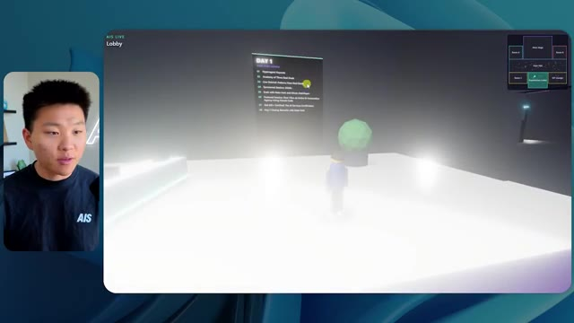
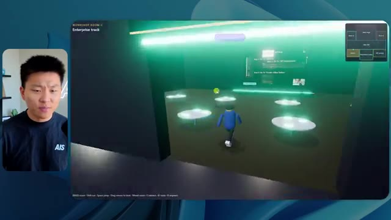
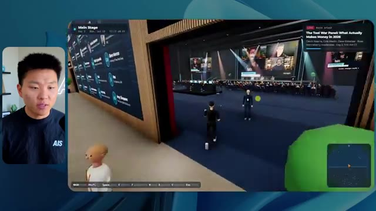
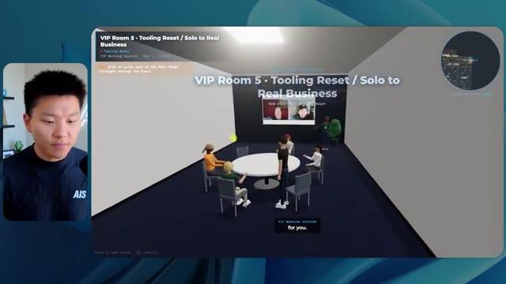
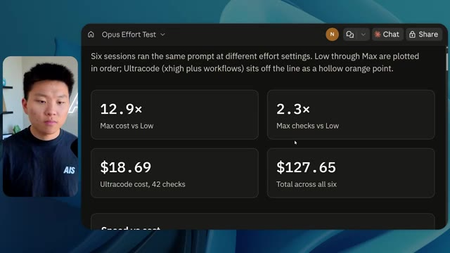

# 🎬 Clay's AI Agent Builds Your Outbound From One Prompt

> **Chaîne** : [Nate Herk | AI Automation](https://www.youtube.com/@nateherk/featured)  
> **Lien YouTube** : [https://www.youtube.com/watch?v=NmN6jn6IiMA](https://www.youtube.com/watch?v=NmN6jn6IiMA)  
> **Date de publication** : 20261017  
> **Durée** : 00:00:59  
> **Identifiant vidéo** : `NmN6jn6IiMA`  
> **Transcription & Analyse** : `whisper-v3-large-turbo+gemini-3.5-flash-lite`  

---

## 📌 Synthèse Exécutive & Outils

### 💡 Résumé
Dans cette vidéo intitulée **Clay's AI Agent Builds Your Outbound From One Prompt**, Nate Herk décortique les capacités pratiques d'automatisation et de développement propulsées par les modèles de pointe.

### 🛠️ Outils, Modèles & Logiciels Présentés
- **Opus 5.5 & Claude Code** : Modèles d'ingénierie et agents de codage autonome.

### 🔑 Points Clés & Enseignements Stratégiques
- Optimiser le niveau d'effort et le raisonnement des modèles IA pour des résultats industriels.
- Automatiser les cycles de création logicielle de bout en bout.

---

## ⏱️ Chronologie & Transcription Complète Audio & Visuelle (Mot pour Mot)

### ⏱️ `[00:00:00 - 00:00:20]` | Segment #01

**🔊 Audio (Transcription Intégrale Mot pour Mot en Français) :**
> Opus 5.5, Opus 5.5, Opus 5.5, Opus 5.5, Opus 5.5. This model is literally everywhere and for very good reason. It's smart, it's cheap, it has amazing taste, it is an incredible AI model. But with every AI model, you have a choice of effort, whether that be low, medium, high, extra, max, or ultra code.

**👁️ Analyse Visuelle d'Écran (gemini-3.5-flash-lite) :**
**Interface & Outils** : X (anciennement Twitter) affichant un post média.

**Contenu textuel & Code** : Texte du tweet : "It's a great time for hobbyists, bad time for professionals. This experiment has further cemented my view that technical creatives are about to experience a massive disruption."

**Action / Démonstration** : Affichage d'un exemple de contenu généré par IA pour illustrer le potentiel de disruption technologique.

*⏱️ 00:00:05 — Capture d'écran d'un tweet affichant une vidéo de démonstration d'un environnement 3D (paysage tropical) créé potentiellement par IA.*

---

### ⏱️ `[00:00:20 - 00:00:38]` | Segment #02

**🔊 Audio (Transcription Intégrale Mot pour Mot en Français) :**
> So in this video, I gave Opus 5.5 the same exact prompt and I ran it on every single effort level and we're gonna be comparing the results. We will look at the quality of all of the different actual outputs, But then we're also going to look at how long each one of these ran, how much it cost us if it was API billing, the total tokens, how many checks they ran, and how many questions they actually asked me throughout the process.

**👁️ Analyse Visuelle d'Écran (gemini-3.5-flash-lite) :**
**Interface & Outils** : Outil de tableau blanc collaboratif ou interface de design de canvas (type FigJam/Miro).

**Contenu textuel & Code** : Tableau avec les colonnes : Low, Medium, High, Extra, Max, Ultracode. Lignes : Run time, API cost, Total tokens, Checks, Questions asked.

**Action / Démonstration** : Présentation de la structure du tableau qui servira à comparer les performances et les coûts des différents niveaux d'effort de l'IA Opus 5.5.

*⏱️ 00:00:29 — Tableau comparatif vierge dans une interface de type canvas (probablement FigJam ou Miro), affichant les niveaux d'effort de l'IA (Low, Medium, High, Extra, Max, Ultracode) et les métriques associées (Run time, API cost, Total tokens, etc.).*

---

### ⏱️ `[00:00:39 - 00:00:58]` | Segment #03

**🔊 Audio (Transcription Intégrale Mot pour Mot en Français) :**
> And the results that we got are not what I expected at all, so I can't wait to share this with you guys. Let's not waste any time and just get straight into this one. Okay, so let's jump right into this one. I want to start off just by showing you guys the actual prompt that we used that we gave to every single one of these different agents. I'm going to go into the files over here, and we're going to open up this prompt markdown file, and I'll show you what we got. So here is the slash goal that I fed in.

**👁️ Analyse Visuelle d'Écran (gemini-3.5-flash-lite) :**
**Interface & Outils** : Opus 5.5 / Éditeur de code (type Cursor)

**Contenu textuel & Code** : Texte affiché : "Read the task prompt and listed worktree files. Hi Nate. This worktree has the effort-test task queued in PROMPT.md : build a walkable third-person 3D world of the AIS Live conference..."

**Action / Démonstration** : Initialisation d'une tâche de développement par l'agent IA à partir d'un fichier de prompt.

*⏱️ 00:00:48 — Interface de l'outil de développement IA (Opus 5.5 / Cursor) affichant une fenêtre de chat avec une proposition de projet technique.*

---

### ⏱️ `[00:00:58 - 00:01:34]` | Segment #04

**🔊 Audio (Transcription Intégrale Mot pour Mot en Français) :**
> I said, you need to create me a 3D world that is a realistic tech conference that I can walk around in third-person view. You will look at this folder, which is my event recording assets from AIS Live. And this folder is a frame IO folder of 105 gigabytes of video recordings. This was a completely virtual event. Everything was recorded and all of the recordings are right here. I said, your goal is to take this event and turn it into a 3D explorable world that makes me feel like I actually went to a real in-person conference with different rooms, different tracks, different stages, blah, blah, blah. Feel free to use key.ai if you need to generate any images or videos. And you can also use anything else inside of my Herc 2 project, which is like my AI operating system. I said,

**👁️ Analyse Visuelle d'Écran (gemini-3.5-flash-lite) :**
**Interface & Outils** : VS Code (éditeur de texte), Frame.io (plateforme de gestion de médias).

**Contenu textuel & Code** : Texte du prompt "PROMPT.md" décrivant la conversion d'enregistrements d'événements virtuels en un monde 3D explorable, incluant des références à 'Kie.ai' et au projet 'Herk-2'.

**Action / Démonstration** : Présentation des assets sources (vidéos) et lecture du prompt de développement envoyé à une IA pour construire l'environnement 3D.

*⏱️ 00:01:07 — Éditeur de code (probablement VS Code) affichant un fichier 'PROMPT.md' contenant les instructions pour créer un monde 3D à partir d'enregistrements vidéo.*

*⏱️ 00:01:16 — Interface de la plateforme Frame.io montrant un dossier "Sep 22, 2026" contenant les enregistrements vidéo de l'événement AIS Live (poids total : 105.69 Go).*

*⏱️ 00:01:25 — Identique à l'image 1 : retour sur l'éditeur de code présentant le prompt détaillé pour la génération du projet de conférence virtuelle 3D.*

---

### ⏱️ `[00:01:34 - 00:02:08]` | Segment #05

**🔊 Audio (Transcription Intégrale Mot pour Mot en Français) :**
> you'll be judged on creativity, design, physics, and the overall feel as I explore the 3D world that you built. And that was basically the end of the instructions. So as you can see on this left-hand side, I ran this through all of the different effort levels. Let's start off with low and work our way up to ultra code. All right. So here we have the result from low. Let's open this up and take a look. So we have AIS live, AI services summit in person finally, and we were able to click around. First of all, this doesn't feel very branded. Like this isn't the IS Live logo. It's not even our colors. So I don't love that, but let's get in here. Okay. This is way too bright. Um, we have a map in the top, right? We have a city back here. I can't tell what city

**👁️ Analyse Visuelle d'Écran (gemini-3.5-flash-lite) :**
**Interface & Outils** : Éditeur Cursor (avec le modèle Opus 5.5 sélectionné).

**Contenu textuel & Code** : Liste de fichiers/dossiers : "Session logs cost analysis", "Hello", "Extra", "High", "Max", "Ultracode", "Medium", "Low". Message de l'IA : "Hi Nate. This worktree has the effort-test task queued in PROMPT.md : build a walkable third-person 3D world...".

**Action / Démonstration** : Navigation dans la barre latérale pour sélectionner le dossier "Low" afin de lancer le test d'effort sur la création d'un monde 3D.

*⏱️ 00:01:42 — Interface de l'outil de développement Cursor montrant une liste de dossiers de test organisés par "niveaux d'effort" (Low, Medium, High, Max, Ultracode) et une fenêtre de discussion avec une IA.*

---

### ⏱️ `[00:02:08 - 00:02:40]` | Segment #06

**🔊 Audio (Transcription Intégrale Mot pour Mot en Français) :**
> this is. Okay. This is Chicago, which is kind of cool because you know, I live in Chicago, but anyways, on the top, right, we can see a map. We have a lobby. We have an expo hall. We have VIP lounge main stage. Also the map shows where every other person is and that's sinking live. So we can see registration. We can see day one, hyper agent keynote, live debrief. Cool. So it actually does know the agenda and then there's day two. So it found that that's good. We have these little balls in here that I can hopefully kick around. Okay. The face, Oh, look at this. If I go over here, all the people just disappear. Very bad. Very bad. Okay. So let's see. Can I sprint? Okay.

**👁️ Analyse Visuelle d'Écran (gemini-3.5-flash-lite) :**
**Interface & Outils** : Espace événementiel virtuel (type métavers professionnel/plateforme de conférence en ligne).

**Contenu textuel & Code** : Noms des zones (Lobby, Expo Hall, Badge pickup), liste d'agenda "DAY 1", instructions de contrôle (WASD move, Shift run, etc.).

**Action / Démonstration** : Navigation et exploration de l'utilisateur à travers les différents espaces de l'événement virtuel avec visualisation en temps réel des autres participants sur la carte.

*⏱️ 00:02:16 — Vue en perspective à la troisième personne d'un environnement virtuel type événement ("Badge pickup") avec avatars, minimap en haut à droite et interface de navigation.*

*⏱️ 00:02:24 — Vue de la zone "Lobby" dans l'espace virtuel, affichant un panneau informatif "DAY 1" listant des sessions, avec la minimap active.*

*⏱️ 00:02:32 — Vue de l'"Expo Hall" avec des avatars, des stands, une structure lumineuse centrale et les indications de contrôle clavier en bas d'écran.*

---

### ⏱️ `[00:02:40 - 00:03:04]` | Segment #07

**🔊 Audio (Transcription Intégrale Mot pour Mot en Français) :**
> I can move a little faster. I'll first go over here. There's some swag, um, AIS plus certified glido. Okay. So it's got the actual booths that we had in the virtual event. We had booths. So that's pretty cool. A little place to take pictures. Room C. Right now we have Tangy Frederick doing a workshop. Okay. But this isn't a video. As you can see, it's just an image. She's not moving. So that's just an image. These people are disappearing. They must be ghosts. Let's go over here to room A.

**👁️ Analyse Visuelle d'Écran (gemini-3.5-flash-lite) :**
**Interface & Outils** : Environnement de conférence virtuelle (plateforme type Gather ou similaire).

**Contenu textuel & Code** : Texte à l'écran : "Sponsors, booths and hallway conversations", "Workshop Room C", "Enterprise track", et étapes de configuration "API Key".

**Action / Démonstration** : Navigation de l'avatar dans l'espace virtuel et interaction avec les zones de contenu (stands et salle de workshop).

*⏱️ 00:02:46 — Vue d'un espace d'exposition virtuel avec un personnage (avatar) se déplaçant devant un stand sponsorisé par "Glaido".*

*⏱️ 00:02:52 — Vue de l'intérieur de la "Room C" (Workshop) dans l'environnement virtuel, avec des tables lumineuses et une projection au mur.*

*⏱️ 00:02:58 — Gros plan sur une présentation projetée dans la salle virtuelle, détaillant des étapes de configuration pour une "API Key".*

---

### ⏱️ `[00:03:04 - 00:03:30]` | Segment #08

**🔊 Audio (Transcription Intégrale Mot pour Mot en Français) :**
> We have Liberty White. Okay. Very cool. Your first 30 days in automation. Once again, it's just a still image and the people are glitchy. So not very good here. I'm going to go over to the main stage and see what we've got going. Okay, cool. So we have a main looking stage. The people are glitching. Really bad. That's not very good at all. Our video is actually moving. Like I saw my face here and I saw Devin's, but now they're gone. So I'm not sure what happened. Okay. It's, it looks like it's more of a slideshow. Nothing is actually being played still. Anyways, let's come in here.

**👁️ Analyse Visuelle d'Écran (gemini-3.5-flash-lite) :**
**Interface & Outils** : Environnement de conférence virtuel (métavers).

**Contenu textuel & Code** : Aucun contenu technique (code, workflow ou prompt) n'est visible de manière exploitable ; il s'agit d'une simulation graphique de salle de conférence.

**Action / Démonstration** : Navigation d'un avatar dans un espace virtuel.

---

### ⏱️ `[00:03:30 - 00:03:58]` | Segment #09

**🔊 Audio (Transcription Intégrale Mot pour Mot en Français) :**
> We have more booths. We have hyper agent. We have Claude Code. We have more swag. Room B is Dave Ebelor. I'm assuming it's the same exact thing. We've got coffee. And then I'm assuming VIP lounge, VIP access only. That's pretty cool, but there's really nothing going on right here. That screen's way too bright. Okay. So I think you guys understand the vibe that we're getting here from Opus 5.5 on low effort. And here's where things get interesting. How much do you guys think that this ran for? How long? This one ran for 16 minutes and 43 seconds. How much do you think this cost?

**👁️ Analyse Visuelle d'Écran (gemini-3.5-flash-lite) :**
**Interface & Outils** : Plateforme de conférence virtuelle (type Gather ou Metaverse), Tableau de bord d'analyse de performance IA (Opus 5.5).

**Contenu textuel & Code** : Matrice de données avec des variables de performance : Run time, API cost, Total tokens, Checks, Questions asked.

**Action / Démonstration** : Navigation au sein d'un espace virtuel d'exposition et présentation d'une grille comparative vide pour l'analyse des efforts d'un agent IA.

*⏱️ 00:03:51 — Interface de tableau de bord « Opus 5.5 Efforts » présentant une matrice de comparaison vide avec des colonnes de niveaux de performance (Low à Ultracode).*

---

### ⏱️ `[00:03:58 - 00:04:26]` | Segment #10

**🔊 Audio (Transcription Intégrale Mot pour Mot en Français) :**
> $3.91 if this was API billing. I'm obviously using my subscription here, but we're just going to calculate this in API billing. Total tokens was 191,000. It did 22 checks. So the verification, 22 times it opened up the browser and ran different sorts of checks. So 22 categories of checks. And how many questions did it ask me? It asked me a total of zero questions throughout this slash goal prompt. Okay. So let's open up medium effort and see what we've got. Okay, here we go. Medium effort. We've got Nate Herc. We've got my badge. This is AI's life branded.

**👁️ Analyse Visuelle d'Écran (gemini-3.5-flash-lite) :**
**Interface & Outils** : Opus (outil de dessin/diagramme)

**Contenu textuel & Code** : Tableau avec les colonnes "Low", "Medium", "High" et des lignes de données : "Run time" (16m 43s), "API cost" ($3.91), "Total tokens" (191.3K), "Checks" et "Questions asked".

**Action / Démonstration** : Le présentateur illustre les coûts et les performances techniques d'un processus automatisé via un tableau récapitulatif.

*⏱️ 00:04:05 — Une vue de l'interface de l'outil de design/diagramme "Opus 5.5 Efforts" montrant un tableau de données comparatif avec les métriques d'exécution.*

---

### ⏱️ `[00:04:26 - 00:04:46]` | Segment #11

**🔊 Audio (Transcription Intégrale Mot pour Mot en Français) :**
> So this is already looking a little bit better. This feels like our color schemes that used our brand guidelines. Day one build, day two earn, VIP. Cool. Okay. I'm going to enter the venue. Okay. Wow. So similar sort of vibe. It's sitting in the background. This doesn't look like Chicago though, does it? No, this looks like a, honestly, this looks like a made up city. Either way, it's funny that they decided to do that. Let's see if I can move a little faster. Oh, wow.

**👁️ Analyse Visuelle d'Écran (gemini-3.5-flash-lite) :**
**Interface & Outils** : Présentation ou face-caméra explicatif sans interface logicielle partagée.

**Contenu textuel & Code** : Explications orales et mise en contexte méthodologique.

**Action / Démonstration** : Explications face caméra et démonstration conceptuelle.

---

### ⏱️ `[00:04:46 - 00:05:21]` | Segment #12

**🔊 Audio (Transcription Intégrale Mot pour Mot en Français) :**
> The people are interacting with me. Watch. If I go up to this guy, he just like raised his arm. Well, now he doesn't want anything to do with me at all. But all of these little robots here must be making decisions. I'm not sure if they're using Jev. They're definitely not. I didn't tell it to. Actually, my Jev key is in the back. I don't know. Maybe it did use it. Anyways, we can see here we have Workshop Room C, Agents Lab. Nice. So this one is actually being run. You can see that is a real video being played by Tangy. Everyone here is actually like working on a laptop. They're not glitching. This is pretty cool. Also, my badge is on my chest, which is pretty cool. I can come this way. We have a map up in the top right, as you guys can see, but I can come this way. We have an

**👁️ Analyse Visuelle d'Écran (gemini-3.5-flash-lite) :**
**Interface & Outils** : Présentation ou face-caméra explicatif sans interface logicielle partagée.

**Contenu textuel & Code** : Explications orales et mise en contexte méthodologique.

**Action / Démonstration** : Explications face caméra et démonstration conceptuelle.

---

### ⏱️ `[00:05:21 - 00:05:47]` | Segment #13

**🔊 Audio (Transcription Intégrale Mot pour Mot en Français) :**
> expo hall. This is where we have the Glido booth. And this is actually playing. Yeah, it's playing the video of us talking about Glido. It's playing the video of Ed and I talking about our certification program. We've got the AIS Plus logo back here, which is kind of in a weird spot. This is a speaker slides and takeaways. So wow, this is all the resources that we gave out after the event. They're all sitting right there as well. We can see we've got a community spotlight. So this is Aiden talking about his deal that he landed and it's playing live. These people are watching.

**👁️ Analyse Visuelle d'Écran (gemini-3.5-flash-lite) :**
**Interface & Outils** : Présentation ou face-caméra explicatif sans interface logicielle partagée.

**Contenu textuel & Code** : Explications orales et mise en contexte méthodologique.

**Action / Démonstration** : Explications face caméra et démonstration conceptuelle.

---

### ⏱️ `[00:05:47 - 00:06:21]` | Segment #14

**🔊 Audio (Transcription Intégrale Mot pour Mot en Français) :**
> They're pretty engaged. We've got hyper agent. That was, that's what I meant. If you guys saw those people like raising their arms saying hi, that was kind of funny. Look, look, there he goes again. Anyways. Okay. Where am I now? Now I'm in the main lobby. We've got a coffee bar. We've got a big logo, which is the real logo. It's too bright, but we have the logo. We can see if we can come in here to the foundation track. We've got Sabrina Romanov and Liberty White. So different trainings right there. We can come into this room. This is the advanced track. So what's going on here. We've got Dave Ebelar and Saman talking about some different stuff in there. And now let's go take a look at the main stage. Oh, wait, there's a video of me up there. Is that like a VIP

**👁️ Analyse Visuelle d'Écran (gemini-3.5-flash-lite) :**
**Interface & Outils** : Environnement virtuel 3D (type métavers ou plateforme d'événements virtuels).

**Contenu textuel & Code** : Interface utilisateur affichant "Main Lobby", "Registration", "networking lounge", "coffee bar" et une mini-map de positionnement.

**Action / Démonstration** : Navigation et exploration de l'espace virtuel par l'avatar de l'utilisateur.

*⏱️ 00:05:55 — Vue à la première personne dans un environnement virtuel 3D représentant un "Main Lobby" avec des avatars, un bar et une interface de navigation (mini-map).*

*⏱️ 00:06:04 — L'avatar se déplace vers une salle de conférence où d'autres avatars sont assis, avec un écran de projection affiché au fond.*

*⏱️ 00:06:12 — Vue arrière montrant l'avatar naviguant dans l'espace de conférence virtuel, avec des options d'interaction textuelles en bas à droite.*

---

### ⏱️ `[00:06:21 - 00:06:50]` | Segment #15

**🔊 Audio (Transcription Intégrale Mot pour Mot en Français) :**
> section? Yeah, we'll go check that out in a sec. But anyways, this is the main stage. This looks very, very nice. We've got a big stage. We've got like four people sitting up here. We've got the the three screens of Alex up there with hyper agent. Am I allowed to get on stage? Oh, and lets me up on stage. Okay. That's pretty nice. All right, guys, let's take a selfie. Let me get everyone in the background. Get in here. Anyways, that is pretty, pretty cool. Not every seat is filled though. So we need to work on that. But anyways, I'm going to run back over and see what that VIP section was. Okay. VIP lounge. I feel like this is like a worth the airport or something.

**👁️ Analyse Visuelle d'Écran (gemini-3.5-flash-lite) :**
**Interface & Outils** : Environnement virtuel de conférence (metaverse) pour "Hyperagent Keynote".

**Contenu textuel & Code** : Interface utilisateur affichant "Hyperagent Keynote", "Alex McDonnell", "Session 10:27", et une carte en haut à droite (Main Stage).

**Action / Démonstration** : Navigation et déplacement d'un avatar dans un espace événementiel virtuel dédié à une présentation.

---

### ⏱️ `[00:06:51 - 00:07:14]` | Segment #16

**🔊 Audio (Transcription Intégrale Mot pour Mot en Français) :**
> Okay, cool. So now we've got the VIP sessions up here. VIP Q and a with Nate live video playback right here. Very, very cool. And we've got like a bar or something. Awesome. I would say that this is a pretty good output. Now, as far as the stats here, this one took one hour and 13 minutes to run. It would have cost us $12 and 44 cents. It used 490,000 tokens and it did 23 checks.

**👁️ Analyse Visuelle d'Écran (gemini-3.5-flash-lite) :**
**Interface & Outils** : Environnement de métavers (Image 1) ; Application de type Canvas/Tableau de bord (Image 2).

**Contenu textuel & Code** : Métriques de performance : "Run time", "API cost", "Total tokens", "Checks", "Questions asked".

**Action / Démonstration** : Présentation d'un environnement de conférence virtuelle, suivie de l'analyse des statistiques d'exécution et des coûts liés à l'utilisation de l'agent.

*⏱️ 00:06:56 — Vue d'un environnement virtuel immersif (métavers) montrant un espace "VIP Lounge" avec un écran diffusant une vidéo de session Q&A et des avatars d'utilisateurs.*

*⏱️ 00:07:02 — Capture d'un tableau de bord de performance (Canvas) affichant des métriques d'exécution, notamment le temps d'exécution (16m 43s), le coût API (3,91 $) et le nombre de tokens.*

---

### ⏱️ `[00:07:14 - 00:07:48]` | Segment #17

**🔊 Audio (Transcription Intégrale Mot pour Mot en Français) :**
> And it asked us a grand total of zero questions once again. All right, let's move on to high. This was already a pretty decent output and Anthropic themselves in their how to prompt Opus 5.5 video, or sorry, not video, article. They said to just start on medium and scale it up or down if you need. So that was a medium output. Let's move over to high and see what we got. Real quick, guys, I need to take a second to tell you about the sponsor of today's video, Hostinger. So both of these models just built me a working version of the same thing. And now I'm right where I always end up with something finished sitting on my laptop and no quick way to get it online. And that's the gap that Hostinger's connector closes. It's a free extension

**👁️ Analyse Visuelle d'Écran (gemini-3.5-flash-lite) :**
**Interface & Outils** : Présentation ou face-caméra explicatif sans interface logicielle partagée.

**Contenu textuel & Code** : Explications orales et mise en contexte méthodologique.

**Action / Démonstration** : Explications face caméra et démonstration conceptuelle.

---

### ⏱️ `[00:07:48 - 00:08:23]` | Segment #18

**🔊 Audio (Transcription Intégrale Mot pour Mot en Français) :**
> for your editor that pulls your Hostinger account into whatever you're already coding in. So VS Code, cursor, cloud code, codex, you name it. You sign in once with a single click, and from there, your agent can deploy the site, point a domain at it, set the DNS records, and check on your VPS without you ever having to leave the editor. So whichever one of these you end up liking better, the thing it built is a couple minutes away from a real URL on managed hosting. Connector is free on every hosting or plan, so if you still need the hosting underneath it, grab the unlimited plan with the link in the description and use code NATEHERK for 10% off. That also comes with a free domain and business email for the year. And it's still the cheapest way that I found to get something

**👁️ Analyse Visuelle d'Écran (gemini-3.5-flash-lite) :**
**Interface & Outils** : Interface de gestion Hostinger (extension d'IDE) et fenêtre Claude Code.

**Contenu textuel & Code** : État "Connected" (via OAuth), version Node.js 24.13.0, et liste des outils accessibles : "Websites", "Domains", "Subscriptions & Payments", "Email Marketing".

**Action / Démonstration** : Validation de la connexion entre l'IDE et l'infrastructure Hostinger, permettant à l'agent IA de gérer les services d'hébergement.

*⏱️ 00:07:57 — Une interface de configuration montrant la connexion d'un compte Hostinger à un environnement de développement, avec une liste d'outils disponibles.*

---

### ⏱️ `[00:08:23 - 00:08:47]` | Segment #19

**🔊 Audio (Transcription Intégrale Mot pour Mot en Français) :**
> you built onto a real URL. So let's get back to the video. Okay. Once again, very, very branded. This is even better of a loading screen than the previous one. We've got this nice little effect in the background. We've got the logo. We'll enter the venue. Okay. Here we are. This looks pretty nice. We start outside and you can see that we have these flags for all the speakers, Wyatt, Casper, Alex, Ed, Aiden, Sabrina, Liberty. This is pretty cool. We got live blocks here.

**👁️ Analyse Visuelle d'Écran (gemini-3.5-flash-lite) :**
**Interface & Outils** : Plateforme événementielle virtuelle web (AIS Live) sur navigateur.

**Contenu textuel & Code** : Interface utilisateur de jeu (HUD) avec contrôles (WASD, SHIFT, E, etc.), mini-carte, liste de tâches "Passport" et bannières promotionnelles.

**Action / Démonstration** : Transition depuis l'écran de bienvenue vers l'exploration en temps réel de l'espace virtuel par l'utilisateur.

*⏱️ 00:08:29 — Écran de chargement et d'accueil de la plateforme "AIS LIVE" présentant les contrôles clavier et le bouton pour accéder au lieu.*

*⏱️ 00:08:35 — Vue à la première personne dans l'environnement virtuel 3D "AIS Live Plaza" avec des avatars et une mini-carte.*

*⏱️ 00:08:41 — Exploration de l'environnement virtuel "AIS Live Plaza" affichant des bannières de conférenciers dans un décor urbain.*

---

### ⏱️ `[00:08:47 - 00:09:23]` | Segment #20

**🔊 Audio (Transcription Intégrale Mot pour Mot en Français) :**
> it took this picture from me, your host, Nate Herc, John, Dave, Nate Herc. There we go. Okay. The doors. Awesome. They're automatic sliding glass doors. I love that. We can see VIP check-in. We can see GA. We can come over here and we can check out the expo with different booths, community spotlight. You can also see that in the top left, I have a passport. So it's like, it will be showing how many of the places I've visited. All of these are real playback. We've got a resource wall with all of the different speakers. They've also got a networking session over here. So I'm going to come over real quick and see what that's all about. So we've got the AIS cold brew bar. We've got different community members that were spotlighted or highlighted.

**👁️ Analyse Visuelle d'Écran (gemini-3.5-flash-lite) :**
**Interface & Outils** : Environnement virtuel de type "Metaverse" ou plateforme d'événement numérique immersive.

**Contenu textuel & Code** : Interface utilisateur affichant des informations de navigation, des noms de zones ("Registration Concourse", "Expo Hall"), et une jauge de progression de "Passport".

**Action / Démonstration** : Navigation et exploration de l'utilisateur à travers les différentes sections d'un salon professionnel virtuel.

*⏱️ 00:08:56 — Vue à la première personne d'un environnement virtuel de type conférence, montrant la zone "Registration" avec des panneaux "Main Stage" et "VIP Check-in".*

*⏱️ 00:09:05 — Navigation dans le hall d'exposition virtuel (Expo Hall) avec des stands d'information et des avatars d'utilisateurs.*

*⏱️ 00:09:14 — Vue panoramique du hall d'entrée avec des portes coulissantes automatiques et une foule d'avatars circulant dans la zone de réception.*

---

### ⏱️ `[00:09:23 - 00:09:56]` | Segment #21

**🔊 Audio (Transcription Intégrale Mot pour Mot en Français) :**
> We've got the VIP wing. Wait, what? Pick up a wristband. Oh, I have to actually go get the wristband. Okay. Let me check in real quick. Wristband's already on. Wait, what? Okay. Oh, okay. Now the doors have opened for me. Cool. I can come into here. Oh, that just goes to the main stage. VIP lounge. This is a Q and A going on. It looks like very cool. I mean, I'm very impressed by how it's able to do this. Wow. Okay. So this is really good. What we did is we had VIP breakout rooms with different people. You can see that there's different rooms, different members of the AIS team going into stuff. This is really cool. This is very cool. That's a much better VIP

**👁️ Analyse Visuelle d'Écran (gemini-3.5-flash-lite) :**
**Interface & Outils** : Présentation ou face-caméra explicatif sans interface logicielle partagée.

**Contenu textuel & Code** : Explications orales et mise en contexte méthodologique.

**Action / Démonstration** : Explications face caméra et démonstration conceptuelle.

---

### ⏱️ `[00:09:56 - 00:10:30]` | Segment #22

**🔊 Audio (Transcription Intégrale Mot pour Mot en Français) :**
> experience than what was shown in the first piece. Okay. VIP after party. Look at this. We've got a dance floor. We've got all these elements in here. We have the actual VIP after party playback right here. And there's a DJ booth. That is so funny. There's a bit of a bug right here, a glitch right there, but this is awesome. Oh, cool. So when I'm in here in the main stage, we get closed captions. You can see right here in the bottom of my screen, we're getting these closed captions of Wyatt actually talking up here. We've got lights. We've got the panel. Very cool. Nice main stage. I'm going to go over here. We can go to the foundation,

**👁️ Analyse Visuelle d'Écran (gemini-3.5-flash-lite) :**
**Interface & Outils** : Environnement de conférence virtuelle 3D (Metaverse style).

**Contenu textuel & Code** : Interface utilisateur affichant des métadonnées de session ("VIP After-Party", "Main Stage"), des barres de progression ("Passport"), et des commandes de navigation (clavier/souris).

**Action / Démonstration** : Navigation et exploration de différentes zones de l'événement virtuel interactif par l'utilisateur.

*⏱️ 00:10:04 — Vue à la première personne dans un environnement virtuel 3D montrant une "VIP After-Party" avec des avatars dansant sur une piste lumineuse.*

*⏱️ 00:10:13 — Suite de la scène 3D de la "VIP After-Party" avec un grand écran projetant une mosaïque de participants en visioconférence.*

*⏱️ 00:10:21 — Vue à la première personne dans un auditorium virtuel 3D nommé "Main Stage", avec un présentateur sur grand écran et un public d'avatars assis.*

---

### ⏱️ `[00:10:30 - 00:11:06]` | Segment #23

**🔊 Audio (Transcription Intégrale Mot pour Mot en Français) :**
> advanced, and the enterprise tracks over here. So let's see. We have anatomy of a three real deals. We've got hyper agent. We've got the evals with Nate and Ed in here. We've got Dave going on in the advanced stuff. This is really nice. I mean, obviously each, each of these outputs so far, low was okay. Medium was better. High has been even better. Let's see if that trend continues and let's go ahead and see what this cost us. So high ran for one hour and seven minutes. So a little bit quicker than medium, it would have cost us $16 and 31 cents. It used half a million tokens, 509,000. It did 22 checks. And it also asked us, well, actually, no, I was wrong. This

**👁️ Analyse Visuelle d'Écran (gemini-3.5-flash-lite) :**
**Interface & Outils** : Présentation ou face-caméra explicatif sans interface logicielle partagée.

**Contenu textuel & Code** : Explications orales et mise en contexte méthodologique.

**Action / Démonstration** : Explications face caméra et démonstration conceptuelle.

---

### ⏱️ `[00:11:06 - 00:11:25]` | Segment #24

**🔊 Audio (Transcription Intégrale Mot pour Mot en Français) :**
> one asked me one question and spoiler, it was the only one that asked us a question throughout all of this. So let's see, we've got three left extra max and ultra code. Let me pull open extra and we'll see what we got. Okay. So this one looks pretty good. I would honestly say so far, the loading screen high was the best. The one that we just saw, but anyways, let's enter AIS live.

**👁️ Analyse Visuelle d'Écran (gemini-3.5-flash-lite) :**
**Interface & Outils** : Application de type Canvas (probablement Claude Projects ou interface similaire de gestion de données).

**Contenu textuel & Code** : Tableau de données comparatives incluant : "Run time", "API cost", "Total tokens", "Checks" et "Questions asked" (avec une valeur de 1 pour la colonne High).

**Action / Démonstration** : Le présentateur passe en revue les métriques de performance des différentes configurations d'agents IA.

*⏱️ 00:11:11 — Un tableau comparatif des performances de différents modèles "Opus 5.5" (Low, Medium, High, Extra) affiché dans une interface de type canevas.*

---

### ⏱️ `[00:11:26 - 00:11:51]` | Segment #25

**🔊 Audio (Transcription Intégrale Mot pour Mot en Français) :**
> Whoa. Okay. So we have like little sound bites. I can chat with people. The tool war panel settled a few debates for me. Nice. Good perspective there. We're outside again. We have these different banners, although they're all the same. They don't say like different people's names. So big AIS live logo. Workshop wing is over here. And let's go through the sliding glass doors and see what we've got. So we've got the AIS cafe. The map is in the bottom right, and it's not too descriptive.

**👁️ Analyse Visuelle d'Écran (gemini-3.5-flash-lite) :**
**Interface & Outils** : Environnement virtuel 3D (type métavers).

**Contenu textuel & Code** : Interface utilisateur de simulation avec une mini-carte, des avatars et des textes d'affichage environnementaux (ex: "Convention Plaza").

**Action / Démonstration** : Exploration et navigation au sein d'un espace virtuel interactif.

---

### ⏱️ `[00:11:51 - 00:12:26]` | Segment #26

**🔊 Audio (Transcription Intégrale Mot pour Mot en Français) :**
> I like how the other maps have told us what, like where things were, but this one looks very professional. We can see here's the main stage. Let's hop in here real quick. They've all got these balls flying around, which I think is pretty funny. The AIS beach balls. We have me up there speaking. I think I was introing one of the days. Let's keep on moving here to the workshop room on this left side. Okay. So here we've got the Hyper Agent Theater. We've got this sponsored session in here by Hyper Agent, but it's showing us what's coming up in here as well. It's really funny that we can chat to people. Salmon built a voice sales rep live. The price it right room was packed. Did you grab the VIP companion guide? That's so funny. We have the advanced track in

**👁️ Analyse Visuelle d'Écran (gemini-3.5-flash-lite) :**
**Interface & Outils** : Environnement virtuel de conférence 3D (plateforme de métavers type Gather ou similaire).

**Contenu textuel & Code** : Interface utilisateur incluant une mini-carte en bas à droite, des indicateurs de statut, des options "Chat" et des panneaux signalétiques (Main Stage, Workshops).

**Action / Démonstration** : Navigation et exploration de l'espace virtuel pour démontrer la structure et les fonctionnalités de la conférence en ligne.

*⏱️ 00:12:00 — Vue à la première personne dans un environnement virtuel 3D montrant la "Main Stage" (scène principale) avec un écran géant diffusant le présentateur et des avatars assis dans le public.*

*⏱️ 00:12:09 — Navigation dans le "Grand Lobby" de l'espace virtuel, affichant des zones dédiées comme "Workshops" et "Enterprise AI Services" avec des avatars d'utilisateurs.*

*⏱️ 00:12:17 — Exploration d'un couloir dans l'environnement virtuel menant vers la section "Enterprise AI Services", avec plusieurs avatars interactifs.*

---

### ⏱️ `[00:12:26 - 00:12:58]` | Segment #27

**🔊 Audio (Transcription Intégrale Mot pour Mot en Français) :**
> here. Once again, we've got live playback. Is that live playback? Oh, okay. It started once I got in, but I can take a seat. Oh my. I can watch this. I can stand up. I want to sit in the front. That's pretty cool. That's very nice. I like that. And you know what I noticed so far? The actual character that I'm playing kind of looks like me. I think it modeled it off of my thumbnail pictures or something. Anyways, we have Sabrina in here, room host here, grab any open seat. Okay, cool. And I really liked the sitting functionality. It's kind of funny. Like we could actually attend this workshop and participate. Anyways, it's showing us the speakers. It's showing us the

**👁️ Analyse Visuelle d'Écran (gemini-3.5-flash-lite) :**
**Interface & Outils** : Plateforme de conférence virtuelle (type événementiel 3D).

**Contenu textuel & Code** : Interfaces de gestion d'ateliers (Workshop Blocks) et écrans de partage de session interactive.

**Action / Démonstration** : Navigation et immersion dans un environnement de conférence 3D "Live" avec des participants sous forme d'avatars.

*⏱️ 00:12:34 — Vue d'une salle de conférence virtuelle (Advanced Track) avec des avatars d'utilisateurs et un écran géant affichant une interface de travail.*

*⏱️ 00:12:42 — Vue de la salle de conférence virtuelle (Foundation Track) avec un écran présentant un espace de travail collaboratif sous forme de liste.*

*⏱️ 00:12:50 — Vue de la salle de conférence virtuelle où l'écran géant affiche une interface type réseau social ou dashboard avec des flux vidéo en médaillon.*

---

### ⏱️ `[00:12:58 - 00:13:31]` | Segment #28

**🔊 Audio (Transcription Intégrale Mot pour Mot en Français) :**
> agenda. There's a little red carpet here to take some pictures. We can strike a pose. Oh, wow. That's pretty cool. Resource library, get AIS Plus certified, Glido, Hyper Agent, AIS Plus, three real deals. Awesome. I mean, I would definitely say so far, each one is getting better. And we didn't even check out the VIP section yet, the VIP lounge. Let's go up here real quick. Hopefully I can get in. Nice. We've got tooling reset. These are the different rooms we could go in. So once again, I could grab the worksheet and I could try to understand how to price my stuff. This is so cool. This is definitely better than the previous one where we kind of just

**👁️ Analyse Visuelle d'Écran (gemini-3.5-flash-lite) :**
**Interface & Outils** : Plateforme d'événement virtuel 3D interactive (de type Metaverse événementiel).

**Contenu textuel & Code** : Signalétique événementielle : "Expo Hall", "Hyperagent Title Sponsor", "Workshops", et interface de discussion : "What's your gut floor number?", "If you doubled your rate, what would change?".

**Action / Démonstration** : Navigation de l'avatar dans les différentes sections du salon virtuel et interaction dans le salon VIP pour une session de travail.

*⏱️ 00:13:07 — Vue panoramique d'un hall d'exposition virtuel avec des stands pour AIS+, Hyperagent et Glido.*

*⏱️ 00:13:15 — Hall d'entrée virtuel ("Expo Hall") avec des escaliers, une zone de réception et une signalétique vers des ateliers.*

*⏱️ 00:13:23 — Intérieur du "VIP Lounge" où des avatars sont assis autour d'une table avec une interface de questions interactives flottantes.*

---

### ⏱️ `[00:13:31 - 00:13:59]` | Segment #29

**🔊 Audio (Transcription Intégrale Mot pour Mot en Français) :**
> like looked at stuff. Awesome. I can get behind the bar and come in here. This is very nice. Okay. So as far as statistics go, this one ran for an hour and a half. It costs 25.92 bucks. I don't know why I say point $25, 92 cents. It was 733,000 tokens and 34 checks. So it had the most checks so far by far. And it asked us zero questions. I can't wait to see what we got here from max and ultra code. Okay. Here is max loading screens, boring, but it's on brand and it has our logo.

**👁️ Analyse Visuelle d'Écran (gemini-3.5-flash-lite) :**
**Interface & Outils** : Logiciel de création de diagrammes ou de visualisation de données (type outil de design/whiteboard).

**Contenu textuel & Code** : Tableau comparatif affichant des métriques pour les catégories "Medium", "High", "Extra", "Max" et "Ultracode" : durée (ex: 1h 31m), coût (ex: $12.44, $16.31), nombre de tokens et nombre de vérifications effectuées.

**Action / Démonstration** : Le présentateur commente les données statistiques affichées à l'écran, en mettant en évidence les performances et le coût du test effectué pour la catégorie "Extra".

*⏱️ 00:13:38 — Un tableau de bord ou éditeur graphique affichant les statistiques de performance ("Opus 5.5 Efforts") avec une comparaison entre différents niveaux de configuration.*

---

### ⏱️ `[00:14:00 - 00:14:35]` | Segment #30

**🔊 Audio (Transcription Intégrale Mot pour Mot en Français) :**
> So that was good. I like that. We will go ahead and enter AIS live. Ooh, nice little animation here that brings us in. Once again, the character looks like me. They've all looked like me. I mean, sort of, we have sitting in the background. This looks like Chicago. Like I mentioned earlier, a lot of these are playing sounds and I'm not including that because it would be very distracting for you guys to try to listen to what's going on as well as me speaking. So there is like some slight music in all these. I hate how this is walking. This walking is really, really bad. I mean, the walking, yeah, I don't like this at all. So that's not great. But besides that, let's go in and explore. Notice these shadows when I walk in, they like really switch. I'm not sure why that is,

**👁️ Analyse Visuelle d'Écran (gemini-3.5-flash-lite) :**
**Interface & Outils** : Application de métavers ou plateforme de conférence virtuelle 3D avec interface HUD (mini-carte, contrôles clavier, notifications d'événements).

**Contenu textuel & Code** : HUD indiquant "Arrival Plaza", "LIVE MAIN STAGE", et le titre de la session "The Tool War Panel: What Actually Makes Money in 2026".

**Action / Démonstration** : Navigation et exploration de l'espace virtuel par l'utilisateur via l'avatar.

*⏱️ 00:14:08 — Vue à la troisième personne d'un environnement virtuel type métavers ("Arrival Plaza") avec un avatar au centre.*

*⏱️ 00:14:17 — L'avatar se déplace vers l'entrée d'un bâtiment moderne vitré dans l'espace virtuel.*

*⏱️ 00:14:26 — L'avatar progresse vers l'intérieur du bâtiment, le HUD affiche des informations de navigation et d'événement en direct.*

---

### ⏱️ `[00:14:35 - 00:15:11]` | Segment #31

**🔊 Audio (Transcription Intégrale Mot pour Mot en Français) :**
> but anyways, we can chat with people in here too. Hyperagent booth is right where you walk into the expo. All good. Okay, cool. I can keep clicking E to make them change what they say. We've got the speakers right here. That looks pretty good. Although we definitely had everyone's profile picture. So I'm not sure why that's not included there. We see people taking pictures right here. I love that. And it saves a little picture. Okay. The map also isn't super, like doesn't give me a great explanation of what's going on, but I like these booths. These are cool. I think these booths are the best that I've seen so far. Like they just look nice. They've got reps. There's nice like slides behind them. Yeah. These booths are cool. Okay. We have a little featured theater

**👁️ Analyse Visuelle d'Écran (gemini-3.5-flash-lite) :**
**Interface & Outils** : Plateforme événementielle virtuelle interactive (environnement de type métavers).

**Contenu textuel & Code** : Noms des conférenciers, titres de panels ("The Tool War Panel"), noms de stands et interface de contrôle HUD en bas d'écran.

**Action / Démonstration** : Déplacement des avatars dans l'espace virtuel, interaction sociale et visualisation des stands d'exposition.

*⏱️ 00:14:44 — Vue d'un espace d'exposition virtuel en 3D avec des avatars d'utilisateurs interagissant près de panneaux d'information sur les conférenciers.*

*⏱️ 00:14:53 — Scène dans le hall virtuel montrant une interaction entre avatars autour d'une table haute et l'affichage d'une photo souvenir (step-and-repeat).*

*⏱️ 00:15:02 — Navigation dans la zone "Expo Hall" montrant des stands dédiés (Evals Lab, Enterprise AI) avec des avatars et des écrans d'affichage informatifs.*

---

### ⏱️ `[00:15:11 - 00:15:35]` | Segment #32

**🔊 Audio (Transcription Intégrale Mot pour Mot en Français) :**
> going on over here. It's Casper. Although why is this not playing? I feel like this should be playing, right? Like in the other ones, they were always playing. We can talk to some other people over here. Coffee's free. Blah, blah, blah. Amy Simpson, Matt Wolf. Nice. Okay. This is just the networking area that we're in right now, but we can see in the top right. We can also see what's live on the main stage right now. It is a tool war panel. So let's head in here. We've got Devin, Cole, Dave, and Russ chatting in here. We've got sort of AV, some light stuff going on back here.

**👁️ Analyse Visuelle d'Écran (gemini-3.5-flash-lite) :**
**Interface & Outils** : Plateforme de conférence virtuelle (metaverse/événement en ligne type gather.town ou équivalent).

**Contenu textuel & Code** : Textes informatifs sur l'écran ("REAL PROJECTS, REAL REVENUE", chiffres clés), interface HUD de navigation (raccourcis clavier en bas), panneau d'état de l'événement en haut à droite.

**Action / Démonstration** : Exploration et déplacement de l'avatar au sein d'un environnement numérique simulant un salon professionnel.

*⏱️ 00:15:17 — Vue en jeu d'une salle d'exposition virtuelle avec un panneau affichant des statistiques de projets et revenus.*

*⏱️ 00:15:23 — Navigation du personnage dans un hall de conférence virtuel avec des stands de networking.*

*⏱️ 00:15:29 — Arrivée dans l'auditorium principal de l'événement virtuel avec un écran géant diffusant un panel en direct.*

---

### ⏱️ `[00:15:36 - 00:15:55]` | Segment #33

**🔊 Audio (Transcription Intégrale Mot pour Mot en Français) :**
> Switch the main stage to what actually matters right now. So I can switch the topic. Cool. So I just switched to me and Matt. We can go to anatomy of three real deals. That's pretty cool. The stage looks good. We've got a nice little panel up here. Can I get on the stage? Nice. Nice. Well, I can't go too far, actually. All right, everyone, let me take the selfie. Everyone get in this. I can also take a seat in this audience over here and just enjoy the session.

**👁️ Analyse Visuelle d'Écran (gemini-3.5-flash-lite) :**
**Interface & Outils** : Plateforme de conférence virtuelle (type événement en ligne 3D/métavers).

**Contenu textuel & Code** : Interface utilisateur affichant des instructions contextuelles (ex: "Press E to take a bow") et des éléments HUD de navigation.

**Action / Démonstration** : Navigation et déplacement de l'avatar au sein d'une interface de conférence virtuelle.

---

### ⏱️ `[00:15:55 - 00:16:14]` | Segment #34

**🔊 Audio (Transcription Intégrale Mot pour Mot en Français) :**
> Very cool, very cool. Okay, let's go over here. I see an upstairs section. So it's funny how they all choose to put the VIP section upstairs. I mean, I don't hate it. Oh my gosh, they have an escalator. No way. I'm gonna chat with this guy on the escalator. Glenn has 15 years of agency experience. His land and expand stuff was gold. Great work, Glenn. Cool, so I'm gonna, I can't even get past this guy though.

**👁️ Analyse Visuelle d'Écran (gemini-3.5-flash-lite) :**
**Interface & Outils** : Plateforme événementielle virtuelle (type metaverse/conférence 3D immersive).

**Contenu textuel & Code** : Informations sur les intervenants de la conférence, commandes de mouvement (WASD), mini-carte, et bulles de dialogue interactives avec les participants.

**Action / Démonstration** : Navigation de l'utilisateur dans l'espace 3D, montée d'un escalator vers la section VIP et interaction textuelle avec un autre avatar.

*⏱️ 00:16:00 — Vue à la première personne dans un environnement virtuel de conférence, montrant le hall d'accueil avec des avatars, une mini-carte en bas à droite et une interface utilisateur indiquant l'événement "Anatomy of Three Real Deals".*

*⏱️ 00:16:04 — L'avatar se dirige vers un escalator menant à une zone étiquetée "VIP LEVEL", avec une vue détaillée de l'agencement du hall et des commandes de navigation affichées en bas de l'écran.*

*⏱️ 00:16:09 — L'avatar monte l'escalator derrière un autre utilisateur nommé Glenn, avec une bulle de texte interactive affichant : "Glenn has 15 years of agency experience. His land-and-expand stuff was gold." et une option pour engager la conversation.*

---

### ⏱️ `[00:16:14 - 00:16:48]` | Segment #35

**🔊 Audio (Transcription Intégrale Mot pour Mot en Français) :**
> Oh, I had to jump over him. Okay, VIP level, badge required. Oh my gosh. Are you kidding me? I have to go get my badge. Okay, cool. Now it shows that I'm an actual VIP and I can go up here to the VIP section. We have nice little working sessions back there, which we can hop in. I wonder if it'll let me like sit down in here. I can just chat. Can I participate? It's not letting me sit and participate. That's okay. We've got the pricing war room. Oh, this might be the after party. Let's go see what's going on back here. Or maybe I just have to enter from over here. Okay. That's weird. I just had to enter from over here. This after party is not as cool as the other one. But anyways, let's go see what's going on back here

**👁️ Analyse Visuelle d'Écran (gemini-3.5-flash-lite) :**
**Interface & Outils** : Environnement de conférence virtuelle 3D (Metaverse ou plateforme événementielle immersive).

**Contenu textuel & Code** : Textes informatifs sur l'agenda ("Day 1 - Scope to Ship", "Day 2 - First Sales Call Prep") et annonces d'événements en direct ("Anatomy of Three Real Deals").

**Action / Démonstration** : Navigation et exploration de l'espace virtuel, interaction avec les différentes zones d'accès restreint (VIP) et les salles de travail collaboratif.

*⏱️ 00:16:23 — Vue à la première personne dans un environnement virtuel 3D montrant le présentateur naviguant dans un hall d'accueil avec des escaliers.*

*⏱️ 00:16:31 — Vue de l'intérieur d'une salle de conférence virtuelle où des avatars discutent autour d'une table avec des écrans affichant des agendas.*

*⏱️ 00:16:39 — Vue à l'intérieur d'un espace "VIP Exclusive" montrant une zone de travail virtuelle avec des écrans de présentation et des avatars interactifs.*

---

### ⏱️ `[00:16:48 - 00:17:07]` | Segment #36

**🔊 Audio (Transcription Intégrale Mot pour Mot en Français) :**
> in the workshops. Okay. That was not good. Look at this. You can see everything and I just glitched and now boom. So that's not good. I would say overall, I mean, you guys are getting the vibe of how this works, but I would say that the one before, which was, I believe high, I liked that one better. I can't sit in these chairs either. Yeah. So I don't like the walking in this one.

**👁️ Analyse Visuelle d'Écran (gemini-3.5-flash-lite) :**
**Interface & Outils** : Présentation ou face-caméra explicatif sans interface logicielle partagée.

**Contenu textuel & Code** : Explications orales et mise en contexte méthodologique.

**Action / Démonstration** : Explications face caméra et démonstration conceptuelle.

---

### ⏱️ `[00:17:07 - 00:17:43]` | Segment #37

**🔊 Audio (Transcription Intégrale Mot pour Mot en Français) :**
> I don't like the vibe as much and there's some bugs. So, so far, if we want to go to our list, I like extra extra was the one that I liked the most so far. But anyways, this one was max. This one was max right here. So let's see how long this ran for two hours and 28 minutes. So it ran for a long time, $50 and 38 cents, 1.18 million tokens. So it actually hit a compaction and had to auto compact. And then it did 51 checks. Did it really though? Cause there was a lot of bugs in there. And anyways, this one asked us zero questions. So, so far each time pretty much has gotten more expensive and took longer besides right here. But these basically

**👁️ Analyse Visuelle d'Écran (gemini-3.5-flash-lite) :**
**Interface & Outils** : Présentation ou face-caméra explicatif sans interface logicielle partagée.

**Contenu textuel & Code** : Explications orales et mise en contexte méthodologique.

**Action / Démonstration** : Explications face caméra et démonstration conceptuelle.

---

### ⏱️ `[00:17:43 - 00:18:17]` | Segment #38

**🔊 Audio (Transcription Intégrale Mot pour Mot en Français) :**
> took like very similar amount of time, but every time it's used more tokens because they've been thinking more. And then, you know, those tokens are going to cost more. But anyways, let's move on to the final one, which is ultra code. So we would really hope that this one is the best one. So let's hop into this local host and see what we've got. Okay, cool. Look at this badge. It's a nice badge host all access. We've got a nice little visual right here. We'll go ahead and enter AIS Live. Cool. Okay. Welcome in, Nate. I like the walking. It feels realistic. I like the logo, although it's missing the little red dot that makes it look like live. The map in the top right

**👁️ Analyse Visuelle d'Écran (gemini-3.5-flash-lite) :**
**Interface & Outils** : - Image 1 : Logiciel de type tableau blanc collaboratif (type Miro ou FigJam).
- Image 2 : Moteur de rendu 3D ou application d'environnement virtuel (potentiellement une plateforme métavers d'événement).

**Contenu textuel & Code** : - Image 1 : Données chiffrées sur les performances (1h 07m, $16.31, 509.3K tokens, etc.) pour les modèles High, Extra et Max.
- Image 2 : Interface graphique avec texte "WELCOME TO AIS LIVE", "Registration & Lobby", et des avatars d'utilisateurs.

**Action / Démonstration** : - Image 1 : Présentation d'un comparatif de performances avant l'analyse du dernier modèle "Ultracode".
- Image 2 : Démonstration visuelle de l'environnement généré ou utilisé dans le cadre du projet "AIS LIVE".

*⏱️ 00:17:52 — Un tableau comparatif des performances de différents modèles (High, Extra, Max, Ultracode) affichant le temps, le coût en dollars, le nombre de tokens et d'autres métriques. La colonne "Ultracode" est vide, mise en surbrillance.*

*⏱️ 00:18:09 — Une vue à la première personne d'un environnement virtuel 3D représentant un hall d'accueil d'événement baptisé "AIS LIVE", avec des avatars et des panneaux signalétiques.*

---

### ⏱️ `[00:18:17 - 00:18:49]` | Segment #39

**🔊 Audio (Transcription Intégrale Mot pour Mot en Français) :**
> is labeled a little bit better, so I can see what's going on. I'm going to come in here and collect my VIP wristband real quick. Okay, nice. It's also telling me what to do. So in the top left, it says scan in at the VIP gate at the lobby east wall. So I believe east would be this way, right? Never eat soggy waffles. Yeah. VIP wings, scan wristband. Okay, cool. Now I'm in the VIP section. I can see these different rooms. The tooling reset. Live video is being played. I'm able to see the closed captions right there of what's being talked about. It's also playing the sounds, but I'm just not playing the audio for you guys because I don't want to overwhelm.

**👁️ Analyse Visuelle d'Écran (gemini-3.5-flash-lite) :**
**Interface & Outils** : Environnement virtuel 3D de type métavers ou plateforme événementielle immersive.

**Contenu textuel & Code** : Instructions textuelles dynamiques ("Scan in at the VIP gate", "New space unlocked", "VIP Room 5 - Tooling Reset") et interface de navigation spatiale (mini-carte en haut à droite).

**Action / Démonstration** : Navigation et exploration de l'utilisateur dans l'espace virtuel pour atteindre des zones spécifiques et déverrouiller des accès via des interactions avec l'environnement.

*⏱️ 00:18:25 — L'avatar du présentateur se trouve dans un hall d'exposition virtuel intitulé "Registration & Lobby", avec une consigne affichée en haut à gauche : "Scan in at the VIP gate at the lobby east wall".*

*⏱️ 00:18:33 — L'avatar franchit une porte marquée "VIP Wing" après avoir déverrouillé l'accès, avec une nouvelle consigne indiquant de se rendre à la scène principale ("Main Stage").*

*⏱️ 00:18:41 — L'avatar entre dans une salle de réunion virtuelle intitulée "VIP Room 5 - Tooling Reset / Solo to Real Business" où d'autres avatars sont assis autour d'une table.*

---

### ⏱️ `[00:18:50 - 00:19:08]` | Segment #40

**🔊 Audio (Transcription Intégrale Mot pour Mot en Français) :**
> Once again, this one's working with Cody and Mustafa in there. That's awesome. Live video. The video doesn't play until you walk in though. So honestly, I think that's a good call. As soon as I walk in though, the video starts. Nice. Nice touch. All these rooms. Awesome. Yeah. I mean, this feels very premium. Here's a pricing war room. Let's hop in here. Me and John in there.

**👁️ Analyse Visuelle d'Écran (gemini-3.5-flash-lite) :**
**Interface & Outils** : Plateforme d'événement virtuel ou environnement métavers collaboratif.

**Contenu textuel & Code** : Interface utilisateur avec mini-carte en haut à droite, noms des salles ("VIP Room 1 - Working Session"), instructions de navigation et affichage "VIP Wing".

**Action / Démonstration** : Exploration de l'espace virtuel et déclenchement automatique d'une vidéo lors de l'entrée dans une salle dédiée.

*⏱️ 00:18:54 — Vue à la première personne dans un environnement virtuel 3D de type métavers ou espace de conférence en ligne, montrant l'entrée dans le "VIP Wing" où un écran diffuse une vidéo dès l'arrivée de l'avatar.*

---

### ⏱️ `[00:19:08 - 00:19:42]` | Segment #41

**🔊 Audio (Transcription Intégrale Mot pour Mot en Français) :**
> And then we have nice the after party. This after party is not as busy yet. And we have more beach balls for some reason, but this after party is cool. I mean, it gives us the good vibe and there's the playback right here of our after party Q and a, this is all live as well. Sweet. Okay. Let's head into the main stage. It's also prompting me to grab an aisle seat at the main stage, which is straight through the expo. So actually let's go through the expo first. What are you building. There's a lot of people talking about different things over here. Wow. There's also like a little, a basketball thing. Can I throw it? I can. Do I have to look up to throw it up? Okay.

**👁️ Analyse Visuelle d'Écran (gemini-3.5-flash-lite) :**
**Interface & Outils** : Présentation ou face-caméra explicatif sans interface logicielle partagée.

**Contenu textuel & Code** : Explications orales et mise en contexte méthodologique.

**Action / Démonstration** : Explications face caméra et démonstration conceptuelle.

---

### ⏱️ `[00:19:42 - 00:20:08]` | Segment #42

**🔊 Audio (Transcription Intégrale Mot pour Mot en Français) :**
> Well, not great. But anyways, we have an AIS plus booth. We have the Glido booth. Is that playing live? Yeah, that definitely is playing live. Nice. We have the hyper agent booth. We have other stuff over here. Okay, cool. I'm going to go into the main stage and see if we can grab an aisle seat. As soon as we walk in, everything starts playing. We've got a very nice stage vibe. How do I grab an aisle seat though. There we go. I had to find the right one. Grab the aisle seat. There's no one on the stage, which is weird. I liked when they had people on the stage in the past versions.

**👁️ Analyse Visuelle d'Écran (gemini-3.5-flash-lite) :**
**Interface & Outils** : Présentation ou face-caméra explicatif sans interface logicielle partagée.

**Contenu textuel & Code** : Explications orales et mise en contexte méthodologique.

**Action / Démonstration** : Explications face caméra et démonstration conceptuelle.

---

### ⏱️ `[00:20:08 - 00:20:31]` | Segment #43

**🔊 Audio (Transcription Intégrale Mot pour Mot en Français) :**
> Let's take a quick selfie. Anyways, we got me and Pat up there. Pat is all dressed up like a construction worker. As you can see, we were doing a little mock discovery call in that example. I'm going to come back through the expo and we're going to go out here to the workshop wing and just check out if these rooms basically are the exact same as they should. Now I can't actually chat with people. I used to be able to, in the previous versions, chat with people, which I thought was a really nice touch. And we have workshop a foundation track. Can I sit down?

**👁️ Analyse Visuelle d'Écran (gemini-3.5-flash-lite) :**
**Interface & Outils** : Présentation ou face-caméra explicatif sans interface logicielle partagée.

**Contenu textuel & Code** : Explications orales et mise en contexte méthodologique.

**Action / Démonstration** : Explications face caméra et démonstration conceptuelle.

---

### ⏱️ `[00:20:32 - 00:21:04]` | Segment #44

**🔊 Audio (Transcription Intégrale Mot pour Mot en Français) :**
> I can't sit down. I don't know. We do have Liberty actually talking right now and she is speaking and we can hear it. So that's nice, but it's not letting me sit down. And look at this. I'm getting pretty glitchy right here. That was glitching the way I was walking. It like wasn't letting me walk. That's not good. Same thing. We got this advanced track in there. Awesome. So overall, they have a very similar vibe. I will say I'm impressed by the way they were able to tell a story out of what we were doing. Speaker takeaways library. Okay. This is cool. I don't think we saw this from different places, but these are like the resources and showing some cool stuff. Oh, wow. I

**👁️ Analyse Visuelle d'Écran (gemini-3.5-flash-lite) :**
**Interface & Outils** : Présentation ou face-caméra explicatif sans interface logicielle partagée.

**Contenu textuel & Code** : Explications orales et mise en contexte méthodologique.

**Action / Démonstration** : Explications face caméra et démonstration conceptuelle.

---

### ⏱️ `[00:21:04 - 00:21:41]` | Segment #45

**🔊 Audio (Transcription Intégrale Mot pour Mot en Français) :**
> can actually open all of these things and we can take pictures right here as well. Nice. Take a photo. I can save this as well. Like I can actually download this. And now we have this photo that we just took at this AIS live event. All right. Well, I think it is time for me to make some conclusions, but first let us see what this run cost us. This took a one hour and 35 minutes. So it was much faster than max. It only took $18 and 69 cents. Wow. So it was a little bit more expensive than high, cheaper than extra and much cheaper than max. It also ran 606,000 tokens and 42 checks with zero questions. Now, one other thing that's interesting to note is that all of

**👁️ Analyse Visuelle d'Écran (gemini-3.5-flash-lite) :**
**Interface & Outils** : Visionneuse d'images Windows (Image 1) et outil de création de diagrammes/tableaux de bord (Image 2).

**Contenu textuel & Code** : Image 1 : Fichier « ais-live-photo.png » avec logo AIS LIVE. Image 2 : Tableau de données comparant « Max » et « Ultracode » avec des métriques de temps (1h 35m), coûts ($50.38) et tokens (1.18M).

**Action / Démonstration** : Le présentateur affiche la capture d'écran prise par l'IA (Image 1) puis bascule sur l'analyse comparative des données de performance des modèles (Image 2).

*⏱️ 00:21:13 — Visualisation de la photo générée lors de l'événement « AIS LIVE » montrant deux avatars sur un tapis rouge avec un arrière-plan de marque.*

*⏱️ 00:21:22 — Interface de l'outil de diagramme/tableau « Opus 5.5 Efforts » affichant des données comparatives chiffrées sur les performances (temps, coûts, tokens).*

---

### ⏱️ `[00:21:41 - 00:22:13]` | Segment #46

**🔊 Audio (Transcription Intégrale Mot pour Mot en Français) :**
> these runs, none of them used a sub agent. I looked through and I made sure none of them used sub agents. They didn't want to delegate any work around, which was interesting. So these tokens are what was reflected inside of that session. Obviously, like I said, this one went over, you know, 950K, so, or whatever the compaction window is. I never usually let it get that high, but because this was a slash goal and I wasn't involved, this one had to compact, but the rest of them just ran in this one session. And these are the overall stats. And also real quick on the UltraCode stuff, guys, I don't know if you've been noticing this, but when I've been running UltraCode lately, it's just felt weird. It's felt a little buggy. I, a couple of times I've ran it

**👁️ Analyse Visuelle d'Écran (gemini-3.5-flash-lite) :**
**Interface & Outils** : Interface de type tableau de bord (probablement un outil de visualisation de données ou de gestion de projets comme Obsidian ou un outil de prise de notes).

**Contenu textuel & Code** : Données chiffrées sur les exécutions de modèles IA. On peut lire, par exemple, pour le niveau "Max" : 2h 28m de temps d'exécution, $50.38 de coût API, et 1.18M de jetons au total.

**Action / Démonstration** : Le présentateur commente les statistiques du tableau pour illustrer l'absence de sous-agents et la consommation de jetons lors des sessions de test.

*⏱️ 00:21:49 — Tableau comparatif des performances de différents modèles "Opus 5.5" (Low, Medium, High, Extra, Max, Ultracode) affichant le temps d'exécution, le coût API, le nombre total de jetons, le nombre de vérifications et les questions posées.*

---

### ⏱️ `[00:22:13 - 00:22:34]` | Segment #47

**🔊 Audio (Transcription Intégrale Mot pour Mot en Français) :**
> and been like, is it even running UltraCode? It did quite a few more checks than these other ones, but for some reason it just didn't feel right because essentially what UltraCode is, is it's extra effort and then it's just like using more dynamic workflows in order to do things. And so through all my digging on the session logs and even when I was watching this thing build in UltraCode, it wasn't spinning up any of these dynamic workflows and I tried this a few times.

**👁️ Analyse Visuelle d'Écran (gemini-3.5-flash-lite) :**
**Interface & Outils** : Logiciel de tableau blanc ou application de prise de notes (type Miro ou FigJam).

**Contenu textuel & Code** : Tableau de données techniques intitulé "Opus 5.5 Efforts" montrant les métriques de performance : "Run time", "API cost", "Total tokens", "Checks" et "Questions asked" pour chaque mode.

**Action / Démonstration** : Présentation visuelle et analyse comparative des données pour illustrer l'efficacité relative du mode "Ultracode".

*⏱️ 00:22:18 — Tableau comparatif des performances de différents niveaux d'effort (Low, Medium, High, Extra, Max, Ultracode) pour Opus 5.5, affichant la durée d'exécution, le coût API, le nombre de jetons, le nombre de vérifications et les questions posées.*

---

### ⏱️ `[00:22:35 - 00:23:00]` | Segment #48

**🔊 Audio (Transcription Intégrale Mot pour Mot en Français) :**
> So I don't know if that's a bug right now in the CloudCode harness or if it's just with Opus 5.5, it's a little bit worse with UltraCode right now or something, but either way, these are the actual bulk effort levels and this all seems to make a lot of sense when you kind of look through how they progress. So let's take a look at this. Max cost versus low, we had 12.9X on the cheapest run compared to the most expensive run, which I believe was $3.98 to $50.38.

**👁️ Analyse Visuelle d'Écran (gemini-3.5-flash-lite) :**
**Interface & Outils** : Outil de prise de notes ou tableau blanc numérique (type FigJam ou équivalent).

**Contenu textuel & Code** : Tableau présentant les colonnes Low, Medium, High, Extra, Max et Ultracode avec pour lignes : "Run time", "API cost", "Total tokens", "Checks" et "Questions asked".

**Action / Démonstration** : Présentation et analyse comparative des données chiffrées sur les performances de traitement par l'IA.

*⏱️ 00:22:41 — Tableau comparatif des niveaux d'effort ("Opus 5.5 Efforts") affichant des métriques de performance et de coût pour différents modes de traitement.*

---

### ⏱️ `[00:23:01 - 00:23:19]` | Segment #49

**🔊 Audio (Transcription Intégrale Mot pour Mot en Français) :**
> So that was low and max. As far as max checks versus low, we had a 2.3X multiple. The total across all six was 127 bucks and ultra code was $18.69. Let's look at speed versus cost here. So let me zoom out a little bit so we can see this whole thing. So on the X axis, we have runtime. In the Y axis, we have cost.

**👁️ Analyse Visuelle d'Écran (gemini-3.5-flash-lite) :**
**Interface & Outils** : Application web de reporting/tableau de bord de test (interface de type "Claude" ou plateforme d'analyse d'IA).

**Contenu textuel & Code** : Métriques affichées : "12.9x Max cost vs Low", "2.3x Max checks vs Low", "$18.69 Ultracode cost, 42 checks", "$127.65 Total across all six". Texte explicatif sur les paramètres d'effort des sessions.

**Action / Démonstration** : Le présentateur affiche les résultats chiffrés d'un test comparatif sur l'efficacité et le coût d'exécution d'une IA, avant de passer à l'analyse graphique du compromis vitesse/coût.

*⏱️ 00:23:05 — Une interface de tableau de bord de test montrant des métriques de performance ("Opus Effort Test") avec des données comparatives sur les coûts, les vérifications (checks) et les multiples de performance pour différents niveaux d'effort.*

---

### ⏱️ `[00:23:19 - 00:23:42]` | Segment #50

**🔊 Audio (Transcription Intégrale Mot pour Mot en Français) :**
> So I feel like what the best would be is in the bottom left, but not really. So anyways, you can see that low was cheap and fast. Max was slow and expensive. But this sort of chart typically makes sense. As you increase in effort, it's gonna cost more and it's gonna run a little bit longer. That makes sense. Now let's see growth relative to low. So we have runtime in blue, API costs in orange, tokens in green, and checks in yellowish gold, mustard.

**👁️ Analyse Visuelle d'Écran (gemini-3.5-flash-lite) :**
**Interface & Outils** : Interface web de visualisation de données (type dashboard d'analyse de performance).

**Contenu textuel & Code** : Graphique montrant les points de données : Low (vert), Medium, High, Extra, Ultracode, Max (bleu/orange). Une info-bulle est visible sur le point "Low" détaillant : "16m 43s - $3.91 - 191.3K tokens - 22 checks".

**Action / Démonstration** : Le présentateur commente le graphique pour expliquer la corrélation entre l'augmentation de l'effort, le coût et le temps d'exécution.

*⏱️ 00:23:25 — Un graphique de dispersion intitulé "Speed vs cost" affiché dans une interface web, corrélant le temps d'exécution (abscisses) et le coût API (ordonnées) pour différents niveaux d'effort d'IA (Low, Medium, High, Extra, Ultracode, Max).*

---

### ⏱️ `[00:23:42 - 00:24:01]` | Segment #51

**🔊 Audio (Transcription Intégrale Mot pour Mot en Français) :**
> And by the way, the reason why UltraCode shows up like this is because it actually uses extra effort level. It's just incentivized and it uses more like dynamic workflows and things like that, which is why this, you know, this makes sense because it basically was using extra under the hood. That's also why Claude tagged it here in orange. Anyways, if we continue back down here, this typically makes sense, right?

**👁️ Analyse Visuelle d'Écran (gemini-3.5-flash-lite) :**
**Interface & Outils** : Interface web d'analyse de données ou tableau de bord de performance de modèle IA (type outil d'évaluation interne).

**Contenu textuel & Code** : Graphique "Growth relative to Low" affichant des courbes de progression pour : Run time (8.9x), API cost (12.9x), Tokens (6.2x) et Checks (2.3x) au niveau "Max/UltraCode". Une infobulle affiche le détail pour le point "Extra - Checks: 1.5x Low".

**Action / Démonstration** : Le curseur de la souris survole le point de données "Extra" du graphique pour afficher les détails spécifiques des métriques.

*⏱️ 00:23:47 — Un graphique linéaire comparant la croissance de différentes métriques (Run time, API cost, Tokens, Checks) en fonction des niveaux d'effort de l'IA, avec une emphase sur le mode "UltraCode" et le niveau "Extra".*

---

### ⏱️ `[00:24:02 - 00:24:21]` | Segment #52

**🔊 Audio (Transcription Intégrale Mot pour Mot en Français) :**
> As the effort level increases, once again, these metrics are gonna increase. Runtime, API costs, tokens, and checks. Same thing here with runtime. It's just kind of giving us more individual line charts now for each of these different metrics, like API cost, checks, total tokens, cost per check, and all the numbers in one spot. So pretty cool data.

**👁️ Analyse Visuelle d'Écran (gemini-3.5-flash-lite) :**
**Interface & Outils** : Dashboard de test de performance (type Notion ou plateforme d'analyse de données).

**Contenu textuel & Code** : Graphique "Growth relative to Low" affichant des multiplicateurs pour chaque métrique : API cost (12.9x), Run time (8.9x), Tokens (6.2x), et Checks (2.3x) au niveau "Max".

**Action / Démonstration** : Le présentateur commente l'augmentation proportionnelle des coûts et ressources de l'IA à mesure que le niveau d'effort augmente.

*⏱️ 00:24:06 — Un graphique linéaire comparant la croissance relative de quatre métriques (Run time, API cost, Tokens, Checks) en fonction du niveau d'effort, avec le présentateur en médaillon.*

---

### ⏱️ `[00:24:21 - 00:24:40]` | Segment #53

**🔊 Audio (Transcription Intégrale Mot pour Mot en Français) :**
> I will say nothing here is too shocking. What was more shocking to me was those results. My top two contenders were high, which is this one, and extra, which is this one. So I need to go back in here and just remember what I thought about them. I really liked this feel. This one also just feels the smoothest. The physics were nice. The sliding glass door was nice. I didn't really notice many bugs in this one, which is what I really liked.

**👁️ Analyse Visuelle d'Écran (gemini-3.5-flash-lite) :**
**Interface & Outils** : Présentation ou face-caméra explicatif sans interface logicielle partagée.

**Contenu textuel & Code** : Explications orales et mise en contexte méthodologique.

**Action / Démonstration** : Explications face caméra et démonstration conceptuelle.

---

### ⏱️ `[00:24:40 - 00:25:13]` | Segment #54

**🔊 Audio (Transcription Intégrale Mot pour Mot en Français) :**
> I can't remember if this one was one where, oh, I couldn't talk to people though. I could just walk right through them. I couldn't sit in this one either. Here is another little visual thing where I basically just walk right through this wall. So don't love that. But I think, was this the one where I could sit in these sessions? No. Okay. So I don't think this was my winner then. This is extra high. I think this is the winner. Yeah. I think this was the one that I liked the most. I loved this whole vibe. I loved that I could chat to people. This was definitely the one where we could come in here and we could sit wherever we wanted, take a seat, stand up. I could read these three deals and I could chat with them. I also realized that there was little sections to mock discovery calls in here too.

**👁️ Analyse Visuelle d'Écran (gemini-3.5-flash-lite) :**
**Interface & Outils** : Présentation ou face-caméra explicatif sans interface logicielle partagée.

**Contenu textuel & Code** : Explications orales et mise en contexte méthodologique.

**Action / Démonstration** : Explications face caméra et démonstration conceptuelle.

---

### ⏱️ `[00:25:13 - 00:25:51]` | Segment #55

**🔊 Audio (Transcription Intégrale Mot pour Mot en Français) :**
> We have some swag and totes, which is real physics. I like that. This was the one where we could sit down everywhere. Yeah, I really, really liked this one. Although I think the one downside about this one was that it didn't have like a VIP after party because I think this was the lounge. And I think this was the only piece of the VIP section, which was these being the different rooms that you could come in and sit in. But besides that, it didn't have a great VIP experience compared to some of the other ones that we saw. So my winner here is definitely going to be Extra. Extra did a phenomenal job. It was about half the runtime and half the cost of Max. So Max, I think, was just way too much for not enough good. I think that highs was decent. It could have,

**👁️ Analyse Visuelle d'Écran (gemini-3.5-flash-lite) :**
**Interface & Outils** : Présentation ou face-caméra explicatif sans interface logicielle partagée.

**Contenu textuel & Code** : Explications orales et mise en contexte méthodologique.

**Action / Démonstration** : Explications face caméra et démonstration conceptuelle.

---

### ⏱️ `[00:25:51 - 00:26:25]` | Segment #56

**🔊 Audio (Transcription Intégrale Mot pour Mot en Français) :**
> with maybe one or two more prompts, gotten to where I really liked it. But for a slash goal, Extra delivered an amazing result here. I didn't love Medium. And for a lot of my knowledge work and stuff I'm doing, Medium works just fine. But for this task specifically, I needed a lot of reasoning. It had to go through tons of stuff. It had to go through tons of videos. It had to find a lot of things inside of my projects. It had to create an experience and tell a story out of everything. I think Extra did a phenomenal job. In general, though, I liked a lot of these outputs, but Extra is the one that I'd want to start from right now. If I wanted to really make that like a super, super polished and cool app and world, I would start with Extra's output and probably

**👁️ Analyse Visuelle d'Écran (gemini-3.5-flash-lite) :**
**Interface & Outils** : Application de type tableau blanc interactif (type Miro ou FigJam).

**Contenu textuel & Code** : Tableau de données comparatives incluant : Run time, API cost, Total tokens, Checks et Questions asked pour chaque niveau de modèle.

**Action / Démonstration** : Présentation visuelle des résultats de tests pour justifier le choix du modèle "Extra" mentionné dans l'audio.

*⏱️ 00:26:00 — Un tableau comparatif des performances de différents niveaux de modèles (Low, Medium, High, Extra, Max, Ultracode) affiché dans une interface de prise de notes ou de gestion de projet.*

---

### ⏱️ `[00:26:25 - 00:26:37]` | Segment #57

**🔊 Audio (Transcription Intégrale Mot pour Mot en Français) :**
> keep iterating with Extra. So anyways, guys, that was the experiment. I hope that you found that insightful. I hope that you learned something new. And if you did, please give it a like. It helps me out a ton. And as always, I appreciate you guys making it to the end of the video, and I'll see you on the next one. Thanks, everyone.

**👁️ Analyse Visuelle d'Écran (gemini-3.5-flash-lite) :**
**Interface & Outils** : Aucune

**Contenu textuel & Code** : Aucun

**Action / Démonstration** : Le présentateur s'adresse directement à son audience pour conclure la vidéo.

---

