# 🎬 I Tried 100+ AI Tools. These 7 Are the Best

> **Chaîne** : [Nate Herk | AI Automation](https://www.youtube.com/@nateherk/featured)  
> **Lien YouTube** : [https://www.youtube.com/watch?v=hgLI491ajG0](https://www.youtube.com/watch?v=hgLI491ajG0)  
> **Date de publication** : 20261019  
> **Durée** : 00:10:15  
> **Identifiant vidéo** : `hgLI491ajG0`  
> **Transcription & Analyse** : `whisper-v3-large-turbo+gemini-3.5-flash-lite`  

---

## 📌 Synthèse Exécutive & Outils

### 💡 Résumé

Dans cette vidéo, Nate Herk partage le fruit de son retour d'expérience après avoir testé plus de 100 outils d'IA, en isolant les sept solutions qui structurent réellement sa pile technologique opérationnelle et pilotent 90 % de son flux de travail quotidien. Loin des effets de mode et des gadgets superficiels, il démontre comment des agents autonomes et des infrastructures cloud s'articulent pour faire office de système d'exploitation d'entreprise (« AIOS »), centralisant le second cerveau, la gestion des projets, les bases de connaissances et l'automatisation des tâches répétitives. 

L'approche technique présentée repose sur le couplage d'agents de développement en langage naturel (comme Claude Code et Codex), d'une passerelle d'inférence unifiée (OpenRouter) et d'une infrastructure d'hébergement cloud permanente (Hostinger VPS) pour faire tourner des agents autonomes 24h/24 et 7j/7. Cette architecture permet non seulement de s'affranchir d'abonnements logiciels multiples en générant ses propres applications sur mesure (comme des alternatives à Gamma, Loom ou Poppy), mais aussi d'automatiser des flux métiers complexes (trading, création de contenu, gestion de communauté) avec un minimum de frictions DevOps et un contrôle granulaire des coûts.

### 🛠️ Outils, Modèles & Logiciels Présentés

* **Claude Code** : Agent IA fonctionnant localement sur l'ordinateur pour lire des fichiers, écrire du code, concevoir des documents et servir de partenaire de brainstorming stratégique.
* **Codex** : Agent IA complémentaire particulièrement performant pour l'utilisation autonome d'ordinateurs et de navigateurs web.
* **OpenRouter** : Plateforme d'agrégation offrant un accès unifié à plus de 500 modèles d'IA via un compte unique, avec gestion de clés par automatisation et systèmes de secours intégrés.
* **Hostinger VPS** : Serveur privé virtuel cloud permettant d'héberger en continu des agents open source (Hermes, OpenClaw) et des scripts d'automatisation sans compétences DevOps avancées.
* **GrokBot** : Application mobile et de bureau permettant de configurer rapidement des bots dotés d'un accès navigateur, terminal et système de fichiers pour exécuter des routines programmées.
* **Glido** : Application de dictée vocale instantanée permettant de transcrire et coller la voix dans n'importe quelle application pour éliminer la frappe manuelle.
* **Gamma** : Outil SaaS de création de présentations, progressivement remplacé par des micro-applications personnalisées construites par les agents.
* **Loom** : Outil de capture vidéo, également supplanté par des solutions logicielles internes générées sur mesure.
* **Poppy** : Outil d'aide à la création de contenu, substitué par des agents de génération automatisée.
* **Hermes & OpenClaw** : Agents open source hébergés sur VPS pour automatiser des tâches complexes en arrière-plan (trading, création de reels et carrousels Instagram).

### 🔑 Points Clés & Enseignements Stratégiques

* **Rationalisation de la pile logicielle (Stack Consolidation)** : Éliminer la prolifération des abonnements SaaS mensuels en utilisant des agents de code pour concevoir ses propres mini-applications sur mesure adaptées à ses besoins précis.
* **Le paradigme de l'AIOS (Système d'Exploitation IA)** : Centraliser l'ensemble du second cerveau, des procédures opérationnelles standard (SOP), des transcriptions et des compétences de l'entreprise au sein d'un répertoire local piloté par agents.
* **Agilité multi-modèle par la redondance** : Utiliser des passerelles d'inférence centralisées pour basculer dynamiquement entre différents modèles selon les forces du moment (par exemple, Claude Code pour la réflexion, Codex pour l'usage du navigateur).
* **Robustesse des automatisations critiques** : Mettre en place des mécanismes de repli (fallback) au niveau des fournisseurs d'API pour qu'un échec de modèle n'interrompe jamais un flux de travail en production.
* **Granularité financière et analytique** : Isoler les coûts d'IA par automatisation en attribuant des clés API distinctes pour auditer précisément la rentabilité de chaque processus.
* **Délégation asynchrone permanente (24/7)** : S'appuyer sur un serveur virtuel privé (VPS) pour exécuter des agents autonomes en continu, garantissant l'exécution de tâches de fond même lorsque les postes de travail locaux sont éteints.
* **Accessibilité de l'infrastructure cloud** : Tirer parti des déploiements en un clic sur VPS pour les outils open source tendance, permettant aux profils non-techniques d'exploiter la puissance des agents sans maîtriser la complexité DevOps.
* **Industrialisation des tâches répétitives de communauté** : Automatiser la post-traitement des sessions de questions-réponses et la syndication de contenu sur les réseaux sociaux pour éliminer l'erreur humaine et garantir une cohérence opérationnelle parfaite.
* **Optimisation de la productivité par la voix** : Remplacer la saisie textuelle par la dictée vocale instantanée pour la rédaction d'e-mails, de messages et de prompts complexes, réduisant la friction à l'interaction.
* **Approche itérative de la complexité logicielle** : Accepter de développer des outils internes simples pour un usage personnel ou une petite équipe, où le risque technique est faible, avant d'envisager une mise à l'échelle externe.

---

## ⏱️ Chronologie & Transcription Complète Audio & Visuelle (Mot pour Mot)

### ⏱️ `[00:00:00 - 00:00:35]` | Segment #01

**🔊 Audio (Transcription Intégrale Mot pour Mot en Français) :**
> Donc, après avoir testé plus de 100 outils d'IA pour mon entreprise, j'ai remarqué quelque chose, c'est que la plupart d'entre eux ne sont que du bruit ou une solution sophistiquée à quelque chose de très basique. Mais il y a sept outils qui ont réellement changé ma façon de gérer mon entreprise chaque jour, même s'il y a tellement de nouveaux outils qui apparaissent tout le temps. Maintenant, certains d'entre eux peuvent sembler assez simples ou même ennuyeux, mais ils ont eu un impact plus important sur mon entreprise que je ne le pensais quand j'ai commencé à les utiliser. Donc aujourd'hui, je veux parler de ce qu'ils sont, de la façon dont je les utilise, et pourquoi vous devriez faire de même. Donc le premier outil ne va choquer personne. Ce sont en fait deux outils. Ce sont Claude Code et Codex. Ce sont des agents IA qui fonctionnent directement sur votre ordinateur afin qu'ils puissent lire vos fichiers locaux, ils peuvent écrire du code, ils peuvent construire des choses, et tout ce que vous avez à faire est de leur parler en langage naturel. Et pour moi, ce sont les

**👁️ Analyse Visuelle d'Écran (gemini-3.5-flash-lite) :**
**Interface & Outils** : Interface graphique de présentation d'outils (macOS / liste d'applications)

**Contenu textuel & Code** : Liste numérotée d'outils d'IA incluant 'Claude, Codex', 'Open router', et 'Hostinger VPS'

**Action / Démonstration** : Navigation et mise en avant visuelle des différents outils d'IA de la liste par le présentateur

*⏱️ 00:00:09 — Capture d'écran montrant une interface graphique avec une liste numérotée d'outils d'IA, avec un dock d'applications en bas.*

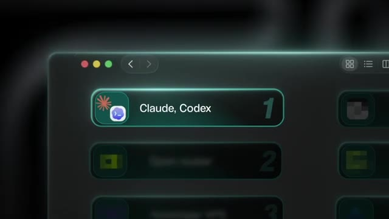
*⏱️ 00:00:26 — Gros plan sur l'interface graphique mettant en avant le premier outil de la liste numérotée, 'Claude, Codex'.*

---

### ⏱️ `[00:00:35 - 00:01:09]` | Segment #02

**🔊 Audio (Transcription Intégrale Mot pour Mot en Français) :**
> Le premier levier le plus important dans mon entreprise. Si je ne devais utiliser qu'un seul de ces outils de cette liste aujourd'hui, ce serait soit Claude Code, soit Codex. Je peux les utiliser pour créer des présentations, des tableurs et des Google Docs. Je peux les utiliser comme partenaire de brainstorming, comme conseiller, et fondamentalement comme tout mon système d'exploitation sur lequel repose toute mon entreprise. Mon second cerveau y réside, tous mes projets, mes compétences, toutes mes connaissances, toutes mes transcriptions de réunions, tout ce genre de choses. Il pilote environ 90 % de mon flux de travail quotidien. Il m'a également aidé à éliminer de nombreux autres outils pour lesquels je payais auparavant, car maintenant je peux simplement les fabriquer moi-même. J'avais donc l'habitude de payer pour quelque chose comme Gamma pour faire des présentations ou quelque chose comme Poppy pour m'aider avec le contenu. Et maintenant, je peux juste fabriquer mon propre petit

**👁️ Analyse Visuelle d'Écran (gemini-3.5-flash-lite) :**
**Interface & Outils** : Google Sheets, extension Claude for Sheets.

**Contenu textuel & Code** : Document de tableur "Q3 budget vs actuals" et instructions textuelles dans le volet latéral Claude.

**Action / Démonstration** : Utilisation d'un assistant IA pour automatiser la création et la structuration de données financières dans un tableur.

*⏱️ 00:00:43 — Interface Google Sheets avec une barre latérale Claude pour générer et formuler des tableaux de budget.*

---

### ⏱️ `[00:01:09 - 00:01:30]` | Segment #03

**🔊 Audio (Transcription Intégrale Mot pour Mot en Français) :**
> des applications personnalisées à la place. J'ai même construit ma propre version de Loom que j'utilise parce qu'une fois qu'on peut simplement décrire l'outil que l'on veut, vous savez, on n'a plus vraiment besoin de louer l'outil de quelqu'un d'autre. Maintenant, ce n'est pas moi qui dis qu'il est facile de créer un logiciel que l'on pourrait porter à des centaines de milliers d'utilisateurs, mais si vous l'utilisez juste vous-même ou pour une petite équipe, ce n'est pas si risqué. Donc si vous dirigez une entreprise, un bon point de départ est un outil pour lequel vous payez chaque mois, mais dont vous n'utilisez qu'une seule fonctionnalité.

**👁️ Analyse Visuelle d'Écran (gemini-3.5-flash-lite) :**
**Interface & Outils** : Maquette d'interface web / application

**Contenu textuel & Code** : Éléments graphiques d'interface, images de paysages naturels et blocs de texte descriptifs

**Action / Démonstration** : Présentation visuelle de maquettes d'applications logicielles personnalisées

*⏱️ 00:01:14 — Capture d'écran montrant une interface utilisateur de type tableau de bord ou application web avec des visuels de nature et du texte, affichée sous forme de maquette.*

---

### ⏱️ `[00:01:30 - 00:01:54]` | Segment #04

**🔊 Audio (Transcription Intégrale Mot pour Mot en Français) :**
> Ou vous pouvez pointer quelque chose comme Cloud Code vers des procédures opérationnelles standard et des documents clients, et votre équipe peut poser huit questions au lieu de vous les poser. Maintenant, les gens me demandent toujours lequel de ces deux-là j'utilise, et la réponse est que c'est les deux. Je paie pour les deux, et j'utilise les deux chaque semaine. Vous savez, parfois un modèle a une longueur d'avance. Parfois, mon utilisation dure simplement plus longtemps sur l'un d'eux, donc je fais beaucoup va-et-vient. Mais en général, vous savez, je pense que Codex est beaucoup plus performant pour l'utilisation de l'ordinateur, l'utilisation du navigateur, et Cloud Code est un meilleur partenaire de réflexion lorsque je fais du brainstorming.

**👁️ Analyse Visuelle d'Écran (gemini-3.5-flash-lite) :**
**Interface & Outils** : Interface utilisateur de Claude Code et graphiques comparatifs d'agents IA.

**Contenu textuel & Code** : Textes "Sop", "Client document", "Hey, generate this week's report", et indicateurs de performance ("Processing... 63%").

**Action / Démonstration** : Génération de rapports et démonstration comparative des deux outils par l'interface.

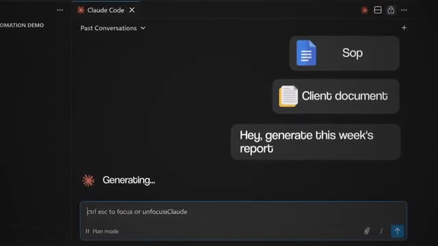
*⏱️ 00:01:36 — Interface de Claude Code affichant des documents de référence (SOP, Client document) et un prompt pour générer un rapport.*

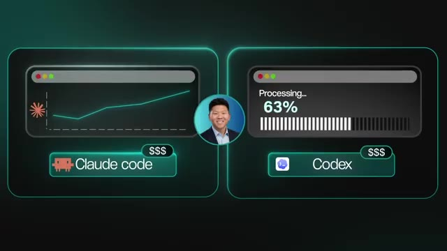
*⏱️ 00:01:48 — Comparaison visuelle entre "Claude code" (graphique de tendance) et "Codex" (barre de progression à 63%).*

---

### ⏱️ `[00:01:54 - 00:02:13]` | Segment #05

**🔊 Audio (Transcription Intégrale Mot pour Mot en Français) :**
> Et en ce moment, l'utilisation dure beaucoup plus longtemps, mais ce ne sera peut-être plus vrai dans deux mois. Ce n'est donc pas une question de savoir quel est le meilleur. C'est de savoir lequel d'entre eux est le meilleur pour la tâche que je fais en ce moment. Et comment est-ce que je construis tout mon système, en quelque sorte mon AIOS, tous mes fichiers, mes dossiers et mes projets d'une manière où je peux basculer entre les deux et où ce n'est pas une corvée ou ce n'est pas pénible du tout. Mais passons au numéro deux, qui est OpenRouter.

**👁️ Analyse Visuelle d'Écran (gemini-3.5-flash-lite) :**
**Interface & Outils** : Incrustation graphique animée simulant une fenêtre d'application.

**Contenu textuel & Code** : Deux icônes de logiciels ou d'outils avec le texte "Website design".

**Action / Démonstration** : Présentation visuelle de concepts ou d'outils liés au design de sites web.

*⏱️ 00:02:04 — Le présentateur s'exprime tandis qu'un graphique incrusté à gauche affiche deux icônes hexagonales sous l'intitulé "Website design".*

---

### ⏱️ `[00:02:13 - 00:02:49]` | Segment #06

**🔊 Audio (Transcription Intégrale Mot pour Mot en Français) :**
> OpenRouter vous donne accès à plus de 500 modèles d'IA provenant de plus de 80 fournisseurs différents via un seul et unique compte. Tout est donc regroupé au même endroit. Vous n'avez pas à gérer une multitude de clés différentes, d'informations de facturation distinctes ou de mots de passe pour des services comme OpenAI, Anthropic, Google et tous les autres fournisseurs de modèles d'IA. Ainsi, toutes les automatisations que nous avons actuellement en production, que ce soit pour mon entreprise ou, vous savez, pour l'une de celles que nous mettons en production pour un client, utilisent pratiquement OpenRouter comme fournisseur de modèles d'IA pour les alimenter, vous savez, parce que je peux aussi configurer des solutions de secours de sorte que si un modèle tombe en panne ou génère une erreur, il essaie simplement le suivant, il bascule sur le modèle de secours au lieu que toute l'automatisation ne plante. Et je peux créer une clé API séparée par automatisation. Ainsi, les analyses

**👁️ Analyse Visuelle d'Écran (gemini-3.5-flash-lite) :**
**Interface & Outils** : Animation graphique / Diagramme animé de présentation

**Contenu textuel & Code** : Logotype et nom OpenRouter relié à un bloc Fable 5

**Action / Démonstration** : Animation de transition et illustration visuelle de la centralisation des modèles par OpenRouter

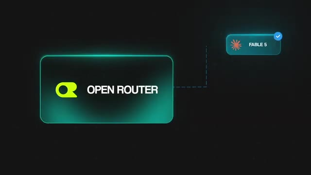
*⏱️ 00:02:40 — Animation graphique illustrant le logo d'OpenRouter connecté à un élément nommé Fable 5.*

---

### ⏱️ `[00:02:49 - 00:03:24]` | Segment #07

**🔊 Audio (Transcription Intégrale Mot pour Mot en Français) :**
> me montrent exactement lequel me coûte combien d'argent. Donc, si vous créez des automatisations pour votre propre entreprise, ce que je suppose que vous faites tous, alors vous pourriez avoir un modèle bon marché et rapide pour trier vos prospects entrants, puis vous pourriez avoir un modèle plus intelligent pour rédiger les véritables réponses ou effectuer différents raisonnements. Et tout cela peut se faire dans un seul tableau de bord auprès d'un seul fournisseur. C'est un outil vraiment, vraiment simple. Et c'est un peu pour ça que je l'aime. Tout est dans un seul tableau de bord, comme je l'ai dit, et tout peut être payé avec une seule carte bancaire, et changer de modèle consiste fondamentalement à modifier une seule ligne. Super facile. Très rapidement, les gars, j'ai ce kit entièrement gratuit que je veux vous offrir à tous pour vous aider à construire votre propre système d'exploitation IA (AIOS). Que vous ayez besoin de le construire ou de le faire évoluer, c'est le kit complet. Il est basé sur mon propre cadre de travail. J'appelle ça le Herc Loop.

**👁️ Analyse Visuelle d'Écran (gemini-3.5-flash-lite) :**
**Interface & Outils** : Navigateur web affichant une page d'atterrissage (landing page).

**Contenu textuel & Code** : Texte promotionnel : "Yours Free: an AI OS template that will 10x your productivity" avec un formulaire pour s'inscrire par e-mail.

**Action / Démonstration** : Présentation de la ressource gratuite "AI OS" proposée aux spectateurs pour améliorer leur productivité.

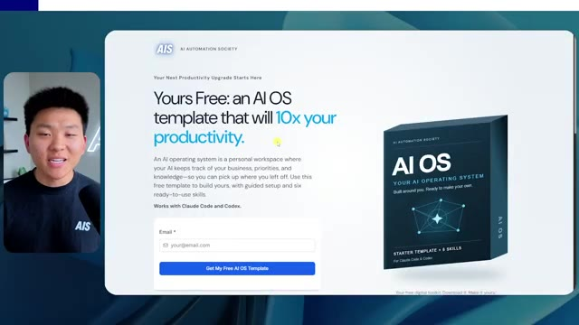
*⏱️ 00:03:15 — Capture d'écran d'une page web présentant une offre de modèle "AI OS" de l'AI Automation Society avec un champ de saisie d'e-mail.*

---

### ⏱️ `[00:03:24 - 00:03:57]` | Segment #08

**🔊 Audio (Transcription Intégrale Mot pour Mot en Français) :**
> Contexte, Connexions, Capacités et Cadence. Cet outil propose six compétences. Il vous aide à configurer un cerveau. Il vous aide à définir vos priorités et votre entreprise, et il vous interviewe. C'est exactement comme cela que j'ai construit mon propre système d'exploitation IA, et c'est ce qui me permet d'aller aussi vite. Donc, si vous voulez vous le procurer, le lien est dans la description. Mais bref, revenons à la vidéo. Très bien, passons au numéro trois, Hostinger VPS. Maintenant, Hostinger sponsorise cette partie de la vidéo, mais je l'aurais mise dans la liste de toute façon, parce que je l'utilise vraiment et que je l'utilise depuis très, très longtemps. Un VPS est un serveur privé virtuel. Donc, en gros, un ordinateur dans le cloud qui reste allumé 24h/24 et 7j/7 et qui garde toutes vos données sur ce serveur privé.

**👁️ Analyse Visuelle d'Écran (gemini-3.5-flash-lite) :**
**Interface & Outils** : Navigateur web et interface utilisateur logicielle minimaliste avec menus en surbrillance.

**Contenu textuel & Code** : Texte descriptif sur l'AI OS et les 4C, options de configuration et intégrations d'outils IA (Claude, Codex, Open router).

**Action / Démonstration** : Navigation et présentation visuelle des fonctionnalités de configuration du système d'exploitation IA.

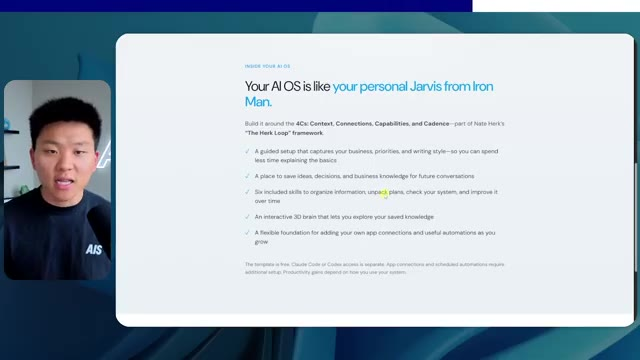
*⏱️ 00:03:32 — Présentation web détaillant le fonctionnement de l'OS IA inspiré de Jarvis et basé sur le framework des 4C (Context, Connections, Capabilities, Cadence).*

*⏱️ 00:03:41 — Interface sombre avec un menu de sélection affichant différentes options dont "Claude, Codex" et "Open router".*

---

### ⏱️ `[00:03:57 - 00:04:32]` | Segment #09

**🔊 Audio (Transcription Intégrale Mot pour Mot en Français) :**
> en fonctionnement même si votre ordinateur portable ou de bureau est fermé ou éteint. Bon, celui-ci a sans doute l'air le plus ennuyeux de la liste, mais c'est là que se trouvent concrètement bon nombre de mes projets. J'en ai un qui tourne et qui se termine. J'en ai un qui fait tourner, vous savez, des agents Hermes et des agents OpenClaw et tous les autres agents open source que vous pourriez vouloir héberger plus tard ou même des modèles open source que vous pourriez vouloir héberger vous-même. Vous savez, mes agents Hermes peuvent automatiser différentes parties de mon entreprise ici. Par exemple, j'en ai un qui fait du trading d'actions pour moi et un autre qui crée des reels et des carrousels Instagram pour moi 24 heures sur 24, 7 jours sur 7. Et puis j'en utilise certains juste pour tester différentes configurations de code dans le cloud. Et la raison pour laquelle j'utilise Hostinger, c'est que je peux lancer un serveur très rapidement en un seul clic de bouton sans avoir à me soucier du côté technique, comme la mise à l'échelle ou la puissance de calcul ou, vous savez,

**👁️ Analyse Visuelle d'Écran (gemini-3.5-flash-lite) :**
**Interface & Outils** : Graphique de présentation de type diagramme de flux (Hermes Agent).

**Contenu textuel & Code** : Schéma avec "HERMES AGENT" et ses fonctionnalités connectées (Trading stocks, Test claude setup, Instagram Reels, Instagram Carousel).

**Action / Démonstration** : Présentation des différents cas d'usage et projets gérés par l'agent IA.

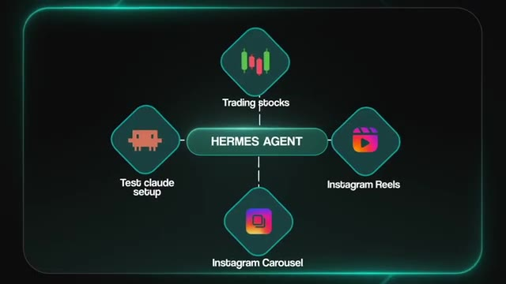
*⏱️ 00:04:24 — Schéma graphique illustrant "HERMES AGENT" au centre relié à quatre cas d'usage : "Trading stocks", "Test claude setup", "Instagram Reels", et "Instagram Carousel".*

---

### ⏱️ `[00:04:32 - 00:05:06]` | Segment #10

**🔊 Audio (Transcription Intégrale Mot pour Mot en Français) :**
> en exécutant les différentes commandes ou quoi que ce soit d'autre, parce que je ne viens pas vraiment d'un milieu technique ou d'un milieu DevOps. Donc, à cause de tous ces modèles en un clic pour les outils tendance comme Enidon, Hermes ou OpenClaw, ou peu importe ce qui sortira ensuite, ça rend les choses tellement plus faciles. Et ça garantit aussi que je n'ai pas à m'inquiéter la nuit quand j'essaie de dormir, en me demandant si quelque chose va s'arrêter et si je ne vais pas réussir à comprendre ce qui s'est passé et pourquoi. Et si vous voulez essayer celui-ci par vous-même, vous pouvez aller sur hostinger.com slash nateherckvps, et ce sera lié dans la description. Et une dernière petite chose à ce sujet, les gars, Hostinger m'a dit qu'ils ont cette vente du Black Friday de pratiquement maintenant jusqu'à environ la moitié du mois de décembre. Il va donc y avoir plein de soldes différentes et le Cyber Monday et plein d'autres choses.

**👁️ Analyse Visuelle d'Écran (gemini-3.5-flash-lite) :**
**Interface & Outils** : Éditeur de code (VS Code ou similaire) sur ordinateur portable.

**Contenu textuel & Code** : Lignes de code source affichées à l'écran du portable.

**Action / Démonstration** : Consultation de code ou programmation tardive illustrant la difficulté technique.

*⏱️ 00:04:49 — Un utilisateur perplexe ou fatigué devant un ordinateur portable affichant du code la nuit.*

---

### ⏱️ `[00:05:06 - 00:05:26]` | Segment #11

**🔊 Audio (Transcription Intégrale Mot pour Mot en Français) :**
> de différentes choses en cours. Donc je vais vous laisser aller voir ça et explorer ces offres. Mais bref, revenons à la vidéo. Donc le numéro quatre est GrokBot. Et j'utilise celui-ci énormément. GrokBot vous permet de configurer des bots qui font du travail pour vous. Et ils partagent tous un ordinateur dans le cloud avec un navigateur, un système de fichiers, et un terminal. Donc ils peuvent fondamentalement faire tout ce que vous pourriez faire vous-même sur un vrai ordinateur. Et ce que j'adore avec GrokBot, c'est la rapidité avec laquelle je peux configurer une automatisation.

**👁️ Analyse Visuelle d'Écran (gemini-3.5-flash-lite) :**
**Interface & Outils** : Application web GrokBot / interface d'agents virtuels

**Contenu textuel & Code** : Champs de connexion (Email, Password) et interface de bureau virtuel partagé

**Action / Démonstration** : Configuration et visualisation des bots sur un ordinateur virtuel partagé

*⏱️ 00:05:16 — Interface de GrokBot montrant un écran virtuel avec une fenêtre de connexion (Email, Password, Sign in) et des menus latéraux.*

---

### ⏱️ `[00:05:26 - 00:06:00]` | Segment #12

**🔊 Audio (Transcription Intégrale Mot pour Mot en Français) :**
> Parce qu'il intègre des connecteurs vers toutes les applications que j'utilise déjà. Je l'ai sur mon téléphone et ça se synchronise presque automatiquement. Je peux y programmer des routines hyper facilement. Donc essentiellement des automatisations qui s'exécutent selon un certain calendrier ou un webhook. Et elles continuent de tourner tout le temps en arrière-plan, directement depuis ma poche. Donc par exemple, après chaque appel de questions-réponses dans ma communauté Plus, l'un de mes Grokbots récupère les transcriptions, les publie dans ma communauté, et les met également dans la salle de classe pour que les membres puissent les retrouver plus tard. Un autre publie dans mes deux communautés à chaque fois que je sors une vidéo YouTube. C'est donc toutes ces petites tâches répétitives que je pourrais oublier, ou si je les oubliais, je devrais les rattraper plus tard. Grokbot peut désormais s'occuper de tout ça. Donc

**👁️ Analyse Visuelle d'Écran (gemini-3.5-flash-lite) :**
**Interface & Outils** : Présentation vidéo avec graphismes textuels animés.

**Contenu textuel & Code** : Texte indicatif 'Q&A CALL', 'PLUS COMMUNITY', 'AIS classroom', 'AIS community'.

**Action / Démonstration** : Présentation par le créateur et affichage de graphismes de transition textuels.

---

### ⏱️ `[00:06:00 - 00:06:18]` | Segment #13

**🔊 Audio (Transcription Intégrale Mot pour Mot en Français) :**
> Je n'ai pas besoin d'être parfaitement cohérent et il y a moins de marge d'erreur humaine pour que je commette une erreur. J'en ai un autre configuré qui me tient au courant de tout ce qui se passe dans l'IA. Il m'envoie simplement de petits rappels et j'ai toutes ces petites personnalités différentes de GrokBot configurées et chacune a un travail très précis. La façon dont j'envisage les choses, c'est que c'est comme avoir un tas d'OpenClaws dans sa poche, mais avec beaucoup moins de configuration technique.

**👁️ Analyse Visuelle d'Écran (gemini-3.5-flash-lite) :**
**Interface & Outils** : Application de chat / agent IA (interface sombre avec panneau latéral).

**Contenu textuel & Code** : Messages sur l'évolution des agents IA vers des travailleurs autonomes, les mises à jour développeur et la concurrence entre OpenAI, Anthropic et Google.

**Action / Démonstration** : Affichage des messages et rappels générés par l'agent IA "Chief of staff".

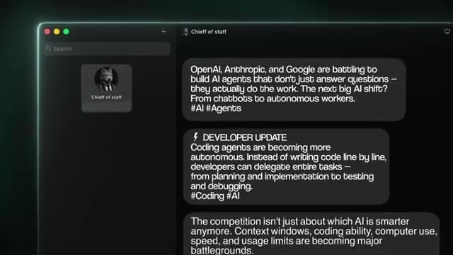
*⏱️ 00:06:09 — Capture d'écran d'une application affichant des messages textuels d'un agent IA nommé "Chief of staff" concernant l'actualité de l'intelligence artificielle.*

---

### ⏱️ `[00:06:18 - 00:06:37]` | Segment #14

**🔊 Audio (Transcription Intégrale Mot pour Mot en Français) :**
> Parce qu'avec OpenClaw, vous devez en quelque sorte gérer le côté serveur, la connexion, l'hébergement et tout le reste. Mais avec GrokBot, vous décrivez simplement ce que vous voulez et c'est juste une application que vous installerez soit sur votre ordinateur portable, soit sur votre téléphone. Très bien, alors passons au suivant. Numéro cinq, il s'agit de Glido. Et en toute transparence, je suis partenaire de Glido. Mais c'est ainsi que vous savez que je l'utilise réellement et que j'ai confiance en sa vision.

**👁️ Analyse Visuelle d'Écran (gemini-3.5-flash-lite) :**
**Interface & Outils** : Tableau de bord web d'OpenClaw et interface de sélection d'applications/agents (GrokBot, Glaido).

**Contenu textuel & Code** : Menus de configuration serveur, onglet Skills, et listes d'applications (Grok bot, Glaido).

**Action / Démonstration** : Navigation dans l'interface de gestion OpenClaw puis visualisation des options de l'application GrokBot.

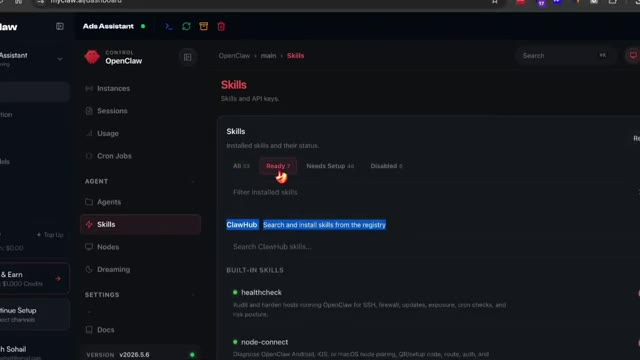
*⏱️ 00:06:23 — Capture d'écran du tableau de bord d'OpenClaw montrant la section Skills et la gestion des configurations serveur.*

*⏱️ 00:06:33 — Interface sombre affichant des applications ou des agents configurables, notamment "Grok bot" et "Glaido".*

---

### ⏱️ `[00:06:37 - 00:06:57]` | Segment #15

**🔊 Audio (Transcription Intégrale Mot pour Mot en Français) :**
> Donc c'est une application de dictée vocale. Donc vous maintenez simplement une touche enfoncée, vous parlez, et ensuite les mots sont tapés et collés dans n'importe quelle application dans laquelle vous vous trouvez réellement. Donc je ne tape pratiquement plus. Des invites, des messages, des e-mails. Je parle simplement dans mon micro et c'est là. Mais vous pouvez vraiment personnaliser tous vos paramètres dedans. C'est aussi la plus rapide du marché et elle est totalement privée. Mais la raison pour laquelle je voulais mettre celle-ci sur la liste, c'est à cause du mode de commande à l'intérieur de Glido.

**👁️ Analyse Visuelle d'Écran (gemini-3.5-flash-lite) :**
**Interface & Outils** : Éditeur de code (VS Code / Claude Code) et application de dictée vocale.

**Contenu textuel & Code** : Code source affiché dans l'éditeur et interface de dictée vocale active avec mention d'enregistrement.

**Action / Démonstration** : Démonstration de l'application de dictée vocale en situation réelle avec affichage du code.

*⏱️ 00:06:42 — Le présentateur montrant l'écran d'un ordinateur affichant un éditeur de code et une application de dictée vocale.*

---

### ⏱️ `[00:06:57 - 00:07:18]` | Segment #16

**🔊 Audio (Transcription Intégrale Mot pour Mot en Français) :**
> Cela signifie qu'au lieu de faire simple dictée, il peut aussi agir pour vous. Je peux donc lui demander de faire des recherches sur le web, de résumer une vidéo YouTube, de mener des recherches approfondies, de trouver et d'ouvrir des fichiers et des applications pour moi, ou vous pouvez même parcourir toutes les différentes choses que j'ai dites à Glido. Et tout cela est évidemment stocké localement. Comme je l'ai dit, c'est totalement privé. Et ce qui est génial avec le mode commande, c'est que vous pouvez créer des outils personnalisés pour lui. Donc en gros, vous pouvez créer des serveurs MCP personnalisés par-dessus.

**👁️ Analyse Visuelle d'Écran (gemini-3.5-flash-lite) :**
**Interface & Outils** : Interface web de Glaido / Application de dictée et d'automatisation vocale.

**Contenu textuel & Code** : Texte interactif de questionnaire 'Question 1 of 7: Who are you, what do you sell, and who do you sell it to?' et champ de saisie 'Do anything'.

**Action / Démonstration** : Navigation et présentation des fonctionnalités d'interaction vocale et d'automatisation de l'outil Glaido.

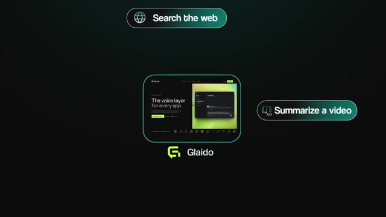
*⏱️ 00:07:02 — Présentation du logiciel Glaido avec des infobulles indiquant des fonctionnalités comme 'Search the web' et 'Summarize a video'.*

*⏱️ 00:07:07 — Interface sombre d'une application interactive affichant une question questionnaire et une zone de saisie 'Do anything'.*

---

### ⏱️ `[00:07:18 - 00:07:39]` | Segment #17

**🔊 Audio (Transcription Intégrale Mot pour Mot en Français) :**
> Donc en gros, des plugins, et vous pourriez faire en sorte que cela lance des fils de discussion dans Cloud Code ou Codex, ou que cela se synchronise avec votre Notion ou votre application de tâches, ou quoi que ce soit d'autre. En fin de compte, la vision que nous avons pour Glido, c'est que vous puissiez contrôler tout votre ordinateur avec juste votre voix et accomplir tout autant de travail loin de votre bureau que si vous étiez assis devant. Et même si vous utilisez seulement la fonction de dictée et non le mode commande, cela fait quand même gagner énormément de temps lorsque vous écrivez des e-mails ou des SFP, ou quoi que ce soit d'autre que vous pourriez être en train de faire.

**👁️ Analyse Visuelle d'Écran (gemini-3.5-flash-lite) :**
**Interface & Outils** : Interface graphique de présentation (schéma conceptuel).

**Contenu textuel & Code** : Texte du schéma : "1. Kick off threads", "2. Sync to notion", "3. Sync to task app".

**Action / Démonstration** : Affichage d'un diagramme illustrant la synchronisation et l'automatisation avec différentes applications.

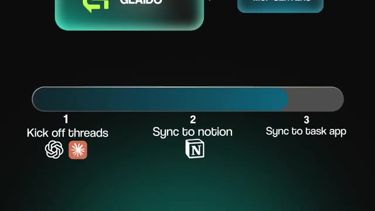
*⏱️ 00:07:23 — Schéma conceptuel montrant les étapes logicielles : 1. Kick off threads, 2. Sync to notion, 3. Sync to task app.*

---

### ⏱️ `[00:07:40 - 00:08:07]` | Segment #18

**🔊 Audio (Transcription Intégrale Mot pour Mot en Français) :**
> Juste parler est plus rapide que taper. Bon, passons au numéro six. Celui-ci, c'est Key.ai et c'est fondamentalement l'équivalent d'OpenRouter, mais pour les images et les vidéos. Vous obtenez un accès à l'acte à un tas de modèles d'images et de vidéos au même endroit comme Luma, ou Kling, ou Seedance, Nano Banana, GPT Image 2. Chaque fois que je crée des images ou des visuels pour un carrousel, ou pour une miniature, ou pour une reel Instagram ou quoi que ce soit d'autre, j'utilise Key.ai parce que vous payez seulement pour ce que vous générez et c'est l'option la moins chère que j'aie trouvée quand je crée beaucoup d'images et de vidéos en même temps.

**👁️ Analyse Visuelle d'Écran (gemini-3.5-flash-lite) :**
**Interface & Outils** : Key.ai (interface web de modèles d'IA)

**Contenu textuel & Code** : Cartes de modèles d'IA : "GPT Image 2", "Nano Banana 2", "Veo 3.1" avec des descriptions et des boutons "Try Model".

**Action / Démonstration** : Navigation et présentation de l'interface de Key.ai montrant l'accès à plusieurs modèles d'IA d'images et vidéos.

*⏱️ 00:07:53 — Interface de la plateforme Key.ai montrant différentes cartes de modèles d'IA pour les images et vidéos comme GPT Image 2 et Veo 3.1.*

---

### ⏱️ `[00:08:07 - 00:08:27]` | Segment #19

**🔊 Audio (Transcription Intégrale Mot pour Mot en Français) :**
> Donc pour vous les gars, ce genre de choses, ce sont les photos de produits, les visuels publicitaires, les petites vidéos pour les réseaux sociaux, vous savez, quel que soit ce que ça peut être. Et vous n'avez pas à payer d'abonnement mensuel. Vous payez simplement à l'utilisation. Et le dernier ici, le numéro sept, c'est trigger.dev. Il héberge votre code TypeScript et il s'exécute selon un calendrier ou chaque fois qu'un événement se déclenche, comme un webhook. Donc, contrairement à un VPS, il n'y a aucun serveur à gérer.

**👁️ Analyse Visuelle d'Écran (gemini-3.5-flash-lite) :**
**Interface & Outils** : Interface web de gestion de tâches et de projets.

**Contenu textuel & Code** : Noms de tâches comme 'clickup-followup-poller', 'clickup-research-poller', 'company-researcher' associés à des chemins de fichiers source TypeScript.

**Action / Démonstration** : Navigation et survol des différentes tâches automatisées dans le tableau de bord.

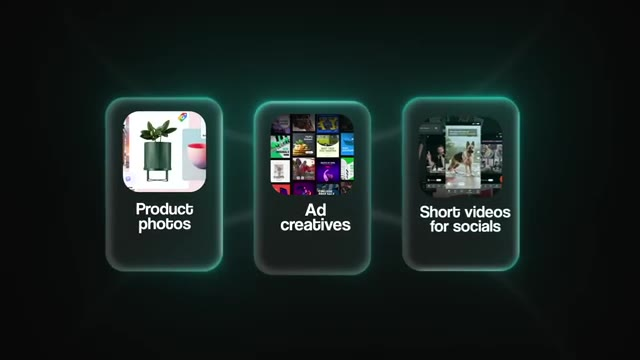
*⏱️ 00:08:12 — Trois boîtes de démonstration illustrant les cas d'usage : 'Product photos', 'Ad creatives' et 'Short videos for socials'.*

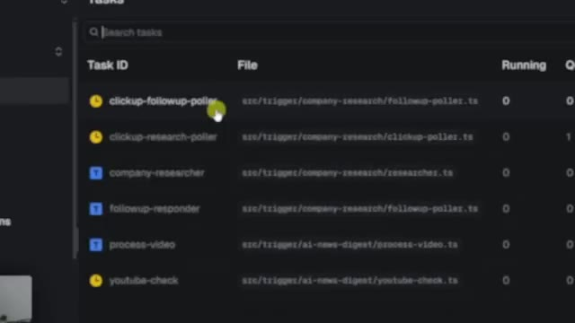
*⏱️ 00:08:22 — Tableau de bord affichant une liste de tâches ('Task ID' et 'File') avec des chemins de fichiers et des indicateurs d'état.*

---

### ⏱️ `[00:08:27 - 00:09:03]` | Segment #20

**🔊 Audio (Transcription Intégrale Mot pour Mot en Français) :**
> C'est juste votre code et il est simplement exécuté. Nous utilisons cela tout le temps pour toutes les automatisations dans l'entreprise qui sont plus déterministes, ce qui signifie qu'elles sont plus prévisibles. Elles font les mêmes étapes à chaque fois, comme le traitement de documents ou la synchronisation de données entre deux outils différents. Celles-là n'ont pas vraiment besoin d'un agent IA complet avec une boucle CloudCode ou AgendaCarness. Et ce serait un peu un gaspi d'utiliser quelque chose d'aussi puissant. Ce serait un peu exagéré pour quelque chose d'aussi simple. Donc, nous créons simplement un script en utilisant CloudCode, et ensuite nous mettons ce script dans trigger.dev pour qu'il s'exécute automatiquement. Et je n'ai même pas besoin d'ouvrir trigger.dev. Je n'ai pas besoin, genre, ce n'est pas très compliqué parce que je dis simplement à CloudCode, hé, je veux une automatisation TypeScript trigger.dev pour ce cas d'utilisation, et il va la construire. Il va

**👁️ Analyse Visuelle d'Écran (gemini-3.5-flash-lite) :**
**Interface & Outils** : AUCUNE

**Contenu textuel & Code** : AUCUNE

**Action / Démonstration** : AUCUNE

---

### ⏱️ `[00:09:03 - 00:09:23]` | Segment #21

**🔊 Audio (Transcription Intégrale Mot pour Mot en Français) :**
> l'aussi déployer, il va aussi le tester, et il peut également le mettre à jour pour moi. Et comme il s'agit simplement d'exécuter du code, c'est aussi super, super bon marché. Donc vous payez essentiellement juste à la seconde où il s'exécute, et le forfait gratuit comprend cinq dollars de crédits chaque mois, ce qui, honnêtement, vous durera pas mal de temps. Donc pour votre entreprise ou pour l'entreprise de votre client, et que vous mettez en place un tas d'automatisations déterministes basées sur du code, je recommanderais vraiment d'utiliser Trigger.dev.

**👁️ Analyse Visuelle d'Écran (gemini-3.5-flash-lite) :**
**Interface & Outils** : Page web de tarification (pricing page)

**Contenu textuel & Code** : Tableau comparatif des forfaits Free et Hobby, mettant en avant les crédits gratuits de 5$.

**Action / Démonstration** : Présentation des grilles tarifaires et du forfait gratuit avec crédits inclus pour exécuter les tâches.

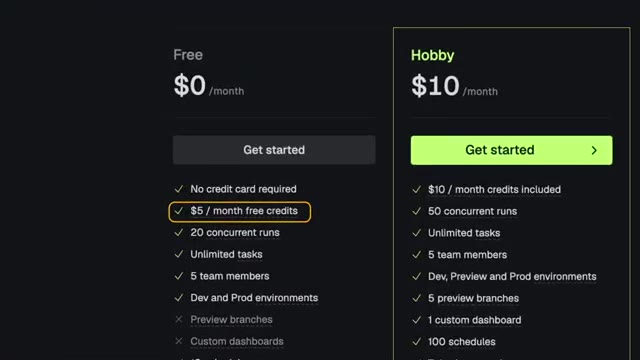
*⏱️ 00:09:13 — Page de tarification montrant le plan Free (0$/mois avec 5$ de crédits inclus) et le plan Hobby (10$/mois).*

---

### ⏱️ `[00:09:23 - 00:09:43]` | Segment #22

**🔊 Audio (Transcription Intégrale Mot pour Mot en Français) :**
> Bon, alors maintenant vous avez vu les sept outils que j'utilise pour faire tourner mon entreprise. Et évidemment, c'est ma liste. Vous savez, elle change un peu avec le temps, mais ce sont les sept sur lesquels je reviens sans cesse et que j'utilise régulièrement depuis un an et demi, deux ans maintenant. Bon, si votre entreprise fait des choses différentes de la mienne, alors cette liste exacte n'est peut-être pas la meilleure pour vous et c'est tout à fait normal. Mais je sais que l'apprentissage de certains d'entre eux peut sembler assez intimidant au début.

**👁️ Analyse Visuelle d'Écran (gemini-3.5-flash-lite) :**
**Interface & Outils** : Interface graphique listant les sept outils logiciels et plateformes d'IA.

**Contenu textuel & Code** : Liste numérotée de 1 à 7 : 1. Claude, Codex, 2. Open router, 3. Hostinger VPS, 4. Grok bot, 5. Glaido, 6. Kie.ai, 7. Trigger.dev.

**Action / Démonstration** : Présentation visuelle et énumération des outils logiciels clés utilisés pour gérer l'entreprise.

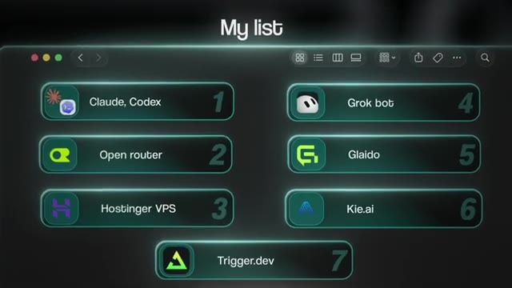
*⏱️ 00:09:28 — Capture d'écran montrant la liste des 7 outils utilisés par le présentateur ("My list").*

*⏱️ 00:09:38 — Présentateur parlant avec incrustation sur le côté gauche de la liste des 7 outils.*

---

### ⏱️ `[00:09:43 - 00:10:04]` | Segment #23

**🔊 Audio (Transcription Intégrale Mot pour Mot en Français) :**
> Et c'est pourquoi j'essaie d'en couvrir autant que possible sur cette chaîne et au sein de ma communauté. Vous pouvez également trouver toutes les ressources gratuites que j'ai jamais offertes à l'intérieur de mes communautés. Et vous pouvez poser des questions sur la façon dont les autres membres de la communauté utilisent ces outils ou trouvent le succès. Et si vous êtes vraiment sérieux au sujet de l'utilisation des outils d'IA pour créer une entreprise ou simplement gagner un peu d'argent de côté, alors vous pouvez rejoindre ma communauté plus avec tout ce dont vous avez besoin pour le côté commercial de l'IA également.

**👁️ Analyse Visuelle d'Écran (gemini-3.5-flash-lite) :**
**Interface & Outils** : Navigateur web affichant la plateforme Skool.

**Contenu textuel & Code** : Publications de la communauté Skool intitulées 'Free Skool Community' avec des discussions sur l'IA et les agents n8n.

**Action / Démonstration** : Navigation et présentation de la communauté Skool par le créateur.

*⏱️ 00:09:54 — Capture d'écran d'une interface de communauté en ligne sur la plateforme Skool montrant divers posts de discussion.*

---

### ⏱️ `[00:10:04 - 00:10:15]` | Segment #24

**🔊 Audio (Transcription Intégrale Mot pour Mot en Français) :**
> Donc les deux liens sont en bas dans la description, mais c'est tout pour celui-ci. Donc si vous avez apprécié, si vous avez appris quelque chose de nouveau, n'hésitez pas à lâcher un pouce bleu. Ça m'aide énormément. Et comme toujours, je vous remercie d'être arrivés jusqu'à la fin de la vidéo. Je vous dis à la prochaine. Merci à tous.

**👁️ Analyse Visuelle d'Écran (gemini-3.5-flash-lite) :**
**Interface & Outils** : YouTube

**Contenu textuel & Code** : Aucun code ou prompt affiché

**Action / Démonstration** : Conclusion de la vidéo et appel à l'action pour aimer.

---

