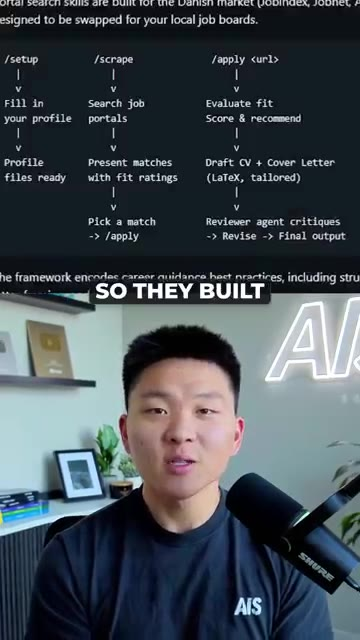
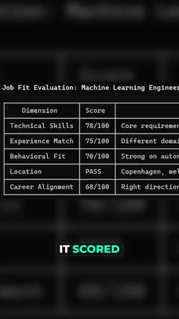
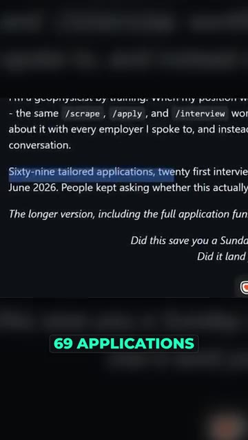

# 🎬 This GitHub repo will automate getting you a job

> **Chaîne** : [Nate Herk | AI Automation](https://www.youtube.com/@nateherk/featured)  
> **Lien YouTube** : [https://www.youtube.com/watch?v=2U8jn2M7g7U](https://www.youtube.com/watch?v=2U8jn2M7g7U)  
> **Date de publication** : 20261020  
> **Durée** : 00:00:28  
> **Identifiant vidéo** : `2U8jn2M7g7U`  
> **Transcription & Analyse** : `whisper-v3-large-turbo+gemini-3.5-flash-lite`  

---

## 📌 Synthèse Exécutive & Outils

### 💡 Résumé
Dans cette vidéo intitulée **This GitHub repo will automate getting you a job**, Nate Herk décortique les capacités pratiques d'automatisation et de développement propulsées par les modèles de pointe.

### 🛠️ Outils, Modèles & Logiciels Présentés
- **Opus 5.5 & Claude Code** : Modèles d'ingénierie et agents de codage autonome.

### 🔑 Points Clés & Enseignements Stratégiques
- Optimiser le niveau d'effort et le raisonnement des modèles IA pour des résultats industriels.
- Automatiser les cycles de création logicielle de bout en bout.

---

## ⏱️ Chronologie & Transcription Complète Audio & Visuelle (Mot pour Mot)

### ⏱️ `[00:00:00 - 00:00:22]` | Segment #01

**🔊 Audio (Transcription Intégrale Mot pour Mot en Français) :**
> So Claw just got someone 20 interviews and landed them a real job. A geophysicist got laid off in late 2025, so they built a job search system inside ClawdCode and ran it every single week on their own career. It searched job boards, it scored how well each role fit, and it wrote a tailored resume and cover letter for every single application. 69 applications turned into 21st interviews and one signed contract, and they started as an AI engineer this June.

**👁️ Analyse Visuelle d'Écran (gemini-3.5-flash-lite) :**
**Interface & Outils** : Interface de terminal ou éditeur de texte type Markdown/CLI.

**Contenu textuel & Code** : Commandes : /setup, /scrape, /apply ; Tableau : scores de compétences, expérience, fit comportemental, localisation ; Texte : "Sixty-nine tailored applications, twenty first interviews".

**Action / Démonstration** : Présentation du processus d'automatisation de la recherche d'emploi, de l'évaluation des candidats et des résultats quantifiables obtenus.

*⏱️ 00:00:05 — Un schéma de workflow montrant les commandes système : /setup, /scrape, et /apply, détaillant les étapes de recherche d'emploi automatisée.*

*⏱️ 00:00:11 — Un tableau de bord d'évaluation affichant les scores de "Job Fit" (adéquation au poste) pour un ingénieur en Machine Learning sur plusieurs critères.*

*⏱️ 00:00:16 — Une capture de texte montrant des statistiques de réussite : 69 candidatures sur mesure ayant mené à 20 entretiens en juin 2026.*

---

### ⏱️ `[00:00:22 - 00:00:28]` | Segment #02

**🔊 Audio (Transcription Intégrale Mot pour Mot en Français) :**
> Then they open sourced the entire thing, and it's sitting at almost 60,000 stars on GitHub. So just comment Hired, and I'll send you the link to the repo.

**👁️ Analyse Visuelle d'Écran (gemini-3.5-flash-lite) :**
**Interface & Outils** : GitHub (interface web).

**Contenu textuel & Code** : Description du projet : "The job search that runs on your machine. AI job application framework built on Claude Code...". Arborescence de fichiers : `.agents/skills`, `.claude`, `.github`, `company_research`, `cover_letters`.

**Action / Démonstration** : Navigation sur la page GitHub du projet pour démontrer sa popularité et sa structure technique.

*⏱️ 00:00:23 — Capture d'écran de la page GitHub d'un dépôt open source présentant un framework d'automatisation de recherche d'emploi basé sur l'IA (Claude Code). On voit la section "About", les métriques (59.6k stars, 18.7k forks) et l'arborescence des fichiers du projet.*

---

