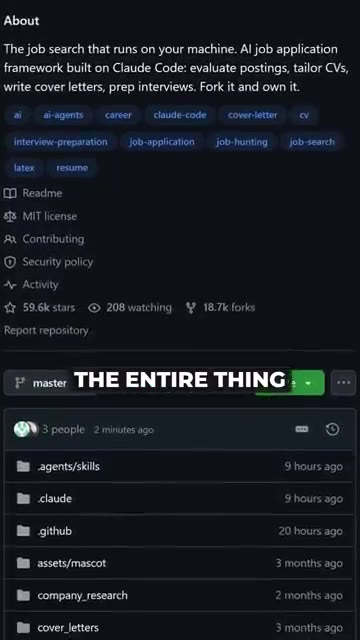

# 🎬 This GitHub repo will automate getting you a job

> **Chaîne** : [Nate Herk | AI Automation](https://www.youtube.com/@nateherk/featured)  
> **Lien YouTube** : [https://www.youtube.com/watch?v=2U8jn2M7g7U](https://www.youtube.com/watch?v=2U8jn2M7g7U)  
> **Date de publication** : 20261020  
> **Durée** : 00:00:28  
> **Identifiant vidéo** : `2U8jn2M7g7U`  
> **Transcription & Analyse** : `whisper-v3-large-turbo+gemini-3.5-flash-lite`  

---

## 📌 Synthèse Exécutive & Outils

### 💡 Résumé
Dans cette vidéo intitulée **This GitHub repo will automate getting you a job**, Nate Herk décortique les capacités pratiques d'automatisation et de développement propulsées par les modèles de pointe.

### 🛠️ Outils, Modèles & Logiciels Présentés
- **Opus 5.5 & Claude Code** : Modèles d'ingénierie et agents de codage autonome.

### 🔑 Points Clés & Enseignements Stratégiques
- Optimiser le niveau d'effort et le raisonnement des modèles IA pour des résultats industriels.
- Automatiser les cycles de création logicielle de bout en bout.

---

## ⏱️ Chronologie & Transcription Complète Audio & Visuelle (Mot pour Mot)

### ⏱️ `[00:00:00 - 00:00:22]` | Segment #01

**🔊 Audio (Transcription Intégrale Mot pour Mot en Français) :**
> So Claw just got someone 20 interviews and landed them a real job. A geophysicist got laid off in late 2025, so they built a job search system inside ClawdCode and ran it every single week on their own career. It searched job boards, it scored how well each role fit, and it wrote a tailored resume and cover letter for every single application. 69 applications turned into 21st interviews and one signed contract, and they started as an AI engineer this June.

**👁️ Analyse Visuelle d'Écran (gemini-3.5-flash-lite) :**
**Interface & Outils** : Terminal de ligne de commande (CLI) / Interface système d'agent IA.

**Contenu textuel & Code** : - Commandes : /setup, /scrape, /apply
- Données : Scores de compatibilité pour "Machine Learning Engineer" (78/100, 75/100, 70/100, etc.)
- Texte : "Sixty-nine tailored applications, twenty first interviews"

**Action / Démonstration** : Présentation du flux logique de l'agent, démonstration de l'évaluation automatisée de la pertinence des candidatures, et affichage des statistiques de réussite basées sur le système.

*⏱️ 00:00:05 — Un schéma de workflow textuel affichant les commandes "/setup", "/scrape" et "/apply" détaillant les étapes d'un processus automatisé de recherche d'emploi.*

*⏱️ 00:00:11 — Un tableau d'évaluation "Job Fit" pour le poste de "Machine Learning Engineer" montrant des scores chiffrés sur diverses dimensions comme les compétences techniques et la localisation.*

*⏱️ 00:00:16 — Un extrait de texte soulignant les résultats de l'automatisation, avec la mention "Sixty-nine tailored applications, twenty first interviews".*

---

### ⏱️ `[00:00:22 - 00:00:28]` | Segment #02

**🔊 Audio (Transcription Intégrale Mot pour Mot en Français) :**
> Then they open sourced the entire thing, and it's sitting at almost 60,000 stars on GitHub. So just comment Hired, and I'll send you the link to the repo.

**👁️ Analyse Visuelle d'Écran (gemini-3.5-flash-lite) :**
**Interface & Outils** : GitHub (interface web).

**Contenu textuel & Code** : Description du dépôt ("The job search that runs on your machine..."), liste des fichiers (.agents/skills, .claude, etc.), statistiques (59.6k stars, 18.7k forks).

**Action / Démonstration** : Navigation dans la structure des dossiers d'un repository open source.

*⏱️ 00:00:23 — Capture d'écran de la page principale d'un dépôt GitHub montrant la section "About" d'un framework d'application d'emploi basé sur l'IA et la liste des dossiers du projet.*

---

