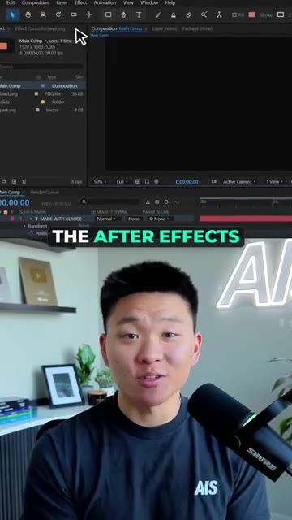
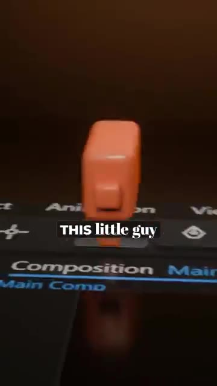
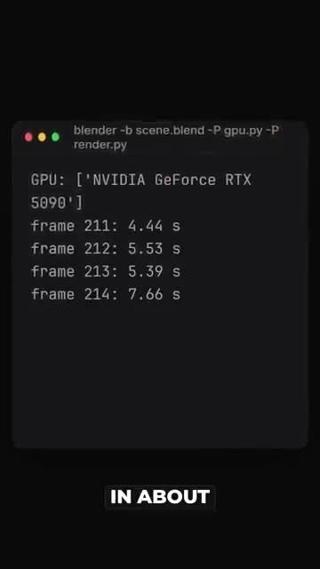
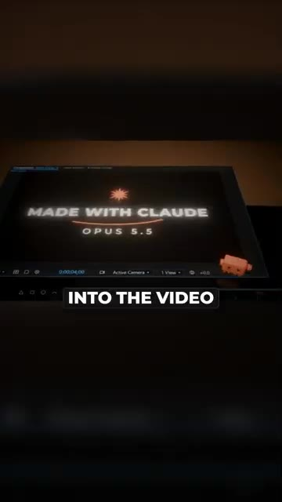
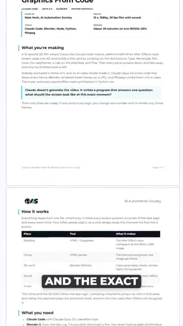

# 🎬 Claude Code + Blender = Insane 3D Renders

> **Chaîne** : [Nate Herk | AI Automation](https://www.youtube.com/@nateherk/featured)  
> **Lien YouTube** : [https://www.youtube.com/watch?v=ezCmuRCAVXY](https://www.youtube.com/watch?v=ezCmuRCAVXY)  
> **Date de publication** : 20261020  
> **Durée** : 00:00:31  
> **Identifiant vidéo** : `ezCmuRCAVXY`  
> **Transcription & Analyse** : `whisper-v3-large-turbo+gemini-3.5-flash-lite`  

---

## 📌 Synthèse Exécutive & Outils

### 💡 Résumé
Dans cette vidéo intitulée **Claude Code + Blender = Insane 3D Renders**, Nate Herk décortique les capacités pratiques d'automatisation et de développement propulsées par les modèles de pointe.

### 🛠️ Outils, Modèles & Logiciels Présentés
- **Opus 5.5 & Claude Code** : Modèles d'ingénierie et agents de codage autonome.

### 🔑 Points Clés & Enseignements Stratégiques
- Optimiser le niveau d'effort et le raisonnement des modèles IA pour des résultats industriels.
- Automatiser les cycles de création logicielle de bout en bout.

---

## ⏱️ Chronologie & Transcription Complète Audio & Visuelle (Mot pour Mot)

### ⏱️ `[00:00:00 - 00:00:19]` | Segment #01

**🔊 Audio (Transcription Intégrale Mot pour Mot en Français) :**
> What if I told you that I made this 3D animation without ever opening Blender? And no, this isn't from an AI video model like VO or C-Dance. Claude Opus 5.5 wrote the whole thing as code. It built the After Effects interface as a webpage. It wrote a Python script that builds a 3D scene in Blender. It animated this little guy hopping across the buttons. And it even made the music and every single sound effect from scratch.

**👁️ Analyse Visuelle d'Écran (gemini-3.5-flash-lite) :**
**Interface & Outils** : Adobe After Effects

**Contenu textuel & Code** : N/A (Éléments d'interface utilisateur et rendu 3D)

**Action / Démonstration** : Présentation d'une interface de logiciel de montage vidéo et démonstration d'un rendu 3D personnalisé.

*⏱️ 00:00:09 — L'image présente l'interface complète du logiciel Adobe After Effects, incluant le panneau de composition, la barre d'outils et la timeline active.*

*⏱️ 00:00:14 — L'image montre un gros plan en 3D d'un objet cubique de couleur orange, superposé visuellement par-dessus l'interface sombre d'un logiciel de montage.*

---

### ⏱️ `[00:00:19 - 00:00:31]` | Segment #02

**🔊 Audio (Transcription Intégrale Mot pour Mot en Français) :**
> Then, Blender rendered all 360 frames on my GPU in about 15 minutes. And FFmpeg stitched them into the video that you're watching right now. So if you want the full guide with the setup and the exact prompt to just paste into Claude, Comment Blender and I'll send it over.

**👁️ Analyse Visuelle d'Écran (gemini-3.5-flash-lite) :**
**Interface & Outils** : Terminal (ligne de commande), logiciel Blender, navigateur web/éditeur de document.

**Contenu textuel & Code** : Commandes Blender (`blender -b scene.blend -P gpu.py`), métadonnées de projet, tableaux explicatifs sur l'automatisation avec Claude Opus 5.5, Blender et Python.

**Action / Démonstration** : Exécution d'un rendu 3D via script Python dans le terminal et démonstration des étapes de production d'un court-métrage généré par code.

*⏱️ 00:00:22 — Une fenêtre de terminal affichant le processus de rendu de Blender en ligne de commande, indiquant l'utilisation d'un GPU NVIDIA GeForce RTX 5090 et la progression du rendu par frame.*

*⏱️ 00:00:25 — Une interface utilisateur de Blender affichant une scène 3D avec un texte "MADE WITH CLAUDE OPUS 5.5" au centre, montrant le résultat visuel final avant l'exportation.*

*⏱️ 00:00:28 — Un document de guide technique ou une page web détaillant le workflow, incluant les outils utilisés (Claude Code, Blender, Python), le fonctionnement technique ("How it works") et la liste des prérequis.*

---

