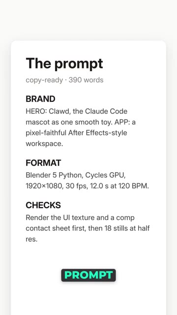
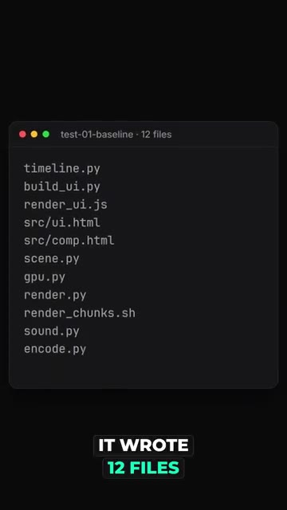
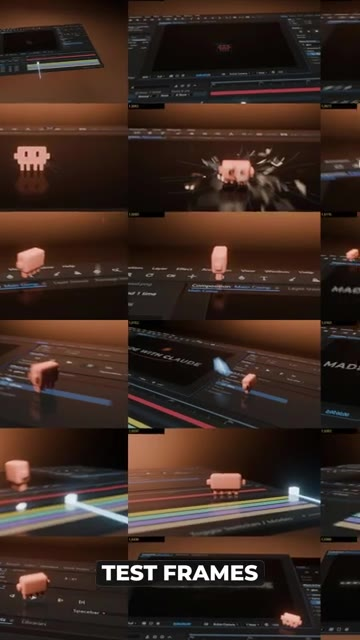
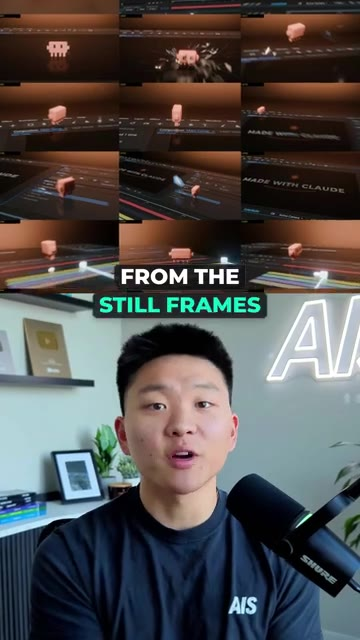
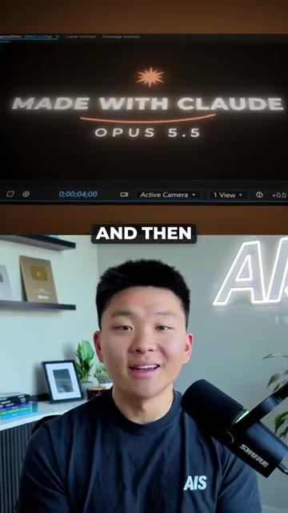
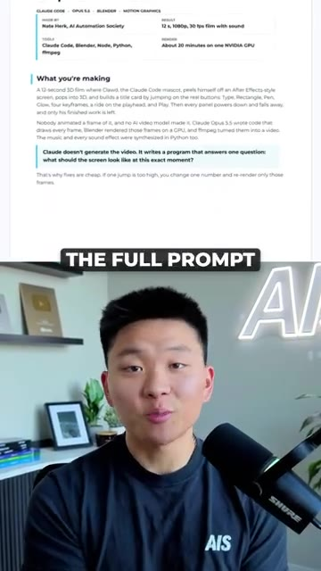

# 🎬 Opus 5.5 + Blender = Insane 3D Renders

> **Chaîne** : [Nate Herk | AI Automation](https://www.youtube.com/@nateherk/featured)  
> **Lien YouTube** : [https://www.youtube.com/watch?v=OawSCIZdZmU](https://www.youtube.com/watch?v=OawSCIZdZmU)  
> **Date de publication** : 20261021  
> **Durée** : 00:00:31  
> **Identifiant vidéo** : `OawSCIZdZmU`  
> **Transcription & Analyse** : `whisper-v3-large-turbo+gemini-3.5-flash-lite`  

---

## 📌 Synthèse Exécutive & Outils

### 💡 Résumé
Dans cette vidéo intitulée **Opus 5.5 + Blender = Insane 3D Renders**, Nate Herk décortique les capacités pratiques d'automatisation et de développement propulsées par les modèles de pointe.

### 🛠️ Outils, Modèles & Logiciels Présentés
- **Opus 5.5 & Claude Code** : Modèles d'ingénierie et agents de codage autonome.

### 🔑 Points Clés & Enseignements Stratégiques
- Optimiser le niveau d'effort et le raisonnement des modèles IA pour des résultats industriels.
- Automatiser les cycles de création logicielle de bout en bout.

---

## ⏱️ Chronologie & Transcription Complète Audio & Visuelle (Mot pour Mot)

### ⏱️ `[00:00:00 - 00:00:21]` | Segment #01

**🔊 Audio (Transcription Intégrale Mot pour Mot en Français) :**
> So Claude just made this entire 3D animation from code. Here's how. Someone online shared a 390 word prompt for this. So I gave it to Opus 5.5 inside of Claude Code just to see if it could actually pull it off. It wrote 12 files, the interface, the 3D scene in Blender, the soundtrack, and the whole render pipeline. The first test frames were kind of rough. The buttons were in the wrong spots, the character came out pinkish, and the title ran off the screen.

**👁️ Analyse Visuelle d'Écran (gemini-3.5-flash-lite) :**
**Interface & Outils** : Système de fichiers (Terminal), Logiciel de rendu 3D/Montage vidéo (type After Effects/Blender).

**Contenu textuel & Code** : Spécifications techniques du prompt (Brand, Format, Checks), liste de fichiers source (timeline.py, scene.py, render.py, etc.), vignettes de prévisualisation d'animation.

**Action / Démonstration** : Génération et structuration de code par une IA pour la création d'une séquence d'animation complexe incluant rendu 3D, interface utilisateur et bande sonore.

*⏱️ 00:00:05 — Une carte de présentation présentant les détails techniques d'un prompt complexe (390 mots) destiné à la génération d'une animation 3D.*

*⏱️ 00:00:10 — Une liste de fichiers système affichée dans une fenêtre de terminal, illustrant les 12 composants générés (scripts Python, fichiers JS, HTML, etc.).*

*⏱️ 00:00:16 — Une planche contact montrant une série de captures d'écran ("test frames") de l'animation 3D produite par l'IA au sein d'une interface de type logiciel de montage/effets visuels.*

---

### ⏱️ `[00:00:21 - 00:00:30]` | Segment #02

**🔊 Audio (Transcription Intégrale Mot pour Mot en Français) :**
> Claude then caught all of those mistakes from the still frames that it took and then re-rendered all the fixes. And then I got this output. So if you guys want to see the full prompt in the setup guide, just comment Blender and I'll send it right over to you.

**👁️ Analyse Visuelle d'Écran (gemini-3.5-flash-lite) :**
**Interface & Outils** : Adobe After Effects (interface de montage), éditeur de texte/documentation (format de guide projet).

**Contenu textuel & Code** : Titres textuels "MADE WITH CLAUDE / OPUS 5.5", notes techniques sur la génération par code (Claude Code, Blender, Python, ffmpeg).

**Action / Démonstration** : Présentation du résultat final du projet et démonstration visuelle des étapes du workflow de rendu assisté par IA.

*⏱️ 00:00:23 — Une grille de prévisualisation montrant plusieurs étapes de l'animation d'un personnage (mascotte) sur une interface de type studio graphique.*

*⏱️ 00:00:26 — Un gros plan sur le rendu final affichant le titre "MADE WITH CLAUDE" et "OPUS 5.5" au centre de l'écran de montage.*

*⏱️ 00:00:28 — Une vue détaillée d'un document textuel explicatif (type guide de configuration) décrivant le workflow de création du film 3D.*

---

