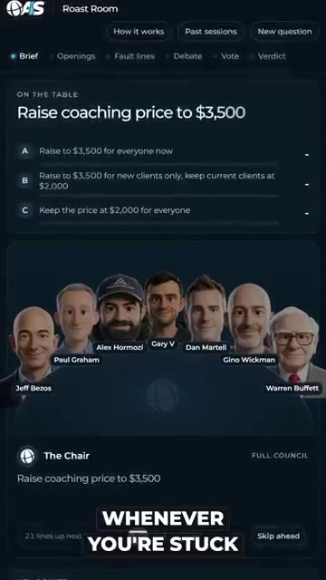
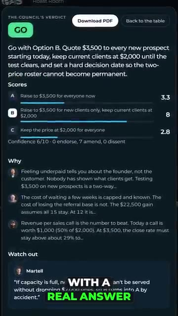

# 🎬 Alex Hormozi, Jeff Bezos, and Warren Buffet help me make decisions

> **Chaîne** : [Nate Herk | AI Automation](https://www.youtube.com/@nateherk/featured)  
> **Lien YouTube** : [https://www.youtube.com/watch?v=kj60zAD8lLU](https://www.youtube.com/watch?v=kj60zAD8lLU)  
> **Date de publication** : 20261021  
> **Durée** : 00:00:31  
> **Identifiant vidéo** : `kj60zAD8lLU`  
> **Transcription & Analyse** : `whisper-v3-large-turbo+gemini-3.5-flash-lite`  

---

## 📌 Synthèse Exécutive & Outils

### 💡 Résumé
Dans cette vidéo intitulée **Alex Hormozi, Jeff Bezos, and Warren Buffet help me make decisions**, Nate Herk décortique les capacités pratiques d'automatisation et de développement propulsées par les modèles de pointe.

### 🛠️ Outils, Modèles & Logiciels Présentés
- **Opus 5.5 & Claude Code** : Modèles d'ingénierie et agents de codage autonome.

### 🔑 Points Clés & Enseignements Stratégiques
- Optimiser le niveau d'effort et le raisonnement des modèles IA pour des résultats industriels.
- Automatiser les cycles de création logicielle de bout en bout.

---

## ⏱️ Chronologie & Transcription Complète Audio & Visuelle (Mot pour Mot)

### ⏱️ `[00:00:00 - 00:00:31]` | Segment #01

**🔊 Audio (Transcription Intégrale Mot pour Mot en Français) :**
> If Claude keeps giving you generic business advice, then you need to make Alex Ramosi, Warren Buffett, and Jeff Bezos fight about it. It's called the Roast Room, and it's completely free. You use it whenever you're stuck on a big decision. So instead of one chat telling you what you want to hear, it brings in a board of AI advisors, each built from a real expert's public work, and it gives every one of them your decision. And then they argue about it. They poke holes in each other's ideas, and they vote until the best option wins, and you walk away with a real answer and a score for every option. To set it up, all you have to do is open up Claude Code, paste in the link, and then just say, set this up for me. So if you want it, just comment roast room and I'll shoot it over.

**👁️ Analyse Visuelle d'Écran (gemini-3.5-flash-lite) :**
**Interface & Outils** : Application web propriétaire « Roast Room » (plateforme de conseil stratégique basée sur des avatars d'IA).

**Contenu textuel & Code** : Problématique métier sur la tarification de services de coaching, scores de décision (A: 3.3, B: 8, C: 2.8), et arguments textuels fournis par les modèles d'IA simulant des experts.

**Action / Démonstration** : Présentation d'un flux de travail complet : de la soumission d'une question business à la consultation du verdict final généré par une équipe d'experts IA.

*⏱️ 00:00:08 — Interface de l'application « Roast Room » montrant le problème posé : « Raise coaching price to $3,500 » avec trois options de choix, ainsi qu'un panel d'avatars de personnalités du business (Jeff Bezos, Alex Hormozi, Warren Buffett, etc.).*

*⏱️ 00:00:23 — Interface de « Roast Room » affichant le verdict du conseil : l'option B est recommandée, accompagnée des scores de vote (8/10 pour l'option B) et des justifications détaillées pour chaque choix, ainsi qu'une section « Watch out ».*

---

