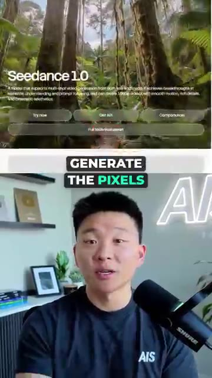
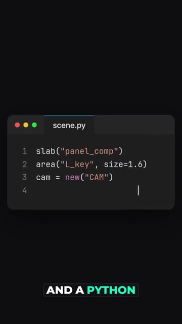
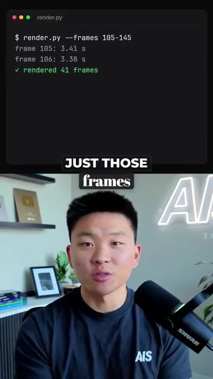
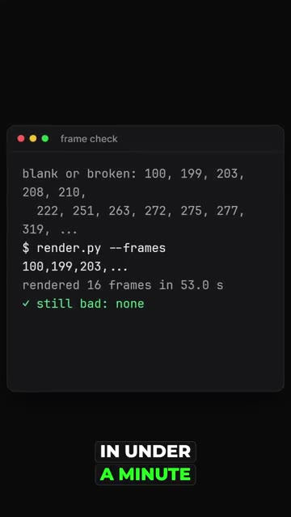
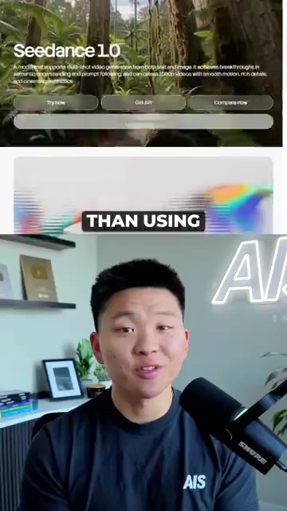

# 🎬 Claude Code + Blender = Beautiful 3D Renders

> **Chaîne** : [Nate Herk | AI Automation](https://www.youtube.com/@nateherk/featured)  
> **Lien YouTube** : [https://www.youtube.com/watch?v=zTfpVoIT03s](https://www.youtube.com/watch?v=zTfpVoIT03s)  
> **Date de publication** : 20261021  
> **Durée** : 00:00:35  
> **Identifiant vidéo** : `zTfpVoIT03s`  
> **Transcription & Analyse** : `whisper-v3-large-turbo+gemini-3.5-flash-lite`  

---

## 📌 Synthèse Exécutive & Outils

### 💡 Résumé
Dans cette vidéo intitulée **Claude Code + Blender = Beautiful 3D Renders**, Nate Herk décortique les capacités pratiques d'automatisation et de développement propulsées par les modèles de pointe.

### 🛠️ Outils, Modèles & Logiciels Présentés
- **Opus 5.5 & Claude Code** : Modèles d'ingénierie et agents de codage autonome.

### 🔑 Points Clés & Enseignements Stratégiques
- Optimiser le niveau d'effort et le raisonnement des modèles IA pour des résultats industriels.
- Automatiser les cycles de création logicielle de bout en bout.

---

## ⏱️ Chronologie & Transcription Complète Audio & Visuelle (Mot pour Mot)

### ⏱️ `[00:00:00 - 00:00:21]` | Segment #01

**🔊 Audio (Transcription Intégrale Mot pour Mot en Français) :**
> Is this video AI? Kind of, but no AI video model made a single frame of it. Tools like Vio or C-Dance generate the pixels directly, but right here, Claude actually wrote the code that answers one question over and over. What should the screen look like at this exact moment? A webpage draws the interface, a canvas draws the title as it gets built, and a Python script tells Blender where every object, light, and camera goes on every single frame.

**👁️ Analyse Visuelle d'Écran (gemini-3.5-flash-lite) :**
**Interface & Outils** : Navigateur web (Seedance 1.0), Éditeur de code (VS Code ou éditeur similaire).

**Contenu textuel & Code** : `slab("panel_comp")`, `area("L_key", size=1.6)`, `cam = new("CAM")`

**Action / Démonstration** : Présentation d'outils de génération d'images/vidéo suivie d'une démonstration de code source utilisé pour définir une scène graphique.

*⏱️ 00:00:05 — Interface web du modèle de génération vidéo "Seedance 1.0" avec des boutons d'action "Try now", "Get API" et "Companions".*

*⏱️ 00:00:16 — Éditeur de code sombre affichant un script Python nommé "scene.py" définissant des propriétés de scène (slab, area, cam).*

---

### ⏱️ `[00:00:21 - 00:00:34]` | Segment #02

**🔊 Audio (Transcription Intégrale Mot pour Mot en Français) :**
> So if one jump is too high, I just change one number and I re-render just those frames. That's also how I fixed 16 frames that broke mid-render in under a minute, instead of having to redo the whole video. This is going to be a lot cheaper than using AI video generation models, so just comment Blender and I'll send you the full guide.

**👁️ Analyse Visuelle d'Écran (gemini-3.5-flash-lite) :**
**Interface & Outils** : Terminal (ligne de commande), navigateur web (page de Seedance 10).

**Contenu textuel & Code** : Commandes : `render.py --frames 105-145`, `render.py --frames 100,199,203...` ; Logs : `rendered 41 frames`, `rendered 16 frames in 53.0 s`, `still bad: none`.

**Action / Démonstration** : Exécution d'un script de rendu sélectif pour corriger des frames spécifiques sans re-générer toute la vidéo.

*⏱️ 00:00:25 — Interface de terminal montrant l'exécution d'un script de rendu Python ciblant une plage spécifique de frames.*

*⏱️ 00:00:28 — Interface de terminal affichant une liste de frames défectueuses et la correction automatique effectuée en moins d'une minute.*

*⏱️ 00:00:31 — Capture d'écran du site web "Seedance 10", un outil de génération de vidéo par IA, utilisé pour la comparaison de coût.*

---

