# 🎬 /roast-room: How I Use Claude to Think Like the Top 1%

> **Chaîne** : [Nate Herk | AI Automation](https://www.youtube.com/@nateherk/featured)  
> **Lien YouTube** : [https://www.youtube.com/watch?v=DSS1Yqb6-qE](https://www.youtube.com/watch?v=DSS1Yqb6-qE)  
> **Date de publication** : 20261022  
> **Durée** : 00:15:00  
> **Identifiant vidéo** : `DSS1Yqb6-qE`  
> **Transcription & Analyse** : `whisper-v3-large-turbo+gemini-3.5-flash-lite`  

---

## 📌 Synthèse Exécutive & Outils

### 💡 Résumé
Dans cette vidéo intitulée **/roast-room : Comment j'utilise Claude pour penser comme le top 1 %**, Nate Herk décortique les capacités pratiques d'automatisation et de développement propulsées par les modèles de pointe.

### 🛠️ Outils, Modèles & Logiciels Présentés
- **Opus 5.5 & Claude Code** : Modèles d'ingénierie et agents de codage autonome.

### 🔑 Points Clés & Enseignements Stratégiques
- Optimiser le niveau d'effort et le raisonnement des modèles IA pour des résultats industriels.
- Automatiser les cycles de création logicielle de bout en bout.

---

## ⏱️ Chronologie & Transcription Complète Audio & Visuelle (Mot pour Mot)

### ⏱️ `[00:00:00 - 00:00:20]` | Segment #01

**🔊 Audio (Transcription Intégrale Mot pour Mot en Français) :**
> Donc, juste ici, vous pouvez voir que j'ai Jeff Bezos, Paul Graham, Alex Ramosi, Gary Vee, Dan Martel, Gino Wickman et Warren Buffett qui discutent tous d'une question business que j'avais. En gros, vous envoyez une question avec différentes options et tous ces différents membres du conseil vont en quelque sorte se réunir, passer votre idée au grill et vous aider à y réfléchir d'une manière différente. Parce que chacun de ces sièges a une question spécifique sur laquelle il se concentre.

**👁️ Analyse Visuelle d'Écran (gemini-3.5-flash-lite) :**
**Interface & Outils** : Navigateur web (application web "Roast Room").

**Contenu textuel & Code** : Panneau latéral affichant les "Key Points" et les positions d'ouverture des membres (Bezos, Graham). Au centre, un avatar de Paul Graham avec un texte détaillant une recommandation stratégique ("Option C, but pick the 5 by hand...").

**Action / Démonstration** : Démonstration visuelle de l'outil de simulation de débat par IA où plusieurs agents personnalisés interagissent sur une problématique métier.

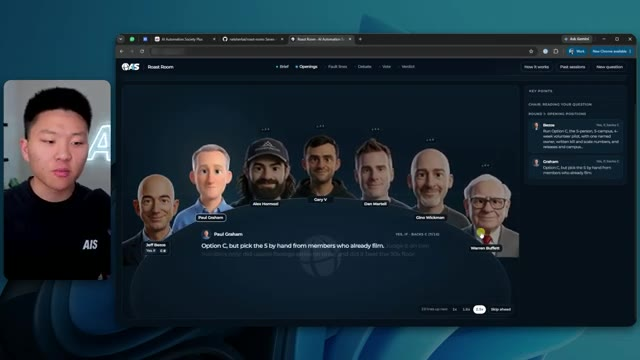
*⏱️ 00:00:05 — Interface de l'application "Roast Room" montrant un conseil consultatif virtuel composé d'avatars de personnalités du monde des affaires (Bezos, Paul Graham, Alex Hormozi, Gary Vee, etc.) analysant une question posée.*

---

### ⏱️ `[00:00:21 - 00:00:54]` | Segment #02

**🔊 Audio (Transcription Intégrale Mot pour Mot en Français) :**
> Et maintenant vous pouvez voir ce qui se passe, c'est qu'ils sont en train de débattre entre eux. Donc Jeff Bezos débattait avec Gary Vee. Même chose avec Paul Graham et Gary Vee. Maintenant j'ai Alex Hormozi qui s'en prend à Gary Vee aussi. Et wow, tout le monde décide de s'en prendre à Gary V dans cette salle de roast. C'est fou. Et voilà, Warren Buffett s'en prend à Hormozi. Mais le fait est que, comme je l'ai dit, tout le monde a sa propre question sur laquelle il se concentre. Donc la question de Warren Buffett est : qu'est-ce que ça fait à la trésorerie, au risque et à la valeur à long terme ? La question d'Alex Hormozi est : est-ce que les gens vont payer ? Combien ? Et comment on conclut ? Et la question de Gino Wickman est : est-ce que l'entreprise peut tourner sans que le fondateur ne tienne tout ensemble ?

**👁️ Analyse Visuelle d'Écran (gemini-3.5-flash-lite) :**
**Interface & Outils** : Application web propriétaire "Roast Room" (système d'IA pour débats et simulations stratégiques).

**Contenu textuel & Code** : - Image 1 : Arguments textuels comparatifs (Ex: "Gary V, his argument is that volume is the lever..."). 
- Image 2 : Données de scoring (Final Score 8/10), amendements de stratégie ("Raise the scale gate from 70%..."), et citation de synthèse ("views ain't cash, cash is cash").

**Action / Démonstration** : Navigation au sein d'une plateforme de simulation décisionnelle où l'utilisateur observe les échanges, les scores de votes et les recommandations stratégiques générés par des agents IA basés sur des personnalités publiques.

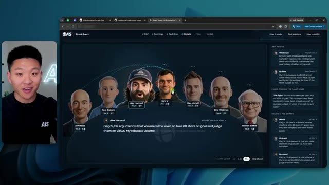
*⏱️ 00:00:29 — Interface web "Roast Room" affichant une discussion structurée sous forme de débat entre des avatars stylisés de personnalités comme Alex Hormozi et Gary Vee.*

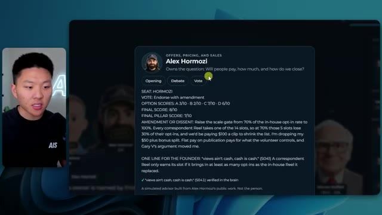
*⏱️ 00:00:45 — Fenêtre modale détaillée dans l'application "Roast Room" présentant l'analyse et le vote simulé d'Alex Hormozi sur une stratégie de vente et de prix.*

---

### ⏱️ `[00:00:54 - 00:01:15]` | Segment #03

**🔊 Audio (Transcription Intégrale Mot pour Mot en Français) :**
> Maintenant, après que ces trois cycles se sont produits, nous pouvons voir que nous avons un verdict final, qui était l'option C. Et ensuite, nous pouvons également télécharger un PDF, ce qui nous permet de lire ceci et nous pouvons en quelque sorte examiner cela plus en profondeur. Et nous pourrions également partager cela avec notre équipe si nous le voulions. Maintenant, c'est vraiment juste une couche visuelle par-dessus ce qui se passe réellement dans Cloud Code, qui exécute fondamentalement juste un groupe de sous-agents basés sur ces différents membres du conseil que j'ai créés.

**👁️ Analyse Visuelle d'Écran (gemini-3.5-flash-lite) :**
**Interface & Outils** : Navigateur web (Roast Room), Terminal Claude Code (CLI).

**Contenu textuel & Code** : "The Council's Verdict: GO", détail de l'option C (5-person, 4-week volunteer pilot), scores des options A, B, C, D. Dans le terminal : "localhost:4731", "/roast-room should I...", "Claude Code".

**Action / Démonstration** : Présentation du verdict final par l'agent, téléchargement du rapport de synthèse au format PDF, et démonstration de l'exécution via la ligne de commande dans Claude Code.

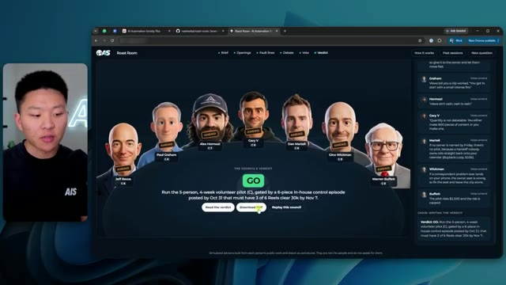
*⏱️ 00:00:59 — L'interface web de "Roast Room" affiche les avatars des conseillers et le verdict final "Option C" avec un bouton de téléchargement PDF.*

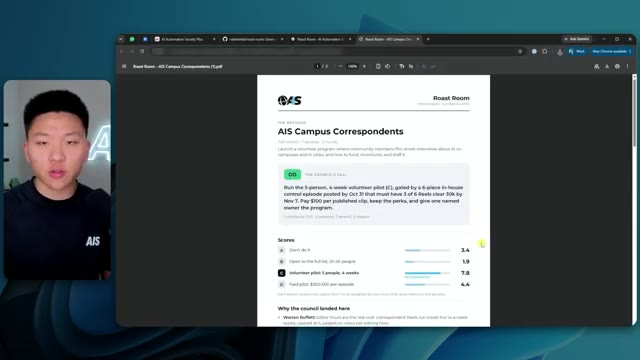
*⏱️ 00:01:05 — Affichage d'un document PDF généré présentant le détail de la décision "AIS Campus Correspondants", incluant les scores des différentes options.*

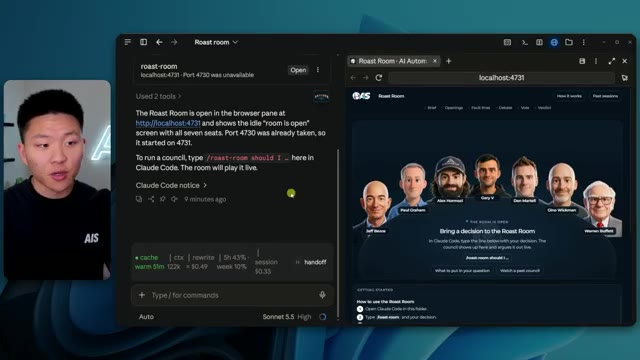
*⏱️ 00:01:10 — Vue en écran divisé montrant à gauche le terminal Claude Code (utilisant le modèle Sonnet 5.5) et à droite l'interface web "Roast Room" en attente de commande.*

---

### ⏱️ `[00:01:15 - 00:01:34]` | Segment #04

**🔊 Audio (Transcription Intégrale Mot pour Mot en Français) :**
> Donc vous n'avez pas besoin de garder ce localhost ouvert pour exécuter et utiliser ceci, mais c'est juste une belle visualisation de ce qui se passe. Et c'est complètement personnalisable, ce qui signifie que vous pouvez changer différents membres du conseil et vous pouvez en créer d'autres aussi. En fait, dans ce répertoire que je vais vous donner les gars, il y en a déjà quelques autres aussi. Hé, Claude, quels sont les autres membres du conseil à l'intérieur de notre salle de roast ?

**👁️ Analyse Visuelle d'Écran (gemini-3.5-flash-lite) :**
**Interface & Outils** : Navigateur web (Google Chrome) affichant une application web personnalisée nommée "Roast Room" (AI Automation Society).

**Contenu textuel & Code** : Portraits avatars (Jeff Bezos, Paul Graham, Alex Hormozi, Gary V, Dan Martell, Gino Wickman, Warren Buffett), texte de verdict ("The Council's Verdict: GO") et une colonne latérale résumant les avis de chaque membre du conseil.

**Action / Démonstration** : Visualisation du résultat final généré par l'agent IA, montrant la prise de décision ("GO") et les recommandations détaillées basées sur les avis des membres du conseil.

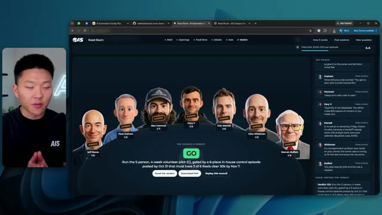
*⏱️ 00:01:20 — Interface web "Roast Room" affichant un conseil de figures d'affaires générées par IA avec un verdict textuel et une barre latérale de points clés.*

---

### ⏱️ `[00:01:34 - 00:01:57]` | Segment #05

**🔊 Audio (Transcription Intégrale Mot pour Mot en Français) :**
> Et donc voilà Glido qui est en train d'envoyer un prompt en ce moment même à Claude Code, comme vous pouvez le voir. Et ensuite, cela va nous montrer qui sont les autres membres du conseil. Claude Code répond et dit qu'il y a 11 sièges. Nous avons les sept par défaut que vous voyez ici. Et puis nous avons aussi Naval, Cody Sanchez, Sarah Blakely et Leila Hermosi. Mais bien sûr, vous pouvez en créer autant d'autres que vous le souhaitez. C'est donc une nouvelle fonctionnalité de Glido qui nous permet d'orchestrer différentes discussions entre différents agents de codage.

**👁️ Analyse Visuelle d'Écran (gemini-3.5-flash-lite) :**
**Interface & Outils** : Navigateur web (Roast Room), Claude Code (agent IA via interface ligne de commande/overlay).

**Contenu textuel & Code** : Texte de la réponse de Claude Code : "The Roast Room has 11 seats. The default board of seven members is Jeff Bezos (strategy), Paul Graham (product), Alex Hormozi (offers), Gary Vaynerchuk (marketing), Dan Martell (people), Gino Wickman (operations) and Warren Buffett (money). The four on-call members are Naval Ravikant, Codie Sanchez, Sara Blakely and Leila Hormozi."

**Action / Démonstration** : Consultation de l'interface de l'application "Roast Room" et affichage de la réponse de l'agent Claude Code concernant la structure de gouvernance du conseil.

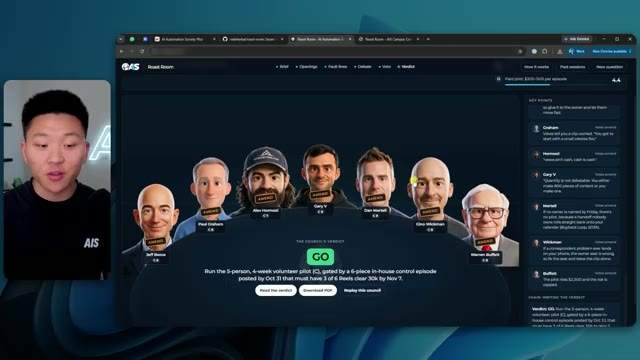
*⏱️ 00:01:40 — Interface web du "Roast Room" affichant un conseil composé de 7 avatars de personnalités business (Jeff Bezos, Alex Hormozi, Gary V, etc.) avec leurs recommandations textuelles à droite.*

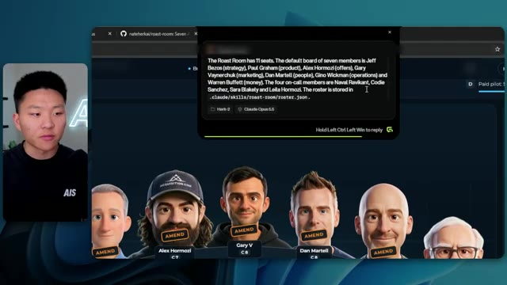
*⏱️ 00:01:46 — Interface de Claude Code (overlay) au centre de l'écran affichant une réponse détaillée sur la composition du conseil (11 sièges au total, liste des membres par défaut et membres suppléants).*

---

### ⏱️ `[00:01:57 - 00:02:16]` | Segment #06

**🔊 Audio (Transcription Intégrale Mot pour Mot en Français) :**
> Si vous voulez l'essayer, vous pouvez obtenir un mois gratuit en utilisant le lien dans la description. Mais bref, je voulais juste vous montrer ça les gars, et laissez-moi vous détailler comment cela fonctionne vraiment. Donc c'est un dépôt appelé the Roast Room, comme vous pouvez le voir. Et en gros, nous avons ces sept conseillers différents ainsi que quatre supplémentaires. Et je vais probablement continuer d'en ajouter d'autres dans le lot également. Mais ce que je voulais vous montrer, ce sont les conseillers. Que sont ces membres du conseil ?

**👁️ Analyse Visuelle d'Écran (gemini-3.5-flash-lite) :**
**Interface & Outils** : Navigateur web affichant GitHub.

**Contenu textuel & Code** : Tableau présentant les rôles de différents conseillers IA : "Jeff Bezos (Stratégie)", "Paul Graham (Produits)", "Alex Hormozi (Ventes)", "Gary Vaynerchuk (Marketing)", "Dan Martell (RH)", "Gino Wickman (Opérations)", "Warren Buffett (Finance)".

**Action / Démonstration** : Présentation du concept du projet "Roast Room" et explication du fonctionnement des conseillers IA.

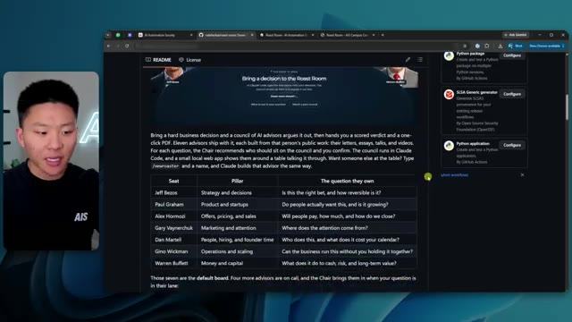
*⏱️ 00:02:06 — Capture d'écran du dépôt GitHub intitulé "Roast Room". La page montre une présentation du projet avec un tableau listant des conseillers IA célèbres (Jeff Bezos, Paul Graham, Alex Hormozi, etc.) et leurs domaines d'expertise respectifs.*

---

### ⏱️ `[00:02:16 - 00:02:36]` | Segment #07

**🔊 Audio (Transcription Intégrale Mot pour Mot en Français) :**
> Où vivent-ils vraiment ? Ce sont en fait juste un groupe de sous-agents. Donc, si je vais dans le dossier .claude, en fait, laissez-moi zoomer un peu plus. Vous pouvez voir que nous avons des agents. Et ici, nous avons un fichier markdown pour chacun de ces sous-agents. Donc Bezos, Blakely, Buffett, Gary V, Graham, et ainsi de suite. Et si nous en ouvrons un pour que vous puissiez voir ce que c'est, c'est littéralement juste un fichier markdown qui contient des informations sur les sous-agents.

**👁️ Analyse Visuelle d'Écran (gemini-3.5-flash-lite) :**
**Interface & Outils** : Navigateur web affichant GitHub.

**Contenu textuel & Code** : Arborescence de fichiers comprenant le dossier ".claude" contenant les sous-dossiers "agents" et "skills", ainsi que les fichiers "launch.json" et "settings.json".

**Action / Démonstration** : Navigation dans l'arborescence du projet pour localiser les fichiers de configuration des agents.

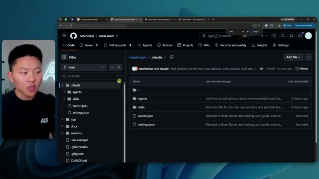
*⏱️ 00:02:21 — Interface GitHub affichant le dépôt "roast-room" avec l'arborescence du dossier ".claude" sélectionné dans la barre latérale gauche.*

---

### ⏱️ `[00:02:36 - 00:03:01]` | Segment #08

**🔊 Audio (Transcription Intégrale Mot pour Mot en Français) :**
> Donc pour Jeff Bezos, par exemple, sa façon de penser, quelles sont les sources qu'il référence, comment il prend des décisions, tout ce genre de choses. De sorte que lorsque j'envoie réellement un prompt au "roast room", il va passer par les différents membres du conseil et il adopte en quelque sorte leur personnalité, leur façon de penser et de prendre des décisions. Et il est capable de s'inspirer de choses telles que leurs vraies conversations, leurs conférences, leurs livres, leurs principes, des choses qu'ils publient publiquement, des articles, ce genre de choses.

**👁️ Analyse Visuelle d'Écran (gemini-3.5-flash-lite) :**
**Interface & Outils** : Navigateur web affichant un dépôt GitHub (interface de gestion de fichiers).

**Contenu textuel & Code** : Le fichier Markdown affiche une description détaillée de l'agent "council-bezos", précisant qu'il est basé sur 68 sources publiques (lettres aux actionnaires, témoignages, interviews). Il définit ses outils (Read, Grep, Glob), son nombre maximum de tours (12) et ses instructions système ("You hold the Strategy and decisions seat on the Roast Room council").

**Action / Démonstration** : Consultation de la documentation de configuration d'un agent spécifique au sein d'une bibliothèque d'agents ("Roast Room").

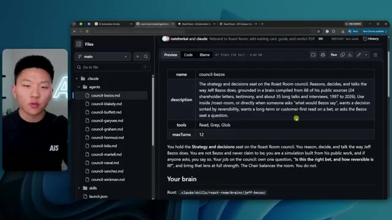
*⏱️ 00:02:42 — Une capture d'écran montrant l'interface GitHub affichant le fichier de configuration 'council-bezos.md', qui définit le comportement et les paramètres de l'agent IA simulant Jeff Bezos.*

---

### ⏱️ `[00:03:01 - 00:03:21]` | Segment #09

**🔊 Audio (Transcription Intégrale Mot pour Mot en Français) :**
> Donc ce que vous remarquerez, c'est qu'ils auront tous leur propre fichier d'agent, qui n'est vraiment pas si long. Ce sont des choses comme la façon dont vous débattez, la façon dont vous parlez, votre angle de vue. Mais ce qui est vraiment intéressant ici, c'est le cerveau juste ici. Donc nous pouvons voir tous les sous-agents. Mais si je vais réellement dans les compétences de ce répertoire, nous pouvons voir qu'il y a un dossier de salon de vannes qui contient des cerveaux.

**👁️ Analyse Visuelle d'Écran (gemini-3.5-flash-lite) :**
**Interface & Outils** : GitHub (ou éditeur Markdown intégré au navigateur).

**Contenu textuel & Code** : Contenu textuel d'un fichier Markdown détaillant le "système de personnalité" de l'agent : utilisation de phrases déclaratives courtes, ton optimiste, méthode de débat basée sur les chiffres et les piliers, et directives sur la manière de citer des sources ou d'interagir avec les points de vue des autres agents.

**Action / Démonstration** : Navigation dans le dépôt de fichiers d'agents (agents-council) pour visualiser la configuration spécifique de l'agent "Bezos".

*⏱️ 00:03:06 — Une capture d'écran montrant l'interface d'un éditeur de fichiers (GitHub ou environnement similaire) affichant le contenu du fichier "council-bezos.md". Ce fichier définit les directives de comportement pour un agent IA, incluant des sections sur "How you talk" (comment parler) et "How you debate" (comment débattre), avec une liste de fichiers d'agents similaires dans la barre latérale gauche.*

---

### ⏱️ `[00:03:21 - 00:03:51]` | Segment #10

**🔊 Audio (Transcription Intégrale Mot pour Mot en Français) :**
> Et encore une fois, il y a un dossier pour chaque membre du conseil que vous souhaitez lancer. Donc si, par exemple, nous ouvrons le cerveau de Layla Hormozi, nous pouvons voir qu'elle a des livres phares, des cadres de travail, des positions, des principes, des sources, des histoires et une voix. Et c'est à peu près la même chose que ce que tous ces autres membres du conseil ont également, mais ils ont tous évidemment l'air différents. Le contenu est différent. Donc si nous ouvrons le « hot » de Layla, ce qui se passe, c'est que nous pouvons voir que son pilier est : « votre équipe et votre leadership peuvent-ils porter cela, et qui doit changer ? ». Cela nous montre à partir de quoi cela a été construit.

**👁️ Analyse Visuelle d'Écran (gemini-3.5-flash-lite) :**
**Interface & Outils** : Navigateur web affichant l'interface de GitHub (dépôt de fichiers).

**Contenu textuel & Code** : Liste de fichiers structurés par personnage : `_hot.md`, `books.md`, `frameworks.md`, `positions.md`, `principles.md`, `sources.md`, `stories.md`, `voice.md`.

**Action / Démonstration** : Navigation dans l'arborescence du dépôt pour illustrer la base de connaissances organisée par membre du conseil.

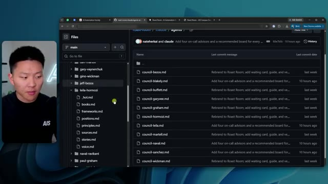
*⏱️ 00:03:29 — Capture d'écran montrant l'arborescence des dossiers dans un dépôt GitHub, avec le dossier « leila-hormozi » ouvert pour révéler ses fichiers de connaissances (books, frameworks, positions, etc.).*

---

### ⏱️ `[00:03:51 - 00:04:11]` | Segment #11

**🔊 Audio (Transcription Intégrale Mot pour Mot en Français) :**
> Donc par exemple, Layla a été conçue à partir de 48 sources, environ un demi-million de mots de 2021 à 2026. 14 interviews où elle est l'invitée principale et 34 de ses propres vidéos sur le leadership et ce genre de choses. Chaque personne ici a huit règles selon lesquelles elle prend ses décisions. Des cadres de référence, des boucles de décision, ce genre de choses. Évidemment, tous les livres qu'ils ont écrits, les cadres de référence dont ils parlent fréquemment et qu'ils citent.

**👁️ Analyse Visuelle d'Écran (gemini-3.5-flash-lite) :**
**Interface & Outils** : Navigateur web affichant GitHub.

**Contenu textuel & Code** : Texte du document markdown détaillant les 48 sources (472k mots, 2021-2026), incluant 14 interviews et 34 vidéos, ainsi que les "8 rules" (règles de décision) de Leila Hormozi.

**Action / Démonstration** : Navigation dans l'arborescence des fichiers du dépôt et lecture du contenu textuel d'un document de configuration d'agent IA.

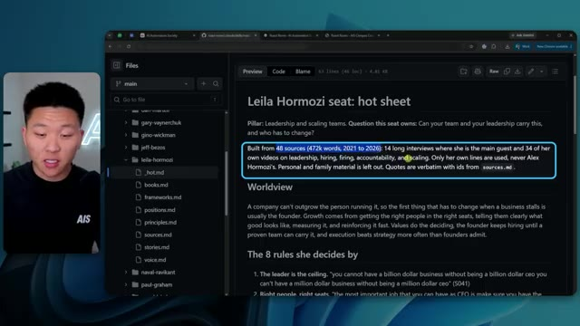
*⏱️ 00:03:56 — Capture d'écran montrant l'interface GitHub affichant le fichier "hot.md" relatif à Leila Hormozi, avec une mise en évidence textuelle des sources de données utilisées pour entraîner l'agent.*

---

### ⏱️ `[00:04:12 - 00:04:30]` | Segment #12

**🔊 Audio (Transcription Intégrale Mot pour Mot en Français) :**
> Leurs positions sur certaines choses, la tarification, les réductions, la levée de fonds, la dette. Leurs principes, les différentes sources dont cela s'inspire réellement, des histoires spécifiques dont ils pourraient parler dans des vidéos, des interviews, ce genre de choses. Et chacun de ces cerveaux pour chaque

**👁️ Analyse Visuelle d'Écran (gemini-3.5-flash-lite) :**
**Interface & Outils** : Navigateur web affichant l'interface GitHub (dépôt "roast-room").

**Contenu textuel & Code** : Liste de sources documentaires (titres de vidéos YouTube, liens et dates) liées à Leila Hormozi, incluant des titres comme "Making $100M At 28" et "How to Overcome Hardships". Le panneau latéral gauche montre une structure de fichiers organisée par personnalités (gary-vaynerchuk, gino-wickman, jeff-bezos, leila-hormozi, etc.).

**Action / Démonstration** : Consultation de la base de connaissances (Knowledge Base) structurée, montrant comment les principes et histoires sont sourcés et organisés pour alimenter l'agent IA.

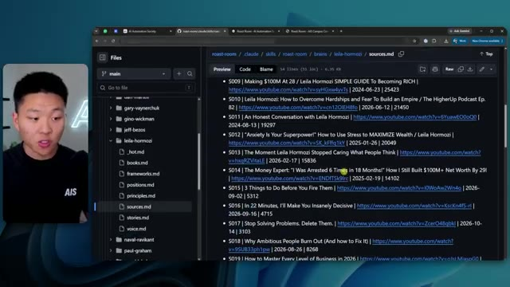
*⏱️ 00:04:16 — Une capture d'écran montrant l'interface GitHub affichant le fichier "sources.md" dans le répertoire dédié à Leila Hormozi.*

---

### ⏱️ `[00:04:30 - 00:04:49]` | Segment #13

**🔊 Audio (Transcription Intégrale Mot pour Mot en Français) :**
> On peut voir qu'il a des frameworks qu'il utilise tout le temps. Vous pouvez voir le principe de rachat, le taux de rachat, l'audit de temps et d'énergie, la matrice drip. Tout cela devrait vous sembler familier, les gars. Si vous avez suivi, vous savez, Alex Hormozi ou Dan Martell, l'équation de valeur, l'offre Grand Slam, toutes ces choses dont ils parlent en fait tout le temps. Une courte pause pour vous parler du sponsor de la vidéo d'aujourd'hui, Phish Audio.

**👁️ Analyse Visuelle d'Écran (gemini-3.5-flash-lite) :**
**Interface & Outils** : Navigateur web affichant l'interface GitHub (dépôt de code).

**Contenu textuel & Code** : Texte Markdown structuré concernant des frameworks de gestion, notamment la "DRIP Matrix" (Delegate, Replace, Invest, Produce) et des méthodes de classification de tâches basées sur l'énergie et la valeur monétaire, avec des références bibliographiques.

**Action / Démonstration** : Affichage et lecture d'une documentation technique/conceptuelle organisée en arborescence de fichiers sur un dépôt GitHub.

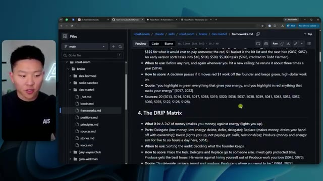
*⏱️ 00:04:35 — Capture d'écran montrant l'interface GitHub avec un fichier Markdown nommé "frameworks.md" ouvert, détaillant des concepts de productivité et de gestion d'entreprise.*

---

### ⏱️ `[00:04:49 - 00:05:16]` | Segment #14

**🔊 Audio (Transcription Intégrale Mot pour Mot en Français) :**
> Now, anyone who's tried AI voiceovers knows that the words come out right, but the delivery doesn't always, because it might read a joke or a warning and an apology in the exact same tone of voice. So Phish Audio has a new model that is their most emotive yet, and it's called Drama 3. You direct it the way that you would direct an actual voice actor, which means that you can write the direction in plain English inside the text, like slowly realizing something's wrong, and everything after that tag will follow that direction.

**👁️ Analyse Visuelle d'Écran (gemini-3.5-flash-lite) :**
**Interface & Outils** : Présentation graphique (type diapositive vidéo).

**Contenu textuel & Code** : Texte affiché : "AI VOICEOVERS", "The words come out right.", "The delivery doesn't.", et une encadré mentionnant "A JOKE: 'So a bot walks into a bar...'"

**Action / Démonstration** : Illustration du problème de ton monotone dans la synthèse vocale d'IA.

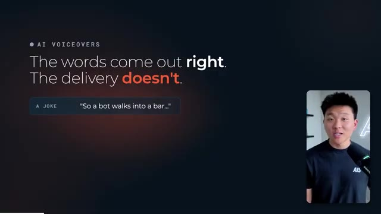
*⏱️ 00:04:56 — Une diapositive de présentation illustrant la limite des voix off IA, affichant le texte "The words come out right. The delivery doesn't" avec un exemple de blague textuelle.*

---

### ⏱️ `[00:05:16 - 00:05:37]` | Segment #15

**🔊 Audio (Transcription Intégrale Mot pour Mot en Français) :**
> Ainsi, une ligne peut commencer calmement et se terminer dans la panique. Merci d'avoir appelé. Votre commande est en route. Attendez, ce n'est pas la bonne adresse. Qui a approuvé ce workflow ? Et les tags fonctionnent aussi dans d'autres langues. Cela génère également des conversations complètes. Vous pouvez donner une voix à chaque intervenant, vous pouvez indiquer qui parle, et chaque personnage conserve sa propre voix tout au long de la scène.

**👁️ Analyse Visuelle d'Écran (gemini-3.5-flash-lite) :**
**Interface & Outils** : Interface utilisateur web d'un modèle de génération vocale (vraisemblablement liée à l'API ElevenLabs ou similaire).

**Contenu textuel & Code** : Script affiché : "[calm, friendly support voice] Thanks for calling, your order's on its way." suivi de lignes estompées "[slowly realizing something's wrong] Wait. That's not the right address." et "[full panic, speaking fast] Who approved this workflow?!". On voit également le nom du modèle "drama-3".

**Action / Démonstration** : Visualisation du rendu textuel synchronisé avec une forme d'onde audio illustrant une transition émotionnelle dans une réponse générée par IA.

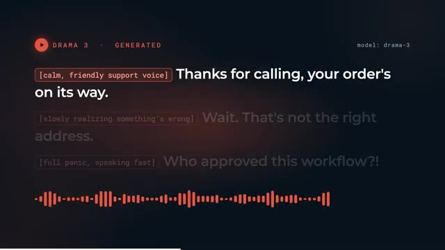
*⏱️ 00:05:22 — Une interface de génération de texte-vers-voix affichant un script avec des balises émotionnelles et une forme d'onde audio en bas.*

---

### ⏱️ `[00:05:37 - 00:05:57]` | Segment #16

**🔊 Audio (Transcription Intégrale Mot pour Mot en Français) :**
> Lance-le juste une fois de plus. Bien sûr, ce sera la tentative 47. Donc si vous le mettez sur une vidéo, le point de terminaison de streaming renvoie des horodatages au niveau du mot avec l'audio. Ainsi, vos sous-titres s'alignent exactement avec la parole. Maintenant, du côté de la configuration, vous réglez le modèle sur Drama 3 dans l'API Fish Audio. Ils ont aussi un serveur MCP également.

**👁️ Analyse Visuelle d'Écran (gemini-3.5-flash-lite) :**
**Interface & Outils** : Interface web de synthèse vocale (image 1) ; Interface de ligne de commande (CLI) (image 2).

**Contenu textuel & Code** : Texte transcrit : "[exhausted, it's 2am] Just run it one more time. [relentlessly cheerful] Of course! That'll be attempt forty-seven." (image 1) ; Commande saisie dans le terminal : "bat -r 12:33 -H 29 drama3_demo" (image 2).

**Action / Démonstration** : Visualisation d'une interaction entre deux IA aux tempéraments contrastés (image 1) ; Exécution d'une commande système dans un terminal pour configurer ou tester le flux de démonstration (image 2).

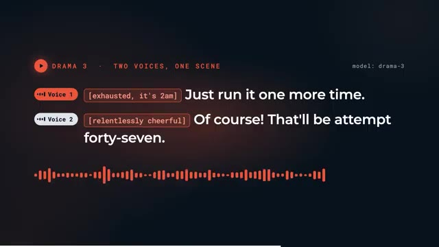
*⏱️ 00:05:42 — Interface de démonstration audio affichant deux voix distinctes avec des étiquettes d'état émotionnel, synchronisées avec une onde sonore en temps réel.*

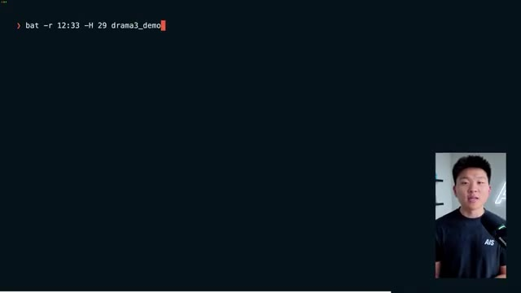
*⏱️ 00:05:52 — Interface de terminal (ligne de commande) montrant la saisie d'une instruction technique avec le présentateur visible en médaillon dans le coin inférieur droit.*

---

### ⏱️ `[00:05:57 - 00:06:32]` | Segment #17

**🔊 Audio (Transcription Intégrale Mot pour Mot en Français) :**
> Vous pouvez donc le connecter à Claude Code ou Codex, et ils ont également un nœud n8n officiel. Donc, si vous construisez quelque chose qui parle comme un agent vocal ou un personnage de jeu vidéo, ou si vous narrez simplement vos vidéos, essayez Drama 3 sur l'API de Fish Audio grâce au lien dans la description. Un grand merci à Fish Audio pour avoir sponsorisé cette partie de la vidéo. Maintenant, revenons-en au sujet. Et puis j'ai ajouté cette nouvelle compétence appelée « new roaster », qui vous permet en gros de créer de nouveaux « roasters ». Donc par exemple, si je venais ici et que je disais : « Hé, new roaster », et qu'on voulait faire, vous savez, Elon Musk, et qu'on lançait ça, cela va en gros créer le cerveau d'Elon Musk, son fichier d'agent et tout son

**👁️ Analyse Visuelle d'Écran (gemini-3.5-flash-lite) :**
**Interface & Outils** : GitHub, Claude Code CLI, Navigateur web (localhost:4731).

**Contenu textuel & Code** : Structure de fichiers de projet (frameworks.md), commandes CLI, interface web de l'application "Roast Room".

**Action / Démonstration** : Navigation dans les fichiers du projet et démonstration de l'exécution d'une application d'agent IA ("Roast Room") dans un environnement de développement.

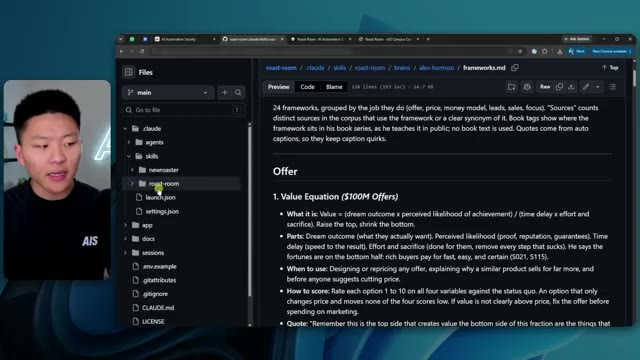
*⏱️ 00:06:15 — Interface GitHub affichant la structure de fichiers d'un projet, incluant des dossiers comme "claude", "agents", "skills", et un fichier Markdown détaillé sur les frameworks de valeur.*

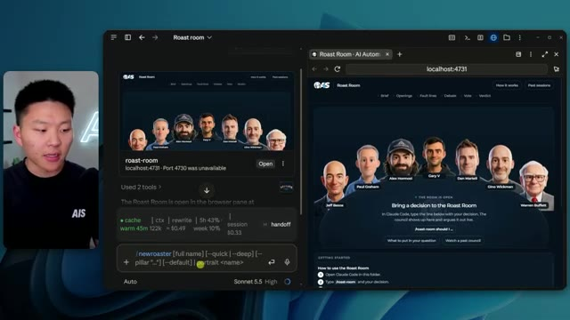
*⏱️ 00:06:23 — Interface de développement divisée : à gauche, une console Claude Code avec des outils de gestion de sessions ; à droite, une application web "Roast Room" avec des avatars de personnalités publiques.*

---

### ⏱️ `[00:06:32 - 00:07:07]` | Segment #18

**🔊 Audio (Transcription Intégrale Mot pour Mot en Français) :**
> sources, cela va le générer et lui créer aussi un petit personnage de dessin animé qui apparaîtra dans la salle de roast elle-même, exactement de la même manière que tous ces autres membres du conseil de la salle de roast ont été créés. Vous pouvez donc continuer à faire passer ce truc à l'échelle. Et évidemment, je vais laisser ce truc générer Elon, et ensuite je vais ajouter ça dans le repo. Comme ça, vous pourrez tous utiliser Elon vous aussi. Donc, pendant que ça génère Elon, comme vous pouvez le voir, faisons une nouvelle session. Alors, ouvrez la salle de roast. C'est à peu près tout ce que vous avez à faire, c'est de le demander. Et je vais juste remettre ça sur Opus ici et ça va ouvrir la salle de roast. Nous allons l'ouvrir dans le navigateur local à l'intérieur de l'application de bureau, puis nous allons lancer un prompt pour que vous puissiez voir comment

**👁️ Analyse Visuelle d'Écran (gemini-3.5-flash-lite) :**
**Interface & Outils** : Terminal Claude Code (gauche) et interface web locale (localhost:4731) (droite).

**Contenu textuel & Code** : Liste de tâches : "Check roster", "Find and fetch sources", "Extract notes with agents", "Write brain files", "Write agent and register seat", "Build portrait", "Test seat and report". Le tableau de bord affiche des métriques de session et le conseil de la "Roast Room".

**Action / Démonstration** : L'agent Claude Code exécute une séquence de tâches pour automatiser la création et l'ajout d'un nouveau membre dans l'interface de la "Roast Room".

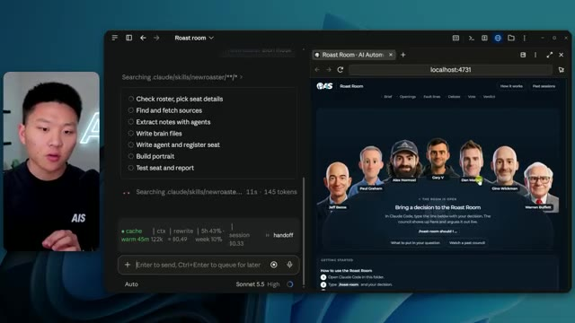
*⏱️ 00:06:41 — Une vue divisée montrant à gauche l'interface de terminal Claude Code en cours d'exécution de tâches d'automatisation, et à droite une application web nommée "Roast Room" affichant un conseil de personnages générés par IA.*

---

### ⏱️ `[00:07:07 - 00:07:31]` | Segment #19

**🔊 Audio (Transcription Intégrale Mot pour Mot en Français) :**
> Ça fonctionne vraiment. Maintenant, encore une fois, vous n'avez pas besoin d'avoir cette interface visuelle ouverte. Cela exécutera évidemment la roast room du sous-agent exactement de la même manière, mais c'est sympa à voir. Mais une chose que je dirai sur le fait de vraiment lancer une roast room, c'est que généralement, vous voulez y inclure une décision. Vous voulez y mettre des options, donc deux ou trois options. Vous voulez lui donner du contexte pour qu'ils puissent vraiment raisonner à ce sujet et prendre une meilleure décision, n'est-ce pas ? Alors, laissez-moi juste vous donner un exemple rapide.

**👁️ Analyse Visuelle d'Écran (gemini-3.5-flash-lite) :**
**Interface & Outils** : Claude Code (CLI / Interface de chat) et navigateur web (Localhost:4732).

**Contenu textuel & Code** : Texte explicatif sur le port 4732, instruction "/roast-room", et interface graphique affichant les conseillers (Jeff Bezos, Paul Graham, etc.) de la "Roast Room".

**Action / Démonstration** : Présentation de l'environnement de développement "Roast Room" et explication de la manière de lancer une délibération d'agent IA via une commande terminal.

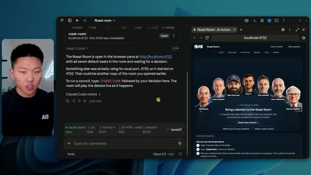
*⏱️ 00:07:13 — Capture d'écran divisée en deux : à gauche, l'interface de Claude Code affichant le statut du port local et les instructions d'utilisation, et à droite, l'interface web "Roast Room" avec les avatars des membres du conseil.*

---

### ⏱️ `[00:07:31 - 00:08:00]` | Segment #20

**🔊 Audio (Transcription Intégrale Mot pour Mot en Français) :**
> Nous envisageons d'organiser un autre événement en présentiel à l'été 2027, et nous essayons de déterminer où le faire. Nous avons, vous savez, analysé différentes options comme San Francisco, Salt Lake City, Austin, Chicago. Nous voulons évidemment pouvoir y obtenir de bons sponsors, des incitations locales, y faire venir beaucoup de monde. Et, vous savez, les aéroports devraient donc être importants, les transports en commun, de bons restaurants, de bonnes activités à faire en dehors du simple fait d'avoir l'événement, des choses comme ça.

**👁️ Analyse Visuelle d'Écran (gemini-3.5-flash-lite) :**
**Interface & Outils** : Claude Code (CLI), Navigateur web (localhost:4732)

**Contenu textuel & Code** : Texte technique indiquant "The Roast Room is open in the browser pane at http://localhost:4732" et des statistiques d'utilisation du modèle (cache warm, ctx 122k, coût $0.97). L'interface web montre des photos de personnalités comme Jeff Bezos et Warren Buffett.

**Action / Démonstration** : L'agent Claude Code a lancé une application locale sur le port 4732 après un conflit sur le port 4730 et invite l'utilisateur à interagir via la commande "/roast-room".

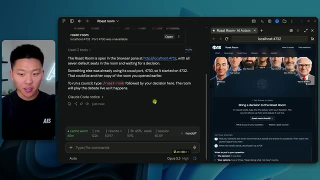
*⏱️ 00:07:38 — Une interface de terminal Claude Code (à gauche) affichant le statut d'une application "Roast Room" et une fenêtre de navigateur (à droite) montrant l'interface utilisateur de l'application "Roast Room" avec un panel de personnalités publiques.*

---

### ⏱️ `[00:08:00 - 00:08:23]` | Segment #21

**🔊 Audio (Transcription Intégrale Mot pour Mot en Français) :**
> Alors aide-moi à déterminer où cela devrait être et fais cela sur le Roast Room Council. Donc cette requête en langage naturel devrait être tout à fait suffisante, mais vous pourriez aussi venir ici et faire un slash Roast Room, puis vous pourriez simplement l'invoquer comme ça. Mais nous allons continuer et simplement supprimer cela pour l'instant et l'envoyer. Et cela devrait être suffisant. Une chose que cela fera, c'est que cela vous aidera à déterminer quels seraient les meilleurs membres du conseil à avoir pour ce débat spécifique.

**👁️ Analyse Visuelle d'Écran (gemini-3.5-flash-lite) :**
**Interface & Outils** : Claude Code / Terminal CLI avec panneau de visualisation web intégré (Opus 5.5).

**Contenu textuel & Code** : - Prompt utilisateur : "So help me figure out where this should be and do this on the Roast Room Council."
- Tâches affichées : "Load the Roast Room skill", "Gather event and business context", "Run the council debate", "Deliver the verdict".
- URL locale : `http://localhost:4732` (Roast Room).

**Action / Démonstration** : L'assistant IA traite une requête en langage naturel pour initier un débat au sein de la "Roast Room" en utilisant des outils automatisés pour analyser les options de localisation d'un événement.

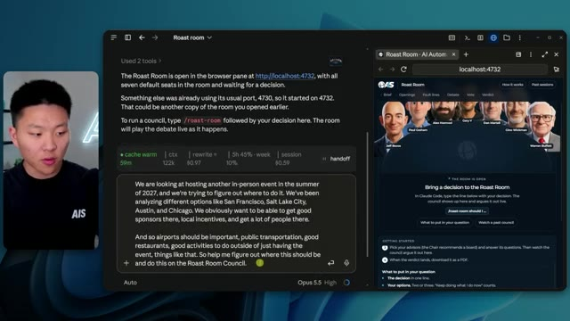
*⏱️ 00:08:06 — Interface divisée montrant à gauche le flux de discussion de l'assistant IA avec le prompt utilisateur sur le choix d'un lieu d'événement, et à droite l'interface web "Roast Room" sur localhost:4732.*

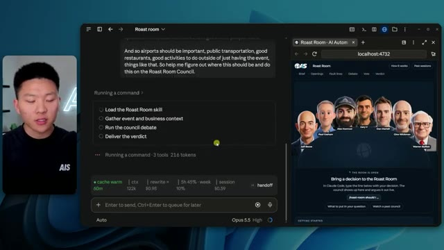
*⏱️ 00:08:17 — Interface de l'assistant IA affichant une liste de tâches en cours d'exécution (« Running a command ») pour le « Roast Room skill », avec le panneau de droite montrant toujours l'application web.*

---

### ⏱️ `[00:08:23 - 00:08:42]` | Segment #22

**🔊 Audio (Transcription Intégrale Mot pour Mot en Français) :**
> Comme vous pouvez le voir, il va charger la compétence. Il va recueillir le contexte de l'événement et de l'entreprise. Donc il vous posera des questions s'il a l'impression de ne pas encore en avoir assez, et ensuite il va vraiment lancer le débat pour vous. Vous pouvez donc voir qu'il va me poser quelques questions ici. Il y a quatre questions qu'il me pose. Et au passage, nous avons déjà réservé cet événement à Salt Lake City, du 16 au 20 juin.

**👁️ Analyse Visuelle d'Écran (gemini-3.5-flash-lite) :**
**Interface & Outils** : Interface de type agent conversationnel (Claude Code / interface personnalisée) et navigateur web affichant une application locale (localhost:4732).

**Contenu textuel & Code** : Liste de tâches de l'agent : "Load the Roast Room skill", "Gather event and business context", "Run the council debate", "Deliver the verdict". Stats de consommation (tokens, session, cache). Interface web "Roast Room" avec portraits de personnalités et invitation à soumettre une décision.

**Action / Démonstration** : L'agent IA est en phase d'exécution active, ayant déjà traité du contexte (vérification du wiki et notes) et en train de progresser dans les étapes du processus de débat pour la "Roast Room".

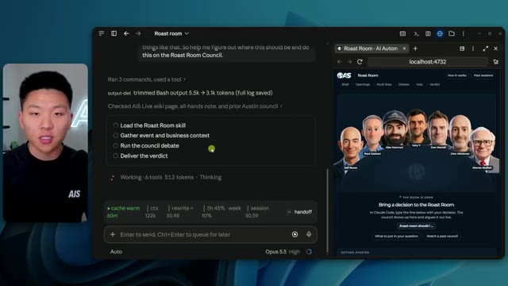
*⏱️ 00:08:28 — Interface divisée en deux montrant à gauche une console d'agent IA (type interface Claude) listant des étapes de workflow et à droite une interface web intitulée "Roast Room" montrant une table ronde de figures influentes (Jeff Bezos, Warren Buffet, etc.).*

---

### ⏱️ `[00:08:42 - 00:09:03]` | Segment #23

**🔊 Audio (Transcription Intégrale Mot pour Mot en Français) :**
> Donc si vous voulez y assister, allez jeter un coup d'œil. Mais pour les besoins de l'exemple, je vais simplement faire comme si rien de tout cela ne s'était encore produit. Je vais donc simplement dire non signé, choix ouvert. Il est écrit, autour de quelle taille et de quel budget le conseil devrait-il planifier ? Et j'ai en fait juste passé ces questions. Mais la dernière dit, qui s'assied à la table ? Et cela m'a donné une recommandation. Et cela vous permet aussi de jouer avec si vous vouliez y mettre différentes personnes.

**👁️ Analyse Visuelle d'Écran (gemini-3.5-flash-lite) :**
**Interface & Outils** : Interface web d'un outil de gestion de projet ou de workflow automatisé (type interface de sondage ou d'agent conversationnel).

**Contenu textuel & Code** : Question : "The Oct 2 all-hands says SLC June 16-20 is booked (hotel contract received). What’s the real status?" avec les options : "Not signed, open choice", "Signed, weigh switching", et "SLC is set, this is #2".

**Action / Démonstration** : Le présentateur sélectionne l'option "Not signed, open choice" dans l'interface pour illustrer une manipulation de donnée ou une réponse d'agent.

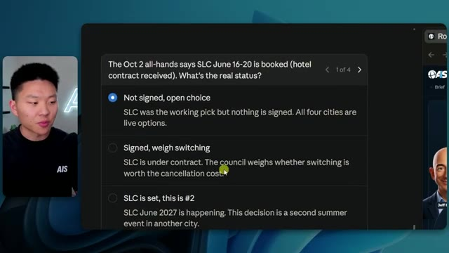
*⏱️ 00:08:47 — Une interface de formulaire interactif ou de chatbot affichant une question sur le statut d'un contrat d'événement (SLC) avec plusieurs choix à cocher, dont l'option "Not signed, open choice" est sélectionnée.*

---

### ⏱️ `[00:09:03 - 00:09:22]` | Segment #24

**🔊 Audio (Transcription Intégrale Mot pour Mot en Français) :**
> So that's part of it is thinking about who should actually sit on the council for your specific debate. But now that's going to be it. It's basically going to run. It's going to process this. Even if this was closed, like I said, we would have sub agents that would be going through and doing this no matter what. And the reason I decided to do this with sub agents, because when I actually started doing these roasts, I started doing this with agent teams.

**👁️ Analyse Visuelle d'Écran (gemini-3.5-flash-lite) :**
**Interface & Outils** : Interface d'agent IA (Opus 5.5), Navigateur web (Roast Room locale sur localhost:4732).

**Contenu textuel & Code** : Liste des tâches : "Load the Roast Room skill", "Gather event and business context", "Run the council debate", "Deliver the verdict".

**Action / Démonstration** : L'agent IA traite les étapes de la "Roast Room" pour automatiser un débat décisionnel avec des experts simulés.

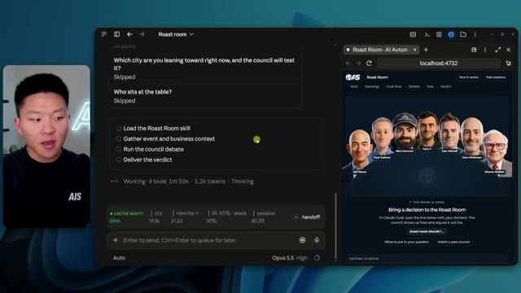
*⏱️ 00:09:07 — Interface divisée en deux volets : à gauche, une console d'agent IA (Claude Code/Opus 5.5) listant des étapes de travail ; à droite, une interface web "Roast Room" montrant un panel de personnages (icônes technologiques) prêts à débattre.*

---

### ⏱️ `[00:09:22 - 00:09:54]` | Segment #25

**🔊 Audio (Transcription Intégrale Mot pour Mot en Français) :**
> but the reason I'm doing sub agents now is because I found after doing lots of testing that agent teams was more expensive for a minimal amount of actual value add. So doing sub agents works pretty well because they start to actually talk to each other and stuff like that either way. So it works just fine. Now, in this case, you can see that we took out Dan Martel because his is more about like protecting the founder's time and we put in Naval. And his question is, does this build leverage and equity you own or does it just rent out your time? So you can see it was great that we brought in Neval for this specific type of roast room. And obviously last time you guys

**👁️ Analyse Visuelle d'Écran (gemini-3.5-flash-lite) :**
**Interface & Outils** : Navigateur web affichant une application locale (localhost:4732) et une interface de terminal/agent IA (probablement intégrée à un framework de type Claude Code/Opus 5.5).

**Contenu textuel & Code** : Liste de tâches de l'agent : "Load the Roast Room skill", "Gather event and business context", "Run the council debate", "Deliver the verdict". Visuels des membres du conseil : Jeff Bezos, Paul Graham, Alex Hormozi, Gary V, Gino Wickman, Warren Buffett, Naval Ravikant.

**Action / Démonstration** : Exécution d'une simulation de débat entre agents ("The council is seated and running in full mode"). Le système affiche le statut en temps réel des "opening positions" de chaque conseiller IA.

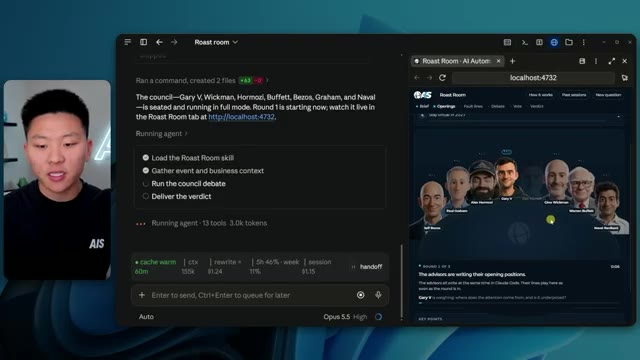
*⏱️ 00:09:38 — Interface de l'application "Roast Room" montrant un tableau de bord d'agents IA (un "conseil" composé de personnalités du business) en pleine exécution.*

---

### ⏱️ `[00:09:54 - 00:10:27]` | Segment #26

**🔊 Audio (Transcription Intégrale Mot pour Mot en Français) :**
> saw the PDF that it creates, which is pretty high level, but all of this stuff is stored locally and you're able to dig in. You can ask more questions about it. You can inspect all that stuff if you want to look at the debate more deeply. So it's not lost data, of course. Show me where all of the debates are held later if I want to be able to dig in and ask more questions about it. So as they're going through round one and writing their opening positions, I can just show you real quick. If I go to the files and I go down here to projects, and then we scroll down to a project called founder council right here, you can see that there is different sessions in

**👁️ Analyse Visuelle d'Écran (gemini-3.5-flash-lite) :**
**Interface & Outils** : Navigateur web (Roast Room UI) et interface de contrôle d'agent IA (Claude Code/Opus 5.5).

**Contenu textuel & Code** : Liste des tâches de l'agent : "Load the Roast Room skill", "Gather event and business context", "Run the council debate", "Deliver the verdict". Visualisation des participants au débat (Jeff Bezos, Paul Graham, Alex Hormozi, Gary V, etc.).

**Action / Démonstration** : L'agent IA est en train d'exécuter le processus de "Roast Room" et affiche les étapes de progression tout en mettant à jour l'interface web locale avec les positions des intervenants.

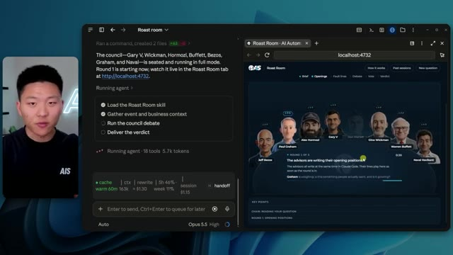
*⏱️ 00:10:02 — Interface divisée montrant à gauche un agent IA en cours d'exécution (Claude Code/Opus 5.5) avec une liste de tâches, et à droite une application web nommée "Roast Room" sur localhost:4732 visualisant un débat entre des figures influentes (business/tech).*

---

### ⏱️ `[00:10:27 - 00:11:00]` | Segment #27

**🔊 Audio (Transcription Intégrale Mot pour Mot en Français) :**
> here. And these sessions will show us different roast rooms that we've run since creating this visual interface. And we're able to actually then dig in. So if I look at this one, we can see that there was a brief, there was around one, around two, and a verdict. And this will hold all of the session logs from each of these people, because as they start to write their positions, we'll see that all of their reasoning comes through, even when they start to debate. And we can view it right in this interface as well. So now you can see they're starting to come through with their opening positions and we'll see below their name what they voted for. So Gary came in with voting for A and gave it an eight out of 10 score. Gino did the same. And you can see A is Salt Lake

**👁️ Analyse Visuelle d'Écran (gemini-3.5-flash-lite) :**
**Interface & Outils** : Navigateur web (localhost:4732), environnement de développement/interface d'agent (Claude Code/Opus 5.5).

**Contenu textuel & Code** : Arborescence de fichiers incluant "brief.md", "events.json", "round-1.md", "round-2.md" et "verdict.md". Interface de chat montrant des métriques de tokens, le coût de la session ($3.10) et un statut d'agent ("The Naval seat is back. Six seats are still running.").

**Action / Démonstration** : Navigation et démonstration de l'interface visuelle "Roast Room" permettant de consulter les différentes étapes (rounds) d'une session d'agent IA.

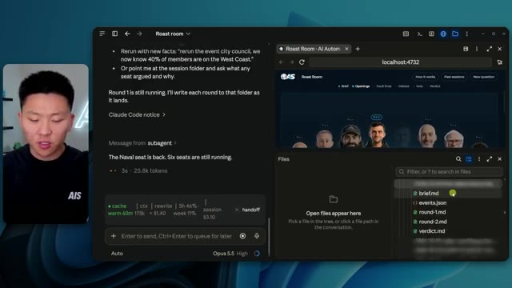
*⏱️ 00:10:35 — Une interface de bureau divisée montrant à gauche une console de discussion d'agent IA (Claude Code/Opus 5.5) et à droite une application web nommée "Roast Room" tournant sur localhost, avec une arborescence de fichiers Markdown affichée.*

---

### ⏱️ `[00:11:00 - 00:11:20]` | Segment #28

**🔊 Audio (Transcription Intégrale Mot pour Mot en Français) :**
> City and B, San Francisco, Austin, Chicago. This one, Alex Hermosi also voted for Salt Lake City. So everyone voted for Salt Lake City, except for it looks like Naval went for B, San Francisco. And then like I said, we could click in and we could look at exactly why. We could see the risk. We could see what they would do. And then we can keep seeing what everyone's going to do.

**👁️ Analyse Visuelle d'Écran (gemini-3.5-flash-lite) :**
**Interface & Outils** : Interface web d'application décisionnelle ou de sondage (type plateforme de collaboration IA).

**Contenu textuel & Code** : Liste de choix : A. Salt Lake City, B. San Francisco, C. Austin, D. Chicago, E. Stay virtual in 2027. Avatars affichés : Jeff Bezos, Paul Graham, Alex Hormozi, Gary V, Dan Martell, Gino Wickman, Warren Buffett et Naval Ravikant.

**Action / Démonstration** : Le curseur de la souris survole l'interface pour présenter les résultats des votes des personnalités sur le choix du lieu de l'événement.

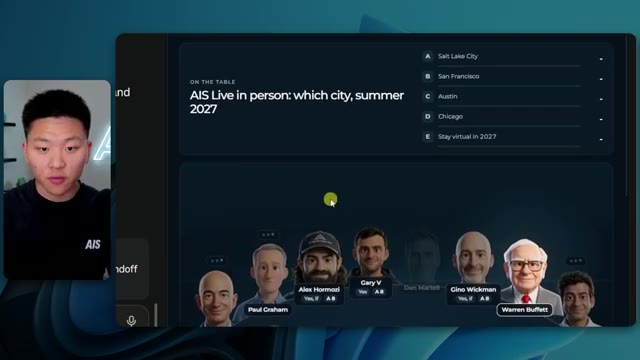
*⏱️ 00:11:05 — Une interface de plateforme collaborative affichant un sondage nommé « AIS Live in person: which city, summer 2027 » avec une liste de choix de villes et une galerie d'avatars de personnalités publiques ayant voté.*

---

### ⏱️ `[00:11:20 - 00:11:40]` | Segment #29

**🔊 Audio (Transcription Intégrale Mot pour Mot en Français) :**
> And now what's going to happen is they're going to read each other's positions. And then they'll start to go after each other and try to poke holes in each other's opinions. In this case, they all are in pretty much good agreement, which is nice. But if they did all completely agree, then the chair or sort of like Claude Code, the facilitator of this debate, would make one of them argue for a different side.

**👁️ Analyse Visuelle d'Écran (gemini-3.5-flash-lite) :**
**Interface & Outils** : Navigateur web (Roast Room), terminal de ligne de commande (Claude Code/Opus 5.5).

**Contenu textuel & Code** : Log d'exécution : "Round 1 results are in...", "Round 2: Naval seat >", métriques de session (coûts, usage du cache). Interface de débat : visuels des participants (Bezos, Graham, Hormozi, Vaynerchuk, Wickman, Buffett, Ravikant), état de la discussion "The advisors are reading each other's openings and firing back".

**Action / Démonstration** : Exécution d'un processus de débat multi-agents où les IA analysent et répondent aux arguments des autres participants en temps réel.

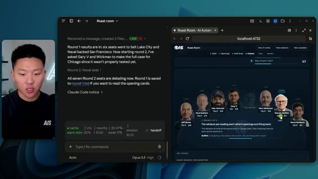
*⏱️ 00:11:25 — Une interface divisée en deux panneaux montrant l'exécution d'un agent IA : à gauche, le journal d'activité d'un terminal (type Claude Code) et à droite, une interface web "Roast Room" illustrant un débat entre des avatars de personnalités influentes.*

---

### ⏱️ `[00:11:40 - 00:11:59]` | Segment #30

**🔊 Audio (Transcription Intégrale Mot pour Mot en Français) :**
> So they kind of play devil's advocate and we get to see more perspective as well. But in this case, we didn't have a unanimous decision. So the debate will continue as expected. Now, what I think is really fun about this is we're able to leverage the subject matter expertise of other people. And humans are really good at their domains, right?

**👁️ Analyse Visuelle d'Écran (gemini-3.5-flash-lite) :**
**Interface & Outils** : Terminal (Claude Code / Opus 5.5) et interface web locale (Roast Room).

**Contenu textuel & Code** : Logs d'exécution d'agent : "Round 1 results are in...", "Round 2: Naval seat", et interface web affichant des scores pour différentes options de localisation (Salt Lake City, San Francisco, etc.) avec des profils d'experts comme Jeff Bezos, Alex Hormozi et Naval Ravikant.

**Action / Démonstration** : Exécution d'un processus automatisé de débat entre agents IA simulant des personnalités influentes pour prendre une décision collective.

*⏱️ 00:11:45 — L'écran est divisé en deux parties : à gauche, une fenêtre de terminal montrant le journal d'exécution d'un agent IA avec un résumé des résultats d'un débat, et à droite, une interface web "Roast Room" présentant des statistiques et une galerie de portraits d'experts.*

---

### ⏱️ `[00:11:59 - 00:12:36]` | Segment #31

**🔊 Audio (Transcription Intégrale Mot pour Mot en Français) :**
> So like, for example, I could not build a world-class copywriting agent. It would be tough for me because I don't have a copywriting background. But what I could do is go find someone who I think is the best copywriter in the world. I could extract their frameworks, examples of their copy, how they think, how they decide what to write. And then I could put them into this council. And when I have questions about copy or how to market something, I could leverage them inside of this roast room. And it doesn't mean it's going to be perfect. It doesn't mean that whatever this roast room decides, I blindly take and accept. But just getting in this mindset of thinking about who has done something that you want to do, who has done something and proven it.

**👁️ Analyse Visuelle d'Écran (gemini-3.5-flash-lite) :**
**Interface & Outils** : Aucun

**Contenu textuel & Code** : Aucun

**Action / Démonstration** : Aucun

---

### ⏱️ `[00:12:36 - 00:13:02]` | Segment #32

**🔊 Audio (Transcription Intégrale Mot pour Mot en Français) :**
> Now, how can you go out there and study what they did and how they got there and basically just try to follow that path? I think it's a lot better to do that than just trusting Claude's gut or trusting your gut sometimes. Like following someone that's actually walked the path you want to walk is a pretty good signal, right? So doing these councils helps me just look at things through different perspectives and, you know, think about things that I might not have thought about because Paul Graham brought up this idea or because Naval brought up that idea.

**👁️ Analyse Visuelle d'Écran (gemini-3.5-flash-lite) :**
**Interface & Outils** : Aucune

**Contenu textuel & Code** : Aucun

**Action / Démonstration** : Le présentateur parle directement à la caméra (Talking head).

---

### ⏱️ `[00:13:02 - 00:13:25]` | Segment #33

**🔊 Audio (Transcription Intégrale Mot pour Mot en Français) :**
> And so even outside of the bounds of this roast room, for example, I think that just thinking like that when you're building out other skills or you're trying to automate different processes, I think thinking like that is a really good way to think. But anyways, you can see they're actually coming through now. They're deciding on final votes. And you can see that we're probably going to win Salt Lake City. It's 7.9 out of 10 right now. And that is probably the verdict that we're going to get.

**👁️ Analyse Visuelle d'Écran (gemini-3.5-flash-lite) :**
**Interface & Outils** : Claude Code, interface web personnalisée (application "Roast Room").

**Contenu textuel & Code** : Historique de discussion d'un agent IA traitant des votes et des amendements, avec des métriques de session (cache, coût, temps), et une interface de vote visuelle affichant les décisions de personnalités comme Jeff Bezos, Alex Hormozi et Naval Ravikant.

**Action / Démonstration** : Exécution d'un processus automatisé où un agent IA synthétise des votes et rédige une ratification, tout en mettant à jour une interface de visualisation en temps réel.

*⏱️ 00:13:19 — Capture d'écran divisée en deux sections : à gauche, l'interface de "Claude Code" montrant un suivi de sous-agent ("subagent"), à droite, une interface web "Roast Room" (localhost:4732) présentant un tableau de bord interactif avec les avatars de personnalités et un système de vote.*

---

### ⏱️ `[00:13:25 - 00:13:57]` | Segment #34

**🔊 Audio (Transcription Intégrale Mot pour Mot en Français) :**
> but of course we could go through and we could read everyone's key points as you can see here is Hermosi's key point here's Wickman's key point you can see here Bezos conceded to Gary V and Graham about them being right on certain things but also disagreed the most with Naval so anyways that's how you could sort of start to read through some things in more depth we can see that we have the pdf now which I'll go ahead and download real quick and now we're able to look at the fact that Salt Lake City won which is actually pretty cool because that is where we decided to have this first in-person event. Now, anyways, that is done. We could obviously do more rounds

**👁️ Analyse Visuelle d'Écran (gemini-3.5-flash-lite) :**
**Interface & Outils** : Navigateur web (Google Chrome) visualisant une interface web de gestion de décisions et un lecteur PDF.

**Contenu textuel & Code** : Analyse décisionnelle type "roast" avec des arguments textuels sur la stratégie commerciale, et un tableau comparatif de scores numériques par localisation.

**Action / Démonstration** : Navigation et démonstration visuelle des arguments argumentés (Bezos) et des données quantitatives (scores des villes) pour justifier un choix stratégique.

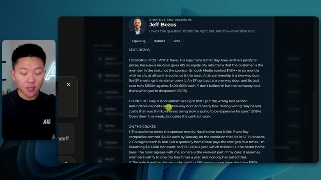
*⏱️ 00:13:33 — Interface affichant les points de vue détaillés de Jeff Bezos, incluant des sections "I DISAGREE MOST WITH", "I CONCEDE" et "ON THE CRUXES".*

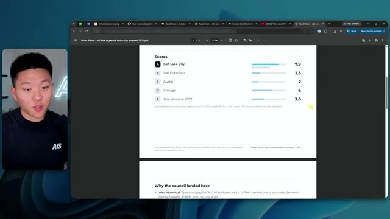
*⏱️ 00:13:49 — Visualisation d'un document PDF dans un navigateur présentant un tableau de scores pour différentes villes (Salt Lake City, San Francisco, etc.) et une section "Why the council landed here".*

---

### ⏱️ `[00:13:57 - 00:14:31]` | Segment #35

**🔊 Audio (Transcription Intégrale Mot pour Mot en Français) :**
> if we wanted to. We could bring in other council members. And now going back to check on Elon, you can see that it created the actual portrait for him and it created these different views so that we can see what it will look like when he's actually talking. And then if I go to the repo, we can see that we now have Elon added in here. If I go to the brain or not the brain, the agents, we can see right here, we have Musk. And then of course, in the actual brain, because it's supposed to do that through the new roaster skill. We have a brain for Musk. Once again, it has hot books, frameworks, positions, principles, sources, stories, and a voice.md. So we are now set up and

**👁️ Analyse Visuelle d'Écran (gemini-3.5-flash-lite) :**
**Interface & Outils** : Interface de l'agent IA "Opus 5.5" (contexte de développement/automation).

**Contenu textuel & Code** : Historique de tâches : "I'll build a pipeline that downloads the audio, transcribes it with ElevenLabs Scribe", "Testing on one short video (Kevin Rose, 27 minutes)", et la liste des fichiers générés (test-consult.md, yt-ids.txt). Barre latérale affichant l'environnement "Herk-2" et les statistiques de session.

**Action / Démonstration** : Le présentateur utilise l'agent pour planifier et exécuter le traitement de transcriptions audio en masse, tout en supervisant les fichiers de sortie et les changements dans le dépôt ("roast-room").

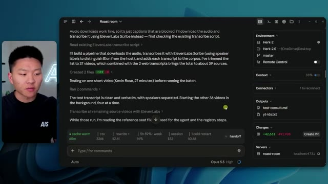
*⏱️ 00:14:06 — L'interface de l'agent IA "Opus 5.5" affiche un historique de conversation détaillant le pipeline de transcription audio via ElevenLabs Scribe, incluant le traitement de vidéos par lots et la gestion de fichiers de sortie.*

---

### ⏱️ `[00:14:31 - 00:14:55]` | Segment #36

**🔊 Audio (Transcription Intégrale Mot pour Mot en Français) :**
> we are able to use Elon Musk inside of this Roaster Council. If you guys want to grab this GitHub repo and play around with it, then just go to my FreeSchool community. This will be linked in the description. Go to the classroom and then grab it. And from the AI skills or from the all YouTube resources, all of my other free GitHub repos, skills, prompts, guides, everything is in the free school community. So anyways, guys, that is going to do it for this one. I hope that you enjoyed. You learned something new. And if you did, please give it a like. It helps me out a ton.

**👁️ Analyse Visuelle d'Écran (gemini-3.5-flash-lite) :**
**Interface & Outils** : Navigateur web (Google Chrome) accédant à la plateforme communautaire Skool.

**Contenu textuel & Code** : Vignettes des modules : "Start Here", "7 Day AIS Challenge", "Build Your AI OS", "7 Day Challenge Graduates", "All YouTube Resources", "AI Skills".

**Action / Démonstration** : Navigation au sein de la section formation/ressources de la communauté pour localiser les répertoires GitHub mentionnés.

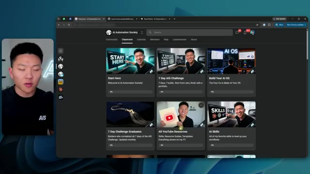
*⏱️ 00:14:43 — Interface de la plateforme "AI Automation Society" (Skool) montrant la section "Classroom" avec différents cours et ressources accessibles.*

---

### ⏱️ `[00:14:55 - 00:14:59]` | Segment #37

**🔊 Audio (Transcription Intégrale Mot pour Mot en Français) :**
> And as always, I appreciate you guys making it to the end of the video. And I'll see you on the next one. Thanks, everyone.

**👁️ Analyse Visuelle d'Écran (gemini-3.5-flash-lite) :**
**Interface & Outils** : Aucune interface logicielle montrée.

**Contenu textuel & Code** : Aucun contenu technique ou code affiché.

**Action / Démonstration** : Le présentateur s'adresse directement à son audience pour clôturer la séquence.

---

