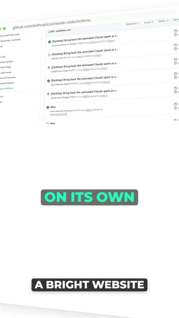
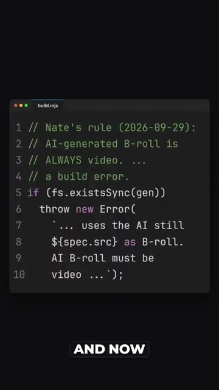
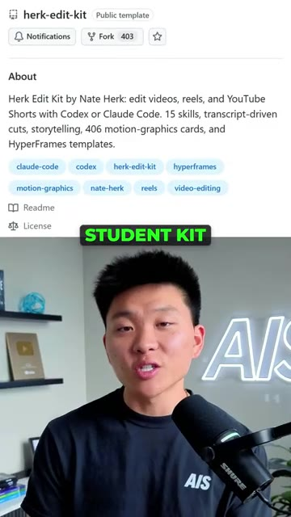

# 🎬 Claude has completely changed how I edit videos

> **Chaîne** : [Nate Herk | AI Automation](https://www.youtube.com/@nateherk/featured)  
> **Lien YouTube** : [https://www.youtube.com/watch?v=GnFFcLnmWuQ](https://www.youtube.com/watch?v=GnFFcLnmWuQ)  
> **Date de publication** : 20261022  
> **Durée** : 00:00:50  
> **Identifiant vidéo** : `GnFFcLnmWuQ`  
> **Transcription & Analyse** : `whisper-v3-large-turbo+gemini-3.5-flash-lite`  

---

## 📌 Synthèse Exécutive & Outils

### 💡 Résumé
Dans cette vidéo de la chaîne Nate Herk | AI Automation, l'analyste démontre une transformation radicale de son flux de production audiovisuelle grâce à l'intégration d'agents IA, propulsés notamment par Claude Code et le modèle Opus 5.5 d'Anthropic. Au lieu d'effectuer un montage manuel ou de s'en remettre à des templates figés, il a entraîné l'agent à comprendre le contexte de ses instructions textuelles (feedback itératif en langage naturel) pour automatiser l'intégralité de la post-production, allant de la coupe brute au sound design en passant par le motion design et l'étalonnage.

La démonstration met en lumière la capacité de l'IA à s'auto-corriger et à évoluer dynamiquement face aux défauts techniques. Qu'il s'agisse de mesurer la luminance des pixels en arrière-plan pour garantir la lisibilité des sous-titres, de bannir les images fixes au profit de clips vidéo IA ou d'extraits réels, ou encore d'ajuster la synchronisation labiale image par image, l'agent apprend en continu. Chaque critique émise par le créateur est immédiatement mémorisée sous forme de « compétence » (skill), garantissant qu'aucune erreur ne se reproduise et transformant l'outil en un assistant de montage senior ultra-spécialisé.

Le résultat ultime de cette ingénierie d'automatisation est saisissant : l'intégralité de la vidéo présentée a été conçue, rythmée et finalisée par l'agent sans intervention manuelle superflue. Cette approche démontre le passage d'une simple assistance générative à une véritable autonomie agentique dans les métiers créatifs, packagée ici dans un kit de montage stratégique offert à la communauté pour démocratiser ces pratiques de pointe.

### 🛠️ Outils, Modèles & Logiciels Présentés
* **Claude** : L'assistant conversationnel et moteur conversationnel central utilisé pour interpréter les retours du créateur et piloter le processus de montage.
* **Claude Code** : L'interface de développement et d'exécution avancée permettant d'interagir directement avec l'environnement technique et d'encoder les règles de montage.
* **Opus 5.5** : Le modèle de pointe d'Anthropic mobilisé pour sa puissance de raisonnement, sa gestion du code et sa compréhension fine des consignes multimodales complexes.
* **Kit d'étudiant en montage** : Le package de ressources et de règles logicielles, alimenté par les compétences apprises par l'IA, mis à disposition de l'audience.

### 🔑 Points Clés & Enseignements Stratégiques
* **L'apprentissage par rétroaction itérative** : Transformer un agent IA en monteur professionnel ne repose pas sur un prompt initial parfait, mais sur une boucle d'amélioration continue basée sur les critiques textuelles du créateur.
* **L'automatisation sensible au contexte visuel** : L'agent a été programmé pour analyser l'arrière-plan des vidéos (luminance des pixels) afin d'adapter dynamiquement l'habillage des sous-titres (ajout d'une boîte sombre systématique pour la lisibilité).
* **L'éradication de la statique visuelle** : Pour maximiser la rétention de l'audience, l'IA a intégré la règle stricte selon laquelle chaque plan d'illustration doit être dynamique, remplaçant les images fixes par des vidéos IA ou des extraits réels.
* **La calibration qualitative du Sound Design** : Substitution des effets sonores génériques de mauvaise qualité (« lasers, zaps ») par des micro-interactions audio subtiles (tapotements, clics, bruits de papier) pour un rendu professionnel.
* **Le contrôle qualité automatisé (QA)** : Intégration d'une vérification systématique de la synchronisation labiale image par image par l'IA avant toute validation humaine, résolvant les décalages audio-vidéo inhérents aux coupes.
* **La persistance des compétences (Skills)** : Chaque remarque formulée par l'analyste est enregistrée de manière permanente dans l'architecture de l'agent, garantissant qu'une consigne n'a jamais besoin d'être répétée deux fois.
* **L'industrialisation de la chaîne de valeur vidéo** : Délégation complète de la complexité technique (coupes, motion design, habillage sonore) à l'agent IA, permettant au créateur de se concentrer exclusivement sur la stratégie de contenu et la ligne éditoriale.
* **L'ingénierie prompt-to-workflow** : Démontre la supériorité des agents spécialisés sur les logiciels de montage traditionnels pour automatiser des tâches répétitives grâce à la programmation en langage naturel.
* **Le levier de productivité exponentielle** : L'utilisation de Claude Code et d'Opus 5.5 réduit drastiquement le time-to-market des productions vidéo tout en maintenant un standard de qualité cinématographique et dynamique.
* **La démocratisation des pratiques expertes** : Le packaging des règles apprises dans un kit accessible au public permet d'industrialiser l'accès à des méthodes de montage hautement sophistiquées pour l'ensemble des créateurs de contenu.

---

## ⏱️ Chronologie & Transcription Complète Audio & Visuelle (Mot pour Mot)

### ⏱️ `[00:00:00 - 00:00:21]` | Segment #01

**🔊 Audio (Transcription Intégrale Mot pour Mot en Français) :**
> J'ai donc appris à Claude à monter mes vidéos simplement en lui disant ce que je n'aimais pas. Son premier montage a mis des sous-titres blancs sur un site web lumineux, et je ne pouvais même pas les lire. Alors maintenant, il mesure les pixels derrière chaque sous-titre et place chacun d'eux sur la même boîte sombre. Ensuite, il a utilisé des images IA comme illustrations, et je lui ai dit que chaque plan doit bouger, il doit être dynamique. Et maintenant, une image fixe casse la construction. Donc à la place, il crée des vidéos IA ou il extrait de vraies images.

**👁️ Analyse Visuelle d'Écran (gemini-3.5-flash-lite) :**
**Interface & Outils** : Navigateur web (GitHub) et éditeur de code source (fenêtre de terminal/éditeur sombre).

**Contenu textuel & Code** : URL github.com/anthropic/claude-code/actions et code JavaScript définissant une règle de build (`Nate's rule` vérifiant si les B-roll sont bien des vidéos).

**Action / Démonstration** : Navigation sur GitHub et visualisation du code source de configuration du projet.

*⏱️ 00:00:05 — Capture montrant l'interface GitHub sur le dépôt anthropic/claude-code avec des flux de travail (workflows) en arrière-plan.*

*⏱️ 00:00:15 — Capture montrant un éditeur de code affichant un fichier JavaScript 'build.mjs' avec une règle personnalisée concernant les B-roll vidéo.*

---

### ⏱️ `[00:00:21 - 00:00:39]` | Segment #02

**🔊 Audio (Transcription Intégrale Mot pour Mot en Français) :**
> À l'origine, ça me donnait des effets sonores ennuyeux comme des lasers bizarres ou des zaps, et ça faisait vraiment bon marché. Donc maintenant, ça s'est mis à des petits bruits de tapotements doux, de clics et de bruits de papier comme celui-ci juste ici. Et à la fin d'une vidéo, mes lèvres étaient légèrement en décalage par rapport à ma voix. Maintenant, ça vérifie chaque image coupée par rapport aux images brutes avant même que je ne la regarde. Chaque remarque que je lui fais est enregistrée dans une compétence, pour que je n'aie jamais à dire les choses deux fois.

**👁️ Analyse Visuelle d'Écran (gemini-3.5-flash-lite) :**
**Interface & Outils** : Logiciel de montage vidéo et audio non spécifié.

**Contenu textuel & Code** : Formes d'onde audio, indicateurs de volume (ex: "KEYSTROKE -25 dB") et sous-titres incrustés.

**Action / Démonstration** : Le présentateur explique et illustre ses choix d'effets sonores et de montage vidéo.

---

### ⏱️ `[00:00:39 - 00:00:50]` | Segment #03

**🔊 Audio (Transcription Intégrale Mot pour Mot en Français) :**
> Et c'est exactement comme ça que toute cette vidéo a été montée. Des coupes aux images d'illustration, en passant par les motion design et le son, j'ai intégré toutes ces règles dans un kit d'étudiant en montage gratuit, et il vous suffit de commenter « montage » et je vous l'envoie tout de suite.

**👁️ Analyse Visuelle d'Écran (gemini-3.5-flash-lite) :**
**Interface & Outils** : Interface GitHub

**Contenu textuel & Code** : Description du dépôt « herk-edit-kit » avec des tags comme claude-code, codex, motion-graphics et video-editing.

**Action / Démonstration** : Présentation du kit de montage étudiant gratuit disponible sur GitHub.

*⏱️ 00:00:47 — Capture d'écran d'une page de dépôt GitHub montrant le projet « herk-edit-kit » avec sa description et ses tags.*

---

