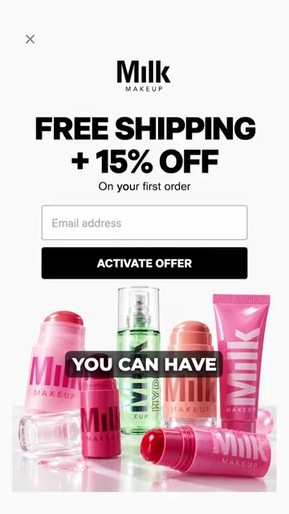
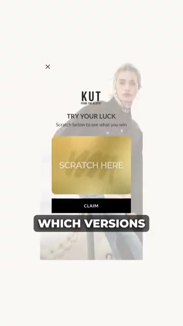
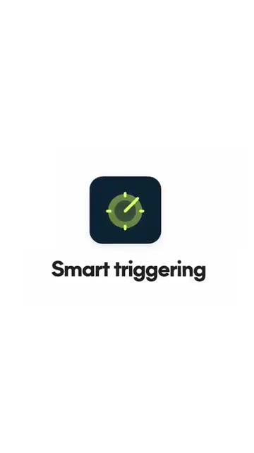
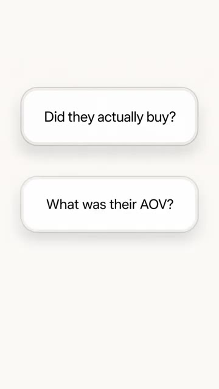

# 🎬 This AI Gives Every Shopper a Different Popup

> **Chaîne** : [Nate Herk | AI Automation](https://www.youtube.com/@nateherk/featured)  
> **Lien YouTube** : [https://www.youtube.com/watch?v=biQmfyYZAHw](https://www.youtube.com/watch?v=biQmfyYZAHw)  
> **Date de publication** : 20261022  
> **Durée** : 00:01:06  
> **Identifiant vidéo** : `biQmfyYZAHw`  
> **Transcription & Analyse** : `whisper-v3-large-turbo+gemini-3.5-flash-lite`  

---

## 📌 Synthèse Exécutive & Outils

### 💡 Résumé
Bienvenue sur la chaîne **Nate Herk | AI Automation**. Dans cette vidéo, nous explorons **Alia**, une solution d'intelligence artificielle révolutionnaire conçue pour transformer l'expérience utilisateur des sites e-commerce en temps réel. Plutôt que de diffuser un pop-up d'acquisition figé et générique, Alia analyse en continu le profil de chaque visiteur — en se basant sur sa page d'atterrissage, ses paramètres UTM ou son origine géographique — pour générer dynamiquement la variante la plus pertinente. L'IA orchestre un processus d'optimisation autonome à grande échelle, combinant des tests A/B massifs et multi-contextuels pour acheminer progressivement le trafic vers les variantes les plus performantes, maximisant ainsi les taux de conversion et l'engagement global.

Au-delà de la simple personnalisation visuelle, l'outil intègre des fonctionnalités avancées telles que les *Smart Offers* et le *Smart Triggering*. La première analyse l'intention d'achat comportementale afin d'ajuster dynamiquement les incitations (comme les codes promotionnels) : elle évite d'éroder les marges sur des acheteurs déjà convertis tout en stimulant l'engagement des primo-visiteurs. La seconde optimise le timing d'affichage des pop-ups pour capturer jusqu'à 40 % d'abonnés supplémentaires. Surtout, l'architecture d'Alia ne se limite pas à la simple capture d'e-mails : elle boucle la boucle en analysant les données post-acquisition (panier moyen, valeur vie client – LTV, et revenus réels générés par lead), offrant aux marques e-commerce un avantage compétitif critique, notamment à l'approche de pics de trafic massifs comme le Black Friday.

### 🛠️ Outils, Modèles & Logiciels Présentés
* **Alia** : Solution d'IA conversationnelle et d'optimisation e-commerce qui automatise la personnalisation des pop-ups et le ciblage comportemental en temps réel.
* **Prism AI** : Moteur technologique sous-jacent permettant de segmenter et d'adapter dynamiquement les variantes de pop-ups en fonction du contexte de trafic (UTM, page d'atterrissage, source).
* **Smart Offers** : Module intelligent évaluant l'intention d'achat pour délivrer des incitations tarifaires sur-mesure sans sacrifier inutilement les marges bénéficiaires.
* **Smart Triggering** : Fonctionnalité algorithmique de cadencement et de déclenchement temporel des fenêtres pop-up visant à maximiser le taux de capture d'abonnés.

### 🔑 Points Clés & Enseignements Stratégiques
* **Dépassement du A/B testing statique** : Remplacement des tests traditionnels à variante unique par un système d'apprentissage continu et multicontextuel piloté par l'IA.
* **Hyper-personnalisation contextuelle** : Adaptation dynamique des interfaces selon l'origine du trafic, les paramètres UTM et le parcours de navigation initial de l'utilisateur.
* **Optimisation orientée LTV et revenus** : Mesure de la performance d'acquisition non seulement au taux de clic ou d'inscription, mais en fonction de la valeur à long terme (LTV) et du panier moyen des clients générés.
* **Protection des marges par l'intention** : Utilisation des *Smart Offers* pour moduler les réductions, évitant ainsi de brader des ventes qui se seraient conclues spontanément sans incitation financière.
* **Maîtrise du timing d'interaction** : Exploitation du *Smart Triggering* pour identifier la fenêtre temporelle optimale d'affichage des pop-ups, augmentant la capture d'abonnés jusqu'à 40 %.
* **Bouclage de la boucle de données (Feedback Loop)** : Connexion directe entre les données d'interaction front-end et les métriques financières back-end pour un apprentissage algorithmique global.
* **Anticipation des pics de trafic saisonniers** : Nécessité critique pour les marques e-commerce d'implémenter et de stabiliser ces boucles d'optimisation autonome avant les fortes affluences du Black Friday.
* **Réduction de la friction utilisateur** : Amélioration de l'expérience de navigation par la pertinence des messages, minimisant l'intrusivité publicitaire ou promotionnelle.
* **Scalabilité de l'automatisation marketing** : Capacité à gérer une infinité de variations de pop-ups de manière automatisée, éliminant la charge de travail humaine liée à la conception manuelle de campagnes segmentées.

---

## ⏱️ Chronologie & Transcription Complète Audio & Visuelle (Mot pour Mot)

### ⏱️ `[00:00:00 - 00:00:22]` | Segment #01

**🔊 Audio (Transcription Intégrale Mot pour Mot en Français) :**
> Cette IA fait réagir votre site web différemment pour chaque personne qui le visite. Elle s'appelle Alia, et au lieu de montrer exactement le même pop-up à chaque acheteur, elle détermine en continu quelle version fonctionne le mieux pour différents types de trafic. Ainsi, avec Prism AI, vous pouvez avoir différentes variantes de pop-up selon des éléments tels que la page sur laquelle la personne a atterri, son UTM ou d'où elle vient. Ensuite, Alia observe quelles versions génèrent le plus d'inscriptions et de revenus dans chaque contexte, et elle envoie progressivement plus de trafic uniquement vers les gagnants.

**👁️ Analyse Visuelle d'Écran (gemini-3.5-flash-lite) :**
**Interface & Outils** : Navigateur web / interface e-commerce avec pop-up promotionnel dynamique.

**Contenu textuel & Code** : Offres promotionnelles, champs de saisie d'e-mail, cartes de grattage virtuelles pour e-commerce.
[COMPILATION] Présentation visuelle de différents formats de pop-ups dynamiques et personnalisés générés par l'IA.

**Action / Démonstration** : Explications face caméra et démonstration conceptuelle.

*⏱️ 00:00:06 — Pop-up de site web promotionnel flou avec une légende incrustée « POP UP ».*

*⏱️ 00:00:11 — Pop-up e-commerce de la marque Milk Makeup proposant la livraison gratuite et 15 % de réduction avec un champ d'adresse e-mail.*

*⏱️ 00:00:17 — Pop-up e-commerce interactif de la marque KUT from the Kloth avec un jeu de grattage « Scratch Here » pour gagner une offre.*

---

### ⏱️ `[00:00:23 - 00:00:44]` | Segment #02

**🔊 Audio (Transcription Intégrale Mot pour Mot en Français) :**
> Donc, c’est fondamentalement un test A/B massif qui continue de s'optimiser tout seul. Ensuite, il y a un truc appelé Smart Offers, qui examine l'intention d'achat. Quelqu'un qui a déjà l'air prêt à acheter n'a pas nécessairement besoin de la même réduction qu'un visiteur qui vient pour la première fois et qui est juste en train de naviguer. Vous pouvez donc améliorer la conversion sans céder inutilement de marge sur des ventes qui auraient eu lieu de toute façon. Et Smart Triggering détermine quand réafficher la fenêtre pop-up, ce qui, selon Alia, peut capturer jusqu'à 40 % d'abonnés en plus.

**👁️ Analyse Visuelle d'Écran (gemini-3.5-flash-lite) :**
**Interface & Outils** : Navigateur web (site e-commerce).

**Contenu textuel & Code** : Catalogue de vêtements en ligne et texte "Smart triggering".

**Action / Démonstration** : Navigation sur un site de e-commerce illustrant le parcours d'achat.

*⏱️ 00:00:33 — Vue en plongée d'une personne naviguant sur un site e-commerce de mode sur un ordinateur portable.*

*⏱️ 00:00:39 — Animation ou graphique minimaliste affichant le texte "Smart triggering" avec une icône de cadran/compteur.*

---

### ⏱️ `[00:00:44 - 00:01:06]` | Segment #03

**🔊 Audio (Transcription Intégrale Mot pour Mot en Français) :**
> Mais la partie la plus intelligente, c'est que ça n'optimise pas seulement en fonction de qui entre son adresse e-mail. Ça peut regarder ce qui se passe après. Est-ce qu'ils ont acheté ? Quel était leur panier moyen ? Leur valeur vie client ? Combien de revenus ces abonnés ont-ils réellement générés ? Et avec le trafic du Black Friday qui s'apprête à exploser, c'est exactement le genre de chose que les marques e-commerce devraient optimiser avant que tout ce trafic n'arrive réellement. Donc si vous voulez découvrir Alia, réservez une démonstration via mon lien ou mentionnez Nate Herc lors de votre réservation et vous obtiendrez un essai gratuit de 30 jours.

**👁️ Analyse Visuelle d'Écran (gemini-3.5-flash-lite) :**
**Interface & Outils** : Interface graphique textuelle (UI animée).
[DESC_IMAGE_1_TEXTE] Did they actually buy? / What was their AOV?

**Contenu textuel & Code** : Questions sur l'historique d'achat et le panier moyen (AOV) des utilisateurs.

**Action / Démonstration** : Affichage séquentiel de questions analytiques illustrant les métriques e-commerce suivies par l'outil.

*⏱️ 00:00:50 — Deux blocs de texte flottants posant des questions analytiques : "Did they actually buy?" et "What was their AOV?".*

---

